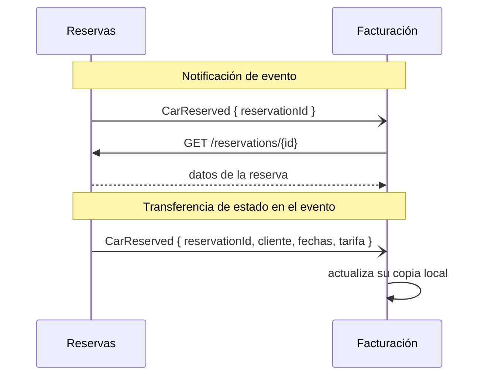
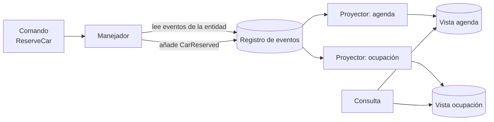

# Event-driven, CQRS y Event Sourcing

El equipo de pedidos tiene un problema doble. La pantalla de operaciones, que cruza pedidos, envíos y devoluciones, tarda varios segundos porque consulta el mismo modelo normalizado que usan las escrituras. Y cuando soporte pregunta quién cambió la dirección de entrega de un pedido y en qué momento, nadie lo sabe: la tabla solo guarda el último valor. Alguien propone «hacerlo event-driven», otro dice «CQRS» y un tercero «Event Sourcing», como si fueran lo mismo. No lo son: **un sistema dirigido por eventos comunica que algo ya ocurrió; CQRS separa el modelo con el que se escribe del modelo con el que se lee; y Event Sourcing guarda el estado como la secuencia de eventos que lo produjo**. Se combinan bien, pero cada uno resuelve un problema distinto y cobra un precio distinto.

Este artículo separa los conceptos, explica cuándo compensa cada patrón y qué cuesta, y termina con un ejemplo de decisión. El código solo muestra nombres y formas, no implementaciones.

<Callout tone="info" title="Alcance y fecha de corte">
  Fuentes consultadas en octubre de 2026. Aquí no se tratan las sagas ni la compensación entre
  servicios (están en [sagas, outbox e idempotencia](/docs/sagas-outbox-idempotencia)), ni los
  brókers, colas y streaming en profundidad (en [caching, colas y
  streaming](/docs/caching-colas-streaming)), ni los modelos de consistencia (en [CAP, PACELC y
  consistencia](/docs/cap-pacelc)).
</Callout>

## Mensaje, comando y evento

Un **mensaje** es solo el sobre: datos que viajan de un emisor a un receptor. Lo que importa es la intención que lleva dentro. El catálogo _Enterprise Integration Patterns_ de Gregor Hohpe y Bobby Woolf (2003) distingue tres intenciones: el mensaje de comando pide al receptor que ejecute una operación, el mensaje de documento transfiere datos sin decir qué hacer con ellos y el mensaje de evento notifica que algo cambió en el emisor sin decirle al receptor cómo reaccionar.

| —                          | Comando                                    | Evento                                      | Consulta                          |
| -------------------------- | ------------------------------------------ | ------------------------------------------- | --------------------------------- |
| Tiempo verbal              | Imperativo: «reserva este coche»           | Pasado: «coche reservado»                   | Pregunta: «¿qué reservas hay?»    |
| Destinatarios              | Uno, que sabe hacerlo                      | Cero, uno o muchos; el emisor no los conoce | Uno                               |
| ¿Se puede rechazar?        | Sí: validación, reglas, permisos           | No: ya ocurrió; como mucho se ignora        | No cambia nada, solo responde     |
| Quién decide qué pasa      | El emisor espera un resultado concreto     | Cada receptor decide su reacción            | El emisor decide qué hacer con él |
| Acoplamiento que introduce | El emisor conoce la capacidad del receptor | El receptor conoce el formato del emisor    | El emisor conoce el modelo leído  |
| Ejemplo de nombre          | `ReserveCar`, `ChangeDeliveryAddress`      | `CarReserved`, `DeliveryAddressChanged`     | `GetReservationsByBranch`         |

Greg Young insiste en el tiempo verbal en sus _CQRS Documents_ (2010): los comandos van en imperativo y los eventos, en pasado. La razón es semántica, no estética. Es natural que el dominio rechace «reservar un coche»; no tiene sentido que le diga a nadie que algo que ya ocurrió no ocurrió. Si un nombre de evento suena a orden (`SendInvoice`), probablemente es un comando disfrazado. El concepto de evento de dominio y cómo nombrarlo con el lenguaje ubicuo están en [Domain-Driven Design](/docs/domain-driven-design).

```text
commands/   ReserveCar, CancelReservation, ChangeDeliveryAddress
events/     CarReserved, ReservationCancelled, DeliveryAddressChanged
queries/    GetReservation, GetReservationsByBranch, GetFleetOccupancy
```

## Cuatro patrones bajo la misma palabra

Martin Fowler publicó el 7 de febrero de 2017 _What do you mean by "Event-Driven"?_, donde distingue cuatro patrones que suelen mezclarse: notificación de evento, transferencia de estado en el evento, Event Sourcing y CQRS. Su tesis es que la confusión entre ellos hace difícil diagnosticar los problemas. Los dos primeros tratan de **cómo se comunican** los sistemas; los dos últimos, de **cómo se guarda y se lee** el estado dentro de uno.

### Notificación de evento

El emisor avisa de que algo cambió y no espera respuesta. El evento puede ser mínimo: un identificador y un enlace para que el receptor consulte los detalles si le interesan. Fowler destaca su bajo acoplamiento y lo fácil que es montarlo, y también su coste: el flujo lógico completo no está escrito en ningún sitio, así que entenderlo, depurarlo o cambiarlo exige mirar el sistema en funcionamiento.

### Transferencia de estado en el evento

El evento lleva los datos que cambiaron, de modo que el receptor mantiene su propia copia y no necesita llamar al emisor. Según Fowler, gana resiliencia (el receptor sigue funcionando si el emisor cae), menos latencia y menos carga sobre el origen. Paga con datos duplicados en muchas copias y con más lógica en el receptor, que ahora gestiona un estado propio.



| —                       | Notificación de evento                         | Transferencia de estado en el evento                 |
| ----------------------- | ---------------------------------------------- | ---------------------------------------------------- |
| Qué viaja               | Un identificador y, a veces, un enlace         | Los datos relevantes del cambio                      |
| Si el emisor cae        | El receptor no puede completar su trabajo      | El receptor sigue con su copia                       |
| Carga sobre el emisor   | Una consulta por cada evento procesado         | Ninguna adicional                                    |
| Contrato que se congela | El nombre del evento y la API de consulta      | El esquema completo de la carga                      |
| Riesgo principal        | Flujo invisible, llamadas de vuelta en cascada | Copias desactualizadas y datos personales esparcidos |

Fowler señala una trampa en la notificación: el evento usado como «comando pasivo-agresivo», cuando el emisor en realidad espera que el receptor haga algo concreto. Si el emisor necesita que algo ocurra, eso es un comando y debería llamarse así.

## CQRS: un modelo para escribir y otro para leer

CQRS (_Command Query Responsibility Segregation_) parte del principio de separación entre comandos y consultas de Bertrand Meyer, formulado en su libro _Object-Oriented Software Construction_: un método o cambia el estado o devuelve un valor, pero no ambas cosas. Young cuenta en sus _CQRS Documents_ que durante un tiempo se habló de CQRS como de «CQS a mayor escala», hasta que se aceptó como patrón distinto; la diferencia es que el objeto se parte en dos, uno con los comandos y otro con las consultas. Fowler lo describió en su bliki el 14 de julio de 2011 y atribuye a Young la primera descripción que oyó.

El valor aparece cuando escritura y lectura tienen necesidades distintas. Young lo resume así: en el lado de comandos es mucho más fácil procesar transacciones con datos consistentes, mientras que la mayoría de los sistemas pueden ser eventualmente consistentes en el lado de consultas; el lado de escritura prefiere un modelo normalizado y el de lectura, uno desnormalizado que evite cruces.

```typescript
// Lado de escritura: comportamiento, invariantes, un solo agregado por comando
export type ReservationCommands = {
  reserveCar(command: ReserveCar): Promise<void>;
  cancel(command: CancelReservation): Promise<void>;
};

// Lado de lectura: vistas planas, sin reglas de negocio
export type ReservationQueries = {
  byBranch(branchId: string, day: string): Promise<readonly BranchReservationRow[]>;
};
```

### Tres grados de separación

CQRS no implica dos bases de datos. La guía de patrones de Azure distingue entre separar los modelos sobre un mismo almacén y usar almacenes distintos sincronizados por eventos. Conviene verlo como una escalera:

| Grado                            | Qué cambia                                                       | Consistencia de la lectura | Coste                                                |
| -------------------------------- | ---------------------------------------------------------------- | -------------------------- | ---------------------------------------------------- |
| Modelos separados, misma base    | Clases o módulos distintos; las lecturas usan SQL a medida       | Inmediata                  | Bajo: es organización de código                      |
| Vistas materializadas en la base | La base mantiene tablas o vistas desnormalizadas para leer       | Inmediata o casi           | Medio: más esquema que mantener                      |
| Almacenes distintos              | La escritura publica cambios y un proyector actualiza la lectura | Eventual                   | Alto: sincronización, reintentos, desfase, operación |

Sube un peldaño solo cuando el anterior no basta. El tercero exige además publicar los cambios de forma fiable; el patrón _outbox_ y los consumidores idempotentes que lo hacen posible están en [sagas, outbox e idempotencia](/docs/sagas-outbox-idempotencia).

### La advertencia de Fowler

En el mismo artículo de 2011 Fowler pide mucha cautela: considera que los dominios donde CQRS encaja son la minoría, que en la mayoría de los sistemas añade una complejidad arriesgada y que debe aplicarse a partes concretas del sistema, a un contexto delimitado, no al sistema entero. La guía de Azure coincide: no lo recomienda cuando el dominio o las reglas son simples y basta una interfaz y un acceso a datos de tipo CRUD.

## Event Sourcing: el estado como historia

Con Event Sourcing no guardas el estado actual y lo sobrescribes: guardas cada cambio como un evento en un registro de solo inserción, y el estado actual se obtiene aplicando esos eventos en orden. Fowler lo describió en 2005 y enumeró lo que permite: reconstruir el estado desde cero, consultar cómo estaba en una fecha pasada y reprocesar eventos para corregir un error. La guía de Azure lo llama _rehidratación_ cuando ocurre al atender un comando.

Young lo explica con un apartado titulado «There is no Delete»: no se puede borrar un evento, igual que no se puede volver atrás en el tiempo. Una anulación es un evento nuevo (`ReservationCancelled`), y deshacer un error también. La historia queda completa, y eso es a la vez su mayor virtud y su mayor carga.

### Proyecciones

El registro responde bien a una sola pregunta: dame los eventos de esta entidad. Young lo reconoce explícitamente: con Event Sourcing no puedes pedir «todos los usuarios que se llaman Greg» porque no existe una representación del estado actual. Por eso casi siempre aparece CQRS al lado. Cada **proyección** es un consumidor que lee el registro y mantiene una vista pensada para una consulta: la agenda por sucursal, la ocupación de la flota, el informe mensual.



Una consecuencia útil: si mañana necesitas una vista nueva, escribes otro proyector y lo pasas por toda la historia. No hace falta migrar datos ni preguntar «¿guardábamos eso?».

### Snapshots y replay

Reproducir miles de eventos cada vez que se atiende un comando es caro. Un **snapshot** guarda el estado de una entidad en un punto del registro; para rehidratarla se carga el último snapshot y se aplican solo los eventos posteriores. Young los llama _rolling snapshots_ y subraya que son una heurística: conceptualmente, la fuente de verdad sigue siendo el registro y el snapshot se puede regenerar. No todas las entidades los necesitan; empieza sin ellos y mide.

El **replay** tiene una trampa que Fowler describe con detalle: los efectos externos. Si al reprocesar se vuelve a enviar el correo o a cobrar la tarjeta, el sistema miente al mundo. Su propuesta es envolver los sistemas externos en pasarelas que se desactivan durante el replay, y registrar las respuestas de las consultas externas (un tipo de cambio, por ejemplo) para usar el valor original, no el actual.

### Versionado de eventos

Un evento guardado es un contrato con el futuro: el código de dentro de tres años tendrá que entenderlo. Young dedicó un libro al tema, _Versioning in an Event Sourced System_ (Leanpub); lo que sigue sale de la crónica de InfoQ de su charla en DDD eXchange 2017 y de la guía de Azure.

| Estrategia                        | Cómo funciona                                                                       | Cuándo usarla                                         |
| --------------------------------- | ----------------------------------------------------------------------------------- | ----------------------------------------------------- |
| Esquema tolerante (_weak schema_) | Se mapea por nombre; lo que falta toma un valor por defecto, lo que sobra se ignora | Cambios aditivos; es la opción que prefiere Young     |
| Versión explícita                 | El tipo o los metadatos llevan la versión y el consumidor elige cómo leerla         | Cuando conviven productores de varias versiones       |
| _Upcasting_                       | Al leer, una función convierte la versión vieja en la actual                        | Para que el código solo conozca la última forma       |
| Copiar y transformar              | Se lee el flujo viejo, se transforma y se escribe uno nuevo en un despliegue        | Cambios que no admiten conversión al vuelo            |
| Reescribir en el sitio            | Se modifican los eventos guardados                                                  | Último recurso: rompe la inmutabilidad y la auditoría |

Según la crónica de InfoQ, Young pone dos reglas al esquema tolerante: no renombrar propiedades y no cambiar su significado. Y si una versión nueva no se puede obtener a partir de la anterior, no es una versión: es otro evento.

### La tensión con el borrado de datos personales

Un registro inmutable choca con la obligación de borrar datos personales, como el derecho de supresión del RGPD. La guía de Azure pide diseñar para esa tensión desde el principio, y hay dos patrones habituales, ambos descritos por Mathias Verraes en mayo de 2019:

- **Carga olvidable** (_forgettable payload_): los datos personales viven en un almacén aparte y el evento solo guarda una referencia. Al pedir el borrado, se elimina la carga y los eventos quedan intactos. Coste: el registro deja de ser la única fuente de verdad y los consumidores que copiaron datos también tienen que borrarlos.
- **Destrucción criptográfica** (_crypto-shredding_): los campos personales se cifran con una clave por persona, guardada fuera del registro; borrar la clave vuelve ilegibles todas las copias, incluidas las de respaldo; si esa garantía basta como borrado legal es discutido (ver la nota).

<Callout tone="warning" title="No es asesoría legal">
  Harrison J. Brown añadió a la entrada de Verraes una actualización con una objeción: para él, los
  datos personales cifrados siguen siendo datos personales aunque nadie tenga la clave, y borrar la
  clave no equivale a borrar. Por eso recomienda la carga olvidable también para esos datos. Verraes
  no suscribe esa recomendación. No encontré una fuente primaria que zanje la cuestión: decídelo con
  tu equipo legal.
</Callout>

## Consistencia eventual del modelo de lectura

En cuanto la lectura sale de otro almacén, hay un desfase entre que el comando se acepta y que la vista lo refleja. La guía de Azure lo dice sin rodeos: los datos leídos pueden estar obsoletos y hay que diseñar para el caso en que el usuario actúa sobre ellos. Qué significa «eventual» en términos formales está en [CAP, PACELC y consistencia](/docs/cap-pacelc); aquí importa cómo se gestiona y cómo se explica.

Técnicas habituales, de menor a mayor coste:

- **Devolver lo que el comando ya sabe.** La respuesta del comando incluye el identificador y el estado resultante, y la interfaz lo muestra sin esperar a la vista.
- **Estados honestos.** «Reserva recibida, confirmándose» es verdad; «confirmada» antes de tiempo no lo es.
- **Leer del lado de escritura para lo propio.** Justo después de un cambio, el detalle de esa entidad se rehidrata del registro; los listados siguen saliendo de la vista.
- **Esperar a una posición.** El comando devuelve la posición del evento en el registro y la consulta espera a que la proyección la alcance, con un límite de tiempo.
- **Medir el desfase.** Publica la distancia entre la cabeza del registro y cada proyección, y alerta sobre un percentil (p99), no sobre la media.

Al negocio no le hables de consistencia eventual: háblale de antigüedad aceptable. Las preguntas útiles son concretas:

| Pregunta al negocio                                               | Decisión técnica que desbloquea                       |
| ----------------------------------------------------------------- | ----------------------------------------------------- |
| ¿Cuánto puede tardar una reserva en aparecer en la agenda?        | Objetivo de desfase de la proyección y su alerta      |
| ¿Qué pasa si dos personas reservan el mismo coche a la vez?       | La regla vive en el lado de escritura, no en la vista |
| ¿Hay decisiones que no pueden tomarse con datos de hace segundos? | Esas consultas leen del modelo de escritura           |
| ¿Qué debe ver el cliente mientras se procesa?                     | Estados intermedios en la interfaz                    |

La analogía del extracto bancario suele funcionar: nadie espera que un pago con tarjeta aparezca en el extracto en el mismo milisegundo, pero sí que el saldo disponible no permita gastar dos veces el mismo dinero.

## Comparativa

| —                     | Notificación        | Transferencia de estado | CQRS                              | Event Sourcing                     |
| --------------------- | ------------------- | ----------------------- | --------------------------------- | ---------------------------------- |
| Problema que resuelve | Desacoplar sistemas | Autonomía del receptor  | Lecturas y escrituras divergentes | Historia, auditoría, vistas nuevas |
| Ámbito                | Entre sistemas      | Entre sistemas          | Dentro de un contexto             | Dentro de un contexto              |
| ¿Requiere asincronía? | Normalmente sí      | Normalmente sí          | No                                | No                                 |
| Coste principal       | Flujo invisible     | Copias y esquemas       | Dos modelos y su sincronización   | Versionado, proyecciones, borrado  |
| Reversibilidad        | Alta                | Media                   | Media                             | Baja: migrar a o desde él es caro  |

Fowler insiste en que ni CQRS ni Event Sourcing exigen comunicación asíncrona; es una fuente habitual de complejidad, no una parte obligatoria.

## Cuándo sí y cuándo no

| Situación                                                                   | Decisión razonable                                                   |
| --------------------------------------------------------------------------- | -------------------------------------------------------------------- |
| Varios sistemas deben reaccionar a un cambio y el emisor no debe conocerlos | Eventos de notificación o con estado                                 |
| Un receptor necesita los datos aunque el emisor esté caído                  | Transferencia de estado en el evento                                 |
| Las pantallas cruzan muchas entidades y las escrituras tienen reglas ricas  | CQRS en ese contexto, empezando por el grado más bajo                |
| La auditoría o la reconstrucción de estados pasados es un requisito real    | Event Sourcing en ese contexto                                       |
| CRUD de formularios, catálogos o configuración                              | Ninguno: un modelo único es más barato y suficiente                  |
| Prototipo o producto mínimo de vida corta                                   | Ninguno; deja la puerta abierta publicando eventos de dominio        |
| El equipo no ha operado nunca un sistema dirigido por eventos               | Empieza por notificación en un caso acotado antes que Event Sourcing |

Para registrar la decisión y sus alternativas, usa un [ADR](/docs/adr); para ponderar el coste frente al beneficio, [trade-offs y decisiones](/docs/trade-offs-y-decisiones).

## Errores frecuentes

- **CQRS en todas partes.** Aplicarlo a todo el sistema, incluidos los módulos CRUD, multiplica el código y el desfase sin beneficio. Fowler pide limitarlo a contextos concretos.
- **Eventos como RPC disfrazado.** Un `SendWelcomeEmail` publicado como evento, con el emisor esperando a que alguien lo haga, es un comando con peor trazabilidad.
- **No versionar eventos.** Cambiar el significado de un campo sin cambiar el tipo rompe proyecciones y replays meses después.
- **Eventos que son filas.** `ReservationUpdated` con el registro entero no dice qué pasó; la guía de Azure recomienda capturar la intención del cambio.
- **Confundir el bróker con el registro.** Azure advierte que un bróker de mensajes no sustituye a un almacén de eventos: suele carecer de consultas por entidad y de concurrencia optimista.
- **Proyecciones no idempotentes.** Con entrega «al menos una vez», un evento duplicado no puede contar dos veces.
- **Efectos externos en el replay.** Reprocesar sin desactivar las pasarelas reenvía correos y cobros.
- **Datos personales dentro del evento.** Después es muy difícil cumplir una petición de borrado.

## Ejemplo trabajado: alquiler de vehículos

Una empresa de alquiler tiene tres módulos: fichas de clientes, catálogo de la flota y reservas. Los requisitos que importan son estos: el regulador exige saber quién modificó cada reserva y cuándo; operaciones quiere una agenda por sucursal y un panel de ocupación que hoy tardan varios segundos; facturación debe poder emitir facturas aunque reservas esté en mantenimiento; y los clientes pueden pedir el borrado de sus datos.

1. **Clientes y catálogo:** CRUD sobre un modelo único. No hay reglas complejas ni requisito de historia.
2. **Reservas:** Event Sourcing. La auditoría es un requisito, no un deseo, y los eventos (`CarReserved`, `ReservationExtended`, `ReservationCancelled`) son el lenguaje del negocio.
3. **Lectura de reservas:** CQRS con dos proyecciones, agenda y ocupación, en un almacén aparte. Objetivo pactado con operaciones: la agenda refleja una reserva en menos de dos segundos en el p99.
4. **Integración con facturación:** transferencia de estado en el evento, con los datos de tarifa y fechas, para que facturación no dependa de que reservas esté disponible.
5. **Datos personales:** fuera de los eventos. El evento guarda el identificador del cliente y los datos viven en la ficha, que sí se puede borrar.
6. **Versionado:** esquema tolerante desde el primer día y una regla de revisión que prohíbe renombrar campos de eventos ya publicados.

La decisión deja fuera de Event Sourcing dos de los tres módulos. Eso no es una concesión: es aplicar cada patrón donde su coste compra algo.

## Checklist

- [ ] Los comandos están en imperativo, los eventos en pasado y ningún evento espera una acción concreta.
- [ ] Sabes si cada evento es una notificación o transfiere estado, y el consumidor lo sabe también.
- [ ] CQRS y Event Sourcing se aplican a contextos concretos, con la decisión registrada en un ADR.
- [ ] El desfase de cada proyección tiene un objetivo pactado con el negocio y se mide.
- [ ] Las proyecciones son idempotentes y se pueden reconstruir desde el registro.
- [ ] Hay una estrategia de versionado de eventos antes del primer despliegue.
- [ ] El replay no dispara efectos externos.
- [ ] Los datos personales no viven dentro de eventos inmutables.

## Fuentes

Consultadas en octubre de 2026. El libro de Young sobre versionado no se pudo abrir (HTTP 403): lo que se cuenta de él sale de la crónica de InfoQ.

- [What do you mean by "Event-Driven"? (Martin Fowler, 7 de febrero de 2017)](https://martinfowler.com/articles/201701-event-driven.html)
- [CQRS (Martin Fowler, 14 de julio de 2011)](https://martinfowler.com/bliki/CQRS.html)
- [Event Sourcing (Martin Fowler, 12 de diciembre de 2005)](https://martinfowler.com/eaaDev/EventSourcing.html)
- [Command Query Separation (Martin Fowler, bliki)](https://martinfowler.com/bliki/CommandQuerySeparation.html)
- [CQRS Documents (Greg Young, 2010)](https://cqrs.wordpress.com/wp-content/uploads/2010/11/cqrs_documents.pdf)
- [Versioning in an Event Sourced System (Greg Young, Leanpub)](https://leanpub.com/esversioning): sin acceso desde esta consulta
- [Crónica de InfoQ de la charla de Greg Young en DDD eXchange 2017 (Jan Stenberg, 17 de julio de 2017)](https://www.infoq.com/news/2017/07/versioning-event-sourcing)
- [Enterprise Integration Patterns: Event Message (Hohpe y Woolf)](https://www.enterpriseintegrationpatterns.com/patterns/messaging/EventMessage.html)
- [CQRS pattern (Azure Architecture Center)](https://learn.microsoft.com/en-us/azure/architecture/patterns/cqrs)
- [Event Sourcing pattern (Azure Architecture Center)](https://learn.microsoft.com/en-us/azure/architecture/patterns/event-sourcing)
- [Eventsourcing Patterns: Forgettable Payloads (Mathias Verraes, 13 de mayo de 2019)](https://verraes.net/2019/05/eventsourcing-patterns-forgettable-payloads/)
- [Eventsourcing Patterns: Crypto-Shredding (Mathias Verraes, 13 de mayo de 2019)](https://verraes.net/2019/05/eventsourcing-patterns-throw-away-the-key/)
