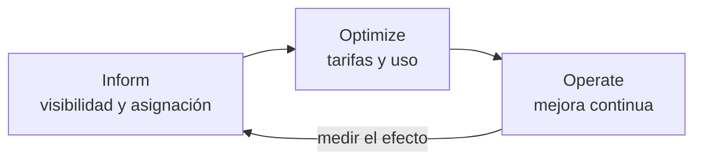
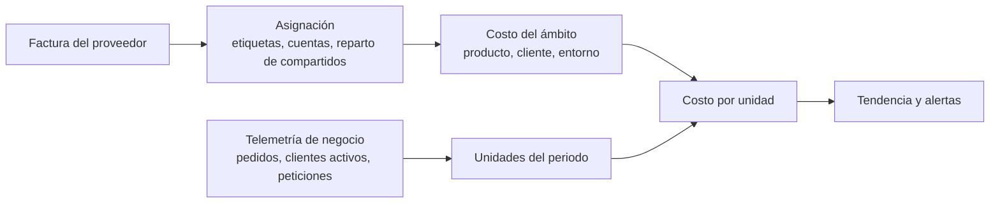
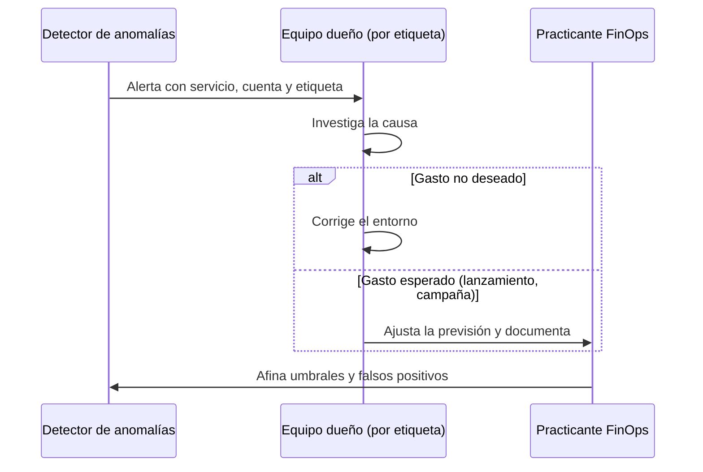

# FinOps: el costo como atributo de arquitectura

Llega la factura del mes y ha subido bastante más que el tráfico. Nadie sabe explicar por qué: la mitad de los recursos no tiene dueño, el clúster compartido aparece como una sola línea y finanzas pregunta si el producto nuevo es rentable. El equipo reacciona como suele hacerlo: apaga entornos de prueba, compra capacidad reservada para lo que hay en marcha y promete revisar los registros. Tres meses después la factura vuelve a subir. El problema no era la falta de ahorro, sino que **el costo no estaba diseñado: nadie lo había declarado como requisito, medido por unidad de negocio ni asignado a quien toma las decisiones que lo generan**.

**FinOps es la práctica que convierte el gasto en tecnología en una decisión compartida entre ingeniería, finanzas y negocio, y para el arquitecto significa tratar el costo como un atributo de calidad más, con requisitos, medidas y trade-offs.** Este artículo explica el marco de la FinOps Foundation, los modelos de precio como conceptos, cómo calcular el costo por unidad, por qué el etiquetado es una decisión de arquitectura, los costos que suelen quedar fuera de los diagramas y cómo gobernar todo ello sin frenar a los equipos.

Quedan fuera tres temas que tienen su propia lección: el modelo de costo de serverless está en [serverless y computación gestionada](/docs/serverless-y-computacion-gestionada), el costo de salida y la dependencia de proveedor en [casado a un proveedor](/docs/casado-a-un-proveedor), y la medición del rendimiento en [números y leyes de rendimiento](/docs/numeros-y-leyes-de-rendimiento).

<Callout tone="info" title="Fecha de corte y cifras">
  Las fuentes se consultaron en octubre de 2026. Los datos de proveedores que aparecen son el plazo
  de uno o tres años de los Savings Plans de AWS, los avisos de interrupción de la capacidad Spot de
  AWS y Azure, el retraso de los datos de facturación de Azure, el precio de AWS por transferencia
  entre zonas y si AWS, Google Cloud y Azure cobran o no ese tráfico. Salen de la documentación
  oficial de cada proveedor, van enlazados donde se citan y pueden cambiar. Todos los demás números
  del artículo son supuestos ilustrativos y están marcados como tales.
</Callout>

## Qué es FinOps y qué no es

La FinOps Foundation define FinOps como un marco operativo y una práctica cultural que maximiza el valor de negocio de la tecnología, permite decisiones oportunas basadas en datos y crea responsabilidad financiera mediante la colaboración entre ingeniería, finanzas y negocio. Es la definición de su Technical Advisory Council, actualizada en marzo de 2026: las versiones anteriores hablaban del valor de la «nube», y la actual habla de «tecnología» porque la práctica se extiende a SaaS, licencias y centros de datos.

El nombre une _Finance_ y _DevOps_. La propia fundación insiste en que no se trata de gastar menos, sino de saber qué inversiones en tecnología devuelven más valor; a veces la respuesta correcta es gastar más. La Linux Foundation anunció en junio de 2020 que acogería a la FinOps Foundation, y el marco se publica con licencia CC BY 4.0.

### El marco en una tabla

| Pieza       | Qué contiene                                                                                                           | Por qué le importa al arquitecto                                                                 |
| ----------- | ---------------------------------------------------------------------------------------------------------------------- | ------------------------------------------------------------------------------------------------ |
| Principios  | Seis, entre ellos «el valor de negocio guía las decisiones de tecnología» y «cada uno se responsabiliza de su uso»     | Piden que el costo se considere desde el diseño, no en una limpieza posterior                    |
| Fases       | _Inform_, _Optimize_, _Operate_, recorridas en ciclo y no en línea recta                                               | El diseño entra en las tres: genera los datos, abre las opciones y las mantiene                  |
| Dominios    | Entender uso y costo, cuantificar el valor, optimizar uso y costo, gestionar la práctica                               | Separan «ver», «valorar» y «mejorar»: sin lo primero lo demás es intuición                       |
| Capacidades | Asignación, detección de anomalías, presupuestos, _unit economics_, optimización de tarifas, arquitectura y ubicación… | Varias dependen de decisiones de diseño: qué metadatos lleva cada recurso, qué telemetría existe |
| Personas    | Practicante FinOps, ingeniería, finanzas, liderazgo, compras, producto                                                 | El arquitecto traduce entre ingeniería y finanzas; nadie más ve las dos mitades                  |

Las tres fases describen un bucle que se recorre a menudo y en pequeño:



Dos ideas del marco cambian la forma de diseñar. La primera distingue la **optimización de uso** (consumir menos recursos para un resultado aceptable, tarea de ingeniería) de la **optimización de tarifas** (pagar un precio adecuado por lo que sí hace falta, tarea de compras y dirección). La segunda pide **centralizar los compromisos y descuentos** para aprovechar la escala, y dejar que los equipos se concentren en su uso. El arquitecto trabaja sobre todo en la primera, pero sus decisiones fijan qué tarifas son posibles.

## El costo como atributo de calidad

Rendimiento, disponibilidad y seguridad se escriben como requisitos medibles; el costo suele llegar como una cifra de presupuesto anual que nadie conecta con el diseño. Tratarlo como [atributo de calidad](/docs/atributos-de-calidad) significa darle el mismo tratamiento: un escenario con estímulo y medida, un lugar en el árbol de utilidad y un trade-off explícito con los demás atributos.

No es una idea aislada de FinOps. La primera de las siete leyes de _The Frugal Architect_, que Werner Vogels presentó en re:Invent 2023, es tratar el costo como requisito no funcional. El AWS Well-Architected Framework dedica uno de sus [seis pilares](https://docs.aws.amazon.com/wellarchitected/latest/framework/the-pillars-of-the-framework.html) a la optimización de costos, y los marcos equivalentes de Azure y Google Cloud también lo incluyen.

Un escenario de costo tiene la misma forma que uno de rendimiento:

| Parte del escenario | Ejemplo (supuesto)                                                                  |
| ------------------- | ----------------------------------------------------------------------------------- |
| Fuente y estímulo   | El volumen de pedidos se duplica en temporada alta                                  |
| Entorno             | Producción, con la arquitectura actual                                              |
| Respuesta           | El sistema escala sin intervención manual                                           |
| Medida              | El costo por pedido no sube más de un 10 % respecto a la media del trimestre previo |

La medida está expresada por unidad de negocio, no en total: que la factura se duplique cuando el negocio se duplica es sano; que el costo por pedido se duplique, no. Ese escenario se puede vigilar de forma automática como una [fitness function](/docs/fitness-functions) que lea el costo asignado y el contador de pedidos.

Como cualquier atributo, el costo compite con los demás. Una réplica en otra zona compra disponibilidad y se paga en almacenamiento y, en algunos proveedores, en transferencia; una caché compra latencia y se paga en memoria. La lección de [trade-offs y decisiones](/docs/trade-offs-y-decisiones) aplica igual: la decisión no es «barato o caro», sino cuánto atributo compras por cada unidad de costo.

## Modelos de precio como conceptos

Los nombres comerciales cambian; los tres modelos de fondo no. La diferencia está en qué riesgo asumes tú y cuál asume el proveedor.

| Modelo                  | Qué compras                                                       | Riesgo que asumes                                         | Conviene cuando                                                           | Nombres en AWS, Azure y Google Cloud                                            |
| ----------------------- | ----------------------------------------------------------------- | --------------------------------------------------------- | ------------------------------------------------------------------------- | ------------------------------------------------------------------------------- |
| Pago por uso            | Capacidad cuando la pides, sin compromiso                         | Ninguno de volumen; pagas la tarifa más alta              | La demanda es incierta, nueva o muy variable                              | On-Demand; pay-as-you-go; precio bajo demanda                                   |
| Compromiso de uso       | Una tarifa menor a cambio de comprometer uso o gasto por un plazo | Pagar el compromiso aunque no lo uses (capacidad vacante) | Hay una base de consumo estable y medida durante un tiempo suficiente     | Reserved Instances y Savings Plans; Azure Reservations; committed use discounts |
| Capacidad interrumpible | Capacidad sobrante a menor precio                                 | Que el proveedor la recupere con poco aviso               | El trabajo tolera interrupciones: lotes, análisis, CI, entornos de prueba | Spot Instances; Azure Spot Virtual Machines; Spot VMs                           |

Algunos datos de proveedor ayudan a fijar el concepto, todos a fecha de consulta (octubre de 2026): los [Savings Plans de AWS](https://docs.aws.amazon.com/savingsplans/latest/userguide/what-is-savings-plans.html) se comprometen por uno o tres años; las [instancias Spot de AWS](https://docs.aws.amazon.com/AWSEC2/latest/UserGuide/spot-instance-termination-notices.html) reciben un aviso de interrupción de dos minutos, y las [máquinas Spot de Azure](https://learn.microsoft.com/en-us/azure/virtual-machines/spot-vms) se desalojan con 30 segundos de aviso y sin SLA. La FinOps Foundation distingue además entre compromisos **por recurso** (una familia de máquinas en una región) y **por gasto** (una cantidad por hora, más flexible).

La regla práctica que se deriva es una mezcla por capas: la **base estable** que llevas tiempo midiendo va a compromiso, el **tramo variable** se queda en pago por uso y el **trabajo tolerante a cortes** va a capacidad interrumpible. El diseño decide cuánto trabajo cae en la última capa: un proceso por lotes que guarda su avance y se puede reanudar es candidato; uno que pierde horas de trabajo si se corta, no.

## Unit economics: el costo por unidad de negocio

El total de la factura dice poco. Un costo que sube un 30 % puede ser una buena noticia si los clientes subieron un 60 %. La capacidad de _unit economics_ del marco relaciona lo que se gasta con el valor que produce: costo por transacción, por cliente, por petición o por caso resuelto, según lo que importe al producto.

El cálculo tiene un numerador que sale de la factura y un denominador que sale de la telemetría:



Un ejemplo con números supuestos. El producto de pedidos tiene asignados estos costos en un mes:

| Partida (supuesta)                   | Costo del mes |
| ------------------------------------ | ------------: |
| Cómputo                              |       4.200 € |
| Base de datos                        |       2.600 € |
| Almacenamiento                       |         700 € |
| Transferencia de datos               |         900 € |
| Observabilidad (registros y trazas)  |       1.100 € |
| Parte asignada de costos compartidos |         500 € |
| **Total**                            |  **10.000 €** |

La telemetría registra 2.000.000 de pedidos y 400 clientes activos en el mismo mes. El costo por pedido es 10.000 / 2.000.000 = 0,005 € (5 € por cada mil pedidos) y el costo por cliente, 10.000 / 400 = 25 €. Lo útil no es el valor de un mes, sino su **tendencia**: si el mes siguiente los pedidos suben y el costo por pedido baja, la arquitectura escala bien; si sube, algo crece más deprisa que el negocio.

Tres trampas habituales en el cálculo:

- **Periodos desalineados.** Los datos de facturación llegan con retraso y la telemetría es casi inmediata. Azure, por ejemplo, indica en su [documentación de Cost Management](https://learn.microsoft.com/en-us/azure/cost-management-billing/costs/understand-cost-mgt-data) que en cuentas EA y MCA esos datos suelen estar disponibles en un plazo de 8 a 24 horas, a fecha de consulta (octubre de 2026). Compara periodos cerrados.
- **Costos compartidos sin repartir.** Si el clúster o la red común no se reparten, el costo por unidad sale bajo y engaña. Decide una regla de reparto (por uso medido, por partes iguales, proporcional) y escríbela.
- **Confundir costo medio con costo marginal.** El costo medio por pedido incluye una parte fija; el costo de un pedido adicional puede ser mucho menor. Para decidir precios o descuentos importa el marginal.

## Etiquetado y asignación de costos

Sin asignación no hay costo por unidad, ni dueño, ni alerta que llegue a quien puede actuar. El marco describe la asignación como el uso de cuentas, etiquetas y metadatos para repartir costos entre quienes los generan, y pide tres estrategias: la de asignación (a qué agrupaciones se asigna todo el gasto), la de etiquetado (qué etiquetas y convenciones identifican cada agrupación) y la de costos compartidos (cómo se reparte lo que usan varios).

Con esos datos se hacen dos tipos de informe. El **showback** muestra a cada equipo lo que cuesta su ámbito, a cualquier nivel de detalle. El **chargeback** lleva ese costo de forma oficial al presupuesto contable de cada área. Según la fundación, la diferencia es la formalidad de imputarlo a la contabilidad, y ninguno de los dos es más maduro que el otro.

### Por qué la falta de etiquetas es un problema de arquitectura

Se suele ver como un descuido de operaciones, pero la causa está en el diseño:

- **La unidad de asignación es una decisión de diseño.** Si el producto es la unidad de _unit economics_, cada recurso debe poder atribuirse a un producto. Una base de datos compartida por tres productos no se puede etiquetar con uno solo; hay que repartirla con telemetría, y esa telemetría tiene que existir.
- **Los recursos compartidos esconden el costo.** Un clúster de contenedores o una base [multi-tenant](/docs/multi-tenancy) aparecen como una línea; el costo por inquilino o por servicio solo se obtiene si la plataforma mide el consumo de cada uno.
- **Una etiqueta que no se exige al crear llega tarde.** Un recurso creado sin etiqueta queda sin asignar hasta que alguien lo corrige, y en AWS las etiquetas de asignación de costos deben activarse antes de aparecer en Cost Explorer y en los informes.

La respuesta es tratar el etiquetado como un contrato que se aplica en la infraestructura como código y se comprueba de forma automática. La forma de la política, no una implementación:

```yaml
# Política de etiquetas obligatorias (forma, valores de ejemplo)
required_tags:
  cost-center: … # centro de costo de finanzas
  product: … # unidad de unit economics
  environment: prod | staging | dev
  owner: … # equipo que responde de la alerta
  data-retention: … # política de retención aplicable
```

Una comprobación en el pipeline que rechace recursos sin estas etiquetas es una fitness function más, y evita que el gasto sin dueño crezca.

## Costos ocultos que el diagrama no muestra

Los diagramas de arquitectura muestran cajas; la factura cobra también las flechas, los datos que se acumulan y las copias.

| Costo                                | Por qué aparece                                                                                                                                                    | Qué decidir en el diseño                                                     |
| ------------------------------------ | ------------------------------------------------------------------------------------------------------------------------------------------------------------------ | ---------------------------------------------------------------------------- |
| Transferencia entre zonas y regiones | Las llamadas entre regiones pueden cobrarse por volumen; entre zonas, en algunos proveedores (por ejemplo AWS o Google Cloud) el tráfico tiene cargo; en otros, no | Mantener juntas las piezas que conversan mucho; medir el tráfico entre zonas |
| Registros y trazas                   | El volumen crece con el tráfico y con el nivel de detalle                                                                                                          | Muestreo de trazas, niveles de registro por entorno, retención por tipo      |
| Almacenamiento sin retención         | Los datos solo crecen si nadie decide cuándo se archivan o se borran                                                                                               | Política de ciclo de vida desde el primer día: caliente, frío, borrado       |
| Réplicas y copias de seguridad       | Cada réplica multiplica almacenamiento y tráfico; las copias se acumulan                                                                                           | Número de réplicas justificado por un requisito; retención de copias escrita |
| Complejidad multinube                | Herramientas duplicadas, tráfico de salida entre proveedores, más especialistas                                                                                    | Justificar cada proveedor adicional con un requisito, no con una preferencia |
| Recursos huérfanos                   | Discos sin máquina, direcciones IP reservadas, instantáneas, entornos olvidados                                                                                    | Etiqueta de dueño y caducidad; limpieza automática de lo que no la tiene     |

La transferencia entre zonas merece un ejemplo concreto, porque cada proveedor la trata de forma distinta. AWS cobra el tráfico de EC2, RDS y otros servicios entre zonas de disponibilidad de la misma región a 0,01 USD por GB en cada sentido, según su [página de precios de EC2](https://aws.amazon.com/ec2/pricing/on-demand/), una cifra del proveedor a fecha de consulta (octubre de 2026). [Google Cloud](https://cloud.google.com/vpc/network-pricing) también tarifica el tráfico entre zonas de una misma región. [Azure](https://learn.microsoft.com/en-us/azure/reliability/availability-zones-overview), en cambio, indica que no cobra la transferencia de datos entre zonas de disponibilidad de la misma región. Desplegar en varias zonas es una decisión de resiliencia correcta (está tratada en [regiones, zonas y recuperación](/docs/regiones-zonas-y-recuperacion)); donde ese tráfico tiene cargo, un servicio que llama a otro de una zona distinta en cada petición paga esa transferencia millones de veces. Comprueba la tarifa del proveedor que uses antes de estimarlo.

Sobre la complejidad de operar con varios proveedores, la lección [multinube: cuándo tiene sentido](/docs/multinube-cuando-tiene-sentido) desarrolla el argumento completo; aquí basta con anotarlo como costo recurrente y no solo como costo de migración.

## Elasticidad frente a costo fijo

La nube vende elasticidad: pagas en proporción a lo que usas. La capacidad fija o comprometida cuesta lo mismo la uses o no, pero su precio por unidad es menor. Cuál conviene depende del volumen, y se puede razonar con dos rectas:

- **Costo variable:** `p · q`, donde `p` es el precio por unidad y `q` el volumen. Empieza en cero.
- **Costo fijo:** `F + v · q`, donde `F` es lo que pagas aunque no haya tráfico y `v` el costo marginal que queda (almacenamiento, red). Empieza en `F` y crece más despacio.

Las rectas se cruzan en `q* = F / (p − v)`. Por debajo de `q*` la opción variable es más barata; por encima, la fija. Es lo que muestra la figura del artículo: la recta fija arranca en `F`, la variable en cero, y el punto de cruce es donde cambia la conveniencia.

Tres matices impiden aplicar la fórmula a ciegas:

- **El volumen no es un número, es una distribución.** Si la demanda tiene picos, la opción fija debe dimensionarse para el pico o combinarse con capacidad variable para el exceso.
- **La capacidad fija no se usa al 100 %.** Como explica [números y leyes de rendimiento](/docs/numeros-y-leyes-de-rendimiento), la latencia se dispara cerca de la saturación; hay que dejar margen, y ese margen sube el costo efectivo por unidad.
- **La elasticidad tiene valor de opción.** Pagar más por unidad compra la posibilidad de no pagar nada si el producto fracasa. Antes de medir, esa opción suele valer más que el ahorro.

## Gobierno: presupuestos, anomalías y costo en el diseño

El gobierno de costos no es un comité que aprueba gastos; son mecanismos que hacen visible el costo a tiempo y lo llevan a quien decide.

### Presupuestos y alertas

Un presupuesto en la consola del proveedor avisa, no detiene. La documentación de Azure lo dice de forma explícita: al superar un umbral se envían notificaciones, pero los recursos no se ven afectados y el consumo no se interrumpe. Detener el gasto exige una acción adicional y una decisión de negocio sobre qué apagar. Los presupuestos útiles se definen por ámbito asignado (producto, equipo, entorno) y avisan con el costo previsto, no solo con el real.

### Detección de anomalías

Una anomalía es un gasto distinto del esperado, casi siempre mayor. Los proveedores ofrecen detección basada en modelos de aprendizaje automático (AWS Cost Anomaly Detection es un ejemplo), y el marco recuerda que la detección solo es útil si los metadatos de asignación permiten saber quién debe investigar. El ciclo de una alerta, según la capacidad de gestión de anomalías:



Un lanzamiento planificado también dispara alertas, porque el detector compara con el pasado. Anunciarlo antes evita trabajo inútil a otros equipos.

### El costo en la revisión de diseño

La decisión con mayor efecto sobre el costo se toma antes de desplegar nada. Por eso las decisiones significativas se registran en un [ADR](/docs/adr) que incluye su costo estimado, la unidad de negocio con la que se medirá y cuándo hay que revisarlo. La forma de esa sección:

```markdown
## Costo estimado

- Unidad de medida: costo por 1.000 documentos procesados
- Estimación inicial: … (supuestos: volumen, mezcla de tarifas, retención)
- Costos fuera del cómputo: transferencia, registros, copias
- Umbral de revisión: el costo por unidad sube más de un …% en dos meses
- Dueño del seguimiento: …
```

La estimación será imprecisa, y no importa: su valor es dejar escritos los supuestos para poder compararlos con la realidad.

## Cuándo sí y cuándo no

| Situación                                                              | Qué hacer                                                                          |
| ---------------------------------------------------------------------- | ---------------------------------------------------------------------------------- |
| El gasto en nube es pequeño frente al costo del equipo                 | Etiquetado básico, presupuestos y alertas; no montes una práctica completa todavía |
| Varios equipos comparten cuentas y nadie sabe qué cuesta cada producto | Empieza por la asignación: sin ella el resto es intuición                          |
| Un producto nuevo con demanda incierta                                 | Pago por uso y medición del costo por unidad desde el primer mes                   |
| Una base de consumo estable medida durante meses                       | Compromiso de uso para esa base, gestionado de forma central                       |
| Trabajo por lotes que se puede reanudar                                | Capacidad interrumpible, con el diseño preparado para el aviso de interrupción     |
| La factura crece más que el negocio                                    | Mira el costo por unidad y los costos ocultos antes de negociar tarifas            |

## Errores frecuentes

- **Optimizar la factura sin mirar el costo por unidad de negocio.** Recortar el total puede empeorar el producto; una factura mayor con un costo por pedido menor es una mejora.
- **Reservar capacidad antes de medir.** Un compromiso sobre un consumo que no conoces convierte una incertidumbre técnica en una deuda financiera de uno o tres años.
- **Dejar recursos huérfanos.** Discos, instantáneas, direcciones IP y entornos de prueba sin dueño ni fecha de caducidad se pagan cada mes.
- **Etiquetar a mano y después.** Si la etiqueta no se exige al crear el recurso, la asignación nunca llega al 100 %.
- **Ignorar las flechas del diagrama.** El tráfico entre zonas, regiones y proveedores no aparece en el inventario de recursos, pero puede aparecer en la factura.
- **Guardar todo para siempre.** Registros, trazas y copias sin política de retención crecen aunque el negocio no crezca.
- **Tratar FinOps como un equipo de recortes.** Si los equipos ven el costo solo cuando alguien les pide ahorrar, no lo incorporan a sus decisiones de diseño.

## Ejemplo trabajado: ¿reservar capacidad o seguir pagando por uso?

Un equipo procesa documentos (facturas escaneadas) y debe decidir cómo pagar el cómputo. **Todos los números son supuestos para ilustrar el razonamiento.**

- **Opción A, variable:** servicio gestionado con pago por uso, `p` = 2,50 € por cada 1.000 documentos.
- **Opción B, fija:** capacidad comprometida con un costo fijo `F` = 1.500 € al mes, capaz de procesar hasta 1.500.000 documentos, más un costo marginal `v` = 0,50 € por cada 1.000 documentos (almacenamiento y red).

El punto de cruce es `q* = 1.500 / (2,50 − 0,50) = 750` miles de documentos al mes. La tabla comprueba los cálculos:

| Volumen mensual (supuesto) | Opción A: 2,50 × miles | Opción B: 1.500 + 0,50 × miles | Más barata |
| -------------------------- | ---------------------: | -----------------------------: | ---------- |
| 200.000                    |                  500 € |                        1.600 € | A          |
| 400.000                    |                1.000 € |                        1.700 € | A          |
| 750.000                    |                1.875 € |                        1.875 € | Empate     |
| 1.200.000                  |                3.000 € |                        2.100 € | B          |

Hoy el volumen es de 400.000 documentos al mes y la previsión de negocio es llegar a 1.200.000 en un año. Elegir B ahora costaría 700 € más al mes (1.700 frente a 1.000); si la previsión se cumple, elegir A al final costaría 900 € más al mes (3.000 frente a 2.100). Y si el volumen cae a 200.000, B costaría 1.100 € más que A (1.600 frente a 500), porque el costo fijo se paga igual.

La decisión razonable es quedarse en A mientras el volumen esté por debajo de `q*`, medir el costo por cada mil documentos cada mes y pasar a B cuando el volumen supere `q*` con margen durante un periodo acordado (por ejemplo, tres meses seguidos, también un supuesto). La decisión se registra en un ADR con ese umbral de revisión, y el disparador se vigila de forma automática. Si el volumen tiene picos estacionales, una mezcla (B dimensionada para la base y A para el exceso) merece un cálculo propio con la misma fórmula.

## Checklist

- [ ] El costo tiene al menos un escenario de calidad expresado por unidad de negocio.
- [ ] Cada recurso tiene dueño, producto y entorno, y la política de etiquetas se aplica al crear el recurso.
- [ ] Los costos compartidos tienen una regla de reparto escrita y medida con telemetría.
- [ ] El costo por unidad se calcula cada mes con periodos cerrados y se sigue su tendencia.
- [ ] Los compromisos de uso cubren solo una base de consumo medida, y se revisa su uso vacante.
- [ ] La transferencia entre zonas y regiones, los registros, las copias y la retención están estimados en el diseño.
- [ ] Hay presupuestos por ámbito y alertas de anomalías que llegan al equipo dueño.
- [ ] Las decisiones significativas registran su costo estimado y su umbral de revisión en un ADR.

## Volver al inicio de la serie

Esta es la última lección de la serie de nube. Si quieres recorrerla desde el principio, empieza por [servicios de nube para arquitectos](/docs/servicios-nube-para-arquitectos).

## Fuentes

Consultadas en octubre de 2026.

- [What is FinOps? (FinOps Foundation)](https://www.finops.org/introduction/what-is-finops/): definición del Technical Advisory Council, actualizada en marzo de 2026
- [FinOps Framework](https://www.finops.org/framework/), [principios](https://www.finops.org/framework/principles/) y [fases](https://www.finops.org/framework/phases/) (FinOps Foundation, licencia CC BY 4.0)
- Capacidades del marco: [Unit Economics](https://www.finops.org/framework/capabilities/unit-economics/), [Allocation](https://www.finops.org/framework/capabilities/allocation/), [Invoicing & Chargeback](https://www.finops.org/framework/capabilities/invoicing-chargeback/), [Anomaly Management](https://www.finops.org/framework/capabilities/anomaly-management/), [Rate Optimization](https://www.finops.org/framework/capabilities/rate-optimization/)
- [The Linux Foundation Brings Together IT and Finance Teams to Advance Cloud Financial Management and Education (Linux Foundation, junio de 2020)](https://www.linuxfoundation.org/press/press-release/the-linux-foundation-brings-together-it-and-finance-teams-to-advance-cloud-financial-management-and-education)
- [The Frugal Architect](https://thefrugalarchitect.com/): las siete leyes presentadas por Werner Vogels en re:Invent 2023
- [Cost Optimization Pillar, AWS Well-Architected Framework](https://docs.aws.amazon.com/wellarchitected/latest/cost-optimization-pillar/welcome.html), [Azure Well-Architected Framework: Cost Optimization](https://learn.microsoft.com/en-us/azure/well-architected/cost-optimization/) y [Google Cloud Well-Architected Framework: Cost optimization pillar](https://cloud.google.com/architecture/framework/cost-optimization)
- [The pillars of the framework (AWS Well-Architected)](https://docs.aws.amazon.com/wellarchitected/latest/framework/the-pillars-of-the-framework.html)
- [What are Savings Plans? (AWS)](https://docs.aws.amazon.com/savingsplans/latest/userguide/what-is-savings-plans.html), [Spot Instances (AWS)](https://docs.aws.amazon.com/AWSEC2/latest/UserGuide/using-spot-instances.html) y [Spot Instance interruption notices (AWS)](https://docs.aws.amazon.com/AWSEC2/latest/UserGuide/spot-instance-termination-notices.html)
- [Azure Spot Virtual Machines (Microsoft Learn)](https://learn.microsoft.com/en-us/azure/virtual-machines/spot-vms) y [Azure Reservations (Microsoft Learn)](https://learn.microsoft.com/en-us/azure/cost-management-billing/reservations/save-compute-costs-reservations)
- [Spot VMs (Google Cloud)](https://cloud.google.com/compute/docs/instances/spot) y [committed use discounts (Google Cloud)](https://cloud.google.com/compute/docs/instances/committed-use-discounts-overview)
- [Amazon EC2 On-Demand Pricing](https://aws.amazon.com/ec2/pricing/on-demand/): transferencia de datos dentro de la misma región; [precios de red de VPC (Google Cloud)](https://cloud.google.com/vpc/network-pricing); [What are Azure availability zones? (Microsoft Learn)](https://learn.microsoft.com/en-us/azure/reliability/availability-zones-overview), sección «Inter-zone networking»
- [Understand Cost Management data (Microsoft Learn)](https://learn.microsoft.com/en-us/azure/cost-management-billing/costs/understand-cost-mgt-data): disponibilidad de los datos de costo y uso
- [AWS cost allocation tags](https://docs.aws.amazon.com/awsaccountbilling/latest/aboutv2/cost-alloc-tags.html), [AWS Cost Anomaly Detection](https://docs.aws.amazon.com/cost-management/latest/userguide/manage-ad.html) y [presupuestos en Microsoft Cost Management](https://learn.microsoft.com/en-us/azure/cost-management-billing/costs/tutorial-acm-create-budgets)
- [Cloud FinOps, 2.ª edición (J.R. Storment y Mike Fuller, O'Reilly, enero de 2023)](https://www.oreilly.com/library/view/cloud-finops-2nd/9781492098348/)
