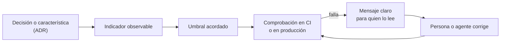

# Fitness functions y arquitectura evolutiva

Una arquitectura se degrada de la misma forma en casi todos los equipos: alguien toma un atajo
razonable, otra persona lo copia, y seis meses después la regla «las capas no se saltan» sigue
escrita en un documento que nadie consulta, mientras el código dice lo contrario. El problema no
es la falta de reglas, sino que **nada las comprueba**.

Una _fitness function_ es la respuesta práctica: convertir una característica de la arquitectura
en una comprobación objetiva y automática que corre junto al resto del código. Este artículo
explica de dónde viene la idea, cómo se clasifican, cómo pasar de un deseo vago a una métrica,
ejemplos con herramientas reales y cómo introducirlas sin bloquear a un equipo con un sistema
heredado.

<Callout tone="info" title="Fecha de corte">
  Los datos son de octubre de 2026. Las herramientas citadas cambian de versión con frecuencia:
  contrasta la sintaxis con la documentación oficial antes de adoptarlas en tu proyecto.
</Callout>

## De dónde viene el concepto

El término se toma de la **computación evolutiva**. En un algoritmo genético, la función de aptitud
(_fitness function_) define qué significa «mejor» y resume cuán cerca está una solución de los
objetivos fijados. Neal Ford, Rebecca Parsons y Patrick Kua lo trasladaron a la arquitectura en el
libro _Building Evolutionary Architectures_ (primera edición de 2017). La segunda edición figura
con cuatro autores (Parsons, Ford, Kua y Sadalage) y el subtítulo _Automated Software Governance_.
Según su editorial, esa segunda edición profundiza en las fitness functions y en cómo usarlas para automatizar la
gobernanza arquitectónica.

La definición que circula, atribuida al libro por InfoQ, es esta: una fitness function
arquitectónica es **cualquier mecanismo que proporciona una evaluación objetiva de la integridad de
alguna característica arquitectónica**. Thoughtworks la incluyó en su Technology Radar como técnica
en el anillo _Trial_ en la edición de noviembre de 2017 y de nuevo en mayo de 2018; hoy ya no
aparece en la edición vigente, lo que no la invalida: la práctica pasó de novedad a parte del
oficio.

Una _arquitectura evolutiva_, en palabras de las diapositivas de Ford, es la que admite cambio
guiado e incremental en varias dimensiones. Las fitness functions son el **guiado**: sin ellas, el
cambio es incremental pero va a la deriva.

## Qué es una fitness function y qué no

La propiedad que la define es la **objetividad**: en palabras de los autores en un podcast de
Thoughtworks, lo importante es que nadie discuta el resultado. Por eso un deseo no sirve:

- «El sistema debe ser mantenible» **no** es una fitness function. No hay forma de medirlo sin
  opinar.
- «La complejidad ciclomática de cada función es menor que cinco» **sí** lo es: cualquiera obtiene el
  mismo resultado.

Tampoco hace falta inventar herramientas. El Radar señala que estas comprobaciones pueden apoyarse en
métodos ya existentes: pruebas unitarias, métricas y monitores. Un linter con un umbral definido y
un resultado rápido es una fitness function; el mismo linter ejecutado de vez en cuando y sin
consecuencias, no. La diferencia no está en la herramienta, sino en que el resultado **bloquea o
informa de forma fiable**.

Y la automatización cambia la conversación: si una comprobación corre en la compilación, no hace
falta revisar a mano los ciclos de dependencias en cada pull request, porque sabes que no pueden
pasar.

## Cómo se clasifican

El índice de la segunda edición organiza las categorías por seis ejes. Esta tabla resume cada uno
con su sentido práctico:

| Eje              | Opciones                       | Qué significa en la práctica                                                                  |
| ---------------- | ------------------------------ | --------------------------------------------------------------------------------------------- |
| **Alcance**      | Atómica o holística            | Una sola característica aislada, o varias interactuando en un contexto compartido             |
| **Cadencia**     | Disparada, continua o temporal | Al ocurrir un evento (commit, build), de forma permanente en producción, o cada cierto tiempo |
| **Resultado**    | Estática o dinámica            | Umbral fijo de pasa o falla, o un umbral que depende del contexto (por ejemplo, la carga)     |
| **Invocación**   | Automatizada o manual          | La ejecuta el pipeline, o la ejecuta una persona (por ejemplo, una revisión de seguridad)     |
| **Proactividad** | Intencional o emergente        | La diseñas desde el principio, o la descubres al ver un problema real                         |
| **Cobertura**    | Específica del dominio         | Comprobaciones que solo tienen sentido en tu negocio (por ejemplo, una regla regulatoria)     |

Las diapositivas de Ford usan una versión más corta de la misma idea: atómicas frente a holísticas
y por lotes frente a continuas, y advierten de que las holísticas deben ejecutarse en un contexto
compartido. Para empezar, basta con quedarse con dos preguntas: **¿mide una cosa o varias?** y
**¿corre en cada cambio o en producción?**

## De característica a comprobación

El paso difícil no es la herramienta, sino traducir una preocupación en una medida. Un método
sencillo:

1. **Nombra la característica** que te importa (modificabilidad, rendimiento, seguridad,
   operabilidad).
2. **Elige un indicador observable:** qué número o qué hecho cambia cuando la característica se
   degrada.
3. **Fija un umbral** que el equipo acepte antes de ver el resultado.
4. **Decide cuándo corre** y qué ocurre si falla: bloquea, avisa o solo registra.



Estos son ejemplos de esa traducción:

| Característica         | Indicador                                  | Ejemplo de umbral                 | Herramienta típica                   |
| ---------------------- | ------------------------------------------ | --------------------------------- | ------------------------------------ |
| Modularidad            | Dependencias entre capas                   | Cero dependencias hacia arriba    | ArchUnit, dependency-cruiser, ESLint |
| Acoplamiento           | Ciclos entre módulos                       | Cero ciclos                       | ArchUnit, dependency-cruiser         |
| Mantenibilidad         | Tamaño y complejidad por archivo o función | Máximo de líneas y de complejidad | ESLint, SonarQube                    |
| Calidad de las pruebas | Cobertura o mutantes detectados            | Por encima de un mínimo acordado  | Cobertura, mutation testing          |
| Rendimiento            | Métricas de carga (Web Vitals)             | LCP máximo en milisegundos        | Lighthouse CI                        |
| Compatibilidad         | Contratos entre consumidor y proveedor     | Cero contratos rotos              | Pruebas de contrato                  |
| Fiabilidad             | Tasa de error en producción                | Menos del 1 % tras un despliegue  | Monitores, SLOs                      |
| Seguridad              | Secretos o dependencias vulnerables        | Cero hallazgos                    | Escáneres de secretos y de CVE       |

## Ejemplos con herramientas reales

### Reglas de capas y dependencias

Es el caso más común y el más barato. Todas las herramientas siguen la misma idea: declarar qué
puede depender de qué y fallar cuando el código lo contradice. Lo que cambia es **dónde vive la
regla**:

| Herramienta        | Lenguaje                | Cómo se declara la regla                                                                                                   |
| ------------------ | ----------------------- | -------------------------------------------------------------------------------------------------------------------------- |
| ArchUnit           | Java                    | Código de prueba JUnit 5: `layeredArchitecture()` con `.layer(...)` y `.whereLayer(...)`                                   |
| NetArchTest        | .NET                    | API fluida dentro de cualquier framework de pruebas: `Types.InCurrentDomain().That().ResideInNamespace(...)`               |
| import-linter      | Python                  | Contratos en un archivo de configuración (`.importlinter`): `type = forbidden`, con `source_modules` y `forbidden_modules` |
| dependency-cruiser | JavaScript y TypeScript | Reglas `forbidden` con `from` y `to`, en un archivo de configuración                                                       |
| ESLint             | TypeScript              | `import-x/no-restricted-paths` con zonas: no hace falta una herramienta nueva                                              |

La elección depende de dónde quieres que viva la regla: como **código de prueba** (ArchUnit,
NetArchTest), como **configuración declarativa** (import-linter, dependency-cruiser) o dentro del
**linter que ya usas** (ESLint). Importa menos cuál que el hecho de que corra en CI y falle con un
mensaje claro.

Para ver la forma, esta es una regla de ArchUnit de su documentación oficial, dentro de una clase
con `@AnalyzeClasses` y campos `@ArchTest`:

```java
layeredArchitecture().consideringAllDependencies()
    .layer("Controller").definedBy("..controller..")
    .layer("Service").definedBy("..service..")
    .whereLayer("Service").mayOnlyBeAccessedByLayers("Controller")
```

Y esta es la de dependency-cruiser en su README, que impide que el código de fuera de `test`
dependa de `test`:

```json
{
  "name": "not-to-test",
  "severity": "error",
  "from": { "pathNot": "^test" },
  "to": { "path": "^test" }
}
```

### Ciclos de dependencias

Los ciclos son un indicador de acoplamiento fácil de medir, y el umbral razonable es cero.
ArchUnit lo expresa con una regla de _slices_ (`slices().matching(...).should().beFreeOfCycles()`)
y dependency-cruiser con la regla `no-circular`, que apunta a `"circular": true` en el campo `to`.

### Tamaño y complejidad

Los límites de tamaño y complejidad son fitness functions atómicas, estáticas y automatizadas. Este
repositorio fija en `eslint.config.ts` un máximo de 300 líneas por archivo (`max-lines`, sin contar
líneas en blanco ni comentarios). Su `AGENTS.md` añade que la complejidad cognitiva se vigila con
`sonarjs/cognitive-complexity`. La advertencia de InfoQ viene al caso: las herramientas de análisis
estático (PMD, SpotBugs, ESLint, SonarQube) solo se convierten en fitness functions cuando dan
**retroalimentación rápida** al desarrollador y tienen límites definidos. Un informe mensual con
cientos de avisos no lo es.

### Rendimiento y tamaño del bundle

Lighthouse CI permite fijar presupuestos como aserciones en `lighthouserc.json` (o `.js`) y
ejecutar `lhci autorun`, que lanza la recolección, las aserciones y la subida. Un ejemplo
ilustrativo: puntuación mínima de 0,9 en `categories:performance` y un máximo de 2500 ms en
`largest-contentful-paint`, ambos con severidad `warn`. Se acerca a una fitness function
**dinámica**: el resultado depende del entorno de medición, así que conviene fijar las condiciones
y repetir las ejecuciones antes de convertirla en una barrera.

### Pruebas, contratos y SLOs

No todo es análisis estático. Estas comprobaciones también son fitness functions cuando tienen un
umbral objetivo:

- **Cobertura y mutation testing.** Thoughtworks cita cobertura por encima del 90 % como ejemplo de
  puerta de calidad. La prueba de mutación es más cara, así que Böckeler recomienda ejecutarla
  después de integrar, no en cada guardado.
- **Pruebas de contrato dirigidas por el consumidor.** Las diapositivas de Ford las incluyen
  como fitness function de compatibilidad entre servicios.
- **SLOs y monitores.** Un objetivo como «tasa de error menor del 1 % durante un despliegue», uno de
  los ejemplos del artículo de Thoughtworks de 2019, es una fitness function **continua**: corre
  en producción, no en el commit.

## Un ejemplo real: las capas de este repositorio

Este sitio aplica la idea sin nombrarla. Sus componentes siguen un diseño atómico (átomos, moléculas,
organismos, plantillas), y la regla de dependencias no vive en un párrafo: vive en la configuración
de ESLint. Esta es la forma de `architectureZones` en `eslint.config.ts`: cada zona nombra un
`target`, las capas `from` que no puede importar y un `message` que explica la regla («los átomos
no pueden depender de capas superiores», «lib debe permanecer independiente de cualquier capa
superior»).

```ts
const architectureZones = [
  { target: './src/components/atoms', from: ['./src/components/molecules' /* … */], message: '…' },
  { target: './src/lib', from: ['./src/components' /* … */], message: '…' },
];
// se activa con: 'import-x/no-restricted-paths': ['error', { zones: architectureZones }]
```

Si un átomo importa de una molécula, `eslint` falla con el mensaje que escribió quien definió la
zona. No hay que revisar a mano ni recordar la regla.

Esa regla no está sola. La tabla muestra qué otras comprobaciones del repositorio cumplen el papel
de fitness function y dónde se ejecutan:

| Comprobación                                           | Qué protege                                                   | Dónde corre                     |
| ------------------------------------------------------ | ------------------------------------------------------------- | ------------------------------- |
| `import-x/no-restricted-paths` con `architectureZones` | Dependencias entre capas                                      | `bun run lint`, `bun run check` |
| `max-lines` (300) y complejidad cognitiva              | Tamaño y complejidad de archivos y funciones                  | `bun run lint`                  |
| `bun run audit`                                        | Contenido MDX, enlaces internos, traducciones y rutas         | `pre-push` y `bun run check`    |
| `bun run check` completo                               | Formato, lint, tipos, auditoría, tests y código muerto (knip) | Workflow de despliegue en CI    |

La auditoría (`tools/audit.ts`) termina con código de salida 1 si hay errores, de modo que bloquea el
push. Es una fitness function de **dominio específico**: valida cosas que solo tienen sentido en este
sitio, como que cada documento tenga su traducción o que el id de una ruta coincida con su archivo.

## Dónde ejecutarlas

Una fitness function vale lo que vale el momento en que falla. Algunas reglas prácticas:

- **Lo barato, pronto.** Reglas de capas, ciclos y tamaño corren en el editor, en el commit y en el
  pipeline. Lo caro (pruebas de mutación, de rendimiento) va después de integrar.
- **Que falle con un mensaje útil.** El mensaje de una zona de ESLint o de un contrato de
  import-linter es documentación que aparece justo cuando hace falta. Böckeler lo subraya: la salida
  de los sensores escrita para que un modelo la lea, por ejemplo con instrucciones para corregir, es
  especialmente útil.
- **Una regla que vive donde se ejecuta no se desactualiza en silencio.** Un párrafo en un documento
  envejece sin que nadie se entere; una regla en el pipeline obliga a actualizarla o a
  justificar la excepción.
- **Los hooks de git no bastan.** Los hooks locales se pueden saltar; el pipeline de CI es la
  barrera que no depende de la buena voluntad. Este repositorio ejecuta `bun run check` como
  puerta de calidad antes de publicar.

## Introducirlas en un sistema legado

Activar una regla estricta sobre un código con cientos de violaciones solo produce ruido. La
alternativa es registrar las violaciones actuales y **bloquear solo las nuevas**. dependency-cruiser
lo documenta así:

```sh
dependency-cruiser src --baseline       # registra las violaciones existentes
dependency-cruiser src --ignore-known   # en CI: ignora lo conocido y falla ante lo nuevo
```

Con `--ignore-known`, las violaciones registradas bajan a severidad `ignore` y las salidas de error
solo muestran un aviso con el recuento; `--no-ignore-known` las vuelve a mostrar. Según su
documentación, es el enfoque recomendado cuando ya hay muchos ciclos.

La idea general se llama _ratchet_ (trinquete): la lista de excepciones **solo puede encogerse**.
Para que funcione de verdad:

1. Falla el build si la lista crece, no solo si hay violaciones nuevas fuera de ella.
2. Borra la entrada de la lista cuando se corrige el sitio, en el mismo cambio.
3. Revisa periódicamente el tamaño de la lista como una métrica de deuda, que además es objetiva.

## Fitness functions, ADR y agentes de IA

### Cada decisión puede llevar su comprobación

Un [ADR](/docs/adr) registra por qué se decidió algo. Una fitness function registra **si se sigue
cumpliendo**. Juntos cierran el ciclo: la decisión («los átomos no dependen de capas superiores») y
la comprobación que la protege viven en el mismo cambio. Cuando un ADR no puede acompañarse de nada
medible, es una pista de que la decisión es más una preferencia que una restricción.

### Son los sensores computacionales del arnés

En el artículo de [harness engineering](/docs/harness-engineering-claude-code), Böckeler distingue
guías (antes de actuar) y sensores (después). Las fitness functions son **sensores computacionales**:
deterministas, rápidos y baratos, aptos para ejecutarse en cada cambio. Un agente de IA que rompe una
regla de capas recibe el fallo del linter como retroalimentación y puede corregirse solo, sin que una
persona intervenga. Lo mismo vale para los proyectos que se apoyan en agentes para escribir código:
el arnés más barato es el que ya tienes en CI. Para el diseño de aplicaciones que usan modelos, ver
también [arquitectura de aplicaciones con LLM y agentes](/docs/arquitectura-agentes-llm).

Böckeler añade un matiz: los sensores computacionales cubren bien la **mantenibilidad** y parte de
la adecuación arquitectónica, pero el **comportamiento** sigue siendo la categoría menos resuelta.
Las fitness functions no sustituyen la revisión humana de lo que el sistema _debe hacer_.

## Errores frecuentes

- **Convertir un deseo en una regla.** «Código limpio» no se mide; el tamaño de función, sí. Empieza
  por lo objetivo y apóyate en [clean code](/docs/clean-code) y [SOLID](/docs/solid) para decidir
  qué merece una métrica.
- **Umbrales sin acuerdo.** Una barrera impuesta sin consenso se desactiva a la primera
  presión. Fija el umbral con el equipo antes de ver el resultado.
- **Reglas que nadie lee cuando fallan.** Un mensaje críptico equivale a ninguno. Explica qué se
  rompió y cuál es la alternativa.
- **Activarlas de golpe en un legado.** Genera ruido y acaba en `// eslint-disable`. Usa una línea
  base y un trinquete.
- **Todo en el pipeline lento.** Si la retroalimentación tarda veinte minutos, la gente deja de
  esperarla. Separa lo rápido de lo caro.
- **Medir lo fácil y no lo importante.** La cobertura alta no dice que el comportamiento sea
  correcto. Combina métricas con pruebas de contrato y de aceptación.
- **Fitness functions que nadie mantiene.** Revisa las reglas cuando cambia la arquitectura, por
  ejemplo en el modelo [C4](/docs/c4-model), y actualiza o borra las que ya no aplican.

## Checklist para tu primera fitness function

- [ ] Nombra la característica que quieres proteger y por qué importa al negocio.
- [ ] Define un indicador observable y un umbral que el equipo haya aceptado.
- [ ] Elige la herramienta que ya tienes (ESLint, ArchUnit, import-linter, dependency-cruiser…).
- [ ] Escribe un mensaje de fallo que explique la regla y la alternativa correcta.
- [ ] Decide cuándo corre: editor, commit, pipeline o producción.
- [ ] Si el sistema es legado, registra una línea base y bloquea solo lo nuevo.
- [ ] Enlaza la comprobación con el ADR que la justifica.
- [ ] Revisa cada cierto tiempo que la regla sigue siendo útil y no genera falsos positivos.

## Fuentes

Consultadas en octubre de 2026; contrasta cada dato con la fuente oficial antes de decidir.

- [Building Evolutionary Architectures, 2.ª edición (Thoughtworks)](https://www.thoughtworks.com/en-br/insights/books/building-evolutionaryarchitectures-second-edition)
- [Building Evolutionary Architectures, 2.ª edición (O'Reilly)](https://oreilly.com/library/view/building-evolutionary-architectures/9781492097532)
- [Capítulo 2, Fitness Functions (O'Reilly)](https://oreilly.com/library/view/building-evolutionary-architectures/9781492097532/ch02.html)
- [Podcast: Rethinking software governance (Thoughtworks)](https://thoughtworks.com/insights/podcasts/technology-podcasts/rethinking-software-governance-reflecting-second-edition-building-evolutionary-architectures)
- [Architectural fitness function (Thoughtworks Technology Radar)](https://thoughtworks.com/radar/techniques/architectural-fitness-function)
- [Fitness function-driven development (Paula Paul y Rosemary Wang, Thoughtworks, 2019)](https://www.thoughtworks.com/insights/articles/fitness-function-driven-development)
- [Fitness functions for your architecture (Thomas Much, InfoQ, abril de 2025)](https://www.infoq.com/articles/fitness-functions-architecture/)
- [Evolutionary Architectures (Neal Ford, diapositivas)](https://nealford.com/downloads/Evolutionary_Architectures_by_Neal_Ford.pdf)
- [Harness engineering for coding agent users (Birgitta Böckeler)](https://martinfowler.com/articles/harness-engineering.html)
- [Guía de usuario de ArchUnit](https://www.archunit.org/userguide/html/000_Index.html)
- [NetArchTest](https://github.com/BenMorris/NetArchTest)
- [import-linter](https://import-linter.readthedocs.io/en/stable/)
- [dependency-cruiser](https://github.com/sverweij/dependency-cruiser)
- [Configuración de Lighthouse CI](https://googlechrome.github.io/lighthouse-ci/docs/configuration.html)
