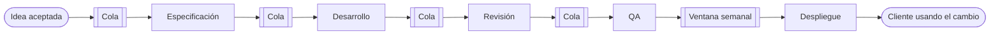
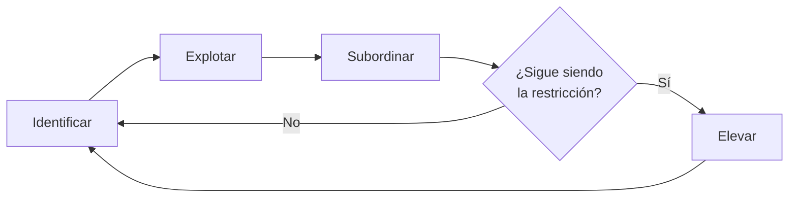

# Flujo de valor y cuellos de botella

Un cambio pequeño, de dos días de trabajo, tarda un mes en llegar a los clientes. Nadie en el equipo está ocioso: los desarrolladores tienen tres tareas abiertas cada uno, la persona de QA no da abasto y la reunión semanal termina con el mismo diagnóstico, «necesitamos más gente». Se contrata a otro desarrollador y, tres meses después, el cambio pequeño sigue tardando un mes. El problema no era la falta de esfuerzo, sino que nadie miraba dónde esperaba el trabajo.

**El flujo de valor es la secuencia completa de pasos, con valor y sin él, por la que pasa una idea hasta que el cliente la usa, y un cuello de botella es el paso con menos holgura, el que fija el ritmo de todo el flujo.**

Esta lección explica cómo dibujar ese flujo, cómo separar el tiempo en que alguien trabaja del tiempo en que el trabajo espera, cómo encontrar el cuello de botella con la teoría de restricciones y cómo usar la ley de Little y los límites de trabajo en curso para decidir dónde actuar. Cierra con un ejemplo de cinco etapas con tiempos supuestos que suman.

<Callout tone="info" title="Fecha de corte y alcance">
  Fuentes consultadas en octubre de 2026. Las cifras de los ejemplos son supuestas y están marcadas
  como tales. No se dan valores de referencia del sector para la eficiencia de flujo ni para las
  métricas de DORA: dependen de quién mide, de cómo mide y de dónde fija el inicio y el fin del
  flujo.
</Callout>

## Qué es un mapa del flujo de valor

El mapa del flujo de valor (_value stream mapping_) viene de la manufactura. Mike Rother y John Shook lo popularizaron en _Learning to See_, un cuaderno de trabajo del Lean Enterprise Institute que documenta la forma en que Toyota dibujaba sus flujos. El libro trabaja sobre una empresa ficticia, Acme Stamping: primero se dibuja el estado actual, después un estado futuro con menos desperdicio y por último un plan para llegar de uno al otro.

Según la descripción del propio instituto, el mapa es un dibujo a lápiz y papel de cada proceso del flujo de material y de información, con los datos clave de cada paso. Lo que lo distingue de un diagrama de proceso es que recoge también las actividades que no crean valor y el flujo de información que dispara el trabajo. El Lean Enterprise Institute define el flujo de valor como el conjunto de acciones, creen valor o no, necesarias para llevar un producto desde el concepto hasta el lanzamiento y desde el pedido hasta la entrega.

En software, el «material» es el trabajo: una historia, un cambio, un incidente. El mapa responde a tres preguntas que ninguna herramienta de seguimiento responde por sí sola:

- **Dónde empieza y dónde termina el flujo.** Desde que alguien acepta una idea hasta que un cliente la usa, no desde que se abre una rama.
- **Qué pasos hay y quién los hace.** Incluidas las aprobaciones, las ventanas de despliegue y las esperas por otro equipo.
- **Cuánto tiempo se trabaja y cuánto se espera en cada paso.** La diferencia entre ambos es casi siempre la parte más reveladora.



### Cómo se dibuja, paso a paso

1. **Elige una familia de trabajo.** Cambios pequeños de un producto, incidentes o peticiones de otro equipo: cada familia tiene su flujo, y mezclarlas promedia cosas que no se parecen.
2. **Fija el inicio y el fin por escrito.** Por ejemplo, «idea aceptada en la priorización» y «cambio activo para todos los clientes». Todas las métricas posteriores dependen de esta frontera.
3. **Recorre el flujo con quienes hacen el trabajo.** El mapa se dibuja con las personas de cada etapa, no desde la descripción oficial del proceso; las esperas reales rara vez están documentadas.
4. **Anota por etapa** el tiempo de proceso, la espera antes de ella, cuántas personas la atienden y qué porcentaje del trabajo vuelve atrás por defectos o información incompleta.
5. **Suma la línea de tiempos.** En la parte inferior del mapa, una línea escalonada con la espera arriba y el proceso abajo, etapa por etapa, y el total al final. Es la escalera que muestra la figura de esta lección.
6. **Dibuja el estado futuro solo después.** Primero se entiende el flujo actual; el futuro se diseña atacando la mayor espera, no la etapa que más se ve.

## Tiempo de proceso frente a tiempo de espera

Un elemento de trabajo pasa su vida en dos estados: alguien trabaja en él o espera. El **tiempo de proceso** es la suma de los ratos en que alguien lo toca; el **tiempo de espera** es todo lo demás: colas, bloqueos, aprobaciones pendientes, la ventana de despliegue del jueves. El **tiempo de entrega** (_lead time_) es la suma de ambos, medido desde el inicio hasta el fin que hayas fijado en el mapa.

La **eficiencia de flujo** es la proporción del tiempo de entrega en la que el trabajo avanza: tiempo de proceso dividido entre tiempo de entrega. Niklas Modig y Pär Åhlström la contraponen en _This Is Lean_ a la **eficiencia de recursos**, que mide cuán ocupadas están las personas y las máquinas. Las dos no se maximizan a la vez: un equipo con todos sus miembros al cien por cien acumula colas, y el trabajo espera más de lo que avanza.

### Cómo medirla sin inventar cifras

La eficiencia de flujo es fácil de definir y difícil de medir bien. Algunas reglas para que el número signifique algo:

1. **Separa en el tablero los estados activos de los de espera.** Cada etapa necesita dos columnas, «en curso» y «terminado, esperando a la siguiente». Sin esa separación, todo el tiempo en una columna cuenta como trabajo.
2. **Marca los bloqueos.** Un elemento «en curso» que espera una respuesta de otro equipo está esperando, no avanzando.
3. **Usa marcas de tiempo, no estimaciones.** Las transiciones entre columnas quedan registradas en casi cualquier herramienta de seguimiento; reconstruir los tiempos de memoria tiende a inflar el trabajo y olvidar la espera.
4. **Mide una muestra de elementos terminados**, no los que están en curso, e informa de la mediana y de la dispersión, no solo de la media.
5. **Compárate contigo mismo en el tiempo.** El valor absoluto depende de dónde pongas el inicio y el fin, así que no es comparable entre equipos.

La forma mínima de un registro que permite calcular todo lo anterior es pequeña:

```yaml
# un evento por cada cambio de columna
- item: PAY-412
  from: dev.in-progress # columna de origen
  to: dev.done # «terminado, esperando revisión»
  at: 2026-10-05T14:20
  blocked: false # verdadero si espera a un tercero
# …
```

<Callout tone="warning" title="Cifras de referencia que circulan">
  Es habitual leer que la eficiencia de flujo del trabajo de conocimiento ronda un porcentaje bajo
  concreto. Esa cifra depende de dónde se fijen el inicio y el fin del flujo y de cómo se separe el
  trabajo de la espera, así que aquí no se da ninguna. Lo útil es tu propia línea base y su
  tendencia.
</Callout>

## Métricas de flujo: qué mide cada una

| Métrica                 | Qué mide                                                        | Cómo se obtiene                                          | Trampa habitual                                                     |
| ----------------------- | --------------------------------------------------------------- | -------------------------------------------------------- | ------------------------------------------------------------------- |
| Tiempo de entrega       | Cuánto tarda un elemento de principio a fin                     | Marca de entrada y de salida del flujo                   | Fijar el inicio en el commit y olvidar la espera previa             |
| Tiempo de proceso       | Cuánto se trabaja de verdad en el elemento                      | Suma de los ratos en columnas activas, sin bloqueos      | Contar como trabajo el tiempo en una columna «en curso»             |
| Eficiencia de flujo     | Qué parte del tiempo de entrega avanza el trabajo               | Tiempo de proceso entre tiempo de entrega                | Compararla con otros equipos que miden con otras fronteras          |
| Caudal (_throughput_)   | Cuántos elementos salen por unidad de tiempo                    | Conteo de elementos terminados por semana                | Mezclar elementos de tamaños muy distintos                          |
| Trabajo en curso (WIP)  | Cuántos elementos han empezado y no han terminado               | Conteo en el tablero en un instante                      | No contar el trabajo «invisible»: urgencias, soporte, favores       |
| Utilización             | Qué fracción de su capacidad usa una etapa                      | Demanda por tiempo de proceso entre personas disponibles | Perseguir el cien por cien: las colas crecen de forma no lineal     |
| Change lead time (DORA) | Tiempo desde el commit en control de versiones hasta producción | Historial del repositorio y del sistema de despliegue    | Tomarla por el flujo completo: no ve lo que ocurre antes del commit |

La última fila merece una nota. El _change lead time_ de DORA solo cubre el tramo de entrega. Si la mayor parte de la espera está entre «idea aceptada» y «primer commit», esa métrica no la verá; el mapa sí.

## Cuellos de botella y la teoría de restricciones

Eliyahu M. Goldratt presentó la teoría de restricciones en _The Goal_ (en español, _La meta_), una novela escrita con Jeff Cox y publicada en 1984. El protagonista dirige una planta en apuros y descubre que lo que sale de toda la fábrica lo fijan unos pocos recursos saturados, y que mejorar cualquier otro no cambia el resultado. La idea de fondo: todo sistema tiene al menos una restricción que limita su rendimiento; el tiempo que se pierde en ella se pierde para todo el sistema, y el que se gana en un recurso que no limita no mejora el resultado.

La teoría se aplica con los **cinco pasos de enfoque**, que la literatura sobre restricciones asocia a _La meta_ y a obras posteriores de Goldratt (fuente secundaria: el artículo de Wikipedia sobre la teoría de restricciones, citado en Fuentes):

1. **Identificar** la restricción del sistema.
2. **Explotarla**: sacarle el máximo sin invertir, por ejemplo evitando que pare o que haga trabajo que otro podría hacer.
3. **Subordinar** todo lo demás a esa decisión: el resto del sistema trabaja al ritmo de la restricción, aunque eso signifique que otros recursos queden por debajo de su capacidad.
4. **Elevarla**: solo si con lo anterior no basta, añadir capacidad con inversión.
5. **Volver al paso 1** si la restricción se ha roto, sin dejar que la inercia se convierta en la nueva restricción.



El orden importa. Explotar y subordinar suelen costar poco y a menudo bastan; elevar cuesta dinero y tiempo, y si se hace primero se paga capacidad que el sistema no puede aprovechar.

### Cómo se ve un cuello de botella en software

En una planta, el cuello de botella es una máquina. En un equipo de software puede ser cualquier cosa que tenga cola delante:

- **Una etapa con poca capacidad**: una sola persona que hace QA, un equipo de plataforma compartido por diez equipos.
- **Una persona experta**: la única que conoce el módulo de facturación revisa todo lo que lo toca.
- **Una política**: una ventana de despliegue semanal, un comité de cambios que se reúne los martes. No falta capacidad, falta frecuencia.
- **Un recurso técnico**: un único entorno de pruebas compartido, una batería de pruebas que tarda horas.

La señal más fiable es la cola: el trabajo se amontona **delante** del cuello de botella, y las etapas **detrás** esperan sin nada que hacer. Una etapa con mucho trabajo acumulado y alta utilización es candidata; confírmalo con los tiempos de espera del mapa antes de actuar.

## Ley de Little: el trabajo en curso fija la espera

La ley de Little relaciona tres promedios de un sistema estable: el trabajo en curso medio es igual al caudal medio multiplicado por el tiempo medio que cada elemento pasa dentro. John D. C. Little publicó la demostración general en 1961; el desarrollo, la fórmula y sus usos en capacidad están en [números y leyes de rendimiento](/docs/numeros-y-leyes-de-rendimiento). Aquí interesa en la forma que se usa en la gestión de operaciones: **tiempo de entrega medio = trabajo en curso medio / caudal medio**.

Sirve para dos cosas en un flujo de valor:

- **Estimar el tiempo de entrega** sin seguir cada elemento: si hay 30 elementos en curso de media y salen 6 por semana, cada uno tarda unas 5 semanas de media.
- **Comprobar que las mediciones cuadran**: si el tablero dice 30 en curso, el caudal es 6 por semana y el tiempo de entrega medido son 2 semanas, algo está mal medido o hay trabajo que no se cuenta.

Las condiciones no son un detalle. La relación vale para **promedios a largo plazo** de un **sistema estable**, en el que entra aproximadamente lo mismo que sale durante la ventana medida, y con **la misma frontera** para los tres valores. No depende de la distribución de las llegadas ni de los tiempos de servicio, pero no sirve si el trabajo en curso crece sin parar, si la ventana es demasiado corta o si cuentas el trabajo en curso de una etapa y el tiempo de entrega de todo el flujo.

La consecuencia práctica es directa: **con el mismo caudal, menos trabajo en curso significa menos tiempo de entrega.** Empezar más cosas no hace que terminen antes; con el caudal fijo, solo alarga la espera de cada una.

## Kanban: límites de trabajo en curso como palanca

David J. Anderson describió el método Kanban para el trabajo de tecnología en _Kanban: Successful Evolutionary Change for Your Technology Business_ (Blue Hole Press, 2010). Su mecanismo central es visualizar el flujo y **limitar el trabajo en curso** por columna: cuando una columna llega a su límite, la etapa anterior no puede empujar más trabajo y quien queda libre ayuda a desatascar en lugar de empezar algo nuevo.

Los límites de WIP conectan las dos ideas anteriores. Por la ley de Little, bajan el tiempo de entrega si el caudal se mantiene. Por la teoría de restricciones, son una forma de **subordinar**: impiden que las etapas rápidas inunden la cola del cuello de botella. Tres reglas para fijarlos:

- **Empieza por el límite actual observado** y bájalo poco a poco; un límite muy bajo deja al cuello de botella sin trabajo y reduce el caudal.
- **Protege la restricción con una cola pequeña delante**, para que nunca se quede parada esperando.
- **Cuando una columna llega al límite, es una señal**, no un fallo: indica dónde está el cuello de botella hoy.

## Métricas DORA y el flujo de entrega

Las métricas de DORA, sus definiciones vigentes y cómo usarlas sin convertirlas en objetivos individuales se explican en [DevOps y su cultura](/docs/devops-cultura). Para el flujo de valor importa una cuestión de alcance: según la guía oficial de DORA, el _change lead time_ se mide desde que un cambio se confirma en el control de versiones hasta que está desplegado en producción. Describe, por tanto, solo el tramo final del flujo; la espera por priorización, especificación o aprobaciones anterior al commit queda fuera, y para verla hace falta el mapa.

DORA agrupa el _change lead time_, la frecuencia de despliegue y el tiempo de recuperación de un despliegue fallido como métricas de caudal, y la tasa de fallo de los cambios y la de retrabajo como métricas de inestabilidad. Por eso conviene leer las de flujo junto a las de inestabilidad: una mejora de flujo que sube la tasa de fallo solo ha cambiado una espera por retrabajo.

## Cuándo sí y cuándo no

**Usa el mapa del flujo de valor y la teoría de restricciones cuando:**

- El tiempo de entrega es largo y nadie sabe explicar en qué se va.
- La solución que se repite es «más gente» o «trabajar más rápido», y no funciona.
- Varios equipos intervienen en un mismo flujo y cada uno optimiza su parte.
- Vas a invertir en capacidad (personas, herramientas, automatización) y quieres saber dónde rinde.

**No es la herramienta adecuada cuando:**

- El trabajo es de exploración pura, sin pasos repetibles: no hay flujo que mapear, hay experimentos. Para ese caso, [mejora continua y experimentos](/docs/mejora-continua-y-experimentos).
- El volumen es tan bajo que no hay promedios estables: la ley de Little no se sostiene con tres elementos al mes.
- El problema no es de flujo sino de qué se hace: entregar rápido lo equivocado. Eso se decide con objetivos y métricas de resultado, como se ve en [medir decisiones con OKR y KPI](/docs/medir-decisiones-okr-kpi).

## Errores frecuentes

- **Optimizar la etapa que no es el cuello de botella.** Acelerar el desarrollo cuando la cola está ante QA solo hace crecer esa cola; el tiempo de entrega no cambia.
- **Aumentar la capacidad de un recurso que no limita.** Contratar, comprar o automatizar fuera de la restricción es el paso cuatro aplicado en el sitio equivocado: cuesta y no se nota en el resultado.
- **Medir solo la productividad individual.** Contar tareas cerradas por persona empuja a cada uno a empezar más trabajo, sube el WIP y alarga la espera de todos. El flujo se mide en el sistema.
- **Perseguir el cien por cien de utilización.** Cerca de la saturación las colas crecen muy deprisa; la holgura en la restricción no es desperdicio, es lo que mantiene el flujo.
- **Mapear solo el tramo técnico.** Si el mapa empieza en el commit, la espera por priorización, diseño o aprobaciones queda fuera, y a menudo es la mayor.
- **Elevar antes de explotar.** Comprar capacidad sin haber quitado antes el trabajo innecesario de la restricción paga por algo que una regla de equipo resolvía gratis.
- **Olvidar que la restricción se mueve.** Tras resolver un cuello de botella aparece otro. Un mapa de hace un año describe otro sistema.
- **Confundir flujo con deuda.** Si una etapa es lenta porque el código es difícil de cambiar, el remedio es de diseño: lo trata [deuda técnica y evolución](/docs/deuda-tecnica-evolucion).

## Ejemplo trabajado: dónde poner el dinero

Un equipo de producto entrega cambios pequeños de un servicio de pagos. La dirección ofrece presupuesto para un desarrollador más. Antes de aceptarlo, el equipo dibuja el mapa con las marcas de tiempo de los últimos tres meses. Todas las cifras son **supuestas** y están en días laborables.

**Supuestos:** la demanda es estable, de 4 elementos por semana, es decir, 0,8 por día laborable. Cada etapa tiene la capacidad que indica la tabla, calculada como personas dedicadas entre tiempo de proceso. El despliegue se hace en una ventana semanal, así que un elemento listo espera de media media semana, 2,5 días.

| Etapa          | Espera antes | Proceso | Personas           | Capacidad (por día) | Utilización |
| -------------- | ------------ | ------- | ------------------ | ------------------- | ----------- |
| Especificación | 2            | 0,5     | 1                  | 2                   | 40 %        |
| Desarrollo     | 2,5          | 1,5     | 3                  | 2                   | 40 %        |
| Revisión       | 2            | 0,5     | 1 (turno rotativo) | 2                   | 40 %        |
| QA             | 7            | 1       | 1                  | 1                   | 80 %        |
| Despliegue     | 2,5          | 0,5     | 1, ventana semanal | 2                   | 40 %        |
| **Total**      | **16**       | **4**   | —                  | —                   | —           |

La utilización es la demanda por el tiempo de proceso entre las personas: en QA, 0,8 × 1 / 1 = 80 %; en desarrollo, 0,8 × 1,5 / 3 = 40 %.

**Diagnóstico.** El tiempo de entrega es 16 + 4 = 20 días y la eficiencia de flujo, 4 / 20 = 20 %. Por la ley de Little, el trabajo en curso medio debería ser 0,8 × 20 = 16 elementos; el tablero muestra entre 15 y 17, así que las mediciones cuadran. QA concentra 7 de los 16 días de espera y es la única etapa al 80 %. En sentido estricto, hoy el caudal lo limita la demanda, porque todas las etapas pueden con 0,8 elementos al día; pero QA es la etapa con menos holgura, la que domina el tiempo de entrega y la primera que limitará el caudal si la demanda sube a 1 por día.

**Opciones evaluadas:**

1. **Contratar un cuarto desarrollador.** La capacidad de desarrollo pasa de 2 a unos 2,7 por día y su utilización baja al 30 %. Como la cola principal está ante QA, los elementos llegarían antes a esa cola y esperarían allí. Es el error de elevar un recurso que no limita: costo alto, efecto casi nulo en los 20 días.
2. **Explotar y subordinar QA.** QA deja de hacer lo que otros pueden hacer: los desarrolladores automatizan la regresión y preparan los datos de prueba, y se fija un límite de 3 elementos en la columna «listo para QA»; quien topa con el límite ayuda a probar. Estimación supuesta: el proceso de QA baja de 1 a 0,6 días, su utilización al 48 % y la espera ante QA de 7 a unos 2 días. El total queda en 3,6 de proceso y 11 de espera: 14,6 días, con una eficiencia cercana al 25 %.
3. **Cambiar la política de despliegue.** Pasar de una ventana semanal a despliegues diarios reduce la espera media antes del despliegue de 2,5 a unos 0,5 días. No es una restricción de capacidad, sino de política, y no requiere contratar a nadie.

**Decisión.** Se aplica la opción 2 y, a continuación, la 3. Con ambas, el tiempo de entrega estimado es 3,6 + 9 = 12,6 días, la eficiencia ronda el 29 % y, por la ley de Little, el trabajo en curso esperado baja a unos 10 elementos. La contratación se rechaza por ahora y se registra la condición para revisarla: si tras dos meses la demanda supera 1 elemento por día de forma sostenida, se evalúa elevar QA. La estimación de la espera ante QA no sale de una fórmula: la cola depende de la variabilidad de las llegadas, por eso se vuelve a medir con el mismo método a las cuatro semanas.

## Checklist

- [ ] El mapa empieza en la idea aceptada y termina con el cliente usando el cambio, no en el commit ni en el despliegue.
- [ ] Cada etapa del tablero separa «en curso» de «terminado, esperando», y los bloqueos están marcados.
- [ ] Los tiempos salen de marcas de tiempo de elementos terminados, con mediana y dispersión.
- [ ] La ley de Little cuadra con lo medido: trabajo en curso, caudal y tiempo de entrega usan la misma frontera.
- [ ] El cuello de botella está identificado por su cola y su utilización, no por quién se queja más.
- [ ] Antes de invertir, se ha explotado la restricción y se le ha subordinado el resto del flujo.
- [ ] Hay límites de trabajo en curso y una cola pequeña que protege la restricción.
- [ ] Las métricas de flujo se miden por sistema y se acompañan de la tasa de fallo de los cambios.

## Fuentes

Consultadas en octubre de 2026. Fuente secundaria para la definición de flujo de valor del Lean Enterprise Institute y para la de eficiencia de flujo de Modig y Åhlström: descripciones del editor y resúmenes de terceros de los libros.

- [Learning to See (Mike Rother y John Shook, Lean Enterprise Institute)](https://www.lean.org/store/book/learning-to-see/): ficha del editor
- [Value Streams y VSM, guía de la Universidad de Míchigan con la definición del Lean Enterprise Institute](https://kresgeguides.bus.umich.edu/Lean-ValueStreams/Value-Streams-VSM-Mapping)
- [Theory of constraints en Wikipedia](https://en.wikipedia.org/wiki/Theory_of_constraints): _The Goal_ (Goldratt y Cox, 1984) y los cinco pasos de enfoque
- [The Goal en Wikipedia](<https://en.wikipedia.org/wiki/The_Goal_(novel)>): ediciones revisadas de 1986 y 1992
- [A Proof for the Queuing Formula: L = λW (John D. C. Little, _Operations Research_ 9(3), 1961)](https://doi.org/10.1287/opre.9.3.383)
- [Little's Law: A Practical Approach to Understanding Production System Performance (Project Production Institute)](https://projectproduction.org/journal/littles-law-a-practical-approach-to-understanding-production-system-performance/): condiciones de estabilidad y promedios a largo plazo
- [Kanban: Successful Evolutionary Change for Your Technology Business (David J. Anderson, Blue Hole Press, 2010), ficha de catálogo](https://search.ub.tum.de/vufind/Record/DE-604.BV036572231)
- [This Is Lean: Resolving the Efficiency Paradox (Modig y Åhlström), reseña del Lean Construction Institute](https://leanconstruction.org/?p=12946)
- [Métricas DORA (guía oficial)](https://dora.dev/guides/dora-metrics/): alcance del _change lead time_ y agrupación en caudal e inestabilidad
