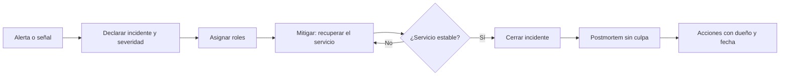

Un incidente no es el momento de descubrir quién escribió el código que falló. Es el momento de
recuperar el servicio con la información que hay, y después, con calma, entender por qué el sistema
permitió que ocurriera. Esa división, primero mitigar y luego explicar, es la tesis de este
artículo: la gestión de incidentes y el postmortem son dos procesos distintos, con objetivos
distintos, y mezclarlos es la forma más común de perder ambos.

La práctica viene de la ingeniería de fiabilidad de Google. El libro _Site Reliability Engineering_
(O'Reilly, 2016) dedica un capítulo a la gestión de incidentes y otro, el 15, a la cultura de
postmortems, y define un postmortem como un registro escrito que cubre el impacto, las acciones de
mitigación, las causas raíz y las acciones de seguimiento. Lo que sigue es cómo aplicar esa idea a
un equipo de producto sin convertirla en un ritual vacío.

<Callout tone="info" title="Qué entendemos por incidente">
  Un incidente es cualquier evento que degrada un servicio por encima de lo acordado o que obliga a
  una respuesta fuera del trabajo normal. No hace falta que haya caído nada: una latencia que
  consume el presupuesto de error de un SLO ya es un incidente en la mayoría de equipos.
</Callout>

## Severidad: decidir antes de saber

Durante los primeros minutos casi nunca se conoce la causa. Por eso la severidad no describe la
causa: describe el impacto y la urgencia, y se asigna con criterios que cualquier persona de
guardia pueda aplicar sin consultar a nadie. Un esquema útil tiene tres o cuatro niveles y cada uno
responde a tres preguntas: ¿cuántos usuarios afecta?, ¿hay datos en riesgo?, ¿hay una vía de trabajo
disponible?

| Nivel | Criterio típico                                                    | Respuesta esperada                                 |
| ----- | ------------------------------------------------------------------ | -------------------------------------------------- |
| SEV1  | Caída total o pérdida de datos; afecta a clientes de pago          | Equipo completo, comunicación externa en minutos   |
| SEV2  | Funcionalidad clave degradada para una parte relevante de usuarios | Respuesta inmediata del equipo dueño y de guardia  |
| SEV3  | Degradación acotada con alternativa operativa                      | Atención en horario laboral, sin despertar a nadie |
| SEV4  | Anomalía sin impacto visible para el usuario                       | Ticket y revisión posterior                        |

La regla que más ayuda es subir la severidad cuando hay duda y bajarla cuando se confirma el alcance.
Es más barato desescalar un incidente que descubrir a las tres horas que debió ser SEV1. Conviene
que la severidad se pueda cambiar en cualquier momento, con una nota de quién la cambió y por qué,
porque ese registro sirve después para entender si la respuesta fue proporcionada.

Las severidades también deciden a quién se llama. Si un SEV2 requiere al equipo de plataforma y
a legal, eso debe estar escrito en el procedimiento, no en la cabeza de la persona que ese día está de
guardia.

## Roles: quién hace qué durante el incidente

El error más frecuente en un incidente grave no es técnico, sino de coordinación: cinco personas
depuran el mismo proceso, nadie informa a los clientes y nadie anota lo que se ha probado. La
solución habitual es separar los roles aunque una persona tenga que ocupar dos, porque cada rol
resuelve un problema distinto.

- **Responsable del incidente** (en inglés, _incident commander_): decide prioridades, asigna tareas
  y mantiene la visión global. No depura. Su éxito se mide por la claridad de las decisiones.
- **Responsable técnico**: dirige la investigación y la mitigación. Propone hipótesis y elige qué
  probar.
- **Responsable de comunicación**: redacta las actualizaciones para dentro y para fuera, con un
  calendario fijo, y es el único que habla con clientes o con la dirección durante el incidente.
- **Anotador**: lleva una línea de tiempo con hora, acción y resultado. Es el rol más infravalorado,
  y el que más tarde permite escribir el postmortem sin reconstruir la memoria de nadie.

En equipos pequeños, el responsable de incidente puede ser el mismo que el técnico, pero entonces
conviene que el incidente se declare explícitamente y que, al menos, la comunicación la asuma otra
persona. Un incidente sin rol asignado tiene siempre la misma salida: alguien deja de depurar para
contestar mensajes y la investigación se enlentece justo cuando más se necesita.

## Comunicación: canal, cadencia y actualizaciones

La comunicación durante un incidente tiene dos audiencias con necesidades opuestas. El equipo necesita
detalle técnico y rapidez; los clientes y la dirección necesitan impacto, estado y próxima
actualización. Mezclar ambas en un mismo hilo confunde a las dos.

Una práctica que funciona es abrir un canal dedicado por incidente, con nombre y enlace al
documento de seguimiento, y publicar actualizaciones externas a una cadencia conocida: por ejemplo,
cada 30 minutos en SEV1 aunque no haya novedades. Decir «seguimos investigando, la siguiente
actualización es a las 15:30» es mejor que el silencio, porque el silencio obliga a los clientes a
preguntar y a los responsables a contestar.

Una actualización útil responde a cuatro preguntas: qué está afectado, qué se sabe, qué se está
haciendo y cuándo habrá otra. Evitar especulaciones sobre la causa hasta que haya evidencia. Una
frase como «un cambio de configuración en el balanceador parece relacionado; lo estamos verificando»
es honesta; «es un ataque» sin pruebas no lo es, y se tendrá que corregir.

## Mitigar primero, explicar después

Durante el incidente, la pregunta es cómo devolver el servicio a un estado aceptable, no por qué
falló. Revertir un despliegue, desactivar una funcionalidad con una bandera, redirigir tráfico o
escalar capacidad suelen ser más rápidos que entender la causa, y tienen menos riesgo. Una
mitigación no tiene que ser elegante: tiene que ser reversible y medible.

Esto encaja con el [presupuesto de error](/docs/observabilidad-slo-presupuesto-error): si un SLO
está consumiendo error budget a un ritmo que lo agotará en horas, la decisión de mitigar no es
discutible. También encaja con las [entregas progresivas](/docs/entrega-progresiva-flags-canary),
donde revertir es un cambio de porcentaje y no una reconstrucción.

El anotador debe registrar cada acción de mitigación con su hora y su efecto observado. Un cambio
que se aplica sin registrar obliga después a adivinar qué causó la recuperación, y las personas
tienden a atribuirla a la última cosa que hicieron.

## El postmortem: qué debe contener

Un postmortem sirve para tres cosas: documentar lo que pasó, entender por qué el sistema lo permitió
y decidir qué cambiar. Si no produce una de las tres, es un resumen y no un postmortem. La estructura
mínima que recomendamos tiene seis partes:

1. **Resumen**: qué pasó, cuánto duró, a cuántos usuarios afectó y cuál fue la severidad, en un
   párrafo que pueda leer alguien de la dirección sin contexto.
2. **Impacto**: métricas concretas. Minutos de caída, peticiones fallidas, pedidos no procesados,
   presupuesto de error consumido. Sin cifras el postmortem no justifica la inversión que propone.
3. **Línea de tiempo**: desde la primera señal hasta la vuelta a la normalidad, con horas en una
   zona horaria única y con la detección marcada explícitamente. El tiempo entre la causa y la
   detección suele ser más revelador que el tiempo de recuperación.
4. **Causas**: el análisis de por qué ocurrió, con la pregunta «¿qué condiciones hicieron posible
   esto?». Un postmortem puede tener varias causas que se combinan; buscar una única causa raíz
   suele producir un culpable y no un aprendizaje.
5. **Qué salió bien y qué salió mal**: la respuesta, la comunicación y las herramientas. Incluir lo
   que funcionó es útil porque indica qué prácticas conservar.
6. **Acciones**: una lista de cambios concretos, cada uno con dueño, fecha y forma de comprobar que
   se hizo.

Un ejemplo ficticio ilustra la diferencia. «El operador borró la tabla por error» describe un hecho
y deja al siguiente operador en la misma situación. «Un script de limpieza aceptaba como argumento un
entorno sin validación; el entorno de producción no exigía confirmación y no había copia de seguridad
restaurable en menos de cuatro horas» describe un sistema que se puede corregir. La primera frase
busca a quién culpar; la segunda, qué cambiar.

## Culpa, error humano y cultura sin culpa

La palabra «sin culpa» (en inglés, _blameless_) se malinterpreta a menudo como «sin responsabilidad».
No es eso. Significa que el análisis se centra en cómo el sistema, sus herramientas y sus procesos
permitieron el error, y no en castigar a la persona que lo cometió. La persona que hizo el cambio
sigue siendo responsable de contarlo con honestidad y de participar en las mejoras.

La razón práctica es que las personas que temen ser castigadas esconden información. Un postmortem
que oculta el orden exacto de los comandos o que omite una decisión dudosa produce acciones
equivocadas. Sidney Dekker, en _Just Culture: Balancing Safety and Accountability_ (Ashgate, 2007),
distingue entre el error honesto, que se corrige con mejor diseño, y la conducta temeraria, que sí
requiere una respuesta distinta. La frontera entre ambos es la que hay que definir de antemano, para
no decidirla en cada caso según quién esté implicado.

Cuando el error humano aparece en el postmortem, la pregunta siguiente es siempre la misma: ¿qué
hacía fácil cometerlo? Si una acción destructiva no pedía confirmación, si dos entornos tenían el
mismo nombre o si la documentación tenía un procedimiento que no se ejecutaba tal cual, el fallo es
del sistema, y esas son las acciones que valen la pena.

## De las acciones a la mejora real

Un postmortem sin acciones es un documento de archivo. Un postmortem con quince acciones sin dueño
tampoco sirve, porque nadie las hará. El criterio que funciona es limitar las acciones a las que
reduzcan la probabilidad de recurrencia o el impacto, con prioridad a las que eliminan una causa
sobre las que solo la detectan antes.

Cada acción necesita tres cosas: un dueño con nombre, una fecha y una forma de verificarla. «Mejorar
la monitorización» no es una acción; «añadir una alerta de consumo del presupuesto de error para el
servicio de pagos, con aviso a la guardia, y comprobarla con un simulacro antes del 30 de noviembre»
sí lo es. El simulacro, o el test de regresión, es la prueba de que la acción existe en la realidad y
no solo en el documento.

Conviene revisar las acciones abiertas cada semana, en la misma reunión donde se revisan los
indicadores del servicio. Las acciones que se posponen repetidamente son una señal: o eran demasiado
grandes, o no eran prioritarias, y en ambos casos hay que decidirlo de forma explícita. Los
incidentes que se repiten con la misma causa indican que el postmortem anterior no cerró su ciclo,
y eso es un problema de proceso, no de personas.

Hay un vínculo con la [deuda técnica](/docs/deuda-tecnica-evolucion): muchas acciones de postmortem
son, en el fondo, pagos de deuda que el equipo había aplazado. Registrarlas como tal ayuda a
justificarlas frente a la presión de entregar funcionalidades.

## Herramientas

Las herramientas importan menos que el procedimiento, pero algunas reducen el coste de seguirlo:

- **Un gestor de incidentes** con roles, severidad y línea de tiempo integradas, o al menos una
  plantilla en el sistema de documentación del equipo que todos conozcan.
- **Un canal de comunicación fijo** y un procedimiento para crearlo, con integración de alertas para
  que el canal se abra solo cuando una alerta supera un umbral.
- **Un registro de cambios** consultable por hora, para correlacionar despliegues, cambios de
  configuración y señales en el mismo eje temporal.
- **Un repositorio de postmortems** con etiquetas por servicio, causa y tipo de acción, para detectar
  patrones que ningún postmortem aislado muestra.

La herramienta de la que más se abusa es el propio documento de postmortem. Una plantilla con
cuarenta campos obligatorios produce documentos vacíos que nadie lee. Una plantilla de seis partes,
con la opción de dejar algo en blanco y justificarlo, produce documentos útiles.

## Errores frecuentes

- **Confundir la mitigación con la solución.** Revertir el cambio que causó el incidente recupera el
  servicio, pero no cierra el postmortem: hay que entender por qué ese cambio pudo llegar a
  producción.
- **Escribir el postmortem para la dirección y no para el equipo.** El resumen es para la dirección;
  el cuerpo es para quien tendrá que operar el sistema después. Si el cuerpo es vago, la dirección
  recibe un resumen tranquilizador y el equipo no aprende nada.
- **Buscar la causa raíz única.** Los sistemas complejos fallan por combinaciones. Un postmortem que
  termina en «el desarrollador no revisó el código» ha parado el análisis demasiado pronto.
- **Escribir el postmortem una semana después.** La memoria se borra y se reescribe. El anotador
  y la línea de tiempo existen para evitar eso.
- **No medir el impacto.** Sin cifras, cualquier acción parece igual de urgente y se acaba
  priorizando por quien más insiste.
- **Tratar el postmortem como un trámite.** Si no se revisan las acciones abiertas, el documento se
  convierte en un registro que no cambia nada.

## Checklist

- [ ] La severidad tiene criterios escritos y se puede cambiar durante el incidente.
- [ ] Cada incidente declarado tiene un responsable de incidente, un responsable técnico y un
      anotador, aunque sean personas distintas solo en los incidentes graves.
- [ ] Las actualizaciones externas siguen una cadencia conocida y dicen qué se sabe, qué se hace y
      cuándo llega la siguiente.
- [ ] La mitigación se prioriza sobre la explicación y cada acción queda registrada con su hora.
- [ ] El postmortem tiene resumen, impacto medido, línea de tiempo, causas, lo que funcionó y
      acciones.
- [ ] Cada acción tiene dueño, fecha y una forma verificable de comprobarla.
- [ ] Las acciones abiertas se revisan cada semana y los incidentes repetidos disparan una revisión
      del proceso.
- [ ] El postmortem se escribe mientras el equipo recuerda los hechos, no al cabo de semanas.

## Fuentes

Consultadas en octubre de 2026. El contenido de los capítulos sobre incidentes y postmortems del libro
de Google se confirmó por su tabla de contenidos y por la versión en línea del capítulo 15; la
definición de postmortem está tomada de ese capítulo. El texto de Dekker se citó por su título, editorial
y año; no se consultó el libro completo.

- [Google SRE: Postmortem Culture: Learning from Failure (capítulo 15)](https://sre.google/sre-book/postmortem-culture/)
- [Google SRE: tabla de contenidos del libro (incluye «Managing Incidents», capítulo 14)](https://sre.google/sre-book/table-of-contents/)
- Sidney Dekker, _Just Culture: Balancing Safety and Accountability_ (Ashgate, 2007).
