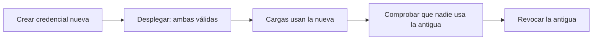

Un secreto es cualquier dato que, en manos equivocadas, da acceso: contraseñas de base de datos,
tokens de API, claves de firma, certificados privados. La mayoría de fugas graves no vienen de un
ataque sofisticado, sino de un secreto que alguien pegó en un archivo de configuración, subió a un
repositorio o dejó en un registro de logs. La tesis de este artículo es que la gestión de secretos se
diseña en dos decisiones: que el código nunca los contenga y que las cargas se identifiquen en lugar de
presentar una contraseña fija. Lo demás, bóvedas, rotación y auditoría, es consecuencia de esas dos.

Esa separación entre quién identifica y qué se entrega es la misma que aparece en la guía de gestión
de claves del NIST (SP 800-57, parte 1, revisión 5, 2020), que trata las claves como activos con ciclo
de vida: generación, uso, rotación, revocación y destrucción. Este artículo baja esa idea a la práctica
de un equipo de producto.

<Callout tone="info" title="Un secreto que ya se filtró está comprometido">
  Borrarlo del repositorio en el siguiente commit no lo recupera: el historial, los forks, las
  cachés de CI y los logs conservan la copia. La respuesta correcta es revocar o rotar el secreto y
  después limpiar el historial, en ese orden.
</Callout>

## Por qué el secreto no puede vivir en el repositorio

El repositorio es el lugar con más copias de un proyecto. Se clona en cada portátil, se replica en CI,
se cachea en imágenes de contenedor y queda en el historial para siempre. Cualquier persona con acceso
de lectura, incluidos antiguos colaboradores y sistemas externos conectados, puede ver lo que haya
ahí. Por eso un secreto en el repositorio no es un problema de configuración sino de diseño: el
artefacto que más se copia es el que menos debe contenerlo.

Hay tres lugares donde un secreto suele acabar por error, y conviene nombrarlos en el equipo:

- **El código fuente**: una cadena literal en un módulo, un ejemplo de configuración con un valor real
  o un script de pruebas que apunta a producción.
- **Las variables de despliegue**: se guardan en el sistema de CI, pero se imprimen en los logs si
  alguien ejecuta un comando de depuración, o se pasan como argumentos visibles en la lista de
  procesos.
- **Los artefactos**: una imagen de contenedor que incorpora un archivo `.env` durante la construcción
  queda con el secreto dentro de cada capa, aunque el archivo se borre después.

La regla práctica es que el repositorio contiene **nombres** de secretos y nunca sus valores. Un
archivo de configuración puede decir que existe una credencial llamada `pagos/db`, pero el valor
llega en tiempo de ejecución.

## Identidad de carga antes que secreto estático

La forma más segura de no tener un secreto es no necesitar uno. Una carga, es decir, un servicio, un
trabajo o un contenedor, puede demostrar quién es ante la bóveda usando la identidad que le da la
plataforma donde corre: el rol de la instancia, la cuenta de servicio de Kubernetes, o un certificado
emitido por un sistema de identidad. La bóveda comprueba esa identidad y entrega acceso a los secretos
que esa carga tiene asignados.

El estándar SPIFFE describe este modelo con identidades verificables llamadas SVID (SPIFFE Verifiable
Identity Document), en formato X.509 o JWT. La idea de fondo es que la identidad está ligada a la carga
y no a una contraseña que se copia. Los proveedores de nube ofrecen variantes del mismo principio:
roles asumidos temporalmente, federación con el proveedor de identidad de CI o cuentas de servicio sin
claves exportadas.

Esto cambia la pregunta de «dónde guardamos la contraseña» a «qué puede demostrar esta carga y a qué
le damos acceso». Cuando la identidad sustituye al secreto, rotar deja de ser una operación de
emergencia y pasa a ser automática.

## Secretos dinámicos y leases

Un secreto estático vive lo que tarde alguien en acordarse de cambiarlo. Un secreto dinámico se crea
bajo demanda para una carga concreta y caduca solo. La bóveda Vault de HashiCorp lo modela con
_leases_: cada secreto dinámico tiene un tiempo de vida (TTL), un tiempo máximo (max TTL) tras el cual
no se puede renovar, y se revoca automáticamente al expirar. La carga tiene que renovar su lease
mientras lo use, y si deja de renovarlo, el acceso desaparece sin que nadie tenga que actuar.

Esto da tres propiedades que valen más que cualquier política escrita. El acceso queda acotado en el
tiempo, la revocación es un evento normal y no una crisis, y la auditoría sabe quién tuvo qué acceso
y cuándo, porque cada credencial tiene nombre propio.

El coste aparece en la aplicación. Si el cliente de base de datos no sabe renovar o reconectar cuando
cambia la credencial, el servicio se cae al expirar el lease. Por eso el diseño de la integración, con
reconexión de pool, reintentos y lectura del secreto en el arranque o por intervalo, es parte del trabajo
de seguridad y no un detalle de implementación.

## Cifrado en sobre y la clave maestra

Una bóveda guarda secretos cifrados, y la clave que los cifra es, a su vez, un secreto. Ese es el
problema de la clave maestra: si está en la misma bóveda, el cifrado no protege nada. La solución
habitual es el cifrado en sobre (_envelope encryption_): cada secreto se cifra con una clave de datos,
y esa clave de datos se cifra con una clave maestra que vive en un gestor de claves separado, con
controles de acceso y registro propios.

En la figura de este artículo, la bóveda guarda los secretos y el gestor de claves guarda la clave
maestra en una caja aparte. Esa separación no es estética. Si un atacante obtiene un volcado de la
bóveda, sin acceso al gestor de claves no puede descifrar nada; y la clave maestra puede rotarse sin
volver a tocar cada secreto, reenvolviendo solo las claves de datos.

La decisión de qué gestor de claves usar depende de la nube, del cumplimiento que se exige y de quién
debe poder usar la clave. Lo importante es que el equipo sepa dónde vive cada clave y quién puede
usarla.

## Rotación sin cortar el servicio

Rotar un secreto significa cambiarlo, y el problema es que el cambio tiene que llegar a todas las
cargas que lo usan antes de que el valor antiguo deje de funcionar. Si se cambia en la bóveda y las
cargas tardan cinco minutos en recargarlo, hay cinco minutos de errores. Un patrón que evita esto es
la rotación en dos fases:

Primero se crea la credencial nueva sin revocar la antigua. Después se despliega el cambio para que las
cargas la empiecen a usar, y solo cuando la métrica de uso de la antigua llega a cero se revoca. La
ventana de solape es el tiempo que tarda el sistema en converger, no un número fijo: se mide con datos
de uso.

Los proveedores de nube automatizan parte de esto. AWS Secrets Manager admite rotación gestionada por el
propio servicio o mediante una función Lambda, y desde 2022 permite programar rotaciones tan frecuentes
como cada cuatro horas. Esa frecuencia tiene sentido solo si la aplicación relee el secreto sin
reiniciarse; si no, la rotación automática produce interrupciones programadas.

Dos reglas hacen la rotación rutinaria: que se pueda ejecutar sin intervención humana y que se pueda
probar en un entorno previo con el mismo procedimiento. Una rotación que solo se ha hecho una vez, a
mano y en producción, no es una capacidad del equipo, es una suerte.

## Detectar fugas antes de que se conviertan en incidentes

Ningún diseño elimina el error humano. Por eso conviene tener dos defensas. La primera es un escaneo de
secretos en el repositorio y en el historial, que detecte patrones de credenciales conocidas. La
segunda es bloquear los envíos que contienen un secreto antes de que lleguen al servidor. GitHub ofrece
_push protection_ con secret scanning: rechaza pushes que contienen secretos reconocidos, por CLI, web o
API; si alguien decide saltarse el bloqueo, el motivo queda registrado y genera una alerta.

El escaneo sirve también para la deuda existente. Un repositorio antiguo casi siempre tiene secretos
en su historial, y la primera auditoría suele encontrar más de los que el equipo esperaba. Esa lista
es la base del plan de rotación, con cada entrada marcada como revocada, rotada o justificada.

Cuando una fuga se confirma, el orden de trabajo importa. Primero se revoca o se rota la credencial,
porque cada minuto que sigue activa es una ventana para quien la tenga. Después se revisa el registro de
acceso para saber desde cuándo se usó la credencial, desde qué orígenes y con qué operaciones, porque eso
determina si hay datos que revisar o clientes que informar. Solo al final se limpia el repositorio y su
historial. Reescribir la historia es necesario, pero rompe las copias locales de todos los colaboradores, así
que conviene coordinarlo con ellos y tratarlo como una operación planificada.

Hay un paso que se olvida con frecuencia: las dependencias de la credencial. Si el mismo secreto lo usaban
otro servicio, un trabajo nocturno o un proveedor externo, su rotación también debe coordinarse, y la lista
de consumidores debe salir del inventario, no de la memoria de quien se acuerde. Un plan escrito para este
caso, con los responsables y los pasos en orden, evita improvisar bajo presión. Como cualquier procedimiento
de respuesta, conviene ensayarlo en un entorno previo antes de necesitarlo.

La rotación de la clave maestra sigue otra lógica. Como esa clave protege a las claves de datos y no
directamente a los secretos, su rotación consiste en reenvolver las claves de datos con la nueva clave
maestra y en conservar la anterior mientras existan datos cifrados con ella. Es una operación más lenta,
pero no interrumpe a las cargas, porque los secretos en uso no cambian. La regla que la protege es no
destruir una clave maestra antigua hasta comprobar que nada depende de ella: destruirla antes produce datos
irrecuperables, y ese error no tiene vuelta atrás.

La auditoría cierra el ciclo. Un registro de acceso sirve de poco si nadie lo revisa, y la mayoría de
equipos descubren sus accesos inesperados cuando ya hay un incidente. Conviene definir qué eventos se
revisan de forma rutinaria: lecturas de secretos fuera de horario, accesos desde identidades que no
corresponden a la carga esperada, intentos de acceso denegados repetidos y cambios de política. Esa revisión
no tiene que ser manual para todo; basta con alertas sobre unos pocos patrones y una revisión periódica del
resto. El objetivo es que cualquier acceso anómalo tenga un dueño que sepa explicarlo en menos de un día.

Hay también una decisión de diseño sobre el tiempo de vida de las credenciales que conviene tomar de forma
explícita. Una credencial de dos horas obliga a que la carga renueve con frecuencia, lo que aumenta la
dependencia del servicio de la bóveda y exige que la renovación sea robusta; una de tres meses es más sencilla
de operar, pero la ventana de exposición ante una fuga es mucho mayor. No hay un valor correcto universal. Lo que
sí debe cumplirse es que la duración sea una decisión escrita por secreto, con su justificación, y que la
renovación se pruebe en el mismo entorno de carga que la producción. Un valor corto sin renovación probada genera
caídas programadas; uno largo sin rotación genera un riesgo que nadie vuelve a mirar.

## Herramientas

- **Una bóveda** con secretos dinámicos o rotación automática, y un registro de acceso consultable.
- **Identidades de carga** de la plataforma (roles, cuentas de servicio, federación de CI) en lugar de
  claves exportadas.
- **Escaneo de secretos** en el repositorio, en los pull requests y en las imágenes de contenedor.
- **Push protection** o un hook equivalente que bloquee el envío antes de que llegue al servidor.
- **Un gestor de claves** separado de la bóveda para la clave maestra, con rotación documentada.

Ninguna herramienta sustituye a la decisión de no escribir el secreto en ningún sitio que no sea la
bóveda. Las herramientas detectan los descuidos; la identidad de carga evita que existan.

## Errores frecuentes

- **Borrar el secreto del código y dar el problema por resuelto.** El historial, los forks y los
  logs conservan la copia. Sin revocación, la fuga sigue viva.
- **Poner el secreto en la imagen de contenedor.** Cada capa conserva el contenido aunque se borre en
  una capa posterior. El secreto entra en tiempo de ejecución, no en la construcción.
- **Rotar sin medir el uso de la credencial antigua.** Revocar cuando no se ha comprobado que nadie
  la usa convierte la rotación en un incidente programado.
- **Guardar la clave maestra en la misma bóveda que los secretos.** El cifrado deja de proteger
  frente al robo de la bóveda.
- **Confiar en secretos de larga vida porque «nunca han dado problemas».** El coste aparece en la
  primera fuga, y entonces rotar es urgente y arriesgado.
- **Tratar los secretos de CI como seguros por defecto.** Un paso que imprime variables, o un
  pull request de un fork que ejecuta el pipeline, puede exponerlos.

## Checklist

- [ ] El repositorio contiene nombres de secretos, nunca valores, y el escaneo lo comprueba en cada
      pull request.
- [ ] Push protection o un bloqueo equivalente está activo, y las excepciones quedan registradas.
- [ ] Las cargas se identifican con su identidad de plataforma siempre que sea posible.
- [ ] Los secretos dinámicos o rotados tienen TTL o fecha de caducidad, y la aplicación sabe renovarlos
      o reconectar sin reiniciar.
- [ ] La clave maestra vive en un gestor de claves separado de la bóveda, con su propia rotación.
- [ ] Cada secreto tiene dueño, procedimiento de rotación probado en un entorno previo y ventana de
      solape medida.
- [ ] Existe un plan para revocar un secreto filtrado en menos de una hora, que incluye el historial y
      las cachés.
- [ ] La rotación se ejecuta según calendario y el resultado queda registrado.

## Fuentes

Consultadas en octubre de 2026. Las capacidades de Vault (leases, TTL y max TTL) se confirmaron con su
documentación de conceptos. La rotación de AWS Secrets Manager se confirmó con la nota de lanzamiento de
2022 sobre rotaciones de hasta cuatro horas. La protección de envíos de GitHub se confirmó con su
documentación. El modelo de identidades SPIFFE y el formato SVID se confirmaron con el proyecto; no se
verificó su fecha de graduación en la CNCF. La guía del NIST se cita por su número y revisión.

- [HashiCorp Vault: leases y secretos dinámicos (concepto)](https://developer.hashicorp.com/vault/docs/concepts/lease)
- [AWS Secrets Manager: rotación de secretos cada cuatro horas (nota de lanzamiento, 2022)](https://aws.amazon.com/about-aws/whats-new/2022/11/aws-secrets-manager-rotation-secrets-as-often-as-four-hours)
- [GitHub: push protection de secret scanning](https://docs.github.com/en/code-security/secret-scanning/introduction/about-push-protection)
- [Proyecto SPIFFE](https://github.com/spiffe/spiffe)
- NIST SP 800-57, _Recommendation for Key Management_, parte 1, revisión 5 (2020).
