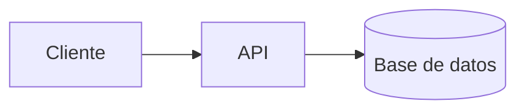

# Primeros pasos

Este documento es una **prueba de humo** del pipeline de contenido. Sirve para validar
MDX, frontmatter, búsqueda, indexación y SEO antes de escribir contenido real.

## Recorrido recomendado

1. Lee los [principios SOLID](/docs/solid) para afinar tu vocabulario de diseño.
2. Aprende a comunicar arquitectura con el [modelo C4](/docs/c4-model#niveles).
3. Pule tu código con las ideas de [clean code](/docs/clean-code).

## Código resaltado

```ts title="ejemplo.ts"
export function createArchitecture(name: string): string {
  return `Arquitectura: ${name}`;
}
```

## Diagrama Mermaid



<Callout tone="tip" title="Componentes embebidos">
  Los componentes del sistema de diseño están disponibles dentro de MDX sin necesidad de importarlos
  manualmente.
</Callout>

## Siguientes pasos

- Reemplaza este documento con contenido real.
- Enlaza internamente con rutas absolutas: `/docs/<slug>` y anclas `#seccion`.
- Mantén las descripciones entre 40 y 160 caracteres y ejecuta `bun run audit`.
