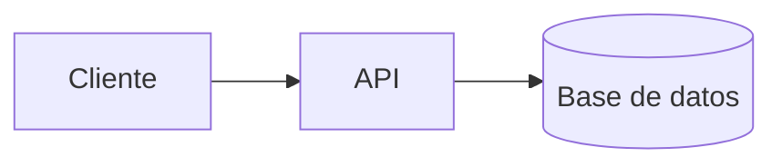

# Primeros pasos

Este sitio es una biblioteca viva sobre **arquitectura de software**, escrita para
desarrolladores que quieren pasar de «hacer que funcione» a «diseñar para que siga funcionando».
Cada documento es una guía práctica con ejemplos, diagramas, listas de verificación y
ejercicios, disponible en español e inglés, con búsqueda integrada y funcionamiento sin
conexión.

Esta página te orienta: qué entendemos por arquitectura, qué hay en la biblioteca, en qué orden
leerla según tu punto de partida, cómo sacarle partido al sitio y, si quieres aportar, cómo
crear tu primer documento.

## Qué es este sitio y para quién es

Está pensado para tres perfiles:

- **Desarrolladores que crecen hacia la arquitectura.** Ya construyen funcionalidades y quieren
  tomar mejores decisiones de diseño.
- **Líderes técnicos.** Necesitan vocabulario común, criterios de revisión y formas de comunicar
  decisiones al equipo y a negocio.
- **Arquitectos con experiencia.** Buscan una referencia ordenada y al día para consultar y
  compartir.

Los documentos no son teoría abstracta. Cada uno sigue la misma lógica: **qué es, qué problema
resuelve, cómo se ve bien y mal aplicado, y cómo practicarlo mañana mismo.**

## Qué entendemos por arquitectura

Arquitectura no es dibujar cajas ni elegir la tecnología de moda. Una definición útil:

> Arquitectura es el conjunto de decisiones que son **caras de cambiar**.

Elegir cómo se dividen los módulos, dónde viven los datos, qué se comunica de forma síncrona o
asíncrona o qué lenguaje usa cada pieza son decisiones de arquitectura precisamente porque
deshacerlas más tarde cuesta mucho. Por eso buena parte del oficio consiste en:

1. **Reconocer** qué decisiones son difíciles de revertir.
2. **Retrasarlas** hasta tener información suficiente, cuando es posible.
3. **Documentarlas** con su motivo, para que el equipo no las repita ni las deshaga por
   accidente.
4. **Protegerlas** con reglas automáticas para que no se erosionen.

La arquitectura se juega a **tres escalas** que conviene dominar por separado: el **código**
(cómo se lee y cambia cada pieza), los **módulos** (cómo se relacionan entre sí) y el
**sistema** (qué piezas ejecutables hay y cómo se comunican). La biblioteca está organizada para
recorrer esas escalas.

## Mapa de contenidos

La biblioteca se agrupa en temas. Cada tema responde a una pregunta distinta:

| Tema                    | Pregunta que responde                                       | Documentos                                             |
| ----------------------- | ----------------------------------------------------------- | ------------------------------------------------------ |
| **Fundamentos**         | ¿Qué principios sostienen un buen diseño?                   | [Principios SOLID](/docs/solid)                        |
| **Diseño de sistemas**  | ¿Cómo comunico y decido la estructura de un sistema?        | [Modelo C4](/docs/c4-model)                            |
| **Prácticas y calidad** | ¿Cómo mantengo el código sano día a día?                    | [Clean code](/docs/clean-code)                         |
| **Tendencias**          | ¿Qué cambia en la industria y cómo afecta a mis decisiones? | [Lenguajes en la era de la IA](/docs/lenguajes-era-ia) |

Los temas crecen con el contenido: cuando se añade un documento nuevo, aparece solo en el índice
lateral, en los filtros y en la portada.

## Rutas de aprendizaje según tu perfil

El orden importa menos que la práctica, pero estos recorridos evitan lagunas.

### Si estás empezando en diseño

Ve de lo pequeño a lo grande, de modo que cada escala se apoye en la anterior:

1. [Clean code](/docs/clean-code): nombres, funciones, errores y refactoring. Es la base de todo.
2. [Principios SOLID](/docs/solid): cómo se relacionan los módulos entre sí.
3. [Modelo C4](/docs/c4-model): cómo se ve y se comunica el sistema completo.
4. [Lenguajes en la era de la IA](/docs/lenguajes-era-ia): hacia dónde va la industria.

### Si lideras un equipo técnico

Prioriza lo que te ayuda a **alinear y decidir**:

1. [Modelo C4](/docs/c4-model#nivel-1-contexto): empieza por el nivel de contexto para alinear
   expectativas con negocio.
2. [Clean code](/docs/clean-code#revisión-de-código): usa la sección de revisión como guion de
   conversación en pull requests.
3. [Principios SOLID](/docs/solid): para discutir diseño con criterios compartidos.
4. [Lenguajes en la era de la IA](/docs/lenguajes-era-ia#cómo-decidir): para fundamentar
   decisiones de tecnología.

### Si ya eres arquitecto

Usa la biblioteca como **referencia y como material para tu equipo**: consulta con la búsqueda,
comparte fragmentos concretos con enlaces directos y revisa las secciones de errores frecuentes
y checklists para tus propios procesos de revisión.

## Plan de cuatro semanas

Un ritmo realista para quien trabaja a tiempo completo. La clave es **aplicar cada tema a tu
código real** antes de pasar al siguiente.

| Semana | Foco                | Lectura                      | Práctica                                                                     |
| ------ | ------------------- | ---------------------------- | ---------------------------------------------------------------------------- |
| 1      | Código limpio       | Clean code                   | Haz el ejercicio guiado con una función real de tu proyecto                  |
| 2      | Diseño de módulos   | Principios SOLID             | Detecta una violación en tu código y refactorízala en pasos pequeños         |
| 3      | Visión del sistema  | Modelo C4                    | Dibuja el contexto y los contenedores de tu sistema y súbelos al repositorio |
| 4      | Decisiones y futuro | Lenguajes en la era de la IA | Escribe un registro de decisión (ADR) comparando dos alternativas            |

Al final de las cuatro semanas deberías tener: una función mejorada, un refactoring revisado por
tu equipo, diagramas versionados y un ADR. Eso vale más que haber leído todo.

## Cómo sacar partido al sitio

La biblioteca está pensada para consultarla, no solo para leerla de principio a fin.

- **Paleta de comandos.** Pulsa `Ctrl + K` (`⌘ + K` en Mac) o `/` desde cualquier página, o toca
  el botón «Buscar» del encabezado. Entiende acentos, combina título, etiquetas, encabezados y
  descripción, y te lleva directo a la sección que contiene lo que buscas. Navega con `↑` `↓`,
  abre con `Enter` y cierra con `Esc`.
- **Filtrar por etiqueta.** Escribe `#` para ver las etiquetas o `#solid liskov` para buscar
  solo dentro de una etiqueta. Al tocar una etiqueta en un artículo o en la portada, la paleta
  se abre ya filtrada.
- **Más que búsqueda.** Sin escribir nada la paleta ofrece documentos, temas, etiquetas y
  acciones como cambiar el tema o el idioma.
- **Índice «En esta página».** En pantallas grandes aparece en el margen y resalta la sección
  activa; en móvil es un bloque plegable al inicio del documento.
- **Selección de texto.** Si seleccionas un fragmento aparece una barra para copiarlo, copiarlo
  como cita, obtener un enlace directo a ese fragmento, compartirlo o abrir un comentario en
  GitHub con la cita incluida.
- **Anclas.** El símbolo `#` junto a cada encabezado copia su enlace.
- **Compartir.** Al final de cada artículo puedes copiar el enlace, usar la hoja nativa del
  dispositivo o enviarlo por X, LinkedIn o correo.
- **Tema claro, oscuro o del sistema.** El selector del encabezado cicla entre los tres.
- **Idioma.** Cambia entre español e inglés desde el selector del encabezado.
- **Sin conexión.** El sitio es una aplicación web instalable que guarda el contenido en la
  caché del navegador, así que puedes leer sin conexión, incluso en enlaces profundos.
- **Suscripción.** Cada idioma tiene su feed RSS en `/<idioma>/feed.xml`.

<Callout tone="tip" title="Lee con un objetivo">
  Antes de abrir un documento, escribe una pregunta concreta de tu proyecto («¿cómo separo estas dos
  responsabilidades?»). Leer con una pregunta en mente retiene mucho más que leer por curiosidad.
</Callout>

## Vocabulario esencial

Estos términos aparecen una y otra vez. Conviene tenerlos claros antes de empezar.

| Término                 | Significado breve                                                                   |
| ----------------------- | ----------------------------------------------------------------------------------- |
| **Acoplamiento**        | Cuánto depende un módulo de otro. Menos es mejor: los cambios no se propagan.       |
| **Cohesión**            | Cuán relacionadas están las responsabilidades dentro de un módulo. Más es mejor.    |
| **Abstracción**         | Esconder detalles tras una interfaz para depender de lo esencial.                   |
| **Contenedor (C4)**     | Aplicación o almacén de datos que se ejecuta por separado, no un contenedor Docker. |
| **Atributo de calidad** | Propiedad como rendimiento, seguridad o mantenibilidad que condiciona el diseño.    |
| **ADR**                 | Registro de una decisión de arquitectura: contexto, decisión y consecuencias.       |
| **Deuda técnica**       | Coste futuro de un atajo de hoy. No es mala si es deliberada, visible y pagada.     |
| **Refactoring**         | Cambiar la estructura del código sin cambiar su comportamiento.                     |
| **Trade-off**           | Compromiso: ganar en una cualidad a costa de otra. Toda decisión lo tiene.          |

## Cómo estudiar para que se quede

Leer solo produce familiaridad, no habilidad. Un método sencillo que funciona:

1. **Lee** un documento en una sola sesión, sin prisas, con la pregunta en mente.
2. **Aplícalo** el mismo día a algo real: una función, un diagrama, una revisión.
3. **Escríbelo:** una nota o un ADR con lo que decidiste y por qué.
4. **Compártelo** con alguien del equipo. Explicar es la mejor prueba de comprensión.
5. **Vuelve** al cabo de unas semanas y comprueba si la decisión sigue teniendo sentido.

Un solo refactoring real enseña más que cinco lecturas.

## Contribuir contenido

Si quieres aportar un documento o mejorar uno existente, esta sección explica cómo está
construido el sitio. Cada página combina texto, código resaltado, diagramas Mermaid y
componentes embebidos.

### Anatomía de un documento

Un documento es **un archivo MDX por idioma**: `src/content/docs/<idioma>/<slug>.mdx`. El
`slug` va en minúsculas con guiones y debe ser **idéntico en todos los idiomas**; la auditoría
avisa si falta alguna traducción.

Comienza con un frontmatter validado automáticamente:

```yaml title="ejemplo.mdx"
---
title: 'Título claro del documento'
description: 'Resumen de entre 40 y 160 caracteres, que se usa en buscadores y en la búsqueda.'
category: fundamentos
tags:
  - arquitectura
  - ejemplo
order: 3
updatedAt: 2026-10-12
---
```

| Campo         | Regla                                                   |
| ------------- | ------------------------------------------------------- |
| `title`       | Entre 3 y 60 caracteres                                 |
| `description` | Entre 40 y 160 caracteres                               |
| `category`    | Id de una sección existente en la taxonomía             |
| `tags`        | Hasta 5, en minúsculas con guiones y sin repetir        |
| `order`       | Entero mayor o igual que 0; ordena dentro de la sección |
| `updatedAt`   | Fecha `AAAA-MM-DD`, no puede ser futura                 |
| `publishedAt` | Opcional, fecha `AAAA-MM-DD`                            |

<Callout tone="warning" title="Entrecomilla títulos y descripciones con dos puntos">
  Si un título o una descripción contiene `: ` (dos puntos y espacio), el frontmatter es YAML
  inválido salvo que lo entrecomilles. Ante la duda, usa comillas dobles.
</Callout>

En el cuerpo se aplican reglas de estructura que la auditoría comprueba:

- Al menos un encabezado `h2` y **sin saltos de nivel** (de `h2` a `h4`).
- **Anclas únicas:** no repitas el texto de dos encabezados.
- Enlaces internos con ruta absoluta (`/docs/<slug>`) y anclas que existan en el destino.
- Bloques de código siempre cerrados.

Dentro del texto puedes usar bloques de código con título, diagramas Mermaid y avisos:

````md
```ts title="ejemplo.ts"
export function createArchitecture(name: string): string {
  return `Arquitectura: ${name}`;
}
```



<Callout tone="tip" title="Un aviso">
  Los tonos disponibles son `info`, `tip` y `warning`.
</Callout>
````

### Flujo de trabajo

1. Crea el archivo del documento en **cada idioma**.
2. Regenera el índice: `bun run content:index`.
3. Comprueba la estructura: `bun run audit`.
4. Ejecuta todas las verificaciones: `bun run check` (formato, lint, tipos, auditoría, tests).
5. Haz el commit con un mensaje convencional, por ejemplo `docs(contenido): añade guía de ADR`.

Para un tema nuevo basta con añadir su entrada en `src/lib/content/taxonomy.json`: aparece solo en
la portada, el índice lateral y los filtros. Todas las reglas del proyecto están en
`AGENTS.md`, en la raíz del repositorio. En cada documento encontrarás al final el enlace
**Editar en GitHub** para proponer cambios directamente.

## Siguientes pasos

- Empieza hoy: abre [Clean code](/docs/clean-code) y elige una función de tu proyecto.
- Cuando quieras ver el sistema completo, pasa al [modelo C4](/docs/c4-model).
- Si necesitas fundamentar una decisión de tecnología, consulta
  [lenguajes en la era de la IA](/docs/lenguajes-era-ia).
- Si algo no está claro, selecciona el texto y abre un comentario: las dudas mejoran la
  biblioteca.
