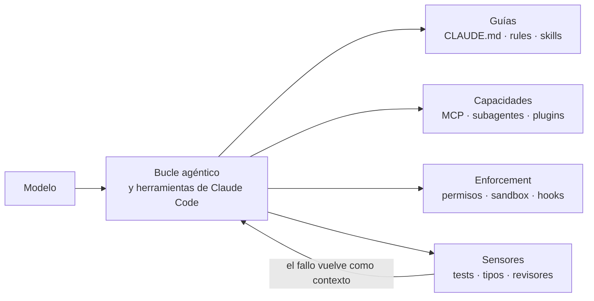
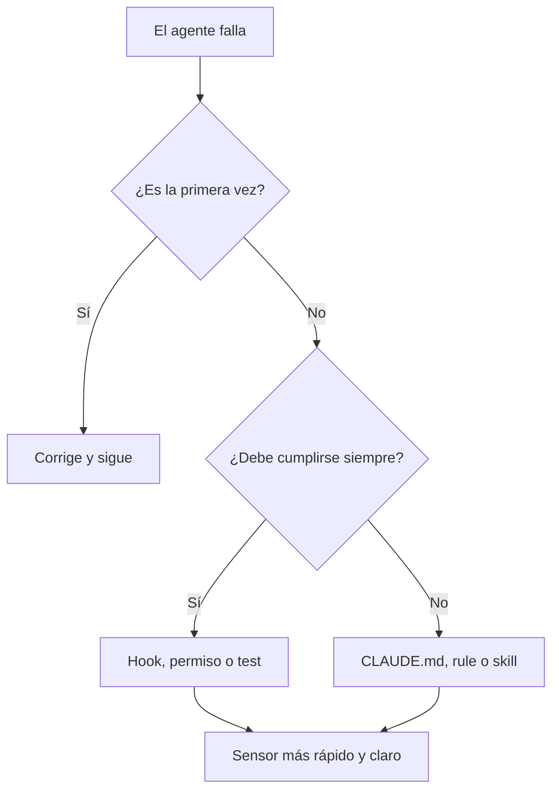

# Harness engineering con Claude Code

El modelo es solo la mitad de un agente. La otra mitad es todo lo que lo rodea: qué sabe al
empezar, qué herramientas alcanza, qué le está permitido, qué se comprueba por él y qué queda
registrado. A esa otra mitad se le llama **harness** (arnés), y diseñarla es una decisión de
arquitectura, no un detalle de configuración.

Este artículo recorre las piezas de Claude Code que forman ese arnés (memoria, hooks, permisos,
sandbox, skills, subagentes, plugins y workflows dinámicos), cuándo usar cada una y qué ha
cambiado en las últimas versiones. Al final hay un caso real, un orden para construirlo sin
sobreingeniería y una checklist.

<Callout tone="info" title="Fecha de corte">
  Los datos son de octubre de 2026 (Claude Code v2.1.296, del 9 de octubre). Anthropic usa la
  palabra «harness» en sus artículos de ingeniería, pero su documentación de producto habla de
  memoria, hooks, skills o permisos; aquí se juntan ambos vocabularios. Las versiones se mueven
  rápido: contrasta con el [changelog oficial](https://code.claude.com/docs/en/changelog).
</Callout>

## Qué es un harness

Birgitta Böckeler (Thoughtworks) lo define en martinfowler.com como «todo lo que hay en un
agente de IA excepto el modelo». Su artículo distingue dos capas: el harness que ya trae la
herramienta (en Claude Code, el bucle agéntico y sus herramientas integradas) y el **harness
exterior** que construyes tú encima. Ese exterior tiene dos objetivos: que el primer intento
salga bien más a menudo y que los errores se detecten antes de que los vea una persona.

La fórmula que se repite en la comunidad es _agente = modelo + harness_. Conviene tomarla en
serio por una consecuencia práctica: cuando el agente falla de forma repetida, rara vez la
solución es «un mejor prompt». Es **mejorar el harness** para que ese fallo no pueda repetirse.

Hay además una idea que enlaza con el resto de esta biblioteca. Böckeler habla de
_harnessability_: unos repositorios son más fáciles de arnesar que otros. Los tipos estrictos,
los límites de módulo claros y las capas con dependencias comprobables son «afordancias del
entorno» que hacen el código legible para un agente. Es decir, [SOLID](/docs/solid), el
[código limpio](/docs/clean-code) y un buen [modelo C4](/docs/c4-model) siguen siendo la mejor
inversión previa; y los [tipos](/docs/lenguajes-era-ia) funcionan como contexto compartido entre
modelo y compilador.

## Guías y sensores

El mismo artículo propone una clasificación útil para decidir qué construir:

- **Guías (feedforward):** orientan al agente _antes_ de actuar. Convenciones, instrucciones,
  documentación de referencia, plantillas.
- **Sensores (feedback):** observan _después_ de actuar y le permiten autocorregirse. Linters,
  tests, tipos, revisores.
- **Computacionales:** deterministas y rápidos (tests, tipos, análisis estructural). Se pueden
  ejecutar en cada cambio.
- **Inferenciales:** semánticos y probabilísticos (revisión por IA, LLM como juez). Más lentos y
  caros, pero aportan juicio.

Sin sensores, las reglas se escriben y nadie las comprueba; sin guías, el agente repite los
mismos errores hasta que un sensor lo frena. Así se reparte en Claude Code:

| —                 | Guía (antes de actuar)                                    | Sensor (después de actuar)                                                                         |
| ----------------- | --------------------------------------------------------- | -------------------------------------------------------------------------------------------------- |
| **Computacional** | Hook `SessionStart` con contexto, code intelligence (LSP) | Hook `PostToolUse` con linter o tipos, tests, hook `Stop` que corre checks                         |
| **Inferencial**   | `CLAUDE.md`, rules, skills, output styles                 | Subagente revisor, `/code-review`, hooks `prompt` y `agent`, verificación adversarial en workflows |

Böckeler también ordena lo que se quiere regular en tres categorías: **mantenibilidad** (la más
fácil, hay muchas herramientas), **adecuación arquitectónica** (fitness functions) y
**comportamiento** (la menos resuelta: especificaciones como guía y tests generados como sensor,
con revisión manual detrás).

## El mapa de Claude Code

Cada mecanismo ocupa un lugar distinto en el bucle del agente. Lo importante para el diseño es
separar lo que **sugiere** de lo que **garantiza**.



| Mecanismo           | Para qué sirve                                      | Cuándo carga                               | Garantía         |
| ------------------- | --------------------------------------------------- | ------------------------------------------ | ---------------- |
| `CLAUDE.md`         | Convenciones y comandos que siempre aplican         | Al iniciar la sesión, completo             | Sugerencia       |
| `.claude/rules/`    | Reglas por tipo de archivo o carpeta                | Al inicio o al abrir archivos coincidentes | Sugerencia       |
| Skills              | Conocimiento y flujos bajo demanda                  | Descripción siempre; cuerpo al usarla      | Sugerencia       |
| Subagentes          | Trabajo en contexto aislado                         | Al crearlos                                | Aislamiento      |
| Workflows dinámicos | Orquestar decenas de agentes con un script          | Al lanzarlos                               | Estructura       |
| MCP                 | Conectar sistemas externos                          | Nombres al inicio, esquemas bajo demanda   | Capacidad        |
| Hooks               | Automatizar y bloquear en eventos del ciclo de vida | Al dispararse el evento                    | **Determinista** |
| Permisos y sandbox  | Qué puede hacer y a qué puede llegar                | Siempre activos                            | **Determinista** |
| Plugins             | Empaquetar y distribuir todo lo anterior            | Según sus componentes                      | —                |

La regla de oro la dice la propia documentación: «Claude trata `CLAUDE.md` como contexto, no como
configuración impuesta». Todo lo que deba cumplirse **siempre** va en un hook o en un permiso,
no en un prompt.

## Capa 1: memoria (`CLAUDE.md`, rules y auto memory)

Cada sesión empieza con la ventana de contexto vacía. Dos mecanismos llevan conocimiento de una
sesión a otra:

- **`CLAUDE.md`:** instrucciones que escribes tú. Se cargan desde la política gestionada, el
  usuario (`~/.claude/CLAUDE.md`), el proyecto (`./CLAUDE.md` o `./.claude/CLAUDE.md`) y lo
  local (`./CLAUDE.local.md`, fuera de git). Los archivos se **concatenan**, no se pisan; los de
  subdirectorios se cargan cuando Claude toca archivos de esa carpeta.
- **Auto memory:** notas que Claude escribe a partir de tus correcciones. Al inicio se cargan
  las primeras 200 líneas o 25 KB.

Si tu repositorio ya usa `AGENTS.md` para otros agentes, Claude Code puede leerlo en lugar de un
`CLAUDE.md`. Las importaciones con `@ruta` expanden otros archivos al arrancar (hasta cuatro
saltos), pero **no reducen el coste de contexto**: lo importado también se carga.

Cómo escribirlo bien:

- **Menos de 200 líneas por archivo.** Más largo consume contexto y baja la adherencia.
- **Instrucciones verificables:** «usa indentación de 2 espacios» en lugar de «formatea bien».
- **Sin contradicciones:** si dos reglas chocan, Claude puede elegir una al azar. Ejecuta
  `/doctor prompt-audit` (desde v2.1.283) para que detecte reglas obsoletas, rutas que no existen
  o archivos que se contradicen.
- **Notas para humanos** en comentarios HTML de bloque: se eliminan antes de llegar al contexto.
- **Lo que solo importa en una parte** del código va a una rule con `paths` o a una skill.

```markdown
---
paths: ['src/routes/**/*.tsx']
---

- En las opciones de ruta, `loader` va antes de `head`.
```

El criterio para añadir algo es empírico: cuando Claude comete el mismo error por segunda vez,
cuando una revisión de código detecta algo que debía saber o cuando escribes la misma
corrección que la sesión anterior. Eso es una edición de memoria, no una corrección suelta en el
chat.

## Capa 2: hooks, el enforcement determinista

Un hook es un comando, una petición HTTP, una llamada a una herramienta MCP, un prompt o un
subagente que Claude Code ejecuta en un punto del ciclo de vida. Claude no decide si se ejecuta:
**siempre** se dispara en su evento. Por eso son la pieza central del harness.

La documentación define **33 eventos**. Estos son los que más importan al diseñar un arnés:

| Evento               | Cuándo se dispara                                   | ¿Puede bloquear?           |
| -------------------- | --------------------------------------------------- | -------------------------- |
| `SessionStart`       | Al iniciar o reanudar la sesión                     | No (puede añadir contexto) |
| `UserPromptSubmit`   | Al enviar un prompt, antes de procesarlo            | Sí                         |
| `PreToolUse`         | Antes de ejecutar una herramienta                   | Sí                         |
| `PermissionRequest`  | Cuando una herramienta necesita decisión de permiso | No (usa `decision`)        |
| `PostToolUse`        | Después de una herramienta que tuvo éxito           | No (da feedback a Claude)  |
| `PostToolBatch`      | Tras un lote de herramientas en paralelo            | Sí                         |
| `SubagentStop`       | Cuando termina un subagente                         | Sí                         |
| `Stop`               | Cuando Claude termina de responder                  | Sí                         |
| `PreCompact`         | Antes de compactar el contexto                      | Sí                         |
| `ConfigChange`       | Cuando cambia la configuración durante la sesión    | Sí                         |
| `InstructionsLoaded` | Al cargarse `CLAUDE.md` o una rule                  | No                         |

Hay cinco tipos de manejador: `command` (recibe JSON por stdin), `http`, `mcp_tool`, `prompt`
(un modelo evalúa en un solo turno) y `agent` (un subagente verifica con herramientas; marcado
como experimental). Se declaran en `~/.claude/settings.json`, `.claude/settings.json` (se
comparte por git), `.claude/settings.local.json`, la política gestionada, el `hooks/hooks.json`
de un plugin o el frontmatter de una skill o subagente. Los hooks de todas las fuentes se
**suman**: todos se ejecutan.

### Bloquear: el patrón `PreToolUse`

Un hook que sale con código **2** detiene la acción y devuelve su `stderr` a Claude como motivo,
de modo que puede corregirse. El patrón sirve para proteger archivos generados, comandos o rutas. Primero se declara en `.claude/settings.json`, asociando un _matcher_ de herramientas con el script:

```json
"PreToolUse": [{
  "matcher": "Edit|Write",
  "hooks": [{ "type": "command", "command": "${CLAUDE_PROJECT_DIR}/.claude/hooks/block-generated.sh" }]
}]
```

El script solo necesita cumplir este contrato:

| Pieza    | Contrato                                                                |
| -------- | ----------------------------------------------------------------------- |
| Entrada  | JSON por stdin con `tool_name` y `tool_input` (por ejemplo `file_path`) |
| Salida 0 | No opina: la acción sigue el flujo normal de permisos                   |
| Salida 2 | Bloquea la acción; lo escrito en `stderr` vuelve a Claude como motivo   |

```bash
FILE=$(jq -r '.tool_input.file_path // empty')
# …si FILE es un archivo generado: mensaje a stderr con el comando que lo regenera, y exit 2
```

Nombra el script por lo que protege (`block-generated.sh`) y haz que el mensaje de error diga qué
hacer en su lugar: Claude lo lee y se corrige.

El mismo resultado se puede expresar con JSON en stdout y salida 0:
`permissionDecision` admite `allow`, `deny`, `ask` y `defer`, y `updatedInput` reescribe los
argumentos antes de ejecutar. Elige un enfoque por hook: no los mezcles.

<Callout tone="warning" title="Un guardia que falla, deja pasar">
  Con cualquier código de salida distinto de 0 y 2, la acción **continúa** y solo aparece un aviso.
  Si el hook es una barrera de seguridad, una caída del script la abre. Desde la v2.1.295 los hooks
  de tipo `command` y `http` aceptan `"onFailure": "block"` en su definición: si no arrancan, se
  agotan o salen con un código inesperado, la acción se bloquea en lugar de pasar.
</Callout>

### Sentir: `PostToolUse` y `Stop`

Los sensores computacionales viven aquí. Un `PostToolUse` con linter alimenta el resultado a
Claude como texto que puede leer y corregir. Un hook `Stop` impide que Claude dé por terminado el trabajo mientras los checks rápidos fallen. El contrato de `stop-gate.sh`: lee `stop_hook_active` de la entrada y, si es `true`, sale sin hacer nada; si no, ejecuta los checks rápidos (aquí, auditoría y tipos) y, si fallan, escribe el final de su salida en `stderr` y sale con 2 para que Claude siga trabajando.

```bash
[ "$(jq -r '.stop_hook_active')" = "true" ] && exit 0 # evita el bucle
# …checks rápidos; si fallan: cola de la salida a stderr y exit 2
```

Claude Code anula un hook `Stop` que bloquee ocho veces seguidas sin que Claude haya llamado a
ninguna herramienta entre medias, así que comprobar `stop_hook_active` es obligatorio. Y la
regla de Böckeler sobre el momento aplica: los sensores baratos van pronto (aquí, auditoría y
tipos); los caros, como la suite completa, después de integrar.

## Capa 3: permisos y sandbox

Los permisos deciden qué ocurre sin preguntarte; el sandbox limita a qué puede llegar un
comando aunque se apruebe. Son controles distintos y se complementan.

### Modos de permiso

| Modo                | Qué se ejecuta sin preguntar                           | Mejor para                          |
| ------------------- | ------------------------------------------------------ | ----------------------------------- |
| `default` (Manual)  | Solo lecturas                                          | Revisar cada acción                 |
| `acceptEdits`       | Lecturas, ediciones y comandos básicos de archivos     | Iterar sobre código que revisas     |
| `plan`              | Lecturas                                               | Explorar antes de cambiar           |
| `auto`              | Todo, con comprobaciones de seguridad en segundo plano | Tareas largas, menos interrupciones |
| `dontAsk`           | Solo lo preaprobado; lo demás se deniega               | CI y scripts blindados              |
| `bypassPermissions` | Todo                                                   | Solo contenedores o VM aislados     |

En modo `auto`, un segundo modelo (el _clasificador_) revisa las acciones antes de ejecutarlas y
bloquea lo que excede lo que pediste, apunta a infraestructura desconocida o parece dirigido por
contenido hostil que Claude leyó. Desde la v2.1.283 es el modo inicial de las sesiones
interactivas de terminal y VS Code.

Encima del modo se aplican **reglas de permiso**, evaluadas en orden **deny, ask, allow**: la
primera coincidencia manda. Las reglas `deny` bloquean en todos los modos, incluso
`bypassPermissions`.

```json
"permissions": {
  "deny": ["Bash(npm *)", "Bash(npx *)", "Edit(/src/routeTree.gen.ts)"]
}
```

Las rutas de `Edit` y `Read` usan sintaxis tipo gitignore: `/ruta` es relativa a la raíz del
proyecto, `//ruta` es absoluta y `~/ruta` parte del home.

### Sandbox

El sandbox de Bash es un límite que impone el **sistema operativo** sobre los comandos de shell
y los procesos que arrancan: macOS usa Seatbelt; Linux y WSL2 usan `bubblewrap` y `socat`. La red
sale por un proxy que solo admite los dominios de `network.allowedDomains`, que empieza vacío.

Pon atención a lo que **queda fuera**: las herramientas de archivos y web (Read, Edit, Write,
WebFetch, WebSearch) se rigen por reglas de permiso y no por el sandbox, y los servidores MCP y
los hooks también se ejecutan fuera de él. En Windows nativo los comandos se ejecutan sin sandbox. La
defensa en profundidad significa combinar las tres capas: reglas de permiso para las
herramientas de archivos, sandbox para los comandos y hooks para las políticas propias.

## Capa 4: skills, subagentes y plugins

### Skills: conocimiento bajo demanda

Una skill es un directorio con un `SKILL.md`. Carga **progresivamente**: el nombre y la
descripción están siempre en contexto, el cuerpo entra al invocarla y los archivos de apoyo solo
cuando el cuerpo los menciona. Mantén el `SKILL.md` por debajo de 500 líneas.

```markdown
---
name: release
description: Prepara una release: changelog, versión y verificación. Úsala al publicar.
disable-model-invocation: true
---
```

El cuerpo son los pasos del procedimiento, en pocas líneas: ejecutar los checks y parar si fallan,
actualizar el changelog desde los commits convencionales y proponer la versión según SemVer.

Campos del frontmatter que más rinden: `disable-model-invocation` (solo tú la invocas; úsalo en
todo lo que tenga efectos secundarios), `allowed-tools`, `context: fork` (corre en un subagente),
`paths` (limita la activación automática) y `hooks` (registra hooks mientras está activa). Los
comandos personalizados se fusionaron con las skills: `.claude/commands/deploy.md` y
`.claude/skills/deploy/SKILL.md` crean el mismo `/deploy`, y para trabajo nuevo se prefieren las
skills.

### Subagentes: aislar contexto

Un subagente es un archivo Markdown en `.claude/agents/` cuyo cuerpo es el prompt de sistema.
Corre en su propia ventana de contexto y devuelve un resumen, así que la lectura de decenas de
archivos no contamina tu conversación.

```markdown
---
name: rule-auditor
description: Audita un diff contra AGENTS.md. Úsalo antes de abrir un PR.
disallowedTools: Edit, Write
model: sonnet
---
```

El cuerpo es el prompt de sistema: pide listar solo violaciones concretas de las reglas, con
archivo y línea, y cerrar con un veredicto APTO o NO APTO. Fíjate en la `description`: es lo que
Claude lee para decidir cuándo delegar, así que di cuándo usarlo, no solo qué hace.

Lo que conviene saber al diseñar:

- **Restringe herramientas:** `tools` es una lista de permitidas y `disallowedTools` una de
  denegadas, que se aplica primero.
- **Aísla escrituras:** `isolation: worktree` ejecuta el subagente en un worktree git temporal.
- **Elige el modelo por tarea.** Orden de resolución: parámetro de la invocación, frontmatter
  `model`, variable `CLAUDE_CODE_SUBAGENT_MODEL` y, por último, el modelo de la conversación.
- **Forks:** el subagente `fork` hereda toda la conversación y comparte la caché de prompt;
  está activo por defecto en sesiones interactivas.
- **Límites:** hasta 20 subagentes concurrentes y tres niveles de anidamiento, ajustables con
  variables de entorno.

### Plugins: distribuir el arnés

Un plugin empaqueta skills, hooks, subagentes y servidores MCP en una unidad instalable, con
nombres con espacio de nombres (`/mi-plugin:review`). Es la forma de llevar el mismo arnés a un
segundo repositorio o a todo un equipo mediante un _marketplace_. Desde la v2.1.292,
`claude plugin install --marketplace <fuente>` añade el marketplace si hace falta e instala en
un paso.

## Capa 5: workflows dinámicos

Es la pieza más reciente, descrita por Anthropic en su blog el 2 de junio de 2026. Un workflow es
un **script de JavaScript** que orquesta muchos subagentes. Claude lo escribe para tu tarea y un
runtime lo ejecuta en segundo plano mientras la sesión sigue libre.

La diferencia con las otras piezas es **quién sostiene el plan**:

| —                            | Subagentes                | Skills                      | Workflows                    |
| ---------------------------- | ------------------------- | --------------------------- | ---------------------------- |
| Qué decide el siguiente paso | Claude, turno a turno     | Claude, siguiendo el prompt | El script                    |
| Dónde viven los resultados   | En la ventana de contexto | En la ventana de contexto   | En variables del script      |
| Escala                       | Unas pocas delegaciones   | Igual que subagentes        | Decenas o cientos de agentes |
| Qué se puede repetir         | La definición del worker  | Las instrucciones           | La orquestación completa     |

Los autores señalan tres fallos de una sola ventana de contexto larga: la **pereza agéntica**
(da por terminado un trabajo grande tras resolver 35 de 50 elementos), el **sesgo autopreferente**
(favorece sus propios resultados al juzgarlos) y la **deriva del objetivo** (cada compactación
pierde fidelidad). Con subagentes aislados y un script que verifica, el contexto principal solo
recibe el resultado final.

Así se ve la forma de un workflow guardado: `agent()` lanza un subagente, `pipeline()` pasa cada elemento por varias etapas y `parallel()` ejecuta tareas a la vez. Importa más la estructura (listar, analizar, verificar) que el texto de cada prompt, y `slugsSchema` es un JSON Schema que obliga a devolver una lista de cadenas:

```javascript
export const meta = { name: 'audit-docs-i18n', description: 'Paridad es/en por documento' };

const listing = await agent('Lista los slugs de src/content/docs/es.', { schema: slugsSchema });
const verified = await pipeline(
  listing.slugs,
  (slug) => agent(`Compara es/${slug}.mdx con en/${slug}.mdx`), // etapa 1: hallazgos
  (findings) => agent(`Intenta refutar: ${JSON.stringify(findings)}`), // etapa 2: verificación
);
return verified.filter(Boolean);
```

Seis patrones de composición aparecen en el artículo de Anthropic: **clasificar y actuar**,
**abrir en abanico y sintetizar**, **verificación adversarial** (otro agente comprueba cada
salida), **generar y filtrar**, **torneo** (comparaciones por pares, más fiables que una
puntuación absoluta) y **repetir hasta terminar**. Para contenido no confiable sirve el patrón
de _cuarentena_: agentes lectores con herramientas de solo lectura resumen el contenido y otro
agente con más privilegios actúa solo sobre esos resúmenes.

Cómo se usan:

- Pídelo con tus palabras («usa un workflow para…») o con la palabra clave `ultracode`. Con
  `/effort ultracode`, Claude planifica un workflow para cada tarea sustancial de la sesión.
- El primer lanzamiento pide aprobación según tu modo de permisos; puedes leer el script antes
  con **View raw script**. Con `claude -p` y el Agent SDK no hay pregunta: aplican tus reglas
  (por ejemplo, `Workflow` en `allow`).
- `/workflows` muestra el progreso por fases; con `s` guardas el script como comando en
  `.claude/workflows/` (compartido por git) o en `~/.claude/workflows/` (personal). También
  puede distribuirse dentro de un plugin.
- Es reanudable en la misma sesión: los agentes completados devuelven su resultado guardado.
  No se pueden usar `Date.now()` ni `Math.random()` dentro del script, justamente para que la
  reanudación repita las mismas llamadas.

Límites del runtime: 16 agentes concurrentes por defecto (hasta 256 con
`CLAUDE_CODE_WORKFLOW_MAX_CONCURRENT_AGENTS`), 4 096 elementos por `parallel()` o `pipeline()` y
1 000 agentes por ejecución. El script no tiene acceso directo al sistema de archivos ni al
shell: eso lo hacen los agentes.

<Callout tone="warning" title="El paralelismo tiene que ganarse su coste">
  Un workflow consume bastantes más tokens que la misma tarea en conversación. Claude Code avisa
  («Large workflow») al pasar de 25 agentes o 1,5 millones de tokens previstos. Los propios autores
  lo dicen: las tareas rutinarias no necesitan un panel de cinco revisores. Prueba con una porción
  pequeña antes de lanzarlo sobre todo el repositorio.
</Callout>

Un detalle de seguridad: la palabra `ultracode` solo activa un workflow en un prompt que escribes
tú. No lo hace si llega por `-p`, por una tarea programada ni por el cuerpo de un webhook o el
comentario de un pull request (desde la v2.1.210). Un atacante no puede arrancar orquestaciones
masivas con texto inyectado.

## Lo más reciente (octubre de 2026)

Lo que ha cambiado en torno al arnés, según el changelog oficial:

| Versión | Novedad                                                                                                                                                                                                                                         |
| ------- | ----------------------------------------------------------------------------------------------------------------------------------------------------------------------------------------------------------------------------------------------- |
| 2.1.283 | `auto` es el modo inicial en terminal y VS Code interactivos; llega `/doctor prompt-audit`                                                                                                                                                      |
| 2.1.292 | Parámetro `effort` en la herramienta Agent; `claude plugin install --marketplace`; corrección de seguridad para lecturas de rutas de red UNC                                                                                                    |
| 2.1.294 | Corregidos los hooks `prompt` y `agent` redactados como instrucciones que dejaban pasar lo que debían bloquear                                                                                                                                  |
| 2.1.295 | `onFailure: "block"` para hooks `command` y `http`; los subagentes precargan como máximo 32 skills                                                                                                                                              |
| 2.1.296 | `CLAUDE_CODE_WORKFLOW_SUBAGENT_MODEL` fija un modelo para los agentes de workflow; `autoCompactWindow` en el frontmatter de subagentes; un `PreToolUse` gestionado que deniega con `"continue": false` rechaza la llamada sin terminar el turno |

La tendencia es clara: más piezas **deterministas** (hooks que fallan cerrados, políticas
gestionadas que no se pueden esquivar) y más orquestación **estructurada** (workflows con
modelo por etapa), en lugar de depender de que el modelo se acuerde de las reglas.

## Un ejemplo real: el harness de este repositorio

Este sitio usa OpenCode, no Claude Code, pero su arnés tiene exactamente la misma forma. Es un
buen ejercicio de traducción:

| Pieza en este repo                                                          | Rol                    | Equivalente en Claude Code                   |
| --------------------------------------------------------------------------- | ---------------------- | -------------------------------------------- |
| `AGENTS.md`: estándar único, inyectado en cada sesión                       | Guía                   | `CLAUDE.md` (o `AGENTS.md`) más rules        |
| `opencode.json`: deniega editar generados y `npm`, `--no-verify`, `--force` | Enforcement            | `permissions.deny`                           |
| Plugin que lanza un error en `tool.execute.before`                          | Enforcement            | Hook `PreToolUse` con salida 2               |
| Agente `rule-auditor` de solo lectura (`edit: deny`)                        | Sensor inferencial     | Subagente con `disallowedTools: Edit, Write` |
| `bun run check`: formato, lint, tipos, auditoría, tests, knip               | Sensor computacional   | Hook `Stop` o `PostToolUse` más CI           |
| Husky: `pre-commit`, `commit-msg`, `pre-push`                               | Sensor y barrera       | Hooks de git, que Claude Code no reemplaza   |
| Reglas de capas con `import-x/no-restricted-paths`                          | Sensor de arquitectura | Igual: es una _fitness function_ ejecutable  |

Fíjate en la última fila. Las capas de componentes (átomos, moléculas, organismos) no se
sostienen con un párrafo en `AGENTS.md`, sino con una regla de ESLint que rompe el build si se
viola. Eso es harness engineering aplicado a arquitectura: **la regla vive donde se ejecuta**.

## Cómo construirlo sin sobreingeniería

No hace falta configurarlo todo el primer día. La propia documentación recomienda añadir cada
pieza cuando aparece su disparador:

| Disparador                                                | Añade                    |
| --------------------------------------------------------- | ------------------------ |
| Claude se equivoca dos veces en una convención o comando  | Una línea en `CLAUDE.md` |
| Pegas el mismo procedimiento en el chat por tercera vez   | Una skill                |
| Quieres que algo ocurra siempre, sin pedirlo              | Un hook                  |
| Una tarea lateral inunda la conversación de salida        | Un subagente             |
| Necesitas datos de un sistema que Claude no ve            | Un servidor MCP          |
| Un segundo repositorio necesita lo mismo                  | Un plugin                |
| Un trabajo supera lo que un puñado de subagentes coordina | Un workflow dinámico     |

Y mantén el bucle de dirección: cada fallo repetido se convierte en una mejora del arnés.



## Errores frecuentes

- **Escribir una regla y darla por cumplida.** Si no hay un sensor que la compruebe, es un
  deseo. Convierte las reglas críticas en hooks, permisos o tests.
- **Un `CLAUDE.md` enciclopédico.** Pasar de 200 líneas diluye lo importante. Reparte entre
  rules con `paths` y skills.
- **Hooks que fallan abiertos.** Un guardia que se cae deja pasar la acción. Usa `exit 2` a
  propósito y `onFailure: "block"` en las barreras de seguridad.
- **`bypassPermissions` fuera de un contenedor.** Está pensado para entornos aislados; en el
  resto, `auto` o reglas explícitas.
- **Workflows para todo.** El paralelismo cuesta tokens y coordinación. Úsalos cuando la tarea
  desborde un contexto o necesite verificación cruzada.
- **Hooks sin `stop_hook_active`.** Un `Stop` que siempre bloquea crea un bucle.
- **Configuración que nadie revisa.** Las reglas envejecen: pasa `/doctor prompt-audit` con
  regularidad.

## Checklist para tu arnés

- [ ] Hay un `CLAUDE.md` (o `AGENTS.md`) corto, concreto y con comandos reales de build y test.
- [ ] Lo que debe cumplirse siempre está en hooks o en reglas `deny`, no solo en prosa.
- [ ] Los archivos generados están protegidos contra edición manual.
- [ ] Existe un sensor computacional rápido que Claude puede ejecutar antes de dar algo por
      terminado.
- [ ] Hay un revisor de solo lectura (subagente o skill) para el juicio que los tests no cubren.
- [ ] Los hooks que son barreras de seguridad fallan cerrados y manejan `stop_hook_active`.
- [ ] Sabes qué modo de permisos usa cada entorno y dónde se aplica el sandbox.
- [ ] El arnés se versiona en git (`.claude/`) y se revisa como cualquier otro código.
- [ ] Cada fallo repetido termina en una mejora del arnés, no en un prompt más largo.

## Fuentes

Consultadas en octubre de 2026; la documentación de Claude Code cambia con frecuencia, así que
contrasta cada dato con la fuente oficial.

- [Harness engineering for coding agent users (Birgitta Böckeler, martinfowler.com)](https://martinfowler.com/articles/harness-engineering.html)
- [A harness for every task: dynamic workflows in Claude Code (Anthropic)](https://claude.com/blog/a-harness-for-every-task-dynamic-workflows-in-claude-code)
- [Effective harnesses for long-running agents (Anthropic Engineering)](https://anthropic.com/engineering/effective-harnesses-for-long-running-agents)
- [Extend Claude Code: cuándo usar cada mecanismo](https://code.claude.com/docs/en/features-overview)
- [Cómo recuerda Claude tu proyecto: CLAUDE.md y auto memory](https://code.claude.com/docs/en/memory)
- [Referencia de hooks](https://code.claude.com/docs/en/hooks)
- [Permisos](https://code.claude.com/docs/en/permissions) y [modos de permiso](https://code.claude.com/docs/en/permission-modes)
- [Sandbox de Bash](https://code.claude.com/docs/en/sandboxing)
- [Skills](https://code.claude.com/docs/en/skills) y [subagentes](https://code.claude.com/docs/en/sub-agents)
- [Workflows dinámicos](https://code.claude.com/docs/en/workflows)
- [Changelog de Claude Code](https://code.claude.com/docs/en/changelog)
