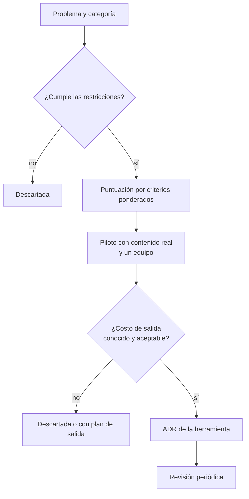
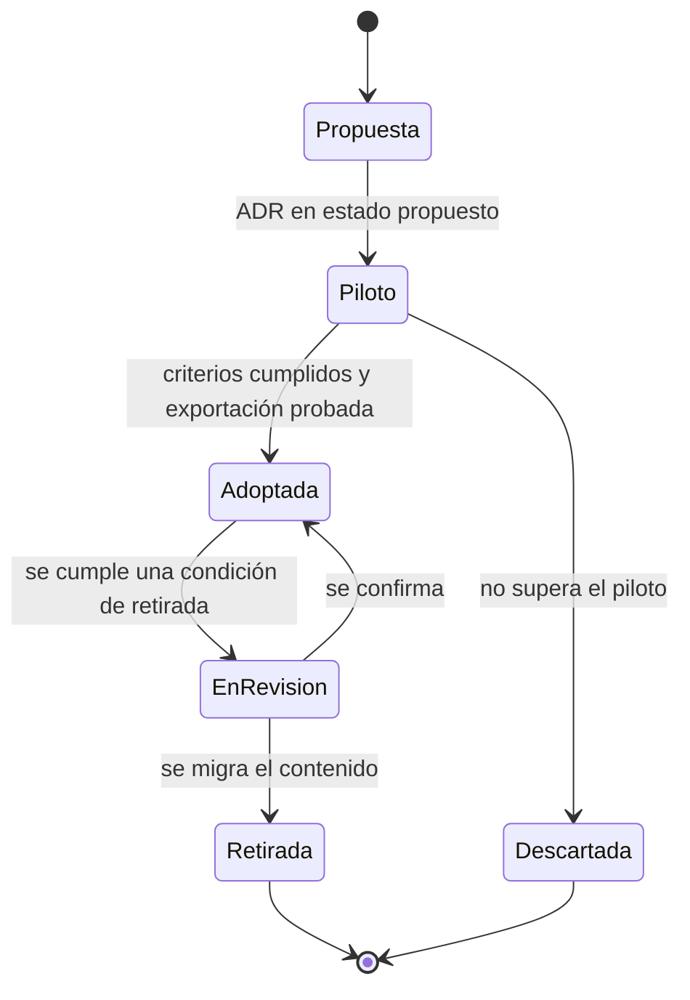

# Herramientas para decidir y documentar

La escena es frecuente. Las decisiones de arquitectura viven en tres sitios: unas en una wiki, otras en carpetas del repositorio y otras en hilos de chat. Hay dos tableros para el mismo equipo porque uno se adoptó para «probar» y nadie retiró el anterior. El último trimestre alguien propuso una herramienta nueva de documentación porque la había visto en una conferencia, y la migración se quedó a medias. Cuando un ingeniero nuevo pregunta por qué se eligió la base de datos, la respuesta es «búscalo, está en algún sitio».

**Elegir una herramienta para decidir o documentar es una decisión de arquitectura: se juzga por el problema que resuelve, por cómo se integra con el resto y por cuánto cuesta abandonarla, no por su popularidad.**

Esta lección propone un marco para hacer esa elección sin caer en la moda. Recorre seis categorías de herramientas (registro de decisiones, documentación viva, tableros de flujo, gestión de iniciativas, diagramas como código, y evaluación y observabilidad de sistemas con IA), cinco criterios comunes para compararlas, el costo total de propiedad, la gestión de accesos y datos sensibles, y cómo registrar la elección en un ADR. Termina con un ejemplo trabajado con criterios ponderados.

<Callout tone="info" title="Fecha de corte y alcance">
  Consultado en octubre de 2026. La lección habla de categorías, no de productos. Los pocos ejemplos
  concretos se citan solo para ilustrar una categoría, verificados en su página oficial, y no
  implican recomendación. No incluye precios ni límites de planes: cambian con frecuencia y dependen
  del contrato.
</Callout>

## El problema que resuelve

Las herramientas de colaboración se adoptan con poca fricción: alguien se registra, invita a su equipo y en una semana ya hay contenido dentro. Esa facilidad es su virtud y su riesgo. Nadie redacta un ADR para empezar a usar un tablero, pero dos años después ese tablero guarda el historial de decisiones de producto y el costo de cambiarlo ya no es trivial.

| Síntoma                                                            | Decisión que nadie tomó explícitamente           |
| ------------------------------------------------------------------ | ------------------------------------------------ |
| La misma información existe en dos herramientas y no coinciden     | Cuál es la fuente de verdad de cada tipo de dato |
| Nadie sabe quién administra una herramienta ni quién paga por ella | Quién es el dueño y quién decide retirarla       |
| Un exempleado sigue teniendo acceso a la wiki meses después        | Cómo se dan y se quitan los accesos              |
| Buscar una decisión pasada exige preguntar a la persona adecuada   | Dónde se busca y qué se indexa                   |
| Migrar el contenido a otra herramienta parece un proyecto entero   | En qué formato debe poder salir el contenido     |
| Se pegan datos de clientes en documentos o en avisos a modelos     | Qué datos pueden entrar en cada herramienta      |

## Seis categorías y el problema de cada una

Antes de comparar productos, nombra la categoría. Muchas discusiones de herramientas son en realidad discusiones sobre qué problema se quiere resolver, y dos herramientas de categorías distintas no compiten aunque se parezcan en la demostración.

| Categoría                         | Problema que resuelve                                      | Artefacto principal                       | Dónde profundizar                                                                |
| --------------------------------- | ---------------------------------------------------------- | ----------------------------------------- | -------------------------------------------------------------------------------- |
| Registro de decisiones            | Recordar por qué se eligió algo y qué se descartó          | Un registro por decisión, inmutable       | [ADR](/docs/adr)                                                                 |
| Documentación viva                | Que el conocimiento se encuentre y siga siendo cierto      | Páginas o archivos con dueño y revisión   | Esta lección                                                                     |
| Tableros de flujo de trabajo      | Ver dónde está cada trabajo y dónde se atasca              | Tarjetas con estados y límites            | [Flujo de valor y cuellos de botella](/docs/flujo-de-valor-y-cuellos-de-botella) |
| Gestión de iniciativas y backlog  | Ordenar qué se hace primero y por qué                      | Iniciativas priorizadas con criterio      | [Marcos de priorización](/docs/marcos-de-priorizacion)                           |
| Diagramas como código             | Que los diagramas se versionen y se revisen como el código | Fuentes de texto que generan imágenes     | [Diagramas como código](/docs/diagramas-como-codigo)                             |
| Evaluación y observabilidad de IA | Saber si un sistema con modelos se comporta como se espera | Conjuntos de evaluación, trazas, métricas | [Controlar la IA](/docs/controlar-la-ia-gobierno-y-autonomia)                    |

### Registro de decisiones (ADR)

**Qué resuelve.** Guarda el contexto, las opciones y las consecuencias de cada decisión significativa. La plantilla, el ciclo de vida y dónde guardarlos se explican en la lección de [ADR](/docs/adr); aquí solo importa qué soporte elegir.

**Criterio de elección.** El soporte más sencillo es una carpeta de archivos Markdown en el repositorio, revisados por pull request. Existen utilidades de línea de comandos que solo numeran y crean archivos, como `adr-tools` (repositorio `npryce/adr-tools` en GitHub), que guarda los registros como Markdown en una carpeta del proyecto. Una herramienta dedicada compensa cuando quienes deciden no trabajan en el repositorio o cuando necesitas buscar decisiones de muchos repositorios a la vez.

**Señales de que sobra.** Hay menos decisiones registradas que campos en el formulario de la herramienta; nadie la abre fuera de la reunión de arquitectura; o el registro vive en un sitio donde el código no está y envejece sin que nadie lo note.

### Documentación viva: wikis y documentos como código

**Qué resuelve.** Que el conocimiento se encuentre cuando hace falta y que siga siendo cierto. Hay dos familias. Las **wikis** priorizan la edición inmediata desde el navegador y el acceso de personas que no programan. Los **documentos como código** (_docs as code_) aplican a la documentación las herramientas del código: Write the Docs lo describe como escribir documentación con las mismas herramientas que el código, es decir, gestor de incidencias, control de versiones, marcado de texto plano, revisión de cambios y pruebas automáticas.

**Criterio de elección.** Pregunta quién escribe y quién lee. Si la documentación describe un servicio y la escriben quienes lo mantienen, vivir junto al código permite revisarla en la misma PR que el cambio. Un ejemplo de esta familia es TechDocs, el módulo de Backstage que, según su documentación, toma Markdown del repositorio de cada componente, genera un sitio estático con MkDocs y lo publica en el portal. Si la escriben y la consultan áreas no técnicas, una wiki suele tener menos fricción.

Sea cual sea el soporte, ayuda separar los tipos de documento. Diátaxis, el marco de Daniele Procida, distingue cuatro: tutoriales, guías prácticas, referencia técnica y explicación. Mezclarlos en la misma página es una causa frecuente de documentación que nadie termina de leer.

**Señales de que sobra.** Páginas sin dueño ni fecha de revisión, una proporción alta de páginas que nadie ha visitado en meses, o una segunda wiki creada porque la primera «está desordenada».

### Tableros de flujo de trabajo

**Qué resuelve.** Hacer visible dónde está cada trabajo, cuánto tarda y dónde se acumula. Cómo leer un tablero y encontrar el cuello de botella es tema de [flujo de valor y cuellos de botella](/docs/flujo-de-valor-y-cuellos-de-botella).

**Criterio de elección.** Que los estados del tablero reflejen el proceso real y que los datos de cada transición (cuándo entró y salió de cada estado) se puedan exportar. Sin esos datos no podrás medir tiempos de ciclo fuera de los informes que la herramienta decida ofrecerte.

**Señales de que sobra.** El tablero se actualiza solo antes de la reunión semanal, o cada equipo tiene su propio tablero en una herramienta distinta y nadie ve el flujo de punta a punta.

### Gestión de iniciativas y backlog

**Qué resuelve.** Ordenar qué se hace primero, con qué criterio y con qué objetivo. El criterio para priorizar está en [marcos de priorización](/docs/marcos-de-priorizacion); la herramienta solo debe sostenerlo.

**Criterio de elección.** Que permita enlazar cada iniciativa con su objetivo, con las decisiones que la afectan y con el trabajo de los tableros, en lugar de copiar texto entre herramientas. Que el criterio de prioridad sea un campo visible, no una conversación perdida.

**Señales de que sobra.** El backlog tiene cientos de elementos que nadie revisa, la prioridad real se decide en otra parte y la herramienta solo refleja el resultado con semanas de retraso.

### Diagramas como código

**Qué resuelve.** Que los diagramas se versionen, se revisen y se regeneren junto al código. La comparación de herramientas y cómo validarlas en CI está en [diagramas como código](/docs/diagramas-como-codigo).

**Criterio de elección.** Que el formato fuente sea texto legible, que el renderizado funcione en tu pipeline y en el visor de tu repositorio, y que exista más de una herramienta capaz de leer ese formato.

**Señales de que sobra.** Hay diagramas en la herramienta de dibujo y la misma vista en código, y ninguno de los dos coincide con el sistema.

### Evaluación y observabilidad de sistemas con IA

**Qué resuelve.** Saber si un sistema que usa modelos de lenguaje responde como se espera, con qué costo y con qué fallos. Incluye conjuntos de evaluación versionados, registro de trazas de cada llamada y paneles de calidad y costo. El NIST AI RMF 1.0 (enero de 2023) agrupa esta actividad en su función _Measure_, junto a _Govern_, _Map_ y _Manage_; cómo poner límites y supervisión humana se trata en [controlar la IA: gobierno y autonomía](/docs/controlar-la-ia-gobierno-y-autonomia), y la arquitectura interna de un agente, en [arquitectura de agentes LLM](/docs/arquitectura-agentes-llm).

**Criterio de elección.** Que las trazas se puedan emitir y exportar en un formato abierto. OpenTelemetry publica convenciones semánticas para IA generativa, pero en octubre de 2026 siguen en estado _Development_: los nombres de atributos pueden cambiar, así que conviene fijar la versión de las convenciones que usas. Y, sobre todo, qué datos se guardan: una traza completa de una conversación puede contener datos personales o secretos.

**Señales de que sobra.** Se guardan trazas que nadie mira, o se evalúa con una herramienta y se depura con otra sin poder relacionar ambos resultados.

## Cinco criterios comunes

Las seis categorías comparten cinco criterios. Para cada uno, la pregunta útil no es «¿lo tiene?», sino «¿cómo lo compruebo antes de firmar?».

| Criterio             | Pregunta                                                          | Cómo comprobarlo antes de adoptar                                      | Señal de alarma                                           |
| -------------------- | ----------------------------------------------------------------- | ---------------------------------------------------------------------- | --------------------------------------------------------- |
| Integración          | ¿Se conecta con donde ya trabaja el equipo?                       | Prueba los enlaces con el repositorio, el chat y el gestor de tareas   | Copiar y pegar entre herramientas como flujo habitual     |
| Exportación de datos | ¿El contenido, el historial y los metadatos salen completos?      | Exporta un espacio real y ábrelo sin la herramienta                    | Exportación parcial, solo en PDF o solo bajo petición     |
| Costo de salida      | ¿Cuánto costaría irse dentro de dos o tres años?                  | Estima contenido, enlaces, automatismos y hábitos que habría que mover | Nadie puede dar un orden de magnitud                      |
| Permisos             | ¿Se puede dar el mínimo acceso necesario y quitarlo a tiempo?     | Revisa roles, acceso de invitados, inicio de sesión único y bajas      | Permisos por persona, sin grupos ni registro de auditoría |
| Búsqueda             | ¿Se encuentra lo que existe, incluidos adjuntos y otros espacios? | Busca diez cosas que sabes que están y cuenta cuántas aparecen         | La gente pregunta en el chat antes de buscar              |

Separa además **restricciones** y **criterios**, como se explica en [trade-offs y decisiones](/docs/trade-offs-y-decisiones): una norma que exige guardar ciertos datos en una región, o una política de seguridad que obliga a usar el inicio de sesión único corporativo, no se puntúan. Si una herramienta no las cumple, se descarta antes de comparar.

## El embudo de decisión

La figura de cabecera resume el proceso como un embudo. Muchas candidatas entran por arriba; cada filtro deja pasar menos. Las restricciones eliminan sin puntuar; los criterios ponderan; una prueba piloto con contenido real confirma o desmiente lo que prometía la demostración. El último filtro, y el que más se olvida, es el **costo de salida**: dos herramientas que empatan en todo lo demás no son equivalentes si una te deja ir con tus datos y la otra no. Los pesos del margen derecho (×2, ×3) son los del ejemplo trabajado del final.



El piloto merece una regla: dura un periodo fijo, usa contenido real (no el de ejemplo) y termina con una exportación completa. Si al final del piloto no puedes sacar lo que metiste, ya sabes algo importante del costo de salida.

## Costo total de propiedad y costo de salida

El precio de la licencia suele ser la parte más pequeña y la más visible. El costo total de propiedad suma todo lo que la herramienta consume durante su vida útil, y el costo de salida es lo que te costaría dejarla.

| Componente             | Qué incluye                                                               | Cómo estimarlo con tus datos                                |
| ---------------------- | ------------------------------------------------------------------------- | ----------------------------------------------------------- |
| Licencia o suscripción | Cuotas, usuarios, invitados, funciones de pago                            | Contrato y número real de usuarios activos                  |
| Implantación           | Configuración, plantillas, estructura de espacios, integraciones          | Semanas-persona del piloto, multiplicadas por los equipos   |
| Migración de entrada   | Contenido que se trae de la herramienta anterior y su limpieza            | Volumen de páginas o registros y una muestra migrada a mano |
| Administración         | Altas y bajas, permisos, auditorías, actualizaciones                      | Horas al mes de quien la administra hoy                     |
| Formación y hábito     | Curva de aprendizaje y convenciones de uso                                | Tiempo hasta que un equipo la usa sin preguntar             |
| Costo de salida        | Exportar, convertir formatos, rehacer enlaces e integraciones, reaprender | Exportación de prueba más inventario de integraciones       |

En herramientas de documentación y decisión, el costo de salida tiene rasgos propios. No basta con exportar el texto: cuentan el **historial** de cambios, los **enlaces** internos (que se rompen al cambiar de dominio o de estructura), los **adjuntos**, los **comentarios** donde a menudo vive la deliberación y los **permisos** de cada espacio. Una exportación que pierde los enlaces convierte una base de conocimiento en una pila de páginas sueltas.

Cómo estimar el costo de salida por componentes y por qué crece con el tiempo de uso se explica en [casado a un proveedor](/docs/casado-a-un-proveedor). La regla práctica que se trae de allí: el objetivo no es evitar toda dependencia, sino que el costo de cambiar sea conocido y aceptado a propósito. Si la herramienta guarda conocimiento que debe sobrevivir a varios cambios de equipo, como el registro de decisiones, ese criterio pesa más que la comodidad del primer año.

## Accesos y datos sensibles

Una herramienta de documentación concentra conocimiento interno: diagramas de red, procedimientos de guardia, decisiones de seguridad, a veces credenciales pegadas por error. Trátala con el mismo cuidado que cualquier otro sistema con datos sensibles; los principios generales están en [seguridad por diseño](/docs/seguridad-por-diseno).

- **Mínimo privilegio.** El principio aparece en el artículo de Saltzer y Schroeder de 1975 sobre protección de la información: cada usuario y cada programa opera con el menor conjunto de privilegios que necesita. En la práctica: espacios restringidos por defecto para lo sensible, lectura amplia para lo demás y permisos por grupo, no por persona.
- **Altas y bajas automáticas.** Si la herramienta admite inicio de sesión único y aprovisionamiento con SCIM (RFC 7643 y RFC 7644, de septiembre de 2015), las bajas de la empresa se propagan sin depender de que alguien se acuerde. Si no lo admite, anota en el ADR quién hace las bajas y cada cuánto se revisan.
- **Invitados y enlaces públicos.** Revisa quién puede compartir hacia fuera y si los enlaces públicos caducan. Es una de las vías más comunes de exposición accidental.
- **Clasificación de datos.** Decide qué tipos de datos no deben entrar nunca: datos personales de clientes, secretos, información regulada. Una regla escrita y un escáner de secretos en el repositorio valen más que una advertencia en la portada de la wiki.
- **Herramientas con IA.** Los avisos y las trazas pueden contener lo mismo que los documentos. El OWASP LLM Top 10, edición 2025 (sustituida en agosto de 2026 por la de 2026), sitúa la divulgación de información sensible en el segundo puesto (LLM02). Antes de conectar un asistente a la wiki o de activar el registro completo de conversaciones, decide qué se redacta, qué se retiene y durante cuánto tiempo.

<Callout tone="warning" title="El permiso que nadie revisa">
  El riesgo más habitual no es un ataque sofisticado, sino un espacio creado como público para una
  demostración que se quedó así. Programa una revisión periódica de espacios públicos, invitados y
  administradores, y anota en el ADR quién la hace.
</Callout>

## Decide la herramienta con su propio ADR

Adoptar o sustituir una herramienta compartida cumple el test de la lección de [ADR](/docs/adr): había alternativas razonables y alguien podría proponer otra dentro de un año. Usa el método de [trade-offs y decisiones](/docs/trade-offs-y-decisiones) (problema, restricciones, opciones, criterios y pesos, evaluación, reversibilidad) y regístralo con la plantilla habitual. A una decisión de herramienta conviene añadirle tres apartados que suelen faltar:

```md
## Dueño <!-- persona o rol que administra y responde por la herramienta -->

## Costo de salida <!-- qué se exporta, en qué formato, última prueba y fecha -->

## Retirada <!-- condiciones medibles que reabren la decisión -->
```

El **dueño** no es quien la propuso, sino quien responde por ella: permisos, convenciones de uso, revisión periódica y, llegado el caso, la retirada. Una herramienta sin dueño se degrada sin que nadie lo decida.

### Ciclo de vida de una herramienta

Una herramienta compartida pasa por estados, igual que una decisión. Hacerlos explícitos evita el caso más común: una herramienta que se quedó en piloto para siempre y convive con la anterior.



Al retirar una herramienta, el trabajo no termina con la migración: deja la anterior en solo lectura durante un plazo acordado, redirige los enlaces más usados y anuncia una fecha de cierre. Sin esos pasos, las dos herramientas conviven indefinidamente.

## Cuándo sí y cuándo no adoptar una herramienta nueva

| Situación                                                              | Decisión razonable                                                     |
| ---------------------------------------------------------------------- | ---------------------------------------------------------------------- |
| El problema es real, medido y la herramienta actual no lo resuelve     | Evalúa con el embudo y un piloto acotado                               |
| La herramienta actual lo resuelve, pero nadie la usa bien              | Cambia convenciones y formación antes que la herramienta               |
| Un equipo quiere una herramienta distinta para algo que ya existe      | Pide el ADR; si se aprueba, define qué herramienta se retira           |
| El contenido debe sobrevivir a varios cambios de equipo y de proveedor | Prioriza formatos abiertos y exportación probada                       |
| Necesidad temporal (un evento, una auditoría puntual)                  | Usa lo que ya hay o define la fecha de cierre desde el primer día      |
| La herramienta procesará datos personales o los enviará a un modelo    | Trata los accesos y la retención como restricciones, no como criterios |

## Errores frecuentes

- **Elegir por moda.** La herramienta aparece en todas las charlas y se adopta sin nombrar el problema. Es el sesgo de la herramienta nueva y brillante descrito en [trade-offs y decisiones](/docs/trade-offs-y-decisiones). Antídoto: escribe primero el problema y la categoría.
- **Herramientas sin dueño.** Nadie administra permisos ni convenciones; el contenido se desordena y la gente deja de confiar en él. Antídoto: dueño con nombre en el ADR.
- **Documentación que nadie consulta.** Se mide cuánto se escribe, no cuánto se usa ni si es cierto. Antídoto: dueño y fecha de revisión por página, y retirar lo que lleva meses sin visitas ni cambios.
- **Dos herramientas para lo mismo.** La nueva se adopta sin retirar la vieja y cada equipo usa la suya. Antídoto: todo ADR de adopción dice qué se retira y cuándo.
- **Comparar demostraciones, no uso real.** La demostración usa contenido ideal. Antídoto: piloto con contenido propio y una exportación al final.
- **Ignorar el costo de salida porque «es solo documentación».** El conocimiento acumulado es lo más caro de mover. Antídoto: exportación probada antes de adoptar y repetida periódicamente.
- **Permisos heredados de la herramienta anterior.** Se migran los espacios con sus permisos, incluidos los que ya no tenían sentido. Antídoto: revisar accesos como parte de la migración.

## Ejemplo trabajado: dónde vive el registro de decisiones

Un caso hipotético, con supuestos explícitos.

### Contexto

Una empresa con cuatro equipos de producto y unas treinta personas en ingeniería tiene sus ADR dispersos: unos en carpetas de algunos repositorios, otros en páginas de la wiki corporativa y varios solo en hilos de chat. Producto y seguridad participan en algunas decisiones y no trabajan en los repositorios. Al incorporar personas nuevas, nadie sabe dar un enlace al registro completo.

**Restricciones:** acceso con el inicio de sesión único de la empresa; el contenido debe poder exportarse completo en un formato de texto abierto. Las tres opciones evaluadas las cumplen.

### Opciones

- **A. Markdown en cada repositorio**, revisado por pull request, con un índice central generado en CI que agrega los registros de todos los repositorios en un sitio de solo lectura.
- **B. Wiki corporativa** con una plantilla de ADR y un espacio por equipo.
- **C. Herramienta dedicada** de registro de decisiones, contratada como servicio.

### Criterios y evaluación

Pesos de 1 a 3, acordados antes de puntuar. Puntuaciones de 1 (malo) a 5 (bueno). El máximo posible es 60.

| Criterio                                 | Peso | A. Repositorio | B. Wiki | C. Dedicada |
| ---------------------------------------- | ---- | -------------- | ------- | ----------- |
| Integración con el flujo de cambios (PR) | 3    | 5              | 2       | 4           |
| Exportación en formato abierto           | 2    | 5              | 3       | 3           |
| Costo de salida                          | 3    | 5              | 2       | 2           |
| Acceso para quien no trabaja en el repo  | 2    | 2              | 5       | 4           |
| Búsqueda transversal                     | 2    | 2              | 4       | 5           |
| **Total ponderado**                      |      | **48**         | **36**  | **42**      |

Las cuentas: A = 15 + 10 + 15 + 4 + 4 = 48; B = 6 + 6 + 6 + 10 + 8 = 36; C = 12 + 6 + 6 + 8 + 10 = 42.

**Sensibilidad.** Si el peso del costo de salida baja de 3 a 1, A queda en 38, B en 32 y C en 38: empate entre A y C. La decisión depende, por tanto, de cuánto valora el equipo poder irse; no es un detalle, es la discusión que hay que tener. El equipo la tiene y mantiene el peso en 3, porque el registro de decisiones debe sobrevivir a cambios de herramienta y de equipo durante años.

**Mitigación de la debilidad de A.** El índice central generado en CI ataca justo los dos criterios donde A puntúa bajo. Si el piloto confirma que el índice permite buscar en todos los repositorios, la búsqueda sube a 4 (A = 52), y el acceso de producto y seguridad se resuelve con permisos de lectura sobre el sitio del índice y propuestas por PR con ayuda de un ingeniero.

### Decisión y consecuencias

**Decisión:** opción A, con un piloto de seis semanas en dos equipos antes de extenderla.

- **Se acepta** que proponer un ADR exija una PR; producto y seguridad lo harán con apoyo del equipo de plataforma, que es además el **dueño** del índice.
- **Se retira** el espacio de ADR de la wiki: pasa a solo lectura al final del piloto, con un aviso que enlaza al índice nuevo.
- **Condiciones de retirada:** si tras seis meses menos de la mitad de las decisiones significativas pasan por el registro, o si el índice deja de generarse más de una semana, se reabre la decisión.

## Checklist

- [ ] El problema y la categoría están escritos antes de mirar productos.
- [ ] Las restricciones (accesos, residencia de datos, inicio de sesión único) se comprobaron antes de puntuar.
- [ ] Los criterios y sus pesos se acordaron antes de evaluar, y se probó su sensibilidad.
- [ ] Hubo un piloto con contenido real que terminó con una exportación completa.
- [ ] El costo de salida está estimado: contenido, historial, enlaces, adjuntos e integraciones.
- [ ] Hay un ADR con dueño, costo de salida y condiciones de retirada.
- [ ] Los permisos siguen el mínimo privilegio y las bajas se propagan solas o tienen responsable.
- [ ] Si se adopta una herramienta para algo que ya existía, está fechada la retirada de la anterior.

## Fuentes

Consultadas en octubre de 2026. Los productos se citan solo como ejemplos de una categoría; no se verificaron precios ni planes.

- [Docs as Code (Write the Docs)](https://www.writethedocs.org/guide/docs-as-code/)
- [Diátaxis (Daniele Procida)](https://diataxis.fr/) y su [colofón](https://diataxis.fr/colophon/)
- [TechDocs (documentación de Backstage)](https://backstage.io/docs/features/techdocs/)
- [adr-tools (repositorio npryce/adr-tools)](https://github.com/npryce/adr-tools)
- [OpenTelemetry semantic-conventions-genai (repositorio en GitHub)](https://github.com/open-telemetry/semantic-conventions-genai): convenciones semánticas para IA generativa, en estado _Development_ en octubre de 2026
- [NIST AI Risk Management Framework (AI RMF 1.0, NIST AI 100-1, enero de 2023)](https://www.nist.gov/itl/ai-risk-management-framework)
- [LLM02:2025 Sensitive Information Disclosure (OWASP GenAI Security Project)](https://genai.owasp.org/llmrisk/llm02/)
- [RFC 7643: SCIM Core Schema](https://www.rfc-editor.org/info/rfc7643) y [RFC 7644: SCIM Protocol](https://www.rfc-editor.org/info/rfc7644)
- [The Protection of Information in Computer Systems (Saltzer y Schroeder, 1975)](https://web.mit.edu/Saltzer/www/publications/protection/)
