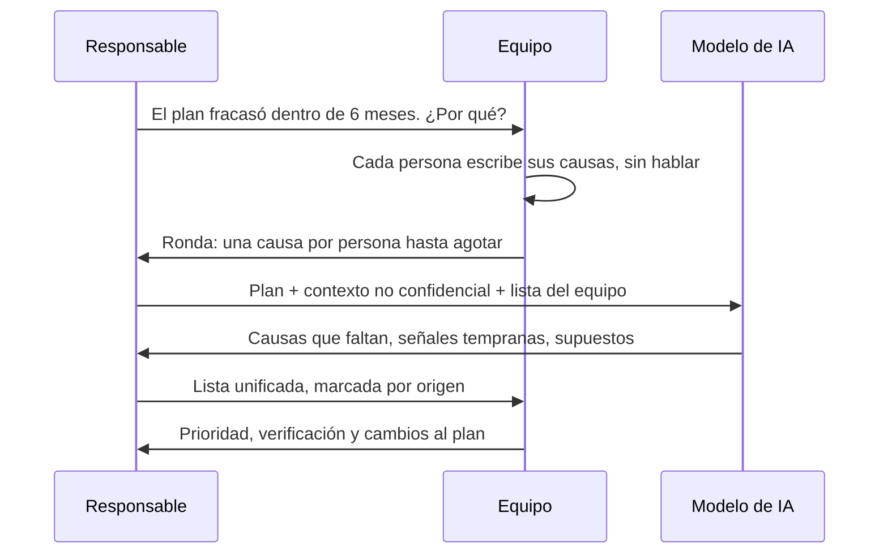
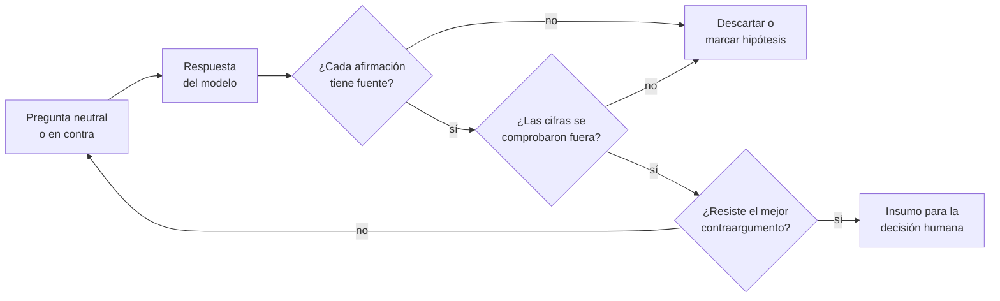

# IA para decidir: investigar, escenarios y pre-mortem

Alguien del comité pega la pregunta en un asistente de IA: «¿nos conviene lanzar un plan de
autoservicio?». En diez segundos llega una respuesta ordenada, con tres ventajas, dos riesgos y
una cifra de conversión «típica del sector». La cifra acaba en la presentación del lunes. Nadie
sabe de dónde salió, y cuando alguien lo pregunta ya forma parte del plan.

El problema no es usar el modelo, sino usarlo como oráculo. **Usar IA para decidir es emplear un
modelo de lenguaje para ampliar y poner a prueba el razonamiento de quien decide (alternativas,
escenarios, contraargumentos, fallos posibles) sin entregarle la elección ni aceptar como
evidencia lo que no se ha verificado fuera de él.**

Esta lección explica en qué tareas un modelo mejora una decisión, en cuáles la empeora sin que se
note, cómo usarlo en un pre-mortem y con qué protocolo verificar lo que aporta. El gobierno de la
IA en la organización está en [controlar la IA](/docs/controlar-la-ia-gobierno-y-autonomia); la
arquitectura de un sistema con agentes, en [LLM y agentes](/docs/arquitectura-agentes-llm).

<Callout tone="info" title="Fecha de corte y alcance">
  Fuentes consultadas en octubre de 2026. No se citan productos ni precios: lo que sigue aplica a
  cualquier asistente basado en un modelo de lenguaje.
</Callout>

## Ayudar a decidir no es decidir

Una decisión de negocio tiene tres partes: entender la situación, elegir entre opciones con
criterios explícitos y responder por la elección. Un modelo puede acelerar la primera y enriquecer
la segunda. La tercera no se le puede asignar: el modelo no firma ni estará en la revisión de
dentro de un año.

La forma de razonar sobre criterios, reversibilidad y el momento de decidir está en
[trade-offs y toma de decisiones](/docs/trade-offs-y-decisiones). Aquí la pregunta es más
estrecha: qué parte de ese proceso puede hacer mejor un modelo y con qué controles.

## Dónde ayuda un modelo de lenguaje

Las tareas en las que un modelo suele aportar comparten un rasgo: producen **material para
pensar**, no conclusiones. Su salida se puede revisar con el criterio del equipo antes de usarla.

### Resumir evidencia que ya tienes

Entrevistas con clientes, tickets de soporte, actas de reuniones o un contrato largo: el modelo
condensa y agrupa por temas. Funciona bien cuando el material lo aportas tú y le pides que cite
el fragmento de origen de cada punto, de modo que puedas comprobarlo. Funciona mal cuando le pides
que resuma «lo que se sabe» sobre un mercado sin darle documentos.

### Generar alternativas y escenarios

El equipo suele llegar con dos opciones, a veces con una. Pedir cinco alternativas distintas,
incluidas «no hacer nada» y una híbrida, amplía el espacio antes de cerrarlo. Lo mismo con un
escenario base, uno adverso y uno favorable, cada uno con sus condiciones. La plausibilidad la
juzga el equipo.

### Contraargumentos y abogado del diablo

Pedir el mejor argumento en contra de la opción preferida es barato y útil. Lord, Lepper y Preston
(1984) observaron que pedir a las personas que consideraran la posibilidad opuesta reducía sesgos
de juicio más que pedirles imparcialidad. El modelo contradice sin costo social, si se le pide.

### Contrastar supuestos

Cada plan descansa en supuestos («los clientes pequeños no necesitan formación», «el soporte
escala»). Pedir al modelo que liste los supuestos implícitos de un documento y que diga qué dato
confirmaría o refutaría cada uno convierte una intuición en una lista verificable.

## Dónde falla o engaña

Los fallos más peligrosos no son los evidentes, sino los que llegan con buena redacción.

### Cifras y citas inventadas

El perfil de IA generativa del NIST (NIST AI 600-1, julio de 2024) llama _confabulación_ al
contenido erróneo o falso presentado con seguridad, lo que se conoce como alucinaciones, y advierte
de que el modelo puede añadir citas o pasos lógicos que parecen justificar una respuesta incorrecta.
En el caso Mata v. Avianca, en junio de 2023, un tribunal federal de Nueva York sancionó a dos
abogados por presentar decisiones judiciales inexistentes generadas por un asistente.

### Falsa confianza y la respuesta única

Un modelo tiende a dar una respuesta completa y segura aunque la pregunta no la tenga. Kalai y
otros (septiembre de 2025) sostienen que el entrenamiento y la evaluación premian adivinar frente a
reconocer incertidumbre. El tono no informa de la fiabilidad, y una recomendación limpia oculta las
alternativas que no se exploraron. OWASP (LLM09:2025) incluye en este riesgo la confianza excesiva
del usuario y propone contrastar con fuentes externas y revisión humana.

### La pregunta inclina la respuesta

Sharma y otros autores (Anthropic, octubre de 2023) documentaron la _complacencia_ (sycophancy):
cinco asistentes de IA tendían a ajustar sus respuestas a las opiniones que expresaba el usuario. Si
preguntas «¿verdad que el plan autoservicio es buena idea?», es más probable recibir razones a
favor. Es el sesgo de confirmación del que pregunta, amplificado. Los sesgos humanos en general
se tratan en [pensamiento sistémico y sesgos](/docs/pensamiento-sistemico-y-sesgos).

### Datos internos que el modelo no tiene

El modelo no conoce tu tasa de abandono ni tus contratos: si no se los das, rellena el hueco con
generalidades que suenan a dato. Si se los das, la pregunta pasa a ser qué puedes compartir.

## Tareas y riesgo de un vistazo

| Tarea                         | Aporte típico                        | Riesgo principal                        | Control mínimo                                |
| ----------------------------- | ------------------------------------ | --------------------------------------- | --------------------------------------------- |
| Resumir documentos propios    | Ahorra horas de lectura              | Omite o deforma un matiz importante     | Pedir la cita de origen y revisar una muestra |
| Generar alternativas          | Amplía el espacio de opciones        | Opciones genéricas, sin contexto        | Filtrar con las restricciones reales          |
| Escenarios                    | Estructura lo incierto               | Probabilidades inventadas               | Escenarios sin porcentajes del modelo         |
| Contraargumentos              | Pone a prueba la opción preferida    | Objeciones débiles si se pide suave     | Pedir «el argumento más fuerte en contra»     |
| Pre-mortem                    | Causas de fallo variadas             | Anclar al equipo en la lista del modelo | El equipo escribe primero su lista            |
| Datos de mercado o del sector | Orienta la búsqueda                  | Cifras sin fuente o desactualizadas     | Verificar cada cifra en una fuente primaria   |
| Recomendación final           | Ninguno que no den los pasos previos | Delegar la responsabilidad              | No pedirla, o tratarla como una opinión más   |

## El pre-mortem con un modelo de IA

La técnica (suponer que el plan ya fracasó y explicar por qué), su origen y sus pasos están en
[pensamiento sistémico y sesgos](/docs/pensamiento-sistemico-y-sesgos#pre-mortem). Aquí solo
cambia una cosa: el modelo entra como un participante más, con reglas propias.

Gary Klein, en «Performing a Project Premortem» (Harvard Business Review, septiembre de 2007),
afirma que la _retrospectiva prospectiva_ (imaginar que un hecho futuro ya ocurrió) mejora en un
30 % la capacidad de identificar las razones de un resultado, y atribuye la cifra a un estudio de
1989 de Deborah Mitchell, J. Edward Russo y Nancy Pennington. Algunas lecturas críticas señalan que
ese estudio midió cuántas razones se generaban, no si eran acertadas. La cifra, por tanto, no
garantiza la calidad de las causas, ni las del equipo ni las del modelo.

El modelo amplía la lista en minutos con causas de tipos distintos (técnicas, comerciales,
regulatorias), propone una señal temprana para cada una y nombra riesgos incómodos sin costo
social. En el pre-mortem falla de cuatro formas:

- **Ancla al equipo** si su lista se lee antes que la del equipo.
- **Da causas genéricas**: no sabe lo que solo sabe el equipo.
- **Confabula**: puede inventar precedentes o porcentajes de fracaso «del sector».
- **Complace**: si la pregunta deja ver que el plan gusta, las causas salen suaves.

<Callout tone="info" title="Nota sobre las fuentes">
  Fuente secundaria: la cifra del 30 % y su atribución al estudio de 1989 se citan según el artículo
  de Klein; la crítica sobre lo que midió el estudio procede de comentarios posteriores. El papel
  del modelo de IA es una adaptación, no parte de la técnica original.
</Callout>



Dos reglas responden a esos fallos. El equipo escribe **antes** de ver la lista del modelo; si
no, esa lista ancla la conversación y lo que solo sabe el equipo no aparece. Y cada causa se marca
por su origen: las del modelo entran como hipótesis, no como hallazgos.

## Protocolo de verificación

Cinco reglas cubren la mayoría de los fallos descritos; no exigen herramientas, solo disciplina.



### Preguntar en contra

Formula la pregunta sin revelar tu preferencia o, mejor, pide el caso contrario: «da los tres
argumentos más fuertes para no lanzar el plan». Repite la pregunta con la preferencia opuesta; si
el modelo cambia de recomendación según cómo preguntes, la respuesta dependía de la pregunta.

### Pedir la incertidumbre

Pide explícitamente qué no sabe, qué tendría que ser cierto para que su análisis falle y qué
alternativas descartó. Una respuesta que no admite ninguna duda sobre un asunto de negocio
incierto es una señal de alerta, no de calidad.

### Exigir la fuente de cada afirmación

Cada afirmación factual debe llevar su origen: el documento que le diste (con la cita) o una
fuente externa que puedas abrir. Si no la tiene, se trata como hipótesis. Una referencia que el
modelo menciona tampoco cuenta hasta que la has abierto: puede no existir o no decir eso.

### Verificar las cifras fuera del modelo

Ninguna cifra pasa a la decisión sin comprobarse en una fuente primaria o en tus propios datos.
Las cuentas también: si el modelo calcula un margen, recalcúlalo en una hoja. Es más rápido que
discutir de dónde salió el número cuando ya está en la presentación.

### Registrar qué se le preguntó

Las preguntas determinan las respuestas, así que forman parte de la evidencia. Basta un registro
corto adjunto a la decisión. Una forma posible:

```yaml
# consulta-ia-0007.yaml (forma orientativa)
decision: ADR-0042 plan autoservicio
herramienta: asistente aprobado por la política interna
datos_compartidos: plan sin cifras de clientes # nada confidencial
preguntas:
  - 'Pre-mortem: el plan fracasó en 6 meses, ¿por qué?'
  - 'Argumentos más fuertes para no lanzarlo'
usado: [causas 3, 5 y 8 del pre-mortem]
descartado: [rango de conversión sin fuente]
verificado_por: responsable de producto
```

## Datos confidenciales sin política

Pegar en un asistente el listado de clientes o los márgenes por contrato puede exponer información
que la empresa debe proteger. El OWASP Top 10 para aplicaciones con LLM de 2025 pone la divulgación
de información sensible en el puesto LLM02 y recomienda, entre otras medidas, enseñar a los usuarios
qué no introducir y tener condiciones de uso claras. Sin una política que diga qué herramienta y qué
datos están permitidos, comparte solo lo que podrías publicar. Esa política se trata en
[controlar la IA](/docs/controlar-la-ia-gobierno-y-autonomia); la protección general, en
[seguridad por diseño](/docs/seguridad-por-diseno).

## La responsabilidad sigue siendo humana

Una decisión asistida por IA se registra como cualquier otra, con responsable y fecha, y el
[ADR](/docs/adr) es el formato natural. Lo que añade la IA es un anexo: qué se preguntó, qué se usó,
qué se descartó y quién lo verificó.

Si en la revisión alguien pregunta por qué se eligió una opción, «lo dijo el modelo» no es una
respuesta: hace falta un criterio defendible y evidencia que el equipo haya comprobado.

## Cuándo sí y cuándo no

| Situación                                                     | Uso razonable del modelo                                   |
| ------------------------------------------------------------- | ---------------------------------------------------------- |
| Decisión con muchas incógnitas y poco tiempo para explorar    | Sí: alternativas, escenarios y pre-mortem                  |
| Tienes documentos propios extensos que leer y comparar        | Sí: resumen con citas al origen                            |
| El equipo coincide demasiado rápido                           | Sí: contraargumentos y pre-mortem                          |
| La decisión depende de cifras de mercado actuales             | Solo para orientar la búsqueda; las cifras, de otra fuente |
| Hay datos personales o secretos comerciales y no hay política | No, hasta que exista una política                          |
| Decisión pequeña y reversible                                 | Rara vez compensa el tiempo de verificar                   |
| Se busca respaldo para algo ya decidido                       | No: la complacencia del modelo lo confirmará               |

## Errores frecuentes

- **Aceptar la primera respuesta.** Es una muestra de un sistema no determinista; preguntar de
  nuevo, en contra o con otro enfoque suele cambiarla.
- **Pegar datos confidenciales sin política.** El ahorro de tiempo no compensa una fuga de datos de
  clientes o de un contrato.
- **Tomar la síntesis como evidencia.** Un resumen bien escrito no es un hecho; la evidencia es el
  documento o el dato que lo respalda.
- **Preguntar con la respuesta dentro.** «¿Verdad que…?» invita a la complacencia.
- **Pedir probabilidades al modelo.** Un «70 % de éxito» sin cálculo detrás es una cifra
  inventada con forma de rigor.
- **No dejar rastro.** Sin registro de las preguntas, nadie puede reproducir ni auditar cómo se
  llegó a la decisión.

## Ejemplo trabajado: un plan de autoservicio

Una empresa vende software de gestión para talleres mecánicos. Tiene 300 clientes en un plan con
venta asistida a 120 USD al mes (36.000 USD de ingreso mensual recurrente). La dirección quiere
decidir si lanza un plan **Básico de autoservicio** a 49 USD al mes, con alta sin llamada
comercial. Todos los datos de este ejemplo son ilustrativos.

### Contexto y supuestos

Los supuestos se escriben antes de consultar al modelo, cada uno con su origen:

| Supuesto                           | Valor         | Origen                                                            |
| ---------------------------------- | ------------- | ----------------------------------------------------------------- |
| Pruebas gratuitas al mes           | 500           | Proyección de marketing con el tráfico actual                     |
| Conversión de prueba a pago        | 6 %           | Piloto de 8 semanas: 200 pruebas, 12 pagos                        |
| Altas al mes                       | 30            | 500 × 6 %                                                         |
| Bajas mensuales                    | 5 %           | Supuesto: el piloto es corto para medirlo                         |
| Costo variable por cliente y mes   | 13 USD        | Soporte 1,5 tickets × 6 USD + 4 USD de pasarela e infraestructura |
| Margen de contribución por cliente | 36 USD al mes | 49 − 13                                                           |

Con 30 altas al mes y un 5 % de bajas, la base crece así: 30; 58,5; 85,6; 111,3; 135,7 y 158,9.
Al sexto mes hay unos 159 clientes, que aportan 159 × 36 = 5.724 USD al mes de contribución.

### Lo que dice el modelo y lo que se verifica

El responsable comparte el plan sin datos de clientes y pide escenarios y contraargumentos:

- El modelo afirma que la conversión «típica» de prueba a pago en software para empresas está
  entre el 15 % y el 25 %. No da una fuente que se pueda abrir. **Se descarta**: el plan se queda
  con el 6 % medido en el piloto.
- El modelo señala la **canibalización**: clientes actuales que bajen al plan Básico. Es una
  hipótesis, así que se verifica con datos internos: 45 de los 300 clientes solo usan funciones
  incluidas en Básico. Si todos bajaran, se perderían 45 × (120 − 49) = 3.195 USD al mes.

### Pre-mortem asistido

El equipo escribe primero sus causas de fracaso: el soporte se desborda, el alta sin llamada deja
a clientes mal configurados, el equipo comercial no apoya el plan. Después el modelo añade causas
que el equipo no había listado; dos sobreviven a la revisión: la canibalización ya cuantificada y
la facturación en varias monedas, que el piloto no probó. Una tercera («los talleres no confían en
el pago en línea») se marca como hipótesis sin dato y se añade al seguimiento.

Con la canibalización completa, el escenario adverso deja 5.724 − 3.195 = 2.529 USD al mes de
contribución neta al sexto mes: positiva, pero lejos del caso base.

### Decisión y registro

La dirección de producto decide lanzar con salvaguardas: Básico excluye la gestión de varias
sucursales y el cambio de plan de un cliente actual requiere una llamada. Se fijan criterios de
parada revisables a las 8 semanas: conversión por debajo del 3 %, más de 3 tickets por cliente al
mes o más de 10 bajadas de plan en el trimestre. El ADR registra la decisión, quién la tomó, los
supuestos con su origen y el registro de consultas al modelo, con lo usado y lo descartado.

## Checklist

- [ ] La pregunta al modelo no revela la opción preferida, o pide el caso contrario.
- [ ] El equipo escribió su propia lista antes de ver la del modelo.
- [ ] Cada afirmación factual tiene una fuente abierta y comprobada, o está marcada como hipótesis.
- [ ] Ninguna cifra del modelo entra en la decisión sin verificarse fuera de él.
- [ ] Solo se compartieron datos permitidos por la política de la organización.
- [ ] Hay un registro de qué se preguntó, qué se usó y qué se descartó.
- [ ] La decisión tiene un responsable con nombre y queda en un ADR.

## Fuentes

- [Performing a Project Premortem (Gary Klein, Harvard Business Review, septiembre de 2007)](https://hbr.org/2007/09/performing-a-project-premortem): origen de la técnica y de la cifra del 30 %
- [Pre-mortem en Wikipedia](https://en.wikipedia.org/wiki/Pre-mortem): referencia de la técnica y su relación con la retrospectiva prospectiva
- [Back to the future: Temporal perspective in the explanation of events (Mitchell, Russo y Pennington, Journal of Behavioral Decision Making, 1989)](https://doi.org/10.1002/bdm.3960020103): estudio sobre la retrospectiva prospectiva citado por Klein
- Lord, C. G., Lepper, M. R. y Preston, E. (1984). Considering the opposite: A corrective strategy for social judgment. Journal of Personality and Social Psychology, 47(6), 1231–1243
- [NIST AI 600-1: Generative Artificial Intelligence Profile (julio de 2024)](https://doi.org/10.6028/NIST.AI.600-1): definición de confabulación, sección 2.2
- [Why Language Models Hallucinate (Kalai, Nachum, Vempala y Zhang, septiembre de 2025)](https://arxiv.org/abs/2509.04664)
- [Towards Understanding Sycophancy in Language Models (Sharma y otros, octubre de 2023)](https://arxiv.org/abs/2310.13548)
- [OWASP LLM02:2025 Sensitive Information Disclosure](https://genai.owasp.org/llmrisk/llm022025-sensitive-information-disclosure/) y [LLM09:2025 Misinformation](https://genai.owasp.org/llmrisk/llm092025-misinformation/)
- [Mata v. Avianca, Inc. en Wikipedia](https://en.wikipedia.org/wiki/Mata_v._Avianca,_Inc.): sanción del 22 de junio de 2023
