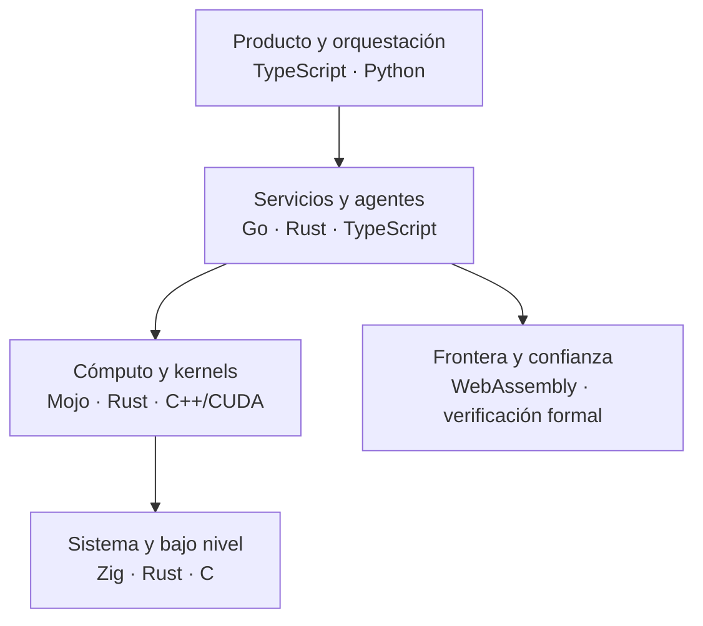
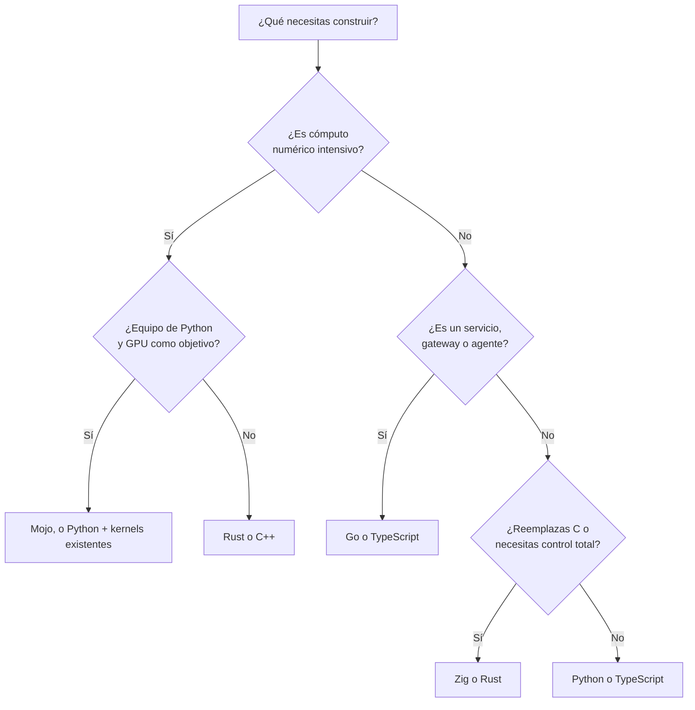

# Lenguajes y frameworks en la era de la IA

Escribir código dejó de ser el cuello de botella. Un agente produce en minutos lo que antes
tomaba un día, y eso cambia la pregunta del arquitecto: ya no es «¿en qué lenguaje lo
escribimos rápido?», sino «¿en qué lenguaje lo **verificamos, operamos y pagamos** mejor
durante cinco años?».

Este artículo recorre los lenguajes que más importan hoy para quien toma decisiones de
arquitectura: los consolidados (Python, TypeScript), los que están ganando terreno en
infraestructura (Rust, Go) y los nuevos que apuntan al futuro del cómputo (Mojo, Zig). Al
final hay una lista corta en el radar y un método para decidir sin dejarse llevar por la
moda.

<Callout tone="info" title="Fecha de corte">
  Los datos son de octubre de 2026. Este es un terreno que se mueve rápido: antes de fijar una
  decisión, revisa las notas de versión oficiales de cada proyecto.
</Callout>

## Qué cambia con la IA

Cuatro presiones nuevas empujan la elección de lenguaje, y conviene nombrarlas porque son las
que justifican (o no) cada tecnología de este artículo.

- **El código es barato, la verificación es cara.** Cuando una IA genera cientos de líneas por
  minuto, el sistema de tipos, el compilador y las pruebas pasan a ser la red de seguridad. Un
  lenguaje que rechaza errores en compilación convierte al compilador en un revisor incansable.
- **El cómputo es el costo dominante.** Entrenar e inferir modelos consume GPU, energía y
  dinero. El rendimiento por vatio y por dólar dejó de ser un detalle de optimización y entró
  en la arquitectura.
- **Los agentes necesitan concurrencia y aislamiento.** Un servicio que orquesta decenas de
  llamadas a modelos y herramientas a la vez exige buena concurrencia, y uno que ejecuta código
  generado exige sandboxing.
- **La seguridad de memoria es un requisito.** Los errores de memoria siguen siendo una fuente
  enorme de vulnerabilidades, y ahora más código llega a producción revisado más rápido.

Una consecuencia curiosa: GitHub atribuyó el ascenso de TypeScript al primer puesto por
número de contribuyentes (agosto de 2025) en parte a que los tipos funcionan bien con
asistentes de IA. Los tipos no son burocracia: son contexto que el modelo y el compilador
comparten.

## Mapa de capas

No existe «el lenguaje de la IA». Existen capas con trabajos distintos, y cada lenguaje brilla
en una.

Esto se conecta con el [modelo C4](/docs/c4-model): cada contenedor puede tener su propio
lenguaje, y la frontera entre ellos (API, proceso, módulo Wasm) es la decisión arquitectónica
real. Elegir un lenguaje por componente, no por empresa, es lo normal.

## Los consolidados: Python y TypeScript

**Python** sigue siendo la lengua franca de la investigación y del ecosistema de IA: PyTorch,
la mayor parte de los notebooks y casi todos los SDK de modelos nacen allí. Su limitación
histórica, el GIL, está cediendo: desde Python 3.14 (octubre de 2025) la compilación
_free-threaded_ tiene estatus de soportada oficialmente (PEP 779), aunque sigue siendo
opcional y separada de la compilación por defecto.

**TypeScript** es el lenguaje de la capa de producto: interfaces, APIs, herramientas para
agentes y servidores MCP. Su ventaja para la era de la IA es el tipado estructural, que da
buen contexto a los modelos y errores tempranos.

- **Úsalos para:** prototipar, orquestar modelos, glue code, interfaces y servicios de
  negocio.
- **Cuidado con:** poner Python en rutas calientes de alta concurrencia sin medir, y
  confiar en `any` en TypeScript (anula justo el beneficio que buscas).

## Rust: seguridad de memoria sin recolector

Rust ofrece rendimiento cercano a C y C++ con seguridad de memoria garantizada por el
compilador, sin recolector de basura. Su punto fuerte en la era de la IA es que el
compilador exige corrección antes de ejecutar, algo valioso cuando parte del código lo
escribe un agente.

Señales de madurez recientes:

- **Linux:** en la cumbre de mantenedores de diciembre de 2025 se acordó que Rust dejara de
  ser experimental en el kernel.
- **Infraestructura:** Debian anunció que APT exigirá Rust a partir de mayo de 2026 (según
  prensa especializada), y proyectos como el controlador Nova para GPU de NVIDIA se escriben en
  Rust.
- **IA:** [Candle](https://github.com/huggingface/candle), de Hugging Face, se centra en
  inferencia ligera sin dependencias pesadas, y [Burn](https://burn.dev) apuesta por un solo
  código para múltiples backends (CPU, GPU, WebAssembly). El ecosistema es mucho más pequeño que
  el de PyTorch.

- **Úsalo para:** motores de inferencia, servidores de alto rendimiento, componentes de
  seguridad, CLIs, extensiones de Python y módulos WebAssembly.
- **Cuidado con:** la curva de aprendizaje, los tiempos de compilación y reescribir todo «por
  seguridad». Reemplaza el componente que duele, no el sistema entero.

## Go: simplicidad operativa para agentes y plataformas

Go es deliberadamente aburrido, y eso es una virtud. Un binario estático, concurrencia con
goroutines y un lenguaje pequeño lo hacen ideal para servicios, CLIs y plataformas de
agentes. Go 1.26 trae:

- el recolector _Green Tea_ activado por defecto, con reducciones reportadas de entre 10 % y
  40 % en la sobrecarga de GC en programas con mucho uso de memoria dinámica (depende de la
  forma del heap);
- unos 30 % menos de sobrecarga en llamadas cgo;
- `go fix` reescrito con «modernizadores», útil para mantener código al día, incluso el
  generado por IA;
- experimentos opcionales como `simd/archsimd` y un perfil `goroutineleak` que detecta
  goroutines filtradas, un problema típico en servidores de agentes de larga vida.

Además existe un [SDK oficial de MCP para Go](https://github.com/modelcontextprotocol/go-sdk),
mantenido junto con Google.

- **Úsalo para:** APIs, gateways de modelos, orquestadores de agentes, herramientas de
  infraestructura y servidores MCP.
- **Cuidado con:** esperar cómputo numérico de primer nivel: Go no compite con Rust, Mojo ni
  C++ en kernels de GPU.

## Mojo: Python para el hardware de IA

Mojo es el lenguaje de Modular (con Chris Lattner, creador de LLVM y Swift). Busca ofrecer una
sintaxis cercana a Python con control de bajo nivel para escribir código de alto rendimiento en
CPU, GPU y aceleradores sin salirse a CUDA o C++.

Estado actual:

- **Mojo 1.0** llegó el 11 de agosto de 2026 con Modular 26.5. Modular indica que los
  cambios durante la serie 1.x deberían ser mayormente aditivos.
- **Código abierto:** la biblioteca estándar ya lo era; según Wikipedia y otras fuentes, el
  compilador se publicó el 18 de agosto de 2026 bajo Apache 2.0 con excepciones de LLVM.
  Verifica el estado y la licencia de los componentes de MAX en el repositorio oficial.
- **Interoperabilidad con Python:** puede importar módulos de Python mediante CPython y
  exponer funciones a Python. **No** es un superset de Python: ese objetivo original se
  pospuso o se abandonó.
- **GPU:** hay evidencia de núcleos competitivos con CUDA y HIP en cargas limitadas por
  memoria en NVIDIA y AMD (estudio de Oak Ridge de 2025).

- **Úsalo para:** kernels y operadores de modelos, inferencia de alto rendimiento y equipos de
  Python que necesitan acercarse al metal sin reescribir en C++.
- **Cuidado con:** un ecosistema joven, dependencia de un solo proveedor (Modular) y partes del
  stack de servicio con licencias distintas. Un 1.0 es una promesa de estabilidad del
  lenguaje, no de madurez del ecosistema.

## Zig: el control de C, sin sorpresas ocultas

Zig es un lenguaje de sistemas sin recolector ni asignaciones ocultas, con compilación
cruzada de primera clase y un sistema de compilación integrado. Reemplaza a C más que a Rust:
prioriza la explicitud sobre las garantías del compilador.

Zig **0.16.0** (14 de abril de 2026) introdujo `std.Io`: toda operación de entrada y salida
recibe un objeto `Io`, de modo que el mismo código puede ejecutarse con hilos o con un motor
orientado a eventos, sin dividir el lenguaje entre funciones «coloreadas» síncronas y
asíncronas. Hoy la implementación basada en hilos es la completa; la orientada a eventos
sigue en desarrollo. Zig **no** está en 1.0, así que aún hay cambios incompatibles entre
versiones.

- **Úsalo para:** runtimes, intérpretes, motores, herramientas de compilación cruzada,
  incrustación en proyectos C y componentes donde cada asignación debe ser visible. Bun, el
  runtime que usa este repositorio, está escrito en Zig.
- **Cuidado con:** adoptarlo en sistemas de larga vida sin aceptar migraciones frecuentes
  mientras no llegue a 1.0.

## En el radar

No son decisiones para esta semana, pero conviene reconocerlos.

| Tecnología           | Qué es                                                                                                               | Por qué mirarla                                                 |
| -------------------- | -------------------------------------------------------------------------------------------------------------------- | --------------------------------------------------------------- |
| **WebAssembly/WASI** | Módulos portables y aislados fuera del navegador. WASI 0.3 (jun. 2026) trae async nativo al modelo de componentes.   | Sandboxing de código generado por IA y extensiones de plugins.  |
| **Lean 4**           | Lenguaje y asistente de pruebas. Mistral publicó Leanstral, un agente de código abierto para Lean 4 (marzo de 2026). | Verificación formal asistida por IA para piezas críticas.       |
| **Gleam**            | Lenguaje tipado para la BEAM (Erlang) y JavaScript.                                                                  | Servicios concurrentes y tolerantes a fallos con tipos fuertes. |
| **Odin**             | Alternativa simple a C/C++ popular en juegos y gráficos.                                                             | Sistemas y gráficos sin la complejidad de C++.                  |
| **Carbon**           | Proyecto experimental de Google como sucesor de C++ con interoperabilidad.                                           | Migración gradual de bases de código C++ enormes.               |
| **Bend / HVM**       | Lenguaje funcional que paraleliza automáticamente en CPU y GPU.                                                      | Investigación en paralelismo implícito; aún experimental.       |

Trátalos como líneas de observación: ninguno justifica hoy reescribir un sistema productivo.

## Comparativa rápida

| Lenguaje   | Sirve mejor para                   | Madurez              | Riesgo principal                              |
| ---------- | ---------------------------------- | -------------------- | --------------------------------------------- |
| Python     | Investigación, orquestación de IA  | Muy alta             | Rendimiento y concurrencia en rutas calientes |
| TypeScript | Producto, APIs, herramientas       | Muy alta             | Tipado débil si se abusa de `any`             |
| Rust       | Inferencia, seguridad, sistemas    | Alta                 | Curva de aprendizaje y tiempos de build       |
| Go         | Servicios, agentes, plataformas    | Muy alta             | Poco apto para cómputo numérico               |
| Mojo       | Kernels de IA, cómputo heterogéneo | Media (1.0 reciente) | Ecosistema joven y dependencia de proveedor   |
| Zig        | Runtimes, sistemas, reemplazo de C | Media (pre-1.0)      | Cambios incompatibles entre versiones         |

## Cómo decidir

Empieza por el problema, no por el lenguaje.

Preguntas que deberías responder antes de elegir:

1. **¿Quién lo mantendrá en tres años?** El talento disponible pesa más que un benchmark.
2. **¿Cuál es la frontera?** Si el componente vive tras una API, un proceso o un módulo Wasm,
   cambiar su lenguaje más adelante es barato.
3. **¿Qué parte falla caro?** Pon las garantías fuertes (Rust, tipos, verificación) donde un
   error cuesta dinero o seguridad.
4. **¿Medimos?** Haz una prueba de concepto con datos reales antes de reescribir nada.
5. **¿El ecosistema existe?** Bibliotecas, depuración, observabilidad y CI cuentan tanto como
   el lenguaje.

## Errores frecuentes

- **Reescribir todo en el lenguaje de moda.** Aísla el cuello de botella y reemplaza solo eso.
- **Elegir por benchmark sintético.** Mide tu carga real, con tus datos y tu hardware.
- **Ignorar el costo de contratar y formar.** Un lenguaje nuevo es una deuda de equipo.
- **Confundir versión 1.0 con ecosistema maduro.** Estabilidad del lenguaje no es lo mismo que
  bibliotecas, herramientas y comunidad.
- **Políglota sin fronteras.** Cada lenguaje extra necesita un contrato claro, CI y
  observabilidad. Documenta cada elección en un ADR.

## Checklist para tu próximo ADR

- [ ] Describe el problema y las restricciones antes de nombrar la tecnología.
- [ ] Compara al menos dos alternativas, incluida la opción conservadora.
- [ ] Mide con una prueba de concepto sobre carga real.
- [ ] Define la frontera del componente y cómo se reemplaza.
- [ ] Anota el plan de salida si la tecnología no madura.
- [ ] Confirma licencia, gobernanza y ritmo de versiones del proyecto.

## Fuentes

Consultadas en octubre de 2026; contrasta cada dato con la fuente oficial antes de decidir.

- [Mojo 1.0 y Modular 26.5](https://www.modular.com/blog/modular-26-5-mojo-1-0-is-here)
- [Mojo en Wikipedia](<https://en.wikipedia.org/wiki/Mojo_(programming_language)>)
- [Zig 0.16.0: notas de versión](https://ziglang.org/download/0.16.0/release-notes.html)
- [Go 1.26](https://go.dev/blog/go1.26)
- [SDK oficial de MCP para Go](https://github.com/modelcontextprotocol/go-sdk)
- [Octoverse: TypeScript #1 en GitHub](https://github.blog/news-insights/octoverse/octoverse-a-new-developer-joins-github-every-second-as-ai-leads-typescript-to-1/)
- [PEP 779: Python free-threaded soportado](https://discuss.python.org/t/pep-779-criteria-for-supported-status-for-free-threaded-python/84319)
- [Rust permanente en el kernel de Linux](https://www.devclass.com/development/2025/12/15/rust-boosted-by-permanent-adoption-for-linux-kernel-code/1725322)
- [WASI 0.3](https://wasi.dev/releases/wasi-p3)
