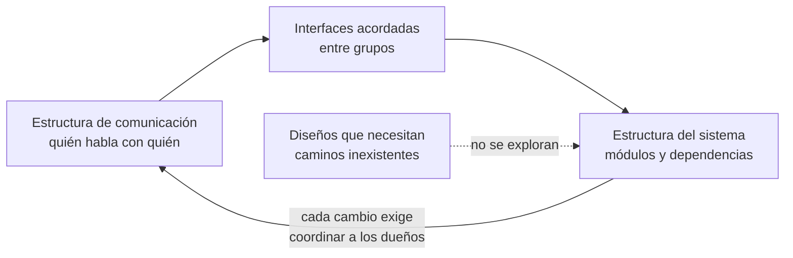
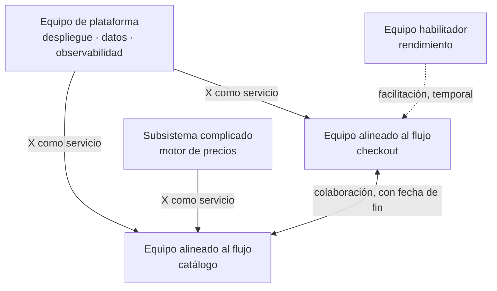

# Ley de Conway y Team Topologies

Un cambio pequeño en el flujo de pago tarda tres semanas. No por el código, que son veinte líneas, sino porque toca la pantalla del equipo de frontend, el servicio del equipo de backend y una tabla que solo puede modificar el equipo de base de datos. Hacen falta tres reuniones, tres colas de prioridades y una ventana de despliegue coordinada. Nadie diseñó esa arquitectura a propósito: salió sola, con la forma exacta del organigrama.

Ese fenómeno tiene nombre desde hace más de medio siglo. **La ley de Conway dice que el diseño de un sistema tiende a copiar la estructura de comunicación de la organización que lo construye.** Team Topologies, el modelo de Matthew Skelton y Manuel Pais, parte de esa observación para proponer cómo diseñar equipos e interacciones de modo que la arquitectura que quieres sea también la que la organización produce con naturalidad.

Este artículo explica la formulación original y su mecanismo, la maniobra inversa, los tipos de equipo y modos de interacción de Team Topologies, la carga cognitiva como límite de diseño y los errores más comunes al aplicarlo. La elección entre monolito y microservicios tiene su propio artículo, [monolito, monolito modular o microservicios](/docs/monolito-vs-microservicios); aquí solo se trata la parte organizativa.

<Callout tone="info" title="Fuentes y fecha de corte">
  Consultado en octubre de 2026. El artículo de Conway se leyó en la copia que publica su autor. Del
  libro Team Topologies se leyó el extracto oficial de IT Revolution (capítulos 1 a 3); los modos de
  interacción salen del sitio oficial del modelo y de la entrada de Martin Fowler. Las citas
  literales van en su idioma original.
</Callout>

## Lo que escribió Conway en 1968

Melvin Conway publicó «How Do Committees Invent?» en la revista _Datamation_ en abril de 1968. Según cuenta él mismo en su web, antes lo había enviado a _Harvard Business Review_, que lo rechazó por considerar que no había demostrado su tesis. Fue Fred Brooks quien, al citarlo en _The Mythical Man-Month_, lo bautizó como «ley de Conway».

La tesis, en palabras del propio artículo:

> organizations which design systems (in the broad sense used here) are constrained to produce designs which are copies of the communication structures of these organizations.

Es decir: las organizaciones que diseñan sistemas, en sentido amplio, están condicionadas a producir diseños que copian sus propias estructuras de comunicación. Dos matices del original que suelen perderse:

- **No habla solo de software.** Conway usa «sistema» en sentido amplio, y uno de sus ejemplos es militar: dos servicios militares a los que su comandante en jefe ordenó desarrollar un sistema de armas común y que, tras mucho esfuerzo, produjeron una copia de su organigrama.
- **Es una relación estructural, no una metáfora.** Conway la describe como un homomorfismo: cada subsistema corresponde a un grupo de diseño, y cada interfaz entre subsistemas, a la comunicación entre esos grupos.

El ejemplo más citado del artículo es pequeño y concreto. Una organización de investigación por contrato tenía ocho personas para escribir un compilador de COBOL y otro de ALGOL. Tras estimar la dificultad, asignó cinco al de COBOL y tres al de ALGOL. El compilador de COBOL acabó ejecutándose en cinco fases; el de ALGOL, en tres.

### La consecuencia que Conway sí sacó

El artículo no termina en la observación. Conway señala que el primer diseño que surge casi nunca es el mejor posible, así que el concepto del sistema puede necesitar cambiar, y para eso la organización tiene que poder cambiar también. Su criterio es explícito: un esfuerzo de diseño debería organizarse según la necesidad de comunicación. También sostiene que hay que recompensar a los gestores de diseño que mantienen sus organizaciones ligeras y flexibles. Medio siglo después, Team Topologies parte casi del mismo punto.

## Por qué ocurre

El mecanismo no tiene nada de místico. Diseñar un sistema exige acordar interfaces, y los acuerdos se toman donde hay comunicación fluida. Conway lo dice así: para cualquier organización de equipos hay una clase de alternativas de diseño que no puede perseguir con eficacia porque no existen los caminos de comunicación necesarios.



El bucle de vuelta importa: una vez que el sistema tiene la forma de la organización, cada cambio obliga a hablar a los dueños de los módulos implicados, lo que refuerza los caminos de comunicación existentes. Por eso la ley se nota más con el tiempo, no menos.

Hay evidencia empírica más allá de la anécdota. MacCormack, Baldwin y Rusnak compararon en 2012 (_Research Policy_) pares de productos de software con funciones similares, unos desarrollados por organizaciones muy acopladas y otros por organizaciones débilmente acopladas. Los productos de las organizaciones débilmente acopladas resultaron significativamente más modulares, con diferencias de hasta un factor de ocho en cuánto se propaga un cambio a otros componentes. La literatura de gestión llama a esta relación «hipótesis del reflejo» (_mirroring hypothesis_).

Ruth Malan lo resumió en una frase que Team Topologies presenta como la versión moderna de la ley:

> If the architecture of the system and the architecture of the organization are at odds, the architecture of the organization wins.

Si la arquitectura del sistema y la de la organización chocan, gana la de la organización. La implicación que destaca el libro es incómoda: quien decide qué equipos existen y qué posee cada uno está decidiendo la arquitectura, lo sepa o no.

## La maniobra inversa de Conway

Si la organización empuja al sistema hacia su forma, puedes usar esa fuerza a tu favor: **diseñar la estructura de equipos y sus canales de comunicación para que favorezcan la arquitectura que quieres**. Esa es la maniobra inversa de Conway (_inverse_ o _reverse Conway maneuver_).

Sobre su origen hay tres referencias que conviene distinguir:

| Fuente                                               | Qué dice del origen                                                                                      |
| ---------------------------------------------------- | -------------------------------------------------------------------------------------------------------- |
| Martin Fowler, entrada «Conway's Law» (octubre 2022) | Atribuye el término a Jonny LeRoy y Matt Simons, en el número de diciembre de 2010 del Cutter IT Journal |
| Thoughtworks Technology Radar                        | Incluye la técnica en el anillo _Trial_ en julio de 2014 y de nuevo en enero de 2015                     |
| Team Topologies (2019)                               | Habla de un «renacer» de la ley hacia 2015, con James Lewis y otros como impulsores de la maniobra       |

La atribución procede de Fowler; el artículo original de Cutter no está en acceso abierto. El libro _Accelerate_ (Forsgren, Humble y Kim) respalda la idea desde los datos de DORA: su investigación apoya que las organizaciones adapten su estructura de equipos para conseguir la arquitectura deseada, de modo que los equipos puedan llevar su trabajo del diseño al despliegue sin comunicación intensa con otros equipos.

Fowler resume las tres respuestas posibles ante la ley:

1. **Ignorarla**, porque no la conoces o crees que no aplica.
2. **Aceptarla**: reconocer su efecto y evitar que la arquitectura choque con los patrones de comunicación existentes.
3. **Invertirla**: cambiar los patrones de comunicación para empujar hacia la arquitectura deseada.

Team Topologies ilustra la tercera con un ejemplo deliberadamente simple. Cuatro equipos con desarrolladores de frontend y de backend que entregan los cambios de datos a un único administrador de base de datos tienden a producir cuatro aplicaciones de dos capas sobre una base de datos compartida. Si lo que quieres son servicios con su propio almacén de datos, la maniobra consiste en meter la capacidad de base de datos dentro de cada equipo en lugar de dejarla fuera. El libro insiste en que no hay garantía: cambiar los caminos de comunicación solo hace más probable que aparezca el diseño buscado.

## Team Topologies: un vocabulario para diseñar equipos

_Team Topologies: Organizing Business and Technology Teams for Fast Flow_ (IT Revolution, septiembre de 2019) convierte la ley de Conway en un modelo de diseño organizativo. En septiembre de 2025 salió una segunda edición que, según la editorial, añade casos de estudio de varios sectores y un prólogo nuevo.

El punto de partida es tratar al **equipo como unidad de entrega**: un grupo estable de cinco a nueve personas que trabaja hacia un objetivo común. El libro recomienda asignar trabajo a equipos, no a individuos, y relaciona el tamaño máximo con los límites de confianza que describe el número de Dunbar.

### Cuatro tipos de equipo

| Tipo                     | Propósito                                                                                   | Señal de que funciona                                      | Riesgo típico                                                    |
| ------------------------ | ------------------------------------------------------------------------------------------- | ---------------------------------------------------------- | ---------------------------------------------------------------- |
| Alineado al flujo        | Entregar de punta a punta un flujo de trabajo, normalmente de un segmento del negocio       | Lleva un cambio a producción sin esperar a otro equipo     | Cargar con tanta infraestructura que deja de entregar valor      |
| De plataforma            | Ofrecer un producto interno que acelera a los equipos alineados al flujo                    | Los equipos lo usan por su cuenta, sin abrir tickets       | Convertirse en una cola de peticiones con su propia agenda       |
| Habilitador              | Ayudar a un equipo alineado al flujo a superar obstáculos y detectar capacidades que faltan | El equipo ayudado deja de necesitarlo                      | Volverse un equipo de expertos permanente del que todos dependen |
| De subsistema complicado | Mantener una parte que exige conocimiento muy especializado (matemática, cálculo, técnica)  | Los demás consumen el subsistema sin entender sus entrañas | Usarlo como excusa para crear equipos por componente             |

El tipo por defecto es el alineado al flujo; los otros tres existen para reducir su carga. Fowler lo subraya con la plataforma: su beneficio principal es reducir la carga cognitiva de los equipos alineados al flujo.

### Tres modos de interacción

El modelo no solo nombra equipos: también restringe cómo se relacionan. Según el sitio oficial, hay tres modos.

| Modo            | En qué consiste                                                        | Cuándo encaja                                          | Señal de alarma                                     |
| --------------- | ---------------------------------------------------------------------- | ------------------------------------------------------ | --------------------------------------------------- |
| Colaboración    | Dos equipos trabajan juntos durante un periodo definido para descubrir | Fronteras inciertas, tecnología o API nuevas           | Lleva meses y nadie sabe cuándo acaba               |
| X como servicio | Un equipo provee algo y otro lo consume con mínima coordinación        | La frontera ya es estable y la interfaz, clara         | El consumidor necesita reuniones para cada uso      |
| Facilitación    | Un equipo ayuda y acompaña a otro para que adquiera una capacidad      | Falta una habilidad que el equipo debe acabar teniendo | El facilitador termina haciendo el trabajo él mismo |

La colaboración es cara a propósito: borra la frontera durante un tiempo para aprender dónde debería estar. Fowler lo describe para las plataformas nuevas, que empiezan colaborando con sus usuarios y deben pasar a servicio cuando maduran. Una interacción que no encaja en ninguno de los tres modos suele indicar que la frontera está mal trazada.



## La carga cognitiva como restricción de diseño

La aportación más útil del modelo para un arquitecto es tratar la **carga cognitiva** como un límite de diseño, igual que la latencia o el presupuesto. El libro toma la definición de John Sweller (1988): la cantidad total de esfuerzo mental que se usa en la memoria de trabajo. Sweller distingue tres tipos, que el libro traduce a software:

| Tipo       | De dónde viene                                    | Ejemplo en un equipo                           | Qué hacer con ella                                   |
| ---------- | ------------------------------------------------- | ---------------------------------------------- | ---------------------------------------------------- |
| Intrínseca | Lo fundamental de la tarea                        | El lenguaje, el modelo de datos del servicio   | Reducirla con formación y buenas elecciones técnicas |
| Extrínseca | El entorno en el que se trabaja                   | Recordar cómo se despliega o se configura algo | Eliminarla, sobre todo automatizando                 |
| Pertinente | Lo que exige atención para aprender o rendir bien | Las reglas del dominio de facturación          | Dejarle el mayor espacio posible                     |

De ahí sale una regla con consecuencias arquitectónicas fuertes: **no dejes que un subsistema crezca más allá de la carga cognitiva del equipo que lo posee**. Si crece, divídelo o divide el dominio; no añadas un segundo equipo al mismo trozo.

El libro desaconseja medir esa carga con líneas de código o número de módulos y propone razonar sobre la complejidad relativa de los dominios. Sus heurísticas, presentadas como punto de partida y no como fórmula:

- Asigna cada dominio a un solo equipo; si es demasiado grande, pártelo en subdominios antes de repartirlo.
- Un equipo puede llevar dos o tres dominios simples.
- Un equipo con un dominio complejo no debería tener ningún otro, ni siquiera uno simple.
- Evita que un mismo equipo lleve dos dominios complicados: en la práctica se comporta como dos subequipos.

La primera medición es una pregunta al equipo, sin juicio: si siente que es eficaz y responde a tiempo al trabajo que se le pide. Si la respuesta es claramente negativa, toca revisar qué posee.

## Cuándo se nota la ley

La ley de Conway rara vez se anuncia. Aparece como fricción que todos aceptan como normal:

| Síntoma                                                         | Lo que te dice la ley                                                          |
| --------------------------------------------------------------- | ------------------------------------------------------------------------------ |
| Un cambio de negocio necesita tres reuniones y tres despliegues | La frontera del sistema corta un flujo que debería pertenecer a un solo equipo |
| Hay una base de datos compartida que nadie se atreve a cambiar  | Hubo un equipo central de datos por el que pasaban todos los cambios           |
| La API entre dos servicios cambia en cada sprint                | Los dos equipos colaboran de forma permanente: quizá son un solo dominio       |
| Existe una capa «común» que todos tocan y nadie posee           | No hay equipo dueño; la comunicación ocurre por accidente, en las revisiones   |
| Tras una fusión, el sistema tiene dos de todo                   | Las dos organizaciones nunca llegaron a compartir caminos de comunicación      |

También aparece en las herramientas. Team Topologies observa que las herramientas compartidas o separadas moldean la comunicación: si quieres que dos equipos colaboren, comparte herramientas; si quieres una frontera clara, sepáralas.

## Usarla a propósito

Diseñar con la ley en mente no es reorganizar cada trimestre. Es tomar las fronteras del sistema y las de los equipos como una sola decisión:

1. **Parte del flujo de valor y del dominio.** Los contextos delimitados de [DDD](/docs/domain-driven-design) son buenos candidatos a frontera de equipo; el [acoplamiento y la cohesión](/docs/acoplamiento-cohesion) te dicen qué debe quedar junto.
2. **Dibuja la arquitectura objetivo y el organigrama en la misma hoja.** Cada interfaz importante debería coincidir con una frontera entre equipos con un modo de interacción declarado.
3. **Comprueba la carga cognitiva** de cada equipo propuesto con las heurísticas anteriores.
4. **Decide el modo de cada interacción** y, si es colaboración, ponle fecha de fin.
5. **Registra la decisión** como cualquier otra decisión de arquitectura, con su contexto, en un [ADR](/docs/adr); el razonamiento de [trade-offs y decisiones](/docs/trade-offs-y-decisiones) aplica igual.

Una forma ligera de hacer visible el resultado es una ficha por equipo en el repositorio, con lo que posee y cómo se relaciona. Es una convención propia, no un formato del libro:

```yaml
# teams/checkout.yaml
team: checkout
type: stream-aligned
owns: [checkout-web, payments-service, orders-db]
interactions:
  - with: platform
    mode: x-as-a-service
  - with: performance-enablers
    mode: facilitating
    until: 2026-12-31
```

## Cuándo sí y cuándo no

| Situación                                                            | Qué hacer                                                                          |
| -------------------------------------------------------------------- | ---------------------------------------------------------------------------------- |
| Un solo equipo pequeño                                               | La ley casi no se nota; cuida la modularidad interna y no fabriques fronteras      |
| Varios equipos que se bloquean entre sí de forma habitual            | Revisa fronteras de equipo y de sistema a la vez; es el caso típico de la maniobra |
| Vas a partir un sistema en servicios                                 | Decide antes qué equipo será dueño de cada uno                                     |
| La organización se reorganiza por motivos de presupuesto o jerarquía | Haz visible el impacto en la arquitectura antes de que se decida                   |
| Proveedores externos construyen partes del sistema                   | Asume que el contrato con el proveedor será una frontera del sistema               |
| Un dominio aún mal entendido                                         | Colaboración temporal antes de fijar fronteras                                     |

La ley es una tendencia fuerte, no un determinismo. Un equipo disciplinado puede mantener un diseño que su organigrama no favorece, pero pagará esa disciplina en cada cambio.

## Errores frecuentes

- **Microservicios sin equipos propios.** Si un mismo equipo mantiene diez servicios, pagas la red y la coordinación de despliegues sin ganar autonomía. El caso completo está en [monolito, monolito modular o microservicios](/docs/monolito-vs-microservicios).
- **Plataforma que se vuelve cuello de botella.** Si cada uso pasa por un ticket, no es X como servicio: es una dependencia con cola. Una plataforma debe tratarse como producto, con usuarios y autoservicio; en [DevOps y su cultura](/docs/devops-cultura) se describe cómo degenera en el antipatrón del «equipo DevOps».
- **Equipos por capa técnica.** Frontend, backend y base de datos como equipos separados producen exactamente esas tres capas, con cada cambio de negocio cruzándolas todas.
- **Equipos por componente por reflejo.** Team Topologies los considera necesarios solo en casos excepcionales de conocimiento muy especializado; por defecto, equipos alineados al flujo.
- **Colaboración permanente.** Dos equipos que llevan un año «colaborando» probablemente deberían ser uno, o necesitan una interfaz estable.
- **Reorganizar sin criterio técnico.** El libro advierte que las reorganizaciones frecuentes por conveniencia de gestión o recorte de plantilla destruyen la capacidad de construir software.
- **Dar la maniobra por hecha.** Cambiar el organigrama no cambia el código; el sistema antiguo seguirá empujando hacia la estructura antigua hasta que se migre.

## Ejemplo de decisión: el flujo de pago

**Contexto.** Una tienda en línea tiene tres equipos: interfaz web, servicios y datos. Cada cambio en el pago cruza los tres y tarda unas tres semanas; el equipo de datos además atiende peticiones de catálogo, inventario e informes. Negocio quiere probar métodos de pago nuevos cada mes.

**Diagnóstico con Conway.** El sistema tiene la forma del organigrama: una capa web, una capa de servicios y una base de datos compartida. La frontera que duplica la comunicación está entre servicios y datos: el pago necesita cambios de esquema que compiten en la cola con todo lo demás. La carga cognitiva del equipo de datos es alta y casi toda extrínseca.

**Opciones.**

| Opción                                                          | Ventaja                                      | Coste                                                    |
| --------------------------------------------------------------- | -------------------------------------------- | -------------------------------------------------------- |
| Mantener equipos y añadir un coordinador                        | Sin cambios organizativos                    | Más comunicación, la misma frontera                      |
| Equipo alineado al flujo de pago, con capacidad de datos dentro | Un cambio de pago lo resuelve un solo equipo | Hay que contratar o formar; el esquema de pago se separa |
| Separar el pago en un servicio nuevo sin cambiar equipos        | Frontera técnica limpia                      | La organización vuelve a cruzarla en cada cambio         |

**Decisión.** Crear un equipo alineado al flujo de pago (seis personas, con perfil de datos dentro) que posee su interfaz, su lógica y su esquema. El antiguo equipo de datos pasa a ser de plataforma: ofrece aprovisionamiento, copias y observabilidad de bases de datos como servicio. Durante un trimestre, un equipo habilitador acompaña al de pago en rendimiento de consultas. Si el pago termina siendo un servicio aparte o un módulo del sistema actual es una decisión distinta que se toma después, con los criterios de [monolito, monolito modular o microservicios](/docs/monolito-vs-microservicios).

**Consecuencias.** El tiempo de un cambio de pago debería medirse antes y después; si no baja, la frontera elegida era la equivocada. La plataforma necesita su propia hoja de ruta de producto para no convertirse en la nueva cola. La decisión queda en un ADR con fecha de revisión.

## Checklist

- [ ] Cada módulo o servicio importante tiene un único equipo dueño.
- [ ] Las fronteras entre equipos coinciden con interfaces explícitas del sistema.
- [ ] Cada interacción entre equipos tiene un modo declarado: colaboración, X como servicio o facilitación.
- [ ] Toda colaboración tiene fecha de fin o criterio de salida.
- [ ] La carga cognitiva de cada equipo se ha revisado preguntando al propio equipo.
- [ ] La plataforma se usa en autoservicio, sin tickets para el caso habitual.
- [ ] Las decisiones sobre equipos que cambian la arquitectura cuentan con criterio técnico y quedan registradas.

## Fuentes

Consultadas en octubre de 2026.

- [How Do Committees Invent? (Melvin E. Conway, Datamation, abril de 1968)](https://www.melconway.com/Home/Committees_Paper.html): copia publicada por el autor
- [Conway's Law (página de Melvin Conway)](https://www.melconway.com/Home/Conways_Law.html): historia del artículo, rechazo de HBR y nombre dado por Brooks
- [Conway's Law (Martin Fowler, 20 de octubre de 2022)](https://martinfowler.com/bliki/ConwaysLaw.html): tres respuestas y origen de la maniobra inversa
- [Team Topologies (Martin Fowler, 25 de julio de 2023)](https://martinfowler.com/bliki/TeamTopologies.html)
- [Inverse Conway Maneuver (Thoughtworks Technology Radar)](https://www.thoughtworks.com/radar/techniques/inverse-conway-maneuver)
- [Key concepts (sitio oficial de Team Topologies)](https://teamtopologies.com/key-concepts): tipos de equipo y modos de interacción
- [Extracto de Team Topologies (IT Revolution)](https://itrevolution.com/wp-content/uploads/2022/06/TTOP_excerpt.pdf): capítulos 1 a 3, ley de Conway, maniobra inversa, tamaño de equipo y carga cognitiva
- [Team Topologies, segunda edición (IT Revolution)](https://itrevolution.com/book/team-topologies/)
- [Exploring the duality between product and organizational architectures (MacCormack, Baldwin y Rusnak, Research Policy, 2012)](https://dash.harvard.edu/handle/1/34403525)
