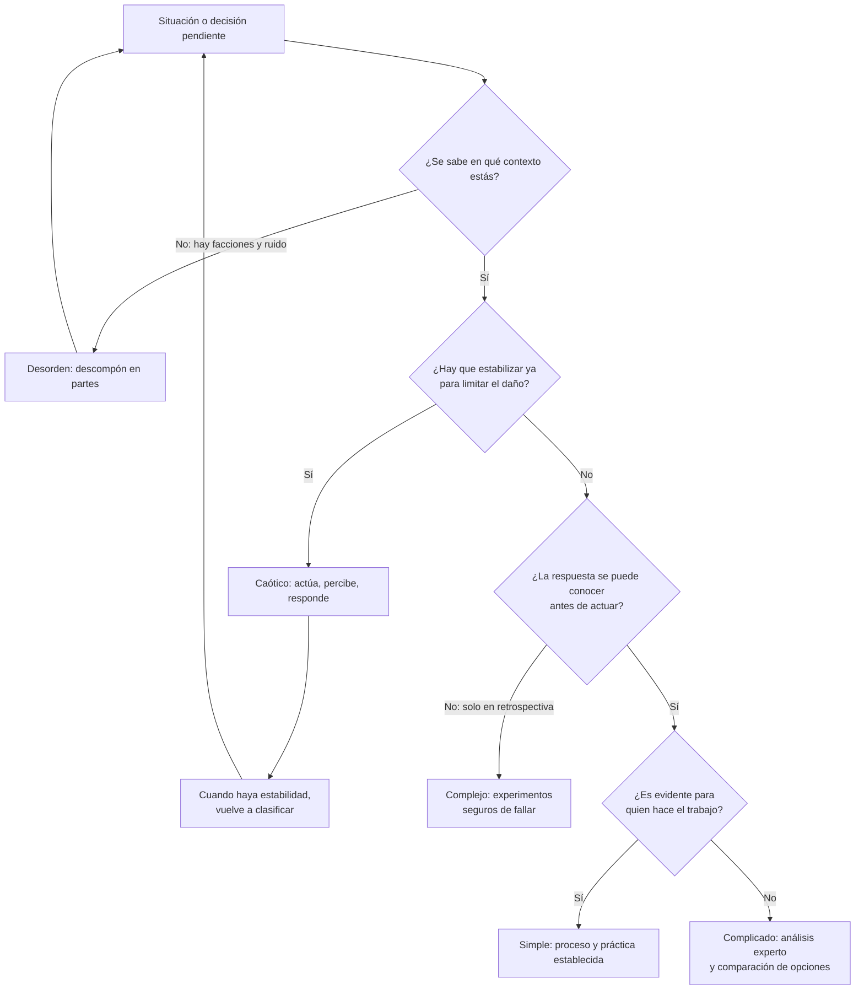
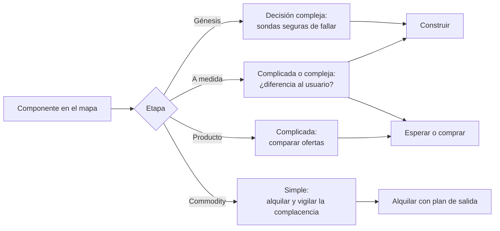

# Marcos de decisión estratégica: Cynefin y mapas de Wardley

Un equipo lleva tres semanas discutiendo si debe reescribir su módulo de videollamadas. Una parte pide una hoja de cálculo con el costo de cada opción; otra quiere un prototipo antes de opinar; alguien propone copiar lo que hizo otra empresa del sector. Nadie tiene mala fe y todos usan buenos argumentos, pero la discusión no avanza porque cada persona está respondiendo a una pregunta distinta: unos creen que el problema tiene una respuesta correcta que se puede calcular, otros que solo se descubre probando, y nadie ha dicho en qué punto de madurez está la pieza que se discute.

**Un marco de decisión estratégica es una herramienta para clasificar la situación antes de elegir la respuesta: no te dice qué decidir, te dice qué tipo de método encaja con lo que tienes delante.**

Esta lección cubre dos marcos que se complementan. **Cynefin** responde a «¿qué tipo de problema es este y cómo debo actuar?». Los **mapas de Wardley** responden a «¿qué piezas componen lo que ofrezco, cuán maduras son y qué implica eso para construir, comprar o alquilar?». Al final hay un ejemplo trabajado con cuatro componentes de un producto, descrito como caso ilustrativo, no como un mapa real.

<Callout tone="info" title="Alcance y fecha de corte">
  Fuentes consultadas en octubre de 2026. Esta lección no trata la priorización de iniciativas (está
  en [marcos de priorización](/docs/marcos-de-priorizacion)), la distinción entre complejidad
  esencial y accidental ([su propia lección](/docs/complejidad-esencial-y-accidental)) ni la
  reversibilidad de las decisiones y los sesgos generales ([trade-offs y
  decisiones](/docs/trade-offs-y-decisiones)). Aquí se enlazan, no se repiten.
</Callout>

## El problema: aplicar el método equivocado con convicción

Las organizaciones suelen tener un método preferido para decidir y lo aplican a todo. Un equipo acostumbrado a análisis exhaustivos pide estudios previos incluso cuando nadie puede saber la respuesta sin probar; un equipo acostumbrado a experimentar improvisa incluso cuando existe un procedimiento conocido que funciona. El error no está en el método, sino en no comprobar si encaja con la situación.

| Síntoma                                                              | Pregunta que nadie formuló                                       |
| -------------------------------------------------------------------- | ---------------------------------------------------------------- |
| Se pide un plan cerrado para algo que nadie ha hecho antes           | ¿Hay una relación causa-efecto que se pueda conocer de antemano? |
| Se convoca a expertos y el debate se estanca durante semanas         | ¿Falta información o falta experimentar?                         |
| El equipo construye a medida algo que todos sus competidores compran | ¿Cuán madura es esta pieza en el mercado?                        |
| Un servicio alquilado ata al proveedor en lo que más diferencia      | ¿Qué componentes son commodity y cuáles no?                      |
| La estrategia se presenta como una lista de iniciativas sin contexto | ¿Dónde está cada pieza y hacia dónde se mueve?                   |

Las dos primeras filas son el terreno de Cynefin; las tres últimas, el de los mapas de Wardley.

## Cynefin: qué tipo de problema tienes

David J. Snowden y Mary E. Boone publicaron _A Leader's Framework for Decision Making_ en **Harvard Business Review, en noviembre de 2007** (volumen 85, número 11). En ese momento Snowden era fundador y director científico de Cognitive Edge, y Boone, presidenta de la consultora Boone Associates. El marco es anterior al artículo: Cynthia F. Kurtz y Snowden lo habían descrito en 2003 en _IBM Systems Journal_ con el título _The new dynamics of strategy: Sense-making in a complex and complicated world_.

La idea central es que los contextos se distinguen por **la relación entre causa y efecto**, y que cada tipo de relación pide una forma distinta de actuar. El artículo define cinco contextos: cuatro en los que se puede diagnosticar y actuar (simple, complicado, complejo y caótico) y un quinto, el desorden, en el que no está claro cuál de los otros cuatro predomina. Los dos primeros forman lo que los autores llaman el mundo ordenado; los dos siguientes, el no ordenado.

<Callout tone="warning" title="Nombres y fechas que cambian según la fuente">
  Este texto usa los nombres del artículo de 2007. En el de 2003, Kurtz y Snowden llamaban _known_ y
  _knowable_ a los dominios que en 2007 pasan a ser simple y complicado. En versiones posteriores
  del marco, el dominio simple aparece como _obvious_ y más tarde como _clear_, y el desorden como
  _confusion_. Fuente secundaria para este historial de nombres, sus fechas y el dato de que Snowden
  empezó a desarrollar el marco en 1999 en IBM Global Services: la entrada de Wikipedia sobre
  Cynefin; no hay una fuente primaria que lo confirme entre las consultadas.
</Callout>

### Los cuatro contextos

| Contexto   | Causa y efecto                                      | Secuencia de respuesta           | Qué guía la respuesta             | Ejemplo en software (ilustrativo)                             |
| ---------- | --------------------------------------------------- | -------------------------------- | --------------------------------- | ------------------------------------------------------------- |
| Simple     | Evidente para todos; existe una respuesta correcta  | Percibir, categorizar, responder | Mejores prácticas                 | Renovar un certificado con un procedimiento documentado       |
| Complicado | Existe, pero hace falta análisis experto para verla | Percibir, analizar, responder    | Buenas prácticas (varias válidas) | Dimensionar una base de datos para una carga conocida         |
| Complejo   | Solo se entiende en retrospectiva                   | Sondear, percibir, responder     | Patrones que emergen              | Saber qué función adoptarán los usuarios de un producto nuevo |
| Caótico    | No hay relación perceptible; todo se mueve          | Actuar, percibir, responder      | Respuesta rápida                  | Una caída total con causa desconocida y clientes afectados    |

Las secuencias del artículo en inglés son _sense-categorize-respond_, _sense-analyze-respond_, _probe-sense-respond_ y _act-sense-respond_. Los ejemplos de la última columna son adaptaciones al software; los del artículo vienen de otros sectores (el procesamiento de pagos de préstamos para el contexto simple, la prospección de petróleo para el complicado, el Apolo 13 para el complejo y el 11 de septiembre de 2001 para el caótico).

### Qué cambia en cada contexto

**Simple.** La respuesta es conocida y compartida. Lo adecuado es establecer procesos, delegar y aplicar la práctica establecida. El artículo advierte de tres riesgos: clasificar aquí lo que se ha simplificado en exceso, el pensamiento condicionado por la experiencia pasada y la complacencia. En su diagrama el dominio simple está junto al caótico, y los autores sostienen que los colapsos más frecuentes hacia el caos se deben a que el éxito generó complacencia. También recuerdan que una mejor práctica es, por definición, una práctica pasada.

**Complicado.** Hay al menos una respuesta correcta, a menudo varias, pero encontrarla requiere expertos. El riesgo es el contrario: que los expertos dominen la conversación, descarten ideas de quien no lo es o se bloqueen en lo que el artículo llama parálisis por análisis. Los autores dan una pista útil para distinguirlo del complejo: si la respuesta correcta se escapa y tienes que decidir con datos incompletos, probablemente el problema es complejo y no complicado.

**Complejo.** No hay respuesta correcta que encontrar de antemano; los patrones emergen. Lo adecuado son experimentos seguros de fallar (_safe-to-fail_): sondas pequeñas cuyo fracaso no cuesta caro, observar qué ocurre y decidir qué patrones conviene reforzar. El riesgo es volver al mando y control y exigir planes con resultados definidos. Los autores afirman que este contexto es mucho más frecuente en las empresas de lo que sus directivos suelen creer.

**Caótico.** No hay tiempo para analizar. Primero se actúa para estabilizar, después se observa dónde hay estabilidad y se trabaja para llevar la situación al contexto complejo. El riesgo aparece después de la crisis: mantener el estilo directivo más tiempo del necesario.

**Desorden.** Varias perspectivas compiten y no se sabe en qué contexto estás. La salida que propone el artículo es descomponer la situación en partes y asignar cada parte a uno de los otros cuatro contextos.

### Cómo clasificar una decisión



El diagrama es una simplificación para uso práctico. Cynefin no es una matriz de cuatro casillas en la que se archiva cada problema una vez: Kurtz y Snowden lo describen como un dispositivo para dar sentido a la situación (_sense-making_), y el artículo de 2007 pide preparar a la organización para entender las transiciones entre contextos. El propio artículo abre con un caso que lo ilustra: en 1993, tras un tiroteo con siete víctimas en Palatine (Illinois), el subjefe de policía Walter Gasior tuvo que atender a la vez un frente caótico, uno simple, uno complicado y uno complejo.

## Mapas de Wardley: dónde está cada pieza

Simon Wardley describe en su libro _Wardley Maps_, publicado por capítulos en Medium bajo licencia Creative Commons BY-SA 4.0, cómo dibujó su primer mapa en 2005, cuando dirigía como CEO un servicio de fotos en línea. Cuenta que refinó la técnica en el consejo de dirección con James Duncan, el CIO de entonces, a quien considera coinventor del método.

Según el capítulo 2 del libro, un mapa necesita cuatro elementos: ser **visual**, ser **específico de un contexto** (un negocio concreto en un momento concreto), mostrar la **posición** de los componentes respecto a un **ancla** y describir el **movimiento**.

- **El ancla** es el usuario y sus necesidades. Se dibuja arriba.
- **El eje vertical es la cadena de valor**: debajo de cada necesidad van los componentes que la satisfacen y, debajo de estos, los que ellos a su vez necesitan. Arriba queda lo más visible para el usuario; abajo, lo que no ve.
- **El eje horizontal es la evolución**: cada componente se sitúa según su madurez, y todos se mueven de izquierda a derecha empujados por la competencia entre oferta y demanda. Por eso Wardley insiste en que el mapa no es estático.

### Las cuatro etapas de evolución

| Etapa                                   | Características según Wardley                                           | Foco que propone                                                    |
| --------------------------------------- | ----------------------------------------------------------------------- | ------------------------------------------------------------------- |
| _Genesis_ (génesis)                     | Único, muy escaso, incierto, en cambio constante, recién descubierto    | Exploración                                                         |
| _Custom built_ (a medida)               | Poco común, todavía se aprende; hecho y ajustado para un entorno        | Aprendizaje y oficio                                                |
| _Product_ (producto, incluido alquiler) | Cada vez más común, fabricado con un proceso repetible, mejor entendido | Refinar y mejorar                                                   |
| _Commodity_ (incluida la utilidad)      | Estandarizado, definido, indiferenciado, operado a escala               | Eliminar la desviación, industrializar y ganar eficiencia operativa |

Wardley reconoce que la evolución no se puede medir sobre el tiempo, pero sí describir por las características de cada etapa. Para situar un componente propone preguntar cuán extendido y bien definido está, si todos tus competidores lo usan, si se puede conseguir como producto o como servicio de utilidad y si es algo nuevo.

### Cómo se dibuja un mapa, paso a paso

1. **Fija el alcance y las necesidades del usuario.** Wardley advierte de una trampa: describir tus necesidades (vender, crecer) en lugar de las del usuario.
2. **Enumera los componentes de la cadena de valor.** Primero las capacidades visibles; después sus dependencias, hasta llegar a lo que queda fuera del alcance, por ejemplo algo que ya consumes como servicio.
3. **Sitúa cada componente en el eje de evolución** con las preguntas anteriores. Wardley avisa de que este paso es el que más discusiones genera.
4. **Compártelo y deja que lo cuestionen.** Según el autor, compartirlo refina el mapa y reparte su propiedad.
5. **Añade el movimiento**: qué componentes están evolucionando y dónde hay inercia al cambio.

Dos advertencias del propio capítulo resultan especialmente útiles. La primera: no describas un componente por cómo lo tratas, sino por lo que es; su ejemplo es el de empresas que en 2016 seguían construyendo su propio CRM pese a que era casi universal. La segunda: si el grupo no se pone de acuerdo sobre la posición de un componente, puede que sean varios subcomponentes, la mayoría commodity y alguno de verdad novedoso.

Si quieres versionarlo junto al código, basta una estructura sencilla. Esta es solo la forma:

```yaml
# docs/strategy/map.yaml (forma orientativa)
scope: reservas-de-citas
reviewed: 2026-10-12
anchor: paciente que necesita una cita
components:
  - name: agenda
    stage: custom # genesis | custom | product | commodity
    needs: [prediccion, crm, video]
    movement: estable
  - name: video
    stage: custom
    movement: hacia commodity # …
```

## De la posición a la decisión: construir, comprar o alquilar

En los capítulos citados Wardley no ofrece una tabla de compra, pero el capítulo 3 de su libro sí relaciona la etapa con el método. En la zona no explorada (génesis y primeras fases a medida) usa un enfoque ágil muy ligero; en la transición hacia producto, el foco pasa a reducir desperdicio y aparece lean; en la zona industrializada dominan Six Sigma y marcos como ITIL. Sobre compras dice algo parecido: un enfoque de capital riesgo en génesis, otro basado en resultados y en productos comerciales en la transición, y otro por unidad en la zona industrializada. Y concluye que la génesis se presta más al desarrollo interno, mientras que lo industrializado puede externalizarse con seguridad.

De ahí sale una regla de partida, no una ley:

| Posición del componente | Decisión por defecto                     | Por qué                                                        | Cuándo reconsiderarla                                      |
| ----------------------- | ---------------------------------------- | -------------------------------------------------------------- | ---------------------------------------------------------- |
| Génesis                 | Construir, en pequeño y con experimentos | Nadie lo vende todavía; lo valioso es lo que aprendes          | Si no es relevante para tu usuario, no lo explores         |
| A medida                | Construir si diferencia; si no, esperar  | Aún cambia mucho; comprar ahora puede fijar un diseño inmaduro | Cuando aparezcan varias ofertas comparables                |
| Producto                | Comprar y configurar                     | Hay ofertas maduras; construir repite trabajo resuelto         | Si tu uso es tan particular que el producto estorba        |
| Commodity               | Alquilar como servicio de utilidad       | Estándar, indiferenciado y operado a escala por otros          | Si el volumen o la regulación cambian la ecuación de costo |

Esta regla se cruza con dos lecciones previas. Alquilar lo que es commodity es justo el caso en el que el lock-in suele ser barato de evitar, y conviene aislarlo detrás de un puerto y tener un plan de salida, como se explica en [casado a un proveedor](/docs/casado-a-un-proveedor). Y comprar algo que ya es producto reduce la complejidad accidental de tu sistema, el argumento de «comprarla resuelta» de [complejidad esencial y accidental](/docs/complejidad-esencial-y-accidental).

### Cómo se combinan los dos marcos

Los dos marcos miran cosas distintas. Wardley sitúa **componentes**; Cynefin clasifica **situaciones y decisiones**. Una lectura útil, que no es una equivalencia que propongan los autores en los textos citados, es esta: la decisión sobre un componente en génesis suele vivir en el contexto complejo, porque nadie sabe todavía qué funcionará; elegir entre productos maduros suele ser un problema complicado, que se resuelve con análisis; y operar un commodity tiende al contexto simple, con su riesgo de complacencia.



## Cuándo sí y cuándo no

**Cynefin sirve cuando:**

- Un equipo discute métodos (analizar más o probar ya) sin haber acordado qué tipo de problema tiene.
- Hay que decidir con información incompleta y alguien exige certezas que no existen.
- Sales de un incidente y necesitas separar lo que fue caótico de lo que ahora es complejo o complicado.

**Cynefin no aporta mucho cuando:**

- La decisión es rutinaria y el procedimiento funciona; clasificarla es burocracia.
- Se usa como etiqueta para justificar una decisión ya tomada («es complejo, así que no planificamos»).

**Un mapa de Wardley sirve cuando:**

- Debes decidir qué construir, comprar o alquilar en un sistema con muchas piezas.
- Hay que explicar a negocio y a tecnología la misma estrategia con un soporte común.
- Quieres anticipar qué componentes se volverán commodity y dónde habrá inercia.

**Un mapa de Wardley no aporta mucho cuando:**

- El alcance es una sola pieza sin dependencias relevantes.
- No hay nadie con conocimiento del mercado y de la operación para situar los componentes; el resultado sería una opinión con forma de diagrama.

## Errores frecuentes

- **Aplicar la respuesta del contexto simple a un problema complejo.** Es el error que el artículo de 2007 describe con más detalle: pedir planes con resultados definidos, mejores prácticas de otros o información condensada para algo que solo se entiende probando. El síntoma es un plan detallado para un producto que nadie ha validado.
- **Confundir complicado con complejo.** Contratar más expertos no resuelve un problema cuyo comportamiento emerge del uso. Si la respuesta se escapa y los datos siempre son incompletos, prueba con sondas pequeñas.
- **Mapear sin hablar con quien opera el sistema.** Wardley insiste en que el mapa lo hace y lo cuestiona un grupo que conoce el negocio, y en que el mapeo no se puede externalizar. Quien opera el sistema sabe qué componente da guerra, qué dependencia falta en el dibujo y qué está a medida solo por costumbre.
- **Usar el mapa como documento estático.** Todos los componentes se mueven hacia la derecha. Un mapa de hace dos años que nadie ha revisado describe un mercado que ya no existe y puede llevarte a construir lo que hoy se alquila.
- **Situar un componente por cómo lo tratas.** Que lo hayas construido a medida no significa que esté en esa etapa: su posición depende del mercado, no de tu historia.
- **Tomar la tabla de construir, comprar o alquilar como ley.** Volumen, regulación, latencia o costo de salida pueden justificar construir algo que es commodity. Hazlo a propósito y escríbelo en un [ADR](/docs/adr).
- **Ignorar la complacencia en lo que funciona.** Los componentes que ya no dan problemas son los que menos se revisan, y el artículo de Snowden y Boone sitúa ahí el riesgo de colapso hacia el caos.

## Ejemplo trabajado: una plataforma de reservas de citas

El caso es **ilustrativo**: el producto, los componentes y las cifras son supuestos para mostrar el razonamiento, no datos de un sistema real ni precios de mercado.

### Contexto y supuestos

Una plataforma de reservas para clínicas tiene un equipo de 8 personas, es decir, una capacidad de 96 personas-mes al año. El usuario ancla es el paciente que necesita una cita. Hoy el equipo dedica su capacidad así:

| Componente                   | Qué hace                                     | Etapa supuesta       | Personas-mes al año |
| ---------------------------- | -------------------------------------------- | -------------------- | ------------------- |
| Agenda                       | Reglas de reserva por especialidad y clínica | A medida             | 30                  |
| Predicción de ausencias (ML) | Estima qué citas no se presentarán           | Génesis              | 12                  |
| CRM                          | Historial de contacto con pacientes          | Producto (comprado)  | 6 de integración    |
| Videoconsulta                | Servidor propio de videollamadas             | A medida → commodity | 18                  |
| **Total en mantenimiento**   |                                              |                      | **66**              |

Quedan 30 personas-mes al año para funciones nuevas. Supón que, cuando se construyó la videoconsulta, ninguna oferta cumplía los requisitos de la clínica, y que hoy hay varios servicios comparables que se pagan por uso.

### El mapa y la clasificación de cada decisión

La figura de esta lección representa ese mapa: la agenda es lo más visible, el CRM está en producto, la predicción en génesis y la videoconsulta se mueve de a medida a commodity. Cada decisión cae en un contexto distinto de Cynefin:

- **Predicción de ausencias: complejo.** Nadie sabe qué señales funcionan. Se decide con dos sondas de cuatro semanas, cada una con un criterio de parada escrito de antemano. Se construye, en pequeño.
- **Agenda: complicado.** Las reglas existen y las conocen los expertos de las clínicas; hay que analizarlas, no experimentar. Es lo que diferencia al producto: se sigue construyendo.
- **CRM: simple.** Es un producto maduro y la integración sigue un procedimiento conocido. Se mantiene comprado.
- **Videoconsulta: complicado.** Comparar proveedores por cumplimiento normativo, latencia y salida de datos es análisis experto. La posición en el mapa sugiere alquilar.

### Las cuentas de la videoconsulta

Supón que la suscripción al servicio equivale a 7,5 personas-mes al año, que operarlo y mantener el adaptador cuesta 1 persona-mes al año y que la migración cuesta 4 personas-mes una sola vez.

| Concepto                        | Construido (hoy) | Alquilado, año 1 | Alquilado, año 2 en adelante |
| ------------------------------- | ---------------- | ---------------- | ---------------------------- |
| Mantenimiento o suscripción     | 18               | 7,5              | 7,5                          |
| Operación y adaptador           | —                | 1                | 1                            |
| Migración                       | —                | 4                | —                            |
| **Total (personas-mes al año)** | **18**           | **12,5**         | **8,5**                      |

El ahorro es de 5,5 personas-mes el primer año y de 9,5 a partir del segundo. Además, el equipo deja de dedicar 18 personas-mes de trabajo propio al video y pasa a dedicarle 5 el primer año y 1 después: libera 13 personas-mes en el año 1 y 17 en los siguientes para la agenda y la predicción, que es donde está la diferencia.

### Decisión y consecuencias

Se alquila la videoconsulta detrás de un puerto propio, con un ADR que recoge el costo de salida estimado y las condiciones que reabrirían la decisión (por ejemplo, un cambio de precio o de requisitos de residencia de datos). El mapa se revisa cada seis meses con quien opera el sistema, porque la predicción de ausencias puede pasar a producto antes de lo previsto y cambiar su decisión de construir a comprar.

## Checklist

- [ ] Antes de elegir método, el equipo ha acordado en qué contexto de Cynefin está la decisión.
- [ ] Si nadie se pone de acuerdo sobre el contexto, el problema se ha descompuesto en partes.
- [ ] Las decisiones complejas se abordan con experimentos pequeños con criterio de parada, no con planes cerrados.
- [ ] El mapa parte de las necesidades del usuario, no de las de la empresa.
- [ ] Cada componente está situado por sus características en el mercado, no por cómo lo trata el equipo.
- [ ] Quien opera el sistema ha revisado y cuestionado el mapa.
- [ ] Lo que se alquila por ser commodity tiene puerto y plan de salida registrados.
- [ ] El mapa tiene fecha de revisión y responsable.

## Fuentes

Consultadas en octubre de 2026.

- [A Leader's Framework for Decision Making (David J. Snowden y Mary E. Boone, Harvard Business Review, noviembre de 2007)](https://hbr.org/2007/11/a-leaders-framework-for-decision-making)
- [The new dynamics of strategy: Sense-making in a complex and complicated world (C. F. Kurtz y D. J. Snowden, IBM Systems Journal, 42(3), 2003)](https://research.ibm.com/publications/the-new-dynamics-of-strategy-sense-making-in-a-complex-and-complicated-world)
- [Wardley Maps, capítulo 2: Finding a path (Simon Wardley, Medium, CC BY-SA 4.0)](https://medium.com/wardleymaps/finding-a-path-cdb1249078c0)
- [Wardley Maps, compilación fiel de los capítulos de Medium, incluido el capítulo 3: Exploring the map (repositorio de Andrew Harmel-Law, CC BY-SA 4.0)](https://github.com/andrewharmellaw/wardley-maps-book)
- [Cynefin framework (Wikipedia)](https://en.wikipedia.org/wiki/Cynefin_framework): fuente secundaria, usada solo para el historial de nombres de los dominios y el inicio del marco en IBM en 1999
