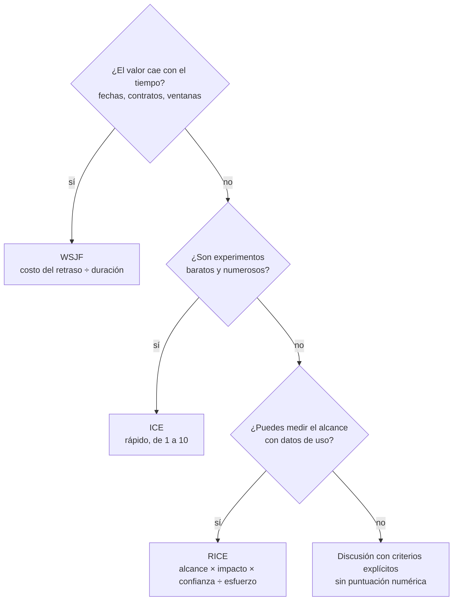
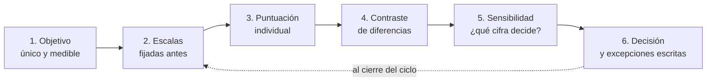

# Marcos de priorización: RICE, WSJF, ICE

Es la reunión de planificación del trimestre. Hay veinte iniciativas sobre la mesa y capacidad para cinco. Ventas quiere el inicio de sesión único que pidió un cliente grande, producto quiere rediseñar el onboarding, el equipo de plataforma quiere pagar deuda en la caché y alguien recuerda que llevan un año prometiendo exportar facturas. Todas suenan importantes, todas tienen un defensor y la discusión gira en círculos hasta que decide quien tiene más rango.

Priorizar no es ordenar una lista de deseos: es decidir qué no se va a hacer ahora. **Un marco de priorización es una regla explícita que convierte unas pocas estimaciones (valor, urgencia, confianza, esfuerzo) en un orden, para que la discusión trate sobre esas estimaciones y no sobre quién insiste más.** El marco no decide por ti. Ordena la conversación, saca a la luz los supuestos y deja un rastro que se puede revisar después.

Esta lección cubre tres marcos muy usados (RICE, ICE y WSJF) y la idea que hay debajo del tercero, el costo del retraso. Incluye un ejemplo trabajado con cinco iniciativas, cuándo engaña cada marco y cómo evitar que se use para justificar lo que ya estaba decidido. El marco general para razonar una decisión con criterios explícitos está en [Trade-offs y decisiones](/docs/trade-offs-y-decisiones); cómo medir si la decisión funcionó, en [Medir decisiones: OKR y KPI](/docs/medir-decisiones-okr-kpi).

<Callout tone="info" title="Fuentes y fecha de corte">
  Consultado en octubre de 2026. RICE se apoya en el artículo original de Intercom; WSJF, en la
  ficha del libro de Reinertsen y en la documentación de SAFe. Fuente secundaria para ICE: el
  glosario de ProductPlan. El texto original de Sean Ellis no figura entre las fuentes consultadas,
  así que la atribución se presenta como secundaria.
</Callout>

## Por qué hace falta un marco

Sin una regla común, cada persona prioriza con un criterio distinto y no lo dice. Una mira el ingreso, otra el número de usuarios afectados, otra la urgencia de un contrato y otra lo que le resulta interesante construir. La discusión se vuelve imposible porque nadie está respondiendo a la misma pregunta.

Un marco obliga a tres cosas:

- **Nombrar los factores.** Qué cuenta como valor, qué cuenta como costo, qué se hace con la incertidumbre.
- **Estimar cada factor por separado.** Es más fácil discutir «¿a cuántos usuarios llega esto?» que «¿esto es más importante que aquello?».
- **Combinarlos con la misma regla para todas las iniciativas.** Así, quien quiera cambiar el orden tiene que cambiar una estimación concreta y explicar por qué.

Lo que un marco no hace es eliminar el juicio. Las estimaciones siguen siendo juicios, solo que ahora están a la vista.

## RICE: alcance, impacto, confianza y esfuerzo

RICE lo publicó Sean McBride en el blog de Intercom en enero de 2018. El artículo cuenta que el equipo de producto lo construyó a partir de primeros principios, tras varias iteraciones, porque los métodos de puntuación que había probado no permitían comparar de forma consistente ideas muy distintas.

La puntuación es el producto de alcance, impacto y confianza, dividido por el esfuerzo. El resultado se lee como impacto total por unidad de trabajo.

| Factor         | Pregunta                                     | Escala en el artículo original                               |
| -------------- | -------------------------------------------- | ------------------------------------------------------------ |
| Reach          | ¿A cuántas personas o eventos llega?         | Cantidad por periodo (p. ej., clientes por trimestre)        |
| Impact         | ¿Cuánto mueve el objetivo para cada persona? | 3 masivo, 2 alto, 1 medio, 0,5 bajo, 0,25 mínimo             |
| Confidence     | ¿Cuánto respaldo tienen las otras cifras?    | 100 % alta, 80 % media, 50 % baja                            |
| Effort         | ¿Cuánto trabajo total exige?                 | Persona-mes de producto, diseño e ingeniería; 0,5 si es poco |
| **Puntuación** | **Reach × Impact × Confidence ÷ Effort**     | **Sin unidad absoluta: solo sirve para comparar en lista**   |

Tres detalles del diseño original que suelen perderse:

- **El alcance usa datos reales siempre que se pueda**, no una intuición. El artículo recomienda sacarlo de las métricas del producto.
- **El impacto es una escala de opción múltiple**, no un número libre. Limitar las opciones reduce la tentación de afinar decimales que no se conocen.
- **La confianza castiga el entusiasmo sin datos.** Por debajo del 50 %, el artículo considera que la idea es una apuesta casi a ciegas.

El propio artículo advierte que RICE no es una regla rígida: puede haber razones para hacer antes algo con menos puntuación, como una dependencia o una funcionalidad necesaria para vender a cierto tipo de cliente. Ese matiz importa en el ejemplo trabajado.

## ICE: impacto, confianza y facilidad

ICE puntúa cada idea en tres dimensiones, por lo general de 1 a 10: **Impact** (cuánto movería la métrica objetivo), **Confidence** (cuánta evidencia respalda esa expectativa) y **Ease** (lo fácil que es ejecutarla). La facilidad juega el papel inverso del esfuerzo: en lugar de dividir por el costo, se multiplica por su contrario.

Nació en el contexto de los equipos de crecimiento, donde lo que se ordena son experimentos baratos y numerosos, no proyectos de varios meses. Ahí su ventaja es la velocidad: puntuar cuarenta ideas en una sesión es razonable con ICE y agotador con RICE.

<Callout tone="warning" title="Origen y fórmula de ICE según fuentes secundarias">
  ICE se atribuye de forma generalizada a Sean Ellis, que fundó GrowthHackers y popularizó el
  término «growth hacking». Fuente secundaria: glosario de ProductPlan; el texto original en el que
  Ellis lo presentó no forma parte de las fuentes de esta lección. Las descripciones secundarias
  tampoco coinciden en cómo combinar los tres factores: la mayoría los multiplica y alguna los
  promedia. Si usas ICE, fija y documenta tu regla de combinación.
</Callout>

La diferencia entre multiplicar y promediar no es cosmética. Con el producto, una idea con facilidad 1 queda hundida aunque su impacto sea 10; con la media, un factor alto compensa uno bajo. Ninguna opción es la correcta en abstracto, pero cambiar de una a otra a mitad de trimestre cambia el orden.

## El costo del retraso

Antes de WSJF hace falta la idea en la que se apoya. **El costo del retraso (_cost of delay_) es el valor que se pierde por cada unidad de tiempo que una iniciativa tarda en estar disponible.** Una funcionalidad que aportaría 10 000 al mes y se entrega tres meses tarde ha costado 30 000, aunque nadie lo vea en ninguna factura.

Donald Reinertsen desarrolló esta idea en _The Principles of Product Development Flow_ (Celeritas Publishing, 2009). SAFe le atribuye la recomendación de que, si en desarrollo de producto se cuantifica una sola cosa, sea el costo del retraso.

Un ejemplo pequeño muestra por qué el orden importa. Dos trabajos comparten el mismo equipo y no se pueden hacer en paralelo:

| Trabajo | Costo del retraso por semana | Duración  |
| ------- | ---------------------------- | --------- |
| X       | 10 000                       | 4 semanas |
| Y       | 2 000                        | 1 semana  |

- **X primero.** X termina en la semana 4 y acumula 40 000 de retraso; Y termina en la semana 5 y acumula 10 000. Total: 50 000.
- **Y primero.** Y termina en la semana 1 y acumula 2 000; X termina en la semana 5 y acumula 50 000. Total: 52 000.

Gana X, pero por poco, y la razón no es que X valga más: es que su costo del retraso **por semana de duración** (2 500) supera al de Y (2 000). Ese cociente es exactamente lo que calcula WSJF.

## WSJF: el trabajo más corto ponderado

WSJF (_Weighted Shortest Job First_) ordena los trabajos por **costo del retraso dividido por duración**. Reinertsen lo presenta en el mismo libro como regla de secuenciación cuando tanto el costo del retraso como la duración varían entre trabajos. Si todos tienen el mismo costo del retraso, la regla se reduce a hacer primero el más corto; si todos duran lo mismo, a hacer primero el de mayor costo del retraso.

El sitio Black Swan Farming, dedicado al costo del retraso, usa la abreviatura CD3 (_Cost of Delay Divided by Duration_) para referirse a este cociente cuando se calcula con estimaciones económicas.

### La versión de SAFe

SAFe (Scaled Agile Framework) adoptó WSJF y cita a Reinertsen como origen. Su variante no estima dinero, sino puntuaciones relativas:

| Componente                              | Qué estima                                                       |
| --------------------------------------- | ---------------------------------------------------------------- |
| User-business value                     | Valor relativo para usuarios y negocio                           |
| Time criticality                        | Cuánto cae el valor si se espera (fechas, ventanas, competencia) |
| Risk reduction / opportunity enablement | Riesgo que reduce o capacidades futuras que habilita             |
| **Costo del retraso**                   | **Suma de los tres anteriores**                                  |
| Job size                                | Tamaño relativo, usado como aproximación de la duración          |
| **WSJF**                                | **Costo del retraso ÷ tamaño**                                   |

La documentación de SAFe indica estimar con números de Fibonacci modificados, **una columna cada vez**, asignando 1 al elemento más pequeño de la columna y puntuando el resto en relación con él. También advierte que el tamaño solo es buena aproximación de la duración cuando los recursos son fijos; si la disponibilidad de personas cambia, hay que usar la duración real.

Para un arquitecto, la tercera componente es la más interesante: es la que da peso explícito al trabajo habilitador (una migración, una caché, pagar [deuda técnica](/docs/deuda-tecnica-evolucion)) que en RICE suele quedar con alcance e impacto bajos porque nadie lo ve desde fuera.

<Callout tone="warning" title="Sumar puntuaciones relativas tiene límites">
  Los tres componentes de SAFe son escalas ordinales que luego se suman y se dividen. Eso funciona
  como heurística para conversar, pero el resultado no es una cifra económica. Black Swan Farming
  critica que, al simplificar el costo del retraso, SAFe lo hace menos útil. Si puedes estimar el
  costo del retraso en dinero por semana, aunque sea en rangos, el cociente original es más honesto.
</Callout>

## Comparación de los tres marcos

| Aspecto                | RICE                                         | ICE                                        | WSJF                                              |
| ---------------------- | -------------------------------------------- | ------------------------------------------ | ------------------------------------------------- |
| Origen verificable     | Intercom, Sean McBride, 2018                 | Atribuido a Sean Ellis (fuente secundaria) | Reinertsen, 2009; adaptado por SAFe               |
| Factores               | Alcance, impacto, confianza, esfuerzo        | Impacto, confianza, facilidad              | Costo del retraso, duración                       |
| Trata la urgencia      | No                                           | No                                         | Sí: es su razón de ser                            |
| Trata la incertidumbre | Sí, con la confianza                         | Sí, con la confianza                       | No de forma explícita                             |
| Trabajo habilitador    | Mal: alcance e impacto directos bajos        | Mal                                        | Bien, con reducción de riesgo u oportunidad       |
| Costo de aplicarlo     | Medio: requiere datos de alcance             | Bajo                                       | Medio o alto: requiere pensar en el tiempo        |
| Mejor para             | Funcionalidades de producto con datos de uso | Experimentos rápidos y baratos             | Portafolios con fechas, dependencias y plataforma |

## Cómo elegir el marco

No hace falta un marco por equipo ni uno para toda la empresa. La pregunta útil es qué rasgo domina tu lista de candidatos.



La última rama es deliberada: si no hay datos para ninguna de las variables, una fórmula solo añade una apariencia de rigor. En ese caso es mejor una comparación por criterios como la de [Trade-offs y decisiones](/docs/trade-offs-y-decisiones).

## Un procedimiento en seis pasos

El marco rinde mucho más cuando la sesión tiene una forma fija.



1. **Un objetivo.** El impacto se mide contra algo: conversión, retención, incidentes, ingreso. Si cada iniciativa se puntúa contra un objetivo distinto, los números no son comparables.
2. **Escalas antes que candidatos.** Define qué significa cada valor de impacto o de confianza antes de ver la lista, para no ajustar la escala a la favorita.
3. **Puntuación individual.** Cada persona puntúa por su cuenta y después se comparan, igual que en el _planning poker_. Así se evita que la primera cifra dicha en voz alta ancle a todas las demás.
4. **Contraste.** Las diferencias grandes entre personas son la parte más valiosa de la sesión: revelan supuestos distintos, no errores de cálculo.
5. **Sensibilidad.** Pregunta qué estimación tendría que cambiar para que cambie el primer puesto. Si basta con mover una cifra dudosa, esa cifra merece más investigación antes que más debate.
6. **Decisión y excepciones.** El resultado del marco es una propuesta. Si decides apartarte de él, escribe por qué; un [ADR](/docs/adr) o una nota en el propio backlog bastan.

Una escala anclada puede tener esta forma; lo importante es que cada nivel describa evidencia, no entusiasmo:

```yaml
confidence: # escala-de-confianza.yaml, forma orientativa
  1.0: datos de uso propios o experimento previo # …
  0.8: varias señales cualitativas coincidentes # …
  0.5: intuición del equipo o petición aislada # …
```

## Ejemplo trabajado: cinco iniciativas, dos marcos

### Contexto y supuestos

Un producto B2B con un único equipo de seis personas. El objetivo del trimestre es aumentar la retención de cuentas. Las cifras son supuestos para el ejemplo, no datos reales:

- **A.** Exportar facturas a CSV. Petición antigua y frecuente.
- **B.** Inicio de sesión único con SAML. Lo exige un cliente grande para renovar dentro de dos meses.
- **C.** Rediseño del onboarding. Hipótesis prometedora, sin validar con usuarios.
- **D.** Caché de búsquedas. Reduce la latencia y la carga sobre la base de datos.
- **E.** Notificaciones dentro de la aplicación. Validado con entrevistas.

### Puntuación RICE

Alcance en usuarios por trimestre, esfuerzo en persona-mes, escalas de impacto y confianza del artículo original.

| Iniciativa | Reach | Impact | Confidence | R × I × C | Effort | RICE  |
| ---------- | ----- | ------ | ---------- | --------- | ------ | ----- |
| A          | 1 200 | 0,5    | 100 %      | 600       | 0,5    | 1 200 |
| B          | 300   | 3      | 80 %       | 720       | 4      | 180   |
| C          | 2 000 | 1      | 50 %       | 1 000     | 3      | 333   |
| D          | 4 000 | 0,25   | 80 %       | 800       | 1      | 800   |
| E          | 1 500 | 1      | 80 %       | 1 200     | 2      | 600   |

Antes de dividir por el esfuerzo, el orden es E, C, D, B, A. Después de dividir, es A, D, E, C, B. La iniciativa A pasa del último puesto al primero: aporta poco por usuario, pero cuesta medio persona-mes. Es la inversión que dibuja la figura del artículo.

### Puntuación WSJF

Mismas cinco iniciativas, con la variante relativa de SAFe: Fibonacci modificado, 1 para el elemento menor de cada columna.

| Iniciativa | Valor | Urgencia | Riesgo u oportunidad | Costo del retraso | Tamaño | WSJF |
| ---------- | ----- | -------- | -------------------- | ----------------- | ------ | ---- |
| A          | 3     | 1        | 1                    | 5                 | 1      | 5,00 |
| B          | 8     | 13       | 5                    | 26                | 8      | 3,25 |
| C          | 8     | 3        | 2                    | 13                | 5      | 2,60 |
| D          | 1     | 1        | 3                    | 5                 | 2      | 2,50 |
| E          | 5     | 2        | 1                    | 8                 | 3      | 2,67 |

El orden es A, B, E, C, D. El inicio de sesión único sube del último puesto al segundo porque la renovación del contrato le da una urgencia que RICE no tiene dónde anotar.

### Lectura y decisión

- **A va primero con los dos marcos.** Es barata y no compite por capacidad con nada grande. Pero su ventaja en RICE depende de una sola cifra: si el esfuerzo real fuera 1 persona-mes en vez de 0,5, su puntuación bajaría a 600 y quedaría por detrás de D. Antes de comprometerla, conviene confirmar ese esfuerzo.
- **B es la discrepancia que importa.** RICE la deja última, WSJF la pone segunda. La diferencia no es un error de ninguno: RICE no modela el tiempo. El propio artículo de Intercom admite que una funcionalidad necesaria para vender a cierto cliente puede justificar saltarse el orden. La decisión es hacer B después de A y dejar escrito que el motivo es la fecha de renovación.
- **C, D y E están empatadas en la práctica.** En WSJF las separan 0,17 puntos con escalas ordinales; tratarlas como un orden firme sería falsa precisión. Se desempatan con otra información: D es trabajo habilitador que baja la carga de la base de datos, C necesita validación antes de comprometer tres persona-mes.
- **Acción sobre la incertidumbre.** Una semana de entrevistas sobre C podría subir su confianza del 50 % al 80 %. Su RICE pasaría de 333 a 533, todavía por debajo de E. Saberlo de antemano evita discutir C toda la reunión.

## Cuándo sirve y cuándo engaña

### Cuándo sí

- Hay más candidatos que capacidad y la discusión gira en círculos.
- Las iniciativas son comparables contra un mismo objetivo.
- Existen datos al menos para una de las variables (alcance, duración, costo del retraso).
- Quieres que las decisiones sean revisables cuando el resultado no sea el esperado.

### Cuándo no

- Hay una restricción que no se negocia: una obligación legal, una vulnerabilidad crítica o un incidente en curso. Eso no se puntúa, se hace (ver [Seguridad por diseño](/docs/seguridad-por-diseno)).
- Las opciones son pocas y muy distintas: comparar tres arquitecturas no es un problema de backlog sino de [trade-offs](/docs/trade-offs-y-decisiones).
- No hay ningún dato y todas las cifras serían inventadas. La fórmula solo daría apariencia de rigor.
- La lista cambia cada semana: el costo de puntuar supera al de equivocarse.

### Cómo engaña

- **Escalas arbitrarias tratadas como medidas.** Un impacto de 2 no es el doble de un impacto de 1 salvo que la escala se haya construido así; multiplicar y dividir escalas ordinales produce números que parecen más precisos de lo que son.
- **Puntuaciones infladas.** Quien defiende una iniciativa tiende a subir su impacto y bajar su esfuerzo. Sin puntuación individual y contraste, el marco solo amplifica esa presión.
- **Falsa precisión.** Una diferencia de 2,60 frente a 2,67 no es una diferencia. Redondea o agrupa en bandas antes de presentar el orden.
- **Esfuerzo optimista.** Como el esfuerzo divide, una subestimación de la mitad duplica la puntuación. Las tareas pequeñas son las más sensibles a este error.

## Calibrar la confianza

La confianza es el factor más fácil de manipular y el más útil cuando se hace bien. Tres prácticas ayudan:

- **Anclar cada nivel a tipos de evidencia**, como en la escala de arriba. «Me parece muy probable» no es evidencia; «tres clientes lo pidieron con el mismo caso de uso» sí.
- **Revisar las predicciones al cierre del ciclo.** Anota el impacto esperado y compáralo con el obtenido. Si las iniciativas con confianza del 80 % fallan la mitad de las veces, la escala está inflada. Cómo definir esa medición es tema de [Medir decisiones: OKR y KPI](/docs/medir-decisiones-okr-kpi).
- **Convertir baja confianza en trabajo de investigación.** Una idea con confianza del 50 % y mucho esfuerzo no se puntúa mejor; se reduce primero la incertidumbre con un prototipo o una prueba barata.

## Evitar que el marco justifique lo ya decidido

El modo de fallo más común no es la fórmula sino el uso: alguien ya sabe qué quiere hacer y ajusta las cifras hasta que salga primero. Señales de que está pasando y qué hacer:

| Señal                                                   | Contramedida                                                   |
| ------------------------------------------------------- | -------------------------------------------------------------- |
| Las escalas se definen después de ver la lista          | Fijar escalas al inicio del ciclo y no tocarlas a mitad        |
| Una sola persona puntúa todo                            | Puntuación individual de varias personas y contraste           |
| Se recalcula hasta que el orden coincide con el deseado | Registrar la primera puntuación y cada cambio con su motivo    |
| Las excepciones al orden no se escriben                 | Toda excepción lleva un motivo escrito y una fecha de revisión |
| Nadie compara predicción con resultado                  | Revisión de aciertos al final de cada trimestre                |

Decidir contra el marco es legítimo. Lo que no es legítimo es disfrazar esa decisión de resultado del marco. Los sesgos que alimentan este comportamiento, como el anclaje o el costo hundido, se tratan en [Pensamiento sistémico y sesgos](/docs/pensamiento-sistemico-y-sesgos).

## Errores frecuentes

- **Usar el marco como oráculo.** El orden es una propuesta para discutir, no una decisión automática.
- **Mezclar objetivos.** Puntuar el impacto de una iniciativa sobre ingresos y el de otra sobre retención hace que los números no se puedan comparar.
- **Ignorar el tiempo.** RICE e ICE no saben que un contrato vence en dos meses. Si la urgencia importa, usa WSJF o anota la excepción.
- **Castigar el trabajo habilitador.** La plataforma y la deuda técnica puntúan bajo en alcance directo. Si siempre quedan al final, el marco está midiendo mal el valor.
- **Comparar puntuaciones entre equipos.** Cada equipo calibra sus escalas a su manera; un RICE de 800 en un equipo no equivale a 800 en otro.
- **Cambiar de marco cada trimestre.** Se pierde la posibilidad de comparar predicciones con resultados.
- **No revisar nunca.** Sin comparar estimación y resultado, la confianza no se calibra y los errores se repiten.

## Checklist

- [ ] Hay un único objetivo contra el que se mide el impacto o el valor.
- [ ] Las escalas de cada factor están definidas y ancladas a evidencia antes de ver la lista.
- [ ] El marco elegido responde al rasgo dominante: urgencia (WSJF), volumen de experimentos (ICE) o alcance medible (RICE).
- [ ] Varias personas puntúan por separado y se discuten las diferencias grandes.
- [ ] Se ha comprobado qué estimación decide el primer puesto y si es fiable.
- [ ] Las puntuaciones cercanas se tratan como empates, no como un orden firme.
- [ ] Cada excepción al orden tiene un motivo escrito.
- [ ] Al cierre del ciclo se comparan predicciones y resultados.

## Fuentes

Consultadas en octubre de 2026.

- [RICE: Simple prioritization for product managers (Sean McBride, Intercom, 5 de enero de 2018)](https://www.intercom.com/blog/rice-simple-prioritization-for-product-managers/)
- Donald G. Reinertsen, _The Principles of Product Development Flow: Second Generation Lean Product Development_, Celeritas Publishing, 2009 (ISBN 978-1-935401-00-1). Ficha en [WorldCat](https://search.worldcat.org/title/435994279); el contenido del libro se cita a través de SAFe y Black Swan Farming
- [Weighted Shortest Job First, SAFe](https://framework.scaledagile.com/wsjf/) (versión pública parcial) y [copia archivada de 2016](https://webarchive.library.unt.edu/web/20161225132214mp_/http://www.scaledagileframework.com/wsjf) con la fórmula, los componentes y el método de estimación
- [WSJF: Weighted Shortest Job First, Black Swan Farming](https://blackswanfarming.com/wsjf-weighted-shortest-job-first/)
- ICE. Fuente secundaria: [glosario de ProductPlan](https://www.productplan.com/glossary/ice-scoring-model); el texto original de Sean Ellis no figura entre estas fuentes
