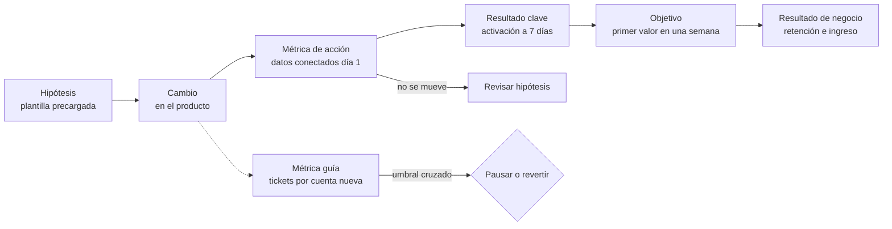

# Medir decisiones: OKR, KPI y métricas guía

Abres el tablero del trimestre y hay cuarenta gráficas. Casi todas suben, alguna baja, nadie sabe cuál importa. En la revisión alguien pregunta qué vamos a hacer distinto y la respuesta es «seguir vigilando». El equipo cumplió sus OKR, pero los clientes se quejan más que antes y soporte está desbordado. Medir mucho no es lo mismo que medir para decidir.

**Una métrica de decisión es un número con definición, dueño y umbral que, al cruzarlo, cambia lo que vas a hacer.** Si ningún valor posible de la métrica cambia una decisión, es decoración: puede ser útil como contexto, pero no merece un lugar en la revisión.

Este artículo separa tres herramientas que se suelen mezclar (KPI, OKR y métricas guía), explica por qué las métricas se degradan cuando se convierten en objetivo y propone una forma concreta de escribir una métrica y de encadenarla desde la hipótesis hasta el resultado de negocio. Cierra con un ejemplo trabajado con números supuestos. La priorización de qué atacar primero está en [marcos de priorización](/docs/marcos-de-priorizacion); el diseño de experimentos, en [mejora continua y experimentos](/docs/mejora-continua-y-experimentos).

<Callout tone="info" title="Fuentes y fecha de corte">
  Consultado en octubre de 2026. El origen de los OKR se apoya en el relato de John Doerr. Fuente
  secundaria: la entrada de Wikipedia sobre OKR; el texto completo de High Output Management no
  figura entre las fuentes consultadas. La formulación de Goodhart procede de la cita de su artículo
  de 1975 en fuentes de referencia, y la de Campbell, de la reedición de su ensayo de 1976.
</Callout>

## Medir para decidir, no para decorar

Antes de añadir una métrica a un tablero, hazle tres preguntas:

1. **¿Qué decisión informa?** Lanzar, pausar, revertir, invertir más, contratar, cambiar de enfoque. Si no hay respuesta, no es una métrica de decisión.
2. **¿Qué valor dispara esa decisión?** Sin umbral, cualquier lectura se puede interpretar a favor de lo que ya pensabas.
3. **¿Cuándo llega la lectura?** Una métrica que tarda noventa días en moverse no sirve para decidir algo que se revisa cada semana.

Estas tres preguntas dejan fuera muchas cifras populares: visitas totales, número de despliegues sin contexto, líneas de código, horas trabajadas. No son inútiles, pero rara vez cambian una decisión por sí solas.

Medir también tiene un costo: instrumentar, mantener la definición, revisar la calidad del dato y dedicar tiempo de reunión. Ese costo se justifica cuando la métrica evita una decisión equivocada o la adelanta. Para decisiones baratas y reversibles, a menudo basta con probar y observar; el criterio general está en [trade-offs y decisiones](/docs/trade-offs-y-decisiones).

## KPI y OKR: dos herramientas distintas

KPI y OKR aparecen juntos en casi todas las presentaciones, pero responden a preguntas diferentes. Confundirlos es el origen de muchos tableros inútiles.

### KPI: la salud del negocio

Un **indicador clave de desempeño** (KPI, _key performance indicator_) mide algo que debe mantenerse sano de forma continua: ingreso recurrente, cancelaciones, margen, disponibilidad del servicio, tiempo de respuesta a clientes. El término no tiene un autor único al que se le pueda atribuir; es vocabulario de gestión de uso general.

Un KPI se parece a un signo vital. No pretende cambiar este trimestre; pretende avisar cuando algo se sale de rango. Por eso un buen KPI tiene un rango aceptable más que una meta, y vive años con la misma definición para que su historia sea comparable.

### OKR: objetivos y resultados clave

Los **OKR** (_objectives and key results_) combinan un **objetivo** cualitativo, que dice a dónde quieres ir, con unos pocos **resultados clave** medibles, que dicen cómo sabrás que estás llegando. Son temporales: se fijan para un periodo, normalmente un trimestre, y se cierran con una puntuación.

El origen que se puede rastrear es este:

- **Peter Drucker** popularizó la dirección por objetivos (_management by objectives_, MBO) en los años cincuenta; la obra que suele citarse es _The Practice of Management_ (1954).
- **Andy Grove**, en Intel durante los años setenta, adaptó esa idea y le añadió los resultados clave. Según el relato de Doerr recogido en la entrada de Wikipedia sobre OKR, el sistema se llamaba entonces «iMBO» (_Intel Management by Objectives_). Grove lo describió en _High Output Management_ (1983) con dos preguntas: a dónde quieres ir (el objetivo) y cómo marcarás el ritmo para saber si estás llegando (los resultados clave).
- **John Doerr** asistió en 1975 a un curso interno de Grove en Intel, según su propio relato. Ya como inversor, presentó el método a los fundadores de Google en 1999 y lo difundió en su libro _Measure What Matters_ (2018).

La guía de OKR de Google (re:Work) añade criterios prácticos: pocos objetivos (de tres a cinco), unos tres resultados clave por objetivo, y resultados clave que describan **resultados y no actividades**. Para objetivos ambiciosos, la misma guía considera razonable lograr entre el 60 % y el 70 % y advierte que cumplir siempre el 100 % sugiere metas poco exigentes.

### Comparación

| Aspecto             | KPI                     | OKR                                     | Métrica guía                               |
| ------------------- | ----------------------- | --------------------------------------- | ------------------------------------------ |
| Pregunta            | ¿Está sano el negocio?  | ¿Qué queremos cambiar este periodo?     | ¿Qué no podemos romper mientras cambiamos? |
| Horizonte           | Continuo, años          | Un periodo (habitualmente un trimestre) | Lo que dure el cambio que protege          |
| Forma               | Rango aceptable         | Objetivo + 3 resultados clave con meta  | Umbral que no se debe cruzar               |
| Si se sale de rango | Investigar y corregir   | Revisar hipótesis o ajustar ambición    | Pausar o revertir el cambio                |
| Ejemplo             | Cancelación mensual 3 % | Activación a 7 días del 40 % al 55 %    | Tickets por cuenta nueva ≤ 0,35            |

Un OKR puede tomar un KPI como resultado clave cuando el objetivo del trimestre es moverlo de forma deliberada. Lo que no conviene es convertir todos los KPI en OKR: el trimestre se llena de metas y deja de haber foco.

## Métricas de resultado y métricas de acción

No todas las métricas se mueven al mismo ritmo ni están igual de cerca de lo que el equipo controla.

- **Métricas de resultado** (_outcome_, a menudo retrasadas): reflejan el efecto que buscas. Retención a 90 días, ingreso, cancelaciones. Importan, pero llegan tarde y las mueven muchos factores a la vez.
- **Métricas de acción** (_leading_ o de entrada): reflejan comportamientos que el equipo puede influir y que se leen pronto. Porcentaje de cuentas que conectan una fuente de datos el primer día, tiempo hasta el primer informe, invitaciones a compañeros.
- **Entregables** (_output_): lo que el equipo produce. Funcionalidades publicadas, campañas enviadas. Son necesarios, pero no son métricas de éxito.

| Tipo       | Velocidad de lectura | Control del equipo | Riesgo principal                 |
| ---------- | -------------------- | ------------------ | -------------------------------- |
| Resultado  | Semanas o meses      | Bajo               | Llega tarde para corregir        |
| Acción     | Días                 | Medio o alto       | Que no prediga el resultado      |
| Entregable | Inmediata            | Total              | Confundir actividad con progreso |

La relación entre una métrica de acción y una de resultado es una **hipótesis**, no un hecho. Que las cuentas que conectan datos el primer día retengan más puede ser causa o simple correlación (quizá solo los clientes más motivados lo hacen). Trata ese vínculo como algo que se valida con datos y, cuando sea posible, con un experimento.

## Cuando la métrica se convierte en objetivo

### La ley de Goodhart

Charles Goodhart, economista, escribió en 1975, en un artículo sobre política monetaria en el Reino Unido publicado por el Banco de la Reserva de Australia, que cualquier regularidad estadística observada tiende a colapsar en cuanto se presiona sobre ella con fines de control. La versión que circula hoy es de la antropóloga **Marilyn Strathern**, en un artículo de 1997 sobre las auditorías en la universidad británica: _«When a measure becomes a target, it ceases to be a good measure»_ (cuando una medida se convierte en objetivo, deja de ser una buena medida). Strathern atribuye esa forma de expresarlo a un texto de Keith Hoskin de 1996.

### La ley de Campbell

El psicólogo social **Donald T. Campbell** formuló una idea vecina en su ensayo _Assessing the Impact of Planned Social Change_ (Dartmouth College, 1976): cuanto más se usa un indicador cuantitativo para tomar decisiones sociales, más expuesto queda a presiones que lo corrompen y más tiende a distorsionar el proceso que pretendía vigilar. Goodhart habla del número que pierde su valor informativo; Campbell añade que el propio proceso se deforma.

En un equipo de producto esto se ve así:

- Se premia el tiempo de cierre de tickets y aparecen tickets cerrados sin resolver.
- Se fija una meta de activación y se rebaja la definición de «activo».
- Se mide la velocidad del equipo y se inflan las estimaciones.

### Cómo protegerse

No existe una métrica inmune, pero sí prácticas que reducen el daño:

- **Emparejar métricas** que tiran en sentidos opuestos: velocidad con calidad, volumen con satisfacción, activación con costo de soporte.
- **Añadir métricas guía** con umbral explícito (siguiente sección).
- **Congelar la definición** durante el periodo: cambiarla a mitad de trimestre es la forma más silenciosa de manipularla.
- **Revisar casos concretos**, no solo agregados: leer diez tickets cerrados dice más que la media de cierre.
- **Separar OKR y evaluación de personas.** La guía de Google afirma que los OKR no equivalen a una evaluación del desempeño; si la puntuación decide el bonus, la presión para maquillarla aparece sola.

## Métricas guía: proteger lo que no quieres romper

Una **métrica guía** (_guardrail metric_) no mide lo que quieres mejorar, sino lo que no debe empeorar mientras mejoras otra cosa. Tiene un umbral, no una meta: mientras se mantenga dentro, no hay nada que hacer; si lo cruza, el cambio se pausa o se revierte aunque el resultado clave vaya bien.

El término se consolidó en la experimentación en línea. Ron Kohavi, Diane Tang y Ya Xu dedican partes de _Trustworthy Online Controlled Experiments_ (Cambridge University Press, 2020) a dos familias: métricas guía **organizativas**, que protegen al negocio (latencia, errores, ingreso), y métricas guía **de confianza**, que detectan si el propio experimento está mal montado, como el desequilibrio en el reparto de usuarios entre variantes.

Fuera de los experimentos la idea sirve igual. Para elegirlas, pregunta: si este equipo cumple su OKR de la forma más barata posible, ¿qué rompería? Las respuestas típicas son:

- **Costo**: soporte, infraestructura, descuentos. El artículo de [FinOps](/docs/finops-costo-como-atributo) trata el costo como atributo de arquitectura.
- **Calidad percibida**: quejas, reembolsos, cancelaciones tempranas.
- **Atributos técnicos**: latencia, errores, disponibilidad. Aquí la métrica guía se parece mucho a una [fitness function](/docs/fitness-functions) o a un objetivo de nivel de servicio de los [atributos de calidad](/docs/atributos-de-calidad).
- **Otros equipos**: carga trasladada a ventas, operaciones o a otro producto.

Dos métricas guía por OKR suelen bastar. Si necesitas cinco, probablemente el objetivo está mal planteado o el cambio es demasiado amplio.

## Cómo escribir una buena métrica

Una métrica sin ficha se reinterpreta en cada reunión. La ficha mínima tiene cinco campos:

| Campo              | Qué contesta                                    | Error típico si falta                          |
| ------------------ | ----------------------------------------------- | ---------------------------------------------- |
| Definición         | Numerador, denominador, ventana y exclusiones   | Dos equipos con cifras distintas               |
| Fuente de datos    | Tabla, evento o sistema de origen               | Nadie puede reproducir el número               |
| Frecuencia         | Cada cuánto se lee y con qué cohorte            | Leer cohortes incompletas como si no lo fueran |
| Responsable        | Quién responde de la definición y de la lectura | La métrica se rompe y nadie lo nota            |
| Umbral de decisión | Qué valor dispara qué acción                    | Cualquier cifra «está bien»                    |

La forma de una ficha puede ser tan simple como esta (es una plantilla de campos, no una configuración real):

```yaml
metrica: activacion_7d
definicion: cuentas con >= 1 informe enviado en 7 días / altas de la cohorte
fuente: eventos de producto # …
frecuencia: semanal, solo cohortes cerradas
responsable: PM de onboarding
umbral_decision:
  verde: '>= 50 %' # seguir
  ambar: '45-50 %' # revisar hipótesis
  rojo: '< 45 %' # replantear el enfoque
guias: [tickets_14d <= 0.35, arpa_nueva >= 47.5]
```

Dos detalles importan más de lo que parece. El **denominador** decide casi todo: «activación» sobre altas totales o sobre altas verificadas da cifras muy distintas. Y la **ventana**: una cohorte de esta semana todavía no ha tenido siete días para activarse, así que mezclarla con cohortes cerradas baja la cifra de forma artificial.

Si la decisión que dispara el umbral es relevante, regístrala junto al razonamiento en un [ADR](/docs/adr) o en el documento de decisión que use el equipo.

## De la hipótesis al resultado de negocio

Una métrica aislada no explica nada. Lo útil es la **cadena**: qué cambio haces, qué comportamiento esperas que provoque, qué resultado clave debería mover y por qué eso importa al negocio. Cada eslabón es una hipótesis que se puede romper.



Leída de izquierda a derecha, la cadena dice qué esperas. Leída al revés, dice dónde mirar cuando algo no se mueve: si la métrica de acción sube pero el resultado clave no, el vínculo entre ambas era falso; si ni siquiera la métrica de acción se mueve, el cambio no produjo el comportamiento esperado. Las relaciones de causa y efecto en sistemas con retroalimentación se tratan en [pensamiento sistémico y sesgos](/docs/pensamiento-sistemico-y-sesgos).

Las métricas de entrega de software, como las de DORA, son otra rama del mismo árbol: miden la capacidad de entregar, no el efecto de lo entregado. Se tratan junto al flujo de trabajo en [flujo de valor y cuellos de botella](/docs/flujo-de-valor-y-cuellos-de-botella).

## Cuándo sí y cuándo no

**Cuándo sí** merece la pena montar OKR, KPI y métricas guía con fichas completas:

- Cuando varios equipos tienen que alinearse sobre un mismo resultado y necesitan un lenguaje común.
- Cuando el cambio tiene efectos colaterales plausibles en costo, calidad u otros equipos.
- Cuando la decisión es cara de revertir y conviene definir de antemano qué evidencia la cambiaría.
- Cuando el resultado tarda en verse y necesitas métricas de acción que avisen antes.

**Cuándo no**, o no con todo el aparato:

- En un equipo pequeño con un único objetivo evidente: una métrica bien definida y una conversación semanal pueden bastar.
- En trabajo exploratorio donde todavía no sabes qué medir: primero aprende, después fija metas.
- Cuando el volumen de datos es tan bajo que las variaciones son ruido: con veinte altas al mes, un cambio del 40 % al 55 % puede ser casualidad.
- Para tareas obligatorias (un cambio regulatorio, una migración con fecha): son compromisos, no resultados clave.

## Errores frecuentes

- **Demasiados indicadores.** Cuarenta métricas equivalen a ninguna. Si todo está en el tablero, nada tiene dueño. Limita la revisión a los resultados clave, los KPI de salud y sus métricas guía.
- **Métricas sin umbral.** Sin un valor que dispare una acción, cualquier lectura sirve para justificar lo que ya se iba a hacer.
- **OKR que son listas de tareas.** «Lanzar el nuevo asistente» es un entregable. El resultado clave es lo que esperas que cambie gracias a él. La guía de Google pone como señal de alarma verbos como _consultar_, _ayudar_, _analizar_ o _participar_: describen actividad, no impacto.
- **Medir lo fácil.** Se mide lo que ya está instrumentado en lugar de lo que importa. Si la métrica relevante requiere instrumentación nueva, ese trabajo forma parte del OKR.
- **Cambiar la definición a mitad del periodo.** Rompe la comparación y, aunque sea de buena fe, parece manipulación.
- **Resultados clave que solo se leen al final.** Si los tres resultados clave se conocen el último día del trimestre, no hay margen para corregir. Combina al menos uno rápido con los lentos.
- **Olvidar el costo de medir.** Instrumentación, calidad del dato y tiempo de revisión. Una métrica que nadie consulta debería retirarse.

## Ejemplo trabajado: activar a los clientes nuevos

**Contexto supuesto.** Un producto SaaS B2B de informes recibe 2.000 altas al mes. El ingreso medio por cuenta (ARPA) es de 50 USD al mes. Hoy el 40 % de las cuentas envía su primer informe en los primeros siete días. Los datos históricos (supuestos) indican que a los 90 días retiene el 80 % de las cuentas activadas y el 25 % de las no activadas.

**Situación actual por cohorte mensual.** 800 cuentas activadas × 0,80 = 640 retenidas; 1.200 no activadas × 0,25 = 300 retenidas. Total: 940 de 2.000, un 47 % de retención a 90 días.

**El OKR del trimestre.**

```text
Objetivo: los clientes nuevos obtienen valor en su primera semana
  KR1: activación a 7 días del 40 % al 55 %
  KR2: mediana de días hasta el primer informe de 4 a 2
  KR3: retención a 90 días de la cohorte del primer mes del 47 % al 55 %
```

**Por qué esos números.** Con un 55 % de activación: 1.100 × 0,80 = 880 retenidas; 900 × 0,25 = 225 retenidas. Total: 1.105, un 55 % redondeado. La diferencia es de 165 cuentas retenidas más por cohorte, que a 50 USD suponen 8.250 USD de ingreso recurrente mensual adicional por cada cohorte. KR3 depende de que la relación entre activación y retención se mantenga; es la hipótesis más débil y por eso se mide.

**Los tres KPI de salud** (no son metas del trimestre, solo rangos):

| KPI                        | Valor actual | Rango aceptable |
| -------------------------- | ------------ | --------------- |
| Ingreso recurrente mensual | 400.000 USD  | No baja         |
| Cancelación mensual        | 3 %          | ≤ 3,5 %         |
| Margen bruto               | 72 %         | ≥ 70 %          |

**Las dos métricas guía.** Para subir la activación, el equipo prueba tres hipótesis: H1, plantillas precargadas; H2, un asistente para conectar datos; H3, hacer obligatoria la conexión de datos en el primer acceso. La forma más barata de cumplir el OKR sería empujar a los clientes a toda costa, así que se protegen dos cosas:

| Métrica guía                                  | Línea base | Umbral     | Acción si se cruza           |
| --------------------------------------------- | ---------- | ---------- | ---------------------------- |
| Tickets de soporte por cuenta nueva (14 días) | 0,30       | ≤ 0,35     | Pausar el cambio responsable |
| ARPA de cuentas nuevas                        | 50 USD     | ≥ 47,5 USD | Revisar descuentos o planes  |

**Lectura en la semana 6.** La activación de las cohortes cerradas está en el 49 % (umbral ámbar), la mediana hasta el primer informe ha bajado a 3 días, el ARPA de cuentas nuevas está en 49,80 USD y los tickets por cuenta nueva han subido a 0,42. La métrica guía de soporte está cruzada.

**Decisión.** Al desglosar por variante, los tickets se concentran en las cuentas que ven H3: la conexión obligatoria bloquea a quienes no tienen credenciales a mano. Se retira H3 y se mantienen H1 y H2. En la semana 9 la activación llega al 53 % y los tickets vuelven a 0,33. Sin la métrica guía, el equipo habría celebrado un 49 % creciente mientras trasladaba el costo a soporte.

**Cierre del trimestre (supuesto).** KR1 en 54 % (0,93: recorrió 14 de los 15 puntos previstos), KR2 en 2 días (1,0) y KR3 pendiente: la cohorte del primer mes no cumple 90 días hasta el inicio del trimestre siguiente. Ese retraso estaba previsto y es la razón de tener KR1 y KR2 como señales tempranas.

## Checklist

- [ ] Cada métrica del tablero responde a qué decisión informa y qué valor la dispara.
- [ ] Los KPI tienen rango aceptable; los OKR, meta y periodo; las métricas guía, umbral.
- [ ] Cada OKR tiene como mucho tres resultados clave y describen resultados, no tareas.
- [ ] Al menos un resultado clave se puede leer en días, no solo al final del periodo.
- [ ] Cada OKR tiene una o dos métricas guía que cubren su efecto colateral más probable.
- [ ] Cada métrica tiene ficha: definición, fuente, frecuencia, responsable y umbral.
- [ ] La definición no cambia durante el periodo; si cambia, se documenta y se recalcula la historia.
- [ ] La cadena desde la hipótesis hasta el resultado de negocio está escrita y se revisa al leer los datos.

## Fuentes

- Andrew S. Grove, _High Output Management_ (Random House, 1983): referencia bibliográfica; su contenido se cita a través de Doerr y Wikipedia.
- John Doerr, _Measure What Matters_ (Portfolio, 2018) y el relato de origen en whatmatters.com («The OKR Origin Story»).
- Wikipedia, «Objectives and key results»: curso de Grove de 1975 y denominación iMBO.
- Google re:Work, «Set goals with OKRs»: número de objetivos, resultados frente a actividades y puntuación orientativa.
- Charles A. E. Goodhart, «Problems of Monetary Management: The UK Experience», _Papers in Monetary Economics_, vol. 1, Reserve Bank of Australia, 1975.
- Marilyn Strathern, «"Improving ratings": audit in the British University system», _European Review_ 5(3), 1997, pp. 305–321.
- Donald T. Campbell, _Assessing the Impact of Planned Social Change_, Occasional Paper n.º 8, Public Affairs Center, Dartmouth College, 1976 (reeditado en _Journal of MultiDisciplinary Evaluation_, 2011).
- Ron Kohavi, Diane Tang y Ya Xu, _Trustworthy Online Controlled Experiments_ (Cambridge University Press, 2020), capítulos 7 y 21.
