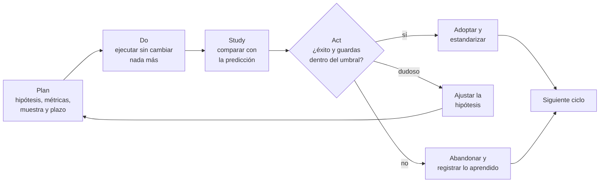

# Mejora continua y experimentos

El equipo decide que las revisiones de código se harán en parejas «porque así será más rápido». Nadie anota cuánto tardaban antes. Tres meses después, unos dicen que funciona y otros que no, y el debate se resuelve por antigüedad. En otro equipo, una prueba A/B del formulario de pago se detiene al tercer día porque el panel ya mostraba una mejora «significativa»; un mes más tarde la conversión ha vuelto a su nivel de siempre. Los dos casos tienen el mismo defecto: se cambió algo sin decidir antes qué resultado confirmaría o refutaría el cambio.

**La mejora continua es la práctica de cambiar un sistema en pasos pequeños, cada uno planteado como una hipótesis que se comprueba con datos antes de convertirlo en el nuevo estándar.** Un experimento es la unidad de ese trabajo: un cambio acotado, con una predicción, una métrica, un plazo y una decisión ya pactada para cada resultado posible.

Esta lección recorre el origen del ciclo PDSA (y su pariente PDCA), el kaizen y la kata de mejora; después explica cómo diseñar un experimento de producto o de proceso, cómo reconocer uno que no merece la pena y cómo convertir las retrospectivas en un ciclo de mejora real. Elegir las métricas en sí se trata en [medir decisiones con OKR y KPI](/docs/medir-decisiones-okr-kpi); encontrar dónde se atasca el trabajo, en [flujo de valor y cuellos de botella](/docs/flujo-de-valor-y-cuellos-de-botella); y los sesgos que deforman la lectura de los datos, en [pensamiento sistémico y sesgos](/docs/pensamiento-sistemico-y-sesgos).

<Callout tone="info" title="Fuentes y fecha de corte">
  Consultadas en octubre de 2026. La historia del ciclo procede del artículo de Moen y Norman en
  Quality Progress (2010). Fuente secundaria: lo que se resume de los libros de Rother, Kerth, Derby
  y Larsen, y Kohavi, Tang y Xu procede de la editorial o de resúmenes publicados, y se indica en
  cada caso.
</Callout>

## De dónde viene: PDSA, PDCA y kaizen

### El ciclo de Shewhart y Deming

Walter Shewhart describió en su libro de 1939, _Statistical Method from the Viewpoint of Quality Control_, tres pasos de la producción en serie (especificación, producción e inspección) y los comparó con los del método científico: formular una hipótesis, hacer un experimento y contrastar la hipótesis. W. Edwards Deming, que trabajó de cerca con esas ideas, presentó en 1950 una versión en un seminario en Japón organizado por la Unión Japonesa de Científicos e Ingenieros (JUSE): una rueda con diseño, producción, venta e investigación.

Según Masaaki Imai, fueron directivos japoneses quienes reformularon esa rueda como el ciclo **plan-do-check-act (PDCA)**. Moen y Norman fechan esa versión japonesa en 1951 y añaden que Kaoru Ishikawa amplió el paso de planificación (fijar metas y métodos para alcanzarlas) y que la versión de PDCA con sus cambios puede rastrearse hasta S. Mizuno, en 1959.

Deming nunca adoptó PDCA. Desde 1986 volvió a presentar el ciclo en sus seminarios y en 1993 lo llamó «ciclo de Shewhart para el aprendizaje y la mejora»: **plan-do-study-act (PDSA)**. En una carta de 1990 a Ronald Moen lo dejó por escrito: «Be sure to call it PDSA, not the corruption PDCA». Su argumento era que _check_ sugiere inspeccionar o frenar, mientras que _study_ significa comparar el resultado con la predicción y aprender de la diferencia. En la práctica, muchos equipos usan los dos nombres como sinónimos; lo que importa es que el tercer paso compare contra una predicción hecha antes, y no solo verifique que algo se hizo.

| Fase  | Pregunta que responde                                   | Qué produce                                               | Error típico                                           |
| ----- | ------------------------------------------------------- | --------------------------------------------------------- | ------------------------------------------------------ |
| Plan  | ¿Qué cambiamos, qué esperamos que pase y cómo lo vemos? | Hipótesis, predicción numérica, métricas, plazo, decisión | Planificar el cambio sin escribir la predicción        |
| Do    | ¿Se ejecutó el cambio como se diseñó?                   | El cambio aplicado y los datos recogidos                  | Cambiar otras cosas a la vez                           |
| Study | ¿El resultado coincide con la predicción? ¿Por qué no?  | Comparación con la predicción y lo aprendido              | Mirar solo si «mejoró», sin la predicción de antes     |
| Act   | ¿Adoptamos, ajustamos o abandonamos?                    | Nuevo estándar, nueva hipótesis o registro del descarte   | No estandarizar, y que el sistema vuelva a lo de antes |

### Kaizen: mejora como trabajo diario

_Kaizen_ (改善) significa «mejora» en japonés. El término se popularizó en Occidente con el libro de Masaaki Imai _Kaizen: The Key to Japan's Competitive Success_ (1986). Toyota describe el kaizen en su página oficial sobre el Sistema de Producción Toyota como mejora incremental diaria que hacen todos los empleados, y lo presenta como la base sobre la que se apoya el _jidoka_ (automatización con intervención humana). Moen y Norman señalan que, en Japón, el ciclo PDCA, las siete herramientas básicas de calidad y el formato de «historia de calidad» se convirtieron en las herramientas habituales del kaizen.

Dos rasgos distinguen al kaizen de un programa de mejora al uso. El primero es la escala: cambios pequeños, frecuentes y cercanos al trabajo, no proyectos de transformación. El segundo es quién mejora: la gente que hace el trabajo, no un departamento aparte. Para un equipo de software esto se traduce en mejorar el propio proceso de entrega cada semana, igual que se mejora el código.

### La kata de mejora

Mike Rother publicó _Toyota Kata_ (McGraw-Hill, 2009) a partir de su estudio de cómo Toyota enseña la mejora. Una _kata_ es una rutina que se practica hasta volverla hábito. La **kata de mejora** tiene cuatro pasos:

1. **Entender la dirección o el reto**: a dónde quieres llegar a largo plazo.
2. **Conocer la condición actual**: cómo funciona hoy el proceso, con datos y observación directa.
3. **Fijar la siguiente condición objetivo**: cómo debería funcionar el proceso en una fecha cercana, a unas semanas o pocos meses vista.
4. **Avanzar hacia ella con experimentos**: elegir un obstáculo cada vez y probar un paso, comparando lo esperado con lo ocurrido.

Rother distingue entre un **objetivo** (un resultado, como «piezas por hora») y una **condición objetivo** (una descripción de cómo debe funcionar el proceso); fuente secundaria: resúmenes publicados del libro. La diferencia importa: «reducir el tiempo de revisión a 8 horas» es un objetivo; «cada pull request recibe una primera revisión en el bloque de la mañana o el de la tarde» es una condición que se puede observar y experimentar.

La **kata de coaching** acompaña a la anterior: un responsable hace a quien aprende cinco preguntas breves con regularidad. Su redacción varía según la fuente, pero la estructura es estable: cuál es la condición objetivo, cuál es la condición actual, qué obstáculos lo impiden y en cuál trabajas ahora, cuál es tu siguiente paso y qué esperas que pase, y cuándo podemos ir a ver qué aprendiste.

### Cómo se relacionan

| Práctica        | Unidad de cambio                      | Cadencia típica             | Quién la conduce              | Qué deja al terminar                       |
| --------------- | ------------------------------------- | --------------------------- | ----------------------------- | ------------------------------------------ |
| PDSA / PDCA     | Un cambio con una predicción          | Lo que dure el experimento  | Quien propone el cambio       | Estándar nuevo o hipótesis descartada      |
| Kaizen          | Mejoras pequeñas en el trabajo diario | Continua                    | El equipo que hace el trabajo | Un proceso un poco mejor cada semana       |
| Kata de mejora  | Un obstáculo hacia una condición      | Ciclos de días o semanas    | Aprendiz con su coach         | Hábito de experimentar y condición lograda |
| Retrospectiva   | Acuerdos del equipo sobre su proceso  | Al cierre de cada iteración | El equipo, con facilitación   | Una o dos acciones con dueño               |
| Experimento A/B | Una variante frente a un control      | Semanas completas           | Producto con datos            | Decisión de lanzar o descartar             |

Las cinco comparten el núcleo del PDSA. Lo que cambia es la escala y quién decide. La cultura que las sostiene (aprendizaje continuo, posmortems sin culpa) se trata en [DevOps y su cultura](/docs/devops-cultura).

## Qué hace que un cambio sea un experimento

Un cambio se vuelve experimento cuando, antes de ejecutarlo, puedes responder a siete preguntas. Escríbelas en una ficha corta; la forma importa más que la herramienta:

```yaml
# ficha de experimento (forma, no plantilla obligatoria)
hipotesis: 'Si <cambio>, entonces <métrica> pasa de <base> a <valor>, porque <razón>'
metrica_exito: <una sola>
metricas_guarda: [<lo que no puede empeorar>, <umbral>]
muestra_minima: <unidades por variante>
duracion: <fechas de inicio y fin, semanas completas>
parada_anticipada: <solo si una guarda supera su umbral>
decision: { supera: <qué hacemos>, no_supera: <qué hacemos>, dudoso: <qué hacemos> }
dueno: <una persona>
```

### Hipótesis verificable

Una hipótesis útil nombra el cambio, la métrica, la dirección y el tamaño del efecto esperado, y la razón por la que crees que ocurrirá. «Mejorar la experiencia de pago» no es verificable; «quitar el registro obligatorio sube la conversión del pago del 10 % al 11 %, porque hoy el 30 % de quienes abandonan lo hacen en ese paso» sí lo es. La razón importa: si el resultado no llega, te dice qué supuesto revisar.

Escribe también el **efecto mínimo que te interesa**: el cambio más pequeño que justificaría el costo de mantener la variante. Un punto de conversión puede valer la pena; una décima, probablemente no. Ese número define el tamaño de la muestra.

### Métrica de éxito y métricas de guarda

Elige **una** métrica de éxito. Con diez métricas, alguna mejorará por azar y la tentación de declararla ganadora es grande. Añade también **métricas de guarda** (_guardrail metrics_), lo que no debe empeorar aunque la métrica principal mejore; qué son y qué familias distinguen Kohavi, Tang y Xu se explica en [medir decisiones con OKR y KPI](/docs/medir-decisiones-okr-kpi).

En un experimento, cada guarda necesita un umbral escrito antes de empezar: «la tasa de cancelación no supera el 2,5 %», no «que no empeore mucho». Ese umbral es además el único motivo legítimo de parada anticipada, como se ve más abajo.

### Tamaño de muestra sin fórmulas

La intuición es esta: cada métrica tiene ruido, y para distinguir un efecto del ruido necesitas más datos cuanto más pequeño es el efecto. La relación no es lineal: **detectar la mitad de efecto exige unas cuatro veces más muestra**. Evan Miller propone una regla práctica para tasas de conversión que permite estimar el orden de magnitud; con una conversión base del 10 % sale aproximadamente esto:

| Efecto mínimo que quieres detectar | Muestra aproximada por variante |
| ---------------------------------- | ------------------------------- |
| +2 puntos (del 10 % al 12 %)       | 3.600                           |
| +1 punto (del 10 % al 11 %)        | 14.400                          |
| +0,5 puntos (del 10 % al 10,5 %)   | 57.600                          |

Úsala para decidir si el experimento es viable, no para calcular el definitivo: para eso existen calculadoras de tamaño de muestra. Si tu tráfico no alcanza la muestra en un plazo razonable, tienes tres opciones honestas: buscar un efecto mayor, medir una métrica más sensible y cercana al cambio, o no hacer un experimento controlado y tratar el cambio como una decisión con seguimiento.

### Duración y criterio de parada

Fija la duración antes de empezar, a partir de la muestra y del tráfico, y redondéala a semanas completas: el comportamiento de los usuarios y de los equipos suele cambiar entre días laborables y fines de semana, y un experimento que solo ve una parte del ciclo semanal mide el calendario. Si el cambio es visible, el efecto novedad puede inflar los primeros días; una duración más larga ayuda a verlo.

El criterio de parada tiene dos partes. La **parada planificada**: el experimento termina en la fecha fijada, se lea lo que se lea. La **parada anticipada**: solo por daño, cuando una métrica de guarda supera su umbral. «Ya está ganando» no es un criterio de parada.

### El error de mirar los datos demasiado pronto

Los cálculos de significancia habituales suponen que el tamaño de la muestra se fijó de antemano. Si consultas el panel cada día y paras en cuanto aparece «significativo», cada consulta es una oportunidad más de que el ruido cruce el umbral. Evan Miller lo ilustró en 2010 con un ejemplo de peor caso en el que una variante sin ningún efecto real se declaraba ganadora en el 26,1 % de las pruebas, frente al 5 % nominal.

Hay dos salidas. La sencilla: fijar muestra y duración y no decidir hasta el final (mirar para vigilar las guardas está bien; decidir, no). La técnica: usar diseños secuenciales o bayesianos pensados para consultas intermedias, con su regla de parada escrita antes de empezar. Lo que no funciona es mirar sin regla. La tendencia a leer los datos a favor de lo que ya creías se trata en [pensamiento sistémico y sesgos](/docs/pensamiento-sistemico-y-sesgos).

<Callout tone="warning" title="Mirar no es lo mismo que decidir">
  Revisar a diario las métricas de guarda es responsable. Detener o lanzar la variante porque la
  métrica principal «ya ganó» antes de la fecha fijada invalida el resultado.
</Callout>

### Experimentos de proceso

Los cambios de proceso (revisiones de código, reuniones, guardias, límites de trabajo en curso) casi nunca admiten un reparto aleatorio: no puedes asignar la mitad de los pull requests a una forma de trabajar sin que el equipo se contamine. Aun así puedes experimentar con disciplina:

- **Mide la línea base antes de cambiar**: al menos tantas semanas como durará la prueba.
- **Cambia una sola cosa** y anota cualquier otra que ocurra en paralelo (vacaciones, un lanzamiento, una incorporación).
- **Fija plazo y reversión**: «cuatro semanas; si no cumple, volvemos a lo anterior».
- **Compara con un grupo que no cambia** si existe uno parecido, aunque sea imperfecto.

La evidencia será más débil que la de una prueba A/B, y conviene decirlo al presentar el resultado. Las métricas de flujo (tiempo de ciclo, trabajo en curso, tiempo de espera) son las candidatas naturales; se explican en [flujo de valor y cuellos de botella](/docs/flujo-de-valor-y-cuellos-de-botella). Un cambio de proceso barato de revertir es una puerta de doble sentido, en el lenguaje de [trade-offs y decisiones](/docs/trade-offs-y-decisiones): conviene probarlo pronto en lugar de debatirlo.

## El ciclo completo

El experimento ocupa las fases Do y Study, pero lo que lo hace útil está en los extremos: la predicción que se escribe en Plan y la decisión que se toma en Act.



Las tres salidas son resultados válidos. Un experimento que refuta la hipótesis evita invertir más en una idea que no funciona; el fracaso real es el experimento que termina sin decisión.

## Experimentos que no valen la pena

Antes de lanzar uno, revisa si cumple lo mínimo. Si no, es probable que consuma tiempo sin cambiar ninguna decisión.

| Señal                                        | Por qué no sirve                                            | Qué hacer en su lugar                                  |
| -------------------------------------------- | ----------------------------------------------------------- | ------------------------------------------------------ |
| No hay métrica de éxito definida             | Cualquier resultado se podrá leer como éxito                | Escribe la métrica y el efecto mínimo antes de empezar |
| No hay fecha de fin                          | Se para cuando conviene, y eso es mirar antes de tiempo     | Fija la duración en semanas completas                  |
| Ningún resultado cambiaría la decisión       | La decisión ya está tomada; el experimento es decorado      | Toma la decisión y monitoriza                          |
| El tráfico no alcanza la muestra             | El resultado será ruido, en cualquier dirección             | Busca un efecto mayor o una métrica más sensible       |
| El cambio es obligatorio (legal, seguridad)  | No hay alternativa que comparar                             | Hazlo y mide el impacto para mitigarlo                 |
| El costo del experimento supera al del error | Construir la variante cuesta más que equivocarse y revertir | Lanza con un interruptor y vigila las guardas          |

## Retrospectivas como ciclo de mejora

El último principio del Manifiesto Ágil (2001) pide que, a intervalos regulares, el equipo reflexione sobre cómo ser más efectivo y ajuste su comportamiento en consecuencia. La retrospectiva es una forma habitual de hacerlo, y encaja en el PDSA: es el Study y el Act de la iteración que termina y el Plan de la siguiente.

Norman Kerth describió la práctica en _Project Retrospectives: A Handbook for Team Reviews_ (2001), que incluye la llamada _Prime Directive_: la premisa de que cada persona hizo el mejor trabajo que pudo con lo que sabía, sus habilidades, los recursos disponibles y la situación del momento. Su función es desplazar la conversación de los culpables a las condiciones del sistema. Esther Derby y Diana Larsen, en _Agile Retrospectives_ (2006), proponen una agenda en cinco fases: preparar el ambiente, recoger datos, generar ideas sobre las causas, decidir qué hacer y cerrar (fuente secundaria: resúmenes publicados del libro).

Para que una retrospectiva sea un ciclo de mejora, y no solo una conversación, sus acciones deben tratarse como experimentos pequeños: una o dos por iteración, cada una con dueño, con una señal observable y con una fecha para revisar si funcionó. La retrospectiva siguiente empieza por ahí.

### Trampas de las retrospectivas

- **Demasiadas acciones.** Diez acuerdos no se cumplen; uno o dos, quizás sí.
- **Acciones sin dueño ni fecha.** «Mejorar la comunicación» no es una acción; «Ana propone el lunes una plantilla de traspaso y la probamos dos semanas» sí lo es.
- **Sin datos.** Si solo se cuenta lo que se recuerda, gana lo más reciente o lo más ruidoso; trae dos o tres números de la iteración.
- **La misma queja cada vez.** Suele ser un problema que el equipo no puede resolver solo; escálalo con evidencia o deja de dedicarle la sesión.
- **Buscar culpables.** Rompe la seguridad que necesita la conversación; vuelve a la premisa de Kerth.
- **No revisar las acciones anteriores.** Sin ese paso no hay Study ni Act, solo Plan repetido.

## Cuándo sí y cuándo no

**Cuándo sí:** cuando la decisión es incierta y hay una forma barata de reducir la incertidumbre; cuando el cambio afecta a mucha gente o a ingresos y conviene saber su efecto real; cuando el equipo discute por opiniones y un dato zanjaría la cuestión; cuando el cambio es reversible y se puede probar en pequeño.

**Cuándo no:** cuando no hay tráfico ni casos suficientes para distinguir el efecto del ruido; cuando el cambio es obligatorio o ético y no admite variante de control; cuando la decisión ya está tomada; cuando el costo de montar el experimento supera el de equivocarse y revertir. En estos casos decide, registra la decisión (un [ADR](/docs/adr) sirve si es técnica) y monitoriza.

## Errores frecuentes

- **Mejoras sin medición.** Se cambia el proceso sin línea base, y meses después nadie puede decir si mejoró. Mide antes de cambiar, aunque sea con datos imperfectos.
- **Experimentos que nadie decide.** El resultado se presenta, se comenta y se archiva; la variante sigue activa o se apaga sin acuerdo explícito. Pacta en Plan qué harás con cada resultado y quién lo decide.
- **Cambios de proceso sin dueño.** «A partir de ahora haremos X» sin una persona responsable de medir y revisar se diluye en semanas.
- **Elegir la métrica después.** Con los datos delante, siempre aparece alguna que mejoró. La métrica se escribe en la ficha antes de empezar.
- **Varios cambios a la vez.** Si mejora, no sabes por qué; si empeora, tampoco.
- **No estandarizar.** El experimento funcionó, pero nadie actualizó la guía, la plantilla ni la automatización, y el sistema vuelve a su estado anterior.
- **Confundir un pico de novedad con un efecto.** Los primeros días de un cambio visible no representan el comportamiento estable.

## Ejemplo trabajado: el registro en el pago

**Contexto.** Una tienda en línea pide crear cuenta antes de pagar. Supuestos: unas 2.100 visitas diarias llegan al paso de pago, la conversión del pago está estable en el 10 % y la tasa de cancelación de pedidos es del 2 %.

**Plan.** Hipótesis: «Permitir pagar como invitado sube la conversión del pago del 10 % al 11 %, porque el registro obligatorio es el paso con más abandonos». Métrica de éxito: conversión del pago. Guardas: cancelación de pedidos por debajo del 2,5 % y latencia p95 de la página de pago por debajo de 800 ms. Efecto mínimo: +1 punto, lo que según la tabla anterior exige unas 14.400 visitas por variante. Con 2.100 visitas diarias repartidas al 50 %, cada variante recibe 1.050 al día: 14 días dan 14.700 por variante. Duración: dos semanas completas. Parada anticipada: solo si la cancelación supera el 3 % dos días seguidos. Decisión pactada: si la conversión sube al menos un punto con las guardas dentro del umbral, se adopta; si sube menos, se ajusta la hipótesis; si baja, se descarta. Dueña de la decisión: la responsable de producto del pago.

**Do.** Se reparte el tráfico al 50 %. El cuarto día el panel muestra +2,5 puntos marcados como significativos; el equipo no para porque la ficha dice dos semanas.

**Study.** Resultados al día 14:

| Métrica               | Control (registro) | Variante (invitado) | Umbral   |
| --------------------- | ------------------ | ------------------- | -------- |
| Visitas al pago       | 14.700             | 14.700              | ≥ 14.400 |
| Pedidos               | 1.470              | 1.646               | —        |
| Conversión del pago   | 10,0 %             | 11,2 %              | ≥ 11,0 % |
| Pedidos cancelados    | 29 (2,0 %)         | 35 (2,1 %)          | < 2,5 %  |
| Latencia p95 del pago | 640 ms             | 655 ms              | < 800 ms |

La diferencia es de 1,2 puntos (176 pedidos más en dos semanas). Con estos números, un intervalo de confianza aproximado del 95 % para la diferencia va de 0,5 a 1,9 puntos: el efecto es real, aunque podría ser menor que el del cuarto día, que sí era en buena parte ruido. Las dos guardas están dentro del umbral y el reparto es exactamente 50/50, así que no hay señal de un problema de asignación.

**Act.** La variante supera el efecto mínimo y respeta las guardas: se adopta. El estándar se actualiza (la variante pasa a ser el flujo por defecto, se retira el interruptor y se documenta el cambio). El aprendizaje alimenta el ciclo siguiente: si el registro era la barrera, la siguiente hipótesis es ofrecer crear la cuenta después del pago, con la tasa de registro como métrica de éxito y la conversión del pago como guarda.

## Checklist

- [ ] La hipótesis nombra el cambio, la métrica, el efecto esperado y la razón.
- [ ] Hay una sola métrica de éxito y cada guarda tiene un umbral escrito.
- [ ] El tamaño de muestra y la duración en semanas completas se fijaron antes de empezar.
- [ ] La parada anticipada solo se permite por daño en una guarda.
- [ ] Está pactado qué se hará con cada resultado y quién decide.
- [ ] Cada cambio de proceso tiene dueño, línea base y fecha de revisión.
- [ ] Las acciones de la retrospectiva se revisan al inicio de la siguiente.
- [ ] Lo adoptado se estandariza y lo descartado queda registrado.

## Fuentes

Consultadas en octubre de 2026.

- [Circling Back: Clearing up myths about the Deming cycle (Ronald D. Moen y Clifford L. Norman, Quality Progress, noviembre de 2010)](https://qi.elft.nhs.uk/wp-content/uploads/2026/02/ron-cliff-circling-back.pdf): historia de Shewhart (1939), la rueda de 1950, PDCA, PDSA (1993) y la carta de Deming de 1990
- [PDCA en Wikipedia](https://en.wikipedia.org/wiki/PDCA)
- [Toyota Production System (Toyota, página oficial)](https://global.toyota/en/company/vision-and-philosophy/production-system/): kaizen y jidoka
- Masaaki Imai, _Kaizen: The Key to Japan's Competitive Success_ (1986). Fuente secundaria: Moen y Norman
- [Toyota Kata en Wikipedia](https://en.wikipedia.org/wiki/Toyota_Kata): libro de Mike Rother (McGraw-Hill, 2009) y los pasos de la kata de mejora
- [Coaching Kata Questions (UCSF)](https://pmo.ucsf.edu/node/331) y [AME Kata Resources](https://ame.org/kata-resources): las cinco preguntas. Fuentes secundarias
- [Trustworthy Online Controlled Experiments (Kohavi, Tang y Xu, Cambridge University Press, 2020)](https://www.cambridge.org/core/books/trustworthy-online-controlled-experiments/sample-ratio-mismatch-and-other-trustrelated-guardrail-metrics/8DBB0F59AC7729D7BC6B94690DB9CCD5): capítulo sobre métricas de guarda
- [How Not To Run an A/B Test (Evan Miller, 18 de abril de 2010)](https://www.evanmiller.org/how-not-to-run-an-ab-test.html): el error de mirar antes de tiempo y la regla para el tamaño de muestra
- [Principios del Manifiesto Ágil](https://agilemanifesto.org/principles.html)
- [The Prime Directive (Retrospective Wiki)](https://www.retrospectivewiki.org/index.php?title=The_Prime_Directive): texto de Norman Kerth
- Esther Derby y Diana Larsen, _Agile Retrospectives: Making Good Teams Great_ (2006): las cinco fases. Fuente secundaria: resúmenes publicados del libro
