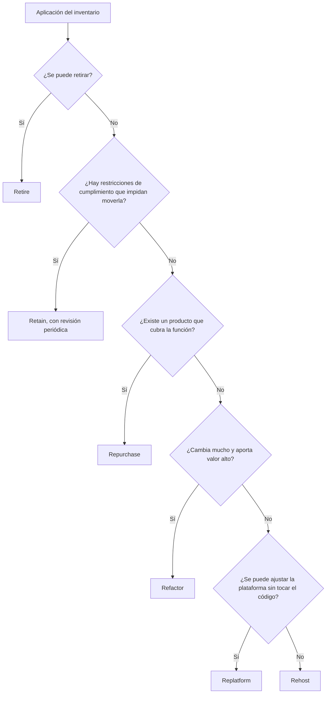

Migrar a la nube no es una decisión única sobre toda la cartera de sistemas. Es una colección de decisiones
pequeñas, una por aplicación, y cada una tiene un coste, un riesgo y un beneficio distintos. La tesis de este
artículo es que la elección de estrategia debe salir de cuatro preguntas sobre cada aplicación (qué aporta al
negocio, cuánto cambia, cuánto está acoplada y qué cuesta mantenerla) y no de una preferencia general por
«rehacerlo todo» o por «moverlo tal cual».

El modelo de las seis estrategias, conocido como las 6R, es de uso muy extendido en la industria y en la
documentación de los proveedores de nube. Sirve como vocabulario común: permite que el equipo, la dirección y
el proveedor hablen de lo mismo. No es una receta, y conviene usarlo como una lista de opciones que hay que
justificar, no como un procedimiento de clasificación automática.

<Callout tone="info" title="Migrar no es lo mismo que modernizar">
  Un rehost puede dejar una aplicación exactamente igual que estaba, con los mismos defectos, en
  otra máquina. Eso tiene valor si el objetivo era salir de un centro de datos a plazo. Si el
  objetivo era reducir coste o velocidad de entrega, el rehost no lo resuelve por sí solo.
</Callout>

## Las seis estrategias en una frase cada una

- **Rehost** (mover tal cual, a veces llamado _lift and shift_): la aplicación se traslada a infraestructura
  en la nube sin cambios de código. Es la vía más rápida y la que menos riesgo funcional introduce, y la que
  menos mejora ofrece.
- **Replatform** (mover con ajustes): se cambian componentes de plataforma sin tocar la lógica, por ejemplo
  pasar una base de datos gestionada en lugar de instalarla en una máquina virtual.
- **Repurchase** (sustituir por un producto): se abandona la aplicación propia y se adopta un servicio de terceros
  que cubra la misma función, como un CRM en lugar de uno interno.
- **Refactor** o **re-architect** (rediseñar): se cambia la arquitectura para aprovechar la nube, por ejemplo
  descomponiendo un monolito o adoptando servicios gestionados para colas y almacenamiento. Es la opción más cara
  y la que más valor puede aportar si la aplicación cambia mucho.
- **Retire** (retirar): se apaga la aplicación porque ya nadie la usa o porque su función está cubierta por otra.
  Es la estrategia más barata y la que menos se usa, porque requiere decidir que algo ya no hace falta.
- **Retain** (conservar): se deja donde está, por ahora. Puede ser porque tiene restricciones de cumplimiento, porque
  la migración no compensa o porque depende de hardware que no se puede mover.

Las seis no son excluyentes en el tiempo. Una aplicación puede empezar como rehost para salir de un centro de datos
en el plazo de un contrato y después pasar a replatform o a refactor cuando el equipo tenga espacio para hacerlo.
Lo importante es registrar la decisión y su siguiente paso.

Hay además una diferencia entre migrar y salir que conviene nombrar. Una migración mueve la carga de un
entorno a otro con un objetivo de estado, y su final se reconoce cuando el entorno antiguo se apaga. Una
salida es la operación inversa, y en la práctica exige los mismos pasos de datos y de identidad, pero
con un proveedor que cambia de lado. Por eso una estrategia de migración que no contempla el coste de un
movimiento futuro construye la siguiente migración por adelantado. Un registro de decisiones con el
proveedor, los servicios gestionados usados y las dependencias de datos convierte esa salida en un plan
en lugar de en una urgencia.

## Criterio 1: valor para el negocio y ritmo de cambio

Lo primero que hay que saber de una aplicación no es su tecnología, sino cuánto importa y con qué frecuencia
cambia. Una aplicación que sostiene ingresos y cambia cada semana justifica una inversión de rediseño. Una
aplicación de consulta interna que no ha tenido cambios en dos años probablemente solo necesita moverse, o que
alguien decida retirarla.

Una forma sencilla de ordenar la cartera es colocar cada aplicación en dos ejes: valor para el negocio en
uno y frecuencia de cambio en el otro. Las que tienen valor alto y cambio frecuente son candidatas a refactor,
porque cada mejora de arquitectura se amortiza en muchas entregas. Las de valor bajo y cambio nulo son
candidatas a retirar o a repurchase. Las demás se reparten entre rehost y replatform según el acoplamiento,
que es la siguiente pregunta.

Un error común es decidir por antigüedad. Una aplicación antigua puede ser la más valiosa de la empresa y
una nueva puede ser una prueba que nadie usa. La antigüedad indica riesgo técnico, no valor.

## Criterio 2: acoplamiento y datos

El acoplamiento determina cuánto cuesta mover una aplicación sin romperla. Una aplicación que depende de un
recurso de red específico, de un directorio interno o de una base de datos compartida con otros tres sistemas
no se mueve sola: se mueve con todo lo que la rodea, y el plan de migración tiene que incluir a esos vecinos.

Los datos son la parte más delicada. Mover una base de datos implica decidir cuándo se copia, cómo se
sincroniza durante la transición y cómo se verifica que el resultado es correcto. La estrategia de
[migración de bases de datos sin downtime](/docs/migraciones-bd-sin-downtime) describe los patrones de
expansión y contracción que hacen posible ese traslado sin parar el servicio. Si la aplicación no puede
tolerar ese procedimiento, el rehost con base de datos gestionada puede ser inviable y la decisión se
inclina hacia retain o hacia un plan por fases.

Mapear dependencias es una tarea que se subestima. Un diagrama de los flujos de datos y de las llamadas
entre sistemas, aunque sea aproximado, evita que una migración de un lunes deje sin datos a un informe
mensual que nadie tenía documentado.

## Criterio 3: coste de operación y coste de salida

Mover a la nube cambia el coste de operación, pero no siempre a la baja. Un rehost de una máquina
infrautilizada puede costar más que el hardware que sustituye, porque la nube cobra por lo que se reserva,
no por lo que se usa. Por eso cada estrategia debe ir con una estimación de coste mensual antes y después,
con las mismas unidades.

También conviene considerar el coste de salida. Una aplicación que usa servicios gestionados muy
específicos de un proveedor es más barata de operar, pero más cara de mover más adelante. Eso no es un
argumento contra esos servicios; es un argumento para decidirlo con los ojos abiertos. El análisis de
[salida de la nube](/docs/salida-de-la-nube) y el de [costo como atributo](/docs/finops-costo-como-atributo)
ayudan a poner ese riesgo en números.

## Criterio 4: cumplimiento, residencia y riesgo

Algunas aplicaciones no pueden moverse a cualquier región o a cualquier proveedor por razones legales o
contractuales. Datos personales con requisitos de residencia, sistemas regulados por el sector financiero o
sanitario y contratos que prohíben subcontratar cierto tipo de tratamiento son restricciones que deciden la
estrategia antes que cualquier criterio técnico.

Estas restricciones se deben conocer al inicio, no al final. Una aplicación que se descubre no migrable a
mitad de una ola obliga a rehacer el plan. La forma de evitarlo es incluir en el inventario las obligaciones
de cumplimiento de cada aplicación, con el responsable que las confirma.

## Orden de olas y dependencias

Migrar toda la cartera a la vez no es realista. Se agrupa en olas, y el orden de las olas lo marcan las
dependencias y el riesgo, no el tamaño. Una buena práctica es empezar por aplicaciones de riesgo bajo que
permitan aprender el procedimiento (cómo se construye la red, cómo se gestionan los secretos, cómo se hace
la monitorización), y dejar para más tarde las que tienen muchos vecinos o datos críticos.

El diagrama siguiente resume cómo se elige la estrategia para una aplicación concreta. Es una simplificación:
las preguntas reales tienen matices, pero el orden de decisión es el que importa.

Las ramas en las que el diagrama manda a retain o a rehost deben tener una fecha de revisión. Una
aplicación que se queda en rehost sin plan de mejora se convierte, al cabo de unos años, en deuda con
la forma de un centro de datos en la nube.

## Medir antes y después

Una migración sin métricas comparables no demuestra nada. Antes de mover una aplicación hay que tomar
una línea base: disponibilidad, latencia en los percentiles que importan, coste mensual, tiempo de
despliegue y número de incidentes. Después de mover, las mismas métricas, con el mismo periodo de
observación, deciden si la migración valió la pena.

La trampa habitual es medir solo el coste. Un rehost puede empeorar la latencia o la fiabilidad y
ahorrar en la factura, y el balance parecería positivo hasta que el número de incidentes lo corrige. Las
métricas de servicio deben estar en la misma tabla que las financieras.

Un caso ficticio ayuda a ver cómo se combinan los criterios. Supongamos una empresa con tres aplicaciones. La
primera es un portal de facturas con alto valor para el negocio, pero que se cambia poco y depende de un
servicio de archivos compartido con otros cuatro sistemas: su estrategia razonable es un replatform, con la base
de datos pasada a un servicio gestionado y el archivo migrado en la misma ola que sus vecinos, porque moverla sola
rompería los informes. La segunda es una herramienta interna de encuestas de satisfacción que un proveedor
ofrece como servicio: el criterio apunta a un repurchase, y la decisión depende de comparar el coste anual del
producto con el coste de mantener el desarrollo propio, medido con las mismas unidades. La tercera es un sistema
de conciliación bancaria heredado que procesa datos regulados y que el departamento financiero exige mantener en
un centro de datos propio por contrato. Aquí la decisión es retain, pero con una fecha de revisión a dos años, en
la que se reevalúa si el contrato sigue vigente y si el coste de mantenerlo fuera de la nube sigue siendo
aceptable.

Lo que tienen en común estos tres casos es que la decisión no sale de la tecnología sino de la combinación de
valor, acoplamiento, coste y restricciones. Tres aplicaciones con la misma pila tecnológica pueden tener
estrategias distintas, y eso es correcto.

Presentar la estrategia a la dirección exige traducir cada decisión a tres magnitudes: coste anual antes
y después, riesgo que se reduce o se acepta, y plazo hasta el beneficio. Una tabla con una fila por
aplicación, su estrategia, su justificación y su fecha de revisión convence más que un discurso general
sobre la nube, porque permite discutir casos concretos. Conviene también reconocer lo que la migración no
resuelve. Mover una aplicación no la hace más rápida de cambiar si su código sigue acoplado, ni reduce el
coste si nadie revisa las instancias sobredimensionadas después del traslado. Esas dos tareas, optimizar
tras migrar y revisar el dimensionamiento, deben estar en el plan con dueño, no como promesas que aparecen
en la presentación final.

## Herramientas

- **Un inventario de aplicaciones** con dueño, dependencias, datos, obligaciones de cumplimiento y coste
  actual. Sin inventario no hay criterio.
- **Un mapa de dependencias** generado a partir de trazas, registros de red o un levantamiento con los
  equipos, aunque sea incompleto al principio.
- **Estimadores de coste** del proveedor, usados con las mismas unidades que la factura actual.
- **Un plan de reversión** por ola, que describa cómo volver al entorno anterior si la migración falla.

Las herramientas de descubrimiento ayudan, pero no sustituyen la conversación con quien conoce la
aplicación. Un inventario completo sin dueños identificados es solo una lista.

## Errores frecuentes

- **Migrar todo como rehost por defecto.** Es rápido y barato de planear, y deja la cartera igual de
  cara y de difícil de cambiar que antes, con un proveedor nuevo.
- **Decidir sin inventario de dependencias.** La primera ola descubre vecinos que nadie mencionó, y el
  plan se reescribe sobre la marcha.
- **Ignorar el coste de salida.** Los servicios gestionados ahorran operación, pero el coste de moverlos
  más adelante no aparece en el presupuesto de la migración.
- **Tratar retain como un fracaso.** Mantener una aplicación donde está puede ser la decisión correcta si
  el coste de moverla supera su valor. Lo que importa es que la decisión tenga fecha de revisión.
- **Medir solo el coste.** Una migración que ahorra y empeora la fiabilidad no es un éxito.
- **Olvidar el cumplimiento hasta la última ola.** Una restricción descubierta tarde obliga a rehacer el
  plan de las olas anteriores que dependían de la misma región o del mismo proveedor.

## Checklist

- [ ] Cada aplicación tiene dueño, valor para el negocio, frecuencia de cambio y dependencias documentadas.
- [ ] Cada aplicación tiene una estrategia elegida con su justificación escrita, no solo la etiqueta.
- [ ] Las restricciones de cumplimiento y residencia se confirman antes de planificar la ola.
- [ ] Hay una línea base de coste, disponibilidad, latencia y despliegue antes de mover nada.
- [ ] Las decisiones de retain y rehost tienen fecha de revisión.
- [ ] Cada ola tiene un plan de reversión probado y un responsable de la decisión de avanzar.
- [ ] El coste de salida de los servicios gestionados se ha estimado y se ha aceptado de forma explícita.

## Fuentes

Consultadas en octubre de 2026. Los nombres y definiciones de las seis estrategias se contrastaron con
fuentes secundarias de proveedores de nube y consultoras; no se localizó la publicación original que las
introdujo ni su fecha, por lo que este artículo no atribuye el modelo a un autor concreto. La definición
de nube y de sus modelos de despliegue sigue el glosario del NIST.

- NIST SP 800-145, _The NIST Definition of Cloud Computing_ (2011), para el vocabulario de nube.
- Documentación de estrategias de migración de los principales proveedores de nube (consultada como fuente
  secundaria; se recomienda contrastar la versión vigente antes de citarla).
