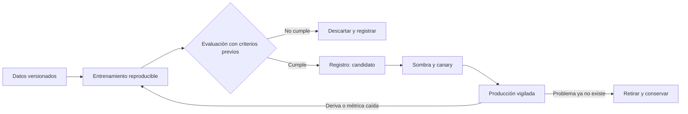

Entrenar un modelo que funciona en un cuaderno es la parte fácil. Lo difícil es que siga funcionando
dentro de seis meses, cuando los datos han cambiado, el código que lo alimenta ha cambiado y nadie
recuerda qué versión de qué dato produjo el resultado que está en producción. La tesis de este artículo
es que un modelo en producción es una **versión publicada de tres cosas a la vez** (código, datos y
modelo), y que el trabajo de MLOps consiste en tratarlas así: versionarlas por separado, desplegarlas con
control y vigilarlas hasta que se retiran.

El problema no es nuevo. Sculley y sus coautores, en «Hidden Technical Debt in Machine Learning Systems»
(NIPS 2015), describieron cómo el código de modelado es una fracción pequeña de un sistema de ML real,
rodeado de configuración, recolección de datos, verificación, servicio y monitorización. Esa observación
es la base de casi todas las prácticas que siguen.

<Callout tone="info" title="MLOps no es DevOps con otro nombre">
  DevOps versiona código y despliega artefactos que se comportan igual con el mismo código. Un
  modelo puede fallar con el mismo código si cambian los datos de entrada. Por eso el ciclo de vida
  necesita vigilancia continua de los datos, no solo de los errores del servicio.
</Callout>

## Un modelo es código, datos y configuración

Un modelo entrenado es el resultado de una receta: el código que transforma los datos, los datos mismos
(con su fecha de corte y su filtrado), los hiperparámetros y el entorno en el que se entrenó. Si se
pierde cualquiera de estos elementos, el modelo deja de ser reproducible. Y un modelo que no se puede
reproducir no se puede depurar cuando algo sale mal.

La consecuencia práctica es que cada modelo en producción debe poder responder a tres preguntas: con qué
código se entrenó, con qué datos y con qué configuración. Si la respuesta es «con el cuaderno que tenía
Ana en su portátil», el modelo está en producción sin ser una versión publicada.

Las guías de arquitectura de Google Cloud para MLOps plantean lo mismo: el sistema de ML real es una
pequeña parte de código de modelo rodeada de componentes de configuración, automatización, verificación
de datos, servicio y monitorización. Su recomendación es automatizar un pipeline que entrene, valide y
despliegue el modelo, en lugar de tratar el entrenamiento como un paso manual.

## Versionar datos, código y modelo por separado

Cada uno de los tres elementos cambia a un ritmo distinto. El código cambia cuando el equipo lo decide.
Los datos cambian cuando cambia el mundo o cuando cambia la fuente de datos. El modelo cambia cada vez que
se reentrena. Si se versionan juntos, cualquier cambio obliga a una versión nueva de todo, y el historial
deja de explicar nada.

La separación práctica es esta:

- **Código**: el repositorio de la pipeline de entrenamiento, con revisiones y pruebas, como cualquier otro
  código de producción.
- **Datos**: conjuntos de datos con identificador propio, fecha de corte y esquema. Un conjunto de datos
  nuevo es una versión nueva; no se sobrescribe el anterior.
- **Modelo**: el artefacto entrenado, con referencia a las versiones exactas de código y datos que lo
  produjeron, sus métricas de evaluación y su estado (candidato, aprobado, en producción, retirado).

El registro de modelos es el lugar donde se unen las tres versiones. Sin él, cada equipo guarda sus
modelos en carpetas con nombres como `final_v3_bueno.pkl`, y la pregunta de qué está en producción no tiene
respuesta fiable.

## Del experimento al registro

Un experimento es una exploración: se prueban variantes, se comparan métricas y se descarta lo que no
funciona. Una versión candidata es un modelo que merece pasar a evaluación formal. La diferencia importa
porque los experimentos generan muchos resultados que no deben llegar a producción, y la evaluación
formal debe ser la misma para todos los candidatos.

La puerta entre ambos estados es una evaluación automática con criterios escritos antes de entrenar: métricas
mínimas de calidad, comparación con el modelo en producción sobre el mismo conjunto de prueba y revisión de
equidad o de sesgos cuando el modelo afecta a personas. Si los criterios se definen después de ver los
resultados, la evaluación confirma lo que el equipo quería, no lo que el modelo hace.

Las tarjetas de modelo (_model cards_) son una forma estándar de documentar esta información. Mitchell y sus
coautores las propusieron en «Model Cards for Model Reporting» (FAT\* 2019): cada modelo publicado debe venir
con su uso previsto, sus condiciones de evaluación, sus métricas desagregadas por subgrupos y sus limitaciones
conocidas. Escribirla al final del proyecto es tarde; el borrador se redacta junto al registro.

## Desplegar con sombra y canary

Un modelo nuevo nunca debería sustituir al anterior de golpe. Hay dos formas de reducir ese riesgo, y se
pueden combinar.

El **despliegue en sombra** (_shadow_) ejecuta el modelo nuevo con el tráfico real, pero sin devolver sus
respuestas a los usuarios. Sus predicciones se registran y se comparan con las del modelo actual y, cuando
existe, con el resultado real. Permite medir el comportamiento con datos reales sin exponer a nadie. Su
límite es que no mide el efecto de la predicción sobre el usuario, porque el usuario nunca la ve.

El **canary** envía una fracción pequeña del tráfico real al modelo nuevo y vigila métricas de negocio y de
servicio. Si todo se mantiene dentro de los umbrales, la fracción crece; si no, se vuelve atrás. Es el mismo
patrón que las [entregas progresivas](/docs/entrega-progresiva-flags-canary), con la diferencia de que aquí la
métrica de decisión incluye la calidad de la predicción, no solo la latencia o los errores.

Un detalle que se olvida: el modelo nuevo puede depender de características que el servicio calcula de forma
distinta en línea y en entrenamiento. Esa diferencia, conocida como sesgo de entrenamiento-servicio, produce
buenas métricas offline y malos resultados en producción. La defensa es calcular las características con el
mismo código en ambos entornos o, al menos, comprobar que producen los mismos valores para las mismas entradas
antes del despliegue.

## Vigilar la deriva

Un modelo se degrada aunque su código no cambie. La **deriva de datos** ocurre cuando la distribución de las
entradas se aleja de la que vio en entrenamiento: cambian los clientes, los canales o el comportamiento. La
**deriva de concepto** ocurre cuando cambia la relación entre entradas y resultado: lo que antes predecía
impago ya no lo predice porque cambió la política de crédito. Ambas requieren vigilancia distinta.

Para la deriva de datos sirve comparar la distribución de las entradas en producción con la de referencia,
por variable, con una métrica de distancia y un umbral acordado. Para la deriva de concepto hace falta el
resultado real, que a veces llega días o meses después. Por eso conviene vigilar ambas: la primera avisa
pronto, la segunda confirma si el aviso importaba.

Breck y sus coautores, en «The ML Test Score» (IEEE BigData 2017), proponen una rúbrica para evaluar la
preparación de un sistema de ML para producción, con pruebas de datos, de modelo, de infraestructura y de
monitorización. Sirve como lista de comprobación para saber qué falta antes de confiar en un modelo sin
supervisión.

## Reentrenar o retirar: decidirlo con datos

Reentrenar no es siempre la respuesta. Un modelo que se degrada puede necesitar datos nuevos, una
característica nueva, un cambio de arquitectura o simplemente que alguien revise si el problema sigue siendo
el mismo. Reentrenar sin diagnóstico produce un modelo igual de malo, entrenado con datos más recientes, que
además tiene menos tiempo de validación.

Una política razonable define tres disparadores: un umbral de métrica de negocio que se incumple durante un
periodo acordado, una deriva de datos que supera el límite por varias variables y una fecha de revisión
periódica que obliga a confirmar que el modelo sigue teniendo sentido. El reentrenamiento se ejecuta por la
pipeline, con la misma evaluación que cualquier candidato, y no por una decisión informal.

Retirar un modelo también es una decisión. Un modelo que ya no se usa, que ha sido sustituido o cuyo problema
de negocio ha desaparecido debe retirarse de forma explícita: se marca como retirado en el registro, se
desconecta del servicio y se conserva su versión para auditoría. Un modelo olvidado en producción, que sigue
recibiendo tráfico y sin dueño, es uno de los riesgos más comunes.

Un caso ficticio muestra por qué la vigilancia tiene que incluir los datos y no solo el servicio. Un
modelo de recomendación de productos para una tienda en línea responde en menos de cien milisegundos, sin
errores, durante todo un trimestre. Los paneles del servicio están en verde. Sin embargo, la tasa de
clics en las recomendaciones cae un quince por ciento en seis semanas. La investigación posterior muestra
que el catálogo cambió su taxonomía de categorías en el mismo periodo: una característica que el modelo
usaba como entrada ahora llega con otros valores para la mayoría de productos. Ninguna alerta de servicio
lo habría detectado; la distribución de esa variable, comparada con la de entrenamiento, sí lo habría hecho
desde la primera semana. La lección es que el sistema de monitorización de un modelo debe mirar lo que
entra, lo que sale y lo que pasa después, no solo si el servicio está vivo.

Hay una dificultad adicional con el resultado real. En muchos casos llega con retraso: el impago se conoce
al cabo de meses, la conversión de una campaña al cerrar el ciclo de compra. Durante ese intervalo, la
deriva de datos es la única señal disponible. Conviene documentar el retraso de cada etiqueta en el registro
del modelo, para que las alertas de deriva de concepto no se interpreten como fallos cuando todavía no hay
datos suficientes para medirlos.

Gobernar un modelo es también decidir quién puede aprobarlo y quién responde por él. Conviene separar
tres papeles: quien entrena y propone el candidato, quien valida que cumple los criterios escritos y quien
acepta el riesgo de ponerlo en producción, que suele ser un responsable de negocio con visibilidad sobre
el impacto. Cuando una misma persona cumple los tres, la revisión se vuelve formal. Esa separación también
fija el procedimiento de excepción: si hay que desplegar un modelo que no cumple un criterio, la decisión
queda firmada, con su motivo y con una fecha para corregirlo. Las excepciones no firmadas se acumulan hasta
convertirse en el sistema en producción real, que nadie aprobó.

La gobernanza también necesita un inventario vivo. Cada modelo en producción debe aparecer en un listado
que enumere su dueño, su última evaluación, su fecha de revisión, el conjunto de datos que lo entrenó y los
servicios que lo consumen. Ese listado sirve para dos cosas que se olvidan con facilidad: saber qué se ve
afectado si un conjunto de datos cambia o se retira, y detectar modelos sin dueño antes de que tomen decisiones
sin que nadie las revise. Un modelo que aparece en el inventario sin dueño es una alerta, y debe resolverse
retirándolo o asignándole responsable en la siguiente revisión.

## Herramientas

- **Un registro de modelos** con versiones, estados, enlaces a código y datos, y métricas de evaluación.
- **Un gestor de conjuntos de datos** o al menos almacenamiento con versiones inmutables y fechas de corte.
- **Una pipeline de entrenamiento** orquestada, que pueda ejecutarse sin intervención humana y con los mismos
  pasos en cada ejecución.
- **Monitorización de datos y de predicciones**, con distribuciones por variable y alertas de deriva, además de
  la monitorización del servicio.
- **Herramientas de tarjetas de modelo** o una plantilla en el registro, para que la documentación se rellene
  junto al modelo.

Ninguna herramienta resuelve la falta de dueños. Cada modelo en producción necesita una persona responsable de
su rendimiento, de sus reentrenamientos y de su retirada.

## Errores frecuentes

- **Guardar modelos como archivos sueltos.** Sin registro, nadie puede responder qué está en producción ni por
  qué.
- **Definir los criterios de aceptación después de ver los resultados.** La evaluación confirma lo que se
  buscaba, no lo que el modelo hace.
- **Desplegar de golpe.** Un modelo que se comporta bien en pruebas puede fallar con el tráfico real y sin
  forma de volver atrás rápido.
- **Vigilar solo los errores del servicio.** Un modelo que responde rápido y sin errores puede estar equivocado
  durante meses.
- **Reentrenar como primera respuesta.** Sin diagnóstico, el nuevo modelo hereda el mismo problema con menos
  validación.
- **Dejar modelos sin dueño.** Un modelo olvidado sigue tomando decisiones que nadie revisa.

## Checklist

- [ ] Cada modelo en producción se puede reproducir: código, datos y configuración están versionados y enlazados
      en el registro.
- [ ] Los criterios de aceptación se escriben antes de entrenar y se aplican igual a todos los candidatos.
- [ ] El despliegue usa sombra o canary, con métricas de decisión que incluyen la calidad de la predicción.
- [ ] Las características se calculan igual en entrenamiento y en servicio, o su equivalencia está comprobada.
- [ ] La deriva de datos y la de concepto se vigilan con umbrales acordados y con el resultado real cuando llega.
- [ ] Existen disparadores escritos para reentrenar y para revisar el modelo periódicamente.
- [ ] Cada modelo tiene una tarjeta con uso previsto, evaluación y limitaciones, y un dueño con nombre.
- [ ] Los modelos retirados se marcan en el registro, se desconectan y su versión se conserva.

## Fuentes

Consultadas en octubre de 2026. Sculley et al. (NIPS 2015) y Breck et al. (IEEE BigData 2017) se confirmaron
con sus actas y su registro bibliográfico. La guía de Google Cloud sobre entrega continua y pipelines de ML se
consultó en su versión en inglés; se revisó por última vez en agosto de 2024, así que conviene comprobar la
vigente. Mitchell et al. (FAT\* 2019) se confirmó con su registro de la ACM y su versión en arXiv.

- Sculley et al., «Hidden Technical Debt in Machine Learning Systems», NIPS 2015, vol. 28, pp. 2503–2511.
- Breck et al., «The ML Test Score: A Rubric for ML Production Readiness and Technical Debt Reduction», IEEE BigData 2017.
- Mitchell et al., «Model Cards for Model Reporting», FAT\* 2019 (arXiv:1810.03993).
- [Google Cloud Architecture Center: MLOps, continuous delivery and automation pipelines in machine learning](https://docs.cloud.google.com/architecture/mlops-continuous-delivery-and-automation-pipelines-in-machine-learning)
