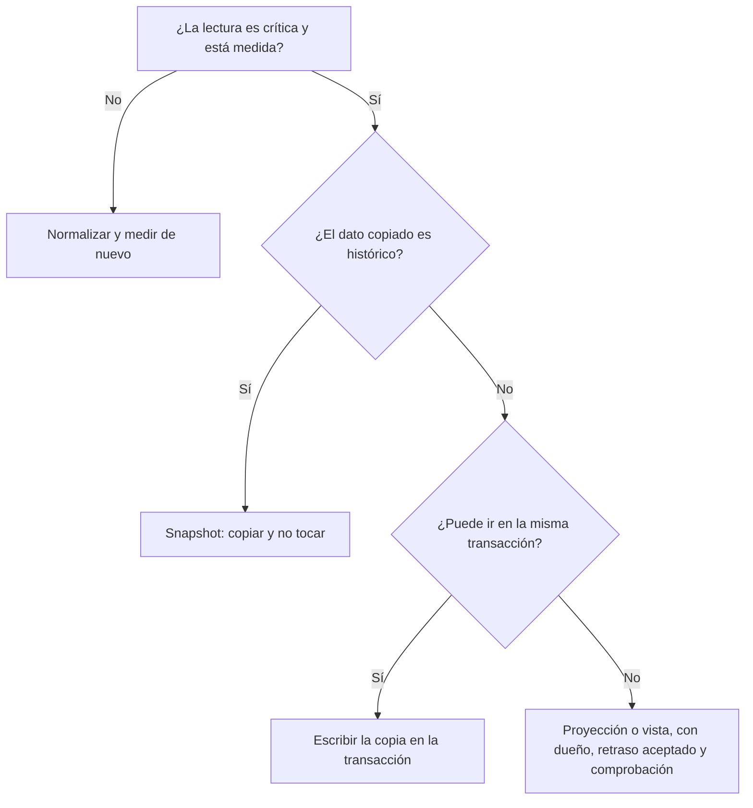

# Modelado de datos: normalizar o desnormalizar

Un modelo de datos responde a dos preguntas a la vez: qué hechos existen y dónde debe vivir cada
uno, y cómo se van a leer y escribir. La primera lleva a normalizar. La segunda decide cuándo
compensa copiar un hecho para que una lectura no tenga que reunirlo. Muchos modelos problemáticos
responden solo a la primera pregunta, o la responden con la intuición de otro sistema.

Este artículo trata el modelado como una decisión de coste: dónde se paga, al escribir o al leer,
y quién responde cuando una copia se desfasa. No repite lo que ya cuentan la
[elección de almacén](/docs/persistencia-politica-elegir-bd), los
[niveles de aislamiento](/docs/datos-acid-y-aislamiento) ni los
[agregados de DDD](/docs/domain-driven-design); los usa como punto de partida.

## Conceptual, lógico y físico

Conviene separar tres niveles:

- **Conceptual:** las entidades del negocio, sus relaciones y los invariantes escritos en su
  lenguaje («un pedido tiene al menos una línea»). Sin tablas, tipos ni índices.
- **Lógico:** tablas, colecciones o documentos, claves y restricciones. Aquí se decide qué fila o
  documento contiene cada hecho.
- **Físico:** índices, particiones, tipos de columna, réplicas. Aquí se afina el coste sin cambiar
  los hechos.

El conceptual es la parte duradera: cambia cuando cambia el negocio. El físico cambia cuando cambia
la carga. El error habitual es saltar al físico con las tablas que propone el ORM o el esquema de la
API antes de haber escrito los invariantes. Entonces la base de datos guarda la forma del código y
no la del dominio.

## Entidades, relaciones y claves

La base (entidad, clave, cardinalidad) está en el artículo de
[ACID y aislamiento](/docs/datos-acid-y-aislamiento#entidades-claves-y-cardinalidad). Aquí van las
decisiones que cambian el modelo:

- **La cardinalidad decide dónde va la clave foránea.** En uno a muchos, la clave va en el lado
  «muchos». En muchos a muchos hace falta una tabla intermedia, y casi siempre esa tabla tiene
  atributos propios: una inscripción tiene fecha y nota, una línea de pedido tiene cantidad y
  precio. Si la tabla intermedia no tiene ningún atributo, conviene preguntarse si la relación
  esconde una entidad que nadie ha nombrado.
- **Clave sustituta para la identidad, natural para la regla.** Una clave generada por el sistema es
  estable y cómoda para referenciar desde otras tablas. Una clave natural (un correo, una matrícula)
  expresa una regla del negocio, pero el negocio la corrige, la reasigna o la comparte. Criterio del
  autor: identifica con una sustituta y declara la natural como `UNIQUE`, así la regla se cumple sin
  que todas las referencias dependan de ella.
- **Las claves compuestas encajan en tablas de unión.** `(pedido_id, producto_id)` expresa que un
  producto aparece una sola vez en un pedido. No la uses como identidad de entidades con vida propia.

## Normalizar: qué anomalía evitas

Normalizar es guardar cada hecho en un solo sitio. Las formas normales son criterios para
comprobar que cada atributo depende de la clave correcta. Un ejemplo lo aclara. Esta tabla plana mezcla pedidos, clientes y productos:

| pedido | cliente | nombre     | email          | producto | cantidad |
| ------ | ------- | ---------- | -------------- | -------- | -------- |
| 1001   | 17      | Ana Torres | ana@ejemplo.es | Teclado  | 1        |
| 1002   | 17      | Ana Torres | ana@ejemplo.es | Ratón    | 2        |
| 1003   | 17      | Ana Torres | ana@ejemplo.es | Monitor  | 1        |

Mal diseñada, produce tres anomalías clásicas:

- **Actualización.** Ana cambia de correo y la corrección llega a dos de las tres filas. La base de
  datos afirma dos cosas a la vez.
- **Inserción.** No puedes registrar a una clienta nueva sin inventar un pedido, porque sus datos
  viven dentro de la fila del pedido.
- **Borrado.** Si cancelas sus pedidos y borras las filas, desaparecen también su nombre y su correo,
  que son hechos distintos del pedido.

Cada forma normal corrige un tipo de dependencia incorrecta:

| Forma | Regla en lenguaje llano                                    | Ejemplo que corrige                                                                               |
| ----- | ---------------------------------------------------------- | ------------------------------------------------------------------------------------------------- |
| 1FN   | Cada celda guarda un solo valor                            | Una celda con `Teclado, Ratón`                                                                    |
| 2FN   | Todo atributo no clave depende de la clave completa        | `producto_nombre` en la tabla de líneas depende solo de `producto_id`, no de `(pedido, producto)` |
| 3FN   | Ningún atributo no clave depende de otro atributo no clave | `ciudad` depende de `codigo_postal`, que depende del pedido                                       |
| FNBC  | Toda dependencia funcional parte de una superclave         | Cada profesor imparte una sola asignatura, pero `profesor` no es clave: la dependencia la rompe   |

Criterio del autor: normalizar hasta FNBC en el núcleo transaccional. Pasar de ahí rara vez aporta
algo que compense.

**Lo que cuesta.** Normalizar traslada el coste a la lectura: cada dato de otra tabla se trae con un
`JOIN`. En un relacional bien indexado es barato cuando la consulta toca pocas filas. Se encarece
cuando la lectura cruza muchas tablas, cuando el sistema reparte los datos entre nodos o cuando la
pantalla es la operación principal y debe responder en milisegundos a escala. Criterio del autor:
normaliza primero, mide las lecturas reales y desnormaliza solo lo que los números señalen.

## Desnormalizar a propósito

Desnormalizar es copiar un hecho para una lectura concreta. Conviene distinguir dos tipos de copia
porque no tienen el mismo problema:

- **Copia de hecho histórico (snapshot).** El precio que pagó el cliente en una línea de pedido no es
  un duplicado: es el dato correcto de ese momento. Guardarlo en la línea no produce desfase, porque
  nadie debe actualizarlo.
- **Copia de estado.** El correo de Ana en la vista de facturación debe seguir al correo de Ana. Aquí
  hay un desfase posible y hay que decidir quién lo corrige.

Las copias de estado son las que cuestan. El diagrama resume cuándo compensan y cómo mantenerlas:

Cuando una copia de estado se mantiene fuera de la transacción, los mecanismos habituales son:

| Mecanismo              | Cuándo encaja                                                       | Qué se paga                                                                               |
| ---------------------- | ------------------------------------------------------------------- | ----------------------------------------------------------------------------------------- |
| Misma transacción      | La copia vive en el mismo almacén y el invariante debe cumplirse ya | Latencia de escritura y acoplamiento: la copia bloquea lo que comparte                    |
| Vista materializada    | El motor puede recalcular la proyección dentro de la base de datos  | Coste de refresco; el desfase es el intervalo entre refrescos                             |
| Proyección por eventos | La copia vive en otro almacén o servicio                            | Consistencia eventual, consumidores idempotentes, reconstrucción y vigilancia del retraso |
| Disparador (trigger)   | La sincronización debe ir pegada a la escritura en la base de datos | Lógica oculta fuera del código de la aplicación, más difícil de probar y versionar        |

Las vistas materializadas tienen un matiz que conviene conocer. Según la documentación de PostgreSQL,
un `REFRESH` sin `CONCURRENTLY` puede bloquear las lecturas de la vista mientras se recalcula; con
`CONCURRENTLY` las lecturas siguen, pero la vista necesita al menos un índice `UNIQUE` que cubra todas
las filas y use solo nombres de columna, sin expresiones ni `WHERE`. Es decir, el mecanismo de
sincronización impone requisitos al modelo.

### Quién responde del desfase

La copia no tiene un dueño natural si nadie lo decide. En la práctica hay tres responsables:

- **El dueño de la fuente** publica cada cambio del hecho y decide qué copias existen.
- **El dueño de la copia** fija cuánto retraso acepta esa vista (por ejemplo, que la vista de soporte
  vaya como mucho un minuto por detrás), sabe reconstruirla y la vigila.
- **Una comprobación de deriva** compara una muestra de la copia con la fuente y alerta cuando se
  separan. Sin ella, la copia se desfasa en silencio y lo descubre alguien en producción.

## Relacional, documental y clave-valor

Cada familia de almacenes premia un modelo distinto. Forzar el modelo de un almacén en otro es una
fuente habitual de problemas.

| Dimensión        | Relacional                                       | Documental                                    | Clave-valor                                            |
| ---------------- | ------------------------------------------------ | --------------------------------------------- | ------------------------------------------------------ |
| Qué premia       | Consultas ad hoc, joins e integridad entre filas | Leer y escribir un agregado entero de una vez | Acceso por clave o prefijo con latencia predecible     |
| Punto de partida | Normalizar y luego indexar                       | Agregado por documento, con copias dentro     | Consulta conocida, clave diseñada para ella            |
| Precio           | Joins; esquema más rígido                        | Duplicados entre documentos; tamaño acotado   | Sin consultas por otros campos sin índices secundarios |
| Riesgo típico    | Joins lentos por índices que faltan              | Documentos o arrays que crecen sin límite     | Necesitar una consulta que la clave no soporta         |

En un documento, la decisión clave es **embeber o referenciar**. La guía de modelado de MongoDB
recomienda embeber cuando los datos se consultan y se actualizan juntos, y referenciar cuando el lado
hijo tiene alta cardinalidad, puede existir solo, se escribe en momentos distintos o su número crece
sin límite. El documento tiene además un techo verificable: según la documentación de MongoDB, el
tamaño máximo de un documento BSON es de 16 mebibytes, y los documentos grandes ocupan más memoria
y más ancho de banda.

Un documento no es lo mismo que un agregado de DDD, pero suele ser su forma física más natural. El
agregado es la unidad que se protege con un invariante; el documento es la unidad que se lee y se
escribe de una vez. Si una operación del negocio necesita modificar tres documentos a la vez, el
límite del agregado probablemente está mal trazado, y conviene revisarlo antes de cambiar de almacén.

En clave-valor, la documentación de AWS para DynamoDB lo resume así: el primer paso es identificar los
patrones de consulta que el sistema debe responder, y el esquema se diseña para ellos. Sus guías
también recomiendan mantener pocas tablas y agrupar los datos relacionados con la clave de partición
y de ordenación. Fuera de esos patrones, la guía advierte de que las consultas son caras y lentas, así que
conviene cambiar el modelo antes que barrer la tabla.

## Diseñar desde las consultas

El orden importa. Primero las operaciones, después el modelo, y solo al final el almacén:

1. **Enumera las operaciones** con su tipo (lectura o escritura), su frecuencia estimada y el tiempo
   de respuesta que se necesita.
2. **Para cada escritura, escribe sus invariantes**: lo que debe ser cierto tras la operación, en la
   misma transacción o en el mismo documento.
3. **Asigna a cada hecho un dueño y una fila o documento canónico.**
4. **Añade copias solo para lecturas medidas**, y decide su mecanismo de sincronización con la tabla
   anterior.
5. **Elige el almacén y diseña claves e índices** para cada consulta de la lista.

Un ejemplo de lista para un sistema de pedidos (valores ilustrativos, no medidos):

| Operación                       | Tipo      | Frecuencia | Invariante o límite                                              |
| ------------------------------- | --------- | ---------- | ---------------------------------------------------------------- |
| Crear pedido descontando stock  | Escritura | Alta       | El stock no baja de cero, en la misma transacción                |
| Ver pedido con sus líneas       | Lectura   | Muy alta   | Un solo acceso al agregado para la pantalla                      |
| Facturación mensual por cliente | Lectura   | Diaria     | Puede ir con minutos de retraso                                  |
| Cambiar el correo del cliente   | Escritura | Baja       | Llega a las copias de soporte y facturación en un plazo acordado |

La lista sirve para algo más que para elegir almacén: cada fila es una consulta que, si cambia,
obliga a revisar el modelo.

## Índices: la copia que mantiene el motor

Un índice es una redundancia que el motor mantiene por ti: una copia de ciertas columnas ordenadas
por una clave. Cada inserción y cada actualización de una columna indexada debe tocar todos sus
índices. Por eso un índice es un coste de escritura y de almacenamiento, aunque no lo parezca porque
no lo escribes a mano.

Criterio del autor: crea índices para consultas medidas, no por si acaso, y revisa periódicamente
los que nadie usa, con las estadísticas de uso que ofrece tu motor. Un modelo normalizado con muchos
índices puede escribir más lento que uno desnormalizado con una sola lectura bien diseñada.

## Señales de que el modelo está mal

- **Joins que no caben en el presupuesto de latencia**, aunque cada tabla esté bien indexada.
- **Dos fuentes para el mismo hecho** sin dueño claro. Es la señal más temprana de duplicados que
  divergen.
- **Cambios conceptuales que tocan muchas tablas o colecciones**. Si cambiar «la dirección de envío»
  obliga a editar seis sitios, el hecho está repartido sin necesidad.
- **Documentos o arrays que crecen sin techo**: comentarios, eventos o auditoría dentro del documento
  padre.
- **Operaciones que necesitan transacciones entre demasiados agregados**. Es una pista del límite de
  agregado, no un problema de almacén.
- **Consultas nuevas que obligan a reescribir el modelo** en lugar de añadir un índice o una vista.
- **Restricciones que viven en el código** porque la base de datos no las puede expresar (una
  combinación única, un solape prohibido). Un invariante que no se puede declarar acaba fallando en
  producción.

## Cuándo sí y cuándo no

**Normaliza** cuando las escrituras y la integridad mandan: inventario, saldos, reservas, cualquier
dominio donde una copia desfasada tiene coste real. Normalizar es la opción por defecto del núcleo
transaccional.

**Desnormaliza** cuando una lectura está medida, es crítica y la copia cambia poco o nunca. Y elige un
documento cuando la operación de negocio siempre lee y escribe el agregado entero.

**No desnormalices por anticipación**, ni porque el ORM o el framework lo haga cómodo. Cada copia
añade trabajo de sincronización que alguien tendrá que mantener.

**No normalices hasta el absurdo** si la pantalla principal necesita ocho joins para pintarse. Eso
suele indicar que la lectura es la operación importante y el modelo debe reflejarlo.

**No metas relaciones de alta cardinalidad dentro de un documento** solo porque es cómodo leerlas.

## Errores frecuentes

- **Diseñar las tablas desde el ORM o desde la API** antes que desde las operaciones y los invariantes.
- **Copiar datos sin dueño ni mecanismo de sincronización.** Una copia sin responsable es un bug
  diferido.
- **Confundir un snapshot con un duplicado.** Actualizar el precio histórico de una línea de pedido es
  un error, no una normalización.
- **Arrays sin límite dentro de un documento**, que crecen hasta chocar con el tamaño máximo o hacen
  lenta cada lectura.
- **Índices por intuición**, sin medir su coste en escritura ni su uso real.
- **Resolver un invariante lógico con lógica de aplicación** cuando una restricción única o una clave
  compuesta lo garantizaría en la base de datos.
- **Modelar relaciones muchos a muchos sin pensar en sus atributos**, y descubrirlos tarde en una
  migración.

## Checklist

- [ ] Los invariantes del negocio están escritos en su lenguaje, no solo en el código.
- [ ] Cada hecho tiene una fila o documento canónico, y las copias están documentadas.
- [ ] Cada copia de estado tiene dueño, mecanismo de sincronización y retraso aceptado.
- [ ] Las claves son sustitutas para la identidad y `UNIQUE` para las reglas que lo exigen.
- [ ] Hay una lista de operaciones con frecuencia y tiempo de respuesta objetivo.
- [ ] Los documentos tienen tamaño y crecimiento acotados, y las relaciones grandes se referencian.
- [ ] Cada índice responde a una consulta medida y su coste de escritura es asumido.
- [ ] Hay una comprobación de deriva entre las copias y su fuente.

## Fuentes

- [MongoDB: Limits and Thresholds (tamaño máximo de documento)](https://www.mongodb.com/docs/manual/reference/limits/)
- [MongoDB: Embedded vs. references (guía de modelado)](https://www.mongodb.com/docs/manual/data-modeling/concepts/embedding-vs-references/)
- [AWS: NoSQL design for DynamoDB](https://docs.aws.amazon.com/amazondynamodb/latest/developerguide/bp-general-nosql-design.html)
- [PostgreSQL: REFRESH MATERIALIZED VIEW](https://www.postgresql.org/docs/current/sql-refreshmaterializedview.html)
