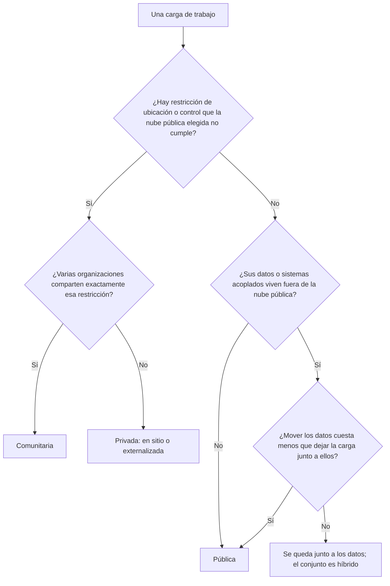

# Modelos de despliegue: público, privado, híbrido

La reunión empieza con una diapositiva: «Estrategia 2027: todo a la nube». Seis meses después, el portal web corre en una región pública, la base de datos del núcleo sigue en el centro de datos de la empresa, y cada cotización tarda un segundo más que antes porque cada consulta cruza un enlace WAN. Nadie decidió que eso pasara; simplemente se decidió el destino del «sitio entero» sin mirar dónde vivían los datos ni quién iba a operar cada pieza. El modelo de despliegue es justo esa decisión, tomada a propósito: **un modelo de despliegue de nube define para quién se aprovisiona la infraestructura, quién la posee y la opera, y dónde está; el arquitecto lo elige para cada carga de trabajo según el control, la ubicación de los datos y el costo que esa carga necesita**.

Esta lección parte de las definiciones de NIST, explica qué cambia de verdad entre un modelo y otro, compara los cuatro con una tabla por criterio, revisa dos etiquetas comerciales que vas a encontrar en las propuestas (nube soberana y nube dedicada) y termina con un método para decidir por carga de trabajo y un ejemplo trabajado. El código es solo una guía de forma, no una receta.

<Callout tone="info" title="Fecha de corte y fuentes">
  Consultado en octubre de 2026. Las definiciones salen del texto de NIST SP 800-145 (septiembre de
  2011) y los escenarios, de NIST SP 800-146 (mayo de 2012), leídos en los PDF oficiales. ISO/IEC
  22123-1:2023 también define los cuatro modelos y su prólogo indica que esa edición cambió la
  definición de nube híbrida; el texto de la norma es de pago y aquí no se cita. Las ofertas de
  proveedores se describen como ejemplos con lo que dicen sus páginas oficiales, no como
  recomendación.
</Callout>

## El problema que resuelve

«Nube» se usa como si fuera un lugar. No lo es: es un modelo de entrega con características concretas (autoservicio, acceso por red, recursos compartidos, elasticidad y servicio medido, según NIST), y ese modelo se puede desplegar de varias formas. Mezclar las formas produce decisiones que nadie tomó explícitamente:

| Síntoma en un proyecto real                                                | Decisión que se tomó sin nombrarla                                          |
| -------------------------------------------------------------------------- | --------------------------------------------------------------------------- |
| La aplicación migrada es más lenta que la original                         | Separar la aplicación de sus datos con una frontera de red de por medio     |
| Auditoría pregunta en qué país están las copias de seguridad y nadie sabe  | No declarar la ubicación de los datos como requisito de cada carga          |
| La «nube privada» necesita un equipo de plataforma que nadie presupuestó   | Confundir «privada» con «sin costo de operación»                            |
| La factura mensual crece por transferencia de datos entre entornos         | Diseñar un flujo de datos que cruza fronteras en cada petición              |
| Dos entornos «híbridos» no pueden mover una sola aplicación entre ellos    | Llamar híbrido a dos entornos sin portabilidad ni gobierno común            |
| El contrato de «nube soberana» no cubre los registros que envía el soporte | Aceptar una etiqueta comercial sin preguntar qué datos y qué personas cubre |

## Las cuatro definiciones de NIST

La referencia más citada es la publicación especial 800-145 de NIST, _The NIST Definition of Cloud Computing_, de Peter Mell y Timothy Grance (septiembre de 2011). Define la computación en la nube como un modelo de acceso por red, bajo demanda, a un conjunto compartido de recursos configurables que se aprovisionan y liberan con un esfuerzo de gestión mínimo, y la compone de cinco características esenciales, tres modelos de servicio y cuatro modelos de despliegue. Los modelos de servicio (IaaS, PaaS, SaaS) se tratan en la [lección anterior](/docs/servicios-nube-para-arquitectos); aquí interesan los de despliegue. Parafraseados con fidelidad:

| Modelo      | Para quién se aprovisiona                                                            | Quién puede poseerla y operarla                                           | Dónde puede estar                   |
| ----------- | ------------------------------------------------------------------------------------ | ------------------------------------------------------------------------- | ----------------------------------- |
| Privada     | Uso exclusivo de una sola organización, que puede tener varios consumidores internos | La propia organización, un tercero o una combinación                      | Dentro o fuera de las instalaciones |
| Comunitaria | Uso exclusivo de una comunidad de organizaciones con intereses comunes               | Una o varias organizaciones de la comunidad, un tercero o una combinación | Dentro o fuera de las instalaciones |
| Pública     | Uso abierto del público general                                                      | Una empresa, una institución académica o un gobierno, o una combinación   | En las instalaciones del proveedor  |
| Híbrida     | Composición de dos o más infraestructuras distintas (privada, comunitaria o pública) | Cada parte conserva su dueño; siguen siendo entidades separadas           | Donde esté cada parte               |

Tres detalles del texto original se pierden a menudo:

- **Privada no significa «en mi centro de datos».** NIST dice expresamente que la nube privada puede estar dentro o fuera de las instalaciones y la puede operar un tercero. Lo que la define es la exclusividad, no la dirección del edificio.
- **Comunitaria es un modelo con entidad propia.** La comunidad comparte misión, requisitos de seguridad, políticas o consideraciones de cumplimiento. Es el caso de varias entidades de un mismo sector que comparten una plataforma.
- **Híbrida exige un vínculo.** Las partes siguen siendo distintas, pero están unidas por tecnología, estándar o propietaria, que permite portar datos y aplicaciones; el ejemplo que da NIST es el desbordamiento de carga de una nube a otra (_cloud bursting_). Tener un centro de datos y una cuenta en un proveedor sin nada que los una no encaja en esa definición.

En la figura, cada zona es una frontera y su rótulo cuenta organizaciones: muchas sobre la misma infraestructura (pública), una sola (privada), un grupo con intereses comunes (comunitaria) y una composición de una parte privada con una pública (híbrida). Dentro de la híbrida está la idea que recorre toda esta lección: la aplicación vive junto a sus datos, del mismo lado de la frontera.

### Los escenarios de NIST SP 800-146

Unos meses después, en mayo de 2012, NIST publicó la SP 800-146, _Cloud Computing Synopsis and Recommendations_ (Lee Badger, Tim Grance, Robert Patt-Corner y Jeff Voas). Es más útil para un arquitecto que la definición, porque analiza cada modelo por su **perímetro de seguridad**, es decir, qué parte controla el consumidor. Su aporte principal es separar la privada y la comunitaria en dos variantes, **en sitio** y **externalizada**, porque tienen propiedades distintas de rendimiento, fiabilidad y seguridad. Con eso, una nube híbrida es una composición de cualquiera de cinco variantes.

| Escenario (SP 800-146)    | Perímetro que controla el consumidor                                    | Rasgos que el documento destaca                                                                        |
| ------------------------- | ----------------------------------------------------------------------- | ------------------------------------------------------------------------------------------------------ |
| Privada en sitio          | El suyo, alrededor de sus recursos y de la nube                         | Costo inicial de significativo a alto, capacidad fija, el consumidor elige dónde corre todo            |
| Privada externalizada     | Dos perímetros (el suyo y el del proveedor) unidos por un enlace seguro | La seguridad depende de ambos perímetros y del enlace                                                  |
| Comunitaria en sitio      | El de cada miembro, unidos por enlaces entre sus fronteras              | Al menos un miembro aporta servicios; la política de acceso y de identidad entre miembros se complica  |
| Comunitaria externalizada | El suyo y el del proveedor, que separa a la comunidad del resto         | Como la privada externalizada, más una política de compartición entre miembros que aplica el proveedor |
| Pública                   | Solo el de sus propias instalaciones                                    | Elasticidad casi ilimitada, red pública, ubicación de la carga oculta salvo que se restrinja           |

Dos observaciones del documento siguen vigentes como preguntas, aunque los productos hayan cambiado. Sobre la privada externalizada, advierte que si la separación entre clientes usa solo los mismos mecanismos que separan a los clientes de una nube pública, el escenario se convierte en la práctica en una nube pública. Sobre la pública, señala que los acuerdos de servicio por defecto limitan lo que el proveedor promete y que las obligaciones reales están en el contrato, no en el material comercial. Ten en cuenta que es un texto de 2012: los controles de ubicación y de auditoría de los proveedores han avanzado mucho desde entonces, así que úsalo por su razonamiento, no por su diagnóstico de mercado.

## Qué cambia de verdad entre modelos

Las etiquetas importan menos que cuatro preguntas. Hazlas para cada carga de trabajo y el modelo casi se deduce solo.

### Quién opera la infraestructura

Operar es aplicar parches, renovar hardware, vigilar la capacidad, responder a incidentes a las tres de la mañana y mantener el perímetro. En la nube pública lo hace el proveedor para todo lo que queda por debajo del servicio que contratas; en una privada en sitio lo hace tu equipo, aunque uses software de nube. Esa diferencia es la que más pesa en el costo total y la que más se subestima: una privada en sitio necesita un equipo de plataforma con habilidades de nube y, según SP 800-146, también las tradicionales mientras convivan sistemas heredados.

### Quién controla la capa física y el plano de control

Conviene separar dos capas. La **capa física** son los edificios, la energía, los servidores y la red. El **plano de control** es el software que crea, cambia y destruye recursos: las API, la consola, la identidad que las autoriza, la telemetría que el proveedor usa para operar. Puedes tener servidores físicos en tu edificio cuyo plano de control vive en una región del proveedor, y al revés, hardware dedicado a ti dentro del centro de datos del proveedor. Para la seguridad, la soberanía y la continuidad, lo que suele importar es quién puede actuar sobre el plano de control y desde dónde.

| Modelo o variante                         | Capa física                         | Plano de control                                | Quién opera              |
| ----------------------------------------- | ----------------------------------- | ----------------------------------------------- | ------------------------ |
| Pública                                   | Proveedor                           | Proveedor                                       | Proveedor (bajo tu capa) |
| Privada en sitio                          | Tu organización                     | Tu organización                                 | Tu organización          |
| Privada externalizada                     | Tercero, dedicada a ti              | Tercero o compartido según contrato             | Tercero                  |
| Infraestructura del proveedor en tu sitio | Tu edificio, hardware del proveedor | Habitualmente el proveedor, ligado a una región | Proveedor                |
| Comunitaria                               | Miembros o tercero                  | Miembros o tercero, con gobierno común          | Según el acuerdo         |

### Dónde viven los datos

La ubicación de los datos incluye más que la base principal: copias de seguridad, réplicas, registros, índices de búsqueda, cachés, datos de soporte y telemetría. SP 800-146 explicaba en 2012 que en una nube pública el proveedor puede mover la carga a cualquier lugar salvo que ofrezca restricciones de ubicación y el cliente las configure, y que esas restricciones solían ser de grano grueso. Hoy elegir región es lo normal, pero la pregunta sigue siendo la misma: ¿qué copias de qué datos salen de la región elegida, y quién puede verlas?

### Qué fuerzas empujan hacia un modelo

| Fuerza                  | Qué empuja                                                                                   | Pregunta para la carga de trabajo                                          |
| ----------------------- | -------------------------------------------------------------------------------------------- | -------------------------------------------------------------------------- |
| Regulación              | Puede exigir controles, auditoría o personal habilitado; no siempre exige un modelo concreto | ¿Qué exige la norma: un lugar, un control o una evidencia?                 |
| Residencia de datos     | Limita en qué jurisdicción pueden estar los datos y sus copias                               | ¿Qué datos están sujetos y cuáles no?                                      |
| Latencia                | Acerca el cómputo al usuario, a la planta o a los datos                                      | ¿Cuántas idas y vueltas hace una petición y con qué presupuesto de tiempo? |
| Gravedad de los datos   | Atrae aplicaciones hacia donde ya están los datos grandes                                    | ¿Cuánto pesa mover los datos frente a mover la aplicación?                 |
| Sistemas heredados      | Fijan cargas a un lugar por hardware, licencias o integraciones                              | ¿Qué depende de este sistema por llamadas síncronas?                       |
| Variabilidad de demanda | Premia la elasticidad del modelo público                                                     | ¿La carga tiene picos estacionales o es estable?                           |

Cuidado con la primera fila: es frecuente leer «la regulación nos obliga a tener nube privada» cuando lo que la norma exige es un control (cifrado, segregación, registro de accesos) o una evidencia (auditoría) que varios modelos pueden cumplir. Lee la norma aplicable a tu sector con tu equipo legal; esta lección no entra en la legislación de ningún país.

## La gravedad de los datos

Dave McCrory propuso el término _data gravity_ en una entrada de su blog del 7 de diciembre de 2010. Su metáfora es la de un planeta: a medida que un conjunto de datos crece, atrae servicios y aplicaciones, igual que una masa grande atrae objetos, y cuanto más masa acumula, más difícil es moverlo. McCrory describe la latencia y el ancho de banda como aceleradores de esa atracción: lo que está cerca de los datos obtiene más rendimiento y menos latencia, y por eso termina dependiendo más de ellos.

Para un arquitecto, la consecuencia práctica es una regla de diseño: **coloca la aplicación del mismo lado de la frontera que sus datos, o diseña la interacción para que cruce la frontera pocas veces y en lotes**. La figura de esta lección lo muestra: la aplicación que habla con la base dentro del mismo centro de datos no cruza ninguna frontera; la que se queda en la región pública paga el tiempo de ida y vuelta (RTT) del enlace en cada consulta.

Un ejemplo con números supuestos lo hace concreto. Imagina una petición que hace 25 consultas secuenciales a la base de datos. Si la ida y vuelta dentro del mismo centro de datos es de 0,5 ms, las consultas suman 12,5 ms. Si la aplicación se mueve a una región a la que hay 30 ms de ida y vuelta, las mismas consultas suman 750 ms, sin que haya cambiado una sola línea de lógica. Las cifras de latencia típicas y cómo razonar con ellas están en [números y leyes de rendimiento](/docs/numeros-y-leyes-de-rendimiento).

La gravedad también tiene un componente económico. Los proveedores públicos cobran la transferencia de datos de salida hacia Internet (AWS lo indica en su página de precios de EC2), así que un diseño que saca muchos datos de una región en cada operación paga esa frontera también en la factura. Cómo medir y asignar ese costo se trata en la lección de [FinOps](/docs/finops-costo-como-atributo).

## Comparación por criterio

La tabla resume tendencias, no garantías: una privada bien automatizada puede ser más ágil que una pública mal gobernada.

| Criterio                        | Pública                                                          | Privada en sitio                                              | Privada externalizada                                      | Comunitaria                                  | Híbrida                                                            |
| ------------------------------- | ---------------------------------------------------------------- | ------------------------------------------------------------- | ---------------------------------------------------------- | -------------------------------------------- | ------------------------------------------------------------------ |
| Control                         | Sobre tu capa; la física y el plano de control son del proveedor | Total, incluida la física                                     | Contractual sobre la física, técnico sobre tu capa         | Compartido según el gobierno de la comunidad | Distinto en cada parte; el reto es una política común              |
| Elasticidad                     | Alta; es la ventaja que SP 800-146 le atribuye                   | Limitada a la capacidad comprada                              | Limitada a la capacidad contratada                         | Limitada al conjunto de la comunidad         | La de la parte pública, si la carga es portable                    |
| Costo inicial frente a variable | Inicial bajo, variable por uso                                   | Inicial alto (equipos, espacio, equipo humano), variable bajo | Inicial moderado, cuota por capacidad reservada            | Inicial repartido entre miembros             | La suma de ambas más la integración                                |
| Cumplimiento                    | Depende de controles, regiones y certificaciones del proveedor   | Lo demuestras tú con tus controles y auditorías               | Repartido: contrato, auditoría del tercero y tus controles | Diseñado para requisitos comunes del grupo   | El de la parte más exigente, y las reglas de qué cruza la frontera |
| Complejidad operativa           | Baja en infraestructura, alta en gobierno de cuentas y costos    | Alta: operas una plataforma completa                          | Media: gestionas el contrato y el enlace                   | Alta en gobierno entre organizaciones        | La más alta: identidad, red, observabilidad y datos entre entornos |



## Nube soberana y nube dedicada

En las propuestas comerciales vas a encontrar dos etiquetas que no son modelos de NIST ni términos con una definición normativa común. Cada proveedor les da un contenido distinto, así que trátalas como un conjunto de promesas que hay que verificar una por una.

### Nube soberana

Suele prometer alguna combinación de estas cosas: infraestructura ubicada dentro de una jurisdicción, operación por personal residente en ella, una entidad jurídica local con su propio gobierno, independencia del plano de control global del proveedor y gestión de claves bajo control del cliente. Un ejemplo publicado: AWS anunció en enero de 2026 la disponibilidad de su AWS European Sovereign Cloud, con una primera región en Brandeburgo (Alemania); su sitio oficial la describe como física y lógicamente separada de las demás regiones de AWS, operada por residentes de la UE ubicados en la UE y gobernada por una nueva sociedad matriz con filiales constituidas en Alemania.

Preguntas que conviene hacer:

- **Plano de control:** ¿dónde vive, quién puede actuar sobre él y desde qué países?
- **Datos fuera de la carga:** ¿qué pasa con metadatos, registros, telemetría, copias de seguridad y adjuntos de los casos de soporte?
- **Claves:** ¿quién custodia las claves de cifrado y puede el proveedor usarlas sin intervención tuya?
- **Catálogo:** ¿qué servicios faltan respecto de una región estándar y cuándo llegan las novedades?
- **Desconexión:** ¿qué sigue funcionando si se corta la conexión con el resto del proveedor?
- **Evidencia:** ¿qué certificaciones y derechos de auditoría cubren exactamente esta oferta, y no la región estándar?

### Nube dedicada

Bajo esta etiqueta caben cosas muy distintas. Algunas dedican **hardware dentro de la región pública**: según la documentación de Microsoft, Azure Dedicated Host ofrece servidores físicos asignados a una sola suscripción, sin máquinas de otros clientes, pero desplegados en los mismos centros de datos y compartiendo la red y el almacenamiento subyacentes con hosts no aislados. Otras llevan **infraestructura del proveedor a tu edificio**: según la guía de AWS, Outposts es capacidad de cómputo y almacenamiento instalada en el sitio del cliente que AWS opera y gestiona como parte de una región, conectada a ella por un enlace de servicio. En el primer caso cambia el aislamiento físico; en el segundo, la ubicación. En ninguno de los dos pasas a operar el plano de control.

Preguntas que conviene hacer:

- **Qué se dedica:** ¿el servidor, el rack, la red, el almacenamiento, el plano de control o el equipo humano?
- **Quién opera:** ¿quién aplica parches y reemplaza hardware, y con qué ventanas de mantenimiento?
- **Dependencia del enlace:** si la infraestructura está en tu sitio, ¿qué operaciones requieren conexión con la región?
- **Capacidad:** ¿qué pasa cuando se llena? La elasticidad de la región no viene incluida.

<Callout tone="warning" title="Una etiqueta no es un control">
  Ni «soberana» ni «dedicada» garantizan por sí mismas el cumplimiento de una norma. Traduce cada
  promesa a un control verificable (dónde, quién, qué evidencia) y regístralo en un [ADR](/docs/adr)
  junto con lo que la oferta no cubre.
</Callout>

## Decidir por carga de trabajo, no por el sitio entero

El error de partida es preguntar «¿a qué modelo nos movemos?». La pregunta útil es «¿dónde debe vivir cada carga de trabajo?». Una carga de trabajo es un conjunto de componentes que se despliegan y escalan juntos y comparten datos: el portal, el motor de cotización, el almacén analítico, el archivo documental. SP 800-146 ya ponía ejemplos así en 2012, como procesar la nómina en una privada externalizada y usar una pública para desarrollo y pruebas.

Un método en cinco pasos:

1. **Inventaria las cargas** y, para cada una, sus datos principales, su volumen y con qué otras cargas habla de forma síncrona.
2. **Clasifica los datos** por sensibilidad y por restricciones de ubicación. Muchas veces solo una parte de los datos está sujeta.
3. **Mide el acoplamiento**: cuántas llamadas por petición hace cada carga a cada almacén y a cada sistema heredado. Agrupa lo que no puede separarse por una frontera de red.
4. **Asigna un modelo por grupo** con el diagrama de decisión de arriba, ponderando la tabla de criterios con los [atributos de calidad](/docs/atributos-de-calidad) que el negocio priorizó.
5. **Diseña las fronteras**: qué cruza entre modelos, con qué frecuencia, en qué formato y con qué controles. Esta es la parte que desarrolla la siguiente lección.

La forma de registrar la decisión importa más que la herramienta. Una entrada por carga de trabajo basta:

```yaml
# placement/cotizador.yaml — una entrada por carga de trabajo
workload: cotizador
data:
  primary: polizas-core # dónde viven hoy y su volumen
  classification: confidencial
  residency: jurisdiccion-de-operacion
coupling:
  sync_calls_per_request: 25 # medido, no estimado
  legacy: [mainframe-polizas]
model: privada-en-sitio # pública | privada-* | comunitaria
crossings: [eventos-a-analitica] # qué cruza la frontera y cómo
review: 2027-04 # … y qué haría cambiar la decisión
```

El resultado normal de este ejercicio es una arquitectura que combina modelos. Eso no la convierte automáticamente en una buena nube híbrida: una combinación sin identidad común, sin red diseñada y sin reglas sobre qué datos cruzan es solo una colección de entornos. El trabajo de unirlos es el tema de [la siguiente lección](/docs/nube-hibrida-en-detalle).

## Cuándo sí y cuándo no

| Modelo                | Cuándo sí                                                                                                         | Cuándo no                                                                             |
| --------------------- | ----------------------------------------------------------------------------------------------------------------- | ------------------------------------------------------------------------------------- |
| Pública               | Demanda variable, servicios gestionados que ahorran operación, equipo pequeño, datos sin restricción incompatible | La carga depende de forma síncrona de datos que no pueden salir de otro lugar         |
| Privada en sitio      | Requisitos de control físico, cargas estables y grandes, sistemas heredados que no se pueden mover                | No hay equipo ni presupuesto para operar una plataforma, o la demanda es muy variable |
| Privada externalizada | Necesitas exclusividad sin operar edificios ni hardware                                                           | Esperas la elasticidad de una región pública por el mismo costo                       |
| Comunitaria           | Varias organizaciones con los mismos requisitos y un gobierno común creíble                                       | Los miembros no acuerdan quién opera, quién paga ni cómo se sale                      |
| Híbrida               | Cargas con necesidades distintas que deben intercambiar datos con reglas claras                                   | Se usa para posponer la decisión o porque «así no nos casamos con nadie»              |

Para el miedo a depender de un proveedor hay una lección propia, [casado a un proveedor](/docs/casado-a-un-proveedor); mezclar modelos no es la forma más barata de resolverlo.

## Errores frecuentes

- **Decidir por moda.** «Todo a la nube» y «todo de vuelta al centro de datos» son la misma falta de análisis con distinto signo. Decide por carga de trabajo y deja escrito el porqué.
- **Ignorar la gravedad de los datos.** Planificar la migración de las aplicaciones sin mirar dónde están los datos que consultan, cuánto pesan y cuánto cuesta moverlos.
- **Mover a la nube solo la capa de aplicación.** La aplicación queda en una región pública y la base de datos en el centro de datos: cada consulta cruza la WAN, la latencia se multiplica y la transferencia aparece en la factura.
- **Confundir privada con «en mi edificio».** NIST la define por exclusividad; puede estar fuera de tus instalaciones y operarla un tercero.
- **Llamar híbrido a cualquier mezcla.** Sin portabilidad de datos o aplicaciones ni gobierno común, tienes entornos separados, no una nube híbrida.
- **Tratar la regulación como sinónimo de modelo.** La norma suele exigir controles y evidencias, no un modelo concreto.
- **Olvidar las copias.** Respaldos, réplicas, registros y telemetría también tienen ubicación y también cuentan para la residencia.
- **Subestimar la operación de lo privado.** El hardware es la parte barata; el equipo de plataforma, los parches y la capacidad de reserva son la cara.

## Ejemplo trabajado de decisión

Una aseguradora regional (caso supuesto) tiene cuatro cargas de trabajo: un portal de clientes, un motor de cotización, un almacén analítico y un archivo de expedientes médicos de siniestros. El núcleo de pólizas corre en un sistema heredado en su centro de datos, y su regulador exige que los expedientes médicos permanezcan en el país y que el acceso quede registrado.

| Carga de trabajo    | Datos y acoplamiento                                                          | Modelo elegido                              | Motivo                                                                      |
| ------------------- | ----------------------------------------------------------------------------- | ------------------------------------------- | --------------------------------------------------------------------------- |
| Portal de clientes  | Contenido y sesiones; pide cotizaciones por API, una llamada por pantalla     | Pública, región en el país                  | Picos de demanda en renovaciones; pocas llamadas cruzan la frontera         |
| Motor de cotización | 25 consultas síncronas por petición al núcleo de pólizas                      | Privada en sitio, junto al núcleo           | Gravedad de los datos: moverlo a la región pública suma 750 ms por petición |
| Almacén analítico   | Recibe eventos del núcleo en lotes nocturnos; consultas pesadas y esporádicas | Pública, región en el país                  | Elasticidad para consultas grandes; el cruce es asíncrono y en lotes        |
| Expedientes médicos | Datos sensibles con requisito de residencia y registro de accesos             | Privada externalizada en un proveedor local | Exclusividad y ubicación verificable sin operar hardware propio             |

Los 750 ms salen de las cifras supuestas de la sección anterior: 25 consultas por 30 ms de ida y vuelta, frente a 12,5 ms si el motor se queda junto al núcleo. El equipo descartó mover el núcleo de pólizas porque la migración del sistema heredado es un proyecto propio, y dejó anotado en el [ADR](/docs/adr) qué haría cambiar la decisión: si el núcleo se reemplaza, el motor de cotización se reevalúa junto con él. El resultado combina tres modelos, con dos cruces diseñados (portal a cotización por API, núcleo a analítica por lotes) y ninguna consulta síncrona que atraviese la WAN.

## Checklist

- [ ] Cada carga de trabajo tiene un modelo de despliegue asignado y un motivo escrito.
- [ ] Para cada carga sabes quién opera la capa física y quién puede actuar sobre el plano de control.
- [ ] Los datos están clasificados, y las restricciones de ubicación cubren también copias, registros y telemetría.
- [ ] Ninguna ruta síncrona frecuente cruza una frontera de red entre modelos sin un presupuesto de latencia medido.
- [ ] Los flujos que cruzan fronteras están enumerados, con frecuencia, formato y controles.
- [ ] Las promesas de «soberana» o «dedicada» están traducidas a controles verificables en el contrato.
- [ ] El costo de operar cualquier componente privado, incluido el equipo humano, está en el caso de negocio.
- [ ] La decisión está en un ADR con las condiciones que harían revisarla.

## Siguiente lección

Si tu arquitectura combina modelos, el reto pasa a ser unirlos bien: identidad, red, datos y operación entre entornos; continúa con [nube híbrida en detalle](/docs/nube-hibrida-en-detalle).

## Fuentes

Consultadas en octubre de 2026.

- [The NIST Definition of Cloud Computing, SP 800-145 (Peter Mell y Timothy Grance, NIST, septiembre de 2011)](https://nvlpubs.nist.gov/nistpubs/Legacy/SP/nistspecialpublication800-145.pdf)
- [Cloud Computing Synopsis and Recommendations, SP 800-146 (Lee Badger, Tim Grance, Robert Patt-Corner y Jeff Voas, NIST, mayo de 2012)](https://nvlpubs.nist.gov/nistpubs/Legacy/SP/nistspecialpublication800-146.pdf): capítulo 4, secciones 4.1 a 4.7
- [ISO/IEC 22123-1:2023, Information technology — Cloud computing — Part 1: Vocabulary](https://www.iso.org/standard/82758.html): consultado el prólogo de la vista previa pública
- [Data Gravity – in the Clouds (Dave McCrory, Data Gravitas, 7 de diciembre de 2010)](https://datagravitas.com/2010/12/07/data-gravity-in-the-clouds/)
- [AWS European Sovereign Cloud (sitio oficial)](https://aws.eu/)
- [Overview of Azure Dedicated Hosts (Microsoft Learn)](https://learn.microsoft.com/en-us/azure/virtual-machines/dedicated-hosts/overview)
- [What is AWS Outposts? (guía de usuario de AWS)](https://docs.aws.amazon.com/outposts/latest/userguide/what-is-outposts.html)
- [Amazon EC2 On-Demand Pricing, sección de transferencia de datos (AWS)](https://aws.amazon.com/ec2/pricing/on-demand/)
