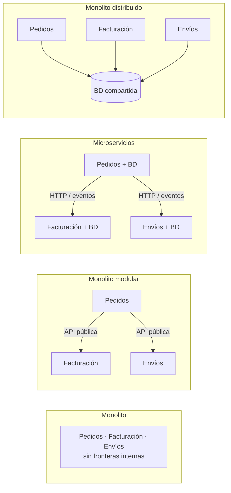
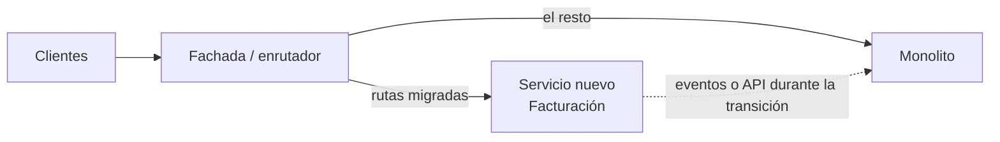
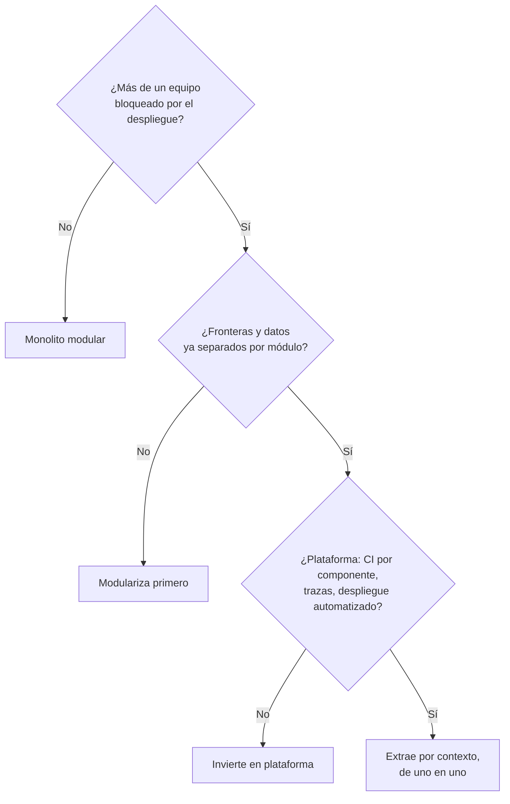

# Monolito, monolito modular o microservicios

La escena se repite: el monolito tarda cuarenta minutos en pasar la integración continua, dos equipos se pisan en cada despliegue y alguien propone «pasar a microservicios». Seis meses después hay doce servicios, una base de datos compartida, un tablero de trazas que nadie entiende y una persona dedicada a coordinar qué se despliega con qué. El problema no era el número de procesos, sino las fronteras. Esta es la idea que guía todo el artículo: **la decisión importante no es cuántos procesos despliegas, sino dónde trazas las fronteras y cómo las haces cumplir; el despliegue independiente es un coste que solo se paga cuando lo que compra lo justifica**.

El artículo define los cuatro estilos (incluido el antipatrón que nadie elige a propósito), compara sus costes sin maquillaje, repasa el debate «monolito primero», explica cómo se sostienen las fronteras de un monolito modular, revisa dos casos públicos con lo que dicen y lo que no, y termina con rutas de migración, un ejemplo de decisión y una lista de comprobación. El código es solo una guía de estructura y nombres.

<Callout tone="info" title="Fecha de corte y verificación">
  Fuentes consultadas en octubre de 2026. Las fechas y citas de Fowler, Tilkov, Shopify y la
  cobertura de Prime Video salen de los textos originales o de prensa técnica, y se indica cuál en
  cada caso. El artículo original de Prime Video ya no está en su dirección (redirige a otra web),
  así que lo que se cuenta de él viene de InfoQ y otros medios que lo citaron.
</Callout>

## Cuatro formas de repartir un sistema

### Monolito

Una sola **unidad de despliegue**: todo el código se compila, se prueba y se publica junto, y las llamadas entre partes son llamadas a función dentro del mismo proceso. Sam Newman lo resumió en QCon Londres 2020 (según la crónica de InfoQ): un monolito se define por su unidad de despliegue, no por ser código heredado. Un monolito puede estar bien o mal estructurado; el término no dice nada de su calidad interna.

### Monolito modular

Un monolito cuyo interior está dividido en **módulos con fronteras explícitas**: cada módulo tiene una API pública, oculta su implementación, es dueño de sus datos y declara de qué otros módulos depende. Sigue siendo una sola unidad de despliegue. Newman, en la misma charla, llamó a sus ideas «ideas de vanguardia de los años setenta», en referencia a que la modularidad es un principio antiguo: lo nuevo es tomárselo en serio dentro de un único despliegue.

### Microservicios

Servicios que se **despliegan de forma independiente**, se comunican por red y gestionan sus propios datos. James Lewis y Martin Fowler, en su artículo del 25 de marzo de 2014, describieron nueve características comunes, entre ellas componentes como servicios, organización en torno a capacidades de negocio, gestión de datos descentralizada, automatización de infraestructura y diseño para el fallo. No es una definición formal, sino un retrato de los sistemas que observaban.

### Monolito distribuido: el antipatrón

Varios servicios en procesos distintos que **no se pueden desplegar por separado**: comparten base de datos o esquema, se llaman en cadena de forma síncrona o requieren versiones coordinadas. Tiene la complejidad operativa de los microservicios y el acoplamiento del monolito. Newman lo llamó «el peor de los monolitos» y dio una señal práctica: si tienes a alguien a tiempo completo coordinando versiones, probablemente tienes un monolito distribuido.



La diferencia entre las dos columnas centrales es la unidad de despliegue; la diferencia entre microservicios y monolito distribuido es si las fronteras son reales. Fíjate en que el monolito modular y los microservicios bien hechos comparten el mismo dibujo lógico: por eso el primero es un buen punto de partida para el segundo.

## Los trade-offs sin maquillaje

Fowler resumió en 2015 los beneficios de los microservicios en tres puntos (fronteras de módulo fuertes, despliegue independiente y diversidad tecnológica) y sus costes en otros tres (distribución, consistencia eventual y complejidad operativa). La tabla aterriza esos costes en lo que nota un equipo en el día a día:

| Dimensión                  | Monolito                                   | Monolito modular                                | Microservicios                                                    |
| -------------------------- | ------------------------------------------ | ----------------------------------------------- | ----------------------------------------------------------------- |
| Unidad de despliegue       | Una                                        | Una                                             | Una por servicio                                                  |
| Autonomía de equipos       | Baja: todos tocan todo                     | Media: dueños por módulo, despliegue compartido | Alta, si las fronteras están bien trazadas                        |
| Consistencia de datos      | Transacciones locales                      | Transacciones locales; propiedad por módulo     | Consistencia eventual, sagas, idempotencia                        |
| Latencia entre partes      | Llamada a función                          | Llamada a función                               | Red: serialización, reintentos, tiempos de espera                 |
| Observabilidad             | Logs y perfilador de un proceso            | Igual, con etiquetas por módulo                 | Trazas distribuidas, correlación, métricas por servicio           |
| Pruebas                    | Integración sencilla, suite lenta si crece | Por módulo, más una suite del conjunto          | Contratos entre servicios y entornos de integración               |
| Desarrollo local           | Un proceso                                 | Un proceso                                      | Varios servicios, dobles o un entorno remoto                      |
| Cambiar una frontera       | Barato, pero nadie la ve                   | Refactorización con ayuda del compilador        | Cambio coordinado entre repositorios, APIs y datos                |
| Escalado                   | Todo junto                                 | Todo junto (réplicas idénticas)                 | Por servicio, según su perfil de carga                            |
| Aislamiento de fallos      | Un fallo de memoria tumba todo             | Igual que el monolito                           | Contenible, si hay disyuntores y degradación                      |
| Diversidad tecnológica     | Un stack                                   | Un stack                                        | Posible, aunque cada stack nuevo es un coste de plataforma        |
| Coste operativo de partida | Bajo                                       | Bajo                                            | Alto: plataforma, CI por servicio, red, seguridad entre servicios |

Dos matices que la tabla no recoge:

- **El coste de la frontera equivocada es asimétrico.** En un monolito modular, mover una responsabilidad de módulo es una refactorización; entre servicios es un proyecto con migración de datos y versiones de API. Por eso las fronteras deberían estabilizarse antes de convertirse en red.
- **La consistencia es la factura más grande.** En cuanto un dato vive en dos servicios, cada operación que los cruza necesita una estrategia: consistencia eventual, compensaciones, reintentos idempotentes. Lo tratamos con más detalle en [CAP y PACELC](/docs/cap-pacelc) y en [atributos de calidad](/docs/atributos-de-calidad).

## La postura «monolito primero» y su réplica

En 2015 Fowler publicó tres textos que fijaron el debate:

- **MicroservicePremium** (13 de mayo de 2015): los microservicios cobran una «prima» de complejidad, y no deberías ni considerarlos salvo que el sistema sea demasiado complejo para gestionarlo como monolito.
- **MonolithFirst** (3 de junio de 2015): observa que casi todas las historias de éxito con microservicios empezaron con un monolito que creció demasiado y se dividió, y que los sistemas construidos como microservicios desde cero solían acabar en problemas serios. El argumento central es que las fronteras estables son difíciles de acertar al principio, y que refactorizar entre servicios es mucho más caro que dentro de un monolito. Propone incluso aceptar un monolito «de sacrificio» que luego se descarte.
- **Microservice Trade-Offs** (1 de julio de 2015): la lista de beneficios y costes citada arriba.

El propio Fowler advierte en MonolithFirst que la postura no es unánime y enlaza la réplica de **Stefan Tilkov**, «Don't start with a monolith» (9 de junio de 2015). Tilkov sostiene que empezar con un monolito suele ser un error porque el acoplamiento interno (objetos de dominio compartidos, una sola base de datos, llamadas en proceso) hace muy difícil dividirlo después. Su argumento vale sobre todo para sistemas grandes cuyo dominio ya conoces bien, y él mismo pide desconfiar de las recetas demasiado simples.

Leídas juntas, las dos posturas coinciden más de lo que parece: ambas dicen que el problema es el acoplamiento sin frontera. El monolito modular es la respuesta que toma de cada una lo que importa: fronteras explícitas desde el primer día (Tilkov) sin pagar la prima de la red hasta que haga falta (Fowler).

Ya en 2014, Fowler había publicado una advertencia que sigue vigente, **MicroservicePrerequisites**: antes de tener microservicios necesitas aprovisionamiento rápido, monitorización básica (técnica y de negocio) y despliegue rápido de aplicaciones, además de una colaboración estrecha entre desarrollo y operaciones. Si no tienes esas tres capacidades, lo que vas a construir es un monolito distribuido.

## Ley de Conway y topología de equipos

Melvin Conway lo escribió en «How Do Committees Invent?» (Datamation, abril de 1968): una organización que diseña un sistema producirá un diseño cuya estructura copia la estructura de comunicación de la organización. Fowler (entrada de su bliki de octubre de 2022) describe la **maniobra inversa de Conway**: cambiar deliberadamente la estructura de los equipos para favorecer la arquitectura que quieres.

Para esta decisión, la consecuencia es directa:

- Si tienes **un solo equipo**, los microservicios no compran autonomía: el mismo grupo de personas mantiene todos los servicios y paga la red sin recibir independencia a cambio.
- Si tienes **varios equipos alineados a flujos de negocio**, las fronteras entre módulos o servicios deberían coincidir con las fronteras entre equipos. Si no coinciden, cada cambio cruzará equipos y la arquitectura se deformará hacia el organigrama.
- **Team Topologies** (Matthew Skelton y Manuel Pais, 2019) propone cuatro tipos de equipo (alineado al flujo, de plataforma, habilitador y de subsistema complicado) y pone la **carga cognitiva** en el centro. Un equipo alineado al flujo que además debe operar la red, la mensajería y la observabilidad de diez servicios tiene una carga que alguien, normalmente un equipo de plataforma, debe absorber.

La pregunta útil no es «¿monolito o microservicios?», sino «¿cuántos equipos necesitan desplegar sin pedir permiso a otro, y qué parte del dominio posee cada uno?». La respuesta suele salir de un mapa de contextos de [DDD](/docs/domain-driven-design).

## Cómo se hacen cumplir las fronteras en un monolito modular

Un monolito modular sin reglas ejecutables se degrada a monolito en pocos meses: basta una importación «temporal» a una clase interna de otro módulo. Las fronteras se sostienen con mecanismos, no con buenas intenciones.

### Estructura y API pública

Cada módulo es una carpeta (o un paquete) con una superficie pública pequeña y todo lo demás marcado como interno:

```text
src/modules/
  orders/
    index.ts              # API pública: lo único importable desde fuera
    internal/             # dominio, casos de uso, persistencia
    events.ts             # eventos que publica el módulo
  billing/
    index.ts
    internal/
  shipping/
    index.ts
    internal/
  shared-kernel/          # tipos mínimos y estables que todos comparten
```

La API pública habla en el lenguaje del negocio y devuelve datos simples, no entidades internas. Solo la forma:

```typescript
// src/modules/billing/index.ts
export type InvoiceSummary = Readonly<{ invoiceId: string; total: Money; status: InvoiceStatus }>;

export type BillingApi = {
  issueInvoice(orderId: string): Promise<InvoiceSummary>;
  findInvoice(invoiceId: string): Promise<InvoiceSummary | undefined>;
};
// la implementación vive en ./internal y no se exporta
```

Esta es la misma idea de puertos que se explica en [arquitectura hexagonal](/docs/arquitectura-hexagonal), aplicada entre módulos en lugar de entre núcleo e infraestructura.

### Mecanismos para hacer cumplir la frontera

| Mecanismo                   | Qué impide                                           | Ejemplos de la familia                                                             | Límite                                                        |
| --------------------------- | ---------------------------------------------------- | ---------------------------------------------------------------------------------- | ------------------------------------------------------------- |
| Visibilidad del lenguaje    | Usar tipos no exportados                             | Visibilidad de paquete en Java, `internal` en C#, sistemas de módulos del lenguaje | Suele ser demasiado gruesa o fácil de saltar con reflexión    |
| Módulos de compilación      | Importar algo que no está declarado como dependencia | Paquetes separados en un monorepo, proyectos o subproyectos del sistema de build   | Añade configuración por módulo                                |
| Reglas de análisis estático | Importaciones entre carpetas prohibidas y ciclos     | Reglas de importación del linter, dependency-cruiser, Packwerk en Ruby             | Hay que mantener las reglas al crear módulos                  |
| Tests de arquitectura       | Dependencias prohibidas, expresadas como un test más | ArchUnit en la JVM, equivalentes en otros ecosistemas                              | Solo detecta lo que alguien pensó en escribir                 |
| Propiedad de datos          | Que un módulo lea o escriba las tablas de otro       | Un esquema o prefijo por módulo y usuarios de base de datos con permisos distintos | Las consultas de informes que cruzan módulos necesitan diseño |

Shopify es un ejemplo documentado de esta familia: su herramienta **Packwerk** (código abierto, presentada en septiembre de 2020) analiza estáticamente las referencias entre paquetes y reporta dos tipos de violación, de dependencia (usar un paquete no declarado) y de privacidad (usar algo no público de otro paquete). Cada paquete se declara con un archivo `package.yml`.

### Reglas ejecutables en CI

Una regla basta para la frontera más importante: ningún módulo importa el interior de otro. Con dependency-cruiser, las referencias a grupos (`$1`) permiten escribirla una sola vez para todos los módulos:

```javascript
// .dependency-cruiser.cjs (fragmento)
module.exports = {
  forbidden: [
    {
      name: 'solo-api-publica-entre-modulos',
      severity: 'error',
      from: { path: '^src/modules/([^/]+)/' },
      to: { path: '^src/modules/[^/]+/internal/', pathNot: '^src/modules/$1/' },
    },
  ],
};
```

Es una [fitness function](/docs/fitness-functions): falla el pipeline cuando alguien rompe la frontera. Si el código existente ya la viola, congela las violaciones actuales con una línea base y bloquea las nuevas.

### Los datos también son frontera

La regla que más cuesta y más rinde: **cada tabla tiene un único módulo dueño**. Los demás módulos piden los datos por la API pública o reaccionan a eventos. Newman propuso en 2020 un monolito modular con varias bases de datos como camino que mantiene abierta la opción de extraer servicios, porque separar la capa de datos es el paso más difícil. Si dos módulos escriben en la misma tabla, no tienes dos módulos: tienes uno con dos carpetas. Lo que mide si una frontera está bien trazada es el [acoplamiento y la cohesión](/docs/acoplamiento-cohesion) de lo que queda a cada lado.

## Casos públicos: qué dicen y qué no

### Prime Video, 2023

Marcin Kolny, ingeniero de Prime Video, publicó en marzo de 2023 cómo el equipo de análisis de calidad de vídeo rediseñó su herramienta de monitorización de flujos, que detecta problemas como congelaciones o desincronización de audio y vídeo. Según la crónica de InfoQ (3 de mayo de 2023):

- La primera versión era distribuida sobre componentes serverless: AWS Step Functions orquestaba funciones Lambda, los fotogramas intermedios pasaban por S3 y los resultados salían por SNS.
- Los cuellos de botella fueron el volumen de transiciones de estado de la orquestación (llegaron al límite de la cuenta) y las lecturas y escrituras a S3; el sistema alcanzó un límite duro de escalado en torno al 5 % de la carga esperada.
- El rediseño juntó los componentes en un único proceso sobre ECS y EC2, con los datos en memoria, y escaló horizontalmente clonando ese proceso. El equipo reportó una reducción de más del 90 % en el coste de infraestructura.
- El propio texto acotaba la conclusión: el enfoque distribuido no aportaba muchos beneficios «en nuestro caso de uso específico».

Lo que el caso **no** dice: que Prime Video entero abandonara los microservicios. Se trata de una herramienta concreta. Adrian Cockcroft argumentó en mayo de 2023 que el resultado es en realidad un microservicio de larga duración y que el equipo siguió una ruta razonable de «serverless primero» y optimización posterior. Werner Vogels, CTO de Amazon, escribió ese mismo mes «Monoliths are not dinosaurs», donde cita el caso, insiste en que no hay una solución única y recomienda revisar la arquitectura con cada orden de magnitud de crecimiento.

### Shopify

Kirsten Westeinde publicó el 21 de febrero de 2019 «Deconstructing the Monolith». Shopify describía su base de código como una de las mayores en Ruby on Rails, trabajada durante más de una década por más de mil desarrolladores, y sin fronteras internas. El equipo consideró microservicios y los descartó por el coste de pipelines e infraestructura por servicio, la latencia y fiabilidad de las llamadas por red, los datos que no están donde se necesitan y la dificultad de refactorizaciones grandes. Optó por un **monolito modular**: el código se reorganizó por conceptos de negocio (pedidos, envíos, inventario, facturación) en lugar de por capas de Rails.

El seguimiento de Philip Müller, «Under Deconstruction» (16 de septiembre de 2020), cuenta que las ideas se mantenían pero casi todos los detalles habían cambiado: la herramienta de grafo de llamadas en tiempo de ejecución se sustituyó por Packwerk, los componentes evolucionaban hacia Rails Engines, había 37 componentes y el foco pasó de solo desacoplar a también mejorar la cohesión. Shopify extraía servicios solo de forma deliberada, con ejemplos como el renderizado de tiendas (lecturas masivas) y la custodia de datos de tarjetas (datos sensibles).

<Callout tone="warning" title="Lo que no pude verificar">
  No encontré una aclaración publicada por los autores del artículo de Prime Video: las matizaciones
  que circulan son de terceros (Cockcroft) y de Vogels. Tampoco pude abrir el texto de Vogels
  directamente (HTTP 403); lo citado viene de resultados de búsqueda que lo reproducen. Los datos de
  Shopify son de 2019 y 2020 y pueden haber cambiado desde entonces.
</Callout>

## Rutas de migración

### Estrangulador: sustituir por partes

Fowler publicó el patrón el 29 de junio de 2004 como «Strangler Application» y lo renombró «Strangler Fig Application» en abril de 2019; en agosto de 2024 publicó una versión ampliada. La metáfora viene de las higueras estranguladoras que vio en Queensland: crecen sobre un árbol hasta sostenerse solas. En software, el sistema nuevo crece junto al viejo, una fachada desvía cada funcionalidad cuando su versión nueva está lista y el código heredado se retira por partes. Fowler acepta explícitamente el código de transición como coste a cambio de menos riesgo y valor más temprano.



### Extraer por contexto delimitado

La unidad de extracción no es una tabla ni una capa técnica, sino un **contexto delimitado** con su lenguaje y sus datos. El orden que reduce el riesgo:

1. **Modulariza primero dentro del monolito.** Si el módulo no tiene ya una API pública y datos propios, extraerlo traslada el acoplamiento a la red.
2. **Separa los datos** dentro del mismo despliegue: esquema propio, sin escrituras ajenas.
3. **Pon la fachada** y desvía el tráfico de forma gradual, con posibilidad de volver atrás.
4. **Retira el código viejo** cuando la ruta nueva lleve tiempo en producción. Un estrangulador que nunca retira nada deja dos sistemas que mantener.

Buenos candidatos: un módulo con un perfil de carga muy distinto del resto, requisitos de aislamiento (datos de pago, cumplimiento normativo), o un equipo que necesita un ritmo de despliegue propio y ya es dueño de esa parte del dominio.

### Cuándo no extraer

- **La frontera aún se mueve.** Si el modelo de ese contexto cambia cada pocas semanas, la red congela un error.
- **El módulo comparte transacciones con otros.** Si una operación de negocio necesita atomicidad entre dos módulos, extraer uno convierte una transacción en una saga.
- **El motivo es el rendimiento de la CI.** Hay soluciones más baratas: pruebas por módulo, cachés de build y ejecución selectiva según lo que cambió.
- **No hay quien lo opere.** Sin los prerrequisitos de Fowler (aprovisionamiento, monitorización, despliegue rápido), el servicio extraído será el eslabón más frágil.
- **Solo hay un equipo.** La autonomía de despliegue no tiene a quién beneficiar.

## Cuándo sí y cuándo no

| Situación                                                           | Decisión razonable                                                      |
| ------------------------------------------------------------------- | ----------------------------------------------------------------------- |
| Producto nuevo, dominio que todavía se descubre, un equipo          | Monolito modular; fronteras ligeras y reglas ejecutables desde el día 1 |
| Varios equipos bloqueados por un despliegue compartido              | Primero modulariza y asigna dueños; extrae solo si el bloqueo persiste  |
| Una parte con carga muy distinta (picos, lecturas masivas, cómputo) | Extrae esa parte, no todo el sistema                                    |
| Datos con requisitos de aislamiento o cumplimiento (pagos, salud)   | Servicio separado con su propio perímetro de seguridad                  |
| Organización grande, dominio estable, plataforma madura             | Microservicios alineados a equipos y contextos                          |
| Servicios que siempre se despliegan juntos                          | Fusiónalos: es un monolito distribuido                                  |
| Equipo sin observabilidad ni despliegue automatizado                | No distribuyas hasta tenerlos                                           |

## Ejemplo de decisión

Un caso hipotético para ver el razonamiento. Una plataforma de reservas para clínicas tiene un monolito de cinco años, 28 desarrolladores en cuatro equipos (agenda, pacientes, facturación y notificaciones), despliegue semanal coordinado y una auditoría de protección de datos en camino. La propuesta inicial es «pasar todo a microservicios».

| Criterio                      | Observación                                                                     | Señal                                       |
| ----------------------------- | ------------------------------------------------------------------------------- | ------------------------------------------- |
| Tamaño y forma de los equipos | Cuatro equipos, pero el código no tiene dueños: todos tocan los mismos paquetes | Falta modularidad antes que red             |
| Estabilidad del dominio       | Agenda y facturación son estables; pacientes cambia por la nueva normativa      | Pacientes no debe extraerse aún             |
| Perfil de escalado            | Las notificaciones tienen picos fuertes a primera hora; el resto, carga plana   | Notificaciones es candidato a extracción    |
| Aislamiento y cumplimiento    | Los datos clínicos requieren un perímetro auditado y acceso restringido         | Aislar datos de pacientes, aunque sea en BD |
| Madurez operativa             | Hay CI, pero no trazas distribuidas ni despliegue por componente                | No hay base para diez servicios             |

Decisión: **convertir el monolito en modular** (un módulo por equipo, API pública, esquema de base de datos por módulo y una regla en CI que prohíbe importar el interior de otro módulo), **aislar los datos de pacientes** en su propio esquema con permisos separados, y **extraer solo notificaciones** como servicio, con una cola delante y tras invertir en trazas. Revisión en seis meses con criterios explícitos: si los despliegues siguen bloqueados entre equipos, se evalúa extraer facturación. La decisión y sus criterios de revisión se registran en un [ADR](/docs/adr), siguiendo el enfoque de [trade-offs y decisiones](/docs/trade-offs-y-decisiones).



## Errores frecuentes

- **Distribuir para arreglar un acoplamiento.** Si el código está enredado, partirlo en servicios mueve el enredo a la red y lo hace más caro de cambiar.
- **Base de datos compartida entre servicios.** Es la vía más rápida al monolito distribuido: cualquier cambio de esquema obliga a desplegar en bloque.
- **Servicios por capa técnica.** Un «servicio de datos» y un «servicio de lógica» separan lo que cambia junto. Corta por capacidades de negocio.
- **Cadenas síncronas largas.** Si una petición atraviesa cinco servicios en serie, la disponibilidad total es el producto de las cinco y la latencia, la suma.
- **Monolito modular sin reglas.** Las carpetas no son fronteras. Sin una comprobación en CI, la primera urgencia las rompe.
- **Copiar la arquitectura de una empresa grande.** Su organización, su plataforma y su escala son parte de la decisión; sin ellas, el patrón no se transfiere.
- **Extraer sin retirar.** El estrangulador que nunca elimina el código viejo deja dos sistemas que mantener.
- **Decidir sin registrar el porqué.** Dentro de dos años nadie sabrá si la frontera era deliberada; documéntalo y revisa la [deuda técnica](/docs/deuda-tecnica-evolucion) que genera.

## Checklist

- [ ] La decisión parte del número de equipos que necesitan desplegar sin coordinarse, no de una moda.
- [ ] Cada módulo tiene una API pública pequeña y el resto es interno.
- [ ] Una regla ejecutable en CI impide importar el interior de otro módulo.
- [ ] Cada tabla tiene un único módulo dueño; nadie escribe en datos ajenos.
- [ ] Antes de extraer un servicio existen aprovisionamiento rápido, monitorización y despliegue automatizado.
- [ ] Cada extracción se justifica por perfil de carga, aislamiento o autonomía de un equipo concreto.
- [ ] Ningún par de servicios se despliega siempre junto ni comparte base de datos.
- [ ] La decisión, sus alternativas y su fecha de revisión están en un [ADR](/docs/adr).

## Fuentes

Consultadas en octubre de 2026. El artículo original de Prime Video ya no está disponible en su dirección; se cita a través de InfoQ y The Stack. El texto de Vogels devolvió HTTP 403 y se cita a partir de resultados de búsqueda.

- [Microservices (James Lewis y Martin Fowler, 25 de marzo de 2014)](https://martinfowler.com/articles/microservices.html)
- [MicroservicePrerequisites (Martin Fowler, 28 de agosto de 2014)](https://martinfowler.com/bliki/MicroservicePrerequisites.html)
- [MicroservicePremium (Martin Fowler, 13 de mayo de 2015)](https://martinfowler.com/bliki/MicroservicePremium.html)
- [MonolithFirst (Martin Fowler, 3 de junio de 2015)](https://martinfowler.com/bliki/MonolithFirst.html)
- [Don't start with a monolith (Stefan Tilkov, 9 de junio de 2015)](https://martinfowler.com/articles/dont-start-monolith.html)
- [Microservice Trade-Offs (Martin Fowler, 1 de julio de 2015)](https://martinfowler.com/articles/microservice-trade-offs.html)
- [Original Strangler Fig Application (Martin Fowler, 29 de junio de 2004)](https://martinfowler.com/bliki/OriginalStranglerFigApplication.html) y [Strangler Fig (22 de agosto de 2024)](https://martinfowler.com/bliki/StranglerFigApplication.html)
- [Conway's Law (Martin Fowler, octubre de 2022)](https://martinfowler.com/bliki/ConwaysLaw.html) y [How do committees invent? (resumen de The Morning Paper)](https://blog.acolyer.org/2019/12/13/how-do-committees-invent/)
- [Team Topologies (Martin Fowler, 25 de julio de 2023)](https://martinfowler.com/bliki/TeamTopologies.html)
- [Sam Newman sobre descomposición de monolitos en QCon Londres 2020 (InfoQ, 13 de mayo de 2020)](https://www.infoq.com/news/2020/05/monolith-decomposition-newman/)
- [Prime Video y el paso de serverless a ECS (InfoQ, 3 de mayo de 2023)](https://www.infoq.com/news/2023/05/prime-ec2-ecs-saves-costs/) y [cobertura de The Stack (4 de mayo de 2023)](https://www.thestack.technology/amazon-prime-video-microservices-monolith/)
- [La respuesta de Adrian Cockcroft (The Stack, 9 de mayo de 2023)](https://www.thestack.technology/prime-video-monolith-architecture-debate-bad-takes-adrian-cockcroft/)
- [Monoliths are not dinosaurs (Werner Vogels, mayo de 2023)](https://www.allthingsdistributed.com/2023/05/monoliths-are-not-dinosaurs.html): sin acceso directo
- [Deconstructing the Monolith (Kirsten Westeinde, Shopify, 21 de febrero de 2019)](https://shopify.engineering/deconstructing-monolith-designing-software-maximizes-developer-productivity)
- [Under Deconstruction: The State of Shopify's Monolith (Philip Müller, 16 de septiembre de 2020)](https://shopify.engineering/shopify-monolith)
- [Enforcing Modularity in Rails Apps with Packwerk (Maple Ong, Shopify, 23 de septiembre de 2020)](https://shopify.engineering/enforcing-modularity-rails-apps-packwerk)
