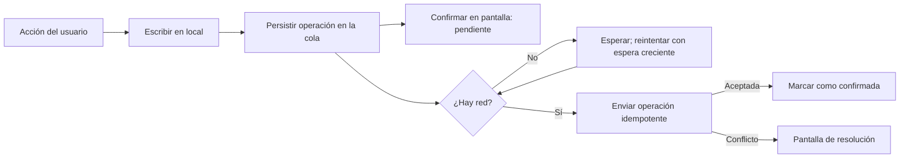

Una aplicación móvil pierde la red en el metro, en el ascensor, en el campo o en un avión. Si su
diseño supone que siempre hay conexión, cada una de esas situaciones se convierte en un error, un
dato perdido o una pantalla que no responde. La tesis de este artículo es que el modelo correcto
es **escribir primero en local y sincronizar después**: la app confirma lo que hace el usuario
inmediatamente, guarda la intención en una cola persistente y la envía al servidor cuando puede.
Lo difícil no es guardar en local, sino decidir qué pasa cuando dos copias del mismo dato divergen.

Este enfoque tiene una formulación explícita en el artículo «Local-first software: You own your data,
in spite of the cloud» (Kleppmann, Wiggins, van Hardenberg y McGranaghan, Onward! 2019), que propone que
el dispositivo sea la copia principal de los datos del usuario y que la nube sirva para sincronizarlos
entre dispositivos. No todas las apps necesitan llegar tan lejos, pero casi todas se benefician de
asumir que la red va a fallar.

<Callout tone="info" title="Offline-first no significa sin servidor">
  El servidor sigue siendo necesario para compartir datos, hacer copias de seguridad y resolver
  conflictos entre dispositivos. Lo que cambia es que la app no se bloquea mientras espera al
  servidor, y que el estado local es lo primero que ve el usuario.
</Callout>

## Qué significa offline-first de verdad

Un diseño offline-first cumple tres propiedades. La primera es que las lecturas se sirven desde el
almacenamiento local, de modo que la pantalla aparece sin esperar a la red. La segunda es que las
escrituras se confirman en local y se registran en una cola que sobrevive a cierres y reinicios. La
tercera es que la sincronización es un proceso de fondo, con reintentos y estado visible, que nunca
bloquea la interacción.

Un diseño que solo hace caché de lecturas no es offline-first. Si una acción del usuario falla cuando
no hay red, el usuario ha perdido algo, aunque la pantalla haya cargado. La prueba de fuego es esta:
cerrar la app en mitad de una operación sin red, reiniciarla y comprobar que la intención del usuario
sigue ahí.

Hay un coste que conviene asumir desde el principio. Cada dato escrito en local es un dato que puede
divergir del servidor. El diseño debe responder a tres preguntas para cada entidad: qué cambios se
pueden hacer sin red, qué cambios necesitan validación del servidor y cómo se reconcilian las copias
cuando vuelven a encontrarse.

## La cola de operaciones como contrato

La unidad de sincronización no es el estado final del dato, sino la **operación**: crear un pedido,
marcar una tarea como completada, cambiar un campo. La cola de operaciones guarda cada una con un
identificador único, su marca de tiempo local, la entidad a la que afecta y el contenido del cambio.
Enviar operaciones en lugar de estados tiene dos ventajas: el servidor puede reproducir la historia y
detectar conflictos con precisión, y el usuario puede ver qué cambios siguen pendientes.

La cola debe cumplir tres reglas. Se persiste en el almacenamiento local antes de confirmar la acción
en pantalla, así que un cierre brusco no la pierde. Se vacía en orden dentro de cada entidad, porque
una edición posterior no puede llegar antes que la creación de la que depende. Y cada operación es
idempotente: si el servidor la recibe dos veces porque la red se cortó antes de la confirmación, el
resultado debe ser el mismo. Esta última propiedad enlaza con el diseño de [idempotencia en sagas y
outbox](/docs/sagas-outbox-idempotencia), donde el mismo problema aparece entre servicios.

El envío necesita una política de reintentos con espera creciente y variación aleatoria, para que miles
de dispositivos que recuperan la red a la vez no golpeen al servidor en el mismo instante. El mecanismo
es el mismo que se describe en [reintentos con jitter](/docs/reintentos-con-jitter).

## Conflictos: cuándo hay conflicto de verdad

Un conflicto aparece cuando dos dispositivos modifican el mismo dato sin conocer el cambio del otro. No
todos los conflictos son iguales, y tratarlos todos con la misma estrategia es una fuente frecuente de
pérdida de datos. Conviene distinguir tres casos.

- **Cambios en campos distintos de la misma entidad**: normalmente se pueden fusionar sin ayuda del usuario.
  Un dispositivo cambia el teléfono y otro la dirección; el resultado correcto tiene ambos cambios.
- **Cambios en el mismo campo**: aquí hay que decidir una regla. La más simple es el último en escribir
  gana, con su marca de tiempo. Es correcta cuando perder el valor anterior no importa, y peligrosa cuando
  el usuario ha escrito un texto largo que se sobrescribe en silencio.
- **Cambios que violan una regla de negocio**: dos reservas del mismo asiento, o un stock que queda
  negativo al sincronizar. La fusión automática no basta; el servidor debe rechazar una operación y la
  app debe explicar el rechazo y ofrecer una salida.

La regla de oro es no perder el texto del usuario. Si una resolución automática va a descartar un cambio
que el usuario escribió, la app debe conservarlo y mostrarlo. Un conflicto que se resuelve en silencio y
borra trabajo es peor que uno que pide una decisión.

## Estructuras que fusionan sin coordinación

Para datos que se editan en paralelo, como texto colaborativo o listas ordenadas, existen estructuras de
datos diseñadas para converger sin coordinación central. Los tipos de datos replicados libres de conflictos
(CRDT) se formalizaron en el trabajo de Shapiro, Preguiça, Baquero y Zawirski (SSS 2011, publicado en
Springer como LNCS 6976), que demuestra que ciertos diseños convergen a la misma copia sin importar el
orden de llegada de las operaciones.

Antes de los CRDT, las aplicaciones colaborativas usaban transformación de operaciones (OT). Ellis y Gibbs
la describieron en «Concurrency Control in Groupware Systems» (SIGMOD 1989): cada operación se transforma
respecto a las concurrentes para que el resultado sea el mismo en todas las copias. OT es potente, pero
difícil de razonar y de implementar bien; los CRDT pagan en tamaño de metadatos lo que ganan en simplicidad.

Para la mayoría de apps de negocio, un CRDT completo es excesivo. Un buen punto de partida es modelar cada
campo como un registro de último escritor gana, usar contadores que solo suman para cantidades, y reservar
las estructuras convergentes para los pocos datos que realmente se editan a la vez por varios usuarios.

## Interfaz: que el usuario sepa qué ha pasado

Una app offline-first tiene que mostrar su estado de sincronización. El usuario debe poder distinguir entre un
dato confirmado en el servidor, un dato guardado solo en el dispositivo y un dato rechazado que necesita su
atención. Sin esa distinción, la app parece mentir: el usuario cree que su cambio está en la nube cuando todavía
viaja en la cola.

La interfaz debe confirmar la acción de inmediato, con un indicador discreto de pendiente, y cambiar a estado
confirmado cuando el servidor responde. Los rechazos merecen una pantalla de resolución, no un mensaje de error
genérico que obliga a repetir el trabajo. Y la app debe tener una vista de operaciones pendientes para que el
usuario, o el equipo de soporte, pueda ver qué falta por enviar.

## Versiones de la app y esquema local

Hay un riesgo que las apps offline-first afrontan y las apps conectadas no: el almacenamiento local vive
en el dispositivo durante meses, y la versión nueva de la app debe poder leerlo. Una operación pendiente
creada por la versión 3.2 puede llegar al servidor cuando el usuario ya tiene la 3.4, o puede haber sido
creada por una versión que el servidor ya no acepta. Ninguna de esas situaciones se evita con pruebas
en la versión de desarrollo.

Dos prácticas reducen el riesgo. La primera es versionar el esquema local con migraciones explícitas,
como en una base de datos del servidor: cada cambio de estructura tiene un número, se aplica una vez y
queda registrado. La segunda es versionar también el formato de las operaciones de la cola. El servidor
debe aceptar al menos las dos últimas versiones de formato, y la app debe marcar cada operación con el
formato con el que se creó. Así, una operación antigua se puede traducir en lugar de rechazarse.

Conviene además tener una política de retirada: cuando una versión del formato deja de aceptarse, la app
debe avisar al usuario antes de descartar sus operaciones pendientes, y el soporte debe poder exportarlas.
Descartar en silencio es equivalente a perder datos. El patrón de [expandir y contraer](/docs/migraciones-bd-sin-downtime)
que se usa en bases de datos de servidor aplica aquí casi sin cambios: primero se acepta el formato nuevo,
después se emite, y solo al final se retira el antiguo.

No todo necesita offline-first. Un formulario de solicitud de vacaciones que solo se envía una vez al día, o
una consulta de saldos de cuenta bancaria, puede exigir conexión sin que el usuario pierda nada útil. La
decisión depende de tres preguntas: con qué frecuencia usa la gente la app sin red, cuánto cuesta un dato
perdido y cuánto cuesta un conflicto mal resuelto. Si la respuesta a la primera es «casi nunca» y a las
otras dos es «poco», el coste de mantener una cola, reintentos y resolución de conflictos supera el beneficio.
Ser offline-first es una inversión que se justifica con datos de uso, no una cualidad que la app deba tener
por defecto.

Cuando sí se justifica, conviene empezar por la entidad que más valor tiene y cuyo fallo más duele, y ampliar
después. Un equipo que intenta hacer offline-first toda la app a la vez suele terminar con una cola que
funciona para unas entidades y falla para otras, y con reglas de conflicto que cambian de una pantalla a otra.
Un orden razonable es: primero las operaciones que el usuario repite sin red, como marcar tareas o registrar
visitas; después las que requieren decisiones, como editar documentos compartidos; y al final las que no deben
hacerse sin servidor, como pagos o reservas con inventario limitado, que pueden ser offline en la interfaz
pero siempre confirmadas por el servidor antes de cerrarse. Cada paso aporta aprendizaje: la primera ola
enseña cómo se comporta la cola con redes reales, y la segunda revela qué conflictos aparecen de verdad y no
los que el equipo imaginaba.

## Herramientas

- **Almacenamiento local transaccional** en el dispositivo, con escritura atómica entre la entidad y su
  operación en la cola.
- **Un identificador de operación** generado en el cliente, único y estable, para la idempotencia.
- **Un mecanismo de reintento** con espera creciente, variación aleatoria y límite de intentos antes de
  pedir intervención.
- **Un endpoint idempotente** en el servidor que acepte operaciones, las aplique una vez y devuelva el
  resultado exacto aunque lleguen repetidas.
- **Telemetría de la cola**: cuántas operaciones pendientes, cuánto tiempo llevan y cuántas se rechazan, por
  versión de la app.

Hay bibliotecas que implementan partes de este patrón, pero conviene entender el modelo antes de adoptar una.
Una biblioteca de sincronización que no se entiende produce errores que nadie sabe diagnosticar.

## Errores frecuentes

- **Confirmar la acción en pantalla antes de persistirla en la cola.** Un cierre brusco borra la intención y el
  usuario cree que su cambio está guardado.
- **Sincronizar estados en lugar de operaciones.** Se pierde la historia y los conflictos se detectan tarde o no
  se detectan.
- **Resolver todos los conflictos con «último gana».** Se pierde texto del usuario en silencio.
- **No hacer idempotentes las operaciones.** Un reintento tras un corte de red duplica pedidos o pagos.
- **Reintentar sin espera ni variación.** Cuando vuelve la red, todos los dispositivos golpean el servidor a la vez.
- **Ocultar el estado de sincronización.** El usuario no sabe qué está confirmado y qué no, y desconfía de la app.
- **Probar solo con red estable.** La mayoría de fallos aparecen con cortes intermitentes, cambios de red y cierres
  durante una operación.

## Checklist

- [ ] Las lecturas se sirven desde el almacenamiento local y la pantalla no espera a la red.
- [ ] Cada acción se persiste en una cola local antes de confirmarse en pantalla.
- [ ] Las operaciones tienen identificador estable y el servidor las aplica una sola vez.
- [ ] La cola se vacía en orden dentro de cada entidad, con reintentos con espera creciente y variación.
- [ ] Cada entidad tiene una regla de conflicto escrita, distinta según el tipo de cambio.
- [ ] Los cambios de texto del usuario no se descartan en silencio: se conservan o se muestran para decidir.
- [ ] La interfaz distingue entre confirmado, pendiente y rechazado, con una pantalla de resolución.
- [ ] Hay pruebas con cortes de red, cierres durante una operación y reinicios con la cola llena.

## Fuentes

Consultadas en octubre de 2026. El artículo de Kleppmann et al. se confirmó con sus metadatos (Onward! 2019, DOI
10.1145/3359591.3359737); no se consultó el texto completo. El trabajo de Shapiro et al. se confirmó por su
registro de LNCS 6976, pp. 386–400. El artículo de Ellis y Gibbs se confirmó por su registro en SIGMOD 1989. Los
ejemplos de conflictos y de cola son ilustrativos y no describen un producto concreto.

- Kleppmann, Wiggins, van Hardenberg y McGranaghan, «Local-first software: You own your data, in spite of the cloud», Onward! 2019.
- Shapiro, Preguiça, Baquero y Zawirski, «Conflict-free Replicated Data Types», SSS 2011, LNCS 6976, pp. 386–400.
- Ellis y Gibbs, «Concurrency Control in Groupware Systems», SIGMOD 1989, pp. 399–407.
