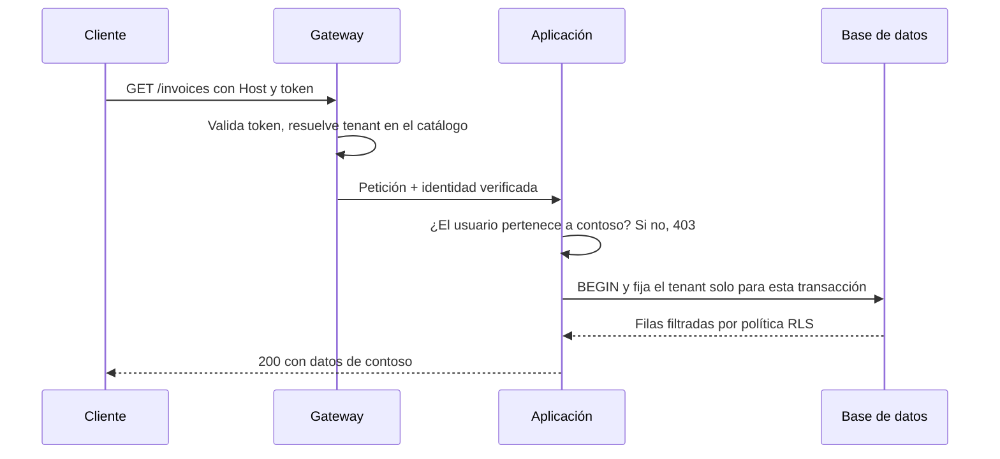
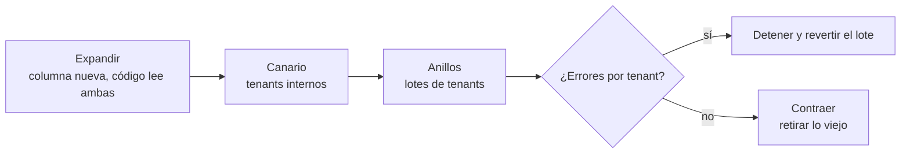

# Multi-tenancy: varios clientes, un sistema

Tu producto empezó con un cliente y una base de datos. Llegó el segundo y copiaste el despliegue; con el décimo, cada actualización era una tarde de scripts y alguien preguntó si no sería mejor meterlos a todos en la misma base. Lo es, hasta el día en que una consulta sin filtro le enseña a un cliente las facturas de otro. Ese es el dilema de la multi-tenancy: compartir abarata y simplifica la operación, pero cada pieza compartida es un lugar por el que los datos pueden cruzar.

**Multi-tenancy es servir a varios clientes (tenants) desde un mismo sistema, decidiendo pieza a pieza qué se comparte y qué se aísla, sin que ningún tenant vea ni degrade lo de otro.**

Este artículo recorre las decisiones que importan: qué es un tenant, los tres modelos de aislamiento de datos, cómo identificar al tenant y propagar su contexto, Row-Level Security como defensa en profundidad, el vecino ruidoso, la configuración por tenant, las migraciones, la residencia de datos y la medición de uso. Dedica una sección completa a la fuga de datos entre tenants, porque es el fallo más grave del tema. El código es solo una guía de forma y nombres.

<Callout tone="info" title="Fecha de corte y fuentes">
  Consultado en octubre de 2026. Las recomendaciones de diseño vienen sobre todo del Azure
  Architecture Center, del SaaS Lens de AWS y de la hoja de trucos de OWASP sobre seguridad
  multi-tenant; el comportamiento de Row-Level Security sale de la documentación de PostgreSQL 18.
  Donde una afirmación es inferencia propia, se dice.
</Callout>

## Qué es un tenant y por qué importa

Un **tenant** es la unidad a la que aíslas datos, configuración y consumo. La guía de Azure propone empezar por quién es tu cliente: en B2B suele ser una organización con muchos usuarios; en B2C puede ser una persona, una familia o un club. La definición no es trivial, porque un mismo cliente puede pedir dos tenants (producción y pruebas) o uno por país, y un usuario puede pertenecer a varios tenants a la vez.

Distingue tres conceptos que a menudo se mezclan:

| Concepto   | Qué es                                            | Ejemplo                                           |
| ---------- | ------------------------------------------------- | ------------------------------------------------- |
| Tenant     | Frontera lógica de datos, configuración y factura | La empresa Contoso                                |
| Usuario    | Identidad que actúa dentro de uno o más tenants   | Ana, que trabaja para Contoso y audita a Fabrikam |
| Despliegue | Conjunto de infraestructura que sirve a tenants   | Un clúster con su base en la región de Fráncfort  |

Azure llama _stamps_ a esos despliegues y recomienda una **capa de mapeo**: una tabla que dice en qué despliegue vive cada tenant. Con ella puedes mover un tenant de un despliegue a otro sin cambiar su identidad. En este artículo la llamaremos **catálogo de tenants**.

¿Por qué importa tanto? Porque la decisión de tenancy no es solo técnica: fija tu coste por cliente, lo que puedes prometer en un contrato, cómo despliegas y cuánto daño hace un fallo. Compartir más reduce coste y piezas que operar; aislar más reduce el radio de impacto y facilita el cumplimiento normativo.

## Modelos de aislamiento de datos

El aislamiento no es binario. Azure lo describe como un espectro, desde no compartir nada hasta compartirlo todo, y el SaaS Lens de AWS le pone nombre a los extremos: **silo** (recursos dedicados por tenant) y **pool** (recursos compartidos), con **bridge** para la mezcla habitual en la que unas partes del sistema van en silo y otras en pool. Puedes elegir un modelo distinto por capa o por servicio.

En la capa de datos, que es donde más duele equivocarse, hay tres opciones principales:

- **Base compartida con `tenant_id`.** Todas las tablas llevan una columna con el tenant y cada consulta filtra por ella. Es el pool clásico.
- **Esquema por tenant.** Una base, un esquema (espacio de nombres) por tenant con las mismas tablas. La aplicación elige el esquema en cada conexión o transacción, por ejemplo con `search_path` en PostgreSQL.
- **Base de datos por tenant.** Cada tenant tiene su base; la aplicación puede seguir siendo compartida. Es un silo en la capa de datos.

| Criterio                   | Base compartida + `tenant_id`              | Esquema por tenant                       | Base por tenant                                |
| -------------------------- | ------------------------------------------ | ---------------------------------------- | ---------------------------------------------- |
| Aislamiento                | Lógico: depende del filtro y de RLS        | Lógico con espacio de nombres separado   | Físico o casi: credenciales y recursos propios |
| Coste por tenant           | El más bajo; máxima densidad               | Bajo, pero crece el número de objetos    | El más alto, mitigable con pools elásticos     |
| Operación                  | Una base que respaldar, vigilar y escalar  | Una base con miles de objetos            | Una flota: hace falta automatizarlo todo       |
| Migraciones                | Una vez, pero sobre tablas grandes         | Una por esquema; hay que orquestarlas    | Una por base; versiones distintas conviven     |
| Vecino ruidoso             | Expuesto: comparten CPU, memoria e índices | Expuesto: comparten el servidor          | Contenido, salvo que compartan servidor        |
| Restaurar un solo tenant   | Difícil: restaurar aparte y extraer filas  | Más fácil: volcar o restaurar un esquema | Directo                                        |
| Personalización por tenant | Muy limitada                               | Posible, pero tienta a divergir          | Posible: claves de cifrado, región, ventanas   |

Algunas matizaciones que la tabla no captura:

- La guía de almacenamiento de Azure desaconseja crear **tablas separadas por tenant** dentro de una misma base cuando hay muchos tenants, porque consultar, gestionar y migrar se vuelve inmanejable. El esquema por tenant es una variante cercana; por inferencia propia, comparte buena parte de ese problema cuando los tenants se cuentan por miles.
- La base por tenant no es «nada compartido»: la aplicación, la cola o la caché pueden seguir siendo comunes. Azure llama a esto despliegue particionado horizontalmente.
- Entre el pool puro y el silo puro está el **sharding**: varias bases compartidas, cada una con un grupo de tenants, y un mapa que dice en qué shard está cada uno.

Cómo elegir entre ellas es un problema de criterios explícitos y reversibilidad. Para compararlos con criterios ponderados, ver [trade-offs y toma de decisiones](/docs/trade-offs-y-decisiones).

## Identificar al tenant y propagar su contexto

Cada petición debe resolverse a un tenant antes de tocar datos. Azure enumera varias formas de hacerlo, cada una con sus límites:

| Fuente                     | Cómo se ve                            | Cuidado con                                                       |
| -------------------------- | ------------------------------------- | ----------------------------------------------------------------- |
| Subdominio o dominio       | `contoso.app.example` en `Host`       | Cabeceras de proxy (`X-Forwarded-Host`) que alguien puede falsear |
| Ruta o parámetro           | `/contoso/...`, `?tenant=contoso`     | Es un dato que el cliente controla por completo                   |
| Cabecera propia            | `Tenant-Id: contoso`                  | Los navegadores y algunos proxies no la envían o la eliminan      |
| Claim del token            | Un claim de tenant en el JWT          | Usuarios de varios tenants: ¿cuál es el activo?                   |
| Clave de API o certificado | Clave emitida para un tenant concreto | Rotación y revocación; las claves no llevan claims                |

La regla que cambia todo: **lo que llega en la petición es un selector, no una autorización**. OWASP lo dice así en su hoja de trucos: trata los identificadores de tenant que envía el cliente solo como selectores, y vincula el contexto a una identidad verificada en el servidor y a una pertenencia vigente. Azure lo enmarca en el principio de «asumir la brecha»: aunque el dominio apunte a un tenant, la aplicación sigue comprobando que esa identidad puede actuar en él.



### El contexto viaja, no se recalcula

Una vez resuelto, el tenant es un **contexto de la petición** inmutable que acompaña a la operación hasta el último adaptador: repositorios, caché, colas, logs y métricas. En términos de [arquitectura hexagonal](/docs/arquitectura-hexagonal), el adaptador de entrada lo construye a partir de la identidad verificada y los adaptadores de salida lo aplican; el núcleo lo recibe como un dato más, no lo lee de una variable global.

```typescript
// core/tenancy/tenant-context.ts: solo la forma
export type TenantId = string & { readonly __brand: 'TenantId' };

export type TenantContext = Readonly<{
  tenantId: TenantId;
  userId: string;
  deployment: string; // del catálogo, no de la petición
}>;

// Cada puerto saliente que toca datos de tenant lo exige
export type InvoiceRepository = {
  list(ctx: TenantContext, filter: InvoiceFilter): Promise<Invoice[]>;
};
```

El tipo de marca (`TenantId`) impide pasar por error una cadena cualquiera donde se espera un tenant verificado. Que el contexto sea un parámetro explícito tiene un coste en firmas, pero hace visible en revisión qué operación no lo recibe.

Los trabajos en segundo plano son el punto débil habitual: el mensaje de una cola debe llevar el tenant y el consumidor debe volver a autorizarlo. OWASP insiste en que una cola compartida no es por sí misma una frontera de aislamiento.

## Fuga de datos entre tenants: el error más grave

En un modelo pool, un solo descuido expone a todos los clientes a la vez. No es un riesgo teórico: OWASP lista la fuga entre tenants, la suplantación de tenant y la manipulación de identificadores (IDOR) entre los riesgos centrales de un sistema multi-tenant.

<Callout tone="warning" title="Un filtro olvidado basta">
  Un `WHERE tenant_id = ?` que falta en una sola consulta, un informe o un endpoint de
  administración puede devolver datos de todos los tenants. Diseña para que olvidar el filtro falle
  cerrado (sin filas o con error), no abierto.
</Callout>

Por dónde suelen escaparse los datos:

| Vía de fuga                     | Cómo ocurre                                                       | Defensa                                                                      |
| ------------------------------- | ----------------------------------------------------------------- | ---------------------------------------------------------------------------- |
| Consulta sin filtro             | Un informe, una búsqueda o un endpoint nuevo omite `tenant_id`    | RLS como segunda barrera; repositorios que exigen el contexto                |
| IDOR                            | `GET /invoices/123` devuelve la factura aunque sea de otro tenant | Comprobar la pertenencia del recurso, no solo que el id existe               |
| Caché compartida                | La clave `invoice:123` no incluye el tenant                       | Tenant en toda clave cuyo valor dependa de él; autorizar antes de leer       |
| Pool de conexiones              | Un `SET` de sesión se queda en la conexión que usa el siguiente   | Fijar el contexto por transacción (`SET LOCAL`) y probarlo con reutilización |
| Trabajos y colas                | El consumidor procesa sin contexto o con el de otro mensaje       | Tenant en el mensaje y nueva autorización en el consumidor                   |
| Ficheros y blobs                | Rutas adivinables o URL firmadas sin comprobar el dueño           | Prefijo o contenedor por tenant y autorización por objeto                    |
| Índices de búsqueda y analítica | El índice o el almacén de datos no filtra por tenant              | El tenant forma parte del documento y de cada consulta                       |
| Herramientas internas           | Paneles que usan un rol con permisos para saltarse las políticas  | Rol separado, acceso auditado y justificado                                  |

Tres principios recogen casi todas las defensas:

- **Fallar cerrado.** Si el contexto falta o no es válido, la operación no se ejecuta; nunca cae a una consulta sin filtro. Es una recomendación explícita de OWASP.
- **Dos barreras independientes.** El filtro en la aplicación y la política en la base. Si una falla, la otra contiene el daño.
- **Pruebas que intentan cruzar.** Una matriz de autorización que, con el usuario del tenant A, pide recursos del tenant B y espera un rechazo. Azure recomienda probar expresamente que los datos de un tenant no se filtran a otro, sea cual sea el modelo elegido.

Esas pruebas son buenas candidatas a [fitness functions](/docs/fitness-functions): por ejemplo, un test que recorre el esquema y falla si una tabla con `tenant_id` no tiene RLS activado y al menos una política, otra recomendación de OWASP.

## Row-Level Security como defensa en profundidad

En PostgreSQL, Row-Level Security (RLS) permite que la base filtre filas según una política, al margen de lo que diga la consulta. Lo que conviene saber, según la documentación de PostgreSQL 18:

- Se activa por tabla con `ALTER TABLE ... ENABLE ROW LEVEL SECURITY`. Con RLS activo y sin ninguna política, se aplica una **denegación por defecto**: no se ve ni se modifica ninguna fila.
- La cláusula `USING` decide qué filas existentes son visibles o modificables; `WITH CHECK` decide qué filas se pueden escribir. Si omites `WITH CHECK`, se usa la expresión de `USING`.
- Los **superusuarios** y los roles con el atributo `BYPASSRLS` siempre se saltan las políticas. El **dueño de la tabla** normalmente también, salvo que actives `FORCE ROW LEVEL SECURITY`.
- Las comprobaciones de integridad referencial (claves únicas, primarias y foráneas) se saltan RLS.

La forma típica en un pool combina una variable de configuración propia con la transacción:

```sql
-- forma de la política, no un script completo
ALTER TABLE invoices ENABLE ROW LEVEL SECURITY;
ALTER TABLE invoices FORCE ROW LEVEL SECURITY;

CREATE POLICY tenant_isolation ON invoices
  USING (tenant_id = current_setting('app.tenant_id', true)::uuid);

-- en cada transacción de la aplicación
BEGIN;
SET LOCAL app.tenant_id = '…';
-- … consultas del caso de uso
COMMIT;
```

Por qué cada pieza:

- **`app.tenant_id`** es una opción personalizada: PostgreSQL acepta cualquier nombre de dos partes separado por un punto.
- **`current_setting(..., true)`** no lanza error si la opción no existe: según el estado de la conexión devuelve NULL o una cadena vacía. Con NULL, la comparación no deja pasar ninguna fila; con cadena vacía, el cast a `uuid` falla. En ambos casos la consulta falla cerrada, pero no siempre devuelve un conjunto vacío: para un comportamiento uniforme, usa `nullif(current_setting('app.tenant_id', true), '')::uuid`.
- **`SET LOCAL`** dura hasta el final de la transacción, con commit o sin él. Así, cuando la conexión vuelve al pool, el siguiente que la use no hereda el tenant anterior. Fuera de una transacción, `SET LOCAL` solo emite un aviso y no tiene efecto, así que la aplicación debe abrirla siempre. La función `set_config(nombre, valor, true)` es el equivalente para usar con parámetros.
- **El rol de la aplicación** no debe ser dueño de las tablas, superusuario ni tener `BYPASSRLS`. OWASP propone comprobarlo en los entornos desplegados.

Si usas PgBouncer en modo de pooling por transacción, su documentación indica que `SET` y `RESET` de sesión no son compatibles con ese modo; no menciona `SET LOCAL`, así que verifica tu configuración con una prueba de reutilización de conexiones antes de confiar en ella.

RLS tiene costes reales. La guía de Azure advierte que propagar la identidad del tenant hasta la base en cada consulta es complejo de diseñar, probar y mantener, y que muchas soluciones multi-tenant no lo usan por eso. Las políticas se evalúan en cada consulta, así que conviene que `tenant_id` forme parte de los índices que usan esas consultas. Úsalo como **segunda barrera**, no como sustituto del filtro y de la autorización en la aplicación.

## El vecino ruidoso

El problema del vecino ruidoso aparece cuando la actividad de un tenant degrada el servicio de otros. Azure lo describe como un antipatrón que no se puede eliminar del todo cuando se comparte un recurso, y que puede darse también cuando muchos tenants pequeños coinciden en su pico. La guía lo trata como un problema de gobierno de recursos y propone, entre otras medidas:

- **Monitorizar por tenant**, no solo en global, con el tenant como dimensión de cada métrica.
- **Cuotas y limitación de tasa** con los patrones Throttling y Rate Limiting. En HTTP, el código 429 de la RFC 6585 indica demasiadas peticiones en un periodo y puede llevar `Retry-After`.
- **Limitar operaciones caras**: un máximo de filas devueltas o de tiempo por consulta, o convertirlas en trabajos asíncronos fuera de hora punta.
- **Reequilibrar tenants** entre despliegues o shards, mezclando patrones de uso complementarios.
- **Capacidad reservada** que el tenant puede comprar, y prioridades (QoS) para que lo crítico pase primero.

OWASP añade un matiz importante: los límites en la frontera HTTP no protegen por sí solos los recursos internos compartidos, como trabajadores, conexiones o colas. Pon límites de concurrencia por tenant también en los consumidores. Las técnicas para contener sobrecargas y fallos entre componentes se tratan en [resiliencia en sistemas distribuidos](/docs/resiliencia-sistemas-distribuidos).

Cuando un tenant es sistemáticamente ruidoso, el remedio estructural suele ser moverlo a un silo, y para eso necesitas el catálogo de tenants desde el principio.

## Configuración y feature flags por tenant

Los clientes piden diferencias: límites distintos según el plan, un módulo activado, una integración propia. La tentación es crear una rama o una columna para cada uno. La guía de Azure lo desaconseja: bifurcar el código o la infraestructura por tenant impide escalar, probar y desplegar, y cambiar el esquema para un solo tenant se vuelve inmanejable con muchas personalizaciones. Propone en su lugar **feature flags y configuración por tenant**.

```yaml
# forma de un registro del catálogo de tenants
tenant: contoso
plan: enterprise
deployment: eu-west-2 # dónde viven sus datos
isolation: silo # pool | silo
limits: { requests_per_minute: 6000, storage_gb: 500 }
features: [advanced-reports, sso]
schema_version: 42
```

El catálogo concentra lo que es distinto por tenant y deja el código igual para todos. Dos reglas: la configuración se valida con un esquema al cargarse, y los flags tienen fecha de retirada para que no se acumulen.

## Migraciones de esquema con muchos tenants

Con una sola base compartida, una migración se aplica una vez, pero sobre tablas con los datos de todos. Con un esquema o una base por tenant, la misma migración se ejecuta cientos o miles de veces, y durante un tiempo convivirán versiones distintas. La guía de Azure da cuatro pautas:

- **Nada manual.** Automatiza las migraciones en un pipeline y registra la versión de esquema de cada tenant o base.
- **Compatibilidad hacia atrás.** La aplicación debe funcionar con al menos la versión de esquema anterior, porque los tenants se actualizan en momentos distintos.
- **Cambios destructivos en varios pasos.** Encaja con el patrón de cambio paralelo (expandir, migrar, contraer) que describió Danilo Sato en 2014: primero añades lo nuevo, luego mueves a los clientes y al final retiras lo viejo.
- **Despliegue por anillos.** Primero los tenants internos o de canario, luego los que aceptan novedades pronto y al final el resto.



Una consecuencia práctica: el informe de qué versión tiene cada tenant forma parte del sistema, no de una hoja de cálculo. Azure sugiere que soporte pueda responder qué cambió para un tenant concreto y cuál era la versión anterior.

## Residencia de datos

Algunos clientes exigen, por contrato o por regulación, que sus datos se queden en una región concreta. La guía de Azure lo lista entre los motivos para aislar tenants o agruparlos con otros de políticas similares, junto con las claves de cifrado propias y las políticas de copia de seguridad individuales.

En la práctica, la residencia se resuelve con **despliegues por región** y el catálogo de tenants como fuente de verdad: el tenant se asigna a un despliegue de su región al darse de alta y el enrutado lo lleva allí. Revisa también lo que viaja fuera de la base: copias de seguridad, logs, telemetría, colas y proveedores de terceros. Qué exige cada normativa es una pregunta legal que conviene responder con tu equipo jurídico; este artículo no la resuelve.

## Medir el uso para facturar

Aunque no cobres por consumo, necesitas saber cuánto cuesta servir a cada tenant. Azure señala que la mayoría de los servicios no desglosan el uso según tu definición de tenant, y propone varias aproximaciones:

| Métrica         | Qué mide                                                      | Cuándo encaja                               |
| --------------- | ------------------------------------------------------------- | ------------------------------------------- |
| Indicativa      | Un indicador que aproxima el consumo, como datos guardados    | Uso parecido entre tenants y pocos recursos |
| Por transacción | La operación que representa el coste, como documentos creados | Hay una función central fácil de contar     |
| Por petición    | Número de llamadas a la API, o su tiempo de proceso           | Producto centrado en API                    |
| Estimada        | Un porcentaje del coste total del despliegue                  | Miles de tenants que consumen poco cada uno |

Dos advertencias de la guía: las herramientas de telemetría pueden muestrear los datos, así que no sirven como registro de facturación; guarda las mediciones en un almacén diseñado para ser exacto. Y contar peticiones asume que todas cuestan lo mismo, lo que rara vez es cierto.

## Cuándo sí y cuándo no

| Situación                                                              | Decisión razonable                                                 |
| ---------------------------------------------------------------------- | ------------------------------------------------------------------ |
| Muchos clientes pequeños con necesidades parecidas                     | Pool con `tenant_id`, filtro en la aplicación y RLS                |
| Pocos clientes grandes con contratos exigentes                         | Silo por tenant, con despliegue automatizado                       |
| Mezcla de ambos                                                        | Bridge: pool por defecto y silo como opción de plan                |
| Clientes que exigen claves propias, región o ventanas de mantenimiento | Silo o grupos de tenants con la misma política                     |
| Un solo cliente o un producto interno                                  | No diseñes multi-tenancy todavía; deja el `tenant_id` como costura |

La multi-tenancy es ortogonal a cómo partes el código: un [monolito modular](/docs/monolito-vs-microservicios) puede ser perfectamente multi-tenant, y migrar a microservicios no aísla a los tenants por sí mismo.

## Errores frecuentes

- **Confiar en el tenant que manda el cliente.** Una cabecera o un subdominio sin comprobar la pertenencia es una invitación a la suplantación.
- **Contexto en una variable de sesión.** Un `SET` sin `LOCAL` en un pool de conexiones arrastra el tenant a la siguiente petición.
- **La aplicación conecta como dueña de las tablas.** RLS no se aplica al dueño sin `FORCE`, ni a superusuarios o roles con `BYPASSRLS`.
- **Claves de caché sin tenant.** La caché devuelve a un tenant lo que calculó para otro.
- **Una rama por cliente.** Cada personalización en código multiplica pruebas y despliegues; usa configuración y flags.
- **Migraciones a mano.** Con muchas bases, alguien acaba con un esquema que nadie sabe reproducir.
- **Sin catálogo de tenants.** Sin él no puedes mover un tenant ruidoso a un silo ni a otra región.
- **Medir el uso con la telemetría muestreada.** La factura no puede depender de un muestreo.

## Ejemplo de decisión

Un SaaS de contabilidad para despachos tiene 400 clientes pequeños y tres grandes. Uno de los grandes exige por contrato que sus datos estén en una base dedicada en la UE; los otros dos solo piden más capacidad. El equipo es de ocho personas y no tiene un área de plataforma.

| Criterio                      | Todo pool                   | Todo silo                     | Bridge                                    |
| ----------------------------- | --------------------------- | ----------------------------- | ----------------------------------------- |
| Contrato del cliente de la UE | No lo cumple                | Lo cumple                     | Lo cumple con un silo para ese cliente    |
| Coste para 400 pequeños       | Bajo                        | Alto: 403 bases               | Bajo                                      |
| Carga operativa del equipo    | Baja                        | Inasumible sin automatización | Media: una base compartida y una dedicada |
| Riesgo de fuga                | Depende del filtro y de RLS | Bajo entre tenants            | Depende de RLS en el pool                 |
| Vecino ruidoso                | Los dos grandes molestan    | No                            | Cuotas en el pool; mover si hace falta    |

**Decisión:** bridge. Una base compartida con `tenant_id`, filtro en los repositorios y RLS forzado para los 402 tenants del pool; una base dedicada en la UE para el cliente que lo exige; el mismo código y el mismo pipeline de migraciones para ambas. El catálogo de tenants registra despliegue, versión de esquema y límites; los dos clientes grandes del pool tienen cuotas propias y una métrica de documentos creados por tenant para vigilar su coste.

**Consecuencias:** hay dos bases que migrar en anillos, una matriz de pruebas que intenta cruzar tenants en CI y un rol de base de datos sin `BYPASSRLS` para la aplicación. Si los grandes siguen creciendo, moverlos a un silo es un cambio en el catálogo y una migración de datos, no un rediseño. La decisión se registra en un [ADR](/docs/adr) con el criterio de reversión.

## Checklist

- [ ] Está escrito qué es un tenant en tu producto y cómo se relaciona con usuarios y despliegues.
- [ ] Un catálogo de tenants dice dónde vive cada uno, su modelo de aislamiento y su versión de esquema.
- [ ] El tenant se resuelve de una identidad verificada; lo que envía el cliente solo selecciona.
- [ ] El contexto del tenant llega explícito a repositorios, caché, colas, logs y métricas.
- [ ] Si falta el contexto, la operación falla cerrada.
- [ ] En el pool, RLS está forzado en cada tabla con `tenant_id` y la aplicación usa un rol sin `BYPASSRLS`.
- [ ] CI ejecuta pruebas que intentan leer y escribir datos de otro tenant, también con conexiones reutilizadas.
- [ ] Hay cuotas y límites por tenant, y el uso se mide en un almacén apto para facturar.

## Fuentes

Consultadas en octubre de 2026.

- [Tenancy models for a multitenant solution (Azure Architecture Center)](https://learn.microsoft.com/en-us/azure/architecture/guide/multitenant/considerations/tenancy-models)
- [Map requests to tenants in a multitenant solution (Azure Architecture Center)](https://learn.microsoft.com/en-us/azure/architecture/guide/multitenant/considerations/map-requests)
- [Architectural approaches for storage and data in multitenant solutions (Azure Architecture Center)](https://learn.microsoft.com/en-us/azure/architecture/guide/multitenant/approaches/storage-data)
- [Noisy Neighbor antipattern (Azure Architecture Center)](https://learn.microsoft.com/en-us/azure/architecture/antipatterns/noisy-neighbor/noisy-neighbor)
- [Considerations for updating a multitenant solution (Azure Architecture Center)](https://learn.microsoft.com/en-us/azure/architecture/guide/multitenant/considerations/updates)
- [Measure consumption (Azure Architecture Center)](https://learn.microsoft.com/en-us/azure/architecture/guide/multitenant/considerations/measure-consumption)
- [Silo, pool, and bridge models (AWS SaaS Lens)](https://docs.aws.amazon.com/wellarchitected/latest/saas-lens/silo-pool-and-bridge-models.html)
- [Multi-Tenant Security Cheat Sheet (OWASP)](https://cheatsheetseries.owasp.org/cheatsheets/Multi_Tenant_Security_Cheat_Sheet.html)
- PostgreSQL 18: [Row Security Policies](https://www.postgresql.org/docs/current/ddl-rowsecurity.html), [SET](https://www.postgresql.org/docs/current/sql-set.html), [funciones de configuración](https://www.postgresql.org/docs/current/functions-admin.html) y [opciones personalizadas](https://www.postgresql.org/docs/current/runtime-config-custom.html)
- [Características de PgBouncer por modo de pooling](https://www.pgbouncer.org/features.html)
- [RFC 6585: Additional HTTP Status Codes (abril de 2012)](https://www.rfc-editor.org/rfc/rfc6585)
- [Parallel Change (Danilo Sato, 13 de mayo de 2014)](https://martinfowler.com/bliki/ParallelChange.html)
