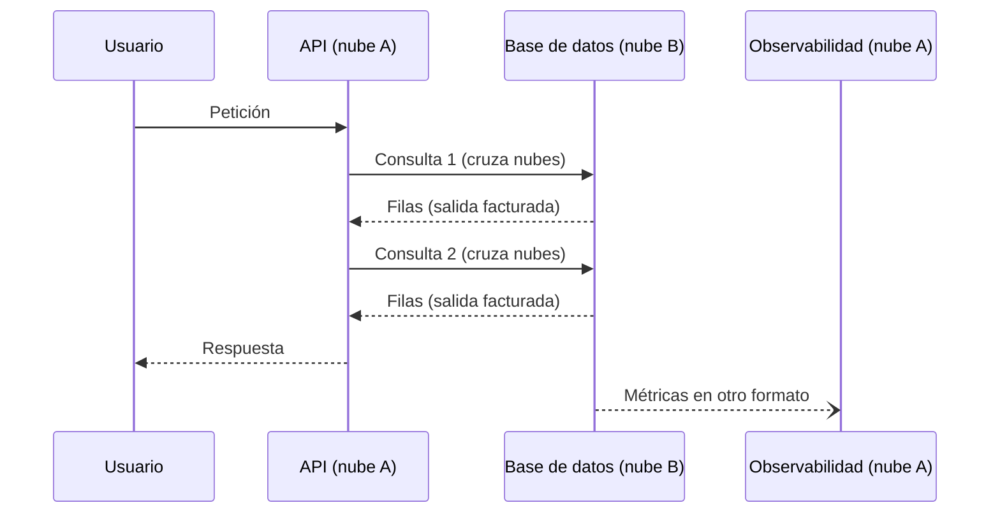
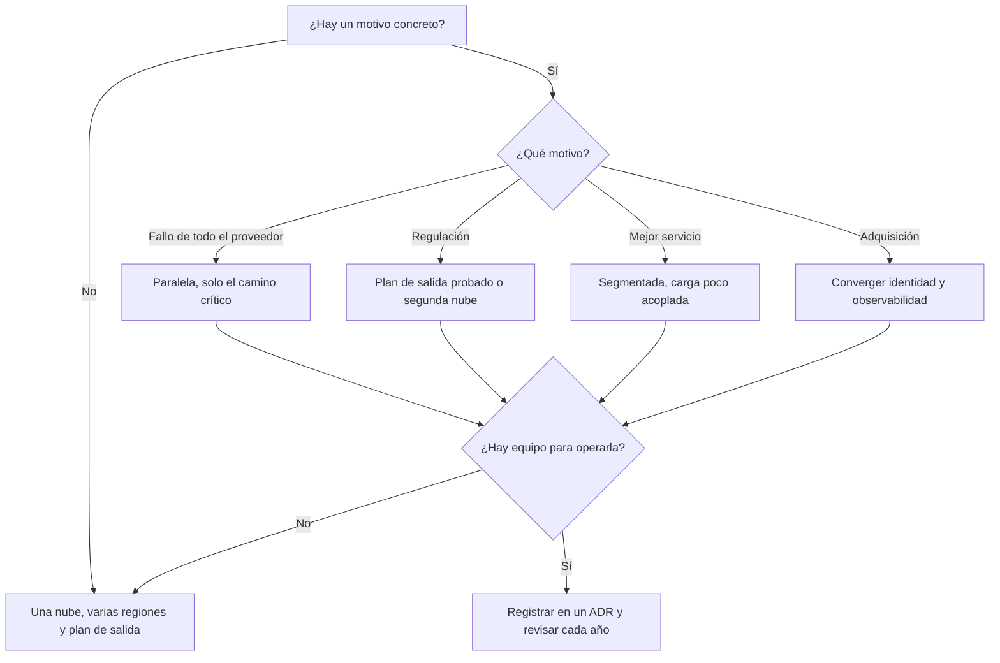

# Multinube: cuándo tiene sentido

El comité de dirección pide «no depender de un solo proveedor». Alguien propone la solución obvia: repartir los sistemas entre dos nubes. Dieciocho meses después hay dos equipos de plataforma, dos consolas, dos facturas, dos maneras de dar permisos y un servicio que llama a su base de datos a través de un enlace entre nubes que nadie quiere tocar. Y si mañana el proveedor principal subiera precios, nada se movería, porque cada sistema sigue anclado a los servicios gestionados de su nube. El objetivo era reducir un riesgo; el resultado fue sumar otro. La multinube no es buena ni mala: **es usar a propósito dos o más proveedores de nube pública, y solo compensa cuando lo que compra (resiliencia, cumplimiento, un servicio mejor) vale más que lo que cuesta operar varias plataformas a la vez**.

Este artículo define el término y lo separa de lo que no es, repasa los motivos que suelen funcionar y los que suelen fallar, pone nombre a los costos que no aparecen en la propuesta inicial, describe los patrones que reducen ese costo y termina con un marco de decisión y un ejemplo trabajado con números supuestos.

<Callout tone="info" title="Fecha de corte y fuentes">
  Consultado en octubre de 2026. Las clasificaciones de Gregor Hohpe, el informe del incidente de
  Google Cloud y los textos de DORA y de la Ley de Datos de la UE se leyeron en sus fuentes (o en
  reproducciones del texto oficial, en el caso de los reglamentos). No hay precios de proveedores:
  las cifras del ejemplo son supuestas y lo indican.
</Callout>

## Qué es y qué no es

La palabra se usa para tres cosas distintas, y mezclarlas lleva a decisiones malas.

| Situación                                                      | Qué es                          | Problema que resuelve                                   |
| -------------------------------------------------------------- | ------------------------------- | ------------------------------------------------------- |
| Un proveedor, muchos servicios (cómputo, colas, base de datos) | Una sola nube, bien usada       | Ninguno de los de este artículo: es el punto de partida |
| Una aplicación repartida entre tu centro de datos y una nube   | Nube híbrida                    | Datos o sistemas que no pueden o no deben moverse aún   |
| Cargas en dos o más proveedores de nube pública                | Multinube                       | Riesgo de proveedor, cumplimiento, mejor servicio       |
| Las dos cosas a la vez                                         | Híbrido y multinube, combinados | Los dos problemas, con los dos costos                   |

La definición clásica del NIST (SP 800-145) incluye la nube híbrida entre sus cuatro modelos de despliegue: dos o más infraestructuras distintas que siguen siendo entidades separadas pero se conectan con tecnología que permite mover datos y aplicaciones. La multinube no figura en esa lista. Hohpe propone una distinción útil: el híbrido es una realidad que la mayoría de las empresas tiene que gestionar, mientras que la multinube es una opción de arquitectura que se elige. El híbrido tiene su propia lección en [nube híbrida en detalle](/docs/nube-hibrida-en-detalle); aquí nos quedamos con la segunda.

### Cinco formas de ser multinube

Gregor Hohpe distingue cinco opciones en su artículo sobre híbrido y multinube (actualizado en julio de 2019). Sirven para saber de qué estás hablando antes de discutir si conviene.

| Forma        | Qué significa                                            | Qué compra                                | Qué cuesta                                              |
| ------------ | -------------------------------------------------------- | ----------------------------------------- | ------------------------------------------------------- |
| Arbitraria   | Las cargas caen en una nube u otra sin un criterio claro | Nada deliberado                           | Todos los costos de la multinube, sin beneficio         |
| Segmentada   | Cada tipo de carga va a la nube que mejor la sirve       | El mejor servicio para cada caso          | Dos plataformas que operar, pocas dependencias cruzadas |
| Por elección | Cada proyecto elige proveedor dentro de un marco común   | Margen de maniobra, al menos al principio | Gobierno central y catálogo que mantener                |
| Paralela     | La misma aplicación corre en varias nubes                | Disponibilidad por encima de un proveedor | Duplicar capacidad, datos y operación                   |
| Portable     | Las cargas se mueven entre nubes cuando hace falta       | Libertad de movimiento                    | Automatización y abstracción intensas                   |

Hohpe insiste en que una opción más «avanzada» de la lista no es mejor por serlo: la que conviene depende de lo que necesitas, y la elección debe ser consciente. La arbitraria es la que nadie elige y casi todos tienen.

## Motivos que suelen funcionar

### Resiliencia frente a fallos correlacionados

Repartir una aplicación entre zonas y regiones de un mismo proveedor protege de muchos fallos, pero no de los que comparten causa en todo el proveedor: un plano de control global, un sistema de identidad común o datos de configuración que se replican a todas partes. El 12 de junio de 2025 Google Cloud sufrió un incidente de ese tipo. Según su informe, un cambio de política con campos en blanco se escribió en tablas de Spanner que se replican globalmente en segundos; el componente que valida cada llamada a la API (Service Control) falló en todas las regiones a la vez, por un error de código que no tenía manejo de errores ni estaba protegido por un _feature flag_. Varias regiones no ayudaban: todas leían el mismo dato.

Ese es el argumento legítimo para la forma paralela: **cubrir el fallo que un solo proveedor no puede aislar por diseño**. Tiene dos condiciones que conviene escribir antes de comprometerse. La primera, que el camino crítico pueda funcionar en el otro proveedor sin depender del primero (si la autenticación sigue en la nube caída, no hay conmutación). La segunda, que el costo de mantener esa capacidad sea menor que la pérdida esperada por esos incidentes. Las estrategias de recuperación y las métricas de RTO y RPO dentro de un proveedor se tratan en [regiones, zonas y recuperación](/docs/regiones-zonas-y-recuperacion).

### Requisitos regulatorios

En el sector financiero de la UE, el reglamento DORA (Reglamento (UE) 2022/2554, aplicable desde el 17 de enero de 2025) pide cosas concretas sobre los proveedores de servicios TIC. Su artículo 28 exige estrategias de salida para los servicios que soportan funciones críticas o importantes: planes documentados, probados y revisados periódicamente, con soluciones alternativas y planes de transición identificados, para poder salir sin interrumpir el negocio. El artículo 29 obliga a evaluar el riesgo de concentración antes de contratar: si el proveedor es difícil de sustituir, o si se acumulan contratos con el mismo proveedor, hay que sopesar alternativas, como usar proveedores distintos.

<Callout tone="warning" title="DORA no exige multinube">
  El reglamento pide estrategias de salida probadas y una evaluación del riesgo de concentración.
  Una segunda nube activa es una forma de cumplir, no la única: un plan de salida ensayado, con la
  infraestructura descrita como código y los datos exportables, puede bastar. Lo decide tu análisis
  de riesgo y tu supervisor, no una lectura rápida del texto.
</Callout>

Otros requisitos de residencia de datos o de soberanía pueden obligar a usar un proveedor concreto en un país donde el principal no tiene región. Ese caso es multinube segmentada por obligación, y suele ser estrecho: una carga, un país.

### El mejor servicio para una carga

A veces un proveedor tiene un servicio claramente mejor para un caso (analítica, un modelo de aprendizaje automático, una base de datos concreta) y la diferencia justifica el costo. Funciona cuando la carga está **poco acoplada** al resto: recibe datos por lotes o por eventos y devuelve resultados, sin llamadas síncronas de ida y vuelta. Si el servicio elegido necesita leer la base de datos operativa en cada petición, el costo de la red entre nubes se come la ventaja.

### Fusiones y adquisiciones

Compras una empresa que vive en otro proveedor. Eso es multinube desde el primer día, sin que nadie lo haya decidido. La pregunta correcta no es «¿migramos todo?» sino qué compartirán los dos mundos: identidad, facturación, observabilidad, seguridad. A menudo lo razonable es converger esa capa común y dejar las cargas donde están hasta que haya un motivo de negocio para moverlas.

## Motivos que suelen fallar

### «Así negociaremos mejor el precio»

La palanca de negociación existe solo si el proveedor cree que puedes irte. Si cada sistema usa los servicios gestionados de su nube, la amenaza no es creíble, y además repartir el gasto suele reducir el volumen comprometido con cada proveedor, que es justo lo que se usa para obtener descuentos. El argumento puede funcionar en la renovación de un contrato con una alternativa real ensayada; rara vez funciona como estrategia general.

### Portabilidad que nunca se usa

Diseñar todo para poder moverse «por si acaso» tiene un costo diario seguro a cambio de un beneficio incierto. Hohpe lo resume en su artículo de 2019 en martinfowler.com: evitar un tipo de dependencia suele costar otra, y las capas de abstracción añaden piezas, curva de aprendizaje y riesgo de errores sistémicos. Su propio ejemplo: herramientas como Terraform o Pulumi reducen la dependencia de una nube y crean otra con la herramienta. La consecuencia típica es el **mínimo común denominador**: renuncias a los servicios gestionados que justificaban ir a la nube para quedarte con lo que existe igual en todas. Cómo medir y acotar la dependencia de un proveedor se trata en [casado a un proveedor](/docs/casado-a-un-proveedor).

## Los costos ocultos

La propuesta inicial suele comparar precios de cómputo. Los costos que deciden el resultado están en otra parte.

| Costo                        | De dónde sale                                                                      | Cómo lo notas                                                      |
| ---------------------------- | ---------------------------------------------------------------------------------- | ------------------------------------------------------------------ |
| Dos conjuntos de habilidades | Cada proveedor tiene su modelo de red, de permisos y de servicios gestionados      | Guardias que solo saben resolver incidentes en una de las nubes    |
| Dos planos de control        | APIs, cuotas, modelos de IAM y consolas distintos                                  | El mismo control de seguridad se implementa y se audita dos veces  |
| Herramientas duplicadas      | Seguridad, inventario, costos, copias de seguridad y despliegue por proveedor      | Licencias e integraciones multiplicadas; huecos entre herramientas |
| Datos que cruzan nubes       | La transferencia de salida (_egress_) se factura por volumen                       | Una partida de red que crece con el tráfico y nadie presupuestó    |
| Redes entre nubes            | Enlaces privados, direccionamiento IP sin solapes, DNS y cifrado entre proveedores | Latencia añadida en cada llamada y un punto de fallo nuevo         |
| Observabilidad fragmentada   | Cada nube trae su monitorización, sus registros y su formato de trazas             | Una petición que cruza nubes no se puede seguir de punta a punta   |

Sobre la transferencia de datos hay un matiz regulatorio en la UE. La Ley de Datos (Reglamento (UE) 2023/2854) suprime de forma gradual los cargos por cambiar de proveedor, y su artículo 34 trata aparte el **uso en paralelo** de varios proveedores: ahí el proveedor puede cobrar la salida de datos, pero sin superar los costos en que incurre. Es decir, la ley abarata irse, pero no hace gratis vivir en dos nubes a la vez.

Sobre la red, los proveedores ofrecen enlaces dedicados entre nubes: por ejemplo, Cross-Cloud Interconnect de Google Cloud conecta con AWS, Azure, Oracle Cloud Infrastructure y Alibaba Cloud. Reducen la latencia y el paso por internet, pero son otro recurso que contratar, dimensionar y vigilar. Cómo se diseñan estas redes está en [redes, identidad y seguridad en la nube](/docs/redes-identidad-seguridad-nube).

El costo más traicionero es el de una petición que cruza la frontera varias veces:



Cada flecha que cruza nubes suma latencia, un cargo por los datos que salen y una posibilidad de fallo parcial. Si el diseño necesita muchas, el problema no es la red: es que se partió un sistema acoplado.

## Patrones que reducen el costo

### Capa común de plataforma

Describir la infraestructura como código (Terraform, OpenTofu, Pulumi o Crossplane, por ejemplo) y empaquetar las aplicaciones en contenedores sobre Kubernetes gestionado (EKS, AKS o GKE) da un mismo flujo de trabajo en todos los proveedores. Lo que no da es igualdad: los módulos de red, de identidad y de bases de datos siguen siendo específicos de cada nube. La capa común compensa cuando hay forma paralela o portable de verdad, o cuando varios equipos despliegan en varias nubes; no compensa si la segunda nube aloja una sola carga segmentada, porque construirás una plataforma para un inquilino.

### Identidad federada

Un solo proveedor de identidad (IdP) para las personas, con acceso a cada nube por federación, evita tener tres directorios de usuarios. Para las cargas de trabajo existe el mismo principio: por ejemplo, la federación de identidades de carga de trabajo de Google Cloud permite que una máquina de AWS o de Azure cambie su credencial de origen por un token de corta duración, sin claves de servicio guardadas. Es el patrón con mejor relación costo-beneficio: sirve incluso con dos nubes y una carga. Los detalles están en la lección de [redes, identidad y seguridad](/docs/redes-identidad-seguridad-nube).

### Catálogo de servicios interno

Un catálogo dice qué tipo de carga va a qué nube, con qué plantillas y bajo qué dueño. Convierte la multinube arbitraria en segmentada o por elección. Basta con algo así por entrada:

```yaml
# catalogo/analitica-por-lotes.yaml (forma, no implementación)
tipo: analitica-por-lotes
proveedor: nube-b # motivo registrado en un ADR
plantilla: plantillas/lote-nube-b # IaC revisada por plataforma
datos-de-entrada: eventos-exportados # nunca la base operativa en línea
responsable: equipo-datos
revision: anual
```

| Patrón                   | Compensa cuando                                           | No compensa cuando                           |
| ------------------------ | --------------------------------------------------------- | -------------------------------------------- |
| Capa común de plataforma | Forma paralela o portable; varios equipos en varias nubes | Una sola carga segmentada en la segunda nube |
| Identidad federada       | Siempre que haya más de una nube                          | Prácticamente nunca deja de compensar        |
| Catálogo interno         | Varias formas de carga y varios proveedores en uso        | Una nube y un puñado de equipos              |
| Observabilidad común     | Peticiones que cruzan nubes o guardias compartidas        | Cargas totalmente aisladas por nube          |

Para la observabilidad común, OpenTelemetry (OTel) da un formato abierto para trazas, métricas y registros que puedes enviar al mismo destino desde cualquier proveedor.

## Multinube y lock-in: no es la única salida

La multinube responde a una pregunta (¿qué pasa si este proveedor deja de servirme?) con la respuesta más cara: pagar ya por la alternativa. Hay salidas más baratas que conviene descartar antes: aislar las dependencias del proveedor detrás de puertos ([arquitectura hexagonal](/docs/arquitectura-hexagonal)), guardar los datos en formatos que puedas exportar, mantener la infraestructura como código y ensayar de vez en cuando un plan de salida. Esas medidas bajan el costo de cambiar sin pagar dos plataformas cada mes. La lección [casado a un proveedor](/docs/casado-a-un-proveedor) desarrolla cómo medir esa dependencia; aquí basta con recordar que la multinube es una de varias respuestas, no la respuesta por defecto.

## Un marco de decisión

Tres preguntas, en este orden. Si la primera no tiene respuesta concreta, las otras dos sobran.

1. **¿Cuántas nubes y para qué?** Nombra el motivo (un fallo correlacionado que no aceptas, una obligación regulatoria, un servicio concreto, una adquisición) y la forma de Hohpe que lo resuelve.
2. **¿Con qué carga?** Elige la carga más pequeña que satisface el motivo. Rara vez es «todo».
3. **¿Con qué equipo?** Cada nube activa necesita personas que la operen y la arreglen de madrugada. Si no existen, el plan no existe.



La comparación entre opciones se apoya en el método general de [trade-offs y decisiones](/docs/trade-offs-y-decisiones), y la decisión se registra en un [ADR](/docs/adr) con el motivo, la forma elegida y la condición que la haría cambiar.

## Cuándo sí y cuándo no

| Cuándo sí                                                                          | Cuándo no                                                           |
| ---------------------------------------------------------------------------------- | ------------------------------------------------------------------- |
| Una caída de todo el proveedor en el camino crítico cuesta más que la segunda nube | El motivo es «no depender de nadie», sin pérdida esperada calculada |
| Un regulador o un contrato exige una alternativa operativa y probada               | El requisito se cumple con un plan de salida ensayado               |
| Una carga poco acoplada gana mucho con el servicio de otro proveedor               | Esa carga lee la base operativa de forma síncrona                   |
| Heredas otra nube por una adquisición                                              | Hay que mover todo «para unificar» sin un beneficio de negocio      |
| Tienes equipo de plataforma con experiencia en ambos proveedores                   | Un solo equipo pequeño ya va justo con una nube                     |

## Ejemplo trabajado

Una empresa de pagos en la UE, sujeta a DORA, opera en un proveedor con dos regiones. Su servicio de autorización de pagos es una función crítica. Todas las cifras son **supuestas**, en miles de euros al año, solo para mostrar el razonamiento.

**Riesgo que se quiere cubrir.** Supón un incidente que afecta a todo el proveedor una vez cada diez años (probabilidad anual 0,1), de 8 horas, con una pérdida de 150 por hora en autorizaciones no procesadas. Pérdida esperada: 0,1 × 8 × 150 = **120 al año**.

| Partida                                           | Opción 1: una nube y salida preparada | Opción 2: paralela solo en autorización | Opción 3: todo portable en dos nubes |
| ------------------------------------------------- | ------------------------------------: | --------------------------------------: | -----------------------------------: |
| Regiones adicionales en la nube principal         |                                   180 |                                     180 |                                    — |
| Simulacro anual de salida y documentación         |                                    40 |                                      40 |                                    — |
| Despliegue de prueba trimestral en otra nube      |                                    20 |                                       — |                                    — |
| Mantener plantillas y adaptadores de la otra nube |                                    40 |                                       — |                                    — |
| Capacidad en espera o duplicada en la otra nube   |                                     — |                                      90 |                                  600 |
| Transferencia de datos entre nubes                |                                     — |                                      35 |                                  150 |
| Enlace dedicado entre nubes                       |                                     — |                                      25 |                                   50 |
| Personas adicionales en plataforma                |                                     — |                                     200 |                                  600 |
| Herramientas duplicadas                           |                                     — |                                      30 |                                  100 |
| **Total**                                         |                               **280** |                                 **600** |                             **1500** |

La opción 2 cuesta 380 más que la base de regiones y simulacro (220), para evitar una pérdida esperada de 120. Solo se paga sola si la pérdida por hora supera 475, porque 0,1 × 8 × 475 = 380. La opción 3 cubre lo mismo que la 2 para este riesgo y cuesta más del doble.

La decisión fue la opción 1: el plan de salida probado responde a DORA, y el despliegue trimestral en el otro proveedor demuestra que la salida es real, aunque recuperar el servicio allí llevaría días y no minutos. Ese tiempo de recuperación se aceptó por escrito en el ADR, junto con la condición de revisión: si la pérdida por hora de autorización supera 475, o si el supervisor pide una alternativa en caliente, se pasa a la opción 2. Ninguna de las tres opciones protege de un error de configuración propio, que se trata en la sección siguiente.

## Errores frecuentes

- **Multinube por defecto.** Elegir dos nubes antes de nombrar el motivo convierte la arquitectura en la forma arbitraria: todos los costos, ningún beneficio deliberado.
- **Partir un sistema acoplado entre nubes.** Un servicio en una nube y su base de datos en otra pagan latencia y transferencia en cada llamada, y suman fallos parciales. Divide por fronteras de bajo [acoplamiento](/docs/acoplamiento-cohesion), no por proveedor.
- **Creer que dos proveedores te protegen de tus propios errores.** Si el mismo pipeline despliega la misma configuración errónea en las dos nubes, o replicas un dato corrupto a ambas, caen las dos. Es la versión propia del incidente de Google: el dato malo llegó a todas partes. Protege con despliegues escalonados y validación, como se explica en [resiliencia de sistemas distribuidos](/docs/resiliencia-sistemas-distribuidos).
- **Bajar al mínimo común denominador.** Renunciar a los servicios gestionados para ser portable anula buena parte de la razón de estar en la nube.
- **Contar solo el cómputo.** Las personas, la transferencia de datos y las herramientas duplicadas suelen pesar más que la diferencia de precio de las máquinas.
- **No probar la conmutación.** Una segunda nube que nunca recibió tráfico real es una hipótesis, no un plan.
- **Olvidar la identidad y la observabilidad comunes.** Sin ellas, cada incidente que cruza nubes empieza con media hora buscando quién tiene acceso a qué.

## Checklist

- [ ] El motivo de la multinube está escrito y es uno de los legítimos, con su forma (segmentada, por elección, paralela, portable).
- [ ] Se calculó la pérdida esperada que se quiere evitar y se comparó con el costo total, incluidas personas y transferencia.
- [ ] La carga elegida es la más pequeña que satisface el motivo y está poco acoplada al resto.
- [ ] Hay un proveedor de identidad común y federación para personas y cargas de trabajo.
- [ ] Trazas, métricas y registros llegan a un mismo destino con un formato común.
- [ ] La conmutación o el plan de salida se prueban con una frecuencia fijada.
- [ ] Los despliegues de configuración son escalonados entre nubes, no simultáneos.
- [ ] La decisión, su condición de revisión y el tiempo de recuperación aceptado están en un ADR.

## Siguiente lección

Con el mapa de proveedores claro, la siguiente pregunta es cuánto de la operación delegas en ellos: [serverless y computación gestionada](/docs/serverless-y-computacion-gestionada).

## Fuentes

Consultadas en octubre de 2026. Los textos de DORA y de la Ley de Datos se leyeron en reproducciones del Diario Oficial de la UE; la versión de EUR-Lex es la autoritativa.

- [Multi Cloud Architecture: Decisions and Options (Gregor Hohpe, The Architect Elevator, actualizado el 21 de julio de 2019)](https://architectelevator.com/cloud/hybrid-multi-cloud/)
- [Don't get locked up into avoiding lock-in (Gregor Hohpe, martinfowler.com, 9 de septiembre de 2019)](https://martinfowler.com/articles/oss-lockin.html)
- [NIST SP 800-145, The NIST Definition of Cloud Computing (Mell y Grance, septiembre de 2011)](https://csrc.nist.gov/pubs/sp/800/145/final) y la entrada [Hybrid cloud del glosario del NIST](https://csrc.nist.gov/glossary/term/Hybrid_cloud)
- [Informe del incidente de Google Cloud del 12 de junio de 2025](https://status.cloud.google.com/incidents/ow5i3PPK96RduMcb1SsW)
- [Reglamento (UE) 2022/2554, DORA](https://eur-lex.europa.eu/eli/reg/2022/2554/oj), artículos [28](https://www.springlex.eu/en/packages/dora/dora-regulation/article-28/) y [29](https://www.springlex.eu/en/packages/dora/dora-regulation/article-29/)
- [Reglamento (UE) 2023/2854, Ley de Datos](https://eur-lex.europa.eu/eli/reg/2023/2854/oj), [artículo 34](https://www.springlex.eu/en/packages/data-act/data-act-regulation/article-34/)
- [Cross-Cloud Interconnect overview (Google Cloud)](https://docs.cloud.google.com/network-connectivity/docs/interconnect/concepts/cci-overview)
- [Workload Identity Federation (Google Cloud)](https://cloud.google.com/iam/docs/workload-identity-federation) y [su configuración con AWS o Azure](https://docs.cloud.google.com/iam/docs/access-resources-aws)
- [OpenTelemetry](https://opentelemetry.io/docs/what-is-opentelemetry/)
