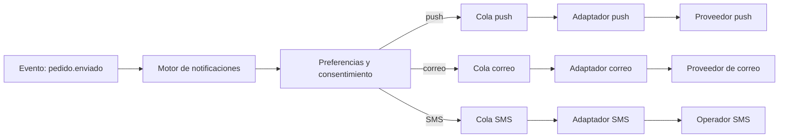

Una notificación parece una llamada de una línea: «avisa al usuario de que su pedido salió». Detrás hay tres canales con reglas distintas, proveedores externos que fallan por su cuenta, preferencias que cambian a mitad de camino y una pregunta que casi nadie se hace al diseñarla: qué pasa si el aviso llega dos veces, o si no llega nunca. Este artículo trata la notificación como un sistema de entrega, no como una función que se llama desde el código de negocio.

La tesis es simple: **un evento de negocio no envía un mensaje; produce una intención de notificar**, y esa intención pasa por un servicio propio que decide canal, respeta al usuario, encola por proveedor y registra cada intento. Con esa separación, un proveedor de SMS caído retrasa solo los SMS, y el correo y las push siguen su curso.

## Por qué no basta con llamar al proveedor desde el código

El enfoque ingenuo es que el servicio de pedidos llame directamente a la API de correo, a la de push y a la de SMS al terminar una operación. Funciona en la primera semana y falla de tres formas predecibles.

La primera es el acoplamiento: el servicio de pedidos ahora conoce tres proveedores, sus límites de tasa, sus formatos de error y sus contratos. Cambiar de proveedor de correo obliga a desplegar pedidos. La segunda es la **pérdida silenciosa**: si la llamada falla después de que la transacción ya se confirmó, nadie reintenta y el usuario nunca sabe que su pedido salió. La tercera es el **duplicado**: si el servicio reintenta la operación completa para recuperarse de un error, el aviso se envía otra vez.

El diseño alternativo mueve el envío fuera de la transacción de negocio. El evento `pedido.enviado` se guarda en el mismo almacenamiento que el pedido (con un patrón de _outbox_, como se explica en [sagas, outbox e idempotencia](/docs/sagas-outbox-idempotencia)) y un consumidor lo convierte en notificaciones. Así el envío nunca bloquea ni deshace la operación principal, y el productor no necesita saber qué canales existen.

<Callout tone="info" title="Intención, no comando">
  El servicio de pedidos dice «el pedido 4812 salió». No dice «envía un correo a ana@ejemplo.com».
  Esa diferencia es la que permite cambiar canales, idiomas y plantillas sin tocar el dominio.
</Callout>

## Un servicio, una cola por canal

La arquitectura básica tiene cuatro piezas: un consumidor de eventos, una capa de decisión (preferencias, plantilla, idioma, horario), una cola por canal y un adaptador por proveedor. La cola por canal es la decisión que más importa, porque aísla fallos y ritmos distintos.

Los tres canales no tienen el mismo perfil. El push es barato y casi instantáneo, pero el dispositivo puede estar apagado y el token puede haber caducado. El correo tolera minutos de retraso y tiene reputación del dominio emisor que cuidar. El SMS es caro, tiene límites regulatorios y de operador, y no admite errores de plantilla con gracia. Si estuvieran en una sola cola, el SMS saturado retrasaría los correos de restablecimiento de contraseña, que son justo lo que más importa que llegue rápido.

Con colas separadas cada canal tiene su propio consumidor, su propio límite de concurrencia y su propio umbral de alerta. Un proveedor caído hace crecer solo su cola, y el resto de canales sigue. La figura de este artículo muestra exactamente eso: la rama de SMS puede detenerse sin que las otras dos se enteren.

El coste es operativo: más colas que vigilar y más configuración. Para un sistema pequeño con un solo canal, una cola basta. La separación se justifica cuando aparece el segundo canal con otro perfil de fallo, no antes.

## Preferencias: el usuario decide, no el equipo

Antes de enviar, el motor consulta qué quiere recibir la persona. Esa decisión no es un detalle de interfaz: si se toma mal, el sistema envía avisos que el usuario no pidió, algo que en la Unión Europea puede tener consecuencias legales además de dañar la confianza.

Conviene modelar las preferencias en dos capas que se combinan. La primera es el **consentimiento por tipo de mensaje**: los transaccionales (confirmación de compra, código de acceso) se envían siempre que el canal exista, mientras que los comerciales (novedades, promociones) requieren una elección explícita. La segunda es la **preferencia por canal**: una persona puede aceptar push y no SMS, o correo solo a la semana.

El punto delicado es distinguir transaccional de comercial. Un aviso de «tu pedido llegó» es transaccional aunque incluya una recomendación al final; si la recomendación es el motivo del envío, el mensaje es comercial y necesita consentimiento. La regla práctica es que el tipo se decide por la intención del mensaje, no por su plantilla.

<Callout tone="warning" title="El consentimiento no se hereda">
  Un usuario que aceptó recibir correos de su cuenta no ha aceptado SMS, ni que sus datos de
  contacto se usen para campañas de terceros. Guarda el consentimiento con fecha, canal y finalidad,
  y revísalo en cada envío comercial, no solo al registrarse.
</Callout>

Las preferencias también necesitan un horario. Una notificación push a las tres de la madrugada en la zona horaria del usuario puede ser un error de producto aunque sea legal. El motor debe convertir la hora de envío a la zona del destinatario y aplazar los mensajes no urgentes hasta una ventana razonable, dejando que los urgentes (un código de verificación) salgan de inmediato.

## Entrega al menos una vez y deduplicación

Ningún canal ofrece entrega exactamente una vez. Las colas entregan al menos una vez, los proveedores reintentan cuando una respuesta se pierde y el propio motor puede reprocesar un mensaje si se cae antes de confirmar. Eso significa que la garantía realista es **al menos una vez**, y la tarea de diseño es que el duplicado sea inofensivo o se elimine.

La deduplicación se apoya en una clave de idempotencia que identifica la intención de notificar, no el intento de envío. Una forma habitual es combinar el identificador del evento, el destinatario, el canal y el tipo de mensaje. Antes de llamar al proveedor, el adaptador comprueba si esa clave ya tiene un envío confirmado dentro de una ventana de tiempo; si la tiene, no envía de nuevo.

Hay un límite que conviene declarar en el diseño: la comprobación y el envío no son atómicos. Si el adaptador envía el mensaje y se cae antes de registrar la confirmación, un reintento volverá a enviarlo. Por eso la idempotencia de los proveedores importa tanto. Algunos aceptan una clave de idempotencia en la petición; cuando no lo hacen, el duplicado es el precio de la garantía de entrega, y hay que aceptarlo para los mensajes donde la pérdida es peor.

La decisión práctica es distinta por canal. En un código de verificación, un duplicado es una molestia menor y una pérdida es un fallo grave: se acepta la repetición. En un aviso de cobro, un duplicado puede causar confusión y un soporte innecesario: conviene deduplicar con más rigor. Escribir esto en el diseño evita que cada equipo lo decida por su cuenta.

## Reintentos, caducidad y canal de respaldo

Un reintento sin límite convierte un proveedor caído en una cola que crece sin fin. Un reintento sin backoff convierte un error transitorio en una tormenta de peticiones. Por eso cada canal define tres cosas: cuántas veces reintenta, cuánto espera entre intentos (con variación aleatoria, como en [reintentos con jitter](/docs/reintentos-con-jitter)) y cuándo caduca el mensaje.

La caducidad es la parte que más se olvida. Un correo que dice «tu código expira en cinco minutos» y llega a los cuarenta minutos es peor que no llegar: genera soporte y desconfianza. Cada mensaje debe llevar una fecha límite de validez, y el adaptador debe descartarlo, en lugar de enviarlo, cuando la haya superado. Descartar también se registra, para que el equipo sepa cuántos mensajes se perdieron por caducidad.

Los errores no son todos iguales. Un error transitorio (límite de tasa, timeout, 503) justifica reintentar. Un error permanente (dirección inválida, token de dispositivo borrado) no: reintentarlo solo gasta cuota. En push, el token caducado debe eliminarse de la base de datos de dispositivos para que no vuelva a intentarse. En correo, una dirección que rebota de forma permanente debe marcarse y dejar de recibir envíos comerciales.

El canal de respaldo es una decisión de producto, no técnica. Si un código de acceso no llega por push en treinta segundos, ¿se envía por SMS? Esa cadena es útil, pero multiplica el coste y el riesgo de duplicados. Conviene limitarla a los mensajes críticos y dejar explícito cuánto tiempo espera cada canal antes de pasar al siguiente.

## Proveedores: cambiar sin reescribir el sistema

Los proveedores cambian: cambian sus APIs, sus precios y sus políticas. Un ejemplo concreto es el push de Android. Firebase Cloud Messaging anunció que sus APIs heredadas de envío (HTTP y XMPP) quedaban obsoletas desde el 20 de junio de 2023 y que su apagado empezaba el 22 de julio de 2024; la migración recomendada es la API HTTP v1, que usa tokens de acceso de corta vida. Quien tuviera el envío mezclado con la lógica de pedidos tuvo que tocar todo el sistema. Quien tenía un adaptador por proveedor cambió un archivo.

El adaptador es la frontera. Su interfaz expone lo que el motor necesita (enviar, consultar estado, marcar un destino como inválido) y traduce los errores del proveedor a un vocabulario propio: transitorio, permanente, limitado por tasa. Así el motor no cambia cuando cambia el proveedor, y las pruebas pueden sustituirlo por uno simulado.

Conviene evitar dos trampas. La primera es que el adaptador se convierta en un proveedor genérico que oculta capacidades útiles: si el proveedor de correo ofrece seguimiento de rebotes y el sistema no lo usa, el dominio pierde reputación sin que nadie lo vea. La segunda es mantener dos proveedores por canal desde el primer día sin un motivo: el coste de mantener la paridad de plantillas, formatos y métricas suele superar al beneficio hasta que hay un incidente real o una exigencia de disponibilidad.

### Plantillas, idioma y textos

Las plantillas son otra fuente de fallos silenciosos. Un aviso con una variable vacía («Hola ,») o con el idioma equivocado se envía sin error técnico y el usuario lo percibe como un fallo. Por eso las plantillas se versionan, se validan antes de publicarse y se renderizan con los datos del evento, no con consultas adicionales que puedan fallar en mitad del envío.

El idioma del usuario debe resolverse en el motor, con una cadena de respaldo explícita: idioma preferido, idioma de la cuenta, idioma por defecto. Mezclar idiomas dentro de un mismo mensaje es más frecuente de lo que parece, sobre todo cuando el asunto y el cuerpo vienen de sistemas distintos. Una regla sencilla es que una plantilla es una unidad: se traduce completa o no se publica en ese idioma.

Para el correo, la autenticación del dominio es requisito técnico, no opcional. SPF, DKIM y DMARC son mecanismos definidos en RFC: DKIM firma el mensaje con una clave del dominio emisor (RFC 6376), SPF declara qué servidores pueden enviar en nombre del dominio (RFC 7208) y DMARC indica al receptor qué hacer cuando la autenticación falla y exige alineación con el dominio visible (RFC 7489). Sin ellos, los correos transaccionales terminan en spam aunque la aplicación funcione perfectamente.

### Observabilidad de entregas

Una notificación tiene un ciclo de vida que conviene poder seguir: creada, decidida (enviar o no, y por qué), encolada, enviada, entregada, abierta o rebotada. Cada transición debe tener un identificador común para que soporte pueda responder «¿llegó el aviso?» sin revisar cuatro sistemas.

Las métricas que importan son de proceso y de resultado. De proceso: profundidad de cada cola, edad del mensaje más antiguo, tasa de reintentos y de descartes por caducidad. De resultado: tasa de entrega por canal y proveedor, tiempo desde el evento hasta la entrega, y quejas o rebotes. Un aumento de la edad de la cola de SMS a los diez minutos es una alerta; un aumento de quejas en correo comercial es otra, y puede indicar un problema de consentimiento.

Las métricas de entrega real tienen límites. Muchos proveedores confirman la aceptación, no la entrega al dispositivo, y las aperturas de correo se ven afectadas por la protección de privacidad de los clientes de correo. Conviene decidir qué métrica es la que se optimiza y no confundir «aceptado por el proveedor» con «recibido por la persona».

## Herramientas

No hace falta una plataforma concreta para diseñar esto bien, pero sí elegir dónde vive cada responsabilidad. Un bus de eventos o una cola gestionada entrega los eventos al consumidor; una base de datos con clave única implementa la deduplicación; un servicio de envío por canal encapsula al proveedor. Las herramientas se eligen según el volumen y el equipo: en un sistema pequeño, una tabla de envíos con restricción de unicidad y un proceso que la recorre puede ser suficiente, y es más fácil de operar que una cadena de servicios.

<Callout tone="tip" title="Empieza por la tabla de envíos">
  Antes de elegir un proveedor de colas, escribe la tabla donde se registra cada intención de
  notificar, su estado y su clave de deduplicación. Si esa tabla es clara, cambiar la
  infraestructura de colas después es un problema de despliegue, no de datos.
</Callout>

## Errores frecuentes

Enviar desde la transacción de negocio es el error más común. Parece cómodo y convierte cada fallo del proveedor en un fallo de la operación principal, o en una notificación perdida sin rastro.

Tratar todos los mensajes igual, con el mismo reintento, la misma prioridad y el mismo canal de respaldo, mezcla un código de verificación con una campaña de marketing. Cada tipo de mensaje tiene su perfil de urgencia, tolerancia al duplicado y consentimiento.

No borrar tokens de dispositivo ni marcar direcciones inválidas hace que el sistema gaste cuota y tiempo en destinos que nunca recibirán nada, y que las métricas de entrega empeoren sin explicación.

Confiar en que el proveedor garantiza la entrega exactamente una vez lleva a diseños frágiles. La garantía real es al menos una vez, y la deduplicación es responsabilidad del sistema.

## Checklist

- Cada notificación nace de un evento de negocio y pasa por un servicio propio, no por una llamada directa al proveedor.
- Hay una cola y un consumidor por canal, con límites de concurrencia y alertas de profundidad y de edad.
- El tipo de mensaje (transaccional o comercial) está definido por su intención, y el comercial tiene consentimiento registrado con fecha y canal.
- Existe una clave de deduplicación que identifica la intención, y se documenta el riesgo de duplicado por proveedor.
- Los reintentos tienen límite, backoff con variación aleatoria y una caducidad por mensaje.
- Los errores permanentes (token inválido, dirección que rebota) se marcan y dejan de intentarse.
- El adaptador por proveedor traduce los errores a un vocabulario propio y puede sustituirse en pruebas.
- Las plantillas se validan antes de publicarse, y el idioma se resuelve con una cadena de respaldo explícita.
- El dominio de correo tiene SPF, DKIM y DMARC configurados.
- Cada envío puede rastrearse de punta a punta con un identificador común.

## Fuentes

- Firebase, [Migrar de las API heredadas de FCM a HTTP v1](https://firebase.google.com/docs/cloud-messaging/migrate-v1): fechas de obsolescencia (20 de junio de 2023) y apagado (22 de julio de 2024), según la documentación oficial que consultamos.
- RFC 8030, [Generic Event Delivery Using HTTP Push](https://www.rfc-editor.org/rfc/rfc8030): el protocolo base de Web Push.
- RFC 8292, [Voluntary Application Server Identification (VAPID) for Web Push](https://www.rfc-editor.org/rfc/rfc8292): identificación del servidor de aplicación, publicada en noviembre de 2017.
- RFC 5321, [Simple Mail Transfer Protocol](https://www.rfc-editor.org/rfc/rfc5321): SMTP.
- RFC 6376, [DomainKeys Identified Mail (DKIM)](https://www.rfc-editor.org/rfc/rfc6376).
- RFC 7208, [Sender Policy Framework (SPF)](https://www.rfc-editor.org/rfc/rfc7208).
- RFC 7489, [Domain-based Message Authentication, Reporting, and Conformance (DMARC)](https://www.rfc-editor.org/rfc/rfc7489).

Consultadas en octubre de 2026. La obligación de consentimiento para comunicaciones comerciales electrónicas en la Unión Europea (Directiva ePrivacy) se describe en general y no se comprobó contra su texto en este artículo. Las fechas de publicación de los RFC de Web Push y de los de correo se citan por su número, no por año.
