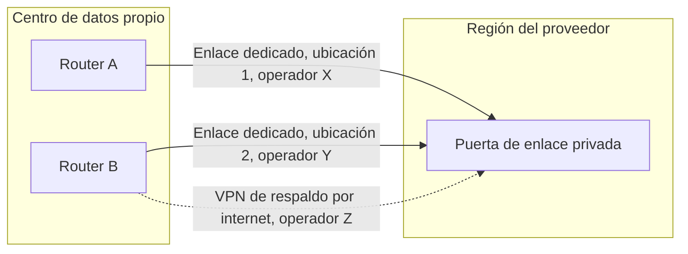
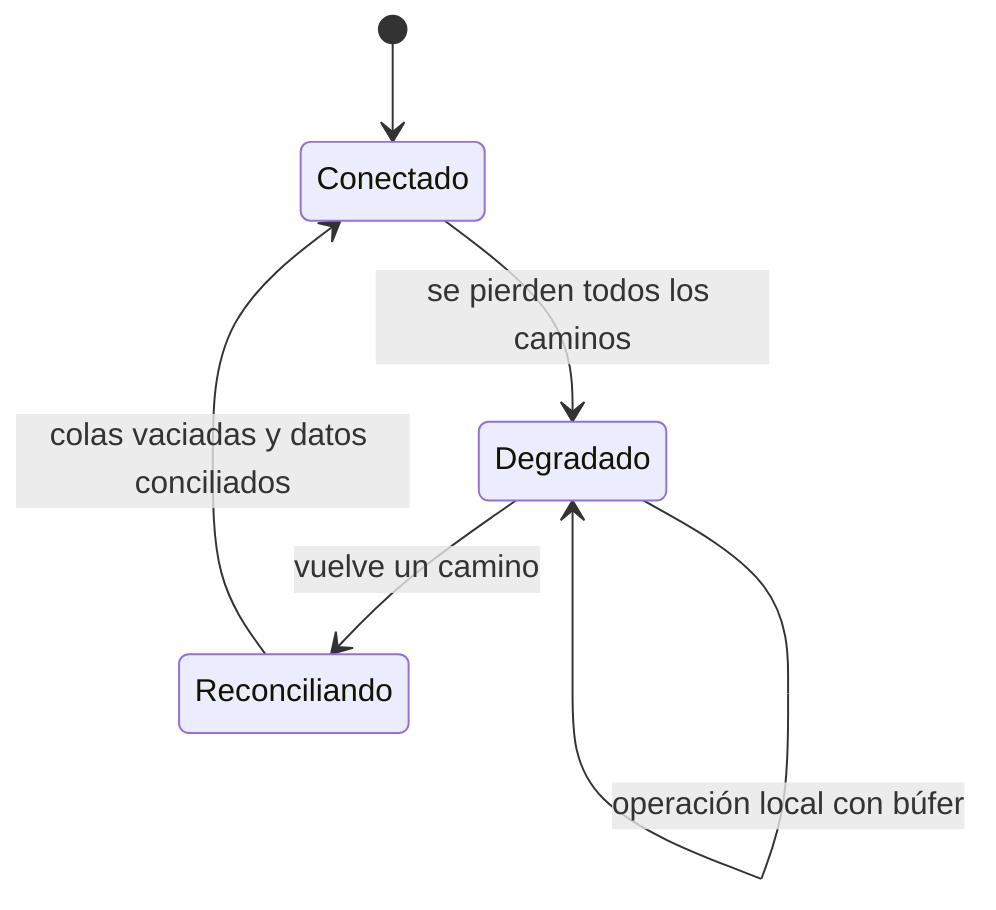

# Nube híbrida en detalle

La planta lleva años con su sistema de producción en un centro de datos propio. El equipo de datos monta la analítica en la nube, el de identidad mueve el inicio de sesión a un proveedor gestionado y el de plataforma empieza a desplegar con las herramientas del proveedor también en local. Todo funciona hasta el día en que una excavadora corta la fibra del operador. Las máquinas siguen ahí, los servidores responden, pero nadie puede iniciar sesión en la aplicación de planta, los despliegues se quedan colgados y los paneles muestran un hueco de cuatro horas. Nadie decidió que la planta dependiera de la nube: ocurrió poco a poco. **Una nube híbrida es un sistema repartido entre un entorno propio y uno o más entornos de nube cuyos datos, identidad, red y operación cruzan la frontera entre ambos, y diseñarla es decidir qué cruza esa frontera y qué pasa cuando deja de poder cruzarla.**

Esta lección recorre los patrones habituales (extender el centro de datos, desbordar a la nube, repartir servicios, procesar en el borde), la conectividad y sus fallos, la latencia y la gravedad de los datos, la identidad federada, el despliegue y la observabilidad comunes, el gobierno de dos plataformas y, sobre todo, los modos de fallo. Cómo se comparan los modelos de despliegue (pública, privada, comunitaria, híbrida) está en [modelos de despliegue en la nube](/docs/modelos-de-despliegue-nube); aquí se da por sabido y se baja al detalle de diseño.

<Callout tone="info" title="Fecha de corte y alcance">
  Consultado en octubre de 2026. Los nombres de producto y los valores numéricos de proveedores
  salen de su documentación oficial a esa fecha y se citan como ejemplos de una categoría, no como
  recomendación. Los productos cambian de nombre y de límites: comprueba la página enlazada antes de
  diseñar con ellos.
</Callout>

## Qué es híbrido y qué no

La definición de referencia es la del NIST (SP 800-145, Peter Mell y Timothy Grance, septiembre de 2011): una infraestructura compuesta por dos o más infraestructuras de nube distintas (privada, comunitaria o pública) que siguen siendo entidades separadas, pero que están unidas por tecnología estándar o propietaria que permite la portabilidad de datos y aplicaciones. El propio texto pone como ejemplo el _cloud bursting_ para repartir carga entre nubes.

Dos ideas de esa definición importan para diseñar. La primera: los entornos **siguen siendo distintos**. No se convierten en uno por estar conectados; tienen operadores, ciclos de cambio y modos de fallo propios. La segunda: lo que los une es **tecnología concreta** (red, identidad, formatos de despliegue), y esa tecnología es la parte que más falla y la que menos se diseña.

Una definición operativa útil: tienes un sistema híbrido cuando al menos uno de estos cuatro planos cruza la frontera en el camino crítico de una operación de negocio.

| Plano     | Qué cruza la frontera                                      | Pregunta que debes poder responder                         |
| --------- | ---------------------------------------------------------- | ---------------------------------------------------------- |
| Datos     | Réplicas, colas, ficheros, consultas entre ambos lados     | ¿Dónde está la copia que manda y cuánto retraso tolera?    |
| Identidad | Inicio de sesión, tokens, grupos, cuentas de servicio      | ¿Puede alguien autenticarse en local sin la nube?          |
| Red       | Rutas, DNS, resolución de nombres, inspección de tráfico   | ¿Qué camino sigue un paquete y cuál sigue la respuesta?    |
| Operación | Despliegue, parches, métricas, alertas, gestión de equipos | ¿Puedes desplegar, parchear y ver el estado sin el enlace? |

Lo que no es híbrido, aunque se le llame así: una aplicación en la nube que lee una vez al día un fichero exportado del sistema local. Ahí hay integración, no un sistema repartido: si el fichero no llega, nada se rompe en el camino crítico. La distinción importa porque el costo de diseño de un híbrido real (red redundante, identidad sin punto único, operación doble) solo se justifica cuando el acoplamiento es real.

## Patrones de nube híbrida

### Extender el centro de datos a la nube

La nube se trata como un centro de datos más: mismas redes privadas, mismo direccionamiento planificado, mismas herramientas de gestión. Es el punto de partida de muchas migraciones porque permite mover cargas sin cambiar cómo se conectan. El riesgo es que la extensión se convierta en una red plana con dependencias invisibles entre ambos lados: una aplicación movida a la nube que sigue consultando una base local en cada petición paga la latencia del enlace en cada llamada.

### Desbordar a la nube (cloud bursting)

La carga base se atiende en local y los picos se desbordan a la nube. Suena barato y tiene condiciones duras: la aplicación debe poder ejecutarse en ambos lados con la misma imagen, los datos que necesita el pico deben estar disponibles en la nube (o el tráfico de vuelta al origen se convierte en el cuello de botella) y el reparto de carga debe poder activarse sin intervención manual. En la práctica funciona mejor para cargas sin estado o por lotes, con datos de entrada que se copian antes del pico, que para transacciones que escriben en una base local.

### Distribuir servicios entre ambos lados

Cada servicio vive donde mejor encaja y se comunican a través de interfaces explícitas: el sistema de planta en local por latencia o regulación, la analítica y el portal de clientes en la nube por elasticidad. Es el patrón más sano cuando la frontera coincide con una frontera de dominio, porque las llamadas entre lados son pocas y asíncronas. Es el más frágil cuando la frontera corta un flujo síncrono por la mitad: cada petición de usuario cruza el enlace varias veces y hereda su latencia y su disponibilidad. Cómo cortar servicios lo trata [monolito frente a microservicios](/docs/monolito-vs-microservicios); aquí lo que añade la nube híbrida es que el corte pasa por un enlace de red con dueño, costo y fallos propios.

### Computación en el borde

Parte del procesamiento ocurre cerca de donde se generan los datos: en la planta, la tienda, el hospital o la antena. El borde tiene sentido cuando se da al menos una de estas condiciones: la respuesta necesita una latencia que el viaje de ida y vuelta a una región no permite, el volumen bruto es demasiado grande para enviarlo entero, o la operación debe continuar sin conexión. El precio es operar muchos sitios pequeños, a menudo sin personal técnico, con hardware que alguien tiene que reponer.

| Patrón               | Qué cruza el enlace en el camino crítico | Encaja cuando                                       | Riesgo principal                                  |
| -------------------- | ---------------------------------------- | --------------------------------------------------- | ------------------------------------------------- |
| Extender el centro   | Casi todo: red privada continua          | Migración por fases con dependencias aún sin cortar | Red plana y llamadas síncronas entre lados        |
| Desbordar picos      | Tráfico del pico y sus datos             | Cargas sin estado o por lotes con picos previsibles | Datos en el lado equivocado justo durante el pico |
| Repartir servicios   | Eventos e integraciones entre dominios   | La frontera de red coincide con una de dominio      | Un flujo síncrono partido por el enlace           |
| Procesar en el borde | Agregados y órdenes, no datos brutos     | Latencia local, volumen bruto alto o autonomía      | Operar y parchear muchos sitios pequeños          |

## Conectividad: VPN o enlace dedicado

Hay dos grandes familias. Una **VPN de sitio a sitio** cifra el tráfico (normalmente con IPsec) y lo envía por internet: se monta en horas y depende de la calidad de internet en ambos extremos. Un **enlace dedicado** es una conexión privada entre tu red y la del proveedor, en un punto de presencia o a través de un operador: AWS lo llama Direct Connect, Azure ExpressRoute y Google Cloud Interconnect. Microsoft describe que sus conexiones ExpressRoute no pasan por internet, y lo presenta como más fiable, con latencia más consistente y más seguro que una conexión típica por internet.

| Criterio         | VPN de sitio a sitio                             | Enlace dedicado                                                 |
| ---------------- | ------------------------------------------------ | --------------------------------------------------------------- |
| Tiempo de puesta | Horas o días                                     | Semanas: contrato con operador, cruce físico, configuración BGP |
| Latencia         | Variable: depende de internet                    | Más predecible                                                  |
| Cifrado          | Incluido en el túnel                             | No por defecto; hay que añadirlo (MACsec o VPN sobre el enlace) |
| Ancho de banda   | Limitado por túnel; se escala con varios túneles | Mayor y más estable                                             |
| Papel típico     | Arranque, sitios pequeños, respaldo del dedicado | Tráfico principal de producción                                 |

Un matiz de seguridad que suele olvidarse: privado no significa cifrado. La documentación de Google Cloud dice que Cloud Interconnect no cifra el tráfico por defecto y ofrece MACsec o HA VPN sobre el enlace para hacerlo. AWS explica que MACsec en Direct Connect cifra el tramo de capa 2 entre tu router y el suyo, punto a punto, y que no es un cifrado de extremo a extremo. Si tus datos exigen cifrado en tránsito, decide en qué capa lo pones; no lo des por hecho porque el enlace sea privado.

### Fallos típicos del enlace

- **MTU y fragmentación.** El túnel añade cabeceras y reduce el tamaño máximo de paquete útil. Según la guía de AWS para su VPN de sitio a sitio, a fecha de consulta (octubre de 2026) admite una MTU de 1446 bytes y un MSS de 1406 bytes, y menos según el algoritmo de cifrado. El síntoma clásico: las conexiones se establecen, las consultas pequeñas funcionan y las transferencias grandes se cuelgan, a menudo porque los mensajes ICMP que avisan del tamaño se filtran por el camino o la aplicación no los procesa. La guía recomienda ajustar MTU y MSS al algoritmo y fragmentar antes de cifrar.
- **Rutas asimétricas.** Cuando hay más de un camino (internet y enlace dedicado, o dos enlaces), un paquete puede salir por uno y volver por otro. Microsoft documenta el efecto: un cortafuegos con estado que no vio el inicio de un flujo descarta la respuesta. Lo resuelve anunciando cada prefijo por el enlace adecuado o con NAT de origen, y lo detecta con _traceroute_ desde ambos lados.
- **Ruta única.** Dos circuitos que salen por el mismo conducto, llegan al mismo punto de presencia o terminan en el mismo router no son redundantes: comparten el fallo. Hay que preguntar por la ruta física, no solo por el número de circuitos.
- **Dependencia del operador.** Contratar dos enlaces con el mismo operador, o una VPN de respaldo por una conexión a internet del mismo operador que el enlace dedicado, deja un único punto de fallo comercial y técnico.

### Diseñar redundancia

AWS publica tres modelos de resiliencia para Direct Connect. El de máxima resiliencia usa conexiones separadas que terminan en dispositivos distintos en más de una ubicación; el de alta resiliencia, una conexión en cada una de dos ubicaciones; y el de un solo sitio redundante, dos conexiones en dispositivos distintos de una misma ubicación, que AWS reserva para cargas no críticas. Microsoft recomienda algo equivalente para ExpressRoute: cada circuito ya tiene dos conexiones a dos routers del proveedor, y para la máxima resiliencia propone dos circuitos en dos ubicaciones de peering distintas. AWS describe además la VPN como un respaldo de menor costo, con el límite de que su ancho de banda por túnel puede no cubrir el del enlace principal, y por eso no la recomienda como respaldo de enlaces de más de 1 Gbps salvo que repartas el tráfico entre varios túneles (a fecha de consulta, octubre de 2026).



El diagrama resume tres reglas: dispositivos distintos en tu lado, ubicaciones distintas en el del proveedor y operadores distintos en medio. Usa enrutamiento dinámico (BGP) para que la conmutación sea automática, y prueba el corte de cada camino de forma programada, no solo el día que falla. Cómo diseñar el resto del sistema para tolerar fallos de red (tiempos de espera, reintentos, cortacircuitos) está en [resiliencia de sistemas distribuidos](/docs/resiliencia-sistemas-distribuidos).

## Latencia y gravedad de los datos

Dave McCrory propuso en 2010 el término **gravedad de los datos**: como una masa, los datos atraen a las aplicaciones y los servicios que los usan, y cuanto más crecen, más cuesta moverlos y más servicios acaban a su alrededor. En un híbrido esto se traduce en una regla práctica: el cómputo que consulta un conjunto de datos a menudo y con poca latencia debe vivir en el mismo lado que esos datos. Lo que cruza el enlace debe ser poco y resumido.

| Si la operación…                                        | Procésala                      | Porque                                                  |
| ------------------------------------------------------- | ------------------------------ | ------------------------------------------------------- |
| Tiene un plazo de respuesta menor que el RTT del enlace | Al lado de quien la necesita   | El viaje de ida y vuelta ya agota el presupuesto        |
| Lee muchos datos y devuelve poco                        | Donde están los datos          | Mueves el resultado, no el conjunto                     |
| Debe continuar sin conexión                             | En local o en el borde         | No puede depender de un camino que puede caer           |
| Necesita elasticidad y tolera minutos de retraso        | En la nube, con datos copiados | Escala bajo demanda sin consultar al origen             |
| Combina datos de ambos lados en cada petición           | Replantéala                    | Hereda la latencia y la disponibilidad de los dos lados |

Mide antes de decidir. El RTT medio dice poco: lo que rompe un flujo síncrono es la cola (p99) y la variación en horas de carga. Los órdenes de magnitud de red y disco, y cómo se suman las latencias en serie, están en [números y leyes de rendimiento](/docs/numeros-y-leyes-de-rendimiento).

## Identidad federada entre dos mundos

El objetivo es una sola identidad por persona y por servicio, reconocida en ambos lados. Los estándares para conseguirlo son conocidos: SAML 2.0 y OpenID Connect (su especificación núcleo 1.0 es de febrero de 2014) para el inicio de sesión único, y SCIM (RFC 7644, septiembre de 2015) para aprovisionar y retirar usuarios y grupos de forma automática entre dominios. La decisión de arquitectura no es qué protocolo usar, sino **dónde vive la fuente de verdad y qué pasa cuando no se alcanza**.

| Fuente de verdad                         | Ventaja                                        | Qué falla si se corta el enlace                                    |
| ---------------------------------------- | ---------------------------------------------- | ------------------------------------------------------------------ |
| Directorio local, federado hacia la nube | Local sigue funcionando sin la nube            | Los usuarios no entran en las aplicaciones de la nube              |
| Proveedor de identidad en la nube        | Gestión centralizada, MFA y políticas modernas | Las aplicaciones locales que validan contra él dejan de autenticar |
| Ambos, sincronizados                     | Cada lado puede autenticar por su cuenta       | Hay que reconciliar altas, bajas y cambios al volver el enlace     |

Si eliges la nube como fuente de verdad, las aplicaciones locales críticas necesitan un plan para el corte: validar tokens con claves ya descargadas mientras no caduquen, una réplica local del directorio o cuentas de emergencia locales, guardadas y auditadas. Lo que no debe pasar es descubrir en el primer corte que el operario de planta no puede iniciar sesión. Los principios de diseño de identidad y mínimo privilegio están en [seguridad por diseño](/docs/seguridad-por-diseno).

### El plano de control como dependencia oculta

Cada servicio de nube tiene dos partes: el **plano de datos**, que hace el trabajo (ejecuta la máquina, sirve el disco), y el **plano de control**, que lo crea, cambia y supervisa. En un híbrido, los productos que llevan la nube a tu centro de datos suelen dejar el plano de control en la región del proveedor. AWS lo documenta con claridad para Outposts en rack: si se pierde el enlace con la región, las instancias y volúmenes ya en marcha siguen funcionando y se alcanzan desde la red local, pero lanzar, arrancar, parar y terminar instancias no está disponible hasta que vuelve la conexión; las métricas y los registros se guardan en local hasta 7 días y se envían al volver, y una desconexión más larga puede perderlos (a fecha de consulta, octubre de 2026).

<Callout tone="warning" title="Lo que sigue en pie no es lo mismo que lo que puedes operar">
  Durante un corte, lo que ya estaba en marcha puede seguir sirviendo, pero no puedes escalar,
  reemplazar una máquina caída ni desplegar un arreglo si esa operación pasa por la región. Revisa
  cada componente local y anota qué operaciones dependen del plano de control remoto: la identidad,
  el DNS, la distribución de secretos y la descarga de imágenes son las que más sorprenden.
</Callout>

## Despliegue consistente

Dos entornos con dos formas de desplegar acaban divergiendo. La herramienta para evitarlo es la misma que en un solo entorno, aplicada con más disciplina: **infraestructura como código** con módulos que expresan la intención (una red, un clúster, una base) y adaptadores por entorno, y **contenedores** como unidad de despliegue, para que la misma imagen firmada corra en ambos lados. La organización del repositorio hace visible qué es común y qué es propio de cada lado:

```text
infra/
  modules/            # intención: red, clúster, base de datos, observabilidad
    network/          # // … entradas comunes, sin detalles del proveedor
    cluster/
  envs/
    onprem/           # adaptador al hipervisor o al hardware propio
    cloud/            # adaptador al proveedor
  policies/           # reglas comunes: etiquetas, cifrado, regiones permitidas
```

Lo que debe ser idéntico en ambos lados: la imagen, la configuración de la aplicación (inyectada, no horneada), las políticas y el proceso de promoción entre entornos. Lo que puede diferir: cómo se aprovisiona el hardware o la máquina debajo. Si el despliegue local depende de descargar imágenes de un registro en la nube, mantén una réplica local del registro: si no, el corte del enlace también corta los despliegues de urgencia. La práctica de entrega continua que sostiene todo esto está en [cultura DevOps](/docs/devops-cultura).

Los proveedores ofrecen productos para gestionar recursos externos desde su consola. Microsoft describe Azure Arc como una forma de proyectar servidores, clústeres de Kubernetes y bases de datos que no están en Azure sobre su gestor de recursos, para gobernarlos con las mismas herramientas. Google Distributed Cloud tiene una variante solo de software que ejecuta Kubernetes empresarial sobre tus servidores o tu infraestructura VMware. Son útiles para unificar inventario y políticas, y a la vez son otro caso de plano de control remoto: decide qué operaciones aceptas que dependan de él.

## Observabilidad que une ambos lados

El objetivo es una sola vista de una petición que cruza la frontera, no dos herramientas con dos verdades. Tres decisiones lo hacen posible:

- **Un mismo formato y una misma correlación.** Métricas, registros y trazas con las mismas etiquetas (servicio, entorno, lado, versión) y un identificador de traza que viaje en cada llamada que cruza el enlace.
- **Un destino, con búfer local.** Envía todo a un único sistema, pero guarda en local lo que no pudo salir durante un corte y reenvíalo después. Si no, el corte deja un hueco justo en el intervalo que más necesitas analizar.
- **El enlace como componente observado.** Latencia, pérdida, estado de BGP y uso de cada camino son métricas de primera clase con alertas propias. Un respaldo que se activó hace un mes sin que nadie lo notara es un enlace único con otro nombre.

Evita mantener una pila completa en cada lado salvo que la regulación lo exija: duplicar herramientas duplica el costo y, peor, produce dos conclusiones distintas sobre el mismo incidente.

## Gobierno, parches y ciclo de vida

Un híbrido son dos plataformas con calendarios distintos. El proveedor de nube cambia su lado de forma continua y retira versiones según su propio calendario; tu lado cambia cuando tú lo planificas. Las consecuencias prácticas:

- **Parches con dueño en cada lado.** El sistema operativo, el hipervisor, el firmware y el clúster local son tuyos. En los productos de nube instalados en tu centro, el reparto depende del producto: léelo en el modelo de responsabilidad compartida de cada uno.
- **Versiones compatibles.** Si ambos lados ejecutan el mismo orquestador, fija una ventana de versiones admitida y trata la diferencia como deuda con fecha.
- **Políticas comunes.** Etiquetado, cifrado, regiones permitidas y retención se escriben una vez y se aplican en ambos lados. Comprobarlas de forma automática es una [fitness function](/docs/fitness-functions).
- **Ciclo de vida del hardware.** El lado local tiene renovaciones de equipos, contratos de soporte y capacidad que se compra por adelantado. Cuando la capacidad local se agota, el patrón de desborde deja de ser una opción y pasa a ser una obligación.

## Productos por categoría

La tabla nombra ejemplos para ubicar cada categoría, no para compararlos. Todos están verificados en la documentación oficial de cada proveedor a fecha de consulta (octubre de 2026).

| Categoría                                  | AWS              | Azure                                        | Google Cloud                             |
| ------------------------------------------ | ---------------- | -------------------------------------------- | ---------------------------------------- |
| Enlace privado dedicado                    | Direct Connect   | ExpressRoute                                 | Cloud Interconnect                       |
| VPN gestionada de sitio a sitio            | Site-to-Site VPN | VPN Gateway                                  | HA VPN                                   |
| Plataforma del proveedor en tu instalación | Outposts (rack)  | Azure Local (en hardware validado de socios) | Google Distributed Cloud (conectado)     |
| Gestión de recursos externos               | —                | Azure Arc                                    | Google Distributed Cloud (solo software) |
| Operación totalmente desconectada          | —                | Azure Local (operaciones desconectadas)      | Google Distributed Cloud (aislado)       |

La tabla no es exhaustiva: un guion indica que no se ha confirmado un producto equivalente en la documentación consultada, no que el proveedor no lo ofrezca. Azure Local, antes Azure Stack HCI, se diferencia de Outposts en que el hardware lo compras tú a socios validados por Microsoft, mientras que Azure Arc actúa como plano de control. Elegir un producto de esta tabla tiene un costo de salida; ese análisis es el tema de la siguiente lección.

## Modos de fallo: cuando se corta el enlace

La pregunta que define un buen diseño híbrido es concreta: **con el enlace cortado durante horas, ¿qué sigue funcionando, qué se degrada y qué se detiene?** Escríbelo por flujo de negocio antes de que ocurra.



| Flujo                                    | Conectado                    | Degradado (sin enlace)                          | Al reconciliar                   |
| ---------------------------------------- | ---------------------------- | ----------------------------------------------- | -------------------------------- |
| Operación local crítica (planta, tienda) | Normal                       | Normal, con identidad y datos locales           | Nada que hacer                   |
| Envío de datos a la nube                 | Continuo                     | Se acumula en un búfer local con límite         | Reenvío ordenado e idempotente   |
| Inicio de sesión local                   | Contra el proveedor federado | Claves en caché o directorio local              | Aplicar altas y bajas pendientes |
| Despliegues y cambios                    | Normal                       | Congelados, salvo los de emergencia desde local | Reanudar la cola de cambios      |
| Funciones que viven solo en la nube      | Normal                       | No disponibles, con mensaje claro               | Se recuperan sin intervención    |

Tres reglas salen de esta tabla. La primera: el búfer local tiene un tamaño finito, así que define cuántas horas de corte cubre y qué haces al llenarse. La segunda: los reenvíos deben ser idempotentes, porque tras un corte siempre hay mensajes que no sabes si llegaron (el patrón está en [sagas, outbox e idempotencia](/docs/sagas-outbox-idempotencia)). La tercera: si ambos lados aceptan escrituras sobre el mismo dato durante el corte, la reconciliación es un problema de consistencia que [CAP y PACELC](/docs/cap-pacelc) explican; decide la regla por operación antes del corte.

## Cuándo sí y cuándo no

| Situación                                                                   | Decisión razonable                                                       |
| --------------------------------------------------------------------------- | ------------------------------------------------------------------------ |
| Latencia de control menor que el RTT a la región más cercana                | Híbrido o borde: ese cómputo se queda en local                           |
| Regulación o soberanía que obliga a mantener ciertos datos en un sitio      | Híbrido con frontera de datos explícita y auditada                       |
| Migración por fases de un sistema grande                                    | Híbrido temporal, con fecha de salida y dependencias entre lados medidas |
| Inversión reciente en centro de datos con capacidad para años               | Híbrido para lo nuevo y elástico; no muevas lo estable por moverlo       |
| Solo quieres ahorrar en picos y la aplicación no corre igual en ambos lados | Primero haz portable la aplicación; si no, el desborde no funcionará     |
| Equipo pequeño que no puede operar dos plataformas                          | Elige un lado como principal y reduce el otro a lo imprescindible        |

Registra la elección y sus supuestos (RTT medido, horas de autonomía, qué datos cruzan) en un [ADR](/docs/adr): cuando cambien, sabrás qué revisar.

## Errores frecuentes

- **Gestionar dos entornos como si fueran uno.** Una red plana, un único inventario mental y la suposición de que lo que funciona en un lado funciona en el otro. Son dos plataformas con fallos y calendarios propios.
- **No medir la latencia.** Mover una aplicación a la nube sin medir cuántas llamadas hace a la base local por petición, ni el p99 del enlace en horas de carga.
- **Identidad duplicada.** Cuentas creadas a mano en cada lado, sin aprovisionamiento automático: las bajas no se propagan y aparecen cuentas huérfanas con permisos.
- **Redundancia de papel.** Dos circuitos por el mismo conducto, el mismo operador o el mismo router. Cuentan dos en el contrato y uno en el fallo.
- **El respaldo que nunca se probó.** La VPN de respaldo tiene una MTU distinta, un ancho de banda menor o rutas que nadie anunció, y se descubre en el corte.
- **Ignorar el plano de control.** Asumir que «está en local» significa «funciona sin la nube», cuando escalar, desplegar o autenticar pasa por la región.
- **Observabilidad con huecos.** Métricas que se pierden durante el corte, justo en el intervalo que el análisis posterior necesita.

## Ejemplo trabajado: una planta con analítica en la nube

Supón una planta con un sistema de ejecución de fabricación (MES) en local, sensores en las líneas y un equipo de datos que quiere analítica y modelos en la nube. Todas las cifras son supuestas para el ejemplo.

**Requisitos.** El lazo de control de calidad debe responder en menos de 50 ms. La planta no puede parar más de 15 minutos por un fallo de TI. Los sensores generan 200 GB brutos al día; la analítica necesita agregados por minuto.

**Medición.** El RTT a la región más cercana es de 18 ms de mediana y 70 ms de p99 en horas de carga. El enlace contratado es una VPN por internet.

**Decisiones.**

1. El lazo de control se queda en local: el p99 del RTT (70 ms) ya supera el plazo de 50 ms antes de procesar nada.
2. El borde agrega por minuto y envía unos 2 GB al día en lugar de 200 GB: una centésima parte del volumen bruto cruza el enlace. Los datos brutos se guardan en local 30 días por si hace falta reprocesar.
3. El búfer local cubre 72 horas de agregados (unos 6 GB), con reenvío idempotente al volver el enlace.
4. La identidad se federa desde el proveedor en la nube, pero el MES valida tokens con claves en caché y hay dos cuentas de emergencia locales auditadas. Un corte no impide el turno.
5. Conectividad: enlace dedicado como principal, VPN por un operador distinto como respaldo; se prueba el corte del principal cada trimestre.
6. Las imágenes se replican a un registro local; el despliegue de emergencia en planta no depende de la nube.

**Resultado esperado del corte.** La planta produce con normalidad, la analítica muestra datos con retraso y se pone al día al volver el enlace, y los despliegues no urgentes esperan. Ese es el comportamiento que el ADR deja escrito y que una prueba de corte programada comprueba.

## Checklist

- [ ] Cada flujo de negocio tiene escrito qué hace con el enlace cortado: sigue, se degrada o se detiene.
- [ ] La conectividad tiene caminos con dispositivos, ubicaciones y operadores distintos, y el corte de cada uno se prueba de forma programada.
- [ ] MTU y MSS están ajustados al túnel, y las rutas se revisaron para evitar asimetrías con cortafuegos con estado.
- [ ] La latencia entre lados se mide en p99 y en horas de carga, no solo en mediana.
- [ ] Hay una sola fuente de verdad de identidad, aprovisionamiento automático entre lados y un plan de autenticación local para el corte.
- [ ] Están inventariadas las operaciones locales que dependen del plano de control remoto (escalar, desplegar, secretos, DNS, imágenes).
- [ ] Despliegue, políticas y observabilidad son comunes a ambos lados, con búfer local para la telemetría.
- [ ] La decisión y sus supuestos están en un ADR con fecha de revisión.

## Siguiente lección

Cada servicio gestionado que usas en un híbrido te ata un poco más a su proveedor: la siguiente lección explica cómo medir ese acoplamiento y cuándo aceptarlo, en [casado a un proveedor](/docs/casado-a-un-proveedor).

## Fuentes

Consultadas en octubre de 2026.

- [The NIST Definition of Cloud Computing, SP 800-145 (Peter Mell y Timothy Grance, NIST, septiembre de 2011)](https://nvlpubs.nist.gov/nistpubs/Legacy/SP/nistspecialpublication800-145.pdf): definición de nube híbrida y ejemplo de _cloud bursting_
- [Tunnel options for your AWS Site-to-Site VPN connection (AWS)](https://docs.aws.amazon.com/vpn/latest/s2svpn/VPNTunnels.html): dos túneles por conexión para redundancia
- [Best practices for an AWS Site-to-Site VPN customer gateway device (AWS)](https://docs.aws.amazon.com/vpn/latest/s2svpn/cgw-best-practice.html): MTU, MSS y fragmentación
- [AWS Direct Connect Resiliency Recommendations (AWS)](https://aws.amazon.com/directconnect/resiliency-recommendation/): modelos de resiliencia y VPN como respaldo
- [MAC Security in Direct Connect (AWS)](https://docs.aws.amazon.com/directconnect/latest/UserGuide/MACsec.html): alcance del cifrado de capa 2
- [AWS Outposts racks FAQs (AWS)](https://aws.amazon.com/outposts/rack/faqs/) y [Connectivity through service link (AWS)](https://docs.aws.amazon.com/outposts/latest/userguide/service-links.html): comportamiento durante la desconexión de la región
- [Azure ExpressRoute overview (Microsoft Learn)](https://learn.microsoft.com/en-us/azure/expressroute/expressroute-introduction): conexión privada, redundancia y resiliencia máxima
- [Azure ExpressRoute: asymmetric routing (Microsoft Learn)](https://learn.microsoft.com/en-us/azure/expressroute/expressroute-asymmetric-routing): causas, dispositivos con estado y soluciones
- [Azure Arc overview (Microsoft Learn)](https://learn.microsoft.com/en-us/azure/azure-arc/overview): gestión de recursos fuera de Azure
- [What is Azure Local? (Microsoft Learn)](https://learn.microsoft.com/en-us/azure/azure-local/overview), [Renaming Azure Stack HCI to Azure Local (Microsoft Learn)](https://learn.microsoft.com/en-us/azure/azure-local/rename-to-azure-local) y [Disconnected operations for Azure Local (Microsoft Learn)](https://learn.microsoft.com/en-us/azure/azure-local/manage/disconnected-operations-overview): hardware de socios, cambio de nombre y operación sin conexión
- [Cloud Interconnect overview (Google Cloud)](https://docs.cloud.google.com/network-connectivity/docs/interconnect/concepts/overview): tipos de enlace y cifrado no incluido por defecto
- [Google Distributed Cloud (Google Cloud)](https://docs.cloud.google.com/distributed-cloud/docs): variantes aislada, conectada y solo software
- [Data Gravity formula (InfoQ, 29 de junio de 2012)](https://www.infoq.com/news/2012/06/datagravity-formula): origen del término en 2010 y su formulación posterior
- [OpenID Connect Core 1.0 (OpenID Foundation, febrero de 2014)](https://openid.net/specs/openid-connect-core-1_0.html)
- [RFC 7644, System for Cross-domain Identity Management: Protocol (septiembre de 2015)](https://www.rfc-editor.org/rfc/rfc7644.html)
