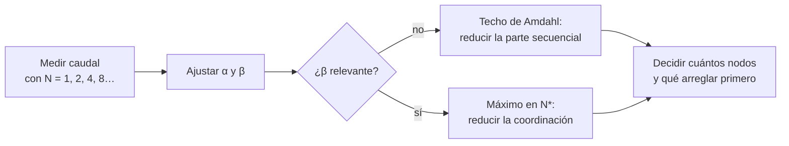
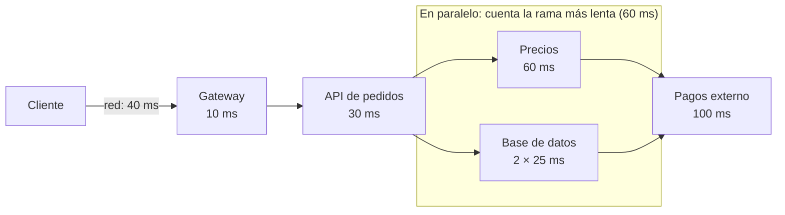

# Números y leyes de rendimiento

El servicio de pedidos va al 85 % de CPU en la hora punta y alguien dice que «todavía queda un 15 % de margen». Una semana después, una campaña sube el tráfico un 10 % y la latencia no crece un 10 %: se multiplica. El equipo añade instancias y la mejora es la mitad de la esperada, porque todas comparten un bloqueo en la misma fila. Nada de esto era imprevisible. Tres o cuatro leyes muy viejas lo anticipan con una servilleta: **las leyes de rendimiento son relaciones entre caudal, tiempo, concurrencia y utilización que se cumplen en casi cualquier sistema estable y te dejan estimar antes de construir y explicar después de medir**.

Este artículo reúne esas relaciones (Little, Amdahl, la ley de escalabilidad universal y la teoría de colas básica), los números de latencia que conviene tener en la cabeza y la forma de usarlos en un presupuesto de latencia o un cálculo de concurrencia. No repite el método de estimación de capacidad aplicado a casos concretos, que está en [escalabilidad y casos clásicos](/docs/escalabilidad-casos-clasicos), ni cómo fijar SLI y SLO, que está en [atributos de calidad](/docs/atributos-de-calidad).

<Callout tone="info" title="Supuestos y fuentes">
  Las cifras marcadas como **supuesto** son ilustrativas: sirven para practicar el cálculo, no
  describen ningún sistema real. Las fechas y las fórmulas salen de las fuentes citadas al final. No
  pude abrir el texto completo de «The Tail at Scale» (el servidor respondió 403): la cifra que se
  cita de él viene de resúmenes de terceros y se puede recalcular con la fórmula que se muestra.
</Callout>

## Por qué estimar antes de construir

Un cálculo de orden de magnitud cuesta minutos y descarta diseños enteros. Si necesitas 50 conexiones simultáneas a la base de datos, un pool de 10 no es un detalle de configuración: es un cuello de botella que aparecerá el primer día de carga real. Si el 30 % del trabajo es secuencial, ninguna cantidad de instancias te dará más de 3,3 veces el rendimiento. Esas respuestas no necesitan un prototipo; necesitan la ley adecuada.

| Pregunta que te haces                                    | Relación que la responde         |
| -------------------------------------------------------- | -------------------------------- |
| ¿Cuántas peticiones habrá en vuelo con este tráfico?     | Ley de Little                    |
| ¿Cuánto gano si paralelizo o añado procesadores?         | Ley de Amdahl                    |
| ¿Por qué añadir nodos dejó de mejorar o empeoró?         | Ley de escalabilidad universal   |
| ¿Por qué la latencia se dispara al acercarse al límite?  | Teoría de colas (M/M/1)          |
| ¿Cuánto cuesta un viaje de red frente a leer de memoria? | Tablas de latencia de referencia |

## Ley de Little: concurrencia, caudal y tiempo

La ley dice que el número medio de elementos dentro de un sistema (**L**) es igual a la tasa media de llegada (**λ**) por el tiempo medio que cada elemento pasa dentro (**W**): `L = λW`. Antes de 1961 era un resultado conocido y demostrado solo para casos particulares; Philip M. Morse lo había planteado como reto. John D. C. Little publicó la prueba general en «A Proof for the Queuing Formula: L = λW», en _Operations Research_, vol. 9, n.º 3, 1961, pp. 383–387.

Lo valioso son sus condiciones, que son pocas:

- **Promedios a largo plazo de un sistema estable.** Lo que entra tiene que acabar saliendo: si las llegadas superan la capacidad, la cola crece sin fin y no hay media que aplicar.
- **No depende de las distribuciones.** Da igual cómo se repartan las llegadas o los tiempos de servicio y en qué orden se atienda.
- **Vale para cualquier frontera.** Puedes aplicarla al clúster entero, a una instancia, al pool de conexiones o solo a la cola de espera, siempre que L, λ y W se midan sobre la misma frontera.

Lo que no garantiza: en ventanas cortas o durante un transitorio (un pico que acaba de empezar, un despliegue) la igualdad no tiene por qué cumplirse con los datos de ese intervalo.

### Tres usos inmediatos

| Uso                         | Qué despejas       | Ejemplo (supuesto)                                                 |
| --------------------------- | ------------------ | ------------------------------------------------------------------ |
| Dimensionar un pool         | L, a partir de λW  | 6.000 consultas/s × 4 ms = 24 conexiones ocupadas de media         |
| Calcular el techo de caudal | λ, a partir de L/W | 50 conexiones / 10 ms por consulta = 5.000 consultas/s como máximo |
| Detectar una espera oculta  | W, a partir de L/λ | 300 mensajes pendientes / 100 mensajes/s = 3 s de espera media     |

Aplicada solo al servidor, la ley da otra relación útil: el número medio de trabajos en servicio es λ por el tiempo de servicio **S**, y en un servidor único ese número es su **utilización** `ρ = λS`. Si cada petición ocupa la CPU 8 ms y llegan 100 por segundo a un núcleo, ese núcleo está al 80 %.

## Ley de Amdahl: el techo de la fracción secuencial

Gene Amdahl presentó su argumento en la conferencia de primavera de AFIPS de 1967, en «Validity of the single processor approach to achieving large scale computing capabilities» (AFIPS Conference Proceedings, vol. 30, pp. 483–485). Según los editores de su reimpresión de 2007, el artículo no contiene ninguna ecuación. El razonamiento era verbal: estimaba que el trabajo de gestión de datos suponía el 40 % de las instrucciones ejecutadas, que ese trabajo parecía secuencial y que por eso imponía un límite de cinco a siete veces sobre el rendimiento, por mucho que se paralelizara el resto.

La forma algebraica que hoy se llama ley de Amdahl se escribió después. Si **p** es la fracción del trabajo que se puede paralelizar y **N** el número de procesadores, la aceleración es `S(N) = 1 / ((1 − p) + p / N)`. Cuando N crece sin límite, el segundo término desaparece y la aceleración tiende a `1 / (1 − p)`: el techo lo pone la parte secuencial, no el hardware.

| Fracción paralela p | Con 8 procesadores | Con 64 procesadores | Límite (N infinito) |
| ------------------- | ------------------ | ------------------- | ------------------- |
| 0,50                | 1,78×              | 1,97×               | 2×                  |
| 0,90                | 4,71×              | 8,77×               | 10×                 |
| 0,95                | 5,93×              | 15,42×              | 20×                 |
| 0,99                | 7,48×              | 39,26×              | 100×                |

La tabla enseña lo incómodo: con un 5 % secuencial, pasar de 8 a 64 procesadores multiplica el coste por ocho y el rendimiento por menos de tres.

La misma fórmula sirve para optimizar código, no solo para paralelizar. Si la consulta a la base de datos es el 20 % del tiempo de una petición, hacerla infinitamente rápida acelera la petición como mucho 1,25 veces. Antes de optimizar, mide qué fracción domina.

<Callout tone="tip" title="Amdahl y Gustafson">
  John Gustafson publicó «Reevaluating Amdahl's Law» en _Communications of the ACM_ (vol. 31, n.º 5,
  mayo de 1988). Su objeción: Amdahl fija el tamaño del problema, pero con más procesadores se
  suelen resolver problemas más grandes en el mismo tiempo, y entonces la parte secuencial pesa
  menos. Las dos leyes responden a preguntas distintas: «¿cuánto más rápido hago esto?» frente a
  «¿cuánto más trabajo hago en el mismo tiempo?».
</Callout>

## Ley de escalabilidad universal: cuando más es peor

Amdahl explica por qué la mejora se aplana, pero no por qué a veces empeora. Neil Gunther añadió un segundo coste. Su ley de escalabilidad universal (USL) escribe la capacidad relativa con N nodos, hilos o usuarios concurrentes así: `C(N) = N / (1 + α(N − 1) + βN(N − 1))`.

- **α (contención)**: el tiempo que se pasa esperando un recurso compartido, como un bloqueo o una cola. Es la parte secuencial de Amdahl: con β = 0, la USL se reduce a Amdahl.
- **β (coherencia)**: el coste de mantener coherentes los datos entre participantes (invalidar cachés, sincronizar réplicas, coordinar). Crece con el cuadrado de N, porque cada participante tiene que ponerse de acuerdo con los demás.

Con β mayor que cero la curva tiene un máximo en `N* = √((1 − α) / β)` y después baja: añadir nodos reduce el caudal total. El antecedente de la ley es un artículo de Gunther de 1993 en la conferencia del Computer Measurement Group; la desarrolla en los capítulos 4 a 6 de _Guerrilla Capacity Planning_ (Springer, 2007).

| N (supuesto α = 0,05, β = 0,001) | Capacidad relativa C(N) | Lectura                      |
| -------------------------------- | ----------------------- | ---------------------------- |
| 8                                | 5,69                    | Todavía escala, con pérdidas |
| 32                               | 9,03                    | Cerca del máximo (N\* ≈ 31)  |
| 64                               | 7,82                    | Doble de nodos, menos caudal |
| 128                              | 5,42                    | Peor que con 8 nodos         |

Lo práctico de la USL es que se ajusta con pocas mediciones: mides el caudal con varios niveles de concurrencia, ajustas α y β por regresión (el paquete `usl` de R lo hace) y obtienes un modelo que extrapola dónde está el techo. Con tres puntos el ajuste es frágil; cuantos más niveles midas, mejor.

## Colas: utilización y latencia

Ninguna de las leyes anteriores explica la sorpresa del principio: por qué un servicio al 85 % va bien y al 95 % es inservible. Eso lo explica la teoría de colas. El modelo más simple, la cola **M/M/1** (llegadas de Poisson, tiempos de servicio exponenciales, un servidor), da un tiempo medio de respuesta `R = S / (1 − ρ)` y un número medio de trabajos en el sistema `ρ / (1 − ρ)`. Lo segundo se obtiene de lo primero con la ley de Little.

El denominador es lo importante. Cuando la utilización se acerca a 1, el tiempo de respuesta no crece de forma lineal: diverge. Ese es el **codo** de la curva de la figura. No hay un punto exacto donde empiece; lo que sí se ve es que cada paso hacia el 100 % cuesta más que el anterior.

| Utilización ρ | Trabajos en el sistema | R media (supuesto S = 10 ms) | p99 en M/M/1 |
| ------------- | ---------------------- | ---------------------------- | ------------ |
| 50 %          | 1                      | 20 ms                        | ≈ 92 ms      |
| 70 %          | 2,3                    | 33 ms                        | ≈ 153 ms     |
| 80 %          | 4                      | 50 ms                        | ≈ 230 ms     |
| 90 %          | 9                      | 100 ms                       | ≈ 461 ms     |
| 95 %          | 19                     | 200 ms                       | ≈ 921 ms     |
| 99 %          | 99                     | 1.000 ms                     | ≈ 4,6 s      |

La última columna sale de que, en M/M/1, el tiempo de respuesta se distribuye de forma exponencial con parámetro μ − λ; su percentil 99 es ln(100) ≈ 4,6 veces la media. Pasar del 80 % al 90 % duplica la media y pasar del 90 % al 95 % la vuelve a duplicar. Por eso un servicio al 90 % tiene colas largas: con un servidor, de media hay nueve trabajos dentro.

### La variabilidad empeora el codo

M/M/1 es un modelo, no tu sistema. John Kingman publicó en 1961 una aproximación para colas con distribuciones generales (G/G/1) que muestra el factor que falta: la espera en cola es aproximadamente `(ρ / (1 − ρ)) × ((ca² + cs²) / 2) × S`, donde ca y cs son los coeficientes de variación de las llegadas y del servicio. En M/M/1 ese factor vale 1. Con tráfico a ráfagas o tiempos de servicio muy dispares vale más, y la misma utilización produce más espera. La consecuencia práctica: si tu carga es irregular, deja más margen de utilización que el que sugiere la tabla.

## Números de latencia de referencia

Jeff Dean incluyó una diapositiva titulada «Numbers Everyone Should Know» en su conferencia magistral de LADIS 2009, «Designs, Lessons and Advice from Building Large Distributed Systems». Peter Norvig publica una tabla parecida en su ensayo «Teach Yourself Programming in Ten Years», sin fecha propia. La siguiente reproduce los valores de la diapositiva de Dean.

| Operación (diapositiva de 2009)               | Valor      | Orden de magnitud |
| --------------------------------------------- | ---------- | ----------------- |
| Referencia a caché L1                         | 0,5 ns     | Nanosegundos      |
| Fallo de predicción de salto                  | 5 ns       | Nanosegundos      |
| Referencia a caché L2                         | 7 ns       | Nanosegundos      |
| Bloquear y liberar un mutex                   | 25 ns      | Decenas de ns     |
| Referencia a memoria principal                | 100 ns     | Cientos de ns     |
| Comprimir 1 KB con Zippy                      | 3.000 ns   | Microsegundos     |
| Enviar 2 KB por una red de 1 Gbps             | 20.000 ns  | Decenas de µs     |
| Leer 1 MB secuencial de memoria               | 250.000 ns | Cientos de µs     |
| Ida y vuelta dentro del mismo centro de datos | 500.000 ns | Medio milisegundo |
| Búsqueda en disco                             | 10 ms      | Milisegundos      |
| Leer 1 MB secuencial de disco                 | 20 ms      | Decenas de ms     |
| Paquete California, Países Bajos, California  | 150 ms     | Cientos de ms     |

<Callout tone="warning" title="Son órdenes de magnitud de 2009">
  El hardware ha cambiado desde entonces: los discos de la tabla son giratorios (un SSD no tiene
  búsqueda mecánica), las redes son más rápidas y los procesadores tienen más niveles de caché. No
  uses estos valores para dimensionar. Úsalos para las proporciones: memoria frente a red dentro del
  centro de datos, centro de datos frente a otro continente. Para tu caso, mide en tu hardware.
</Callout>

Las proporciones que siguen siendo útiles: una ida y vuelta de red dentro del centro de datos cuesta lo mismo que miles de accesos a memoria; un viaje intercontinental, cientos de idas y vueltas locales. Las idas y vueltas sueltas son baratas (diez de 0,5 ms suman 5 ms); lo caro son las llamadas a servicios, que hacen trabajo en cada salto. Diez llamadas en serie de 20–30 ms cada una ya consumen 200–300 ms: todo el presupuesto del ejemplo siguiente antes de hacer trabajo útil propio.

## Cómo usar los números

### Presupuesto de latencia

Un objetivo de extremo a extremo se reparte entre los saltos de la petición, y cada equipo sabe cuánto puede gastar. El reparto se escribe antes de construir y se compara con lo medido después.

| Tramo (supuesto, objetivo p99 de 300 ms) | Presupuesto | Camino      | Nota                                                     |
| ---------------------------------------- | ----------- | ----------- | -------------------------------------------------------- |
| Red del cliente                          | 40 ms       | En serie    | Fuera de tu control; mídelo, no lo asumas                |
| Gateway y autenticación                  | 10 ms       | En serie    | Validación de token en memoria                           |
| Lógica de la API                         | 30 ms       | En serie    |                                                          |
| Precios                                  | 60 ms       | En paralelo | Rama más lenta del bloque paralelo: es la que se suma    |
| Dos consultas a la BD (25 + 25 ms)       | 50 ms       | En paralelo | En paralelo con precios; no se suma porque 50 < 60 ms    |
| Proveedor de pagos                       | 100 ms      | En serie    | Va tras el bloque paralelo; necesita su propio timeout   |
| Margen                                   | 60 ms       | En serie    | Para lo que no está en el dibujo                         |
| **Total del camino en serie**            | **300 ms**  |             | 40 + 10 + 30 + 60 + 100 + 60; la fila de la BD no cuenta |

Las dos consultas a la BD van en serie entre sí (25 + 25 = 50 ms), pero su rama corre a la vez que precios, así que el bloque paralelo cuesta 60 ms y no 110 ms. El camino crítico suma 240 ms y el margen completa los 300 ms.

Un matiz: los percentiles no se suman. La suma de los p99 de cada tramo no es el p99 de la petición; sirve como orientación para repartir, pero el objetivo se comprueba midiendo el extremo a extremo. Cómo elegir timeouts a partir de esos percentiles está en [resiliencia en sistemas distribuidos](/docs/resiliencia-sistemas-distribuidos).

### Calcular la concurrencia

La ley de Little convierte el tráfico previsto en recursos. Supuesto: 1.500 peticiones por segundo en el pico, 120 ms de tiempo medio por petición y dos consultas a la base de datos que retienen la conexión 10 ms de media cada una.

| Magnitud (supuesto)                    | Cálculo                       | Resultado                     |
| -------------------------------------- | ----------------------------- | ----------------------------- |
| Peticiones en vuelo en el pico         | 1.500/s × 0,12 s              | ≈ 180 en todo el clúster      |
| Por instancia, con 10 instancias       | 180 / 10                      | ≈ 18 workers o hilos ocupados |
| Conexiones a la BD ocupadas            | 1.500/s × 2 consultas × 10 ms | ≈ 30 de media                 |
| Pool con utilización objetivo del 70 % | 30 / 0,7                      | ≈ 43 conexiones en total      |

El último paso aplica la tabla de colas: un pool dimensionado para la media va al 100 % en cuanto llega una ráfaga.

### Percentiles frente a medias

[Atributos de calidad](/docs/atributos-de-calidad) explica por qué los objetivos se expresan en percentiles. Aquí importa una consecuencia que crece con la arquitectura: el **abanico** (_fan-out_). Si una petición consulta N servidores en paralelo y cada uno es lento una vez de cada cien, la probabilidad de que al menos uno sea lento es `1 − 0,99^N`. Con 10 servidores es casi un 10 %; con 100, un 63 %. Es el ejemplo de Jeffrey Dean y Luiz André Barroso en «The Tail at Scale» (_Communications of the ACM_, vol. 56, 2013), que supone lentitudes independientes. El libro de SRE de Google lo resume así: el p99 de un backend puede convertirse en la mediana de tu frontend.

## Qué responde cada ley

| Relación      | Pregunta                               | Forma                      | Supuesto clave                    | Deja de servir cuando                          |
| ------------- | -------------------------------------- | -------------------------- | --------------------------------- | ---------------------------------------------- |
| Little        | Cuántos en vuelo, cuánta espera        | L = λW                     | Sistema estable, promedios largos | Hay sobrecarga o miras una ventana corta       |
| Amdahl        | Cuánto acelera paralelizar u optimizar | 1 / ((1 − p) + p/N)        | Problema de tamaño fijo           | El problema crece con los recursos (Gustafson) |
| USL           | Dónde está el máximo al añadir nodos   | N / (1 + α(N−1) + βN(N−1)) | α y β estables en el rango medido | Extrapolas muy lejos de lo medido              |
| M/M/1         | Cuánto crece la latencia con la carga  | S / (1 − ρ)                | Llegadas y servicio exponenciales | La carga es muy variable (usa Kingman)         |
| Tabla de Dean | Cuánto cuesta cada operación           | Órdenes de magnitud        | Hardware de 2009                  | La usas como valor exacto actual               |

## Cuándo sí y cuándo no

**Cuándo sí:**

- Al elegir entre diseños antes de escribir código: cuántas llamadas remotas por petición, qué se hace en paralelo, dónde hay un recurso compartido.
- Al dimensionar pools, colas, consumidores e instancias a partir del tráfico previsto.
- Al interpretar una prueba de carga: si el caudal se aplana o baja, la USL te dice si es contención o coherencia.
- Al fijar umbrales de alerta y de autoescalado por debajo del codo, no en el 90 %.

**Cuándo no:**

- Como sustituto de medir. Los modelos dan forma y orden de magnitud; los parámetros salen de tu sistema.
- Para afinar el último 5 % de rendimiento: ahí manda el perfilador.
- Cuando el sistema está en sobrecarga: Little y M/M/1 suponen estabilidad, y en sobrecarga lo que necesitas es deslastre de carga, no un modelo.

## Errores frecuentes

- **Promedios para la latencia.** La media de 80 ms puede convivir con un p99 de dos segundos. Los objetivos y las alertas van en percentiles.
- **Optimizar la parte que no domina.** Hacer el doble de rápido algo que es el 10 % del tiempo te da un 5 % de mejora. Mide antes la fracción.
- **Escalar sin medir la fracción secuencial.** Si hay un bloqueo global o una fila caliente, añadir instancias compra poco y, con coherencia de por medio, puede restar.
- **Planificar al 90 % de utilización.** En una cola simple eso significa diez veces el tiempo de servicio de media. Planifica la utilización objetivo pensando en el p99, no en la media.
- **Usar la tabla de latencias como dato.** Son proporciones de 2009, no especificaciones de tu hardware.
- **Sumar percentiles.** El p99 de una cadena no es la suma de los p99 de sus tramos.
- **Aplicar Little con fronteras mezcladas.** Si L es el número de conexiones del pool, W tiene que ser el tiempo que se retiene una conexión, no el de toda la petición.

## Ejemplo trabajado: ¿más instancias o menos coordinación?

**Contexto (supuesto).** Un servicio de cotizaciones corre en 8 instancias y atiende un pico de 240 peticiones por segundo. El p99 ha pasado de 150 ms a 900 ms en tres meses. El plan de negocio prevé 300 peticiones por segundo en el pico del año que viene. La propuesta inicial es duplicar instancias.

**Medición.** Una prueba de carga mide el caudal máximo con 1, 2, 4 y 8 instancias: 50, 95, 170 y 273 peticiones por segundo. En capacidad relativa son 1, 1,9, 3,4 y 5,5. Ajustando la USL salen α ≈ 0,05 y β ≈ 0,002 (con cuatro puntos, el ajuste es una primera aproximación).

**Lectura con las leyes.**

1. **Utilización actual:** 240 / 273 ≈ 0,88. Con la tabla de colas, eso explica el p99: el servicio está pasado el codo.
2. **Techo con este diseño:** el máximo está en N\* = √(0,95 / 0,002) ≈ 22 instancias, con C ≈ 7,4, es decir unas 370 peticiones por segundo. Con 16 instancias, C ≈ 7,2.
3. **Lo que hace falta:** 300 peticiones por segundo con una utilización objetivo del 70 % exigen 300 / 0,7 ≈ 430 de capacidad. Ni con 22 instancias se llega.
4. **Dónde está β:** cada cotización toma un bloqueo distribuido sobre la tabla de tarifas para leer una versión coherente. Es coordinación entre todas las instancias.

**Decisión.** Duplicar instancias no basta y, pasado N\*, empeora. Se reemplaza el bloqueo distribuido por tarifas versionadas e inmutables que cada instancia lee sin coordinarse. Si la nueva prueba baja β a unos 0,0005, el máximo pasa a N\* ≈ 44 y con 20 instancias C ≈ 9,3, unas 467 peticiones por segundo: suficiente para 430 con margen. La decisión y el umbral de utilización que dispara el siguiente escalado se registran en un [ADR](/docs/adr) y el umbral se vigila con una [fitness function](/docs/fitness-functions). Para pesar las alternativas, ver [trade-offs y decisiones](/docs/trade-offs-y-decisiones).

## Checklist

- [ ] Sabes el caudal previsto en el pico y el tiempo de servicio de cada recurso compartido.
- [ ] Los pools, colas y consumidores están dimensionados con la ley de Little y un margen de utilización.
- [ ] La utilización objetivo de cada recurso está por debajo del codo y justificada con el p99.
- [ ] Conoces la fracción secuencial (o α y β) del servicio antes de proponer más instancias.
- [ ] Existe un presupuesto de latencia por tramo y se mide el extremo a extremo.
- [ ] Objetivos y alertas de latencia usan percentiles, no medias.
- [ ] Los números de referencia que usas están medidos en tu hardware, o marcados como orden de magnitud.

## Fuentes

Consultadas en octubre de 2026. El texto completo de «The Tail at Scale» no se pudo abrir (HTTP 403); su cifra del 63 % viene de resúmenes de terceros y coincide con el cálculo `1 − 0,99^100`. El artículo de Gunther de 1993 no se consultó directamente.

- [A Proof for the Queuing Formula: L = λW (John D. C. Little, _Operations Research_ 9(3), 1961)](https://doi.org/10.1287/opre.9.3.383) y [Little's law en Wikipedia](https://en.wikipedia.org/wiki/Little%27s_law)
- [Validity of the single processor approach… (Gene Amdahl, AFIPS 1967), reimpresión de 2007](https://www3.cs.stonybrook.edu/~rezaul/Spring-2019/CSE613/reading/Amdahl-1967.pdf)
- [Reevaluating Amdahl's Law (John L. Gustafson, _Communications of the ACM_ 31(5), 1988)](https://doi.org/10.1145/42411.42415)
- [Neil J. Gunther en Wikipedia](https://en.wikipedia.org/wiki/Neil_J._Gunther) y la [viñeta del paquete usl de R](https://cran.r-project.org/web/packages/usl/vignettes/usl.pdf), que cita _Guerrilla Capacity Planning_ (Springer, 2007)
- [Notas de Raj Jain sobre colas M/M/1](https://classes.engineering.wustl.edu/~jain/cse567-11/ftp/k_31asq.pdf)
- [Kingman's formula en Wikipedia](https://en.wikipedia.org/wiki/Kingman%27s_formula)
- [Designs, Lessons and Advice from Building Large Distributed Systems (Jeff Dean, LADIS 2009)](https://research.cs.cornell.edu/ladis2009/talks/dean-keynote-ladis2009.pdf)
- [Teach Yourself Programming in Ten Years (Peter Norvig)](https://norvig.com/21-days.html)
- [The Tail at Scale (Jeffrey Dean y Luiz André Barroso, 2013)](https://research.google/pubs/pub40801/) y el [resumen de Adrian Colyer](https://blog.acolyer.org/2015/01/15/the-tail-at-scale/)
- [Monitoring Distributed Systems, libro de SRE de Google](https://sre.google/sre-book/monitoring-distributed-systems/)
