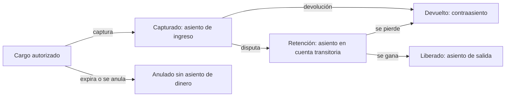

Un sistema de pagos tiene dos verdades que deben coincidir. La primera es lo que el cliente cree haber pagado; la segunda, lo que el proveedor de pagos ha cobrado, retenido o devuelto. Entre ambas hay un tercer registro, el propio, que dice cuánto se debe a cada cliente, cuánto nos debe el proveedor y cuánto es nuestro. Si ese registro se escribe como un simple campo `saldo` que se actualiza con cada operación, se pierde la historia y, con ella, la capacidad de demostrar qué pasó.

Este artículo defiende una tesis concreta: **el dinero se registra en un libro mayor de partida doble, con asientos inmutables, y las correcciones son asientos nuevos que compensan los anteriores**. La técnica tiene cinco siglos y no es un capricho contable: es lo que permite reconstruir cualquier saldo, auditar cualquier movimiento y conciliar con un proveedor sin discutir cada céntimo a mano.

## Por qué un saldo no es suficiente

El enfoque habitual en aplicaciones es una tabla de cuentas con una columna `saldo`. Cada cobro suma, cada reembolso resta y el sistema queda aparentemente correcto. El problema aparece en cuanto alguien pregunta algo que la columna no sabe responder: ¿por qué este saldo es 340 y no 355?, ¿cuándo cambió?, ¿qué operación lo cambió y quién la autorizó?

Una columna de saldo guarda solo el resultado. Cuando hay un error, sea de código, de concurrencia o de integración, la única forma de corregirlo es editar el número, y al editarlo se borra la evidencia de que hubo un error. Dos procesos que escriben el mismo saldo a la vez pueden perder una actualización sin que nadie lo note. Y si el proveedor de pagos envía un evento duplicado, el saldo lo suma dos veces sin dejar rastro.

El libro mayor invierte la relación. El saldo deja de ser un dato que se guarda y pasa a ser un cálculo sobre movimientos que no cambian. Cualquier saldo puede recalcularse en cualquier momento, y cualquier diferencia se explica señalando el movimiento que la causó.

## La partida doble en una página

La partida doble dice que cada movimiento afecta al menos a dos cuentas, con un **débito** en una y un **crédito** en otra, y que la suma de débitos y créditos de cada asiento es igual. Parece una regla burocrática, pero tiene un efecto práctico enorme: el dinero no aparece ni desaparece. Si un error rompe el equilibrio, el sistema lo detecta en la misma transacción, no meses después en el cierre.

Un cobro de 100 euros con 3 euros de comisión del proveedor se registra, por ejemplo, así:

| Cuenta                            | Débito | Crédito |
| --------------------------------- | -----: | ------: |
| Efectivo en el proveedor (activo) |  97,00 |         |
| Comisiones de pago (gasto)        |   3,00 |         |
| Ingresos por ventas (ingreso)     |        |  100,00 |

Los débitos (100,00) suman lo mismo que los créditos (100,00). Si el cálculo de la comisión fallara y dejara 3 euros sin contabilizar, el asiento no cuadraría y no debería poder guardarse. Esa es la propiedad que queremos: **un asiento desbalanceado es un error de programa, no un dato**.

Para un sistema de pagos conviene separar tres ideas que suelen mezclarse. El **cargo** es la intención del cliente de pagar. La **captura** es el momento en que el proveedor retiene el importe. El **asiento** es el registro contable de un hecho económico. Un cargo puede estar autorizado y no capturado, capturado y luego devuelto, o disputado. Cada estado produce asientos distintos, y el libro mayor debe reflejar los hechos, no la intención.

## Asientos inmutables y correcciones por contraasiento

La regla más importante del libro mayor es que **un asiento publicado no se modifica ni se borra**. Si un asiento es incorrecto, se publica un contraasiento que lo compensa exactamente, y después el asiento correcto. El historial queda completo: el error, su corrección y el motivo.

Un reembolso total de la venta anterior no es una resta sobre el ingreso original. Es un asiento nuevo que mueve el dinero en sentido contrario, y que referencia al movimiento que compensa. Si el reembolso era parcial, el asiento refleja el importe devuelto; si el proveedor retuvo también la comisión, la comisión no se devuelve y eso también queda escrito.

<Callout tone="warning" title="Inmutable no significa imposible de corregir">
  La inmutabilidad protege la historia, no impide arreglar errores. Lo que no se permite es borrar
  la evidencia. Un error se corrige con un asiento que dice «esto estaba mal y esto lo sustituye»,
  con autor, fecha y motivo.
</Callout>

Esta disciplina tiene un coste. Las consultas de saldo deben sumar movimientos en lugar de leer un número, lo que exige índices adecuados y, con volúmenes grandes, saldos precalculados como caché que se reconstruye desde el libro. Ese caché es derivado y puede tirarse sin perder información; el libro, no.

## Modelo mínimo: cuentas, asientos y líneas

El modelo de datos tiene tres entidades. Las **cuentas** representan de dónde viene y a dónde va el dinero: activos (el efectivo en el proveedor), pasivos (lo que debemos a un comercio), ingresos y gastos. Un **asiento** agrupa los movimientos de un mismo hecho económico, con fecha de contabilización, descripción y referencia al evento de origen. Las **líneas** son los débitos y créditos individuales, cada una con su cuenta, su importe y su moneda.

Las restricciones son la parte que protege el sistema. La suma de líneas de cada asiento debe ser cero en cada moneda. Un asiento necesita al menos dos líneas. Los importes se guardan como enteros en la unidad menor de la moneda (céntimos), nunca como números de coma flotante. Y las líneas de un asiento publicado no pueden cambiar, lo cual se implementa con permisos de base de datos o con un modelo de solo inserción.

Hay una decisión menos evidente: cuántas cuentas crear. Es tentador crear una cuenta por cliente, pero eso mezcla el plan contable con los datos de clientes y dificulta los informes. Una alternativa habitual es mantener cuentas globales para el dinero de la empresa y cuentas por entidad (un comercio, un cliente) con un identificador de titular. Así el balance global se obtiene sumando las cuentas de un tipo, y el saldo de un comercio, filtrando por su titular.

## Idempotencia del cobro

Un cobro puede llegar dos veces: el cliente pulsa el botón dos veces, la red corta la respuesta, el proveedor reenvía un evento. Sin protección, el sistema cobra dos veces o registra dos ingresos. La defensa tiene dos capas que deben coincidir.

La primera es la clave de idempotencia en la petición al proveedor. Muchas APIs de pagos aceptan una cabecera o campo que identifica la operación, de modo que repetir la petición con la misma clave devuelve el resultado original en lugar de crear otro cobro. La clave debe generarse una vez por intención de pago, no en cada reintento, y debe guardarse junto a la intención antes de llamar al proveedor.

La segunda es la restricción en el propio libro. Cada hecho económico recibido del proveedor tiene un identificador externo, y el libro impone que ese identificador sea único por tipo de hecho. Si llega un segundo evento con el mismo identificador, el sistema lo reconoce y no publica un asiento nuevo. Esta restricción sigue protegiendo aunque falle la capa del proveedor, porque es la última línea de defensa en la base de datos.

Conviene recordar que la idempotencia no sustituye al tratamiento de estados intermedios. Un cobro cuyo resultado no se conoce (timeout) no está ni cobrado ni rechazado: está pendiente de consulta. El sistema debe poder preguntar al proveedor por el estado de esa intención, en lugar de reintentar a ciegas.

<Callout tone="info" title="Dos claves, dos propósitos">
  La clave de idempotencia del proveedor evita cobros duplicados en la llamada. El identificador
  externo en el libro evita asientos duplicados al procesar eventos. Usar solo una de ellas deja un
  hueco.
</Callout>

## Conciliación con el proveedor

El libro mayor describe lo que el sistema cree que ha pasado. La conciliación compara esa descripción con lo que dice el proveedor, normalmente en un extracto diario de movimientos y liquidaciones, y señala cada diferencia. Es el control que detecta lo que ningún código de aplicación ve: comisiones distintas a las previstas, liquidaciones que llegan tarde, devoluciones iniciadas por el proveedor sin evento en nuestro sistema.

Una conciliación útil tiene tres niveles. El primero casa movimientos por identificador: cada cobro del libro debe tener su equivalente en el extracto, y viceversa. El segundo compara importes y comisiones, porque un movimiento puede existir en ambos lados con un importe distinto. El tercero compara saldos por periodo: lo que el proveedor debe liquidar frente a lo que el libro dice que debe.

Las diferencias no se corrigen editando el libro. Se registran como elementos de conciliación abiertos, con un responsable y un plazo, y se resuelven con asientos de ajuste explicados. Un equipo que corrige a mano sin dejar rastro acaba con un libro que cuadra por casualidad y una conciliación que nadie entiende.

### Moneda, redondeo y fechas

Tres detalles producen errores caros si se ignoran. El primero es la moneda: un asiento puede mezclar monedas si hay cambio, y en ese caso cada moneda debe cuadrar por separado o el tipo de cambio debe registrarse como un asiento propio. Sumar euros y dólares en un mismo total sin convertir es un error que el libro bien diseñado no debería permitir.

El segundo es el redondeo. Un 19 % de IVA sobre 0,05 euros no da un número entero de céntimos, y cada redondeo debe ser explícito y tener una cuenta de diferencias. Dejar que el redondeo se pierda en la aplicación genera asientos que no cuadran por un céntimo, y esos céntimos se acumulan en las conciliaciones.

El tercero son las fechas. Un pago puede estar autorizado hoy, capturado mañana y liquidado dentro de cinco días. Cada una de esas fechas tiene un significado contable distinto: la fecha de devengo, la de cobro y la de valor. Mezclarlas hace que los cierres mensuales no cuadren con los extractos del banco. Conviene guardar al menos la fecha del evento económico y la fecha de contabilización por separado.

### Cierres de periodo y cuentas transitorias

El cierre contable es el momento en que un periodo deja de aceptar asientos nuevos y se congela para informes. Un libro de solo inserción lo hace natural: se marca el periodo como cerrado y cualquier asiento posterior que pertenezca a él se rechaza o se traslada, explícitamente, al periodo abierto. Lo que no debe pasar es que un asiento aparezca en un mes cerrado porque llegó tarde un evento del proveedor; la fecha de contabilización debe decidirse por la fecha económica del hecho, no por la de su recepción.

Muchos flujos de pago necesitan **cuentas transitorias**: el dinero que está en camino entre el cliente, el proveedor y el comercio. Un cobro capturado pero no liquidado vive en una cuenta de liquidación pendiente; una disputa mueve el importe a una cuenta de retención; una liquidación recibida la cierra. Las cuentas transitorias deben tender a cero al final de cada ciclo. Si una de ellas acumula saldo de forma persistente, el sistema tiene un problema de conciliación que conviene investigar antes de que llegue al cierre anual.

Un ejemplo concreto. Un comercio vende por 200 euros, el proveedor retiene 6 euros de comisión y liquida 194 euros cinco días después. El libro registra primero el ingreso frente a la cuenta de comercios pendientes de liquidar, después la comisión como gasto, y al llegar la liquidación cierra la cuenta pendiente contra el efectivo en el proveedor. Si la liquidación llega por 193,50 euros, la diferencia de 0,50 euros no se absorbe en silencio: se publica como asiento de ajuste con su propia cuenta y su motivo, y entra en la lista de conciliación abierta.

## Herramientas

Para la mayoría de los equipos no tiene sentido construir un motor contable completo. Una opción razonable es usar la base de datos relacional con transacciones para publicar asientos atómicos, una tabla de solo inserción para las líneas y una vista materializada para los saldos. Si el negocio exige un sistema contable formal, una plataforma de contabilidad o de tesorería cubre el libro, pero el sistema de pagos sigue siendo responsable de no publicar asientos incorrectos.

El proveedor de pagos aporta el extracto, las claves de idempotencia y los webhooks. Esos webhooks pueden llegar fuera de orden y repetirse, así que la lógica de procesamiento debe ser tolerante a ambos casos, como se explica en [sagas, outbox e idempotencia](/docs/sagas-outbox-idempotencia).

<Callout tone="tip" title="Empieza por el cuadre">
  Antes de elegir tecnología, escribe la regla que todo asiento debe cumplir y pruébala con datos
  sucios: cobros duplicados, eventos fuera de orden, importes con céntimos. Si la regla resiste, el
  resto del diseño es mecánico.
</Callout>

## Errores frecuentes

El primer error es guardar un saldo como fuente de verdad. Es cómodo para mostrar datos y peligroso para explicarlos. Si el saldo se puede editar, no hay libro, solo un contador.

El segundo es permitir asientos que no cuadran, dejando la validación a la aplicación sin restricción en la base de datos. Un bug en un solo endpoint basta para romper el balance global.

El tercero es corregir asientos editando sus líneas. Rompe la historia y hace imposible auditar, y suele ocurrir porque corregir un contraasiento parece más trabajo al principio.

El cuarto es tratar el reintento como si fuera un nuevo cobro. Sin clave de idempotencia y sin restricción de unicidad en el libro, cada timeout se convierte en una posible duplicidad real.

El quinto es conciliar tarde. Una diferencia de un mes sin explicar cuesta más que una diferencia de un día, porque las causas se pierden.

## Checklist

- El libro es de solo inserción: los asientos publicados no se editan ni se borran.
- Cada asiento cuadra en cada moneda, y la base de datos o el propio flujo impiden publicar un asiento desbalanceado.
- Los importes se guardan como enteros en la unidad menor de la moneda.
- Cada cobro tiene una clave de idempotencia generada una vez por intención y guardada antes de llamar al proveedor.
- Cada hecho recibido del proveedor tiene un identificador externo único que el libro impone.
- Los estados intermedios (pendiente de consulta) están modelados, y el sistema puede consultar al proveedor.
- Los saldos son derivados del libro y pueden reconstruirse desde cero.
- La conciliación casa movimientos por identificador, importes y saldos por periodo, y registra las diferencias abiertas.
- La moneda, el redondeo y las fechas contables están definidos y tienen cuenta propia cuando hace falta.
- Las correcciones llevan autor, fecha, motivo y referencia al asiento que sustituyen.

## Fuentes

- Luca Pacioli, _Summa de arithmetica, geometria, proportioni et proportionalità_ (Venecia, 1494), con la exposición del método de partida doble, según la [entrada de Wikipedia sobre la obra](https://en.wikipedia.org/wiki/Summa_de_arithmetica). El método era anterior; el libro lo describe como práctica vigente.
- Documentación de la API de idempotencia de Stripe, [Idempotent requests](https://docs.stripe.com/api/idempotent_requests), como ejemplo del uso de claves de idempotencia en pagos. Los detalles de caducidad de las claves no se comprobaron y no se citan aquí.

Consultadas en octubre de 2026. Las cifras de ejemplo del asiento son ilustrativas. El principio de partida doble y el funcionamiento de conciliaciones y de cargos y capturas se describen en general, sin atribuirlos a un proveedor concreto.
