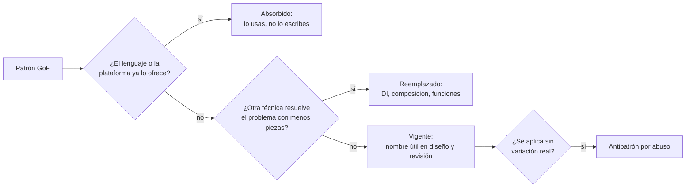
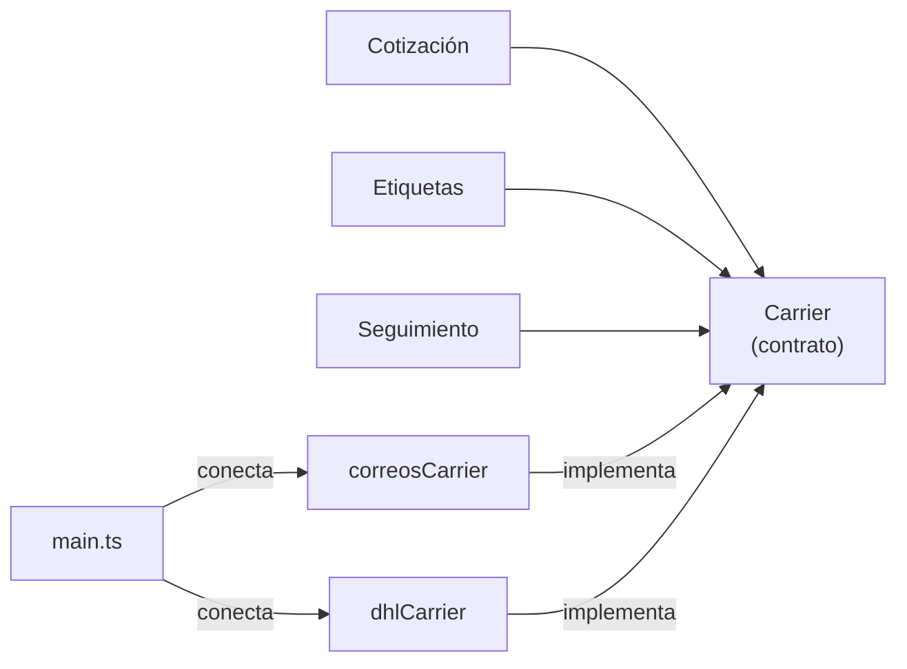

# Patrones de diseño GoF con enfoque moderno

Abres una revisión de código y encuentras `PaymentProcessorStrategyFactoryProvider`: cuatro archivos, dos interfaces y una clase abstracta para elegir entre tarjeta y transferencia. En el módulo de al lado ocurre lo contrario: el mismo `switch` sobre el tipo de transportista está copiado en el cálculo de tarifas, en la etiqueta y en el seguimiento, y cada transportista nuevo exige tocar los tres. Los dos equipos conocen los patrones de diseño. Uno los aplica por reflejo y el otro no ve dónde faltan.

La definición que usa este artículo es esta: **un patrón de diseño es una solución con nombre a un problema de diseño que se repite en un contexto concreto, y su valor está en el problema que nombra y en sus consecuencias, no en las clases que dibuja**.

Con esa definición en la mano, el catálogo clásico de 1994 se lee de otra forma. Algunos patrones siguen siendo vocabulario diario. Otros desaparecieron dentro del lenguaje: ya no los escribes, los usas. Otros los sustituyó una técnica distinta, sobre todo la inyección de dependencias. Y uno, Singleton, pasó a considerarse un problema en la mayoría de los contextos. Aquí verás cada caso, por qué ocurrió y cómo decidir cuándo un patrón compensa lo que cuesta.

<Callout tone="info" title="Fecha de corte y alcance">
  Fuentes consultadas en octubre de 2026. No tuve acceso al texto completo del libro del GoF: los
  datos sobre su contenido salen de la ficha del editor, de Wikipedia y de apuntes académicos que lo
  resumen, y así se indica en cada caso. La clasificación de vigencia es una valoración editorial,
  no una lista oficial.
</Callout>

## De dónde vienen: el libro del GoF

_Design Patterns: Elements of Reusable Object-Oriented Software_ lo escribieron Erich Gamma, Richard Helm, Ralph Johnson y John Vlissides, conocidos como la «banda de los cuatro» (_Gang of Four_, GoF). Lo publicó Addison-Wesley en octubre de 1994, con copyright de 1995, y sus ejemplos están en C++ y Smalltalk. Ese detalle importa: muchos patrones resuelven limitaciones de esos lenguajes en aquel momento.

El catálogo tiene 23 patrones en tres categorías:

| Categoría         | Qué resuelve                                        | Patrones                                                                                                                        |
| ----------------- | --------------------------------------------------- | ------------------------------------------------------------------------------------------------------------------------------- |
| Creacionales      | Cómo se crean los objetos sin acoplarse a su clase  | Abstract Factory, Builder, Factory Method, Prototype, Singleton                                                                 |
| Estructurales     | Cómo se componen objetos y clases en piezas mayores | Adapter, Bridge, Composite, Decorator, Facade, Flyweight, Proxy                                                                 |
| De comportamiento | Cómo se reparten responsabilidades y se comunican   | Chain of Responsibility, Command, Interpreter, Iterator, Mediator, Memento, Observer, State, Strategy, Template Method, Visitor |

Son 5 creacionales, 7 estructurales y 11 de comportamiento. Según los resúmenes académicos del primer capítulo, cada patrón tiene cuatro elementos: **nombre, problema, solución y consecuencias**. El cuarto es el que más se olvida, y es el que te dice cuándo no usarlo.

La introducción deja dos principios que han envejecido mejor que cualquier patrón concreto: programar contra una interfaz y no contra una implementación, y preferir la composición de objetos a la herencia de clases. Casi todo lo que se dice hoy sobre patrones es una consecuencia de esos dos principios, que también están detrás de la D y la O de [SOLID](/docs/solid).

## Qué pasó en treinta años

Dos documentos marcan la evolución.

El primero es la charla de Peter Norvig _Design Patterns in Dynamic Languages_, presentada el 5 de mayo de 1996. Su diapositiva central dice que 16 de los 23 patrones son invisibles o más simples en Lisp o Dylan, y lo atribuye a rasgos concretos del lenguaje:

| Rasgo del lenguaje         | Patrones que simplifica según Norvig                                               |
| -------------------------- | ---------------------------------------------------------------------------------- |
| Tipos de primera clase     | Abstract Factory, Flyweight, Factory Method, State, Proxy, Chain of Responsibility |
| Funciones de primera clase | Command, Strategy, Template Method, Visitor                                        |
| Macros                     | Interpreter, Iterator                                                              |
| Combinación de métodos     | Mediator, Observer                                                                 |
| Multimétodos               | Builder                                                                            |
| Módulos                    | Facade                                                                             |

Norvig distingue tres niveles: un patrón es **invisible** cuando forma parte del lenguaje y ni lo notas, **informal** cuando lo nombras pero lo implementas a mano cada vez, y **formal** cuando el propio lenguaje permite escribirlo una vez y reutilizarlo. Treinta años después, buena parte de lo que él veía en Lisp está en Java, C#, Python, TypeScript, Kotlin o Go.

El segundo es la entrevista _Design Patterns 15 Years Later_, publicada por InformIT el 22 de octubre de 2009. Allí Gamma dice que está a favor de quitar Singleton porque su uso «casi siempre es un olor de diseño». Los autores esbozan una reorganización en categorías nuevas (núcleo, creacionales, periféricos y otros), proponen generalizar Factory Method como Factory y añadir, entre otros, Null Object e **inyección de dependencias**. Lo presentan como notas en borrador, no como una segunda edición.



## Clasificación para la práctica actual

La tabla clasifica los patrones que más aparecen en código real. «Vigente» no significa «úsalo siempre»: significa que el nombre sigue describiendo una decisión que tomas tú y no el lenguaje.

| Patrón           | Estado hoy                                     | Por qué                                                                                                                                                     |
| ---------------- | ---------------------------------------------- | ----------------------------------------------------------------------------------------------------------------------------------------------------------- |
| Strategy         | Absorbido en su forma mínima                   | Una estrategia de un solo método es una función que pasas como argumento. Sigue vigente como objeto cuando agrupa varias operaciones o estado propio        |
| Observer         | Vigente, casi siempre provisto                 | Emisores de eventos, señales y flujos reactivos lo traen hecho. La decisión que queda es tuya: orden de entrega, errores y bajas de suscripción             |
| Decorator        | Vigente                                        | Es la forma de los _middlewares_ y de los envoltorios de caché, reintentos o métricas. En su versión ligera es una función de orden superior                |
| Adapter          | Vigente                                        | Es el adaptador de la [arquitectura hexagonal](/docs/arquitectura-hexagonal) y la pieza de una capa anticorrupción                                          |
| Facade           | Vigente, absorbido por los módulos             | Un módulo con una API pública pequeña es una fachada. Norvig ya lo atribuía a los módulos                                                                   |
| Factory Method   | Reemplazado en la mayoría de los casos         | La inyección de dependencias y las funciones de construcción eligen la implementación sin una jerarquía de creadores. Sobrevive en _hooks_ de frameworks    |
| Abstract Factory | Reemplazado por inyección de dependencias      | Elegir una familia coherente de implementaciones es tarea de la raíz de composición. Vigente solo si la familia cambia en tiempo de ejecución               |
| Command          | Absorbido si solo se ejecuta                   | Si solo hay que ejecutar algo más tarde, basta un cierre (_closure_). Vigente cuando el comando es un dato: se encola, se serializa, se audita o se deshace |
| Iterator         | Absorbido por el lenguaje                      | Bucles _for-each_, generadores y protocolos de iteración lo hacen invisible. Solo lo implementas al exponer una colección propia                            |
| Singleton        | Antipatrón si se abusa                         | Mezcla «una sola instancia» con «acceso global». Lo primero es legítimo; lo segundo oculta dependencias y rompe los tests                                   |
| Template Method  | Reemplazado por composición                    | Fija el algoritmo en una clase base y obliga a heredar. Pasar los pasos variables como funciones o colaboradores da lo mismo sin acoplarte a la jerarquía   |
| State            | Vigente, con otra forma                        | Para ciclos de vida con reglas, una unión discriminada de estados y una tabla de transiciones suele ser más legible que una clase por estado                |
| Proxy            | Absorbido por plataformas y frameworks         | Carga diferida de ORMs, clientes RPC generados, `Proxy` de JavaScript. Lo diseñas a mano pocas veces, pero debes reconocerlo al depurar                     |
| Builder          | Vigente en construcción por pasos              | Con parámetros nombrados u objetos literales sobra para crear datos. Sigue siendo útil cuando la construcción valida por etapas                             |
| Visitor          | Reemplazado donde hay coincidencia de patrones | En lenguajes con tipos suma y _pattern matching_, recorrer una jerarquía cerrada no necesita doble despacho                                                 |

## Cómo el lenguaje absorbió patrones

Un patrón se absorbe cuando el lenguaje convierte su estructura en sintaxis o en biblioteca estándar. Lo que queda es el problema, no la ceremonia.

### Iteradores y generadores

El Iterator del GoF separa el recorrido de la colección mediante un objeto con operaciones para avanzar y consultar el elemento actual. Hoy cualquier lenguaje mayoritario tiene un protocolo de iteración que el bucle _for-each_ consume directamente, y los generadores permiten escribir un recorrido perezoso como una función que va entregando valores. La decisión de diseño que sobrevive es cuándo exponer un iterable propio en lugar de devolver un arreglo: cuando la colección es grande, se recorre de forma perezosa o se pagina contra un servicio externo.

### Funciones de primera clase en lugar de estrategias y comandos

Si una estrategia o un comando tiene un solo método, la interfaz y sus clases son la versión larga de un tipo de función. Compara las dos firmas:

```typescript
// Versión clásica: una interfaz y una clase por variante
interface DiscountStrategy {
  apply(cart: Cart): Money;
}
declare class BlackFridayDiscount implements DiscountStrategy {
  // …
}

// Versión actual: el tipo es una función y las variantes, valores
type ApplyDiscount = (cart: Cart) => Money;
declare const blackFriday: ApplyDiscount;
declare function checkout(cart: Cart, discount: ApplyDiscount): Receipt;
```

La idea del patrón sigue ahí: el algoritmo varía sin tocar a quien lo usa. Lo que desaparece son las clases. El objeto vuelve a ganar cuando la variante necesita varias operaciones relacionadas (calcular, describir, validar) o estado propio: entonces un tipo con varios métodos comunica mejor que tres funciones sueltas.

Con Command ocurre lo mismo. Un cierre que captura sus argumentos ya es un comando que puedes ejecutar más tarde. Lo que un cierre no da es una representación como dato: si necesitas guardar el comando en una cola, reintentarlo en otro proceso, registrarlo para auditoría o deshacerlo, vuelve a ser un objeto con nombre y campos, como el comando de un caso de uso en la [arquitectura hexagonal](/docs/arquitectura-hexagonal).

### Inyección de dependencias en lugar de fábricas y singletons

Martin Fowler publicó el 23 de enero de 2004 el artículo que fijó el término _Dependency Injection_: eligió el nombre porque «inversión de control» era demasiado genérico. La idea es que un objeto recibe sus colaboradores desde fuera en lugar de crearlos o buscarlos.

Eso deja sin trabajo a dos patrones creacionales. Abstract Factory existía para que el código cliente no supiera qué familia de clases concretas usar; ahora esa decisión vive en un único lugar, la raíz de composición, que conecta cada dependencia con su implementación. Singleton existía para garantizar una instancia y dar acceso a ella; ahora la instancia única la crea la raíz de composición una vez y la pasa a quien la necesita. La garantía se mantiene y el acceso global desaparece.

No necesitas un contenedor para esto. Pasar dependencias por constructor o por argumento y conectarlas en `main` es inyección de dependencias. Un contenedor se justifica cuando el grafo es grande, no antes.

## Singleton: de patrón a antipatrón

Singleton promete dos cosas a la vez: que solo exista una instancia y que cualquiera pueda obtenerla desde cualquier sitio. La primera promesa casi nunca es el problema. La segunda sí.

| Consecuencia        | Qué pasa en la práctica                                                                                                    |
| ------------------- | -------------------------------------------------------------------------------------------------------------------------- |
| Estado global       | Cualquier módulo puede leerlo y modificarlo. Un fallo en un sitio aparece en otro que no tiene relación aparente           |
| Dependencia oculta  | La firma de una función no dice que usa la configuración o la conexión: lo descubres al leer su cuerpo o al fallar el test |
| Tests acoplados     | El estado sobrevive entre tests; el orden de ejecución cambia el resultado y paralelizar se vuelve arriesgado              |
| Sustitución difícil | Para usar un doble en un test hay que parchear un acceso estático en vez de pasar otra implementación                      |
| Concurrencia        | La inicialización perezosa exige cuidado para no crear la instancia dos veces                                              |

Por eso Gamma lo llamó un olor de diseño en 2009, y por eso la regla práctica actual es separar las dos promesas.

**Dónde sigue siendo legítimo.** Que exista una sola instancia de algo es normal: un pool de conexiones, un cliente HTTP con su configuración, la caché de un proceso. Lo correcto es crearla una vez en la raíz de composición e inyectarla; los contenedores de inyección llaman a eso vida «singleton», y no tiene los problemas de la tabla porque nadie la obtiene por acceso global. También es aceptable un módulo que exporta valores inmutables, como constantes o configuración leída al arrancar y congelada: no hay estado que mutar. El caso que debes evitar es un objeto mutable que cualquier capa alcanza con una llamada estática.

## El vocabulario que vino después del GoF

Varios patrones que hoy se nombran a diario no están en el libro de 1994. No hace falta profundizar en ellos aquí, pero conviene saber de dónde vienen y dónde se tratan.

| Patrón                         | Origen                                                                                                           | Relacionado                                                                                                 |
| ------------------------------ | ---------------------------------------------------------------------------------------------------------------- | ----------------------------------------------------------------------------------------------------------- |
| Repository                     | Catálogo de _Patterns of Enterprise Application Architecture_ (Fowler, 2002); entrada de Edward Hieatt y Rob Mee | [Domain-Driven Design](/docs/domain-driven-design) y [arquitectura hexagonal](/docs/arquitectura-hexagonal) |
| Unit of Work                   | Mismo catálogo: registra los objetos afectados por una transacción y coordina su escritura                       | [Arquitectura en capas, limpia y cebolla](/docs/arquitectura-en-capas-clean-onion)                          |
| Inyección de dependencias      | Artículo de Fowler de enero de 2004                                                                              | [SOLID](/docs/solid), principio de inversión de dependencias                                                |
| Patrones dirigidos por eventos | Fowler (2017) distingue notificación de eventos, transferencia de estado en el evento, _event sourcing_ y CQRS   | [Monolito o microservicios](/docs/monolito-vs-microservicios)                                               |

Fíjate en que el adaptador de la hexagonal es un Adapter del GoF con un rol concreto, y que Repository cumple un papel parecido: una interfaz tipo colección que media con la capa de mapeo de datos. Los patrones nuevos rara vez inventan estructuras: dan nombre a un rol dentro de una arquitectura.

## El peligro del diseño guiado por patrones

Nombrar un patrón no hace bueno un diseño. Un diseño es bueno si el cambio que esperas es barato; un patrón solo ayuda si apunta a ese cambio. Cuando se elige el patrón antes de conocer la variación, el resultado es indirección sin propósito.

El caso del principio del artículo, reducido a firmas:

```typescript
// Antes: tres patrones para dos medios de pago que no cambian juntos
abstract class AbstractPaymentProcessor {
  // …
}
interface PaymentProcessorFactory {
  create(kind: string): AbstractPaymentProcessor;
}
declare class PaymentProcessorRegistry {
  static getInstance(): PaymentProcessorRegistry;
}

// Después: un tipo de función y un mapa cerrado por tipo de pago
type ChargePayment = (charge: Charge) => Promise<Receipt>;
declare const chargeBy: Readonly<Record<PaymentMethod, ChargePayment>>;
```

La versión de después tiene la misma capacidad de extensión (añadir un medio de pago es añadir una entrada), el compilador comprueba que el mapa cubre todos los valores de `PaymentMethod` y no hay acceso global. Lo que se perdió son nombres de patrones, no diseño.

Joshua Kerievsky defendió en _Refactoring to Patterns_ (Addison-Wesley, 2004) que es mejor llegar a un patrón refactorizando un diseño existente que aplicarlo de antemano, y que hay que saber refactorizar **hacia**, **en dirección a** y **lejos de** un patrón. Esa tercera dirección es la que más se olvida: quitar un patrón que ya no compra nada es una mejora legítima.

## Ejemplo resuelto: del switch repetido a una estrategia con nombre

Una tienda calcula envíos con tres transportistas. El código tiene un `switch` sobre el transportista en tres sitios: la cotización, la generación de la etiqueta y la URL de seguimiento. Llega un cuarto transportista y el cambio toca tres archivos; en la revisión alguien olvida el caso del seguimiento y el error aparece en producción.

**Diagnóstico.** El síntoma no es el `switch` en sí: un `switch` en un solo lugar es perfectamente legible. El síntoma es el **mismo `switch` en varios sitios**, porque significa que el conocimiento sobre cada transportista está repartido. Es el caso de manual que Fowler cataloga como _Replace Conditional with Polymorphism_.

**Decisión.** Cada transportista tiene tres operaciones relacionadas que cambian juntas. Eso inclina hacia un tipo con varios métodos (una estrategia como objeto) y no hacia tres mapas de funciones independientes, que repartirían de nuevo el conocimiento.

```typescript
// shipping/carrier.ts: el contrato que cada transportista cumple
export type Carrier = {
  quote(parcel: Parcel, destination: Address): Money;
  createLabel(shipment: Shipment): Promise<Label>;
  trackingUrl(trackingId: string): URL;
};

// shipping/carriers/*.ts: una implementación por transportista
declare const correosCarrier: Carrier;

// main.ts: la raíz de composición elige; nadie más conoce la lista
declare const carriers: Readonly<Record<CarrierId, Carrier>>;
```



**Resultado.** Añadir un transportista es crear un archivo y una entrada en el mapa; si falta una operación, el compilador lo señala. Cada implementación se prueba sola, y una batería común verifica que todas cumplen el contrato. No hizo falta fábrica, ni clase base, ni singleton: el patrón es Strategy y la técnica que lo conecta es inyección de dependencias.

**Dónde parar.** Si mañana un transportista necesita un paso extra que los demás no tienen, la tentación es añadir un método opcional al contrato. Mejor no: es la señal de que ese paso pertenece a otra abstracción o a ese transportista en particular. El contrato debe describir lo que **todos** hacen.

## Cuándo un patrón compensa su coste

Cada patrón añade tipos, archivos y un salto más al leer el código. Ese coste se paga en cada lectura, así que solo compensa si compra una variación que existe o que es muy probable.

| Cuándo sí                                                                      | Cuándo no                                                                    |
| ------------------------------------------------------------------------------ | ---------------------------------------------------------------------------- |
| Ya hay dos o más variantes reales, o una segunda confirmada en la hoja de ruta | «Por si algún día» sin un caso concreto                                      |
| La misma decisión condicional se repite en varios sitios                       | El condicional aparece una vez y es legible                                  |
| Necesitas una costura para probar sin infraestructura                          | La pieza es pura y ya se prueba sola                                         |
| El equipo reconoce el nombre y lo usa en revisiones                            | El nombre solo lo entiende quien lo aplicó                                   |
| El lenguaje no ofrece el mecanismo y el patrón lo suple                        | El lenguaje ya lo trae: funciones, iteradores, módulos, parámetros nombrados |

### Señales de que falta un patrón

- **El mismo `switch` o cadena de `if` sobre un tipo en varios lugares.** Falta polimorfismo: Strategy o un mapa de implementaciones.
- **Parámetros booleanos que cambian el comportamiento.** Suelen esconder dos estrategias dentro de una función. Lo tratamos en [clean code](/docs/clean-code).
- **El mismo envoltorio copiado en muchas llamadas** (registro, reintentos, métricas). Falta un Decorator o un _middleware_.
- **Un objeto que consulta a otro en bucle para saber si cambió.** Falta Observer o un evento.
- **Un ciclo de vida con `if` sobre una cadena de estado repartidos por el código.** Falta un State explícito: unión de estados y tabla de transiciones.
- **Tu código de negocio importa el SDK de un proveedor.** Falta un Adapter en la frontera; el [acoplamiento](/docs/acoplamiento-cohesion) lo pagarás al cambiar de proveedor.

### Señales de que sobra

- **Interfaces con una sola implementación** y sin necesidad de un doble de prueba.
- **Fábricas que solo llaman al constructor** sin decidir nada.
- **Nombres con varios sufijos de patrón** (`...StrategyFactoryProvider`): cada sufijo es un salto que quien lee debe resolver.
- **Clases base abstractas con un único hijo**, creadas por Template Method antes de que hubiera un segundo caso.
- **Para seguir una petición hay que abrir cinco archivos** y ninguno contiene lógica de negocio.

Si dudas, empieza por lo simple y deja que el segundo caso real te pida el patrón. Esa decisión, y el momento de revertirla, son buenos candidatos para un [ADR](/docs/adr), porque es [deuda técnica](/docs/deuda-tecnica-evolucion) que alguien heredará.

## Errores frecuentes

- **Aprender el diagrama y no las consecuencias.** El cuarto elemento de cada patrón dice cuándo no usarlo; sin él, el patrón es una plantilla.
- **Traducir C++ de 1994 a un lenguaje de 2026.** Clases para lo que en tu lenguaje es una función, un módulo o un iterador.
- **Usar Singleton para «no pasar la dependencia».** El problema que esquivas es justo el que el diseño debería resolver: quién depende de qué.
- **Heredar para reutilizar.** Template Method y las jerarquías profundas te atan a la clase base; la composición da lo mismo con menos acoplamiento.
- **Confundir el patrón con su nombre.** Llamar `Repository` a un objeto que expone consultas SQL no aísla nada.
- **Patrones como requisito de revisión.** Pedir «aplica un patrón aquí» en lugar de preguntar qué cambio debe ser barato.
- **No quitar nunca un patrón.** Cuando la variación desaparece, la indirección se queda y se paga en cada lectura.

## Checklist

- [ ] Cada patrón del código responde a una variación real o a una costura de prueba que puedes señalar.
- [ ] Las estrategias y comandos de un solo método son funciones, salvo que deban viajar como datos.
- [ ] No hay objetos mutables alcanzables por acceso global; las instancias únicas se crean en la raíz de composición.
- [ ] La elección de implementaciones vive en un solo lugar, no en fábricas repartidas.
- [ ] Ningún `switch` sobre un tipo se repite en más de un sitio.
- [ ] Los nombres describen el rol en el dominio, no la lista de patrones aplicados.
- [ ] Las decisiones de introducir o retirar un patrón relevante están registradas.

## Fuentes

Consultadas en octubre de 2026. No tuve acceso al texto completo del libro del GoF; el contenido del primer capítulo se cita a partir de apuntes académicos.

- [Design Patterns: Elements of Reusable Object-Oriented Software, ficha del editor (InformIT)](https://www.informit.com/store/design-patterns-elements-of-reusable-object-oriented-software-9780201633610)
- [Design Patterns en Wikipedia](https://en.wikipedia.org/wiki/Design_Patterns): fecha de publicación, categorías y recepción
- [Introducción a los patrones, apuntes de la Universidad Estatal de San Diego](https://eli.sdsu.edu/courses/spring98/cs635/notes/patternIntro/patternIntro.html): los cuatro elementos de un patrón, solo desde resultados de búsqueda
- [Design Patterns in Dynamic Languages (Peter Norvig, 1996)](https://norvig.com/design-patterns/) y sus [diapositivas en PDF](https://norvig.com/design-patterns/design-patterns.pdf)
- [Design Patterns 15 Years Later: An Interview with Erich Gamma, Richard Helm, and Ralph Johnson (InformIT, 2009)](https://www.informit.com/articles/article.aspx?p=1404056)
- [Inversion of Control Containers and the Dependency Injection pattern (Martin Fowler, 2004)](https://martinfowler.com/articles/injection.html)
- [Repository](https://martinfowler.com/eaaCatalog/repository.html) y [Unit of Work](https://martinfowler.com/eaaCatalog/unitOfWork.html) en el catálogo de _Patterns of Enterprise Application Architecture_
- [What do you mean by "Event-Driven"? (Martin Fowler, 2017)](https://martinfowler.com/articles/201701-event-driven.html)
- [Replace Conditional with Polymorphism, catálogo de refactorings](https://refactoring.com/catalog/replaceConditionalWithPolymorphism.html)
- [Refactoring to Patterns (Joshua Kerievsky, Industrial Logic)](https://www.industriallogic.com/xp/refactoring/) y su [ficha en O'Reilly](https://www.oreilly.com/library/view/refactoring-to-patterns/0321213351/)
- [Singleton en Refactoring.Guru](https://refactoring.guru/design-patterns/singleton): inconvenientes del patrón
