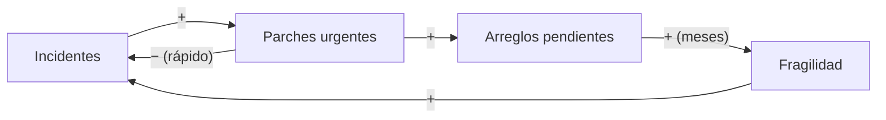
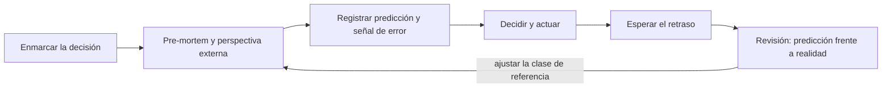

# Pensamiento sistémico y sesgos en las decisiones

Un equipo cierra cada incidente con un parche urgente. Cada parche funciona: la alerta se apaga y el servicio vuelve. Seis meses después hay más incidentes que nunca, el backlog está lleno de «arreglo definitivo pendiente» y la retrospectiva concluye que hace falta más disciplina. Nadie tomó una mala decisión aislada; la estructura del trabajo produjo el resultado. Y cuando el equipo decide cómo salir, estima la reescritura en cuatro meses porque es lo que dice el plan, no lo que tardaron los últimos proyectos parecidos.

**El pensamiento sistémico explica el comportamiento de un sistema por su estructura (acumulaciones, bucles de realimentación y retrasos) y no por eventos aislados; los sesgos cognitivos son desviaciones sistemáticas del juicio que te hacen leer mal esa estructura y decidir peor.**

Este artículo se centra en la primera mitad: cómo reconocer bucles de refuerzo y de equilibrio, por qué los retrasos engañan y cuándo una solución empeora el problema que ataca. Después repasa los sesgos que más pesan cuando el sistema responde tarde y las técnicas para contrarrestarlos. Los criterios generales de decisión y la reversibilidad están en [trade-offs y toma de decisiones](/docs/trade-offs-y-decisiones), que ya trata en detalle el anclaje, el costo hundido y el statu quo; el uso de la IA como apoyo, en [IA para decidir en negocio](/docs/ia-para-decidir-negocio), y la distinción entre lo que el problema exige y lo que la solución añade, en [complejidad esencial y accidental](/docs/complejidad-esencial-y-accidental).

<Callout tone="info" title="Fecha de corte y fuentes">
  Fuentes consultadas en octubre de 2026. Las definiciones de Donella Meadows proceden de su ensayo
  sobre puntos de apalancamiento, publicado en su sitio oficial, y de resúmenes de _Thinking in
  Systems_ (fuente secundaria). Del artículo de Gary Klein en Harvard Business Review se cita el
  resumen público. Los datos de Buehler, Griffin y Ross proceden del artículo original.
</Callout>

## Del evento a la estructura

Ante un problema, la reacción natural es buscar el evento que lo causó: el despliegue del viernes, el cambio de proveedor, la persona que no revisó el PR. El pensamiento sistémico propone otra pregunta: **¿qué estructura hace que este patrón se repita?** Si el mismo tipo de incidente vuelve cada pocas semanas, el evento de hoy es solo la última muestra.

Donella Meadows escribió _Thinking in Systems: A Primer_ como borrador en 1993; tras su muerte en 2001, sus colegas del Sustainability Institute lo reestructuraron, Diana Wright lo editó y Chelsea Green lo publicó en 2008. El libro trabaja con tres piezas:

- **Acumulaciones** (_stocks_): cantidades que crecen o se vacían con el tiempo. Lo que ves en un instante es una foto de ellas.
- **Flujos** (_flows_): lo que entra y sale de cada acumulación por unidad de tiempo.
- **Bucles de realimentación**: cadenas causales en las que el estado de una acumulación termina influyendo en sus propios flujos.

En software las acumulaciones no siempre son evidentes, porque muchas no aparecen en ningún tablero:

| Acumulación                     | Flujo de entrada                             | Flujo de salida                           |
| ------------------------------- | -------------------------------------------- | ----------------------------------------- |
| Arreglos definitivos pendientes | Cada parche urgente que se deja «para luego» | Trabajo planificado para cerrarlos        |
| Conocimiento del sistema        | Incorporaciones, documentación, pares        | Rotación, olvido, código que nadie toca   |
| Confianza de los clientes       | Entregas fiables, respuestas rápidas         | Incidentes visibles, promesas incumplidas |
| Complejidad accidental          | Atajos, dependencias nuevas, capas añadidas  | Simplificaciones y retirada de código     |
| Clientes activos                | Altas                                        | Bajas                                     |

Las acumulaciones explican por qué los sistemas tienen inercia: aunque cortes hoy el flujo de entrada, lo acumulado sigue ahí y tarda en vaciarse.

## Bucles de realimentación

Meadows distingue dos tipos de bucle. Conviene marcarlos en cualquier diagrama causal con una letra: **R** para refuerzo y **B** para equilibrio (_balancing_).

### Bucles de refuerzo

Un bucle de refuerzo amplifica el cambio: cuanto más funciona, más fuerte se vuelve. En su ensayo sobre puntos de apalancamiento, Meadows los describe como la fuente del crecimiento, la explosión, la erosión y el colapso, y advierte que un bucle de refuerzo sin freno termina destruyéndose. Pueden ser virtuosos o viciosos; la estructura es la misma, solo cambia el signo del resultado.

Ejemplos que reconocerás:

- **Tormentas de reintentos.** Una dependencia se degrada, los clientes reintentan, la carga sube, la dependencia empeora y hay más reintentos. Los mecanismos para cortarlo están en [resiliencia en sistemas distribuidos](/docs/resiliencia-sistemas-distribuidos).
- **Parches que generan parches.** Cada incidente se cierra con un parche; cada parche deja un arreglo pendiente; los pendientes acumulados vuelven el sistema más frágil y generan más incidentes. Es el bucle de la figura del artículo.
- **Efecto red (virtuoso).** Más usuarios generan más contenido, que atrae a más usuarios. El mismo bucle funciona al revés cuando los usuarios se van.

### Bucles de equilibrio

Un bucle de equilibrio busca un objetivo: corrige la desviación entre el estado actual y una meta. Los resúmenes del libro lo describen como un bucle que busca la estabilidad y que mantiene una acumulación en un valor o dentro de un rango. El ejemplo clásico es el termostato. En arquitectura, el **autoescalado** es un bucle de equilibrio: si el uso de CPU supera el objetivo, se añaden instancias; si baja, se retiran.

Meadows insiste en que la fuerza de un bucle de equilibrio debe estar a la altura del impacto que corrige, y en que quitar mecanismos de corrección que casi nunca se usan reduce el rango de condiciones en que el sistema sobrevive. En software, eso es lo que pasa cuando se elimina un límite de tasa «porque nunca salta».

### Retrasos

Entre una acción y su efecto suele haber un retraso. Meadows lo formula en relación con la velocidad de cambio del sistema: los retrasos demasiado cortos provocan sobrerreacción, y los demasiado largos provocan oscilaciones amortiguadas, sostenidas o crecientes. También observa que los retrasos suelen ser difíciles de cambiar, y que a menudo es más fácil frenar el ritmo de cambio para que el retraso haga menos daño.

Tres retrasos típicos en decisiones técnicas y de negocio:

| Retraso                             | Duración típica (orientativa) | Efecto si lo ignoras                                         |
| ----------------------------------- | ----------------------------- | ------------------------------------------------------------ |
| Arranque de nuevas instancias       | Segundos a minutos            | El autoescalado añade de más y luego retira de más           |
| Incorporación de personas al equipo | Meses                         | Añadir gente a un proyecto atrasado lo retrasa más al inicio |
| Deterioro por deuda acumulada       | Trimestres                    | Se atribuyen los incidentes a la mala suerte, no a la deuda  |

El segundo caso es la ley de Brooks, formulada en _The Mythical Man-Month_ (1975): añadir personas a un proyecto de software atrasado lo atrasa más. Es un retraso de incorporación combinado con un costo de coordinación.

El retraso es lo que hace peligroso un bucle de refuerzo: mientras el efecto no llega, la decisión parece correcta y se repite.

## Cuando la solución empeora el problema

La combinación más traicionera junta un bucle de equilibrio rápido con un bucle de refuerzo lento. Peter Senge la catalogó como el arquetipo _fixes that fail_ («arreglos que fallan») en _The Fifth Discipline_ (1990), junto a otro cercano, _shifting the burden_ («desplazar la carga»): una solución sintomática alivia el problema, la presión para buscar la solución de fondo desaparece y los efectos secundarios lo agravan. Meadows describe una trampa equivalente, _shifting the burden to the intervenor_, en la que una intervención alivia los síntomas sin tocar la causa y el sistema acaba dependiendo de ella.



El bucle de la izquierda (incidentes, parches) es de equilibrio y actúa en horas: por eso el parche parece funcionar. El de la derecha es de refuerzo y actúa en meses: por eso nadie lo conecta con el parche. Algunos casos frecuentes:

| Solución rápida                       | Alivio inmediato               | Efecto diferido                                               |
| ------------------------------------- | ------------------------------ | ------------------------------------------------------------- |
| Parche urgente sin arreglo de fondo   | El incidente se cierra         | Más fragilidad y más incidentes                               |
| Caché delante de una consulta lenta   | La latencia baja               | Nadie arregla la consulta; la invalidación añade complejidad  |
| Descuento para cerrar el trimestre    | Se cumple la cifra de ventas   | Los clientes aprenden a esperar al descuento                  |
| Héroe de guardia que lo resuelve todo | El servicio se recupera rápido | El conocimiento se concentra y el resto del equipo no aprende |
| Más personas al proyecto atrasado     | Sensación de avance            | Más coordinación y menos productividad durante meses          |

### Dónde intervenir

En su ensayo «Leverage Points: Places to Intervene in a System», Meadows ordena doce puntos de intervención de menor a mayor eficacia y presenta la lista como tentativa. Los menos eficaces son los parámetros y las cifras; los más eficaces, las reglas, los objetivos y el paradigma que da origen al sistema. Algunos con traducción directa a decisiones técnicas:

| Punto de apalancamiento (Meadows)       | Ejemplo en software o negocio                                         |
| --------------------------------------- | --------------------------------------------------------------------- |
| Constantes y parámetros                 | Subir el número de instancias o el timeout                            |
| Duración de los retrasos                | Detectar antes: alertas sobre tendencia y no sobre umbral             |
| Ganancia de los bucles de refuerzo      | Presupuesto de reintentos; capacidad reservada para cerrar pendientes |
| Estructura de los flujos de información | Que el equipo que despliega vea el costo y los incidentes que genera  |
| Reglas del sistema                      | Ningún parche se cierra sin su arreglo de fondo planificado           |
| Objetivos del sistema                   | Medir tiempo de recuperación además de velocidad de entrega           |

Fíjate en la primera fila: es la intervención más habitual y la menos eficaz. Reducir la ganancia del bucle de refuerzo suele rendir más que reforzar el bucle de equilibrio que lo compensa.

En la figura del artículo, el punto marcado entre HOTFIX y BACKLOG es una intervención de ese tipo, y la etiqueta «20%» es un tamaño ilustrativo, un supuesto y no una recomendación: por ejemplo, reservar el 20 % de la capacidad para cerrar pendientes. La curva discontinua muestra que su efecto sobre los incidentes solo aparece después del retraso Δt.

## Los sesgos que distorsionan la lectura del sistema

Los retrasos crean un vacío: durante semanas o meses no hay datos que confirmen o desmientan la decisión. Los sesgos llenan ese vacío. El anclaje, el costo hundido y el sesgo del statu quo se tratan en [trade-offs y toma de decisiones](/docs/trade-offs-y-decisiones#sesgos-que-distorsionan-las-decisiones); la tabla resume los que más pesan cuando el sistema responde tarde.

| Sesgo                    | Qué hace                                                   | Cómo se ve en una decisión                            | Contrapeso principal                     |
| ------------------------ | ---------------------------------------------------------- | ----------------------------------------------------- | ---------------------------------------- |
| Confirmación             | Se busca e interpreta evidencia a favor de lo que ya crees | Solo se miran las métricas que mejoraron              | Escribir antes qué dato te haría cambiar |
| Falacia de planificación | Se subestiman plazos y costos de lo propio                 | El plan asume que todo saldrá como se diseñó          | Perspectiva externa                      |
| Disponibilidad           | Lo reciente o llamativo parece más probable                | El último incidente decide la prioridad del trimestre | Datos de frecuencia, no anécdotas        |
| Historia de éxito        | Se aprende solo de los casos que salieron bien             | «A esa empresa le funcionó, así que nos funcionará»   | Buscar los casos que fracasaron          |

### Confirmación

Raymond Nickerson, en su revisión de 1998 en _Review of General Psychology_, define el sesgo de confirmación como buscar o interpretar evidencia de forma parcial a favor de creencias, expectativas o hipótesis que ya se tienen. Con retrasos largos es especialmente dañino: si decidiste que el problema era el proveedor, cada incidente nuevo parece confirmarlo, aunque la causa sea el bucle de parches.

### Falacia de planificación

Kahneman y Tversky propusieron el término en un trabajo sobre predicción intuitiva publicado en 1979. La evidencia más citada es de Buehler, Griffin y Ross (1994). En su primer estudio contactaron a 37 estudiantes de último año; el análisis de plazos incluye a 33, porque 4 no habían entregado la tesis cuando terminó el registro. Como mejor predicción, estimaron de media que terminarían en 33,9 días; tardaron 55,5. Menos de un tercio (29,7 %) terminó en el plazo que había dado como más probable, e incluso la estimación pesimista (48,6 días) se quedó corta. En el mismo trabajo, los participantes se centraban en el plan futuro y apenas en su experiencia pasada.

### Disponibilidad

Tversky y Kahneman describieron en 1973 la heurística de disponibilidad: estimar la frecuencia o probabilidad de algo por la facilidad con que vienen a la mente ejemplos. La disponibilidad se correlaciona con la frecuencia real, pero también depende de otros factores, y por eso produce sesgos sistemáticos. Un incidente grave de la semana pasada pesa más que veinte pequeños repartidos en el año.

### Historia de éxito

Dos efectos se combinan. El primero es el **sesgo de supervivencia**: los casos que fracasaron no escriben artículos ni dan charlas, así que la muestra de la que aprendes está filtrada. El segundo es el **sesgo de resultado**: Baron y Hershey (1988) mostraron que las personas juzgan mejor el razonamiento y la competencia de quien decidió cuando el resultado fue bueno, aunque la información disponible al decidir fuera la misma. Juntos llevan a copiar decisiones por su resultado y no por su calidad.

<Callout tone="warning" title="Conocer los sesgos no basta">
  En el experimento de Fischhoff (1975) sobre el sesgo retrospectivo, los participantes apenas se
  daban cuenta de cómo conocer el resultado cambiaba su juicio. Saber que un sesgo existe no lo
  desactiva: hacen falta procedimientos que actúen aunque no lo notes.
</Callout>

## Técnicas de contrapeso

Las cuatro técnicas siguientes no requieren talento especial; funcionan porque cambian el procedimiento, no la voluntad.

### Pre-mortem

Gary Klein lo propuso en «Performing a Project Premortem» (_Harvard Business Review_, septiembre de 2007). El equipo supone que el proyecto ya fracasó y genera razones plausibles del fracaso. Klein lo justifica porque mucha gente no expresa sus reservas durante la planificación, y el ejercicio hace seguro que quienes conocen las debilidades del plan hablen. Kahneman lo recogió en _Thinking, Fast and Slow_ (2011).

Cómo aplicarlo:

1. Con el plan casi cerrado y antes de comprometerte, reúne a quienes conocen la decisión.
2. Plantea: «Es dentro de un año y esto fracasó. ¿Por qué?».
3. Cada persona escribe sus razones en silencio, durante unos minutos.
4. Se leen en ronda, una por persona, hasta agotarlas.
5. Elige las dos o tres más plausibles y cambia el plan o añade una señal que las detecte pronto.

### Perspectiva externa

La perspectiva interna construye la estimación desde el plan del propio proyecto; la externa la construye desde lo que tardaron proyectos parecidos (la **clase de referencia**). Es el antídoto que Kahneman y Tversky propusieron para la falacia de planificación, y Lovallo y Kahneman la desarrollaron para decisiones de empresa en «Delusions of Success» (_Harvard Business Review_, julio de 2003). El procedimiento:

1. Elige una clase de referencia: proyectos similares en alcance y equipo, idealmente tuyos.
2. Mira la distribución de resultados (por ejemplo, la razón entre duración real y estimada).
3. Haz tu estimación interna como siempre.
4. Ajústala hacia la distribución, más cuanto menos predecible sea el tipo de proyecto.

### Registro de la predicción antes de decidir

Fischhoff mostró en 1975 que, al conocer un resultado, las personas lo juzgan más probable de lo que lo juzgaban antes y sobrestiman lo que habrían sabido sin él. Si no escribes la predicción antes, la revisión posterior comparará el resultado con un recuerdo ya reescrito. Basta con un registro corto, junto al [ADR](/docs/adr) si existe:

```yaml
# decisions/2026-10-motor-notificaciones.yaml (forma orientativa)
decision: comprar-proveedor
alternativas: [construir, comprar-proveedor, no-hacer-nada]
prediccion:
  integracion_meses: 2.5
  confianza: 0.7
  senal_de_error: 'integración sin terminar en el mes 4'
dato_que_me_haria_cambiar: 'el proveedor no soporta envío por lotes'
revision: 2027-04-12
# …
```

### Revisión posterior

En la fecha fijada, compara lo que predijiste con lo que pasó y separa dos preguntas: **¿fue buena la decisión con la información que había?** y **¿fue bueno el resultado?** Annie Duke llama _resulting_, en _Thinking in Bets_ (2018), a juzgar la calidad de una decisión por su resultado. La revisión busca diferencias entre predicción y realidad y sus causas, no culpables.



## Qué técnica para qué problema

| Técnica                   | Contrarresta sobre todo               | Costo aproximado          | Cuándo aporta más                             |
| ------------------------- | ------------------------------------- | ------------------------- | --------------------------------------------- |
| Diagrama de bucles        | Leer eventos en vez de estructura     | Una sesión de pizarra     | Problemas que se repiten pese a «arreglarlos» |
| Pre-mortem                | Optimismo, silencio del grupo         | 30–60 minutos             | Planes con compromiso de fecha o presupuesto  |
| Perspectiva externa       | Falacia de planificación, anclaje     | Reunir datos de proyectos | Estimaciones de plazo y costo                 |
| Registro de la predicción | Sesgo retrospectivo, confirmación     | Diez minutos              | Decisiones cuyo efecto tarda meses            |
| Revisión posterior        | Sesgo de resultado, historia de éxito | Una reunión por decisión  | Decisiones que se repetirán con otra forma    |

## Cuándo sí y cuándo no

**Cuándo sí:**

- El mismo problema vuelve después de cada arreglo: busca el bucle antes de buscar otro arreglo.
- La decisión tiene un efecto diferido de meses y es costosa de revertir.
- Hay una estimación de plazo o costo que condiciona la elección.
- El equipo está muy de acuerdo muy pronto: es cuando el pre-mortem encuentra más.

**Cuándo no:**

- La decisión es barata de revertir y su efecto se ve en días: decide, mide y corrige.
- No hay datos de proyectos parecidos ni forma de conseguirlos: la perspectiva externa se vuelve una cifra inventada; dilo y usa márgenes amplios.
- El problema es un evento único sin patrón: un diagrama de bucles sobre un solo incidente es especulación.

## Errores frecuentes

- **Creer que conocer los sesgos basta para evitarlos.** Una charla sobre sesgos no cambia el resultado; un paso obligatorio en el proceso, sí.
- **Usar el pre-mortem como trámite.** Si nadie cambia nada del plan después, fue teatro. Fija de antemano que al menos un riesgo tendrá una acción o una señal asignada.
- **Convertir cada decisión en un análisis largo.** Gradúa el esfuerzo por reversibilidad, como explica [trade-offs y toma de decisiones](/docs/trade-offs-y-decisiones). La mayoría de las decisiones necesitan una predicción escrita y nada más.
- **Dibujar bucles sin retrasos.** Sin el retraso, el diagrama no explica por qué la solución pareció funcionar.
- **Intervenir solo en parámetros.** Más instancias o más personas sin tocar la ganancia del bucle compran tiempo, no una salida.
- **Revisar solo los fracasos.** Las decisiones que salieron bien por suerte enseñan tanto como las que salieron mal.
- **Elegir la clase de referencia a medida.** Si descartas los proyectos que se desviaron «porque eran distintos», vuelves a la perspectiva interna.

## Ejemplo trabajado: construir o comprar un motor de notificaciones

Un equipo de tres personas debe decidir si construye su propio motor de notificaciones o integra un proveedor. El horizonte de análisis es de tres años (36 meses). Todas las cifras son supuestos ilustrativos, en USD.

**Supuestos comunes:** una persona-mes cuesta 10.000; mantener el motor propio exige 0,2 personas a tiempo completo (2.000 al mes) desde que está terminado; la licencia del proveedor cuesta 5.000 al mes durante los 36 meses.

### Con la perspectiva interna

El plan dice que construir lleva 4 meses y que integrar el proveedor lleva 2 meses a 2 personas.

| Opción    | Desarrollo               | Operación                 | Total a 3 años |
| --------- | ------------------------ | ------------------------- | -------------- |
| Construir | 4 × 3 × 10.000 = 120.000 | (36 − 4) × 2.000 = 64.000 | 184.000        |
| Comprar   | 2 × 2 × 10.000 = 40.000  | 36 × 5.000 = 180.000      | 220.000        |

Construir parece 36.000 más barato. El sesgo de confirmación hace el resto: el equipo encuentra tres artículos de empresas que construyeron el suyo y les fue bien (historia de éxito), y ninguno de las que lo abandonaron.

### Con la perspectiva externa

El pre-mortem señala el plazo como el riesgo principal, así que el equipo busca su clase de referencia. Sus seis últimos desarrollos internos se desviaron con estas razones entre duración real y estimada: 1,2; 1,5; 1,7; 1,8; 2,0 y 2,6. La mediana es (1,7 + 1,8) / 2 = 1,75. Sus tres últimas integraciones con terceros: 1,0; 1,25 y 1,6, con mediana 1,25.

| Opción    | Duración ajustada    | Desarrollo                | Operación                 | Total a 3 años |
| --------- | -------------------- | ------------------------- | ------------------------- | -------------- |
| Construir | 4 × 1,75 = 7 meses   | 7 × 3 × 10.000 = 210.000  | (36 − 7) × 2.000 = 58.000 | 268.000        |
| Comprar   | 2 × 1,25 = 2,5 meses | 2,5 × 2 × 10.000 = 50.000 | 36 × 5.000 = 180.000      | 230.000        |

Ahora comprar es 38.000 más barato. El sesgo no cambió un detalle: cambió la opción elegida.

### Dónde está el punto de equilibrio

Con una razón de desvío _r_, construir cuesta 120.000 × r + (36 − 4r) × 2.000 = 112.000 × r + 72.000. Iguala esa cifra a los 230.000 de comprar y obtienes r ≈ 1,41. Construir solo gana si el proyecto se desvía menos de un 41 %, y solo uno de los seis proyectos anteriores (1,2) lo consiguió.

### Decisión, predicción y revisión

El equipo elige comprar y registra la predicción: integración en 2,5 meses con un 70 % de confianza; señal de error, integración sin terminar en el mes 4; dato que les haría cambiar, que el proveedor no soporte envío por lotes. Fija la revisión a seis meses. Además, la opción elegida no añade un nuevo flujo de entrada a la acumulación de pendientes del equipo, que ya alimenta el bucle de parches descrito arriba: ese efecto no aparece en la tabla de costos, pero cuenta.

## Checklist

- [ ] Ante un problema que se repite, hay un diagrama con sus bucles marcados como R o B.
- [ ] Cada bucle del diagrama indica dónde están los retrasos y de qué orden son.
- [ ] Para cada solución rápida se ha escrito su posible efecto diferido.
- [ ] La intervención elegida actúa sobre reglas, información o ganancia de un bucle, no solo sobre parámetros.
- [ ] Las estimaciones de plazo y costo se contrastaron con una clase de referencia.
- [ ] Hubo un pre-mortem y al menos un riesgo tiene acción o señal asignada.
- [ ] La predicción, la confianza y la señal de error están escritas antes de decidir.
- [ ] Hay fecha de revisión, y la revisión separa calidad de la decisión y calidad del resultado.

## Fuentes

Consultadas en octubre de 2026. Fuente secundaria para los libros de Meadows, Senge, Kahneman y Duke: sus ideas se citan a través de las fuentes indicadas.

- [Leverage Points: Places to Intervene in a System (Donella Meadows, The Donella Meadows Project)](https://donellameadows.org/archives/leverage-points-places-to-intervene-in-a-system/): puntos de apalancamiento, retrasos y bucles
- [Thinking in Systems: A Primer (Wikipedia)](https://en.wikipedia.org/wiki/Thinking_In_Systems:_A_Primer): historia de la edición, fuente secundaria
- [Fixes that fail (Wikipedia)](https://en.wikipedia.org/wiki/Fixes_that_fail) y [System archetype (Wikipedia)](https://en.wikipedia.org/wiki/System_archetype): arquetipos de Senge, fuente secundaria
- [Performing a Project Premortem (Gary Klein, Harvard Business Review, septiembre de 2007)](https://hbr.org/2007/09/performing-a-project-premortem)
- [Exploring the «planning fallacy» (Buehler, Griffin y Ross, 1994)](https://bear.warrington.ufl.edu/brenner/mar7588/Papers/buehler-et-al-1994.pdf)
- [Planning fallacy (Wikipedia)](https://en.wikipedia.org/wiki/Planning_fallacy): origen del término, fuente secundaria
- [Confirmation Bias: A Ubiquitous Phenomenon in Many Guises (Nickerson, 1998)](https://pages.ucsd.edu/~cmckenzie/nickersonConfirmationBias.pdf)
- [Availability heuristic (Wikipedia)](https://en.wikipedia.org/wiki/Availability_heuristic): referencia a Tversky y Kahneman (1973)
- [Outcome bias in decision evaluation (Baron y Hershey, 1988)](https://bear.warrington.ufl.edu/brenner/mar7588/Papers/baron-hershey-jpsp1988.pdf)
- [Hindsight ≠ foresight (Fischhoff, 1975), resumen en PSNet](https://psnet.ahrq.gov/issue/hindsight-foresight-effect-outcome-knowledge-judgment-under-uncertainty)
- [Delusions of Success: comentario de Bent Flyvbjerg a Lovallo y Kahneman (arXiv)](https://arxiv.org/abs/1305.0741): referencia al artículo de julio de 2003
