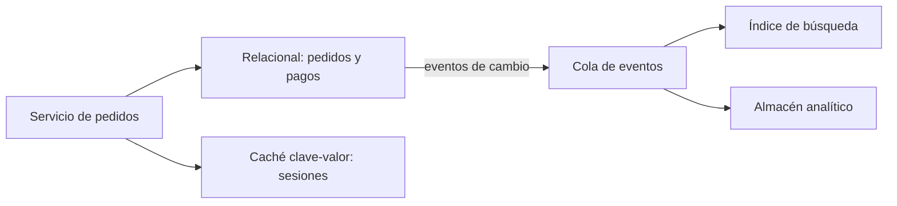

La pregunta «¿PostgreSQL o MongoDB?» llega casi siempre demasiado pronto. Se formula antes de saber qué se va a leer, con qué frecuencia, con qué latencia y con qué garantías, y la respuesta acaba decidida por la familiaridad del equipo o por una lectura de moda. El resultado habitual es una base de datos que no encaja con las consultas reales y que hay que forzar durante años con índices, cachés y parches.

La tesis de este artículo es que **el almacén se elige a partir de los patrones de acceso, no al revés**. Un patrón de acceso es una pregunta que el sistema hace repetidamente (buscar pedidos por cliente en orden cronológico, contar eventos por hora, encontrar productos por texto) junto con su frecuencia y su tolerancia a la latencia. Si esas preguntas están escritas, la mayoría de las decisiones de almacenamiento dejan de ser opiniones y se vuelven comprobables.

## Empezar por la lista de consultas

El ejercicio previo es una tabla con cada operación que el sistema necesita. Para cada una se anota qué lee, qué escribe, con qué frecuencia (por segundo, por hora, por día), cuánto tiempo puede tardar y si debe ver los datos recién escritos. Esa tabla suele tener entre diez y treinta filas en un sistema de tamaño medio, y basta con eso para descartar la mayoría de opciones.

Un ejemplo sencillo. Un servicio de reservas necesita tres operaciones: crear una reserva que no puede solaparse con otra en la misma sala, consultar las reservas de un usuario ordenadas por fecha, y calcular la ocupación de cada sala por semana. La primera exige una restricción de unicidad que garantice la ausencia de solapes. La segunda es una consulta por clave de usuario con orden. La tercera es una agregación que puede tolerar algo de retraso. Ya con esas tres filas se ven tres tipos de carga distintos, y no hay una sola base de datos ideal para todos.

La tabla también revela lo que no hay que optimizar. Si el sistema escribe cien veces al día y lee una vez al mes, no compensa un almacén de escritura de alto rendimiento. Si el 90 % de las lecturas son por una misma clave, un índice simple resuelve el problema sin cambiar de tecnología.

## Qué dimensiones importan

Hay cuatro dimensiones que cambian la elección de forma decisiva, y conviene anotarlas para cada operación.

La primera es la **forma de la consulta**. Si las preguntas cruzan entidades, con filtros arbitrarios y uniones, un modelo relacional da flexibilidad. Si siempre se accede por una clave conocida, un almacén clave-valor es más simple y más rápido. Si la consulta es por texto con relevancia, aparece un índice de búsqueda como pieza propia, como se explica en [búsqueda en la aplicación](/docs/busqueda-en-aplicacion).

La segunda es el **patrón de escritura**. Un flujo de eventos append-only, como lecturas de sensores o clics, se parece poco a una actualización de fila con bloqueos. Almacenes pensados para series temporales o para escritura masiva tienen ventaja real en ese caso, y una base relacional puede necesitar particionado antes de tiempo.

La tercera es la **consistencia requerida**. Un saldo o una plaza de aforo limitado necesitan garantías fuertes; una lista de recomendaciones puede ser eventualmente consistente. Este punto conecta con el teorema CAP y con el modelo PACELC, que describen qué se sacrifica cuando la red falla o cuando se busca latencia: se explica con detalle en [CAP y PACELC](/docs/cap-pacelc). Y la capacidad de transacciones multi-fila, con las propiedades ACID, se trata en [datos, ACID y aislamiento](/docs/datos-acid-y-aislamiento).

La cuarta es el **volumen y el crecimiento**. Un conjunto de datos que cabe en memoria de un nodo tiene opciones que uno de varios terabytes no tiene. Dimensionar con números reales (filas esperadas dentro de tres años, tamaño medio, tasa de crecimiento) evita elegir una arquitectura de escala para un problema que no existe.

## Familias de almacenes y para qué sirven

No hace falta memorizar productos. Basta con conocer las familias y sus compromisos, porque cada familia resuelve bien un tipo de consulta y mal otros.

| Familia            | Fuerte en                                                  | Débil en                                                  | Ejemplo típico                          |
| ------------------ | ---------------------------------------------------------- | --------------------------------------------------------- | --------------------------------------- |
| Relacional         | Transacciones, joins, restricciones, consultas ad hoc      | Escalado horizontal de escrituras sin particionar         | Pedidos, cuentas, inventario            |
| Documento          | Objetos con forma variable, lectura de agregados completos | Consultas que cruzan documentos, integridad entre ellos   | Catálogos, perfiles, configuraciones    |
| Clave-valor        | Acceso por clave con latencia muy baja                     | Consultas por atributos distintos de la clave             | Sesiones, caché, contadores             |
| Columnar analítico | Agregaciones sobre muchas filas y pocas columnas           | Escrituras pequeñas y frecuentes, actualizaciones de fila | Informes, métricas históricas           |
| Búsqueda de texto  | Relevancia, coincidencias parciales, facetas               | Fuente de verdad transaccional                            | Buscador del sitio, registros de logs   |
| Grafo              | Recorridos de relaciones de profundidad variable           | Agregaciones masivas sobre todo el conjunto               | Detección de fraude, redes de contactos |
| Series temporales  | Escritura continua de muestras con tiempo                  | Relaciones entre entidades                                | Telemetría, sensores, bolsa             |

La tabla es una orientación, no un veredicto. Muchas bases modernas cubren varias familias: un relacional con tipo documento, o una base con índices de texto integrados. La pregunta útil no es qué producto tiene más funciones, sino qué compromisos asume el equipo cuando lo opera a escala real.

## Persistencia políglota: cuándo compensa

La persistencia políglota consiste en usar más de un tipo de almacén en el mismo sistema, cada uno para lo que mejor hace. Es una buena idea cuando hay cargas con perfiles claramente distintos, y una mala idea cuando se adopta por reflejo.

El diagrama muestra el patrón habitual: el relacional es la fuente de verdad transaccional, y los demás almacenes son **derivados**, alimentados por eventos. Esta separación es la clave. Si cada almacén es fuente de verdad de algún dato, el sistema tiene dos verdades que tarde o temprano discrepan. Si todos son derivados de una fuente, un almacén puede reconstruirse desde la fuente.

La persistencia políglota compensa cuando una carga concreta no cabe en el almacén principal y el coste de mantenerla separada es menor que el de forzarla. Un buscador de texto que el relacional resuelve con `LIKE` y que deja de responder en medio segundo es un buen candidato. Un contador de visitas que escribe miles de veces por segundo también.

No compensa cuando el equipo tiene solo un caso de uso y lo mete en un segundo almacén por si acaso. Cada almacén añade copias de datos, pipelines de sincronización, monitorización, backups, pruebas de restauración y una persona que sepa operarlo. Ese coste aparece en la factura, en las guardias y en la velocidad de cambio.

<Callout tone="warning" title="Derivado no es lo mismo que fuente">
  Un índice o una caché pueden perderse y reconstruirse. Una base de datos que alguien tomó por
  fuente de verdad no puede reconstruirse sin pérdida. Antes de añadir un almacén, pregunta cuál de
  los dos será la verdad cuando discrepen.
</Callout>

## Lo que cuesta operar cada almacén

Elegir un almacén es elegir cómo se opera durante años. Hay cinco costes que conviene estimar antes de decidir, porque suelen quedar fuera de las comparaciones de rendimiento.

El primero son los **backups y la restauración**. Hacer copias es sencillo; comprobar que la restauración funciona en el tiempo objetivo es otra cosa. Cada almacén tiene su procedimiento, su tiempo de recuperación y su modo de fallo.

El segundo son las **migraciones de esquema**. Un relacional exige migraciones planificadas, con sus riesgos de bloqueo. Un documento parece libre de esquema, pero el código sigue dependiendo de una forma que cambia, y eso también requiere migración, aunque sea en la aplicación. Los patrones para cambiar esquemas sin cortar el servicio se explican en [migraciones de base de datos sin downtime](/docs/migraciones-bd-sin-downtime).

El tercero es el **escalado**. Escalar lectura con réplicas suele ser sencillo; escalar escritura exige particionar, y el particionado condiciona el modelo de datos desde el principio. Elegir una clave de partición mal hace que todas las escrituras caigan en un mismo nodo, y cambiarla después implica reescribir datos.

El cuarto es el **conocimiento del equipo**. Un almacén que nadie sabe ajustar tiene un coste real aunque su licencia sea gratuita. Diagnosticar una consulta lenta, leer un plan de ejecución y entender las garantías de consistencia son habilidades que se acumulan, y que se pierden con la rotación.

El quinto es la **portabilidad**. Algunos servicios gestionados ofrecen comodidad a cambio de atar el sistema a sus APIs y a sus límites. Eso no es malo por sí mismo, pero debe ser una decisión consciente, con el coste de salida anotado.

## Modelar para el acceso, no para la teoría

Cada almacén premia un modelo distinto, y forzar el modelo de un almacén en otro es la fuente de muchos problemas. En un relacional, la normalización protege la integridad y las consultas flexibles se pagan con joins. En un documento, desnormalizar para leer en una sola operación es lo habitual, y el precio es duplicar datos que deben mantenerse sincronizados. En clave-valor, la clave lo es todo: si la consulta no puede expresarse como una clave o un prefijo, el almacén no sirve.

La práctica que funciona es escribir el modelo a partir de las consultas de la tabla inicial. Si la consulta «pedidos de un cliente en orden cronológico» es frecuente, la clave de ordenación y el índice se diseñan para ella. Si «pedidos de hoy por estado» es frecuente, hay que decidir si se resuelve con un índice compuesto o con una vista derivada. Cada decisión queda ligada a una consulta concreta, y cuando la consulta cambia, la decisión se revisa.

Un error habitual es diseñar la base de datos antes que la API. Eso produce modelos que reflejan la estructura interna y no las preguntas reales. Empezar por las operaciones que el usuario realiza obliga a que el modelo responda a ellas.

### Un caso: reservas que no pueden solaparse

Volvamos al servicio de reservas. La operación más delicada es la de crear una reserva en una sala sin solapes. Un almacén que solo ofrece consistencia eventual permite que dos usuarios reserven la misma franja a la vez si las comprobaciones se hacen en réplicas distintas. La solución natural en un relacional es una restricción que impida el solape dentro de la misma transacción, o una exclusión de rangos temporales si el motor la soporta. En un almacén clave-valor, la alternativa es una clave compuesta por sala y franja horaria, con una escritura condicional que falle si la clave ya existe.

Cada solución protege el invariante a costa de algo distinto. La restricción relacional es fácil de razonar y cuesta latencia de escritura en la sala más demandada. La clave compuesta es rapidísima, pero obliga a discretizar el tiempo (por ejemplo, en bloques de media hora) y a decidir qué ocurre con reservas que cruzan bloques. Ninguna opción es la correcta en abstracto: depende de si las franjas son fijas, de cuántas reservas simultáneas hay en la sala y de cuánto cuesta un overbooking frente a un rechazo.

La ocupación semanal, en cambio, puede vivir en un almacén analítico o en una vista derivada que se actualiza con retraso. Aquí la latencia de unos minutos no tiene consecuencias para nadie, y hacerla síncrona encarecería la escritura sin ningún beneficio. Este caso ilustra por qué una sola base de datos rara vez es la respuesta para todo el servicio: cada operación tiene un invariante distinto, y el almacén debe proteger el invariante que importa en esa operación.

## Herramientas

La elección concreta depende del equipo, del proveedor y del volumen, y no hay una respuesta universal. Para la mayoría de aplicaciones de negocio, una base relacional con buen soporte de índices, transacciones y réplicas cubre la fuente de verdad y gran parte de las consultas. Un almacén clave-valor para caché y sesiones, un índice de búsqueda para texto y un almacén analítico para informes se añaden cuando la medición lo justifica, no antes.

Antes de comparar productos, conviene medir. Una prueba de carga con las consultas de la tabla inicial, con datos de volumen realista, dice más que cualquier comparativa publicada. Y conviene comprobar los límites reales del servicio elegido: tamaño máximo de fila, número de conexiones, límites de tasa y comportamiento bajo fallo de un nodo.

<Callout tone="tip" title="Mide con tus consultas">
  Carga la base con datos de volumen esperado para dentro de dos años y ejecuta las diez consultas
  más frecuentes. Si una de ellas supera el objetivo de latencia, ya sabes qué modelo o qué índice
  falta, sin cambiar de tecnología.
</Callout>

## Errores frecuentes

Elegir por moda o por familiaridad sin consultar la lista de operaciones es el error más común. El resultado es un almacén que funciona en la demo y se degrada con el uso real.

Usar un almacén de escritura masiva para datos que se leen con joins complejos obliga a reconstruir relaciones en la aplicación, con código frágil y lento.

Añadir un segundo almacén sin definir cuál es la fuente de verdad produce datos que discrepan sin que nadie sepa cuál es el correcto.

Diseñar la clave de partición sin mirar el patrón de escritura lleva a puntos calientes, con un nodo saturado mientras el resto está ocioso.

Subestimar la operación (backups, restauración, migraciones, guardias) hace que la elección se tome por el rendimiento y se pague con incidentes.

## Checklist

- Existe una lista de operaciones con lectura, escritura, frecuencia, latencia tolerada y necesidad de consistencia.
- El volumen esperado a dos o tres años está estimado con números, no con intuiciones.
- Cada almacén nuevo tiene una justificación medida, no hipotética.
- Hay una fuente de verdad clara por cada dato, y los almacenes derivados pueden reconstruirse desde ella.
- La clave de partición se eligió mirando el patrón de escritura y se revisó con una prueba de carga.
- El procedimiento de restauración se ha probado y tiene un tiempo medido.
- Las migraciones de esquema tienen un plan sin bloqueo prolongado.
- El equipo tiene personas que saben operar el almacén, o hay un plan para adquirirlas.
- El coste de salida del proveedor está anotado si se usa un servicio gestionado.

## Fuentes

- Martin Kleppmann, _Designing Data-Intensive Applications_ (O'Reilly, 2017), para los compromisos entre modelos de datos, replicación y particionado.
- Edgar F. Codd, «A Relational Model of Data for Large Shared Data Banks» (1970), para el modelo relacional. La cita se usa por su contenido general; no se comprobó contra el texto original en este artículo.

Consultadas en octubre de 2026. Las familias de almacenes se describen por sus compromisos típicos, no por productos concretos, que cambian con frecuencia; las capacidades de cada producto deben verificarse en su documentación vigente antes de decidir.
