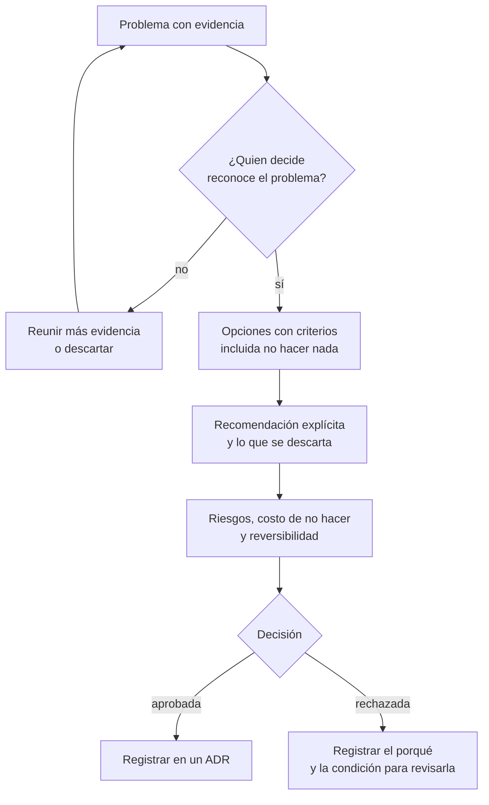

# Presentar ideas y propuestas que se aprueban

Pasaste dos semanas preparando la migración de un proceso crítico. Tienes treinta minutos con la dirección. Dedicas veinte a explicar la arquitectura nueva, y entonces alguien pregunta: «¿Y qué pasa si no hacemos nada?». No tienes la cifra a mano, la conversación deriva hacia otro tema y la decisión se aplaza al trimestre siguiente. La idea era buena; la propuesta no lo era.

**Una propuesta se aprueba cuando quien decide entiende, en el primer minuto, el problema, la alternativa que recomiendas y el costo de no hacer nada.** Todo lo demás (la arquitectura, las cifras de detalle, los diagramas) es soporte de esas tres cosas y se ordena por debajo de ellas.

Este artículo reúne estructuras de escritura con un origen conocido, explica cómo plantear el problema antes que la solución, cómo presentar opciones con criterios y una recomendación explícita, y cómo adaptar el mensaje a cada audiencia. Termina con un ejemplo de propuesta corta con supuestos explícitos. Cómo razonar el trade-off en sí está en [Trade-offs y toma de decisiones](/docs/trade-offs-y-decisiones); cómo dejar registrada la decisión una vez tomada, en [ADR](/docs/adr).

<Callout tone="info" title="Fecha de corte y alcance de las fuentes">
  Fuentes consultadas en octubre de 2026. Fuente secundaria para la pirámide de Minto: catálogos de
  bibliotecas y resúmenes de terceros del libro. Fuente secundaria para los ingredientes del pitch
  de Shape Up: resúmenes de terceros que citan el capítulo «Write the Pitch». Fuente primaria para
  la práctica de Amazon: la carta de 2017 de Jeff Bezos a los accionistas. Sobre las prácticas
  internas de cualquier empresa, solo se recoge lo que esa empresa ha publicado.
</Callout>

## Qué necesita quien decide

Quien aprueba una propuesta rara vez tiene tu contexto. Llega desde otra reunión, con otros problemas en la cabeza, y necesita contestar unas pocas preguntas antes de comprometer dinero, personas o tiempo. Si el documento no las contesta pronto, las hará en voz alta, y la reunión se convierte en un interrogatorio en lugar de una decisión.

| Pregunta de quien decide           | Dónde debe responderse en la propuesta                 |
| ---------------------------------- | ------------------------------------------------------ |
| ¿Qué me pides exactamente?         | Primera frase: decisión, presupuesto y fecha           |
| ¿Por qué ahora?                    | El problema, con evidencia y su tendencia              |
| ¿Qué pasa si no hacemos nada?      | El costo de no hacer, cuantificado aunque sea en rango |
| ¿Qué otras opciones hay?           | Una tabla con al menos tres, incluida la de no actuar  |
| ¿Por qué esta y no otra?           | Criterios explícitos y la recomendación                |
| ¿Qué puede salir mal y cómo lo sé? | Riesgos, señales de alerta y punto de retirada         |
| ¿Puedo deshacerlo si me equivoco?  | Reversibilidad y costo de dar marcha atrás             |

Fíjate en que ninguna pregunta es sobre la tecnología. La tecnología aparece como respuesta a «¿por qué esta opción?», y casi siempre en un anexo.

## Cuatro estructuras con origen conocido

No hace falta inventar un formato. Hay estructuras probadas durante décadas, y cada una pone el énfasis en un sitio distinto.

### La pirámide de Minto

Barbara Minto, exconsultora de McKinsey, describió en _The Pyramid Principle: Logic in Writing and Thinking_ una forma de ordenar las ideas de un documento: la conclusión arriba y, debajo, los argumentos que la sostienen, agrupados por niveles. Los catálogos de bibliotecas registran una edición de Minto International de 1987; hay ediciones posteriores con otras editoriales y la numeración de ediciones no es uniforme entre catálogos.

La estructura tiene tres piezas, tal como la resumen las reseñas del libro:

- **La idea principal arriba.** El documento empieza por la respuesta o la recomendación, no por el recorrido que llevó hasta ella.
- **Una introducción breve que prepara la respuesta.** Se suele resumir como SCQ o SCQA: situación (lo que el lector ya sabe y acepta), complicación (lo que cambió), pregunta (la que surge de esa complicación) y respuesta (la idea principal).
- **Agrupaciones sin solapes ni huecos.** Cada nivel resume al de abajo, y los argumentos de un mismo nivel no deberían repetirse ni dejar fuera algo relevante. Las reseñas lo asocian a la sigla MECE (mutuamente excluyentes, colectivamente exhaustivos).

La figura de este artículo dibuja esa forma: la idea en el vértice, tres argumentos debajo, la evidencia de cada argumento y, en la base, los datos. Quien lee puede detenerse en cualquier nivel y llevarse algo completo.

### El memo de una página

No tiene un autor único: es una práctica extendida en muchas organizaciones. Su valor está en la restricción. Una página no admite contexto innecesario, obliga a elegir qué argumento va primero y deja claro qué se pide. Una estructura habitual:

1. La petición en una frase (qué, cuánto, para cuándo).
2. El problema y su evidencia.
3. Las opciones consideradas, con la recomendada señalada.
4. El costo de no hacer nada.
5. Riesgos y cómo se detectarán.
6. Lo que queda fuera.

Funciona bien para decisiones medianas con un decisor claro. Se queda corto cuando la decisión exige comparar muchos datos o cuando la audiencia necesita entender un dominio que no conoce.

### El pitch de Shape Up

_Shape Up_ es el libro de Ryan Singer sobre cómo trabajaba Basecamp (hoy 37signals), publicado gratis en línea en 2019. Su capítulo «Write the Pitch» define cinco ingredientes para presentar un proyecto:

- **Problem**: la idea en bruto o el caso de uso que motiva el trabajo. El libro insiste en presentar siempre el problema junto a la solución.
- **Appetite**: cuánto tiempo se está dispuesto a invertir. No es una estimación: es un presupuesto que forma parte de la definición del problema.
- **Solution**: los elementos centrales, a un nivel de detalle que se entienda rápido (bocetos, no especificaciones).
- **Rabbit holes**: los detalles con riesgo que conviene señalar antes de empezar.
- **No-gos**: lo que se excluye a propósito para que el proyecto quepa en el apetito.

Lo más útil del pitch para cualquier propuesta son los dos últimos ingredientes. Decir qué no se hará y dónde está el riesgo cambia la conversación: quien decide deja de imaginar la versión ideal y evalúa la que realmente se va a construir.

### La narrativa escrita larga

En su carta a los accionistas de 2017, publicada en abril de 2018, Jeff Bezos explicó que en Amazon no se usan presentaciones de diapositivas en las reuniones: se escriben memos de seis páginas con estructura narrativa y se leen en silencio al principio de cada reunión, en una especie de «sala de estudio». La misma carta dice que la calidad de esos memos varía mucho y que los mejores se escriben y reescriben, se comparten con colegas para mejorarlos y se dejan reposar un par de días antes de editarlos de nuevo.

La lección transferible no es el número de páginas, sino dos ideas: la prosa obliga a conectar los argumentos (una diapositiva admite viñetas sueltas; un párrafo no), y leer en silencio al principio garantiza que todos discuten el mismo documento.

<Callout tone="warning" title="Lo que circula sin fuente primaria">
  Sobre esta práctica circulan muchos detalles atribuidos a correos internos, plantillas o reglas de
  formato. Aquí solo se recoge lo que dice la carta pública. Copiar el ritual (seis páginas, lectura
  en silencio) sin la parte difícil, que es reescribir hasta que el argumento se sostiene, produce
  documentos largos, no mejores decisiones.
</Callout>

### Cuál elegir

| Estructura         | Extensión      | Empieza por              | Sirve para                                        | Riesgo si se usa mal                           |
| ------------------ | -------------- | ------------------------ | ------------------------------------------------- | ---------------------------------------------- |
| Pirámide de Minto  | Cualquiera     | La conclusión            | Ordenar cualquier documento o presentación        | Una conclusión débil queda expuesta pronto     |
| Memo de una página | Una página     | La petición              | Decisiones medianas con un decisor claro          | Omitir el costo de no hacer por falta de sitio |
| Pitch de Shape Up  | Unas páginas   | El problema y el apetito | Proyectos de producto con tiempo acotado          | Confundir el apetito con una estimación        |
| Narrativa larga    | Varias páginas | El contexto y la tesis   | Decisiones grandes que exigen razonar en conjunto | Texto largo que nadie reescribió               |

No son excluyentes. Un memo de una página puede seguir la pirámide, y un pitch puede abrir con una frase al estilo de Minto.

## El problema antes que la solución

La forma más común de perder una propuesta es abrir con la solución. Si la primera frase es «Proponemos migrar a una cola gestionada», quien lee evalúa la cola, no el problema, y cualquier objeción a la tecnología tumba la propuesta entera.

Un buen planteamiento del problema cumple cuatro condiciones:

1. **Dice a quién le duele.** Clientes, un equipo, un proceso de negocio. No «al sistema».
2. **Trae evidencia.** Incidentes, horas, tickets, dinero, tiempo de ciclo. Aunque sea un rango.
3. **Explica por qué ahora.** Una tendencia, un cambio de contexto, una fecha que se acerca.
4. **No menciona la solución.** Alguien tiene que poder estar de acuerdo con el problema sin opinar todavía sobre la tecnología.

| Planteamiento débil                          | Planteamiento útil                                                               |
| -------------------------------------------- | -------------------------------------------------------------------------------- |
| El proceso de facturación es legado y frágil | La facturación nocturna falló 2 veces al mes en el último semestre               |
| Necesitamos modernizar la plataforma         | Cada fallo retrasa las facturas un día y ocupa a dos personas durante seis horas |
| El equipo quiere usar colas                  | El volumen crece y la ventana nocturna se acerca a su límite                     |

Si el problema no convence, no vale la pena seguir. Es mejor descubrirlo con una página que con un proyecto.

## Opciones con criterios y una recomendación explícita

Presentar una sola opción convierte la reunión en un sí o no, y un «no» deja el problema sin resolver. Presentar varias sin recomendar ninguna traslada el trabajo de análisis a quien decide. El punto medio es una tabla con al menos tres opciones y una recomendación clara.

- **Incluye siempre la opción de no hacer nada.** Tiene costo, y ponerlo en la tabla al lado de las demás es la forma más honesta de mostrarlo.
- **Declara los criterios antes de puntuar.** Costo, plazo, riesgo, reversibilidad, impacto en el cliente. Cómo elegirlos y ponderarlos está en [Trade-offs y toma de decisiones](/docs/trade-offs-y-decisiones); en la propuesta basta con nombrarlos y aplicarlos.
- **Recomienda en voz activa.** «Recomendamos B porque…», no «B podría ser una opción interesante».
- **Di qué se descarta y por qué.** Una línea por opción descartada. Evita que la discusión reabra lo que ya se analizó.
- **Separa lo que sabes de lo que supones.** Cada cifra estimada lleva la etiqueta de supuesto y, si es posible, un rango.

Cuando hay que ordenar muchas iniciativas compitiendo por el mismo presupuesto, el problema ya no es presentar una propuesta, sino priorizar entre varias: eso se trata en [Marcos de priorización](/docs/marcos-de-priorizacion).

## Riesgos, costo de no hacer y reversibilidad

Estas tres secciones son las que más se omiten y las que más preguntas generan.

**Costo de no hacer.** Es una proyección del problema en el tiempo: horas de incidentes, ingresos retrasados, clientes perdidos, multas, oportunidades que no se pueden atender. Exprésalo en la unidad que usa quien decide (dinero, días, clientes) y con un horizonte (un trimestre, un año).

**Riesgos.** Para cada riesgo relevante: qué puede pasar, cómo se notaría pronto (la señal) y qué se haría entonces. Un riesgo sin señal ni respuesta es solo una preocupación.

**Reversibilidad.** Indica si la decisión se puede deshacer y a qué costo. Una opción reversible y barata de probar suele merecer menos análisis que una que compromete años; la distinción entre decisiones de un sentido y de doble sentido está desarrollada en [Trade-offs y toma de decisiones](/docs/trade-offs-y-decisiones).

**La petición.** Cierra con lo que necesitas: la decisión concreta, el presupuesto, las personas, la fecha en la que necesitas la respuesta y lo que pasa si llega más tarde.

El recorrido completo de una propuesta, desde el problema hasta el registro de la decisión, se ve así:



Una propuesta rechazada también es información útil si queda escrito por qué y qué tendría que cambiar para revisarla.

## Adapta el mensaje a cada audiencia

La pirámide es la misma; lo que cambia es la evidencia que pones en el segundo nivel y la unidad en la que hablas.

| Audiencia  | Primera pregunta             | Unidad que entiende              | Qué va arriba                            | Qué va al anexo               |
| ---------- | ---------------------------- | -------------------------------- | ---------------------------------------- | ----------------------------- |
| Dirección  | ¿Cuánto cuesta y qué gano?   | Dinero, plazo, riesgo de negocio | Petición, costo de no hacer, retorno     | Arquitectura, detalle técnico |
| Producto   | ¿Qué cambia para el cliente? | Funcionalidad, plazo, alcance    | Impacto en el cliente, lo que se excluye | Cifras de infraestructura     |
| Ingeniería | ¿Cómo y con qué riesgo?      | Latencia, errores, esfuerzo      | Opciones técnicas, riesgos, operación    | Retorno financiero detallado  |

Tres consejos prácticos:

- **Una propuesta, varias portadas.** Mantén un único documento de fondo y escribe un resumen distinto para cada audiencia. Si cada versión cuenta una historia diferente, alguien lo notará.
- **Traduce los atributos técnicos.** «p99 de 2 s» no significa nada para la dirección; «uno de cada cien pedidos tarda más de dos segundos en confirmarse» sí. Los [atributos de calidad](/docs/atributos-de-calidad) son el puente entre ambos lenguajes.
- **Los diagramas, al servicio del argumento.** Un diagrama de contexto ayuda a que producto entienda qué sistemas se tocan; un diagrama de despliegue solo interesa a ingeniería. Cómo elegir el nivel de detalle está en [Modelo C4](/docs/c4-model), y cómo mantenerlos versionados, en [Diagramas como código](/docs/diagramas-como-codigo).

## Cuándo sí y cuándo no

**Escribe una propuesta formal cuando:**

- La decisión compromete presupuesto, personas o plazos que no controlas.
- Es difícil de revertir o afecta a otros equipos.
- Hay varias opciones razonables y personas con preferencias distintas.
- Quien decide no estuvo en el análisis y necesita entenderlo sin ti.

**No hace falta cuando:**

- La decisión es pequeña, reversible y está dentro de tu autonomía: hazla y regístrala si deja huella.
- El problema aún no está claro. Una conversación exploratoria vale más que un documento prematuro.
- La decisión ya está tomada por otra vía. Escribir una propuesta para legitimarla consume tiempo y credibilidad.

## Errores frecuentes

- **Empezar por la tecnología.** La propuesta se discute como preferencia técnica y el problema queda en segundo plano.
- **Presentar una sola opción.** Quien decide no puede comparar y el rechazo deja el problema intacto.
- **No decir qué se descarta.** Las opciones descartadas vuelven a la mesa en cada reunión.
- **Esconder el costo.** Si aparece después, la credibilidad de la propuesta, y la tuya, cae con él.
- **Omitir el costo de no hacer nada.** Sin él, no hacer nada parece gratis y siempre gana.
- **Adjetivos en vez de cifras.** «Mucho más estable» no se puede comparar; «de 2 fallos al mes a 1» sí.
- **No pedir nada concreto.** Una propuesta sin petición termina en «interesante, lo vemos».
- **Diapositivas que necesitan al autor.** Si el documento no se entiende sin tu voz, no sobrevive al reenvío.

## Ejemplo trabajado: estabilizar la facturación nocturna

Una empresa ejecuta cada noche un proceso por lotes que genera las facturas. Estos son los supuestos, todos explícitos y revisables:

- El proceso falla 2 veces al mes (media del último semestre).
- Cada fallo ocupa a 2 personas durante 6 horas: 12 horas por fallo, 24 horas al mes.
- Costo cargado de una hora de ingeniería: 60 USD (supuesto interno, no un dato de mercado).
- Costo de no hacer nada: 24 h × 60 USD = 1.440 USD al mes, 17.280 USD al año. Sin contar el retraso en el cobro.

Opciones consideradas:

- **A. Reintentos, idempotencia y alertas en el proceso actual.** Una persona durante una semana: 40 h × 60 USD = 2.400 USD. Supuesto: baja a 1 fallo al mes (12 h, 720 USD al mes).
- **B. Migrar a trabajadores sobre una cola gestionada.** Dos personas durante tres semanas: 240 h × 60 USD = 14.400 USD, más 150 USD al mes de infraestructura (supuesto). Supuesto: baja a un fallo cada cuatro meses (3 h al mes, 180 USD), es decir, 330 USD al mes en total.
- **C. Reescribir el servicio de facturación.** Unos tres meses de un equipo. Se descarta: el problema es la fiabilidad del lote, no el modelo de facturación.

| Opción             | Inversión inicial | Costo mensual | Año 1  | Acumulado 2 años | Acumulado 3 años |
| ------------------ | ----------------- | ------------- | ------ | ---------------- | ---------------- |
| No hacer nada      | 0                 | 1.440         | 17.280 | 34.560           | 51.840           |
| A. Reintentos      | 2.400             | 720           | 11.040 | 19.680           | 28.320           |
| B. Cola gestionada | 14.400            | 330           | 18.360 | 22.320           | 26.280           |

A se recupera en algo más de tres meses (2.400 / 720 de ahorro mensual). B solo supera a A a partir del mes 31 aproximadamente (12.000 de diferencia inicial / 390 de diferencia mensual), y ese resultado depende del supuesto más incierto: que la cola reduzca los fallos a uno cada cuatro meses.

La propuesta, escrita como pirámide, cabe en una página:

```text
Petición: aprobar 1 semana de 1 persona (2.400 USD) para A, decisión antes del día 15.
Problema: la facturación nocturna falla 2 veces al mes; cuesta ~17.000 USD al año.
Recomendación: A ahora; revisar B en 6 meses.
  Porque: A se paga en ~3 meses y es reversible.
  Porque: B solo gana a partir de ~31 meses y su ahorro es el supuesto más débil.
  Porque: C no ataca la causa (fiabilidad del lote).
Riesgo: A no baja los fallos. Señal: más de 1 fallo al mes durante 2 meses.
  Respuesta: adelantar B.
Fuera de alcance: facturación en tiempo real, cambio de proveedor de pagos.
```

Observa lo que hace el ejemplo: la petición va primero, el costo de no hacer está cuantificado, la recomendación no es la opción más ambiciosa, lo descartado tiene su razón y el riesgo tiene una señal medible y una respuesta. Una vez aprobada, la decisión se registra en un [ADR](/docs/adr) con estos mismos supuestos, para poder revisarla cuando cambien.

## Checklist

- [ ] La primera frase dice qué se pide, cuánto cuesta y para cuándo.
- [ ] El problema tiene evidencia y se entiende sin mencionar la solución.
- [ ] Hay al menos tres opciones, incluida la de no hacer nada.
- [ ] Los criterios están declarados y la recomendación es explícita.
- [ ] El costo de no hacer está cuantificado, aunque sea en rango.
- [ ] Cada riesgo tiene una señal temprana y una respuesta.
- [ ] Lo que queda fuera de alcance está escrito.
- [ ] Los supuestos están marcados y se pueden revisar por separado.

## Fuentes

Consultadas en octubre de 2026.

- [Shape Up, capítulo «Write the Pitch» (Ryan Singer, Basecamp, 2019)](https://basecamp.com/shapeup/1.5-chapter-06): los cinco ingredientes del pitch. Fuente secundaria: los resúmenes de terceros de este capítulo enlazados a continuación
- [Book Review: Shape Up (Beeminder)](https://doc.beeminder.com/shapeup): resumen de terceros del capítulo 6 y sus cinco ingredientes
- [Announcing Shape Up (Signal v. Noise, 2019)](https://signalvnoise.com/svn3/announcing-shape-up-a-deep-dive-into-how-we-work/): presentación del libro y su acceso gratuito
- [Carta de Jeff Bezos a los accionistas de 2017, anexo 99.1 en la SEC](https://www.sec.gov/Archives/edgar/data/1018724/000119312518121161/d456916dex991.htm): sección «Six-Page Narratives»
- [The Pyramid Principle en Goodreads](https://www.goodreads.com/book/show/33206): datos bibliográficos y biografía de la autora (fuente secundaria)
- [Lessons from Barbara Minto (Antoine Buteau)](https://www.antoinebuteau.com/lessons-from-barbara-minto/): resumen de terceros de la pirámide, SCQA y MECE
