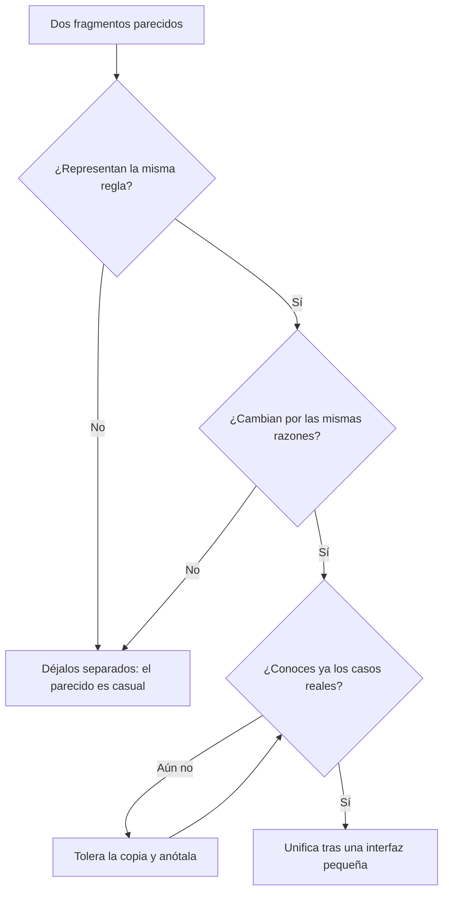

# Principios de diseño básicos

En una revisión de código alguien escribe «esto no es DRY» y pide unificar dos funciones. Otra persona responde «YAGNI» y se niega a añadir un parámetro. Una tercera cita la Ley de Deméter para rechazar una cadena de llamadas, y la discusión termina cuando alguien se cansa. Los cinco principios de este artículo se usan a diario, pero casi siempre como eslóganes para ganar una conversación, no como criterios para tomar una decisión.

**Los principios de diseño básicos son reglas heurísticas para decidir en el día a día qué juntar, qué separar y qué no construir todavía: cada uno protege algo concreto y cada uno cuesta algo cuando se aplica fuera de su sitio.**

Este artículo recorre DRY, KISS, YAGNI, la Ley de Deméter y la ocultación de información con el mismo guion: de dónde salen (con fuentes que puedes comprobar), qué protegen, cuándo ayudan, cuándo dañan y un ejemplo de antes y después hecho solo con nombres y firmas. No repite lo que ya cubren otros artículos: los cinco principios [SOLID](/docs/solid) tienen el suyo, los tipos de [acoplamiento y cohesión](/docs/acoplamiento-cohesion) también, y las reglas de nombres, funciones y comentarios están en [clean code](/docs/clean-code).

<Callout tone="info" title="Qué se verificó y qué no">
  Las fechas y formulaciones salen de fuentes primarias cuando fue posible: la entrevista de Dave
  Thomas en Artima (2003), el artículo de Ron Jeffries (1998), la entrada de Martin Fowler sobre
  YAGNI (2015), la página del proyecto Demeter en Northeastern y la referencia del artículo de
  Parnas (1972). No leí el libro _The Pragmatic Programmer_: su enunciado de DRY viene de citas
  coincidentes en varias fuentes. El origen de KISS solo está documentado en fuentes secundarias.
</Callout>

## Qué protege cada principio

Antes de entrar en detalle conviene ver los cinco juntos. La columna que más importa es la última: un principio aplicado sin esa señal en mente suele producir el problema contrario al que pretendía evitar.

| Principio                 | Origen verificable                                  | Qué protege                                          | Señal de que está haciendo daño                                 |
| ------------------------- | --------------------------------------------------- | ---------------------------------------------------- | --------------------------------------------------------------- |
| DRY                       | Hunt y Thomas, _The Pragmatic Programmer_, 1999     | Que una regla cambie en un solo sitio                | La abstracción compartida acumula banderas y casos especiales   |
| KISS                      | Marina de EE. UU., 1960 (según fuentes secundarias) | Que el sistema se pueda entender y reparar           | «Simple» se usa para justificar no tratar un caso real          |
| YAGNI                     | Programación extrema; Jeffries lo publica en 1998   | El esfuerzo y la complejidad de hoy                  | Se invoca para no definir límites ni hacer el código cambiable  |
| Ley de Deméter            | Holland, Northeastern, otoño de 1987                | Que un cambio de estructura no se propague en cadena | Clases llenas de métodos que solo reenvían llamadas             |
| Ocultación de información | Parnas, _Communications of the ACM_, 1972           | Que una decisión volátil se pueda cambiar en privado | Interfaces opacas que obligan a rodearlas para hacer algo común |

Los cinco comparten una idea: el coste del software está en cambiarlo. Cada principio es una apuesta distinta sobre qué va a cambiar y dónde quieres que duela cuando cambie.

## DRY: una sola representación de cada conocimiento

### Origen de DRY

Andy Hunt y Dave Thomas lo formularon en _The Pragmatic Programmer_ (Addison-Wesley, 1999). El enunciado que citan de forma coincidente varias fuentes dice que cada pieza de conocimiento debe tener una representación única, inequívoca y autorizada dentro de un sistema. La palabra clave es **conocimiento**, no código.

Thomas lo aclaró en una entrevista con Bill Venners publicada en Artima el 10 de marzo de 2003: la mayoría entiende DRY como «no dupliques código», y esa no era la intención. Según él, el principio alcanza también los esquemas de base de datos, los planes de prueba, el sistema de build y la documentación. Si el límite de reintentos está en el código, en un YAML y en la wiki, tienes tres representaciones de un mismo conocimiento aunque no haya dos líneas iguales.

### Cuándo ayuda DRY

- **Reglas de negocio con autoridad.** El tipo de IVA, la política de reembolsos, el formato de un identificador fiscal. Si cambian, deben cambiar en todas partes a la vez.
- **Contratos entre piezas.** Un esquema que genera tipos, validadores y documentación evita que tres copias diverjan.
- **Conocimiento operativo.** Una sola fuente para la configuración de un entorno, de la que se derivan las demás.

### Cuándo daña DRY

DRY aplicado a texto parecido, en vez de a conocimiento compartido, produce **acoplamiento accidental**. Dos funciones pueden ser idénticas hoy y representar reglas distintas: el descuento de un cliente mayorista y el de un empleado se calculan igual este trimestre, pero los decide gente distinta y cambiarán por motivos distintos. Si las unificas, cada cambio futuro de una obliga a añadir un parámetro o una condición para no romper la otra.

Sandi Metz lo resumió en «The Wrong Abstraction» (20 de enero de 2016): la duplicación es mucho más barata que la abstracción equivocada. Su consejo cuando ya tienes una abstracción así es reintroducir la duplicación, copiando el código abstraído en cada llamador, y quitar después lo que cada uno no usa. Es la misma idea que la «razón de cambio» de la responsabilidad única en [SOLID](/docs/solid): lo que cambia por motivos distintos no debería compartir casa.

<Callout tone="warning" title="DRY prematuro">
  Si para unificar dos fragmentos tienes que añadir un parámetro booleano, probablemente no
  representan el mismo conocimiento. Antes de extraer, pregúntate quién pediría cambiar cada uno.
</Callout>

### DRY: antes y después

El caso clásico es una regla fiscal repetida en tres módulos con tres formas distintas de escribirla. Fíjate en que ninguna línea es igual a otra: la duplicación está en el conocimiento, no en el texto.

```typescript
// Antes: la misma regla, tres representaciones
// checkout/total.ts   applyVat(amount: Money): Money          // 21 %
// invoice/lines.ts    withTax(line: InvoiceLine): Money       // × 0.21
// refund/refund.ts    refundGross(net: Money): Money          // × 1.21

// Después: una sola fuente autorizada, los demás la piden
// pricing/tax.ts      tax(amount: Money, region: Region): Money
```

## KISS: la solución más simple que resuelve el problema real

### Origen de KISS

Según Wikipedia, la Marina de EE. UU. lo recoge en 1960, y el acrónimo se atribuye, sin confirmación primaria, a Kelly Johnson, ingeniero jefe de Lockheed Skunk Works. La anécdota que se repite cuenta que Johnson entregó a sus ingenieros un puñado de herramientas y les pidió un avión que un mecánico corriente pudiera reparar en el campo con ellas. La lectura que ofrece esa misma fuente es útil para el software: la simplicidad se mide contra **quién tendrá que entender y reparar el sistema, y con qué medios**.

### Qué significa KISS en software

KISS no pide código corto ni ingenuo. Pide que la complejidad del diseño no supere la del problema. Una solución es simple cuando tiene pocas piezas móviles, pocas formas de fallar y un camino de lectura evidente para quien la mantenga, que a menudo no es quien la escribió.

### Cuándo daña KISS

- **Simple para quien escribe, no para quien opera.** Un script que funciona en tu máquina es simple; un servicio sin observabilidad que falla de madrugada no lo es.
- **Ignorar complejidad esencial.** Si el dominio tiene zonas horarias, monedas y redondeos, la solución «simple» que los ignora traslada el problema a producción.
- **Confundir familiar con simple.** La herramienta que el equipo ya conoce puede ser la elección correcta, pero por familiaridad, no por simplicidad: dilo así en la decisión.

### KISS: antes y después

En KISS la diferencia rara vez está en una firma; está en cuántas piezas hay que entender para seguir un caso. Una tabla lo muestra mejor que el código:

| Necesidad: avisar al cliente cuando se confirma un pedido | Diseño complejo                                          | Diseño simple                                      |
| --------------------------------------------------------- | -------------------------------------------------------- | -------------------------------------------------- |
| Piezas                                                    | Bus de eventos genérico, registro de plugins, plantillas | Un puerto `OrderNotifier` con un adaptador         |
| Para seguir el caso hay que leer                          | Configuración, registro y despacho dinámico              | Una llamada `notifier.orderConfirmed(order)`       |
| Qué pasa si mañana hay SMS                                | Ya está previsto (aunque nadie lo pidió)                 | Segundo adaptador o un puerto nuevo, cuando llegue |

## YAGNI: no construyas hoy lo que solo prevés

### Origen de YAGNI

YAGNI nace de la programación extrema (XP). Martin Fowler, en su entrada del 26 de mayo de 2015, cuenta que la frase surgió de una conversación entre Kent Beck y Chet Hendrickson en el proyecto C3: Hendrickson traía una lista de capacidades que el sistema iba a necesitar y Beck respondía a cada una «you aren't going to need it». Ron Jeffries, cofundador de XP, lo dejó por escrito el 4 de abril de 1998 en «You're NOT gonna need it!»: implementa las cosas cuando de verdad las necesitas, nunca cuando solo prevés que las vas a necesitar.

### Los costes que evita

Fowler descompone el coste de construir una capacidad presunta en cuatro partes. Sirven como lista de preguntas antes de añadir algo «por si acaso»:

| Coste                      | Qué pagas                                                                                     |
| -------------------------- | --------------------------------------------------------------------------------------------- |
| De construcción            | Analizar, programar y probar algo que puede resultar innecesario                              |
| De retraso                 | El valor que no entregaste porque el esfuerzo fue a lo presunto                               |
| De mantenimiento («carry») | La complejidad añadida ralentiza los demás cambios mientras exista, y quitarla también cuesta |
| De reparación              | Si la capacidad se construyó mal, corregirla o convivir con sus defectos                      |

### YAGNI no es excusa para no diseñar límites

La misma entrada de Fowler pone el límite que más se olvida: YAGNI se aplica a las **capacidades** construidas para una funcionalidad presunta, no al esfuerzo de hacer que el software sea **fácil de modificar**. Separar un módulo, nombrar bien un puerto o escribir tests no son funcionalidades especulativas: son lo que te permite añadir mañana lo que hoy decides no construir.

Wikipedia recoge además que, en la definición original de XP, YAGNI depende de prácticas de apoyo: refactorización continua, pruebas unitarias automatizadas e integración continua. Sin ellas, aplazar decisiones no es prudencia, es [deuda técnica](/docs/deuda-tecnica-evolucion) que se acumula.

<Callout tone="tip" title="La pregunta útil">
  No preguntes «¿lo necesitaremos algún día?». Pregunta «si lo necesitamos dentro de seis meses,
  ¿cuánto costará añadirlo con el diseño de hoy?». Si la respuesta es «poco», YAGNI. Si es «habría
  que reescribir», el problema no es la funcionalidad, es un límite que falta.
</Callout>

### YAGNI: antes y después

```typescript
// Antes: capacidades «por si acaso»
export type ReportExporter = {
  export(report: Report, format: 'pdf' | 'xlsx' | 'csv' | 'xml'): Promise<Blob>;
  schedule(report: Report, cron: string): Promise<void>;
  // … plantillas, plugins, varios idiomas
};

// Después: lo que pide la historia actual, detrás de un límite que permite crecer
export type ReportExporter = {
  export(report: Report): Promise<Blob>; // hoy solo CSV
};
```

El tipo de después no es más pobre: es un límite. Cuando llegue el PDF, cambias la implementación o añades un segundo exportador sin tocar a quien lo usa.

## Ley de Deméter: habla solo con tus amigos inmediatos

### Origen de la Ley de Deméter

Según la página del proyecto Demeter en Northeastern University, la regla la identificó Ian Holland en el otoño de 1987. Se publicó en OOPSLA '88 en «Object-Oriented Programming: An Objective Sense of Style», de Karl Lieberherr, Ian Holland y Arthur Riel, y se desarrolló en «Assuring Good Style for Object-Oriented Programs» (IEEE Software, septiembre de 1989). La formulación general de esa página dice que cada unidad debería tener un conocimiento limitado de otras unidades, solo de las «cercanas»; el lema es _only talk to your immediate friends_.

### Cuándo ayuda y cuándo daña

La regla: un método habla con su propio objeto, sus parámetros y lo que crea, no con los objetos que estos le devuelven. Aplícala donde la cadena atraviesa **estructura que puede cambiar**, no como «un solo punto por línea», que solo produce envoltorios vacíos. La versión formal, sus excepciones y su relación con los tipos de acoplamiento están en [acoplamiento y cohesión](/docs/acoplamiento-cohesion).

### Deméter: antes y después

```typescript
// Antes: el controlador conoce la estructura de tres objetos
// shipment.carrier().rateTable().priceFor(shipment.weight())

// Después: pregunta a su amigo inmediato; el camino queda dentro de Shipment
// shipment.shippingCost(): Money
```

## Ocultación de información: esconde lo que puede cambiar

### Origen de la ocultación de información

David Parnas lo planteó en «On the Criteria To Be Used in Decomposing Systems into Modules» (_Communications of the ACM_, vol. 15, n.º 12, pp. 1053–1058, 1972). Su propuesta: no descompongas por pasos del proceso, sino por **decisiones de diseño difíciles o que probablemente cambien**, y que cada módulo oculte una de ellas a los demás. El ejemplo KWIC y su análisis están en [acoplamiento y cohesión](/docs/acoplamiento-cohesion); no los repito.

De los cinco, es el más antiguo de los que nacieron dentro del software, y puede leerse como el que da sentido a los otros: DRY da una sola casa a cada conocimiento, Deméter evita que se filtre la estructura y KISS mantiene pequeña la interfaz que queda a la vista.

### Cómo se usa a diario

La práctica es una lista corta antes de crear un módulo: ¿qué decisión podría cambiar aquí? El formato de almacenamiento, el proveedor externo, el algoritmo, la política de caché. Cada respuesta es un candidato a quedar oculto detrás de una interfaz que no la mencione. Si la interfaz expone la decisión (una tabla, un cliente HTTP, un formato de fichero), el cambio se pagará en cada llamador.

### Cuándo daña ocultar

Ocultar también cuesta. Una interfaz que esconde algo que los llamadores necesitan de verdad (un límite de tamaño, un error transitorio, un coste de latencia) les obliga a rodearla o a adivinar. Oculta las **decisiones**, no los **hechos** que el llamador necesita para usar bien el módulo.

### Ocultación: antes y después

```typescript
// pricing/index.ts: lo único público
export declare function tax(amount: Money, region: Region): Money;

// pricing/rates.ts: la decisión oculta (tabla local, servicio externo o caché)
// no se exporta desde el barril; nada fuera de pricing/ la importa
```

## Cuando los principios chocan

Los principios no forman un sistema coherente: tiran en direcciones distintas y la decisión es tuya. La tabla muestra los choques que más aparecen en revisiones de código; el método general para resolver tensiones así está en [trade-offs y toma de decisiones](/docs/trade-offs-y-decisiones).

| Tensión                   | Cómo se manifiesta                                                     | Criterio para decidir                                                      |
| ------------------------- | ---------------------------------------------------------------------- | -------------------------------------------------------------------------- |
| DRY frente a YAGNI        | Extraer una abstracción compartida antes de conocer los casos reales   | Unifica cuando sepas que es el mismo conocimiento, no cuando lo sospeches  |
| DRY frente a ocultación   | Compartir un modelo entre módulos para no repetirlo expone su interior | Duplica estructuras de datos entre fronteras; no dupliques reglas          |
| Deméter frente a KISS     | Muchos métodos envoltorio que solo reenvían                            | Aplica Deméter donde la estructura puede cambiar; en datos estables, no    |
| YAGNI frente a ocultación | No crear un límite porque «aún no hay segunda implementación»          | Un límite es modificabilidad, no funcionalidad; YAGNI no aplica            |
| KISS frente a DRY         | Una copia evidente frente a una abstracción que hay que estudiar       | Si entender la abstracción cuesta más que mantener la copia, deja la copia |

Para el choque más frecuente, el de DRY con YAGNI ante dos fragmentos parecidos, este flujo resume el criterio:



## Cuándo sí y cuándo no

| Principio                 | Aplícalo cuando                                                         | Relájalo cuando                                                         |
| ------------------------- | ----------------------------------------------------------------------- | ----------------------------------------------------------------------- |
| DRY                       | Una regla con autoridad aparece en más de un sitio o formato            | El parecido es textual y cada copia la decide gente distinta            |
| KISS                      | Hay alternativas que añaden piezas sin resolver un caso conocido        | Lo «simple» ignora complejidad esencial del dominio                     |
| YAGNI                     | Se propone una capacidad para un futuro que nadie ha pedido             | Lo que se propone es un límite, un test o una mejora de modificabilidad |
| Ley de Deméter            | La cadena de llamadas atraviesa estructura que puede reorganizarse      | Son datos inmutables, una API fluida o un objeto sin comportamiento     |
| Ocultación de información | Hay una decisión volátil: proveedor, formato, algoritmo, almacenamiento | El llamador necesita ese hecho para usar bien el módulo                 |

## Errores frecuentes

- **Usar el principio como argumento final.** «No es DRY» o «YAGNI» no son razones; la razón es qué se protege y qué cuesta. Pide siempre la segunda frase.
- **DRY por parecido visual.** Unificar código que coincide por casualidad acopla dos reglas que cambian por motivos distintos.
- **YAGNI contra el diseño.** Rechazar un módulo, un puerto o un test porque «todavía no hace falta» confunde funcionalidad con modificabilidad.
- **YAGNI sin red.** Aplazar decisiones sin tests ni refactorización frecuente convierte cada aplazamiento en deuda.
- **Deméter como regla de puntos.** Contar puntos por línea produce envoltorios vacíos y no oculta nada.
- **Ocultar los hechos con las decisiones.** Una interfaz que esconde límites o errores obliga a rodearla.
- **KISS como excusa.** Llamar «simple» a una solución que ignora un caso real solo traslada el coste a otra persona.
- **Abstracciones con banderas.** Un parámetro booleano en una función compartida es la señal más barata de que la abstracción es la equivocada.

## Ejemplo trabajado: el impuesto que vivía en tres sitios

Un equipo mantiene un comercio con tres módulos: `checkout`, `invoice` y `refund`. Cada uno calcula el impuesto a su manera, y un cambio de tipo impositivo llegó tarde a los reembolsos: durante dos días se devolvió más de lo cobrado.

**1. ¿Es el mismo conocimiento?** Sí. Las tres funciones representan la misma regla fiscal, decidida por la misma área y con la misma razón de cambio (la ley). Aquí DRY aplica sin discusión.

**2. ¿Dónde vive?** En un módulo `pricing` con una sola función pública, `tax(amount, region)`. Es la representación autorizada.

**3. ¿Qué se oculta?** La tabla de tipos por región. Hoy es un fichero; mañana puede ser un servicio del departamento fiscal. Esa es la decisión volátil que Parnas pide esconder: `rates` no se exporta.

**4. ¿Qué no se construye?** Alguien propone soportar ya varias monedas y exenciones por tipo de cliente. Nadie lo ha pedido: YAGNI. Pero la firma recibe `Region` y no un porcentaje, de modo que si una región cambia su tipo o se abre una región nueva, solo cambia la tabla privada y ningún llamador se toca. Eso no es funcionalidad especulativa, es un límite. Las exenciones por cliente sí cambiarían la firma, porque necesitan datos del cliente que `tax` no recibe; se añadirá ese parámetro cuando alguien las pida.

**5. ¿Y la cadena de llamadas?** `checkout` leía `rates` directamente para mostrar el impuesto en el carrito. Esa dependencia se corta: el carrito llama a `tax(subtotal, region)` como los demás módulos, sin que `pricing` exponga nada nuevo. El camino hacia la tabla queda dentro del módulo.

**6. ¿Es simple?** Una función pública, un fichero privado y tres llamadores. No hace falta un motor de reglas fiscales: KISS. La decisión, con lo que se descartó, queda en un [ADR](/docs/adr).

## Checklist

- [ ] Cada regla de negocio con autoridad tiene una sola representación, y sabes dónde está.
- [ ] Antes de unificar dos fragmentos comprobaste que cambian por las mismas razones.
- [ ] Ninguna abstracción compartida necesita banderas para distinguir a sus llamadores.
- [ ] Lo que no construyes por YAGNI se puede añadir sin reescribir: hay un límite donde hará falta.
- [ ] Hay tests y refactorización frecuente que hacen seguro aplazar decisiones.
- [ ] Las cadenas de llamadas no atraviesan estructura interna que pueda reorganizarse.
- [ ] Cada módulo oculta al menos una decisión volátil y expone los hechos que el llamador necesita.
- [ ] Cuando citas un principio en una revisión, dices también qué protege y qué cuesta.

## Fuentes

Consultadas en octubre de 2026. El libro _The Pragmatic Programmer_ no se leyó directamente; el enunciado de DRY procede de la entrevista de Artima y de citas coincidentes. El origen de KISS se apoya en Wikipedia y en las fuentes que esta cita, no en documentos primarios. Los artículos de Lieberherr y Holland se identificaron por su referencia; su texto no se leyó.

- [Orthogonality and the DRY Principle (Dave Thomas con Bill Venners, Artima, 10 de marzo de 2003)](https://www.artima.com/articles/orthogonality-and-the-dry-principle)
- [The Wrong Abstraction (Sandi Metz, 20 de enero de 2016)](https://sandimetz.com/blog/2016/1/20/the-wrong-abstraction)
- [KISS principle en Wikipedia](https://en.wikipedia.org/wiki/KISS_principle)
- [You're NOT gonna need it! (Ron Jeffries, 4 de abril de 1998)](https://ronjeffries.com/xprog/articles/practices/pracnotneed/)
- [Yagni (Martin Fowler, 26 de mayo de 2015)](https://martinfowler.com/bliki/Yagni.html)
- [You aren't gonna need it en Wikipedia](https://en.wikipedia.org/wiki/You_aren%27t_gonna_need_it)
- [Law of Demeter: formulación general (proyecto Demeter, Northeastern University)](https://www2.ccs.neu.edu/research/demeter/demeter-method/LawOfDemeter/general-formulation.html)
- [Object-Oriented Programming: An Objective Sense of Style (Lieberherr, Holland y Riel, OOPSLA '88)](https://www.academia.edu/63220194/Object_oriented_programming_an_objective_sense_of_style)
- [Information hiding en Wikipedia, con la referencia completa de Parnas (1972)](https://en.wikipedia.org/wiki/Information_hiding)
