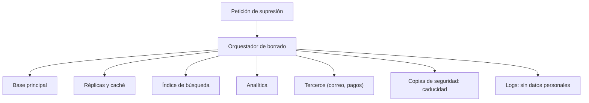

La privacidad suele llegar a un proyecto como un documento legal que alguien firma al final. Cuando eso ocurre, el sistema ya guarda más datos de los necesarios, los conserva indefinidamente, los copia a sitios que nadie inventarió y no sabe borrarlos. Corregir eso después cuesta mucho más que diseñarlo bien desde el principio, porque los datos ya están en backups, en analítica, en logs y en el historial de un proveedor.

La tesis de este artículo es que **la privacidad es un requisito de arquitectura, con consecuencias medibles en el modelo de datos, en los flujos y en los procesos de borrado**. El Reglamento General de Protección de Datos (RGPD) lo expresa en su artículo 25 como protección de datos desde el diseño y por defecto. Lo que sigue son las decisiones concretas que lo hacen posible.

## Minimizar y justificar cada dato

El principio de minimización, recogido en el artículo 5 del RGPD, dice que los datos personales deben ser adecuados, pertinentes y limitados a lo necesario para la finalidad. En la práctica, eso obliga a una pregunta por cada campo: ¿para qué lo necesitamos, y qué pasaría si no lo tuviéramos?

Un ejemplo ilustra la diferencia. Una tienda necesita la dirección de envío para entregar un pedido, así que la guarda. Pero la fecha de nacimiento del cliente, pedida en el registro «por si acaso», no tiene una finalidad definida. Si no hay una promoción que la use ni una obligación que la exija, el dato es un riesgo sin beneficio: aumenta la superficie de una filtración y el alcance de una petición de acceso, y no aporta nada al negocio.

La finalidad debe quedar escrita junto al dato. Una tabla sencilla con las columnas _dato_, _finalidad_, _base legal_, _plazo de conservación_ y _destinatarios_ ya es un avance enorme respecto a la mayoría de sistemas. Esa tabla es también el punto de partida del registro de actividades de tratamiento que exige el artículo 30.

<Callout tone="info" title="Un dato sin finalidad es un dato que no debería existir">
  Antes de añadir un campo al formulario, escribe su finalidad y su plazo. Si no puedes escribirlos,
  no lo pidas. Esta regla evita la mayoría de problemas posteriores.
</Callout>

El artículo 25 añade una segunda exigencia: protección por defecto. Significa que la configuración inicial del sistema debe ser la más respetuosa, sin que la persona tenga que descubrir y desactivar opciones. Una cuenta nueva no debería compartir su perfil con terceros ni aparecer en búsquedas públicas; un formulario no debería marcar casillas de comunicaciones comerciales; una cookie opcional no debería cargarse antes de que la persona la acepte. Estos valores por defecto se escriben en el diseño y se prueban, porque es muy fácil que un cambio de interfaz los invierta sin que nadie lo decida.

Los datos de categorías especiales, como los de salud, el origen étnico o las creencias, requieren una base legal más estricta según el artículo 9 del RGPD. Un sistema que los mezcla con datos ordinarios hace que todo el conjunto herede esa exigencia. Separarlos en almacenes o esquemas propios, con acceso más restringido y registro de accesos, reduce el perímetro que hay que proteger y auditar.

## Retención con plazos concretos

Guardar datos «mientras sean útiles» no es una política de retención. Una política útil fija un plazo por categoría de dato y dice qué ocurre al cumplirlo: borrado, anonimización o archivado con acceso restringido. Los plazos vienen de la finalidad y de las obligaciones legales. Una factura, por ejemplo, puede tener un plazo de conservación fijado por la normativa fiscal de cada país; una sesión de navegación no tiene ninguna razón para durar meses.

La retención se implementa, no solo se documenta. Cada registro debe tener una fecha de expiración o una forma de calcularla, y un proceso periódico debe aplicarla. Un plazo que existe solo en un documento es una promesa que el sistema no cumple.

Conviene distinguir tres estados de un dato antes de su borrado. El **activo** se usa en el servicio. El **restringido** se conserva solo para una obligación concreta (una reclamación, una inspección fiscal) y tiene acceso limitado. El **anonimizado** ya no identifica a nadie y puede usarse para estadística, siempre que la anonimización sea real y no un simple cambio de nombre: un código postal con la fecha de nacimiento y el sexo puede identificar a una persona.

Conviene distinguir también la seudonimización de la anonimización. Un dato seudonimizado sustituye el identificador directo (el nombre, el correo) por un código, pero quien conserve la tabla de correspondencias puede volver a identificar a la persona. Por eso el RGPD lo sigue considerando dato personal. Un dato anonimizado, en cambio, no puede reidentificarse con medios razonables. La diferencia tiene consecuencias de arquitectura: si la clave de la tabla de correspondencias vive junto a los datos, el sistema está seudonimizado; si se destruye, está más cerca de anonimizado. Anotar cuál de las dos cosas se hace, y dónde vive la clave, evita discusiones posteriores.

## Borrado que llega a todas las copias

Este es el punto donde más sistemas fallan. Un usuario pide su supresión y el equipo borra la fila de la tabla principal. Los datos siguen en las réplicas, en la caché, en el índice de búsqueda, en la tabla de analítica, en los logs, en las copias de seguridad y en los sistemas de terceros a los que se enviaron. La petición se cumple solo en apariencia.

El artículo 17 del RGPD reconoce el derecho de supresión, y el equipo debe borrar sin dilación indebida cuando procede. La arquitectura debe poder responder a esa petición en todos los sitios donde hay copias, lo cual requiere tener un inventario de copias y un mecanismo para propagar el borrado.

El orquestador es la pieza que falta en muchos sistemas. Recibe la petición, la registra, la reparte a cada sistema y guarda el resultado de cada uno. Así el equipo puede demostrar que el borrado se hizo y en qué fecha, y puede reintentar lo que falló.

Los respaldos son el caso difícil. Borrar un registro de una copia de seguridad inmutable no es práctico. La solución habitual es aceptar que el dato permanece en el respaldo hasta que este caduque según su propia política, y documentarlo. Lo que no puede ocurrir es restaurar ese respaldo y reintroducir datos que el usuario pidió borrar: el proceso de restauración debe reaplicar las supresiones pendientes antes de devolver el sistema a servicio.

<Callout tone="warning" title="Las copias no son un detalle">
  Un borrado que no llega a las copias de seguridad, la analítica y los terceros no cumple la
  petición. Haz inventario de copias antes de prometer un plazo, porque el plazo lo fija el sistema
  más lento.
</Callout>

## Derechos del interesado y plazos

El RGPD establece plazos para responder a las personas. El artículo 12, apartado 3, dice que el responsable debe facilitar la información sobre las medidas tomadas en respuesta a una solicitud sin dilación indebida y, en cualquier caso, en el plazo de un mes desde su recepción. Ese plazo puede ampliarse dos meses más en casos complejos o numerosos, siempre que se comunique dentro del primer mes y se expliquen los motivos. La arquitectura debe permitir cumplir ese plazo, lo que significa poder localizar los datos de una persona en todos los sistemas, no solo en el principal.

Los mismos principios valen para el acceso y la rectificación. Un sistema que no puede listar los datos de un usuario en menos de unas semanas tendrá dificultades para responder al derecho de acceso en plazo.

La portabilidad es el derecho que se olvida con más frecuencia. El artículo 20 permite a la persona recibir los datos que facilitó, en un formato estructurado y de uso común, y transmitirlos a otro responsable cuando el tratamiento se basa en el consentimiento o en un contrato y se hace por medios automatizados. Diseñar la exportación implica decidir qué datos son «facilitados por la persona» (su nombre, sus pedidos) y cuáles son inferidos (una puntuación de riesgo, un segmento de marketing), porque el alcance del derecho depende de esa frontera. Una exportación JSON generada desde el mismo modelo que usa la aplicación suele ser más útil que un volcado de tablas internas, y se prueba como cualquier otra funcionalidad.

Las brechas de seguridad tienen su propio reloj. El artículo 33 exige notificar a la autoridad de control sin dilación indebida y, cuando sea posible, en un plazo de 72 horas desde que se tiene constancia de la brecha, salvo que sea improbable que suponga un riesgo para los derechos y libertades. Para cumplir ese plazo, el sistema debe registrar qué datos contiene cada parte, qué accesos existen y cómo detectar un acceso anómalo. Sin eso, el equipo no puede saber a qué personas afecta una brecha, y la notificación llega incompleta o tarde.

### Un caso completo: una petición de supresión

Pensemos en una persona que pide borrar su cuenta de una tienda en línea. El sistema debe, primero, verificar que quien pide es realmente la persona titular, porque una supresión falsa es también una brecha. Después, registra la petición con su fecha de recepción: a partir de ella corre el plazo de un mes del artículo 12, apartado 3.

Luego, el orquestador consulta el inventario de copias y reparte el trabajo. La cuenta y sus datos de contacto se borran de la base principal. Los pedidos no se borran sin más, porque la normativa fiscal obliga a conservar facturas durante un plazo; en su lugar, se sustituye el nombre y la dirección por valores que ya no identifican a la persona, y se marca la factura como restringida. Las sesiones y los tokens se revocan. El índice de búsqueda elimina las entradas. La analítica recibe el identificador para excluirlo de futuras agregaciones, y los terceros (proveedor de correo, de pagos, de envíos) reciben la instrucción de supresión que su contrato permita.

Los respaldos siguen su política de caducidad, y la restauración reaplicará la supresión si llega a usarse. Al final, el orquestador guarda un registro con cada sistema, la fecha de ejecución y el resultado. Si alguno falló, el trabajo queda pendiente y se reintenta, no se da por cerrado.

Este caso muestra algo importante: el borrado no es una operación única, sino un proceso con estados. Un sistema que no sabe en qué estado está una petición no puede demostrar cumplimiento, aunque el código funcione.

## Observabilidad sin datos personales

Los logs, las trazas y las métricas son el lugar más frecuente donde se filtran datos personales sin que nadie lo decida. Un registro de error que incluye el cuerpo de la petición contiene el correo, el nombre o la dirección del usuario, y ese dato se copia a la herramienta de monitorización, a su almacenamiento y a sus copias.

La regla práctica es registrar identificadores técnicos y no contenido. Un identificador interno de usuario sirve para depurar y, si el registro cae en una brecha, no revela directamente quién es la persona. Los campos de texto libre deben pasar por un filtro de enmascaramiento antes de salir del servicio, y las trazas deben excluir cabeceras de autenticación y cuerpos de formulario.

La retención de logs también forma parte de la política. Un log con datos personales debe tener un plazo corto y justificado, distinto del de los datos de negocio. Conservarlo un año por comodidad de depuración es una decisión que nadie tomó de forma explícita.

## Herramientas

No hace falta una herramienta especial para empezar: una tabla de inventario de datos, una política de retención escrita en el repositorio y un proceso de supresión con registro bastan para un sistema pequeño. Las herramientas de clasificación de datos y de gestión de consentimientos ayudan cuando el volumen y el número de sistemas crecen, pero no sustituyen al inventario. Un escáner que encuentra datos personales en una base no sabe para qué se usan ni cuánto tiempo deben conservarse.

En el diseño de la seguridad de los datos, la protección técnica (cifrado en tránsito y en reposo, control de accesos) es necesaria pero no suficiente. Cómo se decide quién accede y con qué criterio se trata en [autorización: RBAC, ABAC y ReBAC](/docs/autorizacion-rbac-abac-rebac). La gestión de las claves con las que se cifran los datos se explica en [secretos y claves](/docs/gestion-secretos-claves).

<Callout tone="tip" title="Empieza por el inventario">
  Dibuja una tabla con cada sistema que guarda datos personales, qué datos guarda y cuándo se
  borran. Esa tabla tarda una tarde en escribirse y revela la mayoría de los problemas de privacidad
  del sistema.
</Callout>

## Errores frecuentes

Pedir datos «por si acaso» es el error más común y el más caro. Cada campo sin finalidad aumenta el riesgo, el alcance de las peticiones y el coste de cumplir.

Tratar la supresión como borrar una fila en la base principal deja datos en réplicas, analítica, logs y terceros. La petición parece cumplida y no lo está.

Anonimizar con un simple cambio de identificador, sin considerar que otras columnas pueden identificar a alguien, produce datos que siguen siendo personales.

Registrar cuerpos de petición en los logs filtra datos personales a herramientas que no estaban previstas para contenerlos.

Escribir la política de retención sin implementarla hace que el documento y el sistema digan cosas distintas, y eso es lo que una inspección encuentra primero.

## Checklist

- Cada campo personal tiene finalidad, base legal, plazo y destinatarios escritos.
- Existe un inventario de sistemas y copias que contienen datos personales.
- La política de retención fija plazos por categoría y un proceso la aplica de forma periódica.
- La supresión se orquesta: se reparte a cada sistema, se registra el resultado y se puede reintentar.
- Las copias de seguridad tienen una caducidad documentada, y la restauración reaplica las supresiones pendientes.
- El equipo puede localizar los datos de una persona en todos los sistemas dentro del plazo de un mes.
- Existe un procedimiento para notificar brechas dentro de las 72 horas, con información de qué datos y qué personas afecta.
- Los logs y trazas no contienen cuerpos de petición ni credenciales, y tienen plazo de retención propio.
- Los datos anonimizados se han evaluado para comprobar que no identifican a nadie por combinación.

## Fuentes

- Reglamento (UE) 2016/679 (RGPD), artículos 5, 12, 17, 25, 30 y 33, en su texto consolidado. Los artículos 12(3) y 33 se comprobaron en una copia del texto consultada en línea; el resto se cita según su contenido general.
- Autoridades de control y decisiones publicadas por el Comité Europeo de Protección de Datos, como ejemplo de cómo se aplica el plazo del artículo 12(3). No se citan decisiones concretas en este artículo.

Consultadas en octubre de 2026. Este artículo describe decisiones de arquitectura y no sustituye el asesoramiento jurídico: cada organización debe validar sus bases legales, plazos y obligaciones con su responsable de cumplimiento o asesor.
