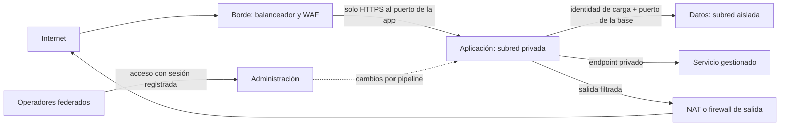
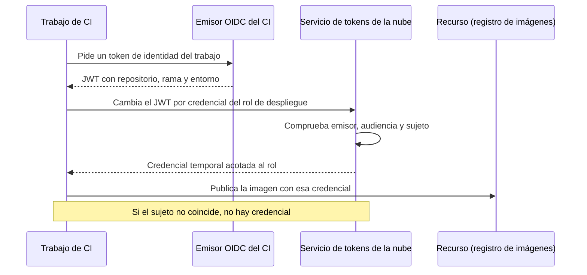

# Redes, identidad y seguridad en la nube

El equipo migró a la nube en tres meses. Para no perder tiempo, copió el centro de datos: una red virtual grande, casi todo en subredes con salida directa a internet, reglas de firewall abiertas «solo» a la IP de la oficina y una cuenta de administración que comparten seis personas. El pipeline de despliegue guarda una clave de acceso de larga duración en una variable de entorno. Un día esa clave aparece en el registro de un trabajo de CI que alguien publicó para depurar un error. Nadie sabe qué permisos tiene exactamente (tiene todos) ni desde cuándo circula, y los registros de auditoría solo cubren las operaciones de administración, no las lecturas de datos.

Ningún componente falló: falló el diseño. En la nube, **la seguridad de una carga se construye con tres capas que se refuerzan: la red decide qué puede alcanzar a qué, la identidad decide quién puede hacer qué sobre cada recurso y el registro deja evidencia de lo que pasó; ninguna de las tres basta sola.**

Esta lección recorre las tres capas con criterios que sobreviven a los cambios de producto: redes virtuales y segmentación, endpoints privados, identidades humanas y de carga de trabajo, políticas como código, secretos y claves, y qué registrar. Los nombres de AWS, Azure y Google Cloud aparecen como ejemplos de servicios equivalentes, no como recomendación.

<Callout tone="info" title="Alcance y fecha de corte">
  Consultado en octubre de 2026. El reparto de responsabilidades entre tú y el proveedor se explica
  en [servicios de nube para arquitectos](/docs/servicios-nube-para-arquitectos); el modelado de
  amenazas, los principios clásicos y zero trust, en [seguridad por
  diseño](/docs/seguridad-por-diseno); el aislamiento entre clientes de un SaaS, en
  [multi-tenancy](/docs/multi-tenancy). Aquí no se repiten.
</Callout>

## Tres capas, un solo diseño

La figura del artículo resume la idea: una red virtual con dos subredes contiguas, la de aplicación y la de datos, una sola entrada por el balanceador, una sola salida por NAT y una compuerta de identidad en la frontera entre ambas subredes que la llamada del servicio tiene que cruzar. La red reduce lo que es alcanzable; la identidad decide si una petición alcanzable está autorizada. El acento está en la identidad de carga de trabajo porque es la pieza que más a menudo falta: el servicio que llama a la base de datos o al almacén de objetos necesita una identidad propia, con credenciales de corta vida, igual que una persona.

| Capa      | Pregunta que responde                       | Controles típicos                                                      | Fallo que más se repite                            |
| --------- | ------------------------------------------- | ---------------------------------------------------------------------- | -------------------------------------------------- |
| Red       | ¿Qué puede abrir una conexión con qué?      | Subredes, tablas de rutas, grupos de seguridad, endpoints privados     | Red plana en la que todo alcanza a todo            |
| Identidad | ¿Quién (persona o carga) puede hacer qué?   | Federación, roles, credenciales temporales, políticas de permisos      | Cuentas compartidas y permisos comodín             |
| Registro  | ¿Qué pasó, quién lo hizo y cuándo lo vimos? | Auditoría del plano de control, acceso a datos, flujos de red, alertas | Registros que nadie revisa o que el atacante borra |

## La red virtual

Una red virtual (VPC en AWS y Google Cloud, VNet en Azure) es un espacio de direcciones privado que defines tú y que el proveedor implementa por software. Dos diferencias de alcance condicionan el diseño: en AWS cada subred vive entera en una zona de disponibilidad, mientras que en Google Cloud la red VPC es un recurso global y sus subredes son regionales. Antes de dibujar, mira en qué ámbito vive cada pieza en tu proveedor.

### Subredes públicas, privadas y aisladas

Lo que hace pública o privada a una subred no es una casilla, sino **su tabla de rutas**. La documentación de AWS lo define así: una subred pública tiene una ruta directa a una puerta de enlace de internet; una privada no la tiene y necesita un dispositivo NAT para salir; una aislada no tiene rutas a destinos fuera de su red.

| Tipo de subred | Ruta de salida                            | Quién puede iniciar conexiones desde fuera | Qué suele vivir ahí                               |
| -------------- | ----------------------------------------- | ------------------------------------------ | ------------------------------------------------- |
| Pública        | Directa a la puerta de enlace de internet | Internet, si las reglas lo permiten        | Balanceadores, NAT, puntos de entrada             |
| Privada        | A través de NAT (solo salida)             | Nadie desde internet                       | Servicios de aplicación, trabajadores             |
| Aislada        | Ninguna fuera de la red                   | Solo recursos de la misma red              | Bases de datos, datos sensibles, cargas por lotes |

La regla práctica: **lo público es la excepción y se justifica**. Un servicio de aplicación no necesita IP pública si entra el tráfico por un balanceador y sale por NAT o por endpoints privados.

### Rutas y puertas de enlace

Cada salida de la red es una puerta con su propio riesgo:

- **Puerta de enlace de internet**: entrada y salida para lo que tenga IP pública.
- **NAT**: solo salida; las respuestas vuelven, pero nadie de fuera inicia una conexión. Centralizarla permite filtrar y registrar el tráfico saliente.
- **VPN o interconexión dedicada**: conecta con tu centro de datos; amplía la frontera de confianza a la red de la oficina, así que trátala como una zona más, no como «interna».
- **Peering entre redes**: la documentación de Azure lo describe como una relación no transitiva; si A habla con B y B con C, A no alcanza a C por B. Es una ventaja de seguridad, y también la razón de que las topologías crezcan con un nodo central.

### Segmentación por zonas de confianza

Segmentar es decidir qué zonas existen y qué flujos se permiten entre ellas, con denegación por defecto. Un esquema habitual tiene cuatro zonas: borde (lo que recibe tráfico de internet), aplicación, datos y administración. La topología **hub-spoke**, que el Cloud Adoption Framework de Azure recomienda, lleva la idea a varias redes: un hub con servicios compartidos (conectividad con el centro de datos, firewall, salida a internet) y redes radiales que aíslan cada carga o entorno.



### Puntos de entrada controlados

Cada zona debería tener pocos puntos de entrada y conocidos: un balanceador o pasarela de API para el tráfico de usuarios, un pipeline para los cambios y un acceso administrativo que no exponga máquinas a internet. Azure Bastion, por ejemplo, da acceso RDP y SSH a máquinas virtuales sin publicar su IP. El criterio es el mismo en cualquier proveedor: si hay que abrir el puerto 22 a internet para operar, falta un punto de entrada controlado.

## Endpoints privados: servicios gestionados sin salir a internet

Los servicios gestionados (almacenamiento de objetos, colas, bases de datos, gestores de secretos) exponen por defecto un endpoint público. El patrón de **endpoint privado** coloca en tu subred una interfaz de red con IP privada que representa a ese servicio, y el DNS resuelve el nombre del servicio a esa IP. Tu carga habla con el servicio sin ruta a internet ni NAT.

| Proveedor    | Nombre del patrón                          | Matiz que conviene conocer                                                                  |
| ------------ | ------------------------------------------ | ------------------------------------------------------------------------------------------- |
| AWS          | PrivateLink (endpoints de interfaz)        | Para S3 y DynamoDB existen además endpoints de pasarela, que no usan PrivateLink sino rutas |
| Azure        | Private Endpoint, sobre Azure Private Link | No restringe por sí solo el acceso público al recurso: hay que cerrarlo aparte              |
| Google Cloud | Private Service Connect                    | Permite consumir servicios gestionados con IP internas desde tu red VPC                     |

Tres consecuencias de diseño:

- **El DNS es parte del control.** Si el nombre del servicio sigue resolviendo a la IP pública, el endpoint privado existe pero nadie lo usa. Azure lo advierte expresamente: la configuración DNS debe resolver al IP privado del endpoint.
- **Cerrar la puerta pública es otro paso.** Un endpoint privado añade un camino; no elimina el público. La política del recurso o del servicio debe negar el acceso que no llegue por el endpoint.
- **El beneficio no es solo «no pasar por internet».** La [documentación de AWS sobre endpoints de pasarela](https://docs.aws.amazon.com/vpc/latest/privatelink/gateway-endpoints.html) indica que el tráfico a S3 o DynamoDB que pasa por la puerta de enlace de internet no sale de la red de AWS. Lo que ganas es quitar la ruta de salida a las subredes de datos y poder decidir qué servicios concretos son alcanzables desde cada red.

## La identidad como nuevo perímetro

En diciembre de 2014, Rory Ward y Betsy Beyer describieron en _;login:_ BeyondCorp, el enfoque de Google que retira el requisito de una intranet privilegiada: el acceso depende de las credenciales del usuario y del estado del dispositivo, no de la red desde la que se conecta. La nube lleva esa idea más lejos, porque el plano de control (crear, borrar o leer recursos) se alcanza por API desde cualquier lugar con una credencial válida. Ahí la red no protege: protege la identidad.

### Identidades humanas y de carga de trabajo

| Tipo                    | Ejemplos                                  | Cómo se autentica bien                                        | Antipatrón                                          |
| ----------------------- | ----------------------------------------- | ------------------------------------------------------------- | --------------------------------------------------- |
| Humana del equipo       | Desarrolladores, operadores, auditores    | Proveedor de identidad central, MFA, sesiones temporales      | Usuario local con contraseña y clave de acceso fija |
| Carga dentro de la nube | Servicio en contenedor, función, máquina  | Rol o identidad gestionada asignada al cómputo                | Clave de acceso copiada en la configuración         |
| Carga fuera de la nube  | Pipeline de CI, servidor local, otra nube | Federación: token del emisor cambiado por credencial temporal | Secreto de larga duración en el sistema de CI       |

### Credenciales de corta vida

Las guías de los tres proveedores coinciden en la dirección. Las buenas prácticas de IAM de AWS piden que las personas accedan por federación con credenciales temporales y que las cargas usen roles con credenciales temporales, que la plataforma entrega al cómputo sin distribuir claves. Azure presenta las identidades gestionadas como una forma de obtener tokens de Microsoft Entra sin gestionar credenciales; las credenciales ni siquiera son accesibles para ti. Google Cloud describe las claves de cuentas de servicio como credenciales potentes que pueden ser un riesgo si no se gestionan bien, y ofrece la federación de identidades de carga de trabajo para no depender de ellas.

Una credencial temporal es tan segura como el camino por el que se obtiene. AWS publicó en noviembre de 2019 la versión 2 de su servicio de metadatos de instancia (IMDSv2), que exige un token de sesión pedido con PUT, no lo entrega a peticiones con la cabecera `X-Forwarded-For` y limita el TTL del paquete para que no salga de la máquina. Su objetivo declarado: defender contra firewalls de aplicaciones y proxies inversos mal configurados y vulnerabilidades SSRF que podían reenviar peticiones al servicio de metadatos y obtener las credenciales del rol.

<Callout tone="warning" title="Un caso con sanción regulatoria">
  En agosto de 2020, la OCC de Estados Unidos impuso a Capital One una sanción de 80 millones de
  dólares por no establecer procesos eficaces de evaluación de riesgos antes de migrar operaciones
  significativas a la nube pública. Los análisis públicos del incidente de 2019 describen un
  firewall de aplicaciones mal configurado y un rol con más permisos de los necesarios; el mecanismo
  exacto varía según la fuente, así que tómalo como ilustración del patrón, no como informe forense.
</Callout>

### Federación

Federar es aceptar la identidad que emite otro sistema en lugar de crear una cuenta propia. Para personas, el proveedor de identidad corporativo emite la sesión. Para cargas externas, el caso más común es el pipeline: GitHub Actions, por ejemplo, emite un token OIDC por trabajo; el proveedor de nube comprueba que el sujeto y el resto de claims coinciden con las condiciones del rol y devuelve un token de acceso de corta vida válido solo para ese trabajo. Ya no hay que copiar credenciales de nube como secretos de larga duración en el CI.



La condición de confianza es lo que se diseña y se revisa. Su forma, sin sintaxis de ningún proveedor:

```yaml
# Confianza del rol de despliegue en el emisor OIDC del CI (forma, no sintaxis real)
role: deploy-production
trust:
  issuer: https://token.actions.githubusercontent.com
  audience: sts # el valor esperado depende del proveedor
  subject: repo:acme/billing:environment:production # nunca un comodín sobre toda la organización
permissions: [push-image, update-service] # // …
maxSession: corta # la fija la política del proveedor
```

### Mínimo privilegio y cómo auditarlo

Mínimo privilegio significa definir qué acciones se pueden hacer sobre qué recursos y bajo qué condiciones. Nadie lo acierta a la primera; AWS lo reconoce y propone empezar más amplio y reducir conforme madura la carga. Lo que importa es que la reducción ocurra, y para eso hacen falta datos:

- **Último acceso.** IAM de AWS ofrece información de último acceso para detectar usuarios, roles y permisos que nadie usa.
- **Generación desde la actividad.** IAM Access Analyzer puede generar una política a partir de las acciones registradas en CloudTrail; luego la pruebas antes de desplegarla.
- **Acceso externo.** El mismo analizador señala recursos con acceso público o entre cuentas.
- **Revisión periódica.** Cada rol tiene dueño y fecha de revisión; lo que no se usa, se retira.

Los otros proveedores tienen herramientas equivalentes con otros nombres; busca la de tu plataforma antes de construir la tuya.

## Políticas como código y revisión de permisos

Los permisos de cada identidad viven en políticas, y las políticas son configuración: se versionan, se revisan en un pull request y se despliegan por pipeline como el resto de la infraestructura. Encima de ellas conviene poner **barandillas** de organización, que limitan lo que cualquier identidad puede hacer aunque tenga una política más amplia:

| Proveedor    | Barandilla de organización             | Comportamiento documentado                                                                  |
| ------------ | -------------------------------------- | ------------------------------------------------------------------------------------------- |
| AWS          | Políticas de control de servicio (SCP) | Fijan el máximo de permisos, no conceden ninguno y no afectan a la cuenta de administración |
| Azure        | Azure Policy                           | Puede denegar, auditar o modificar; Microsoft recomienda empezar en modo auditoría          |
| Google Cloud | Organization Policy Service            | Las políticas se heredan hacia carpetas y proyectos, que pueden sobrescribirlas             |

Fuera del proveedor, Open Policy Agent (OPA), proyecto graduado de la CNCF desde enero de 2021, es un motor de políticas de propósito general que sirve para evaluar planes de infraestructura antes de aplicarlos. Una organización posible del repositorio:

```text
platform-policies/
  guardrails/            # barandillas de organización: regiones, servicios, cifrado
  roles/
    billing-api.yaml     # un archivo por identidad de carga, con dueño
    deploy-production.yaml
  checks/
    no-wildcards.rego    # niega acciones o recursos con comodín // …
    no-public-buckets.rego
  CODEOWNERS             # seguridad revisa cualquier cambio en guardrails/
```

El valor está en el flujo: el pull request muestra el **diff de permisos**, una comprobación automática rechaza comodines y accesos públicos, y alguien distinto del autor aprueba. Es una [fitness function](/docs/fitness-functions) aplicada a la identidad.

## Secretos y claves

La mejor gestión de un secreto es no tenerlo: con identidad de carga de trabajo, el servicio se autentica ante la base de datos o el almacén sin contraseña. Cuando el secreto es inevitable (una clave de API de un tercero, una contraseña heredada), vive en un **almacén de secretos** (AWS Secrets Manager, Azure Key Vault, Google Secret Manager), se lee en tiempo de ejecución con la identidad de la carga y se rota de forma automática. Los criterios generales de rotación y detección de fugas están en [seguridad por diseño](/docs/seguridad-por-diseno); aquí interesa lo propio de la nube.

### Variables de entorno

La hoja de gestión de secretos de OWASP desaconseja las variables de entorno salvo que no haya otra opción, porque suelen ser accesibles para todos los procesos y pueden acabar en registros o volcados del sistema. Si las usas, que el valor llegue en el arranque desde el almacén, no desde el pipeline, y que nunca se imprima la configuración completa.

### Cifrado en reposo y en tránsito

Los servicios de gestión de claves (AWS KMS, Azure Key Vault y Managed HSM, Cloud KMS) se basan en el **cifrado por sobre**: los datos se cifran con una clave de datos, y esa clave se cifra con otra que nunca sale del servicio. Así puedes guardar la clave de datos cifrada junto a los datos y rotar la clave superior sin volver a cifrar todo. En tránsito, la regla es TLS también dentro de la red: una red privada no es un canal cifrado, y las políticas de IAM pueden exigir que las peticiones lleguen por TLS.

### Separación de funciones

La documentación de Cloud KMS lo resume como evitar que una sola identidad tenga todos los permisos necesarios para una acción maliciosa. Aplicado a claves, quien administra el ciclo de vida (crear, rotar, deshabilitar) no es quien cifra y descifra.

| Rol                       | Puede                                         | No debería poder                |
| ------------------------- | --------------------------------------------- | ------------------------------- |
| Administrador de claves   | Crear, rotar, programar borrado, ver uso      | Descifrar datos de producción   |
| Identidad de la carga     | Cifrar y descifrar con su clave               | Cambiar la política de la clave |
| Operador de la plataforma | Desplegar la carga y su configuración         | Leer el valor de los secretos   |
| Auditor                   | Leer registros de uso de claves y de secretos | Modificar nada                  |

## Registro, detección y respuesta

Un registro que no existe cuando lo necesitas no se puede reconstruir. Decide qué registrar antes del primer incidente, y fíjate en lo que viene apagado por defecto.

| Qué registrar                       | Ejemplos por proveedor                                           | Detalle por defecto que conviene saber                                                |
| ----------------------------------- | ---------------------------------------------------------------- | ------------------------------------------------------------------------------------- |
| Plano de control (quién cambió qué) | CloudTrail, Activity Log de Azure, Cloud Audit Logs              | En Google Cloud, Admin Activity se escribe siempre y no se puede desactivar           |
| Acceso a datos sensibles            | Eventos de datos de CloudTrail, Data Access de Cloud Audit Logs  | Los eventos de datos de CloudTrail y Data Access (salvo BigQuery) vienen desactivados |
| Flujos de red                       | VPC Flow Logs, flow logs de red virtual en Azure                 | Hay que activarlos y decidir dónde se guardan                                         |
| Inicios de sesión e identidad       | Registros del proveedor de identidad, inicios de sesión de Entra | Incluye las identidades de carga, no solo las personas                                |
| Uso de claves y secretos            | Registros del gestor de claves y del almacén de secretos         | Cada descifrado es una pregunta que podrás responder después                          |

**Dónde:** en una cuenta o proyecto de registros separado, al que las cargas escriben pero no pueden borrar, con retención acorde a tus obligaciones. Si el atacante puede desactivar el registro con la misma credencial que robó, el registro no sirve.

**Detección:** pocas alertas con señal alta valen más que un panel lleno. Empieza por el uso de la cuenta raíz o equivalente, la desactivación de registros, los cambios en barandillas y en políticas de confianza, la creación de claves de larga duración y el acceso a datos desde identidades que nunca lo hacían.

**Respuesta:** ten escrito cómo revocar sesiones activas, desactivar una credencial y aislar una carga sin borrar las evidencias. Ensáyalo como ensayas una recuperación ante desastres.

## Cuándo sí y cuándo no

La pregunta no es si aplicar estas capas, sino con cuánto rigor en cada etapa. Es un [trade-off](/docs/trade-offs-y-decisiones) entre fricción y riesgo.

| Situación                                          | Rigor razonable                                                                                       |
| -------------------------------------------------- | ----------------------------------------------------------------------------------------------------- |
| Prototipo sin datos reales, un equipo pequeño      | Federación y MFA desde el día uno; red sencilla; sin claves de larga duración                         |
| Producto con datos de clientes                     | Subredes privadas, endpoints privados para datos, identidad por servicio, auditoría de acceso a datos |
| Datos regulados o varios equipos en la misma nube  | Hub-spoke, barandillas de organización, separación de funciones en claves, cuenta de registros aparte |
| Carga que solo sirve contenido público estático    | Red mínima; la inversión va a la identidad de quien publica y al registro de cambios                  |
| Equipo sin capacidad para operar firewalls propios | Prefiere servicios gestionados y endpoints privados antes que dispositivos de red que nadie mantiene  |

## Errores frecuentes

- **Cuentas compartidas.** Si seis personas usan el mismo usuario, el registro dice «fue admin» y nadie responde. Cada persona entra con su identidad federada.
- **Permisos comodín.** Una acción `*` sobre un recurso `*` convierte cualquier fallo de la carga en un fallo de toda la cuenta. Las comprobaciones de políticas deben rechazarlos.
- **Allowlist de IP como única defensa.** La IP de la oficina cambia, se comparte con la VPN de invitados y no dice quién está detrás. Es una capa más, nunca la autenticación.
- **Secretos en variables de entorno sin control.** Acaban en registros, volcados y capturas de pantalla de depuración. Lee del almacén en el arranque o, mejor, elimina el secreto con identidad de carga.
- **Red plana confiada.** «Está dentro de la VPC» no es una autorización. Segmenta por zonas y exige identidad también entre servicios internos.
- **Endpoint privado con la puerta pública abierta.** El camino privado existe, pero el público sigue aceptando tráfico. Cierra el acceso público en la política del recurso.
- **Registros desactivados por costo.** Desactivar el acceso a datos ahorra en la factura y deja sin respuesta la primera pregunta de un incidente: ¿qué se leyó?

## Ejemplo trabajado: la API de facturación

Supón una API de facturación con tres servicios (API, generador de PDF y trabajador de cobros), una base de datos relacional, un almacén de objetos para los PDF y un pipeline de CI externo. Son supuestos para ilustrar la decisión, no un caso real.

**Red.** El balanceador vive en dos subredes públicas; los tres servicios, en subredes privadas; la base de datos, en subredes aisladas. El almacén de objetos y el gestor de secretos se alcanzan por endpoints privados, y su política niega cualquier acceso que no llegue por ellos. Solo el trabajador de cobros necesita salir a internet (a la pasarela de pagos), así que es el único con ruta al NAT, y el firewall de salida solo permite el dominio de la pasarela.

**Identidad.** Cada servicio tiene su propia identidad de carga: 3 identidades. El pipeline usa federación OIDC con dos roles, uno para publicar imágenes y otro para desplegar en producción, este último ligado al entorno protegido: 2 roles. Las personas entran por el proveedor corporativo en dos grupos, operadores y solo lectura: 2 grupos. En total, 7 identidades o grupos con dueño, y ninguna clave de larga duración.

**Datos y claves.** El generador de PDF puede escribir en su prefijo del almacén y nada más; la API solo puede leer de él. La clave que cifra la base y el almacén la administra el equipo de plataforma; las identidades de carga solo pueden usarla.

**Registro.** Plano de control y acceso a datos del almacén van a una cuenta de registros separada. Alertas iniciales: cambios en la confianza de los roles del pipeline, lecturas del almacén desde identidades distintas de la API y cualquier creación de claves de acceso.

Si el producto es SaaS con varios clientes, el aislamiento entre ellos (por esquema, por base o por cuenta) se decide aparte, con los criterios de [multi-tenancy](/docs/multi-tenancy). Registra las decisiones en un [ADR](/docs/adr): dentro de un año alguien preguntará por qué el trabajador de cobros es el único con salida.

## Checklist

- [ ] Ninguna persona tiene usuario local con clave de acceso fija; todas entran federadas, con MFA.
- [ ] Cada carga de trabajo tiene su propia identidad y obtiene credenciales temporales de la plataforma o por federación.
- [ ] Las subredes de datos no tienen ruta a internet y los servicios gestionados se alcanzan por endpoints privados con el acceso público cerrado.
- [ ] Las políticas de permisos viven en el repositorio, sin comodines, con dueño y revisión en pull request.
- [ ] Hay barandillas de organización que limitan regiones, servicios y desactivación de registros.
- [ ] Los secretos inevitables viven en un almacén, se leen en tiempo de ejecución y rotan solos.
- [ ] Quien administra las claves no puede descifrar datos de producción.
- [ ] Los registros de plano de control y de acceso a datos sensibles van a una cuenta separada, con alertas de alta señal y un procedimiento de revocación ensayado.

## Siguiente lección

Con la red, la identidad y los registros en su sitio, toca decidir dónde y cuántas veces se despliega la carga: sigue con [regiones, zonas y recuperación](/docs/regiones-zonas-y-recuperacion).

## Fuentes

Consultadas en octubre de 2026.

- [Subnets for your VPC (documentación de Amazon VPC)](https://docs.aws.amazon.com/vpc/latest/userguide/configure-subnets.html): tipos de subred definidos por su ruta
- [What is AWS PrivateLink?](https://docs.aws.amazon.com/vpc/latest/privatelink/what-is-privatelink.html) y [Gateway endpoints](https://docs.aws.amazon.com/vpc/latest/privatelink/gateway-endpoints.html) (documentación de AWS)
- [What is a private endpoint? (Microsoft Learn)](https://learn.microsoft.com/en-us/azure/private-link/private-endpoint-overview): DNS y acceso público
- [Private Service Connect](https://docs.cloud.google.com/vpc/docs/private-service-connect) y [VPC networks](https://docs.cloud.google.com/vpc/docs/vpc) (documentación de Google Cloud)
- [Hub-spoke network topology in Azure (Azure Architecture Center)](https://learn.microsoft.com/en-us/azure/architecture/networking/architecture/hub-spoke)
- [BeyondCorp: A New Approach to Enterprise Security (Rory Ward y Betsy Beyer, ;login:, diciembre de 2014)](https://www.usenix.org/publications/login/dec14/ward)
- [Security best practices in IAM (documentación de AWS)](https://docs.aws.amazon.com/IAM/latest/UserGuide/best-practices.html)
- [Managed identities for Azure resources (Microsoft Learn)](https://learn.microsoft.com/en-us/entra/identity/managed-identities-azure-resources/overview)
- [Workload Identity Federation (documentación de Google Cloud)](https://docs.cloud.google.com/iam/docs/workload-identity-federation)
- [OpenID Connect en GitHub Actions (documentación de GitHub)](https://docs.github.com/en/actions/concepts/security/openid-connect)
- [Add defense in depth against open firewalls, reverse proxies, and SSRF vulnerabilities with enhancements to the EC2 Instance Metadata Service (Colm MacCárthaigh, AWS Security Blog, 19 de noviembre de 2019)](https://aws.amazon.com/blogs/security/defense-in-depth-open-firewalls-reverse-proxies-ssrf-vulnerabilities-ec2-instance-metadata-service/)
- [OCC Assesses $80 Million Civil Money Penalty Against Capital One (comunicado 2020-101, 6 de agosto de 2020)](https://www.occ.gov/news-issuances/news-releases/2020/nr-occ-2020-101.html)
- [Service control policies (documentación de AWS Organizations)](https://docs.aws.amazon.com/organizations/latest/userguide/orgs_manage_policies_scps.html), [Azure Policy overview (Microsoft Learn)](https://learn.microsoft.com/en-us/azure/governance/policy/overview) y [Organization Policy Service (Google Cloud)](https://docs.cloud.google.com/resource-manager/docs/organization-policy/overview)
- [Open Policy Agent en la CNCF](https://www.cncf.io/projects/open-policy-agent-opa/)
- [Secrets Management Cheat Sheet (OWASP)](https://cheatsheetseries.owasp.org/cheatsheets/Secrets_Management_Cheat_Sheet.html)
- [AWS KMS cryptography essentials](https://docs.aws.amazon.com/kms/latest/developerguide/kms-cryptography.html): cifrado por sobre
- [Separation of duties (documentación de Cloud KMS)](https://docs.cloud.google.com/kms/docs/separation-of-duties)
- [Cloud Audit Logs overview (Google Cloud)](https://docs.cloud.google.com/logging/docs/audit), [Logging data events (AWS CloudTrail)](https://docs.aws.amazon.com/awscloudtrail/latest/userguide/logging-data-events-with-cloudtrail.html) y [Virtual network flow logs (Microsoft Learn)](https://learn.microsoft.com/en-us/azure/network-watcher/vnet-flow-logs-overview)
