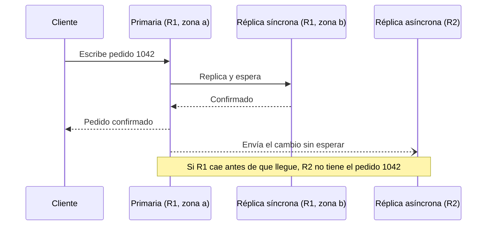
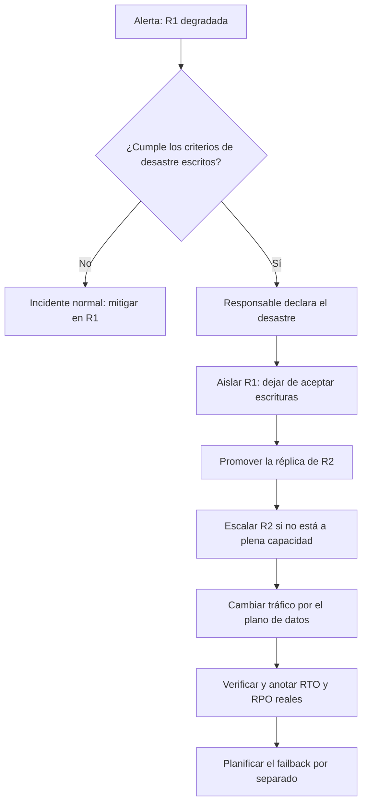

# Regiones, zonas y recuperación ante desastres

Tu sistema corre en tres zonas de disponibilidad, el balanceador reparte tráfico entre ellas y la base de datos tiene una réplica síncrona en otra zona. Un día cae la región entera, o un error de configuración se propaga a todas las zonas a la vez. Alguien pregunta en el canal de incidentes cuánto se tarda en levantar el servicio en otra región y cuántos datos se pierden. Nadie lo sabe: el plan existe en un documento, pero nunca se ejecutó, la réplica entre regiones lleva un retraso que nadie mide y el cambio de DNS depende de una consola que está en la región caída. Este artículo trata de esas dos preguntas. La idea central: **la recuperación ante desastres es la capacidad, diseñada y probada, de devolver el servicio en otro dominio de fallo dentro de un tiempo (RTO) y con una pérdida de datos (RPO) que el negocio ha aceptado por escrito**.

Verás qué cubre una zona y qué cubre una región, cómo se relaciona el tipo de replicación con la consistencia, qué significan RTO y RPO según los proveedores, las cuatro estrategias clásicas ordenadas por costo y tiempo, cómo se cambia el tráfico, qué pasa con los datos durante el cambio y por qué un plan sin simulacros es una hipótesis. Los proveedores aparecen como ejemplos para nombrar piezas equivalentes, no como recomendación.

<Callout tone="info" title="Fecha de corte y fuentes">
  Consultado en octubre de 2026 en la documentación oficial de AWS, Microsoft Azure y Google Cloud.
  Las cifras de distancia y latencia entre zonas son las que publica Azure a esa fecha; los nombres
  de servicios cambian, así que úsalos para orientarte, no como inventario vigente. No se citan
  precios ni SLA.
</Callout>

## El problema que resuelve

La alta disponibilidad y la recuperación ante desastres se confunden a menudo, y el error sale caro. La primera mantiene el servicio ante fallos frecuentes y pequeños (una máquina, un rack, una zona) sin intervención humana. La segunda devuelve el servicio tras un fallo grande y raro, normalmente con una decisión explícita, una pérdida de datos acotada y un tiempo de corte. Los síntomas de no haber separado ambas cosas son reconocibles:

| Síntoma durante un incidente                                     | Decisión que nadie tomó                                                                     |
| ---------------------------------------------------------------- | ------------------------------------------------------------------------------------------- |
| «Estamos en tres zonas» y aun así el servicio cae entero         | Qué no cubren las zonas: un error de configuración o de despliegue replicado en todas ellas |
| Nadie sabe cuántos minutos de pedidos se perdieron               | Un RPO medido y vigilado, no solo declarado                                                 |
| El failover tarda horas porque hay que crear la infraestructura  | Una estrategia acorde con el RTO que pide el negocio                                        |
| El cambio de tráfico necesita una consola o API que no responde  | Qué dependencias tiene el camino de recuperación                                            |
| La réplica copió fielmente el borrado accidental de una tabla    | Que replicar no sustituye a las copias de seguridad                                         |
| El plan funcionaba hace un año, pero la región secundaria cambió | Simulacros periódicos y control de deriva de configuración                                  |

## Dominios de fallo: zona y región

Un **dominio de fallo** es el conjunto de recursos que puede caer por una misma causa. Diseñar para la recuperación consiste en repartir el sistema entre dominios cuyas causas de fallo sean independientes, y en saber qué causas quedan fuera.

### Qué es una zona

Los tres grandes proveedores definen la zona de forma parecida. AWS describe las zonas de disponibilidad como ubicaciones múltiples y aisladas dentro de cada región, y explica que repartir instancias entre varias protege la aplicación del fallo de una sola ubicación. Azure es más concreto: una zona es una agrupación lógica de uno o más centros de datos físicamente separados dentro de una región, con energía, refrigeración y red independientes, de modo que si una zona sufre un corte las demás siguen funcionando. Google Cloud la define como un área de despliegue dentro de una región y dice que diseña las zonas para minimizar el riesgo de fallos correlacionados.

[Azure publica](https://learn.microsoft.com/en-us/azure/reliability/availability-zones-overview) dos datos útiles para razonar (a fecha de consulta, octubre de 2026): sus zonas suelen estar separadas varios kilómetros y normalmente a menos de 100 km entre sí, y su objetivo de latencia de ida y vuelta entre zonas es de unos 2 ms aproximadamente. La propia documentación lo relaciona con la consecuencia arquitectónica: esa latencia baja permite la **replicación síncrona** entre zonas.

### Qué es una región

Una región es un área geográfica separada que agrupa varias zonas. AWS dice que cada región está diseñada para estar aislada de las demás y que no replica recursos entre regiones de forma automática: esa decisión es tuya. Google Cloud resume la diferencia: repartir recursos entre zonas reduce el riesgo de un corte de infraestructura; repartirlos entre regiones da un grado aún mayor de independencia ante fallos. Azure lo dice sin rodeos: las zonas **no protegen** frente al corte de una región completa.

### Qué cubre cada nivel

| Causa del fallo                                             | Varias zonas   | Varias regiones                                     | Copias con versión o punto en el tiempo |
| ----------------------------------------------------------- | -------------- | --------------------------------------------------- | --------------------------------------- |
| Cae una máquina, un rack o un centro de datos               | Sí             | Sí                                                  | No es su función                        |
| Corte de energía o de red que afecta a una zona             | Sí             | Sí                                                  | No es su función                        |
| Desastre o corte que afecta a toda la región                | No             | Sí                                                  | Solo si la copia está en otra región    |
| Despliegue o configuración errónea aplicada en todas partes | No             | Solo si despliegas por regiones de forma escalonada | Ayuda a volver atrás                    |
| Borrado accidental, corrupción, ransomware                  | No: se replica | No: se replica                                      | Sí, es la única defensa                 |
| Credenciales comprometidas en la cuenta                     | No             | Depende del aislamiento de cuentas                  | Sí, si están en otra cuenta             |

La tabla tiene dos lecturas. La primera: para muchos sistemas, varias zonas en una región bastan. AWS lo dice en su guía de recuperación: las zonas de una región están diseñadas con distancia suficiente para que los desastres más comunes afecten solo a una, así que una arquitectura en varias zonas ya cubre buena parte del riesgo. La segunda: la replicación, en cualquier nivel, copia también los errores. Contra la corrupción o el borrado solo sirven las copias de seguridad con punto en el tiempo, guardadas fuera del alcance de quien pudo causar el daño.

## Replicación síncrona y asíncrona

El tipo de replicación decide cuántos datos puedes perder y cuánto tarda cada escritura. Azure los define así en su marco de buena arquitectura: la **síncrona** escribe los cambios en varias ubicaciones a la vez y evita la pérdida de datos a costa de más latencia; la **asíncrona** escribe primero en la ubicación primaria y copia después, con menos latencia y aceptando alguna pérdida.

Es el mismo dilema que formula PACELC en [CAP, PACELC y consistencia](/docs/cap-pacelc): incluso sin partición, coordinar réplicas cuesta latencia. Entre zonas, a pocos milisegundos, la replicación síncrona suele ser asumible. Entre regiones separadas cientos o miles de kilómetros, esperar a la réplica remota en cada escritura alarga cada transacción, y por eso la replicación entre regiones suele ser asíncrona. Azure lo recoge como patrón: síncrona entre zonas para los datos prioritarios, asíncrona entre regiones.

La consecuencia es la que muestra la figura del artículo: en la región primaria (R1) la base de datos tiene una copia síncrona en otra zona; hacia la secundaria (R2) la copia viaja con retraso. Las escrituras confirmadas en R1 que aún no habían llegado a R2 cuando R1 cae son el hueco de datos.



Dos matices. Primero, «sin pérdida» en la replicación síncrona se refiere a las escrituras confirmadas ante el fallo de una copia, no a la corrupción: un `DELETE` erróneo se replica igual de rápido. Segundo, la réplica asíncrona no está «un poco atrasada» de forma abstracta: tiene un retraso medible en segundos o en posición del registro de transacciones, y ese retraso es tu RPO real en cada instante. Cómo afecta la elección de aislamiento y de transacciones a lo que se replica lo cuenta [datos, ACID y aislamiento](/docs/datos-acid-y-aislamiento).

## RTO y RPO

Las dos cifras con las que se negocia la recuperación tienen definición en las guías de los proveedores. La guía de AWS sobre recuperación ante desastres dice:

- **RTO** (objetivo de tiempo de recuperación): el retraso máximo aceptable entre la interrupción del servicio y su restablecimiento.
- **RPO** (objetivo de punto de recuperación): el tiempo máximo aceptable desde el último punto de recuperación de datos; determina qué pérdida de datos se considera aceptable entre ese punto y la interrupción.

Azure las define de forma equivalente: el RPO es la pérdida de datos máxima aceptable medida en tiempo, y el RTO el tiempo máximo aceptable para restablecer la operación. Ambas guías insisten en que los fija la organización a partir del impacto en el negocio, no el equipo técnico a partir de lo que resulta cómodo. AWS añade una regla de sentido común: si la estrategia de recuperación cuesta más que la pérdida que evita, no debería implantarse salvo que haya otro motivo, como un requisito regulatorio.

En la figura, el RPO es el tramo resaltado entre la última escritura que llegó a R2 y la caída de R1; el RTO es el tramo entre la caída y el momento en que R2 vuelve a servir.

| Pregunta del negocio                       | Objetivo | Lo determina sobre todo                                         |
| ------------------------------------------ | -------- | --------------------------------------------------------------- |
| ¿Cuántos minutos de datos podemos perder?  | RPO      | Frecuencia de copias o retraso de la replicación                |
| ¿Cuánto tiempo podemos estar sin servicio? | RTO      | Qué hay ya desplegado en el destino y cómo se cambia el tráfico |

### Medir, no declarar

Un RPO de cinco minutos escrito en un documento no significa nada si la réplica acumula veinte minutos de retraso cada noche durante la carga masiva. Trata ambos objetivos como requisitos de [atributos de calidad](/docs/atributos-de-calidad) y vigílalos como métricas: el retraso de replicación con alerta por encima del RPO, la antigüedad de la última copia válida, y el RTO real medido en cada simulacro. AWS recomienda además restaurar copias de forma periódica, porque restaurar es una operación del plano de control y conviene tener almacenes de datos operativos creados a partir de copias recientes antes de necesitarlos.

## Cuatro estrategias de recuperación

AWS agrupa las estrategias en cuatro, de la más barata y simple a la más compleja: copia de seguridad y restauración, piloto activo (_pilot light_), espera cálida (_warm standby_) y activo-activo en varias regiones. Azure usa nombres parecidos para las variantes activo-pasivo (espera fría y espera cálida). La tabla resume la diferencia en términos relativos; las cifras concretas dependen de tus datos y servicios.

| Estrategia                        | Qué hay en la región de recuperación                          | RTO relativo   | RPO relativo                         | Costo continuo relativo |
| --------------------------------- | ------------------------------------------------------------- | -------------- | ------------------------------------ | ----------------------- |
| Copia de seguridad y restauración | Copias de datos, imágenes y la infraestructura como código    | El más alto    | El intervalo entre copias            | El más bajo             |
| Piloto activo                     | Datos replicados en vivo; la aplicación definida pero apagada | Alto o medio   | El retraso de la replicación         | Bajo                    |
| Espera cálida                     | Una copia completa y funcional, a capacidad reducida          | Medio o bajo   | El retraso de la replicación         | Medio                   |
| Activo-activo                     | El sistema completo sirviendo tráfico en varias regiones      | Cercano a cero | Cercano a cero para fallos de región | El más alto             |

### Copia de seguridad y restauración

Copias periódicas o continuas de los datos, más todo lo necesario para recrear el entorno: código, configuración, imágenes e infraestructura como código. AWS subraya que sin infraestructura como código restaurar en otra región se complica y alarga el tiempo de recuperación. Es la estrategia adecuada cuando el desastre que temes es la pérdida o corrupción de datos, o cuando el negocio tolera horas de corte. Ojo: las copias en la región de recuperación hay que **restaurarlas** durante el failover, y eso forma parte del RTO.

### Piloto activo

Los datos se replican de forma continua a la región secundaria y el núcleo de la infraestructura existe, pero los servidores de aplicación están definidos y apagados (o ni siquiera desplegados) hasta el failover. Es lo que dibuja la figura: la base de datos de R2 recibe cambios y la aplicación está en gris. AWS recuerda que la replicación continua no protege contra la corrupción, así que también necesitas copias con punto en el tiempo.

### Espera cálida

Una copia reducida pero **completamente funcional** del entorno de producción corre en la otra región. AWS marca la diferencia con el piloto activo de forma clara: el piloto no puede atender peticiones sin una acción previa; la espera cálida puede atender tráfico de inmediato, a capacidad reducida, y solo necesita escalar. Ese escalado depende del plano de control (el autoescalado), y AWS lo presenta como un compromiso: si aprovisionas toda la capacidad de antemano, la configuración es estáticamente estable y se llama espera en caliente (_hot standby_).

### Activo-activo

Varias regiones sirven tráfico a la vez. AWS señala que en este caso no hay failover propiamente dicho: el tráfico deja de ir a la región caída y las demás deben absorber la carga. La dificultad se traslada a los datos: si todas las regiones escriben, necesitas una regla para escrituras concurrentes. La guía de AWS distingue tres opciones: escribir en una sola región (_write global_), escribir en la más cercana y reconciliar (_write local_; cita las tablas globales de DynamoDB, que resuelven con «gana el último que escribe») o asignar cada clave a una región (_write partitioned_). Es el terreno de [CAP y PACELC](/docs/cap-pacelc) a escala de región.

<Callout tone="warning" title="Replicar no es hacer copias">
  Todas las estrategias, incluida la activo-activo, necesitan copias de seguridad con punto en el
  tiempo. AWS lo dice expresamente: ante corrupción o borrado, el tiempo de recuperación será mayor
  que cero y el punto de recuperación estará antes del momento en que se descubrió el problema.
</Callout>

## Cambiar el tráfico

Tener la región secundaria lista no sirve de nada si los clientes siguen llamando a la primaria. Hay tres familias de mecanismos, con comportamientos distintos:

| Mecanismo                       | Cómo desvía el tráfico                                                 | Lo que tienes que vigilar                                             |
| ------------------------------- | ---------------------------------------------------------------------- | --------------------------------------------------------------------- |
| DNS con comprobaciones de salud | Cambia la respuesta del nombre hacia el punto sano                     | Las cachés de resolutores y clientes respetan el TTL, o no            |
| Balanceador global o IP anycast | Una IP estable; el proveedor enruta hacia el punto sano                | Que el cambio se haga por el plano de datos, no reconfigurando a mano |
| Conmutación de origen en la CDN | Si falla la petición al origen primario, la reintenta en el secundario | Es por petición: el primario sigue recibiendo intentos                |

El DNS es el mecanismo más extendido y el más malinterpretado. El TTL de un registro, según el RFC 1035, es el intervalo durante el cual el registro puede guardarse en caché antes de volver a consultar la fuente. Eso significa que un cambio no llega a todos los clientes a la vez: depende del TTL, de los resolutores intermedios y de clientes que guardan la respuesta más de lo debido. Azure lo menciona entre los procesos fuera de tu control cuyo retraso debes validar en los simulacros. AWS señala que un acelerador global con IP anycast evita los problemas de caché propios del DNS. No hay una cifra universal de propagación: mídela en tu caso.

### Plano de control y plano de datos

La distinción más útil de la guía de AWS es esta: el **plano de datos** atiende el servicio en tiempo real y el **plano de control** configura el entorno (crear, modificar, borrar). Los planos de datos suelen tener objetivos de disponibilidad más altos, así que la recomendación es que el failover use solo operaciones del plano de datos. Ejemplos concretos del propio AWS: cambiar los pesos de un registro DNS o el dial de tráfico de un acelerador global es una operación del plano de control; activar una comprobación de salud preconfigurada que actúa como interruptor es del plano de datos.

Esto conecta con la **estabilidad estática**: un sistema que sigue funcionando sin necesidad de hacer cambios cuando una dependencia falla. La forma de conseguirla es tener aprovisionado de antemano lo que el failover necesita, en lugar de crearlo durante el desastre.

### Automático o manual

AWS advierte que el failover automático basado en comprobaciones de salud debe usarse con cautela: RTO y RPO nunca son cero, así que un failover por falsa alarma te hace pagar esas pérdidas sin motivo. Por eso es frecuente que la **decisión** sea humana, pero los **pasos** estén automatizados, de forma que iniciar el failover sea pulsar un botón. Azure añade que la vuelta atrás (_failback_) es un proceso distinto, con su propio plan.



## Estado y datos durante el failover

El cambio de región no es solo de tráfico. Cada tipo de estado tiene su destino:

- **Escrituras en el hueco.** Las que R1 confirmó y no llegaron a R2 no existen en la nueva primaria. Si R1 vuelve, puede que aparezcan; decide de antemano si se descartan, se reaplican o se revisan a mano, y quién lo decide.
- **Dos primarias a la vez.** Si R1 no estaba muerta sino aislada, puede seguir aceptando escrituras mientras R2 ya es primaria. El paso «aislar R1» del diagrama existe para eso: cortar la escritura en el lado viejo antes de promover el nuevo. Sin ese corte, el failover crea divergencia que tendrás que reconciliar.
- **Mensajes y eventos.** Un consumidor que procesó un mensaje en R1 y no llegó a confirmar su posición lo verá de nuevo en R2. Los consumidores deben ser idempotentes; los patrones están en [sagas, outbox e idempotencia](/docs/sagas-outbox-idempotencia), y el comportamiento de colas y cachés, en [caching, colas y streaming](/docs/caching-colas-streaming).
- **Reintentos de clientes.** Durante el corte, los clientes reintentan. Una clave de idempotencia que viaje con la petición y se guarde junto con los datos replicados evita cobros o pedidos dobles cuando el reintento llega a la otra región.
- **Cachés, sesiones y secuencias.** Las cachés de R2 empiezan frías y la base recibe toda la carga de golpe. Las sesiones guardadas solo en memoria de R1 se pierden. Los generadores de identificadores secuenciales pueden repetir valores si su estado no estaba replicado.

<Callout tone="tip" title="Diseña el hueco, no lo descubras">
  Escribe para cada almacén de datos qué pasa con las escrituras del hueco y cómo se reconcilian. Si
  la respuesta es «no podemos perder ninguna», esa operación necesita replicación síncrona o
  confirmación en la región secundaria, y has de aceptar la latencia que eso implica.
</Callout>

## Pruebas de recuperación

La frase más citable de la guía de AWS es una observación de experiencia: el único camino de recuperación que funciona es el que pruebas con frecuencia. Por eso recomiendan pocos caminos de recuperación, ejecutados con regularidad, y señalan como antipatrón no ejercitar nunca el failover en producción. Azure va en la misma línea: un plan de recuperación solo significa algo cuando se valida en condiciones realistas, y propone combinar ejercicios de mesa, ensayos fuera de producción y simulacros en producción, con la advertencia de probar primero fuera de producción para no provocar el desastre que se ensaya.

Google lleva haciéndolo años con un nombre propio. Kripa Krishnan describió en _Weathering the Unexpected_ (ACM Queue, 2012) el programa DiRT (_Disaster Recovery Testing_): un ejercicio anual de varios días en toda la empresa que rompe sistemas reales a propósito y que, además, impide participar a personas clave para comprobar que la organización no depende de ellas. El artículo reconoce que estos ejercicios no son baratos.

Un simulacro útil tiene un objetivo medible y un resultado escrito:

- Una hipótesis: «R2 sirve el tráfico de pagos en menos de 45 minutos con menos de 5 minutos de datos perdidos».
- Un runbook que se sigue tal cual, y que se corrige con lo que falló.
- Medición del RTO y del RPO reales, comparados con los objetivos.
- Revisión de la deriva: imágenes, cuotas de servicio y configuración de la región secundaria al día. AWS menciona expresamente las cuotas, que pueden impedir escalar a la capacidad de producción.

El [chaos engineering](/docs/resiliencia-sistemas-distribuidos) es el pariente cercano: experimentos continuos y pequeños; los simulacros de recuperación son menos frecuentes y de mayor alcance. Puedes convertir partes del plan en comprobaciones automáticas, como [fitness functions](/docs/fitness-functions): el retraso de replicación por debajo del RPO, la última restauración de prueba con éxito en los últimos treinta días.

## Cuándo sí y cuándo no

AWS es explícito en algo que suele olvidarse: para cargas poco críticas puede ser válido no tener recuperación ante desastres, y para ciertos escenarios de muy baja probabilidad también, siempre que sea una decisión informada.

| Situación                                                           | Decisión razonable                                                                         |
| ------------------------------------------------------------------- | ------------------------------------------------------------------------------------------ |
| Herramienta interna; el negocio tolera un día sin ella              | Varias zonas y copias en otra región; restauración documentada y probada                   |
| Servicio de cara al cliente; horas de corte suponen pérdidas serias | Piloto activo o espera cálida; replicación asíncrona con el retraso vigilado               |
| Requisito regulatorio de continuidad o de residencia de datos       | La estrategia que pida la norma; si los datos no pueden salir de la región, zonas y copias |
| Pagos o reservas con usuarios en varios continentes                 | Activo-activo con estrategia de escritura explícita por operación                          |
| Nadie sabe decir qué RTO y RPO necesita el negocio                  | Análisis de impacto antes de tecnología; regístralo en un [ADR](/docs/adr)                 |

## Errores frecuentes

- **Recuperación ante desastres sin probar.** Un plan que nunca se ejecutó describe intenciones, no capacidades. El primer simulacro suele encontrar credenciales caducadas, cuotas bajas e imágenes viejas.
- **Un RPO que nadie ha medido.** El objetivo dice cinco minutos; el retraso real de la réplica no tiene métrica ni alerta.
- **Failover manual sin runbook.** A las tres de la mañana, con la persona experta de vacaciones, cada paso improvisado alarga el RTO y añade riesgo.
- **Dependencias ocultas en una sola región.** El camino de recuperación usa un plano de control, un proveedor de identidad o una zona DNS que viven en la región caída. AWS documenta que varios de sus servicios globales tienen el plano de control en una única región; Azure recomienda guardar documentación, scripts y credenciales de recuperación en ubicaciones que sigan accesibles durante un corte regional. Cómo diseñar redes e identidad para que no sean ese punto único se trata en [redes, identidad y seguridad en la nube](/docs/redes-identidad-seguridad-nube).
- **Confundir réplica con copia.** La réplica copia el borrado; solo una copia con punto en el tiempo lo deshace.
- **Crear recursos durante el desastre.** Si el failover necesita aprovisionar balanceadores, buckets o roles, depende de planos de control en el peor momento posible.
- **Olvidar la vuelta.** El failback se hace con prisas y sin plan, y provoca un segundo incidente.
- **Creer que varias regiones lo cubren todo.** Repartir entre regiones de un mismo proveedor no cubre un fallo que afecte al proveedor entero; si ese es tu riesgo, el análisis es otro: [multinube, cuándo tiene sentido](/docs/multinube-cuando-tiene-sentido).

## Ejemplo trabajado: una plataforma de citas médicas

Supuestos del ejemplo (no son datos de ningún proveedor): una plataforma de reserva de citas para clínicas, con una API transaccional, una base de datos relacional y un almacén analítico. El análisis de impacto con el negocio da estos objetivos:

| Componente             | RPO acordado | RTO acordado | Motivo                                                    |
| ---------------------- | ------------ | ------------ | --------------------------------------------------------- |
| API y base de reservas | 5 minutos    | 1 hora       | Una cita perdida se puede recuperar llamando al paciente  |
| Almacén analítico      | 24 horas     | 3 días       | Los informes se pueden regenerar a partir de las reservas |

Opciones para la API, con tiempos medidos en un ensayo (también supuestos):

- **Copia de seguridad y restauración.** Copia cada hora y restauración medida de 2 horas, más 40 minutos de despliegue con infraestructura como código: RPO de hasta 60 minutos y RTO de unos 160 minutos. Incumple ambos objetivos.
- **Piloto activo.** Réplica asíncrona con retraso medido de 30 segundos en el percentil 99 y picos de 2 minutos en la carga nocturna: cumple el RPO. Arrancar y escalar la aplicación tarda 35 minutos, promover la réplica 5 y el cambio de DNS, con TTL de 60 segundos y cachés lentas, otros 10: 50 minutos en total. Cumple el RTO con 10 minutos de margen.
- **Espera cálida.** El mismo RPO y un RTO cercano a 15 minutos, a cambio de mantener una copia funcional encendida todo el año.

La decisión: piloto activo para la API, con una alerta si el retraso de replicación supera 3 minutos (deja margen de 2 hasta el RPO) y un simulacro trimestral que mida los 50 minutos de verdad; si el simulacro supera 50, el equipo pasa a espera cálida. Para el almacén analítico basta con copias diarias en otra región y restauración probada. Las escrituras del hueco se reconcilian con el registro de reservas que guarda la API con su clave de idempotencia.

```yaml
# recovery-objectives.yaml: forma orientativa, una entrada por componente
appointments-api:
  rpo: 5m
  rto: 1h
  strategy: pilot-light
  replicationLagAlert: 3m
  drill: quarterly
  runbook: runbooks/appointments-failover.md
analytics-store:
  rpo: 24h
  rto: 3d
  strategy: backup-restore
  # …
```

## Checklist

- [ ] Cada componente tiene un RTO y un RPO acordados con el negocio y registrados.
- [ ] Sabes qué causas de fallo cubre tu despliegue (zona, región, corrupción, cuenta) y cuáles no.
- [ ] El retraso de replicación y la antigüedad de la última copia válida son métricas con alerta.
- [ ] Existen copias con punto en el tiempo, en otra región y fuera del alcance de las credenciales de producción.
- [ ] El failover usa solo operaciones del plano de datos y recursos aprovisionados de antemano.
- [ ] Hay un runbook con criterios de desastre, responsables, pasos automatizados y plan de failback.
- [ ] Las escrituras del hueco tienen una regla de reconciliación y los consumidores son idempotentes.
- [ ] Un simulacro periódico mide el RTO y el RPO reales y corrige la deriva de la región secundaria.

## Siguiente lección

Cada estrategia de recuperación tiene un costo continuo distinto; la siguiente lección trata el costo como un atributo de diseño más: [FinOps: el costo como atributo de arquitectura](/docs/finops-costo-como-atributo).

## Fuentes

Consultadas en octubre de 2026.

- [Disaster Recovery of Workloads on AWS: Recovery in the Cloud (AWS Whitepaper)](https://docs.aws.amazon.com/whitepapers/latest/disaster-recovery-workloads-on-aws/disaster-recovery-workloads-on-aws.html): secciones [Business Continuity Plan](https://docs.aws.amazon.com/whitepapers/latest/disaster-recovery-workloads-on-aws/business-continuity-plan-bcp.html) (definiciones de RTO y RPO), [Disaster recovery options in the cloud](https://docs.aws.amazon.com/whitepapers/latest/disaster-recovery-workloads-on-aws/disaster-recovery-options-in-the-cloud.html) y [Testing disaster recovery](https://docs.aws.amazon.com/whitepapers/latest/disaster-recovery-workloads-on-aws/testing-disaster-recovery.html)
- [AWS Fault Isolation Boundaries (AWS Whitepaper)](https://docs.aws.amazon.com/whitepapers/latest/aws-fault-isolation-boundaries/static-stability.html): secciones de estabilidad estática y [servicios globales](https://docs.aws.amazon.com/whitepapers/latest/aws-fault-isolation-boundaries/global-services.html)
- [REL13-BP03 Test disaster recovery implementation (AWS Well-Architected, pilar de fiabilidad)](https://docs.aws.amazon.com/wellarchitected/latest/reliability-pillar/rel_planning_for_recovery_dr_tested.html)
- [Regions and Zones (documentación de Amazon EC2)](https://docs.aws.amazon.com/AWSEC2/latest/UserGuide/using-regions-availability-zones.html)
- [What are Azure Availability Zones? (Microsoft Learn)](https://learn.microsoft.com/en-us/azure/reliability/availability-zones-overview)
- [Architecture strategies for disaster recovery (Azure Well-Architected Framework)](https://learn.microsoft.com/en-us/azure/well-architected/reliability/disaster-recovery)
- [Regions and zones (documentación de Google Compute Engine)](https://docs.cloud.google.com/compute/docs/regions-zones)
- [RFC 1035, Domain Names: Implementation and Specification (noviembre de 1987)](https://www.rfc-editor.org/rfc/rfc1035): definición del TTL, sección 3.2.1
- [Weathering the Unexpected (Kripa Krishnan, ACM Queue, 2012)](https://queue.acm.org/detail.cfm?id=2371516). Fuente consultada a través de resúmenes; el texto completo no se pudo abrir.
