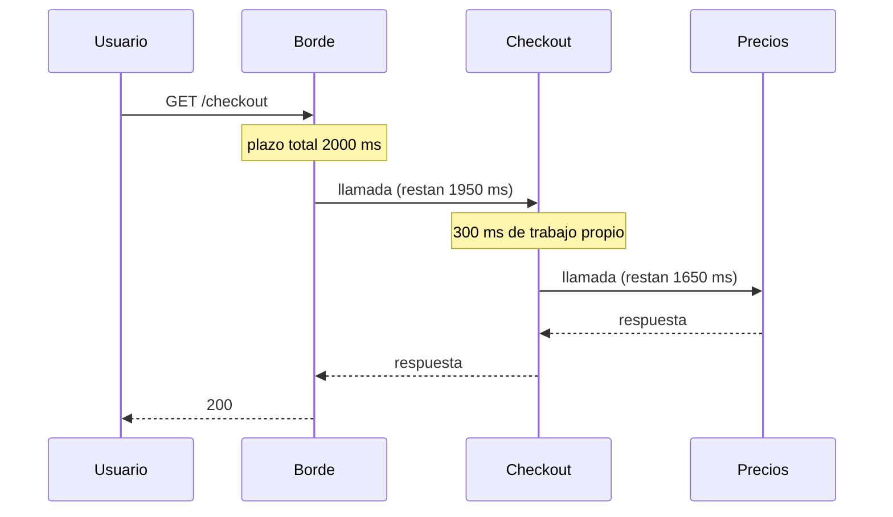
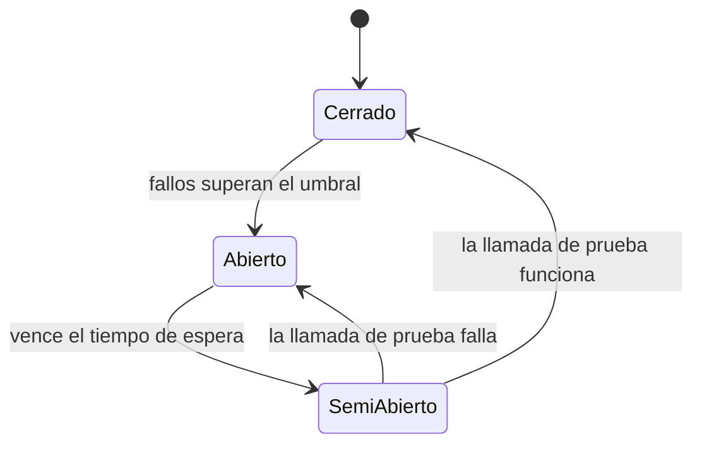

# Resiliencia en sistemas distribuidos

Un viernes, el servicio de recomendaciones empieza a tardar treinta segundos en lugar de ochenta milisegundos. No está caído: responde, pero tarde. La página de pago lo llama para mostrar «también te puede interesar», sus hilos se quedan esperando, el pool de conexiones se agota y, al cabo de unos minutos, nadie puede pagar. Para empeorarlo, cada capa reintenta lo que le falla y multiplica la carga sobre el servicio que ya no podía con ella. Un detalle secundario tumbó la función principal.

**La resiliencia es la capacidad de un sistema de seguir prestando lo más importante, aunque sea degradado, cuando una parte falla o se vuelve lenta, y de recuperarse sin intervención heroica.** No consiste en evitar los fallos, sino en contenerlos: decidir cuánto esperas, cuántas veces insistes, cuándo dejas de llamar, qué aíslas y qué sacrificas.

Este artículo recorre esos mecanismos en el orden en que suelen aplicarse (timeouts y plazos, reintentos, circuit breaker, bulkheads, deslastre de carga y degradación), cómo comprobarlos con chaos engineering y cómo medirlos. Deja fuera dos temas vecinos: la teoría de consistencia está en [CAP, PACELC y consistencia](/docs/cap-pacelc) y la compensación de transacciones, en [sagas, outbox e idempotencia](/docs/sagas-outbox-idempotencia).

<Callout tone="info" title="Fecha de corte y fuentes">
  Las versiones de bibliotecas son de octubre de 2026 (GitHub y NuGet). Los artículos de la Amazon
  Builders' Library redirigen ahora a builder.aws.com. No consulté directamente el libro _Release
  It!_: lo que se dice de él viene del artículo de Martin Fowler y de reseñas, y está señalado así.
</Callout>

## Los fallos parciales son el estado normal

En un solo proceso, una llamada a función termina o lanza una excepción. En un sistema distribuido hay un tercer resultado: no sabes qué pasó. La petición pudo perderse, ejecutarse sin que llegara la respuesta o seguir en curso. Además, el sistema rara vez está entero caído o entero sano; casi siempre hay algo degradado.

Las **falacias de la computación distribuida** resumen las suposiciones que llevan a olvidarlo. Según el artículo de Arnon Rotem-Gal-Oz y la entrada de Wikipedia, L Peter Deutsch, entonces en Sun Microsystems, recogió siete en 1994 a partir del trabajo de otros colegas de Sun, y James Gosling añadió la octava hacia 1997. Cada una tiene una consecuencia de diseño:

| Falacia                        | Qué rompe si la crees                                      | Dónde se trata                                              |
| ------------------------------ | ---------------------------------------------------------- | ----------------------------------------------------------- |
| La red es fiable               | Respuestas perdidas, operaciones ejecutadas a medias       | Timeouts y reintentos idempotentes (este artículo)          |
| La latencia es cero            | Cadenas de llamadas cuyas colas de latencia se suman       | Plazos propagados (este artículo)                           |
| El ancho de banda es infinito  | Cargas grandes que saturan enlaces y colas                 | [Caché, colas y streaming](/docs/caching-colas-streaming)   |
| La red es segura               | Confianza implícita entre servicios                        | Fuera del alcance de este artículo                          |
| La topología no cambia         | Instancias que aparecen y desaparecen durante una petición | Reintentar contra otra réplica, descubrimiento de servicios |
| Hay un solo administrador      | Cambios de configuración ajenos que te afectan sin aviso   | Timeouts defensivos y contratos explícitos                  |
| El coste de transporte es cero | Serializar y mover datos cuesta CPU, latencia y dinero     | Presupuestos de reintento, menos llamadas por petición      |
| La red es homogénea            | Clientes, protocolos y versiones que se comportan distinto | [Diseño de APIs](/docs/diseno-de-apis)                      |

### Lento es peor que caído

Una dependencia caída falla rápido: la conexión se rechaza y el llamante sigue. Una dependencia lenta retiene hilos, conexiones y memoria mientras espera. El capítulo sobre fallos en cascada del libro de SRE de Google lo describe como latencia bimodal: una fracción pequeña de peticiones colgadas hasta un plazo largo puede ocupar la mayoría de los hilos y dejar sin servicio al resto. Por eso casi todos los mecanismos de este artículo buscan lo mismo: **convertir la lentitud en un fallo rápido y acotado**.

## Timeouts: toda llamada remota lleva uno

El timeout es la primera defensa y la más olvidada. Marc Brooker, en su artículo de la Builders' Library sobre timeouts, reintentos y backoff, recomienda ponerlo en cualquier llamada remota, incluso entre procesos de la misma máquina, y distinguir el **timeout de conexión** del **timeout de petición**. No asumas que el cliente que usas trae uno razonable: la documentación de gRPC, por ejemplo, avisa de que por defecto no fija ningún plazo.

Para elegir el valor, el mismo artículo propone partir de una tasa aceptable de falsos timeouts (por ejemplo, 0,1 %) y usar el percentil correspondiente de la latencia de la dependencia (el p99,9 en ese caso). Dos matices que añade:

- **Demasiado bajo también es malo.** Los timeouts falsos generan reintentos, y los reintentos generan carga justo cuando la dependencia va peor.
- **Mira qué cubre el temporizador.** Si incluye la resolución DNS o el saludo TLS de una conexión nueva, el timeout puede saltar tras cada despliegue aunque la dependencia esté sana. Su ejemplo es un timeout de 20 ms que fallaba tras los despliegues; la solución fue abrir las conexiones al arrancar, antes de recibir tráfico.

### Plazos que viajan con la petición

Un timeout por salto no basta. Si el borde concede 2 s al usuario y cada servicio intermedio fija 2 s a su propia llamada, el trabajo sigue aguas abajo mucho después de que el usuario haya recibido un error. La alternativa es un **plazo** (_deadline_): se fija una vez, arriba, y cada salto pasa a la siguiente llamada solo el tiempo que queda.



El libro de SRE recomienda exactamente eso: fijar el plazo en lo alto de la pila, restar el tiempo consumido en cada salto y comprobar el tiempo restante antes de cada etapa para no hacer trabajo que el cliente ya abandonó. Añade la **propagación de la cancelación**: si la petición ya no puede tener éxito, cancela el trabajo relacionado en toda la cadena en lugar de dejar que agote su plazo. gRPC transmite el tiempo restante como duración y no como hora absoluta, lo que evita depender de relojes sincronizados; su documentación advierte de que la propagación automática depende del lenguaje.

La forma del contrato basta para orientar el diseño: el plazo y la señal de cancelación viajan con la llamada.

```typescript
// Forma orientativa: el contexto de la llamada lleva el plazo y la cancelación
type CallContext = {
  readonly deadline: number; // instante límite en ms, del reloj del proceso
  readonly signal: AbortSignal; // se activa si el llamante abandona
};

export declare function remainingMs(ctx: CallContext): number;
export declare function getQuote(ctx: CallContext, sku: string): Promise<Quote>;
```

## Reintentos: útiles, egoístas y peligrosos en cadena

Reintentar resuelve los fallos transitorios: un paquete perdido, una réplica que se reinicia, un pico breve. Brooker los llama **egoístas**: el cliente gasta más tiempo del servidor para mejorar sus propias probabilidades. Con fallos raros es un buen trato; en sobrecarga, empeora el problema. Tres condiciones antes de reintentar:

1. **El error es probablemente transitorio.** Un error de cliente (datos inválidos, falta de permisos) no se arregla insistiendo. Un `429` o un `503` sí admiten reintento, respetando `Retry-After` si llega.
2. **La operación es segura de repetir.** Una API con efectos solo se puede reintentar si es idempotente. Cómo conseguirlo (claves de idempotencia, deduplicación en el consumidor) se explica en [sagas, outbox e idempotencia](/docs/sagas-outbox-idempotencia).
3. **Queda plazo.** Un reintento que no puede terminar antes del plazo solo añade carga.

### Backoff exponencial con jitter

Reintentar al instante concentra la carga en el peor momento. El **backoff exponencial** separa los intentos (por ejemplo, 50 ms, 100 ms, 200 ms…) con un tope máximo. Pero si mil clientes fallan a la vez y todos esperan exactamente lo mismo, vuelven a llegar a la vez. El **jitter** añade aleatoriedad a la espera para desincronizarlos.

Brooker comparó variantes en una entrada del blog de arquitectura de AWS de marzo de 2015. El _equal jitter_ (conservar media espera y aleatorizar la otra mitad) fue el peor de los aleatorizados; el _full jitter_ (esperar un valor al azar entre cero y el tope exponencial) y el _decorrelated jitter_ quedaron cerca, sin un ganador claro. Su conclusión es que el backoff con jitter debería ser el enfoque estándar para clientes remotos.

| Estrategia de espera   | Con muchos clientes fallando a la vez          | Úsala cuando                             |
| ---------------------- | ---------------------------------------------- | ---------------------------------------- |
| Sin espera             | Picos sincronizados que prolongan la caída     | Nunca contra un servicio compartido      |
| Espera fija            | Los clientes siguen llegando en oleadas        | Pruebas locales o un único cliente       |
| Exponencial sin jitter | Las oleadas se espacian, pero siguen alineadas | Rara vez: le falta la aleatoriedad       |
| Exponencial con tope   | Igual, y además acota la espera máxima         | Como base, siempre con jitter encima     |
| Exponencial con jitter | Los intentos se reparten en el tiempo          | Opción por defecto para clientes remotos |

### Tormentas de reintentos

El peligro real aparece cuando varias capas reintentan. Si cada una de cinco capas hace hasta tres intentos, la base de datos del fondo puede recibir 3⁵ = 243 veces la carga original: es el ejemplo de Brooker. El libro de SRE muestra el mismo efecto con otros números. Las dos fuentes coinciden en el remedio: **reintenta en un solo punto de la pila**. Brooker sugiere hacerlo en una sola capa para operaciones baratas; el libro de SRE, en la capa inmediatamente superior a la que rechaza la petición.

### Presupuestos de reintento

Limitar intentos por petición no basta: con mucha concurrencia, tres intentos por petición siguen siendo el triple de carga. Un **presupuesto de reintento** limita los reintentos en proporción al tráfico:

- **Por petición.** El libro de SRE propone hasta tres intentos; después, el error sube al llamante.
- **Por cliente.** El mismo libro describe reintentar solo mientras los reintentos sean menos del 10 % de las peticiones de ese cliente. Con la dependencia sana, casi todo reintento cabe; con la dependencia caída, el presupuesto se agota y el cliente deja de amplificar.
- **Token bucket local.** Brooker describe un cubo de fichas: se reintenta mientras quedan fichas y, agotadas, a un ritmo fijo. Según el artículo, los SDK de AWS lo incluyen desde 2016. La documentación de Envoy también recomienda presupuestos de reintento frente a un límite estático de reintentos activos.

La política entera cabe en una configuración por dependencia; esta es su forma, no valores recomendados:

```yaml
# Forma orientativa de una política por dependencia
pricing:
  connectTimeout: 100ms
  requestTimeout: 300ms # p99,9 observado más margen
  retry:
    maxAttempts: 3 # incluye el primer intento
    backoff: { base: 50ms, max: 1s, jitter: full }
    retryOn: [connect-failure, '503', '429']
    budgetRatio: 0.1 # reintentos / peticiones en la ventana
```

## Circuit breaker: dejar de llamar a quien no responde

Los reintentos insisten; el **circuit breaker** hace lo contrario: cuando una dependencia falla de forma sostenida, deja de llamarla durante un tiempo y devuelve un error inmediato. Martin Fowler lo describe en su bliki el 6 de marzo de 2014 y atribuye su popularidad a Michael Nygard y su libro _Release It!_ (Pragmatic Bookshelf, primera edición de 2007 y segunda de 2018).



Lo que el artículo de Fowler deja como decisiones de diseño:

- **El umbral.** Su ejemplo cuenta fallos consecutivos, pero sugiere opciones más finas, como una tasa de fallos (por ejemplo, 50 %) o umbrales distintos para timeouts y para errores de conexión. No todo error debe abrir el circuito: un error de validación del cliente no dice nada de la salud de la dependencia.
- **Qué hacer con el circuito abierto.** Fallar, o buscar una alternativa: encolar la operación para más tarde o mostrar datos algo antiguos si son suficientemente buenos.
- **Operarlo.** Registrar cada cambio de estado, exponer el estado para la monitorización y permitir que operaciones lo abra o lo cierre a mano.

Un breaker por dependencia, o por instancia cuando el fallo afecta a una sola réplica, evita que una pieza enferma corte el tráfico hacia las sanas.

<Callout tone="warning" title="El breaker también tiene costes">
  Brooker señala que los circuit breakers introducen un comportamiento modal (el sistema se porta
  distinto según el estado) que es difícil de probar y que puede alargar la recuperación, y prefiere
  el presupuesto con cubo de fichas. No son incompatibles, pero conviene saber qué problema resuelve
  cada uno: el presupuesto limita la amplificación; el breaker, además, libera al llamante de
  esperar.
</Callout>

## Bulkheads: que una vía de agua no hunda el barco

El nombre viene de los mamparos de un barco: compartimentos estancos para que una vía de agua no inunde el casco entero. Es otro de los patrones de estabilidad que se atribuyen a _Release It!_. En software significa **repartir los recursos escasos para que una dependencia lenta solo pueda agotar su parte**: un pool de conexiones o de hilos por dependencia, un semáforo que limita las llamadas concurrentes a cada una o cuotas por cliente o por inquilino (ver [multi-tenancy](/docs/multi-tenancy)).

En el ejemplo inicial, un bulkhead de veinte llamadas concurrentes hacia recomendaciones habría dejado esas veinte bloqueadas y el resto del pool libre para pagar. Algunas herramientas usan otros nombres para lo mismo: lo que Envoy llama _circuit breaking_ son en realidad límites por clúster de conexiones, peticiones pendientes, peticiones en curso y reintentos activos, más cercano a un bulkhead que al breaker de Fowler.

## Backpressure y deslastre de carga

Los mecanismos anteriores protegen al llamante. Los dos siguientes protegen al servidor cuando le llega más trabajo del que puede hacer.

**Backpressure** es que el consumidor marque el ritmo al productor. La especificación Reactive Streams (1.0, abril de 2015) se definió como un estándar de flujos asíncronos con backpressure no bloqueante, y Java 9 incorporó sus interfaces como `java.util.concurrent.Flow`: el suscriptor pide un número de elementos y el productor no envía más. Cómo se aplica a colas y logs (prefetch, longitud máxima, lag) está en [caché, colas y streaming](/docs/caching-colas-streaming).

El **deslastre de carga** (_load shedding_) es rechazar a propósito parte del tráfico al acercarse a la saturación para seguir sirviendo bien el resto. El libro de SRE propone basarlo en CPU, memoria o longitud de cola, y menciona dos técnicas para colas: servir en orden LIFO o usar CoDel, porque las peticiones que llevan mucho esperando probablemente ya no interesan a nadie. También describe rechazar antes las peticiones de menor criticidad. La Builders' Library dedica un artículo entero al tema ("Using load shedding to avoid overload").

Rechazar bien también es diseño: responde `503` o `429` (RFC 6585, abril de 2012) con `Retry-After` para que el cliente sepa cuánto esperar, y hazlo pronto y barato, antes de gastar trabajo en la petición. El limitador de tasa por cliente, que comparte técnicas con el deslastre, se trata en [escalabilidad y casos clásicos](/docs/escalabilidad-casos-clasicos).

## Degradación elegante y valores por defecto

Entre funcionar del todo y fallar hay un término medio: **hacer menos trabajo por petición**. El libro de SRE pone ejemplos como buscar en un subconjunto de datos en caché o usar un algoritmo de ordenación más barato. En producto suele verse así: ocultar las recomendaciones, mostrar un catálogo genérico, servir el último valor conocido con su antigüedad visible o aceptar un pedido y confirmar el stock después.

Dos advertencias de las fuentes:

- **El modo degradado se usa poco, así que se rompe sin que nadie lo note.** El libro de SRE pide ejercitarlo con regularidad, vigilar cuántos servidores entran en él y poder desactivarlo rápido si es complejo.
- **Un fallback puede ser peor que el fallo.** El artículo de la Builders' Library "Avoiding fallback in distributed systems", de Jacob Gabrielson, explica que Amazon casi nunca los usa: son difíciles de probar, pueden fallar a su vez y esconden errores latentes durante años. Prefiere hacer más fiable el camino principal, dejar que el llamante gestione el error, empujar los datos por adelantado o convertir el fallback en un failover que se ejercite siempre.

La regla práctica: un valor por defecto es aceptable cuando equivocarse es barato y visible (unas recomendaciones genéricas), y peligroso cuando el dato decide dinero o permisos (un precio o un permiso «por defecto»). En ese segundo caso, falla de forma explícita.

## Qué protege cada mecanismo

| Mecanismo                | Protege a                       | Dónde vive                  | Riesgo si se usa mal                                           |
| ------------------------ | ------------------------------- | --------------------------- | -------------------------------------------------------------- |
| Timeout                  | Hilos y conexiones del llamante | Cliente, en cada llamada    | Corto: falsos timeouts y reintentos; largo: recursos retenidos |
| Plazo propagado          | La cadena entera                | Toda la ruta de la petición | Sin cancelación, el trabajo inútil sigue aguas abajo           |
| Reintento con jitter     | La petición ante fallos breves  | Cliente, en una sola capa   | Amplificación y duplicados si la operación no es idempotente   |
| Presupuesto de reintento | La dependencia en apuros        | Cliente, por proceso        | Mal dimensionado, no reintenta cuando haría falta              |
| Circuit breaker          | Llamante y dependencia          | Cliente, por dependencia    | Comportamiento modal y umbrales que oscilan                    |
| Bulkhead                 | Las demás funciones             | Cliente o servidor          | Compartimentos pequeños rechazan tráfico legítimo              |
| Deslastre de carga       | El servidor saturado            | Servidor o balanceador      | Sin prioridades, descarta también lo crítico                   |
| Degradación o fallback   | La experiencia del usuario      | Cliente o servidor          | Camino poco probado que falla justo cuando se necesita         |

## Chaos engineering: comprobarlo a propósito

Ninguno de estos mecanismos está probado hasta que falla algo de verdad. El **chaos engineering** adelanta ese momento. Su origen está en Netflix: el equipo presentó Chaos Monkey en diciembre de 2010, en una entrada sobre lo aprendido al migrar a AWS, como un servicio que termina instancias al azar para obligar a diseñar servicios que las sobrevivan; lo publicó como código abierto en julio de 2012. El sitio _Principles of Chaos Engineering_ lo define como la disciplina de experimentar sobre un sistema para ganar confianza en su capacidad de soportar condiciones turbulentas en producción; el artículo «Chaos Engineering» (Basiri y otros, IEEE Software, 2016) usa casi la misma definición, referida a sistemas distribuidos.

Los principios del sitio son cinco: formular una hipótesis sobre el **estado estable**, entendido como una salida medible del sistema (rendimiento, tasa de errores, percentiles de latencia) y no sus atributos internos; variar eventos del mundo real (un servidor que muere, respuestas malformadas, un pico de tráfico); experimentar en producción; automatizar los experimentos para que corran de forma continua; y minimizar el radio de impacto. En la práctica conviene empezar pequeño y con un botón para parar.

Antes de llegar a producción, el libro de SRE propone pruebas de carga hasta romper cada componente, con rampas graduales y picos bruscos, comprobar si el sistema vuelve solo a la normalidad y desconectar dependencias no críticas para verificar que no arrastran a las críticas. Ese último experimento habría detectado el problema de las recomendaciones antes del viernes.

## Cómo medirlo

La resiliencia se mide con el vocabulario de [atributos de calidad](/docs/atributos-de-calidad): SLI, SLO y presupuesto de error, con percentiles y no medias. Ese artículo explica cómo fijarlos; aquí importa qué señales mirar para saber si los mecanismos funcionan:

| Señal                                          | Qué revela                                                |
| ---------------------------------------------- | --------------------------------------------------------- |
| Latencia p99 y p99,9 por dependencia           | Si los timeouts están bien elegidos y dónde crece la cola |
| Tasa de errores por tipo (timeout, 5xx, 429)   | Qué está fallando y si los errores son transitorios       |
| Reintentos por petición                        | Si te acercas al presupuesto o hay amplificación          |
| Cambios de estado del breaker y tiempo abierto | Dependencias inestables y umbrales que oscilan            |
| Ocupación de pools y longitud de colas         | Saturación antes de que se convierta en latencia          |
| Peticiones descartadas por criticidad          | Si el deslastre protege lo importante                     |
| SLO de la función principal durante un fallo   | Si la degradación cumple su promesa: la métrica que manda |

Parte de esto puede vigilarse en CI como [fitness function](/docs/fitness-functions): por ejemplo, una regla que falle si un cliente HTTP se construye sin timeout explícito.

## Bibliotecas: dónde no reinventar

Estado a octubre de 2026, según sus repositorios y registros de paquetes:

| Herramienta         | Qué ofrece                                                                                     | Estado                                                                                              |
| ------------------- | ---------------------------------------------------------------------------------------------- | --------------------------------------------------------------------------------------------------- |
| Resilience4j (JVM)  | Módulos de CircuitBreaker, Retry, Bulkhead (semáforo o pool), RateLimiter, TimeLimiter y Cache | Activa; v2.4.0 publicada en marzo de 2026. El README anuncia una versión 3 que requiere Java 21     |
| Polly (.NET)        | Pipelines de resiliencia con retry, circuit breaker, timeout, rate limiter, fallback y hedging | Activa; 8.8.0 publicada en septiembre de 2026                                                       |
| Hystrix (JVM)       | Circuit breaker y bulkheads de Netflix                                                         | En modo mantenimiento: sin desarrollo activo; Netflix recomienda Resilience4j para proyectos nuevos |
| Envoy (proxy, mesh) | Límites por clúster, reintentos y presupuestos de reintento fuera del código de la aplicación  | Su documentación recomienda presupuestos de reintento frente a límites estáticos                    |

Si usas una malla de servicios y además una biblioteca, decide en cuál de las dos capas viven los reintentos: si ambas reintentan, vuelves a la amplificación.

## Cuándo sí y cuándo no

- **Sí, siempre:** timeouts en toda llamada remota y reintentos acotados con jitter en operaciones idempotentes. Son baratos, y su ausencia aparece una y otra vez en los fallos en cascada que describe el libro de SRE.
- **Sí, cuando hay varias dependencias con criticidad distinta:** bulkheads y degradación, para que lo secundario no tumbe lo principal.
- **Sí, en servicios compartidos o con picos:** deslastre de carga y presupuestos de reintento.
- **Con cuidado:** circuit breakers, si puedes probar sus estados y observarlos; y fallbacks, solo si se ejercitan con frecuencia.
- **No:** reintentar operaciones con efectos sin idempotencia, ni copiar una pila completa de patrones a un monolito que habla con una sola base de datos. Si la distribución en sí está en duda, empieza por [monolito o microservicios](/docs/monolito-vs-microservicios).

## Errores frecuentes

- **Llamadas sin timeout.** El valor por defecto de muchos clientes es esperar demasiado o para siempre.
- **El mismo timeout en todos los saltos.** Sin plazo propagado, las capas internas trabajan para un usuario que ya se fue.
- **Reintentos en cada capa.** La amplificación es multiplicativa; reintenta en un solo punto.
- **Backoff sin jitter.** Los clientes se sincronizan y llegan en oleadas.
- **Reintentar errores permanentes.** Un `400` o un `403` no cambian por insistir.
- **Breaker sin observabilidad.** Si nadie ve cuándo se abre, el síntoma aparece como «errores raros» en otro sitio.
- **Fallback sin probar.** El camino alternativo falla precisamente cuando lo necesitas.
- **Medir medias.** La media oculta la cola donde viven los timeouts.

## Ejemplo trabajado: la página de pago

El escenario del principio, con números ilustrativos. La página de pago llama a cuatro dependencias y el borde concede un plazo total de 1,5 s:

| Dependencia     | Criticidad | p99,9 observado | Timeout | Reintento                           | Aislamiento y degradación                              |
| --------------- | ---------- | --------------- | ------- | ----------------------------------- | ------------------------------------------------------ |
| Precios         | Crítica    | 180 ms          | 250 ms  | 1 reintento con jitter, idempotente | Pool propio; sin valor por defecto: falla explícito    |
| Inventario      | Crítica    | 120 ms          | 200 ms  | 1 reintento con jitter              | Pool propio; si cae, aceptar y confirmar stock después |
| Fraude          | Crítica    | 400 ms          | 500 ms  | Ninguno: el plazo no da para dos    | Breaker; si abre, enviar a revisión manual             |
| Recomendaciones | Opcional   | 250 ms          | 150 ms  | Ninguno                             | Bulkhead de 20 llamadas y breaker; si abre, ocultar    |

El razonamiento, paso a paso:

1. **Partir del plazo del usuario.** Precios e inventario van en paralelo; fraude va después, con lo que quede. Si el presupuesto no alcanza para un reintento, no se reintenta.
2. **Timeout de recomendaciones por debajo de su p99,9.** Es la excepción deliberada: aceptas que alguna vez no se muestren a cambio de no esperar por algo opcional.
3. **Un solo punto de reintento.** El servicio de pago reintenta; sus clientes HTTP internos y la malla no.
4. **Degradación decidida por negocio.** Aceptar un pedido sin stock confirmado o mandar un pago a revisión manual son decisiones de producto, no de infraestructura: regístralas en un [ADR](/docs/adr) con su trade-off (ver [trade-offs y decisiones](/docs/trade-offs-y-decisiones)).
5. **Comprobarlo.** Un experimento que vuelve lenta la dependencia de recomendaciones en un entorno de pruebas debe dejar intacto el SLO de pagos completados.

## Checklist

- [ ] Toda llamada remota tiene timeout de conexión y de petición, elegidos a partir de percentiles observados.
- [ ] El plazo se fija en el borde, viaja con la petición y la cancelación se propaga.
- [ ] Solo se reintentan errores transitorios, en operaciones idempotentes y en una sola capa.
- [ ] Los reintentos usan backoff exponencial con tope, jitter y un presupuesto por cliente.
- [ ] Cada dependencia tiene sus recursos acotados (bulkhead) y, si aplica, un breaker observable.
- [ ] El servidor rechaza pronto y con `Retry-After` cuando se satura, empezando por lo menos crítico.
- [ ] Cada modo degradado está decidido por negocio y se ejercita con regularidad.
- [ ] Hay experimentos de fallo que comprueban el SLO de la función principal.

## Fuentes

Consultadas en octubre de 2026. El libro _Release It!_ no se consultó directamente: sus datos vienen del artículo de Fowler, de Wikipedia y de reseñas.

- [Timeouts, retries, and backoff with jitter (Marc Brooker, Amazon Builders' Library)](https://aws.amazon.com/builders-library/timeouts-retries-and-backoff-with-jitter/)
- [Exponential Backoff And Jitter (Marc Brooker, AWS Architecture Blog, 4 de marzo de 2015)](https://aws.amazon.com/blogs/architecture/exponential-backoff-and-jitter/)
- [Using load shedding to avoid overload (Amazon Builders' Library)](https://aws.amazon.com/builders-library/using-load-shedding-to-avoid-overload/)
- [Avoiding fallback in distributed systems (Amazon Builders' Library)](https://aws.amazon.com/builders-library/avoiding-fallback-in-distributed-systems/)
- [CircuitBreaker (Martin Fowler, 6 de marzo de 2014)](https://martinfowler.com/bliki/CircuitBreaker.html)
- [Release It!, segunda edición (Michael Nygard, Pragmatic Bookshelf, 2018)](https://pragprog.com/titles/mnee2/release-it-second-edition/)
- Google SRE Book: [Handling Overload](https://sre.google/sre-book/handling-overload/) y [Addressing Cascading Failures](https://sre.google/sre-book/addressing-cascading-failures/)
- [Fallacies of distributed computing en Wikipedia](https://en.wikipedia.org/wiki/Fallacies_of_distributed_computing) y [Fallacies of Distributed Computing Explained (Arnon Rotem-Gal-Oz)](https://lasr.cs.ucla.edu/classes/188_winter15/readings/fallacies.pdf)
- [Deadlines en la documentación de gRPC](https://grpc.io/docs/guides/deadlines/)
- [Circuit breaking en la documentación de Envoy](https://www.envoyproxy.io/docs/envoy/latest/intro/arch_overview/upstream/circuit_breaking)
- [RFC 6585, Additional HTTP Status Codes (abril de 2012)](https://www.rfc-editor.org/rfc/rfc6585) y [RFC 9110, HTTP Semantics](https://www.rfc-editor.org/rfc/rfc9110) (`503` y `Retry-After`)
- [Reactive Streams](https://www.reactive-streams.org/)
- [Chaos Engineering (Basiri y otros, IEEE Software, 2016)](https://arxiv.org/abs/1702.05843) y [Principles of Chaos Engineering](https://principlesofchaos.org/)
- [Chaos Monkey publicado como código abierto (InfoQ, julio de 2012)](https://www.infoq.com/news/2012/07/chaos-monkey)
- [Resilience4j](https://github.com/resilience4j/resilience4j), [Polly](https://www.pollydocs.org/) y [Hystrix](https://github.com/Netflix/Hystrix)
