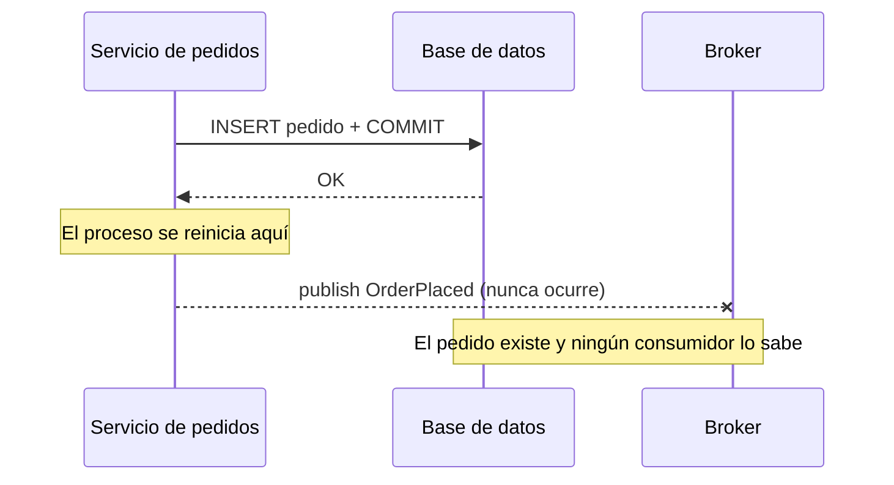
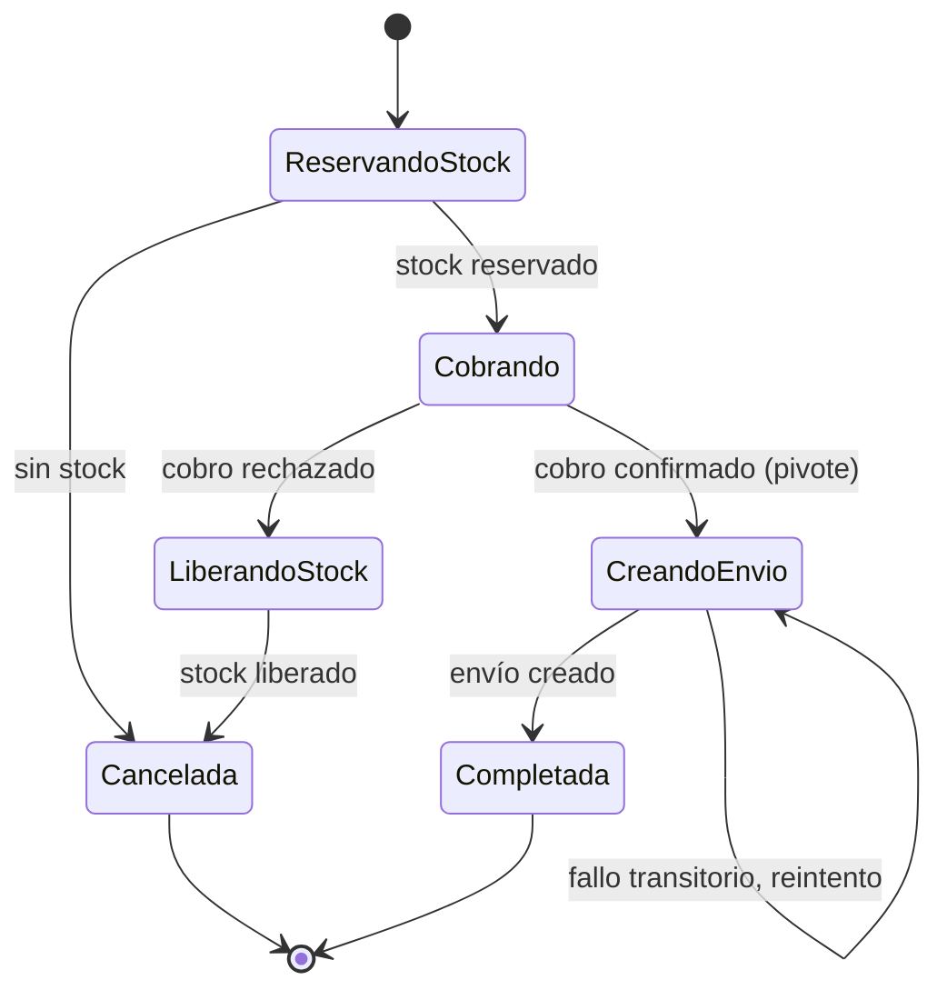
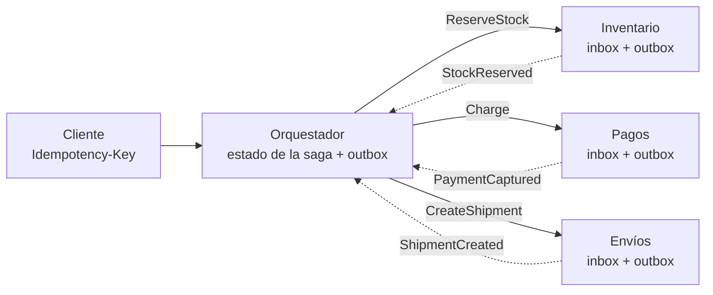

# Sagas, outbox e idempotencia

El servicio de pedidos guarda el pedido y, justo después, publica `OrderPlaced` en el broker. Funciona en todas las pruebas. Un día el proceso se reinicia entre las dos líneas: el pedido existe, pero inventario y facturación nunca se enteran. Otro día el broker responde con un _timeout_ aunque sí recibió el mensaje, el código reintenta y el cliente recibe dos correos de confirmación. Ninguno de los dos fallos aparece en un entorno local, y los dos aparecen en producción.

El problema de fondo es que **cuando una operación de negocio toca más de un sistema sin una transacción común, necesitas diseñar explícitamente qué pasa si se queda a medias y qué pasa si se repite**. Las sagas, el _transactional outbox_ y la idempotencia son las tres piezas habituales de ese diseño, y se necesitan entre sí.

Este artículo explica por qué la doble escritura falla, por qué la transacción distribuida no suele ser la salida, cómo se construye una saga con sus compensaciones, cómo publicar mensajes de forma fiable con una tabla outbox, cómo deduplicar en el consumidor y cómo diseñar operaciones que se puedan repetir sin daño. Los eventos como modelo de diseño están en [eventos, CQRS y event sourcing](/docs/event-driven-cqrs-event-sourcing); la teoría de consistencia, en [CAP, PACELC y consistencia](/docs/cap-pacelc); los brókers y su semántica de entrega, en [caché, colas y streaming](/docs/caching-colas-streaming).

<Callout tone="info" title="Fecha de corte y lo que no verifiqué">
  Fuentes consultadas en octubre de 2026. Del artículo original sobre sagas leí el resumen y
  reseñas, no el texto completo. Las contramedidas de aislamiento las tomo de Microsoft y de las
  charlas de Chris Richardson, no del trabajo académico en que se basan. El estado del borrador del
  IETF sobre la cabecera `Idempotency-Key` lo confirmé en el registro del IETF: la versión 07 es la
  última y el borrador ya expiró.
</Callout>

## El problema de la doble escritura

Llamamos **doble escritura** a actualizar dos sistemas independientes (una base de datos y un broker, dos bases, una base y una API externa) desde el mismo código, uno detrás de otro. Cualquier orden que elijas tiene una ventana de fallo:

| Orden de las operaciones                    | Si falla entre las dos                 | Resultado                                 |
| ------------------------------------------- | -------------------------------------- | ----------------------------------------- |
| Confirmar en la base y luego publicar       | El proceso cae o el broker no responde | Estado cambiado, nadie se entera          |
| Publicar y luego confirmar en la base       | La transacción hace _rollback_         | Evento fantasma: anuncia algo que no pasó |
| Publicar dentro de la transacción abierta   | El _commit_ falla después de publicar  | Igual que el anterior, con más latencia   |
| Reintentar la publicación tras un _timeout_ | El broker sí había recibido el mensaje | Mensaje duplicado                         |



Los dos síntomas son distintos y piden soluciones distintas: la **pérdida** (o el evento fantasma) es un problema de atomicidad entre dos sistemas, y el **duplicado** es un problema de idempotencia. El outbox resuelve el primero y convierte el segundo en algo inevitable pero manejable.

## Por qué no basta con 2PC

La respuesta clásica a «dos sistemas, una sola decisión» es el _commit_ en dos fases (2PC): un coordinador pide a cada participante que se prepare y, si todos votan que sí, ordena confirmar. Funciona, pero tiene costes que en muchos entornos lo hacen poco práctico:

- **Es bloqueante.** Un participante que ya votó «preparado» no puede decidir por su cuenta: si el coordinador cae, espera, y mientras espera mantiene sus bloqueos. La documentación de Teradata, por ejemplo, avisa de que las sesiones en duda pueden bloquear a otras aplicaciones y acabar necesitando resolución manual.
- **Acopla la disponibilidad.** La operación solo progresa si coordinador y participantes están disponibles a la vez; la disponibilidad combinada es menor que la de cada pieza.
- **Exige soporte de todos.** Cada participante tiene que implementar el protocolo (por ejemplo, XA). No todos los brókers ni todos los servicios gestionados lo hacen; compruébalo para tu combinación concreta antes de contar con ello.
- **Cruza fronteras de propiedad.** Con una base de datos por servicio, una transacción distribuida vuelve a acoplar a los equipos a través de los bloqueos que comparten.

Pat Helland lo planteó en 2007 en _Life beyond Distributed Transactions_ (CIDR): observaba que los desarrolladores de aplicaciones muy escalables, en general, no cuentan con transacciones distribuidas, y proponía diseñar con entidades y mensajes entre ellas. No es una prohibición: la versión posterior del artículo en ACM Queue reconoce sistemas como Spanner que ofrecen transacciones fuertes a gran escala, y el propio Richardson sugiere reservar 2PC para los casos de mayor riesgo de negocio. La pregunta útil no es «2PC sí o no», sino si puedes pagar su bloqueo y su acoplamiento en esa operación concreta. Para el fondo teórico, consulta [CAP, PACELC y consistencia](/docs/cap-pacelc).

## Sagas: transacciones locales con compensación

Hector Garcia-Molina y Kenneth Salem publicaron _Sagas_ en las actas de SIGMOD de 1987 (también como informe técnico de Princeton, enero de 1987). El problema que atacaban no eran los microservicios, sino las transacciones de larga duración que retienen recursos de la base de datos y retrasan a las transacciones cortas. Su propuesta: escribir esa transacción larga como **una secuencia de transacciones cortas que pueden intercalarse con otras**, con la garantía de que o se completan todas o se ejecutan **transacciones compensatorias** que enmiendan la ejecución parcial.

**Una saga es una secuencia de transacciones locales en la que cada paso confirma de inmediato y, si un paso posterior falla, los anteriores se compensan con pasos que los anulan semánticamente.** Según las reseñas del artículo, describe dos formas de recuperarse: hacia atrás (compensar lo hecho) y hacia delante (reintentar hasta completar). Los términos «orquestación» y «coreografía» no vienen de ese artículo: son vocabulario de la literatura de microservicios (microservices.io, la guía de arquitectura de Azure).

### Tipos de paso: compensable, pivote y reintentable

La guía de Azure clasifica los pasos de una saga en tres tipos, y ordenarlos bien es la mitad del diseño:

| Tipo de paso | Qué es                                                               | Ejemplo en un pedido                     |
| ------------ | -------------------------------------------------------------------- | ---------------------------------------- |
| Compensable  | Se puede anular con otra transacción de efecto opuesto               | Reservar stock (se compensa liberándolo) |
| Pivote       | Punto de no retorno: si confirma, la saga tiene que terminar         | Cobrar al cliente                        |
| Reintentable | Va después del pivote; es idempotente y se repite hasta que funcione | Crear el envío, enviar el correo         |

La regla práctica: pon primero los pasos compensables, después un único pivote y al final solo pasos que puedas reintentar sin límite. Si un paso no se puede compensar ni reintentar, ese es tu pivote, y todo lo que deba ir antes tiene que poder deshacerse.

### Orquestación frente a coreografía

En la **coreografía** no hay un controlador: cada servicio confirma su transacción local y publica un evento que dispara el paso siguiente en otro servicio. En la **orquestación**, un orquestador guarda el estado de la saga y le dice a cada participante qué transacción local ejecutar, incluidas las compensaciones.

| Criterio               | Coreografía                                     | Orquestación                                         |
| ---------------------- | ----------------------------------------------- | ---------------------------------------------------- |
| Dónde vive el flujo    | Repartido entre los suscriptores de cada evento | En un solo componente, legible de principio a fin    |
| Acoplamiento           | Cada servicio conoce los eventos de los demás   | Los participantes solo conocen al orquestador        |
| Riesgo típico          | Dependencias cíclicas y flujo difícil de seguir | Un componente central que puede fallar o engordar    |
| Pruebas de integración | Hay que levantar todos los servicios            | Se prueba el orquestador con participantes simulados |
| Encaja mejor cuando    | Pocos pasos, pocos servicios, flujo estable     | Muchos pasos, compensaciones o cambios frecuentes    |

Los riesgos de cada columna los recoge la guía de Azure. En la práctica, el orquestador es una máquina de estados persistida; dibujarla antes de escribir código destapa las compensaciones que faltan:



### Compensar no es deshacer

Una compensación no restaura necesariamente el estado anterior: según las reseñas del artículo de 1987, deshace el efecto del paso desde el punto de vista semántico, del negocio, y deja una aproximación aceptable al estado previo. Un correo enviado no se «desenvía»: se manda otro que corrige. Un cobro capturado no se borra: se reembolsa, y el extracto del cliente mostrará los dos movimientos. Por eso cada compensación es una decisión de negocio, no un detalle técnico.

Tres propiedades que conviene exigir a cada compensación:

- **Idempotente.** El orquestador puede ordenarla dos veces; ejecutarla dos veces no debe reembolsar dos veces.
- **Reintentable.** Si falla, se reintenta. Azure advierte de que una compensación puede no tener éxito y dejar el sistema inconsistente; prevé una salida a revisión manual con alerta.
- **Conmutativa con el paso original cuando sea posible.** Si la compensación llega antes que el paso (mensajes desordenados), debe poder registrarse y anular el paso cuando llegue.

### Sin aislamiento: anomalías y contramedidas

Una saga renuncia a la I de ACID: cada paso confirma de inmediato y otras sagas ven los estados intermedios. Microservices.io lo señala como su principal inconveniente, y la guía de Azure enumera las anomalías típicas:

| Anomalía              | Qué ocurre                                                                  |
| --------------------- | --------------------------------------------------------------------------- |
| Actualización perdida | Una saga sobrescribe un cambio de otra sin haberlo leído                    |
| Lectura sucia         | Una saga lee un cambio de otra que todavía puede compensarse                |
| Lectura no repetible  | Dos pasos de la misma saga leen valores distintos porque otra saga escribió |

Las contramedidas se diseñan en el dominio, no en la infraestructura:

| Contramedida                 | Idea                                                                                               |
| ---------------------------- | -------------------------------------------------------------------------------------------------- |
| Bloqueo semántico            | Un estado visible (`PENDING`, `RESERVING`) marca que hay una saga en curso sobre ese registro      |
| Actualizaciones conmutativas | Operaciones que dan el mismo resultado en cualquier orden, como débitos y créditos                 |
| Vista pesimista              | Reordenar la saga para que las escrituras arriesgadas caigan en pasos reintentables                |
| Releer el valor              | Comprobar que el dato no cambió antes de escribir; si cambió, abortar o reiniciar                  |
| Archivo de versiones         | Registrar las operaciones sobre un registro para aplicarlas en el orden correcto                   |
| Por valor                    | Elegir el mecanismo según el riesgo de negocio: sagas para lo barato, algo más fuerte para lo caro |

El bloqueo semántico es el más común y tiene una consecuencia de producto: la interfaz tiene que saber mostrar «pendiente». Si el negocio no acepta ese estado, quizá la operación no debería ser una saga.

## Transactional outbox

**El _transactional outbox_ guarda el mensaje que quieres publicar en una tabla de la misma base de datos, dentro de la misma transacción que el cambio de negocio, y deja que otro proceso lo publique después.** Así la doble escritura desaparece: solo hay una escritura atómica, y el mensaje se publica si y solo si la transacción confirmó.

El componente que lee la tabla y publica se llama _message relay_. Richardson describe dos formas de implementarlo: sondeando la tabla (_polling publisher_) o leyendo el log de transacciones de la base (_transaction log tailing_), que es lo que hace un CDC como Debezium. La forma de la tabla es pequeña; esta es la que espera por defecto el enrutador de outbox de Debezium:

```sql
-- outbox: una fila por mensaje, escrita en la transacción del cambio
CREATE TABLE outbox (
  id            uuid         PRIMARY KEY,  -- id del mensaje: sirve para deduplicar
  aggregatetype varchar(255) NOT NULL,     -- decide el destino (topic)
  aggregateid   varchar(255) NOT NULL,     -- clave del mensaje: orden por agregado
  type          varchar(255) NOT NULL,     -- OrderPlaced, OrderCancelled…
  payload       jsonb                      -- cuerpo del evento
  -- columnas propias opcionales: created_at, trace_id…
);
```

El relay puede caer después de publicar y antes de registrar que publicó; al reiniciar, publicará otra vez. Microservices.io lo dice sin rodeos: el relay puede publicar un mensaje más de una vez, así que el consumidor tiene que ser idempotente. **El outbox cambia «a veces se pierde» por «a veces se repite»**, y lo segundo se resuelve en el consumidor.

### Relay por sondeo

Un proceso consulta cada pocos segundos las filas no publicadas, las publica en orden y las marca. Es la opción de menos piezas: solo necesitas la base que ya tienes. Sus costes: latencia igual al intervalo de sondeo, carga constante sobre la base aunque no haya mensajes, una tabla que crece y hay que purgar, y coordinación si corres varios relays (o aceptas que dos instancias publiquen la misma fila, o te aseguras de que cada fila la toma una sola). Vigila la antigüedad de la fila pendiente más vieja: si crece, el relay está atascado.

### Relay por CDC

Un conector de CDC lee el log de transacciones de la base y convierte cada inserción en la tabla outbox en un mensaje. Con Debezium, el _Outbox Event Router_ (una transformación de Kafka Connect) usa `aggregatetype` para elegir el topic (por defecto `outbox.event.<valor>`), `aggregateid` como clave del mensaje y `payload` como cuerpo; además filtra los `DELETE` sobre la tabla. El artículo de Gunnar Morling en el blog de Debezium (19 de febrero de 2019) borra cada fila justo después de insertarla: como el conector lee el log y no la tabla, captura la inserción y la tabla permanece vacía.

| Criterio             | Relay por sondeo                         | Relay por CDC (Debezium)                                           |
| -------------------- | ---------------------------------------- | ------------------------------------------------------------------ |
| Piezas nuevas        | Un proceso propio                        | Kafka Connect, el conector y su configuración                      |
| Latencia             | El intervalo de sondeo                   | Lo que tarde el conector en leer el log                            |
| Carga sobre la base  | Consultas periódicas aunque no haya nada | Lectura del log; suele exigir habilitar la replicación o el binlog |
| Limpieza de la tabla | Purga programada de filas publicadas     | Se puede borrar la fila en la misma transacción                    |
| Entrega              | Al menos una vez                         | Al menos una vez (lo dice el propio artículo de Debezium)          |
| Encaja mejor cuando  | Poco volumen, equipo pequeño, sin Kafka  | Ya operas Kafka y Kafka Connect, o el volumen es alto              |

Una alternativa al outbox es no tener estado aparte del log de eventos: con _event sourcing_, el evento es el cambio, y publicar es leer ese log. Microservices.io la cita como opción al mismo problema; se desarrolla en [eventos, CQRS y event sourcing](/docs/event-driven-cqrs-event-sourcing).

## Inbox: deduplicar en el consumidor

Si el productor publica al menos una vez y el broker redistribuye al menos una vez, el consumidor recibirá duplicados. El patrón _idempotent consumer_ de microservices.io lo resuelve registrando los identificadores de los mensajes ya procesados; muchos equipos llaman **inbox** a esa tabla, por simetría con el outbox.

La clave está en la transacción. En la versión de microservices.io, una tabla `PROCESSED_MESSAGES` con clave primaria `(subscriberId, messageId)`: el manejador inserta el id del mensaje y aplica el cambio de negocio **en la misma transacción local**. Si el id ya existe, la inserción falla y el mensaje se descarta; si el procesamiento falla, el _rollback_ también quita el id y el mensaje podrá reintentarse.

Tres decisiones que el patrón deja abiertas:

- **Dónde guardar el id.** En una tabla aparte o en la propia entidad que el mensaje crea o modifica (microservices.io admite ambas). Si el mensaje crea un registro, su id puede ser la clave natural y la tabla aparte sobra.
- **Cuánto tiempo guardarlo.** Lo bastante para cubrir la ventana máxima de redistribución del broker y de reprocesamiento manual. El artículo de Debezium deja la limpieza de esa tabla como tarea pendiente; tú no deberías.
- **Qué hacer con efectos fuera de la base.** Si el manejador llama a una API externa, la tabla inbox no cubre esa llamada: necesitas que la API acepte una clave de idempotencia (siguiente sección) o un outbox también en el consumidor.

Para la semántica de entrega de cada broker (al menos una vez, como mucho una vez, transacciones del propio broker) consulta [caché, colas y streaming](/docs/caching-colas-streaming).

## Idempotencia

**Una operación es idempotente si ejecutarla varias veces tiene el mismo efecto que ejecutarla una.** Es lo que convierte el reintento, la única respuesta razonable a un _timeout_, en algo seguro.

### Idempotentes por naturaleza

RFC 9110 (junio de 2022, la semántica de HTTP) define como seguros GET, HEAD, OPTIONS y TRACE, y como idempotentes PUT, DELETE y los métodos seguros. La idempotencia se refiere al efecto pretendido en el servidor, no a que la respuesta sea idéntica: un segundo DELETE puede responder 404 y seguir siendo idempotente. La RFC indica además que un cliente no debería reintentar automáticamente un método no idempotente salvo que tenga forma de saber que es seguro, y que un proxy no debe hacerlo.

Esa semántica es una promesa del método, no una propiedad mágica: si tu PUT incrementa un contador, rompes el contrato. La forma más barata de conseguir idempotencia es diseñar la operación como **fijar un estado** en vez de **aplicar un delta**:

| Operación                                  | ¿Idempotente?  | Por qué                                            |
| ------------------------------------------ | -------------- | -------------------------------------------------- |
| `PUT /orders/42/status` = `CANCELLED`      | Sí             | Fija un estado; repetirla no cambia nada           |
| `DELETE /carts/7/items/3`                  | Sí             | Tras la primera, el recurso ya no está             |
| `POST /accounts/9/credits` con 10 €        | No             | Cada repetición suma otros 10 €                    |
| `POST /payments` con clave de idempotencia | Sí, por diseño | El servidor reconoce la clave y no repite el cargo |
| Actualizar si `version = 7`                | Sí             | La segunda vez la condición ya no se cumple        |

### Claves de idempotencia en APIs

Cuando la operación es inherentemente una creación (un pago, un pedido), la idempotencia hay que construirla: el cliente genera una clave única, la envía con cada intento y el servidor devuelve el resultado guardado en lugar de ejecutar otra vez. El contrato visto desde el cliente, con la documentación de Stripe como referencia, está resumido en [CAP, PACELC y consistencia](/docs/cap-pacelc); aquí interesan las decisiones del lado del servidor.

```typescript
// Registro de idempotencia: vive en la misma base que el efecto que protege
type IdempotencyRecord = {
  readonly scope: string; // cuenta o cliente: las claves no se comparten
  readonly key: string; // generada por el cliente (Stripe sugiere UUID v4, hasta 255 caracteres)
  readonly requestHash: string; // huella de los parámetros
  readonly status: 'in_progress' | 'completed';
  readonly response?: StoredResponse; // código y cuerpo que se repiten
  readonly expiresAt: Date; // Stripe puede purgarlas a partir de las 24 h
};
```

- **Guarda el registro en la misma transacción que el efecto.** Si el cargo se confirma pero el registro no, el reintento cobrará otra vez.
- **Compara los parámetros.** Stripe devuelve un error si la misma clave llega con parámetros distintos: es casi siempre un fallo del cliente y conviene hacerlo visible.
- **Decide qué pasa con peticiones concurrentes.** Stripe no guarda resultado si la petición choca con otra que se está ejecutando con la misma clave, y esa petición puede reintentarse; un estado `in_progress` explícito te permite responder lo mismo.
- **Decide qué errores se repiten.** En su API v1, Stripe guarda la respuesta una vez que empezó a ejecutarse el endpoint, incluidos los `500`; los fallos de validación no se guardan y se pueden reintentar.
- **No uses datos sensibles como clave.** Stripe lo desaconseja expresamente (correos, identificadores personales).

Hay un borrador del IETF, _The Idempotency-Key HTTP Header Field_, que propone estandarizar la cabecera para hacer tolerantes a fallos POST y PATCH. Su última versión es la 07, de octubre de 2025; el borrador ya expiró y, a la fecha de consulta, no tenía sucesor publicado. Úsalo como guía de diseño, no como norma.

### Idempotencia de extremo a extremo

Las piezas solo funcionan juntas si el identificador viaja: la clave de idempotencia del cliente protege la API; el `id` de la fila outbox viaja con el mensaje y protege al consumidor; el consumidor, a su vez, usa una clave derivada al llamar a sistemas externos. Lo que suele llamarse «exactamente una vez» es, en la mayoría de los diseños, **entrega al menos una vez más efecto idempotente**. Para la estrategia de reintentos (cuántos, con qué espera, cuándo parar) consulta [resiliencia en sistemas distribuidos](/docs/resiliencia-sistemas-distribuidos).

## Orden de los mensajes y su coste

Richardson cita como ventaja del outbox que los mensajes salen en el orden en que la aplicación los escribió. Con CDC, Debezium usa `aggregateid` como clave del mensaje, y el artículo de Morling explica que así todos los eventos de un mismo agregado van a la misma partición y se consumen en el orden en que se produjeron. El orden queda garantizado **por agregado**, no global. Pedir más orden cuesta más:

| Nivel de orden       | Qué garantiza                               | Coste                                                                   |
| -------------------- | ------------------------------------------- | ----------------------------------------------------------------------- |
| Ninguno              | Nada; cada mensaje es independiente         | Máximo paralelismo; los manejadores deben tolerar cualquier orden       |
| Por clave (agregado) | Los eventos de un pedido llegan en su orden | El paralelismo se limita al número de claves activas y de particiones   |
| Global               | Todos los eventos en un único orden         | Un solo flujo secuencial: un mensaje atascado detiene a todos los demás |

Antes de exigir orden global, pregúntate si el consumidor puede defenderse solo. Dos técnicas lo hacen posible: incluir en cada evento la **versión del agregado** y descartar las que sean más viejas que la ya aplicada, y diseñar los manejadores como **actualizaciones conmutativas** cuando el dominio lo permita. El precio de un orden estricto aparece en el peor momento: un mensaje que no se puede procesar (_poison message_) bloquea su cola hasta que alguien lo aparta. Cómo se reparte el orden en particiones y grupos de consumidores se trata en [caché, colas y streaming](/docs/caching-colas-streaming).

## Qué resuelve cada pieza

| Pieza                 | Resuelve                                    | Garantía que obtienes                  | Lo que pagas                                          |
| --------------------- | ------------------------------------------- | -------------------------------------- | ----------------------------------------------------- |
| 2PC                   | Atomicidad entre varios recursos            | Todos confirman o ninguno              | Bloqueos en duda, disponibilidad acoplada, soporte XA |
| Saga coreografiada    | Operación de negocio entre varios servicios | Se completa o se compensa              | Flujo repartido, sin aislamiento                      |
| Saga orquestada       | Lo mismo, con un flujo explícito            | Estado de la saga visible y persistido | Un componente más, sin aislamiento                    |
| Outbox con sondeo     | Doble escritura base de datos y broker      | Se publica si y solo si se confirmó    | Latencia del sondeo, carga y purga de la tabla        |
| Outbox con CDC        | Lo mismo, leyendo el log de la base         | Igual, con menos latencia              | Operar el conector y su infraestructura               |
| Inbox                 | Duplicados en el consumidor                 | Cada mensaje produce efecto una vez    | Una tabla más y su retención                          |
| Clave de idempotencia | Reintentos del cliente en una API           | Un reintento no repite el efecto       | Almacenar respuestas y gestionar concurrencia         |

## Cuándo sí y cuándo no

Usa estas piezas cuando:

- Una operación de negocio cruza datos que pertenecen a servicios distintos y no puedes, o no quieres, juntarlos en una base.
- Publicas eventos de los que dependen otros equipos y perder uno cuesta dinero o confianza.
- Tus clientes reintentan (todos lo hacen, aunque no lo sepas) y la operación tiene efectos externos.

No las uses, o úsalas con mucha cautela, cuando:

- Los datos viven en la misma base: una transacción local es más simple y más fuerte que cualquier saga.
- Los pasos están tan acoplados que la saga necesitaría aislamiento real para ser correcta. Quizá el límite entre servicios está mal trazado: revísalo con [monolito o microservicios](/docs/monolito-vs-microservicios) y [DDD](/docs/domain-driven-design).
- El negocio no acepta estados intermedios visibles ni compensaciones (no tolera «pendiente» ni reembolsos).
- Perder un mensaje ocasional es aceptable (métricas aproximadas, avisos sin valor contractual): un envío directo con reintentos puede bastar.

## Errores frecuentes

- **Publicar desde el código justo después del _commit_ y llamarlo outbox.** Sin la fila en la misma transacción, sigue siendo doble escritura.
- **Asumir que el outbox entrega exactamente una vez.** Entrega al menos una vez; sin inbox, el consumidor duplica efectos.
- **Compensaciones que nadie probó.** La ruta de compensación se ejecuta poco y falla cuando más falta hace. Pruébala como la ruta feliz.
- **Un pivote en mitad de pasos no reintentables.** Si después del cobro hay un paso que puede fallar sin remedio, no hay forma limpia de terminar la saga.
- **Claves de idempotencia sin comparar parámetros.** Una clave reutilizada por error devuelve la respuesta de otra operación sin que nadie lo note.
- **Guardar el registro de idempotencia fuera de la transacción del efecto.** Reaparece la doble escritura, ahora en el lado del servidor.
- **Exigir orden global por defecto.** Limita el rendimiento a un solo flujo y convierte un mensaje defectuoso en una parada total.
- **Ignorar la falta de aislamiento.** Dos sagas sobre el mismo stock sin bloqueo semántico acaban vendiendo lo que no hay.

## Ejemplo trabajado: el checkout de una tienda

Un caso hipotético. La tienda tiene tres servicios con su propia base: inventario, pagos y envíos. Hoy el checkout llama a los tres por HTTP en secuencia; cuando el pago falla, el stock se queda reservado a mano, y cuando el cliente pulsa dos veces, a veces se cobra dos veces.

**Decisión 1: saga orquestada, no coreografiada.** El flujo tiene compensaciones y negocio quiere añadir pronto un paso de verificación antifraude. Un orquestador en el servicio de pedidos hace visible el estado de cada checkout y evita que inventario tenga que conocer los eventos de pagos.

**Decisión 2: orden de los pasos.** Reservar stock (compensable: liberarlo), cobrar (pivote) y crear el envío (reintentable). Cobrar antes de reservar obligaría a reembolsar cuando no hay stock, una compensación visible para el cliente y con coste; reservar primero deja la compensación dentro de casa. El stock reservado usa un **bloqueo semántico** (`RESERVED` con caducidad) para que otra saga no lo venda.

**Decisión 3: mensajería fiable.** Cada servicio escribe sus eventos en su tabla outbox. Como el equipo no opera Kafka, el relay es por sondeo; si el volumen crece, la tabla permite pasar a CDC sin tocar el código de negocio. Cada consumidor tiene su inbox.

**Decisión 4: idempotencia en el borde.** El cliente genera una clave por intento de checkout y la reenvía en cada reintento; el orquestador la guarda junto al estado de la saga y la usa para derivar la clave que envía al proveedor de pagos.



**Consecuencias aceptadas:** el pedido pasa por estados intermedios que la interfaz muestra («procesando pago»); aparecen tres métricas nuevas (antigüedad de la fila outbox más vieja, sagas atascadas por estado, compensaciones fallidas que esperan revisión manual); y el orquestador se convierte en una pieza crítica que necesita su propio despliegue y alertas. La decisión y sus condiciones de revisión se registran en un [ADR](/docs/adr); para comparar alternativas con criterios ponderados, consulta [trade-offs y decisiones](/docs/trade-offs-y-decisiones).

## Checklist

- [ ] Ninguna operación escribe en la base y publica en el broker por separado: los mensajes salen de una tabla outbox.
- [ ] Cada consumidor deduplica por id de mensaje en la misma transacción que su cambio de negocio.
- [ ] Cada saga tiene sus pasos clasificados en compensables, un pivote y reintentables, en ese orden.
- [ ] Cada compensación es idempotente, está probada y tiene una salida a revisión manual con alerta.
- [ ] Los estados intermedios tienen un bloqueo semántico y la interfaz sabe mostrarlos.
- [ ] Las operaciones de creación expuestas a reintentos aceptan una clave de idempotencia guardada en la transacción del efecto.
- [ ] El orden exigido es por agregado salvo que haya una razón escrita para pedir más.
- [ ] Hay métricas de antigüedad del outbox, sagas atascadas y compensaciones fallidas.

## Fuentes

Consultadas en octubre de 2026.

- [Sagas (Hector Garcia-Molina y Kenneth Salem, informe técnico TR-070-87, Princeton, enero de 1987)](https://www.cs.princeton.edu/research/techreps/598), publicado en las actas de SIGMOD 1987 ([DOI 10.1145/38713.38742](https://doi.org/10.1145/38713.38742)); leído el resumen, no el texto completo. Reseña de terceros: [Paper summary: Sagas (Temporal)](https://dev.to/temporalio/paper-summary-sagas-4bb6)
- [Pattern: Saga (Chris Richardson, microservices.io)](https://microservices.io/patterns/data/saga.html)
- [Pattern: Transactional outbox (Chris Richardson, microservices.io)](https://microservices.io/patterns/data/transactional-outbox.html)
- [Pattern: Idempotent Consumer (Chris Richardson, microservices.io)](https://microservices.io/patterns/communication-style/idempotent-consumer.html)
- [Data consistency in microservices using sagas (Chris Richardson, QCon SF 2017, diapositivas)](https://archive.qconsf.com/system/files/presentation-slides/dataconsistencyinmicroserviceusingsagasqconsf2017-1711151847291.pdf)
- [Saga design pattern (Azure Architecture Center, Microsoft)](https://learn.microsoft.com/en-us/azure/architecture/patterns/saga)
- [Outbox Event Router (documentación de Debezium)](https://debezium.io/documentation/reference/stable/transformations/outbox-event-router.html)
- [Reliable Microservices Data Exchange With the Outbox Pattern (Gunnar Morling, blog de Debezium, 19 de febrero de 2019)](https://debezium.io/blog/2019/02/19/reliable-microservices-data-exchange-with-the-outbox-pattern/)
- [Idempotent requests (documentación de la API de Stripe)](https://docs.stripe.com/api/idempotent_requests)
- [RFC 9110, HTTP Semantics, §9.2 (IETF, junio de 2022)](https://www.rfc-editor.org/rfc/rfc9110.html#name-idempotent-methods)
- [The Idempotency-Key HTTP Header Field (borrador del IETF, versión 07)](https://datatracker.ietf.org/doc/draft-ietf-httpapi-idempotency-key-header/)
- [Life beyond Distributed Transactions (Pat Helland, CIDR 2007)](https://ics.uci.edu/~cs223/papers/cidr07p15) y su [versión en ACM Queue](https://queue.acm.org/detail.cfm?id=3025012)
- [Externally Coordinated Commit (documentación de Teradata)](https://docs.teradata.com/r/Teradata-Director-Program-Reference/October-2021/Introduction/Externally-Coordinated-Commit): ejemplo del coste de las sesiones en duda
