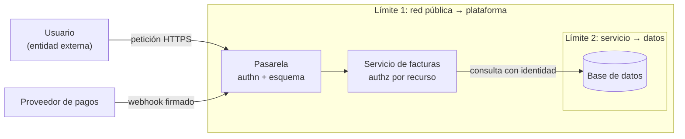
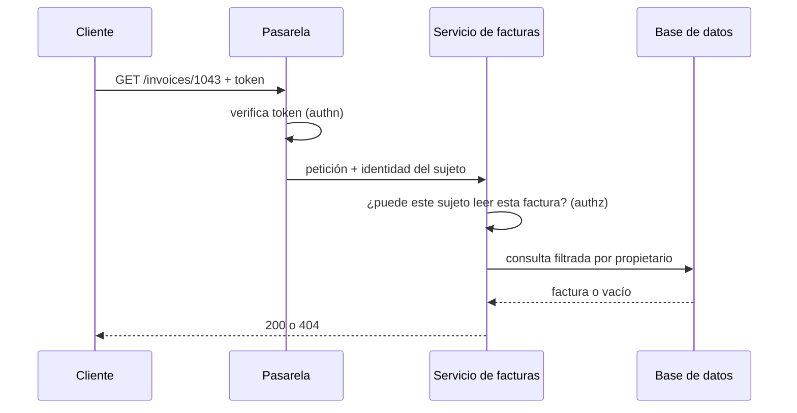

# Seguridad por diseño: amenazas, fronteras y confianza

Una semana antes del lanzamiento llega el informe del pentest. El hallazgo crítico no es exótico: cambiando el identificador en `/invoices/1042` por `1043`, cualquier usuario autenticado lee la factura de otro cliente. La interfaz nunca mostraba ese enlace, así que nadie lo había pensado. Arreglarlo no es un parche de una línea: el servicio de facturas no recibe quién es el usuario, solo un token que validó la pasarela, y la consulta a la base de datos no sabe nada de propietarios. Hay que rediseñar cómo viaja la identidad por el sistema, con la fecha de lanzamiento encima.

**Seguridad por diseño es tratar la seguridad como una propiedad de la arquitectura, decidida junto con el resto del diseño, y no como una revisión que se hace al final.** Las decisiones que más pesan (dónde están los límites de confianza, cómo se propaga la identidad, quién decide los permisos, de dónde salen los secretos) son estructurales: cambiarlas tarde cuesta lo mismo que cambiar cualquier otra decisión estructural.

Este artículo recorre los principios con origen verificable, una forma práctica de modelar amenazas en una hora, y las decisiones de diseño que más se repiten: fronteras, autenticación y autorización, secretos, cadena de suministro y zero trust.

<Callout tone="info" title="Fecha de corte">
  Fuentes consultadas en octubre de 2026. El artículo original de STRIDE (Kohnfelder y Garg, 1999)
  no lo abrí: su fecha, su título y su autoría vienen del blog de Adam Shostack y de Wikipedia. Del
  OWASP Top 10 se cita solo la edición 2025, la vigente.
</Callout>

## Por qué es una propiedad de la arquitectura

La seguridad es un [atributo de calidad](/docs/atributos-de-calidad) como la disponibilidad o el rendimiento: se negocia contra otros atributos y se diseña, no se añade. Microsoft presenta su herramienta de modelado de amenazas como parte de su ciclo de desarrollo seguro (SDL) con un argumento económico: identificar los problemas pronto, cuando todavía son relativamente fáciles y baratos de resolver.

Dos señales recientes apuntan en la misma dirección. La edición 2025 del OWASP Top 10 mantiene una categoría propia para el diseño inseguro (A06, A04 en 2021), separada de los errores de implementación. Y en abril de 2023 CISA, junto con agencias de varios países, publicó la guía _Shifting the Balance of Cybersecurity Risk_ (ampliada en octubre de 2023), que pide a los fabricantes asumir la responsabilidad de los resultados de seguridad de sus clientes en lugar de trasladarles esa carga.

| —                    | Seguridad como revisión final                    | Seguridad por diseño                              |
| -------------------- | ------------------------------------------------ | ------------------------------------------------- |
| Cuándo se piensa     | Antes del lanzamiento, en un pentest o auditoría | Al dibujar el sistema y en cada cambio relevante  |
| Quién la piensa      | Un equipo de seguridad externo al producto       | El equipo que diseña, con apoyo de especialistas  |
| Qué produce          | Una lista de hallazgos                           | Fronteras, controles y decisiones registradas     |
| Coste de un hallazgo | Alto: suele tocar la estructura                  | Bajo: el cambio aún es un dibujo                  |
| Qué detecta mejor    | Errores de implementación conocidos              | Fallos de diseño: confianza mal ubicada, permisos |

Las dos cosas no se excluyen: un pentest sigue siendo útil, pero verifica un diseño, no lo sustituye.

## Principios con origen verificable

### Saltzer y Schroeder, 1975

_The Protection of Information in Computer Systems_, de Jerome Saltzer y Michael Schroeder, se publicó en _Proceedings of the IEEE_ (vol. 63, n.º 9, septiembre de 1975); una versión anterior apareció en _Communications of the ACM_ en julio de 1974. Su lista de ocho principios de diseño sigue siendo la referencia que casi todos los textos posteriores reutilizan.

| Principio                   | Idea, en una línea                                    | Lectura para un arquitecto hoy                                        |
| --------------------------- | ----------------------------------------------------- | --------------------------------------------------------------------- |
| Economía de mecanismo       | Diseños pequeños y simples, revisables por inspección | Un solo punto de autorización bien probado, no veinte variantes       |
| Valores por defecto seguros | Decidir por permiso, no por exclusión                 | Denegar salvo regla explícita; listas de permitidos, no de prohibidos |
| Mediación completa          | Comprobar la autoridad en cada acceso a cada objeto   | Autorizar cada petición sobre el recurso, no solo al iniciar sesión   |
| Diseño abierto              | La seguridad no depende de que el diseño sea secreto  | Algoritmos estándar; lo secreto son las claves                        |
| Separación de privilegios   | Exigir más de una condición para conceder acceso      | Doble aprobación para despliegues o cambios de permisos críticos      |
| Mínimo privilegio           | Cada programa y usuario, con lo mínimo necesario      | Credenciales por servicio y con alcance acotado                       |
| Mínimo mecanismo común      | Reducir los mecanismos compartidos por todos          | Evitar una cuenta de base de datos común para todos los servicios     |
| Aceptabilidad psicológica   | Que lo seguro sea lo fácil de usar bien               | Si el camino seguro es incómodo, la gente lo rodea                    |

Dos de ellos merecen la cita literal. El de mínimo privilegio: «Every program and every user of the system should operate using the least set of privileges necessary to complete the job». Y el de valores por defecto seguros: «Base access decisions on permission rather than exclusion». El segundo es la raíz de casi todo lo que hoy llamamos _deny by default_.

### Defensa en profundidad

El glosario del NIST recoge varias definiciones; la más operativa, tomada de la familia ISA/IEC 62443, la describe como aplicar varias contramedidas en capas, de modo que lo que una no detiene lo detenga otra. Para un arquitecto se traduce en una pregunta: si este control falla, ¿qué impide el daño? Un ejemplo de capas en una API: validación de esquema en la frontera, autorización en el servicio que posee el recurso y, en un sistema multi-tenant, políticas en la propia base de datos, que se explican en [multi-tenancy](/docs/multi-tenancy).

Las capas solo suman si son independientes. Tres comprobaciones que leen el mismo campo de la misma cabecera son, en la práctica, una sola.

### Fallar cerrado

Es la consecuencia operativa de los valores por defecto seguros: cuando un control de seguridad no puede decidir (el servicio de autorización no responde, la política no carga, el certificado no se puede comprobar), la respuesta es denegar. Fallar abierto convierte una caída en una brecha.

Hay un coste: fallar cerrado reduce la disponibilidad, y no todo componente lo justifica. Un limitador de tasa puede fallar abierto a propósito si su caída no expone datos; un control de acceso a datos de clientes, no. Lo que importa es que sea una decisión explícita y registrada en un [ADR](/docs/adr), no un efecto lateral del `catch` por defecto. Cómo convivir con las caídas sin degradar la seguridad se trata en [resiliencia](/docs/resiliencia-sistemas-distribuidos).

## Modelar amenazas con STRIDE

STRIDE nació en Microsoft: Loren Kohnfelder y Praerit Garg lo propusieron en _The Threats to our Products_, un artículo del 1 de abril de 1999 en una publicación interna de la empresa que tardó más de una década en ser público, según Adam Shostack. Shostack subraya que se pensó para ayudar a encontrar problemas, más que para clasificarlos: úsalo como mnemotecnia, con cada letra como una pregunta que se le hace al diseño.

| Letra | Amenaza                   | Propiedad que protege | Pregunta para el diseño                                    | Respuesta típica                           |
| ----- | ------------------------- | --------------------- | ---------------------------------------------------------- | ------------------------------------------ |
| S     | Suplantación              | Autenticidad          | ¿Puede alguien hacerse pasar por un usuario o un servicio? | Autenticación fuerte, mTLS entre servicios |
| T     | Manipulación              | Integridad            | ¿Puede alguien alterar datos en tránsito o en reposo?      | TLS, firmas, control de escritura          |
| R     | Repudio                   | No repudio            | ¿Podría alguien negar una acción sin que se pueda probar?  | Registro de auditoría inalterable          |
| I     | Revelación de información | Confidencialidad      | ¿Quién puede leer lo que no debería?                       | Autorización por recurso, cifrado          |
| D     | Denegación de servicio    | Disponibilidad        | ¿Puede alguien agotar un recurso compartido?               | Límites de tasa, cuotas, aislamiento       |
| E     | Elevación de privilegio   | Autorización          | ¿Puede alguien hacer más de lo que le corresponde?         | Mínimo privilegio, autorización central    |

### Las cuatro preguntas

STRIDE responde a una sola de las preguntas del modelado de amenazas. Shostack las resume en cuatro, que el _Threat Modeling Manifesto_ (2020) adopta: ¿en qué estamos trabajando?, ¿qué puede salir mal?, ¿qué vamos a hacer al respecto? y ¿lo hicimos lo bastante bien? El manifiesto prefiere el análisis temprano y frecuente, y el refinamiento continuo, a una entrega única. Shostack advierte además que el diagrama a veces se confunde con el modelo completo, cuando solo responde a la primera pregunta.

### Una sesión de una hora

Lo que sigue es una agenda propuesta por esta guía, no un método estándar. Funciona con tres a seis personas que conozcan el sistema y una pizarra.

| Minutos | Paso                                  | Resultado                                                   |
| ------- | ------------------------------------- | ----------------------------------------------------------- |
| 0–10    | Dibujar el diagrama de flujo de datos | Entidades externas, procesos, almacenes y flujos del cambio |
| 10–15   | Marcar los límites de confianza       | Líneas donde cambia quién controla el dato o el código      |
| 15–40   | Recorrer STRIDE en cada cruce         | Lista de amenazas concretas, una por línea                  |
| 40–55   | Decidir qué hacer con cada una        | Mitigar, eliminar la funcionalidad, transferir o aceptar    |
| 55–60   | Asignar dueños y registrar            | Tareas en el backlog y decisiones relevantes en un ADR      |

El truco está en el paso tres: no se aplica STRIDE a «el sistema», sino a cada flujo que cruza una frontera. Eso acota la conversación y evita la lista genérica de amenazas que nadie lee.



Dos cruces, dos conversaciones: qué puede llegar por la petición del usuario y por el webhook, y qué puede pedir el servicio a la base de datos.

## Límites de confianza: dónde entra el dato no confiable

Un límite de confianza es la línea en la que cambia quién controla el dato o el código. Todo lo que la cruza hacia dentro es no confiable hasta que se valida. La red pública es el caso obvio; los demás se olvidan con más facilidad:

- **Webhooks y callbacks** de terceros, aunque vengan «de un proveedor conocido»: verifica la firma.
- **Mensajes de colas** publicados por otros equipos o sistemas.
- **Archivos subidos** y sus metadatos (nombre, tipo declarado, tamaño).
- **Datos leídos de una base compartida** que escribe otro sistema.
- **La salida de un modelo de lenguaje**, que puede contener instrucciones inyectadas; el tema se desarrolla en [arquitectura de agentes LLM](/docs/arquitectura-agentes-llm).
- **Configuración y variables de entorno** que puede tocar alguien fuera del equipo.

La regla de diseño es validar una vez, en la frontera, y convertir lo validado en un tipo del dominio que el resto del código pueda usar sin volver a dudar. Cómo definir esos contratos y su validación en la API está en [diseño de APIs](/docs/diseno-de-apis). La validación en la frontera no sustituye a la autorización: un dato perfectamente formado puede pedir un recurso que no le corresponde.

## Autenticación y autorización, por separado

**Autenticar** responde quién eres; **autorizar** responde qué puedes hacer con este recurso concreto. Mezclarlas es el origen del ejemplo inicial: la pasarela autenticó, y el sistema supuso que con eso bastaba. El control de acceso roto ocupa el primer puesto (A01) de la edición 2025 del OWASP Top 10.



Tres decisiones de diseño se desprenden:

- **La autenticación puede centralizarse** en la pasarela o un proveedor de identidad; la autorización vive cerca del recurso, porque necesita saber de quién es.
- **La identidad viaja explícita**, como un sujeto verificable, hasta el servicio que decide. Un servicio que solo recibe «la petición ya fue autorizada» no puede aplicar mediación completa.
- **La decisión tiene una forma única**, aunque la apliquen varios servicios. Basta con fijar la firma:

```typescript
// authz/authorize.ts: una sola puerta para las decisiones de acceso
export type Decision = { allowed: true } | { allowed: false; reason: string };

export declare function authorize(
  subject: Subject, // quién, ya autenticado
  action: 'read' | 'update' | 'delete',
  resource: ResourceRef, // qué, con su propietario
): Promise<Decision>;
```

Ocultar un botón en la interfaz es experiencia de usuario, no un control de acceso.

## Secretos fuera del código

Un secreto en el repositorio vive para siempre en su historial. La hoja de referencia de gestión de secretos de OWASP propone centralizar su almacenamiento, aprovisionamiento, auditoría y rotación; rotarlos con regularidad y de forma automática, para que una credencial robada sirva poco tiempo; preferir credenciales de vida corta pedidas al arrancar; y detectar fugas con herramientas tanto en el equipo del desarrollador (_pre-commit_) como en el pipeline.

| Tipo de secreto                  | Dónde vive                                | Rotación razonable                                      |
| -------------------------------- | ----------------------------------------- | ------------------------------------------------------- |
| Credenciales de base de datos    | Gestor de secretos, dinámicas si se puede | Por sesión o lease corto; si no, periódica y automática |
| Claves de API de terceros        | Gestor de secretos, por entorno           | Periódica y siempre ante sospecha de fuga               |
| Claves de firma de tokens        | Gestor de claves (KMS o HSM)              | Con solapamiento: la nueva firma, la vieja aún verifica |
| Identidad de servicio en la nube | Identidad de carga de trabajo, sin clave  | La gestiona la plataforma                               |

Una decisión de arquitectura que ahorra mucho: que los servicios lean sus secretos del gestor en tiempo de ejecución, en lugar de recibirlos a través del pipeline de CI, que se convierte así en un objetivo menos valioso. Ante una fuga, el orden es revocar, rotar y luego limpiar código y registros.

## Cadena de suministro

La mayor parte del código que despliegas no lo escribió tu equipo. La edición 2025 del OWASP Top 10 dedica la categoría A03 a los fallos de la cadena de suministro de software. Tres piezas se complementan:

- **Inventario (SBOM).** Una lista de materiales de software describe qué componentes y versiones contiene un artefacto. Hay dos formatos estandarizados: SPDX, publicado como ISO/IEC 5962:2021, y CycloneDX, de OWASP, estandarizado por Ecma como ECMA-424 (la segunda edición, de diciembre de 2025, corresponde a CycloneDX 1.7).
- **Firmas.** Sigstore permite firmar artefactos sin gestionar claves de larga vida: Cosign firma con una clave efímera, Fulcio emite un certificado de corta duración ligado a una identidad OIDC y Rekor registra la firma en un log de transparencia de solo anexado.
- **Procedencia.** SLSA (_Supply-chain Levels for Software Artifacts_, versión 1.2 en su sitio) es un marco de estándares y controles para evitar manipulaciones y mejorar la integridad de lo que se construye; la procedencia es la evidencia de cómo y dónde se construyó un artefacto.

| Pieza       | Responde a                      | No responde a                             |
| ----------- | ------------------------------- | ----------------------------------------- |
| SBOM        | ¿Qué hay dentro?                | ¿Alguno de esos componentes es malicioso? |
| Firma       | ¿Quién lo firmó y no se alteró? | ¿Es de fiar quien lo firmó?               |
| Procedencia | ¿Cómo y dónde se construyó?     | ¿El código fuente era correcto?           |

La última columna es la trampa habitual: una firma válida solo dice qué identidad firmó. Si la política de verificación no restringe qué identidades y repositorios se aceptan, acepta cualquier cosa firmada por cualquiera.

## Zero trust

El NIST SP 800-207, _Zero Trust Architecture_ (agosto de 2020; Rose, Borchert, Mitchell y Connelly), parte de una premisa: no se concede confianza implícita a un activo o a una cuenta solo por su ubicación física o de red. La autenticación y la autorización, del sujeto y del dispositivo, ocurren antes de abrir cada sesión con un recurso. El documento lo organiza en siete principios y varios modelos de despliegue.

Para un arquitecto, la consecuencia es concreta: la red interna deja de ser un límite de confianza suficiente. Los servicios se autentican entre sí (mTLS o tokens de servicio), cada petición se autoriza contra el recurso y los accesos se conceden por sesión. Zero trust no es un producto que se compra: se apoya en la mediación completa de Saltzer y Schroeder, llevada a la red.

## El OWASP Top 10 como mapa

La edición vigente es la de 2025, presentada en el OWASP Global AppSec de noviembre de 2025. Úsala como mapa de riesgos frecuentes para orientar el modelado, no como lista de verificación exhaustiva:

| Código | Riesgo (edición 2025)                  | Palanca de diseño principal                         |
| ------ | -------------------------------------- | --------------------------------------------------- |
| A01    | Broken Access Control                  | Autorización por recurso, en el servidor            |
| A02    | Security Misconfiguration              | Configuración segura por defecto y declarativa      |
| A03    | Software Supply Chain Failures         | SBOM, firmas, procedencia, dependencias mínimas     |
| A04    | Cryptographic Failures                 | Bibliotecas estándar, claves en un gestor           |
| A05    | Injection                              | Validación en la frontera, consultas parametrizadas |
| A06    | Insecure Design                        | Modelado de amenazas en cada cambio relevante       |
| A07    | Authentication Failures                | Proveedor de identidad central, MFA                 |
| A08    | Software or Data Integrity Failures    | Verificar firmas e integridad de lo que entra       |
| A09    | Security Logging and Alerting Failures | Auditoría de decisiones de acceso y alertas         |
| A10    | Mishandling of Exceptional Conditions  | Fallar cerrado de forma explícita                   |

## Cuándo sí y cuándo no

La pregunta no es si aplicar seguridad por diseño, sino cuánto rigor dedicarle a cada cambio.

| Situación                                                      | Rigor razonable                                                    |
| -------------------------------------------------------------- | ------------------------------------------------------------------ |
| Sistema nuevo, o datos personales, pagos o salud               | Sesión completa de modelado y revisión con especialistas           |
| Cambio que añade un límite de confianza (webhook, integración) | Sesión de una hora centrada en el cruce nuevo                      |
| Cambio interno sin datos nuevos ni fronteras nuevas            | Repasar el modelo existente; basta con confirmar que sigue vigente |
| Prototipo desechable sin datos reales                          | Lo mínimo: sin secretos en el código y sin datos de producción     |

Un aviso para el último caso: los prototipos que funcionan tienden a llegar a producción. Si eso pasa, el modelado se hace antes del primer usuario real, no después.

## Errores frecuentes

- **Seguridad como checklist de última hora.** Un pentest antes del lanzamiento encuentra fallos de diseño cuando ya son caros de arreglar.
- **Confiar en la red interna.** «Solo se llama desde dentro» no es un control; basta un servicio comprometido para que todo lo interno pueda quedar expuesto.
- **Autorización solo en la interfaz.** Ocultar un botón no impide llamar a la API directamente.
- **Autenticar y dar por autorizado.** Un token válido dice quién es el sujeto, no a qué recursos tiene derecho.
- **Validar en todas partes salvo en la frontera.** Las comprobaciones dispersas se contradicen; la frontera es donde el dato deja de ser ajeno.
- **Fallar abierto por accidente.** Un `catch` genérico que deja pasar la petición cuando el servicio de permisos no responde.
- **Secretos compartidos y eternos.** Una credencial común a todos los servicios, que nadie se atreve a rotar.
- **Firmas sin política.** Verificar que algo está firmado sin restringir por quién.

## Ejemplo trabajado: el portal de facturas

Volvamos al caso inicial. El equipo dedica una hora a modelar el portal antes de rediseñar.

1. **Diagrama.** Usuario, pasarela, servicio de facturas, base de datos y un webhook del proveedor de pagos que marca facturas como pagadas.
2. **Fronteras.** Red pública hacia la pasarela; proveedor de pagos hacia la pasarela; servicio hacia la base de datos.
3. **STRIDE en cada cruce.** En la petición del usuario aparece la revelación de información (leer facturas ajenas) y la elevación de privilegio (un cliente que anula facturas). En el webhook, la suplantación: cualquiera que conozca la URL podría marcar una factura como pagada. En la base de datos, la cuenta única con permisos de escritura sobre todo.
4. **Decisiones.** La pasarela propaga la identidad del sujeto; el servicio aplica `authorize` sobre cada factura y la consulta filtra por propietario; el webhook verifica la firma del proveedor y falla cerrado si no puede; cada servicio usa credenciales propias con permisos mínimos. Aceptan, de forma explícita, no cifrar a nivel de campo en esta versión.
5. **Registro.** Un ADR recoge la decisión de autorizar en el servicio y no en la pasarela, con sus alternativas. Un test de integración, convertido en [fitness function](/docs/fitness-functions), intenta leer una factura ajena en cada build y debe recibir un 404.

El rediseño tardó días, no horas. Habría costado una conversación si el diagrama se hubiera dibujado al principio. El aislamiento entre clientes de distintas organizaciones, si el portal fuera multi-tenant, es otra capa que se trata en [multi-tenancy](/docs/multi-tenancy); la operación del día a día (parches, alertas, respuesta a incidentes) encaja en la [cultura DevOps](/docs/devops-cultura).

## Checklist

- [ ] Existe un diagrama de flujo de datos actualizado con los límites de confianza marcados.
- [ ] Cada flujo que cruza una frontera tiene su revisión STRIDE y sus decisiones registradas.
- [ ] Todo dato que entra por una frontera se valida ahí y se convierte en un tipo del dominio.
- [ ] La autorización se decide en el servidor, por recurso, en cada acceso.
- [ ] Los controles de seguridad fallan cerrados, y las excepciones están en un ADR.
- [ ] No hay secretos en el código; se rotan de forma automática y cada servicio tiene los suyos.
- [ ] Cada artefacto publicado tiene SBOM y firma, y la verificación restringe identidades.
- [ ] Ningún servicio confía en otro solo por estar en la misma red.

## Fuentes

Consultadas en octubre de 2026.

- [The Protection of Information in Computer Systems (Saltzer y Schroeder, 1975)](https://www.cs.virginia.edu/~evans/cs551/saltzer/): copia del texto, con los ocho principios
- [The Protection of Information in Computer Systems en Wikipedia](https://en.wikipedia.org/wiki/The_Protection_of_Information_in_Computer_Systems): datos de publicación
- [20 Years of STRIDE (Adam Shostack)](https://shostack.org/blog/20-years-of-stride-looking-back-looking-forward/) y [STRIDE en Wikipedia](https://en.wikipedia.org/wiki/STRIDE_model): origen de STRIDE
- [Threat Modeling Tool: amenazas (Microsoft Learn)](https://learn.microsoft.com/en-us/azure/security/develop/threat-modeling-tool-threats)
- [Threat modeling (Adam Shostack)](https://shostack.org/resources/threat-modeling) y [Threat Modeling Manifesto](https://www.threatmodelingmanifesto.org/)
- [Defense-in-depth en el glosario del NIST](https://csrc.nist.gov/glossary/term/defense_in_depth)
- [NIST SP 800-207, Zero Trust Architecture (agosto de 2020)](https://csrc.nist.gov/pubs/sp/800/207/final)
- [OWASP Top 10:2025](https://top10.owasp.org/2025/)
- [OWASP Secrets Management Cheat Sheet](https://cheatsheetseries.owasp.org/cheatsheets/Secrets_Management_Cheat_Sheet.html)
- [Secure by Design (CISA)](https://www.cisa.gov/resources-tools/resources/secure-by-design-and-default)
- [ISO/IEC 5962:2021 (SPDX)](https://www.iso.org/standard/81870.html), [ECMA-424 (CycloneDX)](https://ecma-international.org/publications-and-standards/standards/ecma-424/) y [OWASP CycloneDX](https://owasp.org/www-project-cyclonedx/)
- [Sigstore: visión general](https://docs.sigstore.dev/about/overview/) y [SLSA](https://slsa.dev/)
