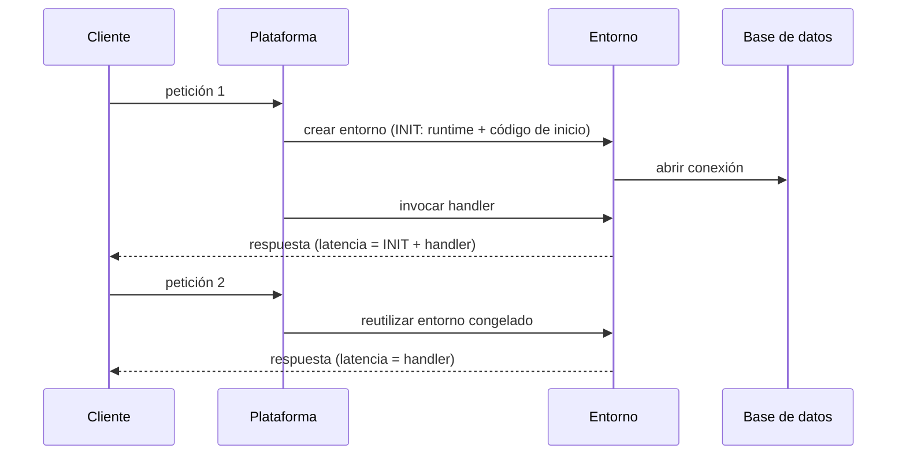
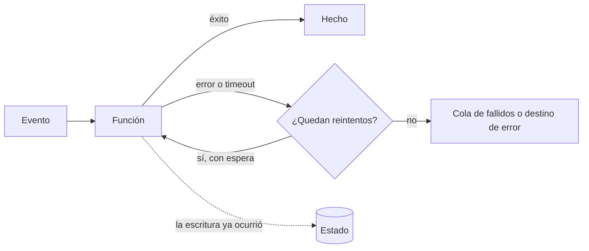

# Serverless y computación gestionada

Un equipo migra su API a funciones. La primera factura es más baja y nadie echa de menos parchear servidores. Al mes aparecen las rarezas: la primera petición de la mañana tarda bastante más que las demás, un pico de tráfico abre cientos de conexiones contra la base de datos relacional y la tumba, y un cobro se ejecuta dos veces porque la plataforma reintentó un evento que ya se había procesado. Ninguno de esos fallos es un error del proveedor: son consecuencias del modelo de ejecución que el equipo aceptó sin leer la letra pequeña. **Serverless es un modelo en el que el proveedor opera los servidores, escala la capacidad con la demanda (a menudo hasta cero) y factura por uso, a cambio de que tu código acepte un ciclo de vida que no controlas.**

Esta lección recorre el espectro que va de la máquina virtual a los servicios totalmente gestionados, explica cómo se ejecuta una función (eventos, concurrencia, escalado a cero, límites), qué es el arranque en frío y cuándo importa, dónde vive el estado, por qué la idempotencia no es opcional, cómo se observa un sistema sin servidor y cuándo deja de compensar pagar por invocación. Termina con los errores más comunes y un ejemplo trabajado con supuestos explícitos.

<Callout tone="info" title="Fecha de corte y cifras">
  Consultado en octubre de 2026. Las cifras de AWS Lambda, Azure Functions y Cloud Run salen de su
  documentación oficial a fecha de consulta y se enlazan en las fuentes; cambian con frecuencia, así
  que compruébalas antes de diseñar con ellas. Donde no hay fuente oficial, el texto describe el
  tipo de límite sin cifra. Los precios del ejemplo trabajado son hipotéticos.
</Callout>

## El espectro de control frente a abstracción

«Serverless» no es sinónimo de «funciones». Mike Roberts, en su artículo de 2018 en el sitio de Martin Fowler, lo describe como la combinación de servicios de terceros que sustituyen al backend (_Backend as a Service_) y de código propio ejecutado en contenedores efímeros gestionados (_Functions as a Service_). El informe de Berkeley de 2019 (Jonas y otros) lo resume como FaaS más BaaS y exige que el servicio escale solo, sin aprovisionamiento explícito; lo distingue del modelo con servidores por tres rasgos: cómputo y almacenamiento desacoplados, código que se ejecuta sin que gestiones la asignación de recursos y pago por lo usado en lugar de por lo asignado. Lo útil para un arquitecto es verlo como un **espectro**: cuanto más subes, menos operas y menos controlas.

| Nivel                    | Qué operas tú                                 | Qué opera el proveedor                       | Unidad de escala                   | Unidad de facturación habitual      | Ejemplos (AWS · Azure · Google Cloud)                                                                 |
| ------------------------ | --------------------------------------------- | -------------------------------------------- | ---------------------------------- | ----------------------------------- | ----------------------------------------------------------------------------------------------------- |
| Máquinas virtuales       | Sistema operativo, runtime, escalado, parches | Hardware e hipervisor                        | Instancia                          | Tiempo encendida                    | EC2 · Virtual Machines · Compute Engine                                                               |
| Contenedores gestionados | Imagen, configuración de escalado             | Nodos, plano de control, a veces el escalado | Réplica de contenedor              | Tiempo de réplica o de vCPU/memoria | ECS con Fargate · Container Apps · Cloud Run                                                          |
| Funciones (FaaS)         | Código del handler y su configuración         | Runtime, escalado, entorno de ejecución      | Entorno por invocación             | Invocaciones y duración × memoria   | Lambda · Azure Functions · Cloud Run functions                                                        |
| Datos serverless         | Modelo de datos, claves, índices              | Capacidad, réplicas, almacenamiento          | Peticiones o unidades de capacidad | Peticiones y almacenamiento         | DynamoDB · Cosmos DB (serverless) · Firestore                                                         |
| Integración serverless   | Reglas, esquemas de eventos, flujos           | Entrega, colas, reintentos, estado del flujo | Mensajes o transiciones            | Mensajes, eventos o pasos           | SQS, EventBridge, Step Functions · Service Bus, Event Grid, Logic Apps · Pub/Sub, Eventarc, Workflows |

Dos matices. Primero, la frontera entre niveles se difumina: Cloud Run ejecuta contenedores y escala a cero, y desde agosto de 2024 Google llama «Cloud Run functions» a lo que antes era Cloud Functions; Azure permite alojar funciones en Container Apps. Segundo, el catálogo de servicios por categoría ya está en [servicios de nube para arquitectos](/docs/servicios-nube-para-arquitectos); aquí interesa el **modelo de ejecución** que comparten.

La decisión no es «serverless sí o no», sino **qué nivel para cada carga**. Un mismo sistema puede tener la API principal en contenedores, el procesamiento de archivos en funciones, los datos en una base gestionada y la coordinación en un orquestador de flujos.

## Cómo se ejecuta una función

### Invocación por evento

Una función no escucha en un puerto: la plataforma la invoca cuando ocurre algo. La documentación de AWS distingue dos formas: **push**, cuando un servicio invoca la función directamente (una petición HTTP a través de un gateway, un objeto nuevo en almacenamiento), y **pull**, cuando la plataforma lee de una cola o un stream y entrega lotes a la función. A eso se suma la diferencia entre invocación **síncrona** (quien llama espera la respuesta) y **asíncrona** (la plataforma encola el evento y responde enseguida). El tipo de invocación decide quién reintenta, quién ve el error y si el arranque en frío lo sufre un usuario o una cola.

### Concurrencia y escalado

La concurrencia es el número de invocaciones en curso a la vez. AWS da una fórmula práctica: **concurrencia = peticiones por segundo × duración media en segundos**. Con 100 peticiones por segundo de 0,5 s necesitas unas 50 invocaciones simultáneas. La fórmula explica algo poco intuitivo: si una dependencia se vuelve lenta y la duración se duplica, la concurrencia se duplica aunque el tráfico no cambie.

El modelo de reparto varía. En Lambda, en su modo estándar, cada entorno de ejecución atiende una invocación a la vez; para la siguiente simultánea, la plataforma crea otro entorno. En Cloud Run, una instancia puede atender varias peticiones en paralelo hasta un máximo configurable, y en el plan Flex Consumption de Azure Functions el escalado se calcula con una concurrencia por instancia configurable. La diferencia importa para las conexiones a bases de datos y para el uso de memoria compartida.

La concurrencia **no es ilimitada**. A fecha de consulta (octubre de 2026), AWS asigna por defecto una cuota de 1.000 ejecuciones concurrentes por cuenta y región, compartida por todas las funciones, y limita además la velocidad a la que una función puede crear entornos nuevos. Al agotarla, las invocaciones se rechazan (_throttling_, un `429` en la API). La **concurrencia reservada** sirve para dos cosas opuestas: garantizar capacidad a una función crítica y, a la vez, ponerle un techo para que no desborde a quien está detrás.

### Escalado a cero

Cuando no hay tráfico, la plataforma retira los entornos y dejas de pagar por cómputo. Es la gran ventaja económica para cargas intermitentes y el origen del arranque en frío: si no hay ningún entorno vivo, la siguiente petición tiene que esperar a que se cree uno. Casi todos los proveedores ofrecen una palanca para no bajar de cierto mínimo (capacidad aprovisionada, instancias siempre listas, instancias mínimas), y casi siempre esa palanca **se paga aunque no haya tráfico**.

### Límites de tiempo, memoria y tamaño

Toda plataforma de funciones impone límites de varios tipos, y conviene conocerlos antes de diseñar:

- **Duración máxima por invocación.** A fecha de consulta, Lambda permite hasta 15 minutos en su modo estándar. Un trabajo que puede crecer más allá necesita partirse o ir a otro nivel del espectro.
- **Memoria, y con ella la CPU.** En Lambda la CPU se asigna en proporción a la memoria configurada, así que subir memoria puede acortar la duración y no siempre encarece.
- **Tamaño de la carga útil**, distinto para invocaciones síncronas y asíncronas.
- **Tamaño del paquete desplegado y almacenamiento temporal** del entorno.
- **Límites de la ruta, no de la función.** En Azure Functions, una función disparada por HTTP tiene un máximo para responder impuesto por el balanceador, con independencia del tiempo máximo de la función. El límite efectivo es el menor de toda la cadena.

## El arranque en frío

La figura de esta lección muestra el recorrido. Cuando llega una invocación y no hay un entorno libre, la plataforma descarga el código, arranca el runtime y ejecuta tu código de inicialización (la fase `INIT`); solo después llama al handler. Si la siguiente petición encuentra ese entorno libre, lo reutiliza y salta directamente al handler: es un arranque **en caliente**.



### Causas

Hay arranque en frío siempre que la plataforma necesita un entorno nuevo: la primera invocación tras un despliegue, la vuelta desde cero tras un rato sin tráfico, cada escalón de un pico (cada invocación simultánea adicional necesita su propio entorno) y la recreación tras un fallo. AWS documenta además que recicla los entornos cada pocas horas aunque la función reciba tráfico continuo. Lo que alarga la fase `INIT` suele estar en tu lado: el tamaño del paquete y de sus dependencias, el trabajo hecho al cargar el módulo y el tiempo de abrir conexiones.

### Cuándo importa

Según la documentación de AWS, los arranques en frío suelen afectar a menos del 1 % de las invocaciones en producción, y su duración va de menos de 100 ms a más de un segundo. Ese porcentaje es pequeño en la media y visible en la **cola de la distribución**: aparece en el p99, que es justo donde se miden muchos objetivos de latencia (lo explica [números y leyes de rendimiento](/docs/numeros-y-leyes-de-rendimiento)). Importa en rutas síncronas con un usuario esperando, en cadenas de funciones (cada eslabón puede sumar su propio arranque) y en tráfico con picos bruscos. Importa poco en procesamiento asíncrono, donde unos cientos de milisegundos extra no los ve nadie. Desde el 1 de agosto de 2025, además, AWS factura la fase `INIT` en todas las configuraciones, así que un arranque lento también cuesta dinero.

### Mitigaciones

| Mitigación                                 | Qué hace                                                               | Costo o límite                                                                      |
| ------------------------------------------ | ---------------------------------------------------------------------- | ----------------------------------------------------------------------------------- |
| Adelgazar la inicialización                | Menos dependencias, importar solo lo necesario, carga perezosa         | Trabajo de ingeniería; no elimina el arranque, lo acorta                            |
| Capacidad precalentada                     | Provisioned concurrency, instancias siempre listas, instancias mínimas | Se paga en reposo; solo cubre hasta el mínimo configurado                           |
| Instantáneas del entorno inicializado      | Restaurar memoria y disco en lugar de inicializar (p. ej. SnapStart)   | Disponible solo en ciertos runtimes; el estado restaurado debe ser seguro de clonar |
| Mover la ruta crítica a contenedores       | Réplicas mínimas siempre encendidas que atienden muchas peticiones     | Vuelves a pagar capacidad y a decidir el escalado                                   |
| Llamadas periódicas para mantener caliente | Un temporizador invoca la función para que no se retire                | Mantiene pocos entornos; no cubre los picos de concurrencia                         |

<Callout tone="warning" title="Calentar con pings no es capacidad">
  Un temporizador que invoca la función cada pocos minutos mantiene vivo, como mucho, un entorno por
  invocación simultánea del ping. Cuando llega un pico, los entornos adicionales arrancan en frío
  igual. Si la latencia de cola es un requisito, usa la capacidad aprovisionada del proveedor o un
  nivel del espectro con réplicas mínimas, y mide el p99 con tráfico realista.
</Callout>

## Estado: la función no recuerda

AWS lo dice sin rodeos: asume que el entorno existe solo para una invocación y guarda cualquier cambio permanente en un almacén duradero antes de terminar. El entorno **puede** reutilizarse, y eso permite cachear clientes y conexiones fuera del handler, pero no hay garantía de cuándo ni de cuál: dos invocaciones seguidas del mismo usuario pueden caer en entornos distintos, y un entorno puede desaparecer en cualquier momento.

Dónde vive entonces el estado:

- **Datos del negocio:** en una base de datos o un almacén de objetos, con su propia consistencia (ver [datos ACID y aislamiento](/docs/datos-acid-y-aislamiento)).
- **Datos derivados y sesiones:** en una caché externa, no en variables globales.
- **Trabajo pendiente:** en una cola o un stream, que absorbe la diferencia de ritmo entre productor y consumidor ([caché, colas y streaming](/docs/caching-colas-streaming)).
- **El progreso de un proceso largo:** en un orquestador de flujos (Step Functions, Durable Functions, Workflows), que guarda en qué paso va cada ejecución y reintenta por ti.
- **Lo local (variables globales, disco temporal):** solo como caché que se puede perder sin consecuencias.

Hay un efecto secundario del escalado que sorprende a menudo: cada entorno abre sus propias conexiones. Cien invocaciones simultáneas son cien clientes para la base de datos relacional, que suele tener un máximo de conexiones mucho más bajo que el techo de concurrencia de la plataforma. Las salidas habituales son un proxy de conexiones gestionado, una base de datos con API por petición o limitar la concurrencia de la función al presupuesto de conexiones.

## Idempotencia y reintentos

En un sistema serverless los reintentos vienen de muchas capas: el cliente, el gateway, la plataforma y la fuente de eventos. La documentación de AWS lo deja claro para las invocaciones asíncronas: si la función falla, la plataforma la reintenta por defecto dos veces más, y aunque no falle, la función puede recibir el mismo evento varias veces porque la cola interna es eventualmente consistente. Si la invocación se rechaza por falta de concurrencia, el evento vuelve a la cola y se reintenta durante horas. Conclusión: **trata cada evento como «al menos una vez»**.



La flecha punteada es el caso peligroso: la función escribió en la base de datos y después agotó su tiempo. Para la plataforma fue un fallo; para el negocio, la operación ya ocurrió. Cuando se reintente, la escritura tiene que reconocerse como repetida. Las técnicas (claves de idempotencia, tabla de procesados, inbox, outbox) están en [sagas, outbox e idempotencia](/docs/sagas-outbox-idempotencia); aquí basta con tres reglas propias de este modelo:

- **Deriva la clave de idempotencia del evento**, no del entorno: un identificador que la fuente mantenga igual entre reintentos.
- **Alinea los tiempos de espera.** Si el timeout de la función es mayor que el de quien la llama, el llamante reintenta mientras la primera invocación sigue viva.
- **Configura un destino para los eventos agotados** (cola de fallidos o destino de error) y vigílalo: un evento que falla siempre (_poison message_) no debe bloquear ni perderse en silencio.

## Observabilidad sin servidor

No hay un servidor al que conectarse ni un proceso que inspeccionar: cada invocación deja sus propios registros y, como recuerda AWS, reconstruir qué le pasó a un evento concreto exige que cada paso registre el mismo identificador de transacción. Tres prácticas mínimas:

- **Trazas distribuidas** que atraviesen gateway, funciones, colas y bases de datos (X-Ray, Application Insights o Cloud Trace, o OpenTelemetry, cuyas convenciones para FaaS incluyen el atributo `faas.coldstart` para distinguir invocaciones en frío).
- **Métricas de plataforma** además de las de negocio: errores, duración, rechazos por concurrencia, concurrencia en uso, duración de `INIT` y antigüedad del mensaje más viejo en cada cola.
- **Logs estructurados con presupuesto.** El volumen de logs crece con las invocaciones y se factura por lo ingerido y lo retenido. En mayo de 2025 AWS introdujo precios escalonados para los logs de Lambda, señal de que es una línea de costo relevante. Usa niveles, muestreo para lo repetitivo y retención acorde al uso.

## Costo por invocación frente a capacidad reservada

El precio de una función suele combinar un cargo por invocación y otro por duración multiplicada por memoria, a lo que se suman el gateway, los logs, la transferencia de datos y los servicios que la rodean. Una réplica de contenedor o una máquina virtual se paga por tiempo encendida, la uses o no. De ahí sale la regla general:

- Con **tráfico intermitente o muy variable**, pagar por uso gana porque no pagas el tiempo ocioso.
- Con **tráfico alto y estable**, la capacidad reservada suele ganar: su costo fijo se reparte entre muchas peticiones, y una réplica puede atender varias a la vez.
- Lo que más altera la cuenta es **el tiempo esperando**. Una función que espera a otra o a una API lenta se factura mientras espera; un servidor ocupado en E/S atiende otras peticiones mientras tanto.

El punto de cruce depende de tus precios, tu duración media y tu utilización, y se mueve cuando cambian. Por eso conviene recalcularlo como una función de aptitud más; el método está en [FinOps: el costo como atributo](/docs/finops-costo-como-atributo).

## Acoplamiento a los disparadores y al proveedor

El lock-in serverless rara vez está en el código de negocio. Está en **la forma de los eventos**: AWS documenta que el JSON que recibe la función varía según el servicio que lo genera y el tipo de evento, y lo mismo pasa en los demás proveedores. Si el handler lee directamente la estructura del evento de almacenamiento o del gateway, cada función queda casada con ese servicio. A eso se suman la firma del handler, la configuración de disparadores, los permisos y los servicios gestionados que la función llama.

La defensa es la de siempre aplicada a este caso, como en la [arquitectura hexagonal](/docs/arquitectura-hexagonal): el handler es un **adaptador** que traduce el evento del proveedor a un comando propio y llama al núcleo, que no sabe qué servicio lo invocó.

```text
pedidos/
  core/                 # reglas de negocio, sin SDK del proveedor
    confirm-order.ts    # confirmOrder(command): Result  // …
  ports/
    order-store.ts      # interfaz que define el núcleo
  adapters/
    http-handler.ts     # evento del gateway → ConfirmOrder
    queue-handler.ts    # mensaje de la cola → ConfirmOrder
    dynamo-order-store.ts
```

Para los eventos que cruzan fronteras entre equipos o sistemas, un formato común ayuda. CloudEvents, especificación de metadatos de eventos que la CNCF graduó el 25 de enero de 2024, la adoptan entre otros Azure Event Grid y Eventarc de Google Cloud. No elimina la dependencia de los disparadores, pero hace portable el sobre del evento. Cuánta portabilidad comprar y a qué precio se discute en [casado a un proveedor](/docs/casado-a-un-proveedor).

## Cuándo sí y cuándo no

| Encaja bien                                                         | Encaja mal                                                                  |
| ------------------------------------------------------------------- | --------------------------------------------------------------------------- |
| Tráfico intermitente, con picos o con largos periodos sin uso       | Tráfico alto y sostenido con utilización estable                            |
| Reacción a eventos: archivos subidos, mensajes, cambios en datos    | Procesos largos que no se pueden partir en pasos                            |
| Pegamento entre servicios gestionados y tareas programadas pequeñas | Latencia de cola estricta sin presupuesto para capacidad precalentada       |
| Equipos pequeños que no quieren operar infraestructura              | Conexiones persistentes, estado en memoria o protocolos con sesión larga    |
| Prototipos y cargas cuyo volumen todavía no conoces                 | Dependencias que no toleran la concurrencia que la plataforma puede generar |

Muchas cargas reales caen en medio. Una salida razonable es empezar en funciones y mover a contenedores la ruta que se vuelva estable y caliente, con una decisión registrada en un [ADR](/docs/adr) que diga qué métrica dispara el cambio.

## Errores frecuentes

- **Una función por endpoint sin límites de dominio.** Decenas de funciones diminutas que comparten tablas y se llaman entre sí son un monolito distribuido. AWS desaconseja también lo contrario, una sola función que atiende todas las rutas. El criterio no es el tamaño sino el límite: agrupa por capacidad de negocio, como propone [domain-driven design](/docs/domain-driven-design).
- **Dependencias síncronas en cadena.** Una función que invoca a otra y espera paga las dos duraciones, suma arranques en frío, necesita la misma concurrencia en cada eslabón y queda tan disponible como el más lento. AWS lo lista como antipatrón; las salidas son una cola entre ambas o un orquestador de flujos.
- **Suponer concurrencia ilimitada.** La cuota es compartida por la cuenta y la región, y la base de datos de detrás suele aguantar mucho menos. Pon techo a cada función según lo que soporte su dependencia más débil.
- **Estado en memoria.** Contadores, sesiones o cachés que «funcionan en pruebas» porque allí siempre hay un solo entorno.
- **Bucles recursivos.** Una función que escribe en el mismo almacenamiento que la dispara puede invocarse sin fin y escalar hasta agotar la cuota.
- **Timeouts desalineados.** El gateway corta antes que la función, el cliente reintenta y la operación se ejecuta dos veces.
- **Ignorar el costo de los logs.** Registrar el evento completo en cada invocación puede costar más que el cómputo.

## Ejemplo trabajado: miniaturas y checkout

Una tienda en línea quiere decidir dónde ejecutar dos cargas. Todos los números son **supuestos** para ilustrar el método, y los precios son unidades hipotéticas, no tarifas de ningún proveedor.

**Supuestos de precio.** Función: 1 unidad por cada 1.000 GB-s, más 0,02 unidades por cada 1.000 invocaciones. Contenedor gestionado: 2 unidades por réplica y hora, encendida las 24 horas; cada réplica atiende varias peticiones a la vez.

**Carga A: miniaturas de imágenes.** Se generan al subir una imagen, de forma asíncrona. Son 20.000 imágenes al día, 2 s por imagen y 1 GB de memoria. Las subidas llegan en ráfagas: una importación de catálogo sube 3.000 imágenes en 5 minutos.

- Concurrencia en la ráfaga: 3.000 / 300 s = 10 por segundo; 10 × 2 s = **20** invocaciones simultáneas.
- Cómputo diario: 20.000 × 2 s × 1 GB = 40.000 GB-s, es decir, 40 unidades; invocaciones: 20 × 0,02 = 0,4 unidades. **Total: 40,4 unidades al día.**
- Con contenedores habría que dimensionar para la ráfaga: 4 réplicas × 24 h × 2 = **192 unidades al día**, ociosas casi todo el tiempo.
- El arranque en frío no importa: nadie espera la miniatura en línea. La operación es idempotente por naturaleza si la clave de salida es el identificador y la versión de la imagen: repetirla sobrescribe el mismo archivo.

**Carga B: API de checkout.** Síncrona, 30 peticiones por segundo estables durante 14 horas al día, 120 ms de media, 0,5 GB, y un objetivo de p99 de 300 ms. Habla con una base de datos relacional.

- Concurrencia: 30 × 0,12 s = **3,6** invocaciones simultáneas.
- Invocaciones diarias: 30 × 14 × 3.600 = 1.512.000. Cómputo: 1.512.000 × 0,12 s × 0,5 GB = 90.720 GB-s, es decir, 90,72 unidades; invocaciones: 1.512 × 0,02 = 30,24 unidades. **Total: 120,96 unidades al día.**
- Con contenedores: 2 réplicas por redundancia × 24 h × 2 = **96 unidades al día**, con capacidad de sobra para 3,6 peticiones simultáneas.
- Además, el p99 de 300 ms deja poco margen para arranques en frío, y la base de datos prefiere un número estable de conexiones.

**Decisión.** Las miniaturas van a funciones, con concurrencia reservada de 20 como techo para no saturar el almacenamiento, destino de error para los eventos agotados y alertas sobre esa cola. El checkout va a contenedores gestionados con 2 réplicas mínimas. La decisión se registra en un ADR con la condición que la revisaría: si el checkout pasa a tener tráfico muy irregular, o si las miniaturas dejan de llegar en ráfagas y se vuelven un flujo constante, se recalcula. Observa que la conclusión depende de las proporciones (utilización, duración, ráfagas) más que de los precios exactos: repite la cuenta con las tarifas reales de tu proveedor.

## Checklist

- [ ] Cada carga tiene elegido su nivel del espectro con una razón explícita, no por costumbre.
- [ ] Sabes qué invocaciones son síncronas, cuáles asíncronas y quién reintenta en cada caso.
- [ ] La concurrencia máxima de cada función está acotada por lo que soporta su dependencia más débil.
- [ ] El arranque en frío se mide en el p99 de las rutas síncronas, y la mitigación elegida tiene costo conocido.
- [ ] Ninguna función depende de estado en memoria o en disco local para ser correcta.
- [ ] Cada evento se procesa de forma idempotente y los eventos agotados van a un destino vigilado.
- [ ] Hay trazas de extremo a extremo con un identificador común y presupuesto para el volumen de logs.
- [ ] Los handlers traducen el evento del proveedor a tipos propios antes de llegar al núcleo.

## Siguiente lección

Con el cómputo elegido, falta decidir cómo se conecta y quién puede hablar con quién: sigue en [redes, identidad y seguridad en la nube](/docs/redes-identidad-seguridad-nube).

## Fuentes

Consultadas en octubre de 2026. Las cifras de proveedores son las de su documentación oficial a esa fecha.

- [Serverless Architectures (Mike Roberts, martinfowler.com, 22 de mayo de 2018)](https://martinfowler.com/articles/serverless.html)
- [Cloud Programming Simplified: A Berkeley View on Serverless Computing (Jonas y otros, arXiv 1902.03383, febrero de 2019)](https://arxiv.org/abs/1902.03383)
- AWS Lambda: [ciclo de vida del entorno de ejecución y arranques en frío](https://docs.aws.amazon.com/lambda/latest/dg/lambda-runtime-environment.html), [concurrencia](https://docs.aws.amazon.com/lambda/latest/dg/lambda-concurrency.html), [cuotas](https://docs.aws.amazon.com/lambda/latest/dg/gettingstarted-limits.html), [errores y reintentos en invocación asíncrona](https://docs.aws.amazon.com/lambda/latest/dg/invocation-async-error-handling.html), [principios de diseño](https://docs.aws.amazon.com/lambda/latest/dg/concepts-application-design.html) y [arquitecturas orientadas a eventos y antipatrones](https://docs.aws.amazon.com/lambda/latest/dg/concepts-event-driven-architectures.html)
- [AWS Lambda standardizes billing for INIT Phase (AWS Compute Blog, 29 de abril de 2025)](https://aws.amazon.com/blogs/compute/aws-lambda-standardizes-billing-for-init-phase/)
- [Amazon CloudWatch launches tiered pricing and additional destinations for AWS Lambda logs (AWS, mayo de 2025)](https://aws.amazon.com/about-aws/whats-new/2025/05/amazon-cloudwatch-tiered-pricing-additional-destinations-aws-lambda-logs)
- [Azure Functions: escalado y hospedaje](https://learn.microsoft.com/en-us/azure/azure-functions/functions-scale)
- Cloud Run: [instancias mínimas](https://docs.cloud.google.com/run/docs/configuring/min-instances) y [concurrencia por instancia](https://docs.cloud.google.com/run/docs/about-concurrency)
- [Cloud Functions is now Cloud Run functions (Google Cloud, agosto de 2024)](https://cloud.google.com/blog/products/serverless/google-cloud-functions-is-now-cloud-run-functions)
- [Semantic conventions for FaaS spans (OpenTelemetry)](https://opentelemetry.io/docs/specs/semconv/faas/faas-spans/)
- [CNCF anuncia la graduación de CloudEvents (25 de enero de 2024)](https://www.cncf.io/announcements/2024/01/25/cloud-native-computing-foundation-announces-the-graduation-of-cloudevents/)
