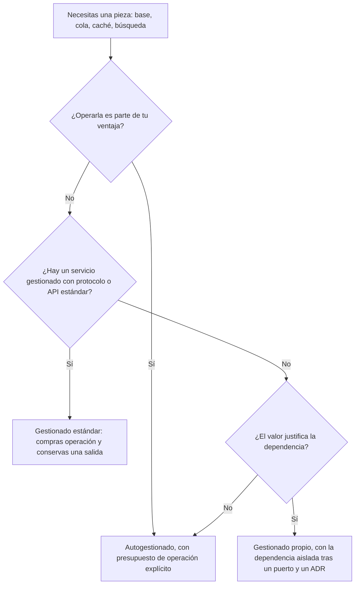
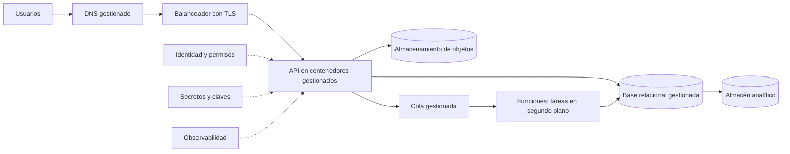

# Servicios en la nube para arquitectos

El equipo terminó la migración a la nube hace seis meses. Las mismas doce máquinas virtuales, el mismo PostgreSQL instalado a mano, el mismo script de copias que corre de madrugada. La factura llega cada mes y las guardias siguen igual: cuando el disco de la base se llena, alguien se despierta a las tres. En otra empresa ocurre lo contrario: adoptaron una base de datos gestionada y, el día que el proveedor aplicó una actualización en su ventana de mantenimiento, descubrieron que nadie sabía qué hacía el servicio durante un cambio de nodo primario. En los dos casos falta lo mismo: entender qué se compró. **Un servicio en la nube es un contrato de responsabilidades: cada modelo de servicio fija qué capas operas tú y cuáles opera el proveedor, y elegir un servicio es decidir dónde trazas esa frontera.**

Esta es la primera lección de la serie de nube. Explica los modelos de servicio con su origen verificable, el reparto de responsabilidades en cada uno, las categorías de servicio que un arquitecto debe reconocer en cualquier proveedor, qué compras y qué pagas con un servicio gestionado, y cómo elegir con criterios que sobreviven a los cambios de catálogo. Los nombres de AWS, Azure y Google Cloud aparecen solo como equivalencias, no como recomendación.

<Callout tone="info" title="Fecha de corte y alcance">
  Fuentes consultadas en octubre de 2026. Los nombres de servicios cambian con frecuencia: las
  equivalencias salen de la tabla comparativa que publica Google Cloud y deben comprobarse en la
  documentación de cada proveedor antes de decidir. Este artículo no da precios, cuotas ni SLA.
</Callout>

## El problema: comprar infraestructura sin saber qué operas

Casi todas las sorpresas en la nube tienen la misma forma: alguien asumió que una responsabilidad era del proveedor y era suya, o al revés.

| Síntoma                                                               | Responsabilidad que nadie asignó                                           |
| --------------------------------------------------------------------- | -------------------------------------------------------------------------- |
| Un bucket de almacenamiento queda expuesto a internet                 | La configuración de acceso del servicio, que en todos los modelos es tuya  |
| Las máquinas virtuales llevan meses sin parches del sistema operativo | El sistema operativo invitado, que en IaaS opera el cliente                |
| La base gestionada se reinicia en horario laboral                     | La ventana de mantenimiento, que el proveedor ejecuta y tú configuras      |
| Se borran datos por error y no hay forma de recuperarlos              | La retención y la prueba de restauración, que el servicio no decide por ti |
| La aplicación no escala aunque el servicio «es elástico»              | El diseño de la aplicación, que el proveedor no puede cambiar              |

## Los modelos de servicio: qué dice la definición

### NIST SP 800-145: tres modelos y cinco características

La referencia más citada es la publicación especial 800-145 del NIST, _The NIST Definition of Cloud Computing_, de Peter Mell y Timothy Grance, publicada en septiembre de 2011. Define la nube con cinco características esenciales (autoservicio bajo demanda, acceso amplio por red, agrupación de recursos, elasticidad rápida y servicio medido), tres modelos de servicio y cuatro modelos de despliegue. Los modelos de despliegue son tema de la [siguiente lección](/docs/modelos-de-despliegue-nube).

Lo valioso de la definición del NIST es que cada modelo se describe por lo que el consumidor **no gestiona ni controla**:

- **IaaS.** El consumidor aprovisiona procesamiento, almacenamiento y red, y puede ejecutar software arbitrario, incluido el sistema operativo. No gestiona la infraestructura subyacente, pero controla el sistema operativo, el almacenamiento y las aplicaciones desplegadas, y quizá algunos componentes de red, como el cortafuegos del host.
- **PaaS.** El consumidor despliega aplicaciones propias o adquiridas, hechas con lenguajes, bibliotecas y herramientas que el proveedor soporta. No controla red, servidores, sistema operativo ni almacenamiento; controla la aplicación y quizá la configuración del entorno que la aloja.
- **SaaS.** El consumidor usa aplicaciones del proveedor. No controla ni siquiera las capacidades de la aplicación, salvo, quizá, una configuración limitada por usuario.

### CaaS y FaaS: términos de la industria

CaaS y FaaS no están entre los tres modelos del NIST. Son nombres de uso común para dos puntos intermedios que hoy tienen servicios propios en todos los grandes proveedores:

- **CaaS (contenedores como servicio).** Entregas una imagen de contenedor; el proveedor opera el orquestador o, en las variantes sin servidor, también los nodos. La imagen, con su sistema base y sus dependencias, es tuya.
- **FaaS (funciones como servicio).** El libro blanco de serverless de la CNCF (v1.0, 2018) lo describe como la funcionalidad central de una plataforma que ejecuta bajo demanda funciones que aporta el usuario. Entregas una función; el proveedor decide cuándo y dónde se ejecuta y cuántas copias corre.

<Callout tone="warning" title="CaaS no significa lo mismo en todas partes">
  ISO/IEC 17788:2014 (texto idéntico a ITU-T Y.3500) definía CaaS como _communications as a
  service_, la categoría cuya capacidad es la interacción y la colaboración en tiempo real, y
  CompaaS como _compute as a service_, la provisión de recursos de proceso para desplegar y ejecutar
  software. Esa norma quedó sustituida por dos documentos que se reparten su contenido: ISO/IEC
  22123-1:2023 (vocabulario) e ISO/IEC 22123-2:2023 (conceptos). El índice público de 22123-2
  conserva CaaS (comunicaciones) y CompaaS; su texto completo no se ha revisado aquí. Si escribes
  CaaS en un contrato o en un documento de arquitectura, define el término la primera vez que
  aparezca.
</Callout>

## Quién opera qué: la pila de responsabilidades

Los tres grandes proveedores publican su versión del **modelo de responsabilidad compartida**. AWS lo formula como seguridad _de_ la nube (el proveedor: hardware, red física, instalaciones y la capa de virtualización) frente a seguridad _en_ la nube (el cliente: lo que construye encima). Añade que la parte del cliente depende del servicio que elija: con una instancia EC2 gestionas el sistema operativo invitado, el software instalado y el cortafuegos del grupo de seguridad; con servicios más abstractos como S3 o DynamoDB, AWS opera la capa de infraestructura y tú te ocupas de los datos, el cifrado y los permisos.

Microsoft lo resume en una matriz en la que tres filas son del cliente en todos los modelos, incluido SaaS: los datos, la configuración y las identidades. Google Cloud lo dice de forma parecida: el cliente sigue siendo responsable de sus políticas de acceso y de sus datos sea cual sea el modelo. La tabla siguiente es una síntesis de esas tres fuentes, con dos columnas añadidas para CaaS y FaaS; trátala como una guía y comprueba el reparto exacto de cada servicio en su documentación.

| Capa                                     | IaaS      | CaaS                     | PaaS      | FaaS                                 | SaaS      |
| ---------------------------------------- | --------- | ------------------------ | --------- | ------------------------------------ | --------- |
| Datos, identidades y permisos            | Tú        | Tú                       | Tú        | Tú                                   | Tú        |
| Configuración del servicio               | Tú        | Tú                       | Tú        | Tú                                   | Tú        |
| Código de la aplicación                  | Tú        | Tú                       | Tú        | Tú                                   | Proveedor |
| Runtime y dependencias                   | Tú        | Tú (dentro de la imagen) | Proveedor | Proveedor (con versiones que eliges) | Proveedor |
| Sistema operativo invitado y parches     | Tú        | Depende de la variante   | Proveedor | Proveedor                            | Proveedor |
| Virtualización, hardware e instalaciones | Proveedor | Proveedor                | Proveedor | Proveedor                            | Proveedor |

La figura del artículo dibuja esa pila con cinco filas cortas: IAM (datos, identidades, permisos y configuración), APP (código), RUNTIME, VM (sistema operativo invitado) y HW (todo lo físico). Cada columna es un modelo de servicio; la **línea brasa** es la frontera de responsabilidad. Sobre ella operas tú; debajo, el proveedor. En IaaS la línea pasa justo encima del hardware; en SaaS solo te deja la capa de datos y accesos. PaaS y FaaS comparten frontera en esta pila: la diferencia entre ellos no está en las capas, sino en la unidad que despliegas (una aplicación o una función) y en quién decide cuántas instancias corren. La cota inferior resume el intercambio: hacia la izquierda conservas control; hacia la derecha dependes más del SLA del proveedor.

Dos matices que la tabla no muestra bien:

- **«Proveedor» no significa «sin trabajo para ti».** AWS clasifica los parches y la gestión de configuración como controles compartidos: el proveedor parchea su infraestructura y tú parcheas lo tuyo. En PaaS sigues eligiendo versiones de runtime y ventanas de mantenimiento.
- **La frontera se mueve dentro de un mismo modelo.** Un Kubernetes gestionado con nodos que administras tú está más cerca de IaaS que un servicio de contenedores sin servidor. Por eso la tabla dice «depende» y la figura dibuja punteada la celda VM de CaaS: la línea pasa por encima solo en la variante en la que el proveedor opera los nodos.

## Las categorías de servicio que debes reconocer

Los catálogos tienen cientos de productos, pero un arquitecto trabaja con un conjunto pequeño de categorías que se repite en todos los proveedores. Para cada una importa más la pregunta de diseño que el producto.

### Cómputo

Tres formas de ejecutar código, de más control a menos: **máquinas virtuales** (eliges sistema operativo y tamaño, operas todo lo que instalas), **contenedores gestionados** (entregas imágenes; el proveedor opera el orquestador y a veces los nodos) y **funciones** (entregas código que responde a eventos). La pregunta clave es quién decide cuántas copias corren y qué pasa cuando no hay tráfico. Las funciones y el cómputo sin servidor tienen su propia lección: [serverless y computación gestionada](/docs/serverless-y-computacion-gestionada).

### Almacenamiento de objetos y de bloques

El **almacenamiento de objetos** guarda archivos completos detrás de una API HTTP, con metadatos y políticas de acceso por contenedor u objeto; se lee y escribe entero, no por bytes sueltos. El **almacenamiento de bloques** es un disco virtual que se monta en una máquina y que el sistema operativo formatea. La pregunta de diseño es quién accede al dato: si lo comparten muchos procesos o se sirve a internet, objetos; si lo usa un solo proceso que necesita un sistema de archivos, bloques.

### Bases de datos gestionadas

El proveedor opera el motor: instalación, parches, copias, réplicas y conmutación por error, con las opciones que tú configuras. Hay relacionales que hablan un protocolo estándar (PostgreSQL, MySQL, SQL Server) y bases propias del proveedor, documentales o de clave-valor, con API específica. La pregunta de diseño es doble: qué garantías de consistencia necesitas (lo trata [ACID y niveles de aislamiento](/docs/datos-acid-y-aislamiento)) y qué te cuesta salir si un día cambias de proveedor.

### Mensajería y streaming

Colas, pub/sub y logs de eventos gestionados. El proveedor opera los brokers y su escalado; tú decides el modelo de entrega, el orden, la retención y qué hace el consumidor ante un duplicado. Las diferencias entre cola, pub/sub y log están en [caché, colas y streaming](/docs/caching-colas-streaming).

### Identidad, red, balanceo y DNS

La **identidad** (usuarios, roles, cuentas de servicio y políticas) es la frontera de seguridad más importante en la nube, porque casi todo se controla por API. La **red virtual** define qué se habla con qué; el **balanceador** reparte tráfico y suele terminar TLS; el **DNS** gestionado resuelve nombres y puede enrutar por salud o por región. Su diseño en detalle es tema de [redes, identidad y seguridad en la nube](/docs/redes-identidad-seguridad-nube).

### Observabilidad, secretos y claves

La **observabilidad** gestionada recoge métricas, logs y trazas de tus servicios y de los del proveedor. La **gestión de secretos** guarda credenciales con rotación y auditoría; la **gestión de claves** custodia las claves con las que se cifran tus datos. Sacar los secretos del código es un principio de [seguridad por diseño](/docs/seguridad-por-diseno); el servicio gestionado solo lo hace más fácil.

### Datos e IA gestionados

Almacenes analíticos, procesamiento de datos y plataformas de aprendizaje automático o de modelos generativos operados por el proveedor. Son los servicios con más valor diferencial y, a la vez, con APIs más propias: el modelo de datos, las consultas y los flujos tienden a quedar escritos contra ese producto.

### Equivalencias entre proveedores

| Categoría                 | AWS                              | Azure                                             | Google Cloud                    |
| ------------------------- | -------------------------------- | ------------------------------------------------- | ------------------------------- |
| Máquinas virtuales        | EC2                              | Azure Virtual Machines                            | Compute Engine                  |
| Kubernetes gestionado     | EKS                              | AKS                                               | GKE                             |
| Contenedores sin servidor | Fargate, ECS Express Mode        | Azure Container Apps                              | Cloud Run                       |
| Funciones                 | Lambda                           | Azure Functions                                   | Cloud Run functions             |
| Objetos                   | S3                               | Azure Blob Storage                                | Cloud Storage                   |
| Bloques                   | EBS                              | Azure Disk Storage                                | Hyperdisk                       |
| Relacional gestionada     | RDS, Aurora                      | Azure SQL Database, Azure Database for PostgreSQL | Cloud SQL                       |
| Documental o clave-valor  | DynamoDB, DocumentDB             | Azure Cosmos DB                                   | Firestore, Bigtable             |
| Colas y pub/sub           | SQS, SNS                         | Azure Queue Storage, Service Bus                  | Cloud Tasks, Pub/Sub            |
| Streaming                 | Kinesis Data Streams             | Azure Event Hubs                                  | Pub/Sub, Dataflow               |
| DNS y balanceo            | Route 53, Elastic Load Balancing | Azure DNS, Azure Load Balancer                    | Cloud DNS, Cloud Load Balancing |
| Secretos y claves         | Secrets Manager, KMS             | Azure Key Vault                                   | Secret Manager, Cloud KMS       |
| Observabilidad            | CloudWatch                       | Azure Monitor                                     | Cloud Monitoring, Cloud Logging |
| Almacén analítico         | Redshift                         | Azure Synapse Analytics                           | BigQuery                        |
| Plataforma de IA          | SageMaker                        | Plataforma de IA de Azure                         | Vertex AI                       |

La tabla sigue la comparativa de Google Cloud consultada en octubre de 2026, con un cambio en la fila de contenedores sin servidor: a fecha de consulta (octubre de 2026), AWS App Runner ya no admite clientes nuevos y AWS recomienda ECS Express Mode, que despliega la imagen como un servicio de ECS sobre Fargate ([aviso de AWS](https://docs.aws.amazon.com/apprunner/latest/dg/apprunner-availability-change.html)). Que dos servicios ocupen la misma fila no los hace intercambiables: cambian los límites, el modelo de consistencia, la facturación y las APIs.

## Gestionado frente a autogestionado

Para casi cualquier pieza puedes elegir entre operarla tú sobre máquinas o contenedores, o comprar el servicio gestionado. Es un [trade-off](/docs/trade-offs-y-decisiones) con dos columnas claras:

| Lo que compras con un servicio gestionado                               | Lo que pagas por él                                                                               |
| ----------------------------------------------------------------------- | ------------------------------------------------------------------------------------------------- |
| Operación rutinaria: instalación, parches, copias, sustitución de nodos | Control: versiones, extensiones, parámetros y ventanas que el proveedor acota                     |
| Escalado o, al menos, la mecánica del escalado                          | Portabilidad: APIs, formatos y semánticas propias que el código acaba asumiendo                   |
| Alta disponibilidad configurada en lugar de construida                  | Costo: el recurso gestionado suele costar más por unidad que el recurso equivalente sin gestionar |
| Integración con identidad, red y observabilidad del proveedor           | Visibilidad: no ves ni tocas lo que pasa por debajo, solo sus métricas y su documentación         |
| Tiempo del equipo para trabajar en el producto                          | Dependencia de la hoja de ruta: retiradas de versiones y cambios que no decides                   |

El costo merece una precisión: comparar solo el precio unitario engaña, porque el autogestionado tiene un costo de personas (guardias, parches, pruebas de restauración) que no aparece en la factura del proveedor. Cómo tratar el costo como un atributo de diseño es la lección de [FinOps](/docs/finops-costo-como-atributo).



Aislar la dependencia tras una interfaz propia es la idea de [puertos y adaptadores](/docs/arquitectura-hexagonal): tu dominio habla con «una cola», no con un producto concreto. Hasta dónde conviene llegar con esa portabilidad es tema de la lección sobre [dependencia de un proveedor](/docs/casado-a-un-proveedor).

## Cómo elegir un servicio

Los criterios que siguen sirven para cualquier categoría y cualquier proveedor. Ninguno decide solo; juntos evitan elegir por la ficha comercial.

| Criterio        | Pregunta que debes responder                                                         | Señal de alerta                                                    |
| --------------- | ------------------------------------------------------------------------------------ | ------------------------------------------------------------------ |
| Madurez         | ¿Está en disponibilidad general, con SLA publicado y casos de uso parecidos al tuyo? | Solo existe en vista previa o en una región                        |
| Costo de operar | ¿Cuántas horas al mes de tu equipo exige, además de la factura?                      | Nadie sabe quién atiende sus alertas                               |
| Dependencia     | ¿Qué parte de tu código y de tus datos quedaría escrita contra su API?               | El modelo de datos solo tiene sentido dentro de ese producto       |
| Latencia        | ¿Dónde corre respecto a tus usuarios y a los servicios con los que habla?            | Cada petición cruza regiones o redes para llegar a él              |
| Cumplimiento    | ¿Dónde quedan los datos, quién puede acceder y qué certificaciones cubre?            | El servicio no está disponible en la región que exige la normativa |
| Equipo          | ¿Alguien del equipo sabe operarlo, depurarlo y explicar cómo falla?                  | La única referencia es un tutorial                                 |

Dos hábitos ayudan a que la elección no se pierda. El primero: **lee los límites y cuotas documentados** del servicio antes de diseñar, porque determinan tamaños de mensaje, conexiones o tasas de petición que tu arquitectura debe respetar. El segundo: deja escrita cada adopción en una ficha corta, al estilo de un [ADR](/docs/adr):

```yaml
# docs/servicios/base-relacional.yaml: una ficha por servicio adoptado
servicio: base-relacional-gestionada
modelo: PaaS
operamos: [esquema, consultas, permisos, retención, prueba de restauración]
opera-el-proveedor: [sistema operativo, parches del motor, hardware, failover]
dependencia: protocolo estándar; extensiones propias: ninguna
salida: volcado lógico o replicación hacia otro destino
responsable: equipo-pagos
revisión: # …
```

## Un mapa de referencia

Una aplicación web típica usa servicios de casi todas las categorías. El diagrama es un ejemplo, no una plantilla: cada caja es una decisión de las que trata este artículo.



| Pieza del mapa                      | Categoría                | Lo que sigues operando tú                               |
| ----------------------------------- | ------------------------ | ------------------------------------------------------- |
| DNS y balanceador                   | Red y borde              | Registros, certificados, reglas de enrutamiento         |
| API                                 | Contenedores gestionados | Imagen, dependencias, réplicas mínimas, sondas de salud |
| Base relacional                     | Base de datos gestionada | Esquema, índices, retención, prueba de restauración     |
| Objetos                             | Almacenamiento           | Políticas de acceso, ciclo de vida, cifrado elegido     |
| Cola y funciones                    | Mensajería y funciones   | Idempotencia, reintentos, cola de mensajes fallidos     |
| Identidad, secretos, observabilidad | Plataforma               | Roles, rotación, alertas y paneles                      |
| Almacén analítico                   | Datos gestionados        | Modelo de datos, permisos, costo de las consultas       |

La columna de la derecha es la que importa: en ninguna fila queda vacía. Un mapa sin esa columna es un catálogo, no una arquitectura.

## Cuándo sí y cuándo no

| Situación                                                                  | Decisión razonable                                                                       |
| -------------------------------------------------------------------------- | ---------------------------------------------------------------------------------------- |
| Equipo pequeño, sin especialistas en operación de bases o brokers          | Gestionados con protocolo estándar para todo lo que no sea el producto                   |
| La pieza es tu ventaja competitiva o necesitas un control que nadie ofrece | Autogestionado sobre IaaS o CaaS, con presupuesto de operación y guardias explícitos     |
| Requisitos de residencia o certificación estrictos                         | Filtra primero por región y cumplimiento; después compara funciones                      |
| Carga muy irregular o con largos periodos sin tráfico                      | Modelos que escalan a cero, si la latencia del arranque es aceptable                     |
| Carga estable y grande, con equipo que ya opera la pieza                   | Compara el costo total, personas incluidas, antes de asumir que gestionado es más barato |

## Errores frecuentes

- **Copiar la arquitectura on-premise a la nube y esperar otro resultado.** AWS llama a esta estrategia _rehost_, también conocida como _lift and shift_: mover las aplicaciones sin cambiarlas. Es legítima como primer paso, y la propia guía de AWS para migraciones grandes recomienda rehospedar o replataformar primero y modernizar después. El error es quedarse ahí y esperar elasticidad o menos guardias: con las mismas máquinas sigues operando las mismas capas.
- **Tratar cada servicio gestionado como una caja negra.** Que el proveedor opere el failover no te exime de saber qué pasa durante él: cuánto dura la interrupción, qué conexiones se cortan y cómo se reconecta tu aplicación. Lee cómo falla el servicio y pruébalo, como cualquier otra dependencia ([resiliencia en sistemas distribuidos](/docs/resiliencia-sistemas-distribuidos)).
- **Elegir por catálogo.** Adoptar un servicio porque existe, porque es nuevo o porque aparece en un diagrama de referencia, sin pasar por los criterios de la tabla anterior. Acaba en una arquitectura con más productos que problemas.
- **Suponer que el proveedor protege tus datos.** Datos, configuración y permisos son tuyos en todos los modelos. Un servicio con copias automáticas no sabe qué retención necesitas ni prueba tu restauración.
- **Usar «CaaS» o «serverless» sin definirlos.** Cada equipo y cada norma entiende algo distinto; escribe qué capas operas en lugar del acrónimo.
- **Ignorar límites y cuotas hasta producción.** Un límite de tamaño de mensaje o de conexiones descubierto tarde obliga a rediseñar lo que una lectura previa habría evitado.

## Ejemplo trabajado: un SaaS B2B con cuatro desarrolladores

Supuesto: un producto de facturación B2B con cuatro desarrolladores, sin nadie dedicado a operación, clientes en un solo país con requisito de residencia de datos y un pico de carga a fin de mes. El equipo decide pieza por pieza con la tabla de criterios.

| Pieza                | Opciones consideradas                                                | Decisión y motivo                                                                              |
| -------------------- | -------------------------------------------------------------------- | ---------------------------------------------------------------------------------------------- |
| Región               | Cualquiera frente a la del país                                      | La del país: el cumplimiento filtra antes que cualquier otro criterio                          |
| API                  | Máquinas virtuales, Kubernetes gestionado, contenedores sin servidor | Contenedores sin servidor: nadie opera nodos y el pico de fin de mes escala solo               |
| Base de datos        | PostgreSQL en una VM, PostgreSQL gestionado, base documental propia  | PostgreSQL gestionado: protocolo estándar, salida con un volcado lógico y sin DBA en el equipo |
| Generación de PDF    | Dentro de la API, funciones disparadas por una cola                  | Funciones con cola: trabajo irregular que no debe frenar la API; los trabajos son idempotentes |
| Archivos             | Disco de bloques, almacenamiento de objetos                          | Objetos: varios procesos los leen y se sirven con enlaces firmados                             |
| Búsqueda de facturas | Motor de búsqueda autogestionado, índices de PostgreSQL              | Índices de PostgreSQL: el volumen no justifica otra pieza; se revisa en un año                 |

El resultado tiene cinco servicios gestionados y ninguna máquina que parchear. Lo que el equipo sigue operando queda escrito en cada ficha: esquema y restauración de la base, imagen de la API, idempotencia de los trabajos, permisos y alertas. La decisión de no añadir un motor de búsqueda vale tanto como las demás, y queda registrada con fecha de revisión.

## Checklist

- [ ] Cada servicio adoptado tiene escrito su modelo (IaaS, CaaS, PaaS, FaaS o SaaS) y qué capas sigue operando el equipo.
- [ ] Datos, configuración y permisos tienen responsable en el equipo, también en los servicios SaaS.
- [ ] Los servicios gestionados críticos tienen documentado y probado su comportamiento durante mantenimiento y failover.
- [ ] La retención de copias y la prueba de restauración están definidas por el equipo, no heredadas por defecto.
- [ ] Cada dependencia de una API propia del proveedor está aislada tras una interfaz y justificada en un ADR.
- [ ] Los límites y cuotas documentados de cada servicio se revisaron antes del diseño.
- [ ] La comparación entre gestionado y autogestionado incluye el costo de las personas, no solo la factura.
- [ ] Ningún servicio se adoptó sin pasar por los criterios de madurez, dependencia, latencia, cumplimiento y equipo.

## Siguiente lección

Con el reparto de responsabilidades claro, la siguiente pregunta es dónde vive esa infraestructura: pública, privada, comunitaria o híbrida, en [modelos de despliegue en la nube](/docs/modelos-de-despliegue-nube).

## Fuentes

Consultadas en octubre de 2026.

- [The NIST Definition of Cloud Computing, SP 800-145 (Peter Mell y Timothy Grance, NIST, septiembre de 2011)](https://csrc.nist.gov/pubs/sp/800/145/final), [DOI 10.6028/NIST.SP.800-145](https://doi.org/10.6028/NIST.SP.800-145)
- [ISO/IEC 17788:2014, Cloud computing, Overview and vocabulary](https://webstore.iec.ch/publication/10567): ficha de la tienda de IEC, que la da por sustituida por ISO/IEC 22123-1:2023 e ISO/IEC 22123-2:2023; las definiciones de CaaS (3.2.18) y CompaaS (3.2.20) se tomaron de la [recopilación de términos de la UIT](https://itu.int/en/publications/Documents/tsb/2020-Cloud-computing-From-paradigm-to-operation/files/basic-html/page16.html)
- [ISO/IEC 22123-2:2023, Cloud computing, Part 2: Concepts](https://webstore.iec.ch/publication/88947): índice y prólogo de la vista previa pública, con las categorías NaaS, CaaS (comunicaciones), CompaaS y DSaaS, y la sustitución de ISO/IEC 17788:2014 junto con ISO/IEC 22123-1:2023
- [AWS App Runner availability change (AWS)](https://docs.aws.amazon.com/apprunner/latest/dg/apprunner-availability-change.html)
- [CNCF Serverless Whitepaper v1.0 (CNCF Serverless Working Group, 2018)](https://github.com/cncf/wg-serverless/tree/master/whitepapers/serverless-overview)
- [Shared Responsibility Model (AWS)](https://aws.amazon.com/compliance/shared-responsibility-model/)
- [Shared responsibility in the cloud (Microsoft Learn)](https://learn.microsoft.com/en-us/azure/security/fundamentals/shared-responsibility)
- [Shared responsibilities and shared fate on Google Cloud (Google Cloud Architecture Framework)](https://docs.cloud.google.com/architecture/framework/security/shared-responsibility-shared-fate)
- [Compare AWS and Azure services to Google Cloud (Google Cloud)](https://docs.cloud.google.com/docs/get-started/aws-azure-gcp-service-comparison)
- [About the migration strategies, the 7 Rs (AWS Prescriptive Guidance)](https://docs.aws.amazon.com/prescriptive-guidance/latest/large-migration-guide/migration-strategies.html)
