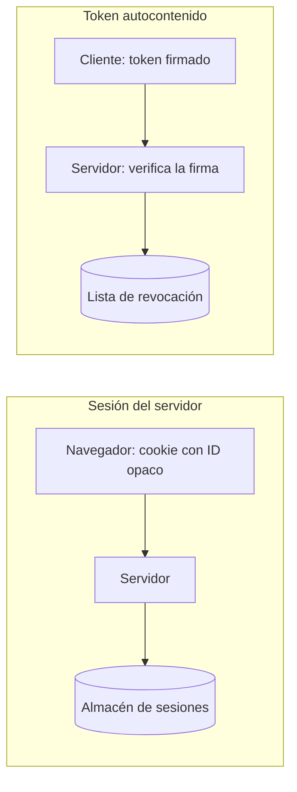
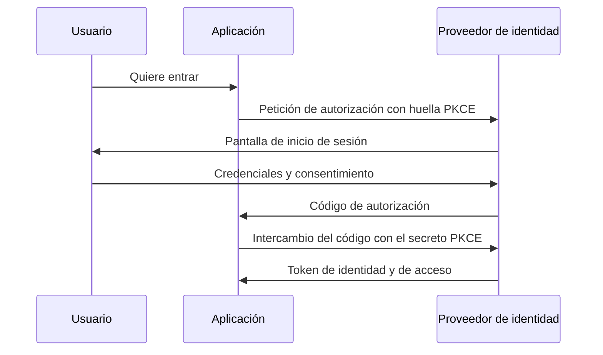

Cuando un usuario inicia sesión, el sistema tiene que recordar quién es en la siguiente petición. Esa memoria puede vivir en el servidor, en el propio cliente o en un proveedor de identidad, y cada lugar cambia cómo se expira, cómo se revoca y cuánto cuesta escalar. Muchas discusiones sobre autenticación se atascan porque mezclan tres cosas distintas: la **sesión** (el estado de que alguien ha entrado), el **token** (el papel que demuestra ese estado) y el **SSO** (la forma de compartir ese estado entre aplicaciones).

La tesis de este artículo es que **la elección no es entre tokens y sesiones como modas, sino entre dónde vive el estado y qué necesitas poder hacer con él**: cerrarlo de inmediato, escalarlo sin una tienda central o delegarlo en un proveedor. A partir de esa pregunta, el resto de decisiones (expiración, almacenamiento, flujos) se deducen con bastante claridad.

## Sesión del servidor: el estado se queda en casa

En una sesión del servidor, el navegador recibe un identificador opaco, normalmente en una cookie, y el servidor guarda los datos asociados (usuario, roles, fecha de inicio, último acceso) en un almacén propio: memoria, una base de datos o una caché distribuida. Cada petición busca ese identificador y obtiene el estado.

La ventaja principal es la **revocación inmediata**. Si un administrador cierra la sesión de un usuario, basta con borrar la entrada del almacén, y la siguiente petición falla. Si la cuenta se compromete, se pueden cerrar todas las sesiones de esa persona en una operación. Ningún dato sensible viaja fuera del servidor, y el cliente no puede falsificar su identidad porque no contiene nada que falsificar.

El coste es el **estado compartido**. Con varias instancias del servicio, todas deben consultar el mismo almacén de sesiones, lo que añade una dependencia, latencia y un punto de fallo. Eso se resuelve con una caché distribuida o con afinidad de sesión, pero ambas soluciones tienen compromisos: la afinidad complica el balanceo y la caché añade un componente que operar.

La duración de la sesión es también una decisión de producto con consecuencias de seguridad. Una sesión que no caduca nunca es cómoda, pero deja un acceso abierto en cualquier dispositivo donde alguien haya entrado alguna vez. Lo habitual es combinar dos plazos: uno absoluto, que obliga a volver a autenticarse tras un número de días fijo, y otro de inactividad, que la cierra si no hay actividad durante un rato. La opción «recordarme» debería alargar solo el plazo absoluto y nunca saltarse la re-autenticación para operaciones sensibles, como cambiar la contraseña o el correo de recuperación.

Hay también un matiz sobre el tamaño del estado. Una sesión del servidor puede guardar mucho más que un token, pero conviene que guarde solo lo que el servidor necesita para decidir: identificador de usuario, versión de sesión, fechas y, si aplica, el nivel de autenticación alcanzado (contraseña sola, o contraseña y segundo factor). Guardar el perfil completo duplica datos y obliga a invalidar la sesión cada vez que el perfil cambia.

## Token autocontenido: el estado viaja con el cliente

Un token autocontenido, como un JWT, contiene las afirmaciones sobre el usuario (su identificador, sus roles, la fecha de expiración) y una firma que permite comprobar que no fue alterado. El servidor no necesita consultar nada para validarlo: basta con verificar la firma con la clave pública o compartida. Eso elimina el estado compartido y facilita escalar, porque cualquier instancia puede validar cualquier token.

La contrapartida es la **revocación**. Un token válido sigue siendo válido hasta que expira, porque el servidor no sabe que existe fuera de la firma. Si un token se filtra, la única defensa inmediata es esperar a su caducidad o mantener una lista de revocación, lo que reintroduce el estado que el token pretendía evitar. Este es el compromiso central: **el token ahorra consultas a costa de no poder retirarse fácilmente**.

Otra limitación frecuente: los tokens tienden a crecer. Si se meten permisos detallados, pertenencias a grupos y preferencias en el token, su tamaño aumenta con cada petición y se acerca a los límites de las cabeceras HTTP. Un token debe llevar lo necesario para autorizar, no todo el perfil del usuario.

El diagrama resume la diferencia. La sesión consulta un almacén en cada petición, y eso permite cerrarla al instante. El token se verifica sin consultar nada, y solo consulta una lista cuando hace falta revocarlo, lo que devuelve algo de estado al sistema.

<Callout tone="info" title="Ninguna opción es gratis">
  Una sesión del servidor cuesta una consulta por petición y da revocación inmediata. Un token
  autocontenido no cuesta consultas y da revocación diferida. Elige según lo que te pese más:
  escalado o control.
</Callout>

## Expiración, rotación y revocación

La práctica moderna separa dos tiempos. El **token de acceso** dura poco, a menudo minutos, y es el que viaja en cada petición. El **token de refresco** dura más y sirve solo para pedir nuevos tokens de acceso. Si el token de acceso se filtra, la ventana de abuso es corta. Si el de refresco se filtra, la ventana es más larga, y por eso se protege con más cuidado.

La **rotación** de tokens de refresco añade una defensa importante: cada vez que se usa un token de refresco se emite uno nuevo y el anterior queda invalidado. Si alguien reutiliza un token ya rotado, eso indica que hay una copia robada en circulación, y el servidor debe revocar toda la familia de tokens de esa sesión. Esta práctica aparece recomendada en el documento de buenas prácticas de seguridad de OAuth 2.0 (RFC 9700).

La revocación combina estas piezas. Para una sesión del servidor basta con borrarla. Para tokens de acceso, se mantiene una lista de revocación indexada por el identificador del token, consultada solo en operaciones sensibles o en un intervalo corto. Para el token de refresco, se revoca la familia completa. Un patrón útil es una **versión de sesión** en la cuenta del usuario: cada token incluye la versión con la que se emitió, y cambiar la versión (por cambio de contraseña, por ejemplo) invalida todos los anteriores sin mantener una lista larga.

<Callout tone="warning" title="Expiración corta no sustituye a la revocación">
  Un token de acceso de cinco minutos sigue siendo válido cinco minutos después de un cierre de
  sesión. Si la operación es sensible (cambiar un pago, borrar datos), comprueba el estado actual,
  no solo la firma.
</Callout>

### Un caso: un token de refresco robado

Imaginemos que un atacante obtiene el token de refresco de un usuario desde un equipo compartido. Si el sistema no rota los tokens, puede usarlo durante semanas, renovando su acceso sin que nadie lo note. Con rotación, el atacante consigue un token nuevo la primera vez; pero cuando el usuario legítimo renueve su sesión con el token que ya tenía, el servidor detecta que un token rotado se ha presentado de nuevo. Esa reutilización es la señal de que hay dos copias en circulación, y el servidor revoca toda la familia: ambas copias dejan de servir y el usuario debe volver a autenticarse.

El coste es real: el usuario legítimo también pierde la sesión y tiene que entrar otra vez. Pero la alternativa es aceptar que el atacante conserve acceso indefinido. Para una aplicación bancaria, el compromiso es obvio; para una aplicación de lectura, quizá no lo sea. La decisión debe tomarse de forma explícita, con el modelo de amenazas delante.

Otro punto práctico: el servidor debe registrar cada uso de un token de refresco con su origen (dirección, agente de usuario, momento). Ese registro no sirve para bloquear automáticamente sin más, porque las direcciones cambian, pero sí para investigar un incidente y para detectar patrones anómalos, como refrescos simultáneos desde países distintos.

## SSO sobre OAuth 2.0 y OpenID Connect

El inicio de sesión único permite que el usuario se autentique una vez en un proveedor de identidad y acceda a varias aplicaciones sin volver a escribir su contraseña. Hoy el estándar práctico sobre el que se construye es OAuth 2.0 para la autorización y OpenID Connect para la identidad. OAuth 2.0 se define en el RFC 6749; OpenID Connect Core 1.0 añade una capa de identidad con un token de identificación firmado y estándar, y se publicó en 2014.

El flujo recomendado para aplicaciones web y móviles es el de código de autorización con PKCE. La aplicación genera un secreto aleatorio para cada inicio de sesión, envía su huella al proveedor y, cuando recibe el código de vuelta, lo intercambia demostrando que conoce el secreto original. PKCE se definió en el RFC 7636, en septiembre de 2015, para proteger a los clientes públicos frente a la interceptación del código.

Un detalle que se pasa por alto: el token de identidad no es lo mismo que el de acceso. El primero dice quién es el usuario y se consume dentro de la aplicación; el segundo permite llamar a otras APIs. Mezclarlos es un error frecuente que hace que una API acepte un token que nunca debió aceptar, en lugar de validar a qué audiencia está destinado.

El SSO exige también decidir qué aplicaciones confían en qué proveedor y cómo se gestiona la salida. Un cierre de sesión único, con propagación a las aplicaciones, es distinto de cerrar solo la aplicación actual, y la diferencia debe estar clara en el diseño.

### Sesiones en aplicaciones móviles

En una aplicación móvil no hay cookies de navegador en el sentido habitual, y el almacenamiento seguro lo ofrece el sistema operativo: el llavero en iOS y el almacén de claves en Android. La regla general es la misma que en la web, con un matiz: el token de refresco debe vivir en el almacenamiento seguro del sistema, nunca en un archivo de preferencias ni en texto plano, y el token de acceso puede mantenerse en memoria mientras la aplicación está activa.

Las aplicaciones móviles tienen además un problema de identidad del cliente. Una aplicación instalada en un dispositivo no puede guardar un secreto de forma fiable, porque cualquiera con el dispositivo puede extraerlo. Por eso se usan clientes públicos con PKCE en lugar de secretos de cliente. Y cuando el usuario cierra sesión en el dispositivo, la aplicación debe revocar el token de refresco en el servidor, no solo borrarlo localmente; si no, el token sigue siendo válido aunque no esté en el teléfono.

## Dónde guardar los tokens en el navegador

El lugar donde el navegador guarda la sesión o el token determina qué puede leer un script malicioso. Hay tres opciones habituales, y ninguna es perfecta.

Una cookie con los atributos `HttpOnly` y `Secure` no es legible desde JavaScript y solo viaja por HTTPS. Su atributo `SameSite` limita el envío en peticiones de otros sitios, y es la defensa principal frente a la falsificación de peticiones entre sitios. Es la opción por defecto para sesiones de aplicaciones web con un único dominio.

Guardar el token en memoria de la aplicación evita que quede almacenado de forma persistente, pero se pierde al recargar la página, y eso obliga a renovarlo con el token de refresco. Si el refresco va en una cookie protegida, el resultado es razonable.

Guardar el token en `localStorage` o `sessionStorage` es la opción más cómoda y la más expuesta: cualquier script que se ejecute en la página, incluido uno inyectado por una dependencia comprometida, puede leerlo. No es una opción para tokens de larga duración.

Las recomendaciones actuales de seguridad para OAuth 2.0 desaconsejan varios de los patrones inseguros que se extendieron en aplicaciones de una sola página, y el documento RFC 9700 los recoge. Antes de elegir, conviene leerlo junto con el modelo de amenazas de la aplicación.

## Herramientas

La mayoría de equipos no debería implementar su propio servidor de identidad. Un proveedor de identidad gestionado o un servidor de código abierto cumple el estándar, gestiona la rotación de claves y ofrece SSO con las aplicaciones corporativas. La decisión real es qué se delega y qué se controla: qué datos del usuario viajan en el token, quién define los roles y cómo se revoca un acceso cuando alguien deja la empresa.

Para las bibliotecas de cliente, conviene preferir las que implementan los flujos recomendados y validan el emisor, la audiencia y la expiración del token, en lugar de decodificar el token a mano. Decodificar no es validar: la firma y las afirmaciones deben comprobarse siempre.

Los detalles de cómo se decide qué puede hacer cada identidad se tratan en [autorización: RBAC, ABAC y ReBAC](/docs/autorizacion-rbac-abac-rebac), y el modelo de amenazas que deriva de todo esto, en [modelado de amenazas con STRIDE](/docs/modelado-de-amenazas-stride).

<Callout tone="tip" title="Antes de elegir, responde esto">
  ¿Necesitas cerrar sesiones al instante? ¿Cuántas instancias validan tokens? ¿Quién gestiona las
  claves? Con esas tres respuestas, la mayoría de la arquitectura de sesión está decidida.
</Callout>

## Errores frecuentes

Confiar en que un token expira solo y no implementar revocación deja una ventana abierta cada vez que una cuenta se compromete o cambia de permisos.

Meter demasiada información en el token lo hace grande, expone datos en cada petición y acaba creando dependencias que impiden cambiar roles sin emitir tokens nuevos.

Guardar tokens de larga duración en `localStorage` convierte cualquier fallo de script en un robo de sesión.

Usar el token de identidad para llamar a APIs, o aceptar tokens sin comprobar su audiencia, rompe el aislamiento entre servicios.

Implementar el flujo de inicio de sesión sin PKCE en clientes públicos deja el código de autorización expuesto a la interceptación.

## Checklist

- Está decidido si el estado vive en el servidor o en el token, y el motivo está escrito junto con su coste.
- Los tokens de acceso son de corta duración, y los de refresco rotan con detección de reutilización.
- Existe un mecanismo de revocación para sesiones y tokens, y se probó cerrando una sesión activa.
- Las operaciones sensibles comprueban el estado actual además de la firma.
- Se usa el flujo de código con PKCE para clientes públicos y web.
- El token de identidad y el de acceso están separados, y cada API valida la audiencia que le corresponde.
- Las cookies de sesión tienen `HttpOnly`, `Secure` y un valor de `SameSite` explícito.
- Los tokens no se guardan en almacenamiento accesible desde scripts cuando su duración es larga.
- Se documenta qué significa cerrar sesión: en la aplicación, en el proveedor o en todas las aplicaciones del SSO.

## Fuentes

- RFC 6749, [The OAuth 2.0 Authorization Framework](https://www.rfc-editor.org/rfc/rfc6749): el marco de autorización.
- RFC 7636, [Proof Key for Code Exchange by OAuth Public Clients](https://www.rfc-editor.org/rfc/rfc7636), publicado en septiembre de 2015.
- RFC 9700, [Best Current Practice for OAuth 2.0 Security](https://www.rfc-editor.org/rfc/rfc9700), publicado en enero de 2025 como BCP 240.
- OpenID Foundation, [OpenID Connect Core 1.0](https://openid.net/specs/openid-connect-core-1_0-final.html), con fecha de 25 de febrero de 2014.

Consultadas en octubre de 2026. La recomendación sobre el atributo `SameSite` de las cookies se describe como práctica general; su especificación vigente está en borrador y no se cita un número de RFC. Los detalles de una implementación concreta de proveedor de identidad deben comprobarse en su documentación vigente.
