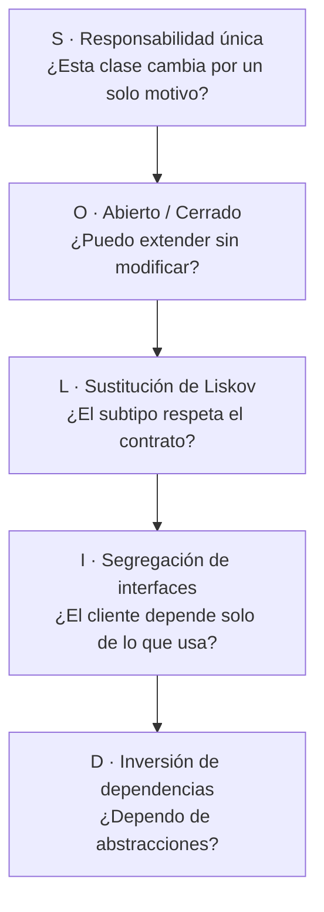
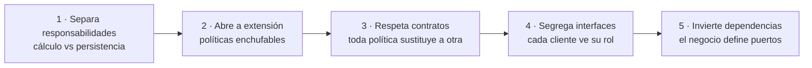

# Principios SOLID

SOLID es el acrónimo de cinco principios de diseño orientado a objetos que reducen el
acoplamiento y aumentan la cohesión. La idea original es de Robert C. Martin y fue
recopilada a principios de los 2000: cada letra nombra un principio independiente, pero los
cinco trabajan juntos como un sistema para que el código sea fácil de leer, fácil de probar
y barato de cambiar.

Piensa en SOLID como gramática del diseño. No te dice qué aplicación construir. Te dice
cómo escribir frases de código que otros puedan entender y modificar sin romper nada.

Si vienes de los [primeros pasos](/docs/getting-started), piensa en SOLID como el
vocabulario que te permite discutir diseño con precisión. Si ya escribes
[clean code](/docs/clean-code), piensa en SOLID como el paso siguiente: ya no se trata solo
de que una función sea legible, sino de cómo las clases y módulos colaboran entre sí a lo
largo de meses y años.

Este artículo explica cada principio con la misma estructura ordenada: qué dice, qué
problema resuelve, cómo se ve cuando lo violas, cómo se ve cuando lo aplicas bien, una
analogía cotidiana, pasos concretos para aplicarlo y errores frecuentes al intentarlo.

La meta no es memorizar definiciones. La meta es que mañana, ante una clase embarrada,
sepas qué pregunta hacerte y qué movimiento pequeño mejora el diseño.

## Cómo leer este artículo

Este artículo es largo a propósito. No lo leas de un tirón si tienes prisa.

Si tienes diez minutos, lee la introducción, el mapa general y el principio que más te
duela hoy. Cada principio funciona por separado.

Si tienes una hora, lee un principio completo con sus ejemplos y haz el ejercicio guiado
que cierra el artículo. Un solo refactoring real enseña más que cinco lecturas.

Si eres líder técnico, usa el checklist de pull request como guion de conversación en
revisiones. SOLID funciona mejor discutido en equipo que impuesto como norma.

Cada sección de principio sigue el mismo esqueleto para que puedas saltar sin perderte:
definición exacta, síntomas de violación, ejemplo de antes y después con código, analogía
cotidiana, pasos de aplicación y error típico. Cuando conozcas el esqueleto, encontrarás
cualquier idea en segundos.

Una nota sobre el lenguaje: todos los ejemplos están en Go. Donde el texto dice «clase»,
lee «tipo o estructura»; donde dice «constructor», lee «campos de la estructura»; donde
dice «herencia», piensa en «incrustación y sustitución de tipos».

## Qué problema resuelve SOLID

Todo sistema suficientemente usado tiende al mismo deterioro. No importa el lenguaje ni el
framework. El uso prolongado, los cambios de requisitos y la presión de entrega empujan el
código hacia el mismo pantano.

SOLID existe para frenar ese deterioro con decisiones pequeñas y repetidas. No promete
perfección. Promete que cambiar el sistema siga siendo barato después del segundo año.

### Las cuatro enfermedades del diseño

Robert C. Martin describió cuatro síntomas de un diseño enfermo. Apréndelos de memoria,
porque son el diagnóstico que justifica cada principio.

- **Rigidez:** un cambio pequeño obliga a tocar muchos archivos. Quieres mover un campo y
  acabas editando doce clases, tres tests y dos scripts.
- **Fragilidad:** un cambio en un módulo rompe otro que parecía no relacionado. Arreglas el
  cálculo del IVA y se cae el envío de correos.
- **Inmovilidad:** no puedes reutilizar una pieza porque viene pegada a otras diez. El
  cálculo de descuentos sería útil en otro servicio, pero arrastra base de datos y HTTP.
- **Viscosidad:** es más fácil hacer el apaño que hacer lo correcto. El diseño bueno exige
  cinco pasos y el atajo exige uno, así que el sistema se degrada cada semana.

Cuando escuches «tocar esto da miedo», casi siempre hay rigidez. Cuando escuches «no sé
por qué se rompió aquello», hay fragilidad. Cuando escuches «mejor lo copio y pego»,
hay inmovilidad. Cuando escuches «ya lo arreglaremos después», hay viscosidad.

### Acoplamiento y cohesión en dos frases

El acoplamiento mide cuánto depende un módulo de otros. La cohesión mide cuánto tienen que
ver entre sí las piezas dentro de un módulo.

Queremos acoplamiento bajo y cohesión alta. Dicho sin jerga: que cada pieza sepa poco de
las demás, y que lo que vive junto tenga un motivo para vivir junto.

Cada principio SOLID es una táctica concreta para mover esas dos agujas. La
responsabilidad única sube la cohesión. La inversión de dependencias baja el acoplamiento.
Los demás hacen las dos cosas desde ángulos distintos.

### Historia del acrónimo en 30 segundos

Los cinco principios nacieron por separado en los años noventa en escritos de Martin,
Barbara Liskov y otros. Michael Feathers acuñó el acrónimo SOLID hacia el año 2000 para
enseñarlos juntos.

El orden de las letras no indica prioridad. La S suele enseñarse primero porque es la más
intuitiva. La D suele enseñarse al final porque presupone entender contratos y
abstracciones.

No necesitas la historia para aplicarlos. Pero ayuda recordar que no son una moda de un
framework: llevan décadas sobreviviendo a lenguajes, porque describen cómo piensa la gente
cuando cambia código ajeno.

<Callout tone="info" title="SOLID no es una receta dogmática">
  No apliques los cinco principios con la misma intensidad en todas partes. En código exploratorio o
  en un prototipo de dos días, la simplicidad gana. En el núcleo de negocio que vivirá años, SOLID
  paga cada semana. La arquitectura es priorizar dónde ser estricto.
</Callout>

## Mapa general de los cinco principios

Cada letra cubre una escala distinta del diseño. Léelas como cinco preguntas que se hacen
en momentos distintos del trabajo diario.



La tabla siguiente resume cada principio en una línea y anticipa su sección completa.

| Letra | Principio                 | Pregunta guía                    | Sección                     |
| ----- | ------------------------- | -------------------------------- | --------------------------- |
| S     | Responsabilidad única     | ¿Cambia por un solo motivo?      | Una razón para cambiar      |
| O     | Abierto y cerrado         | ¿Extiendo sin modificar?         | Nuevas variantes sin riesgo |
| L     | Sustitución               | ¿El subtipo respeta el contrato? | Sustituir sin sorprender    |
| I     | Segregación de interfaces | ¿Dependo solo de lo que uso?     | Contratos pequeños          |
| D     | Inversión de dependencias | ¿Dependo de abstracciones?       | El negocio manda            |

- **S** mira hacia dentro de una clase: una sola razón para cambiar. Es el principio más
  local y el que más aplicas en el día a día.
- **O** mira cómo crece el sistema: nuevas variantes sin reescribir lo estable. Es el
  principio del crecimiento sin miedo.
- **L** mira la sustitución de tipos: que extender no rompa expectativas. Es el
  principio de la confianza en las abstracciones.
- **I** mira los contratos: interfaces pequeñas y cohesivas. Es el principio del respeto
  entre clientes.
- **D** mira la dirección de las dependencias: el negocio manda, los detalles obedecen. Es
  el principio arquitectónico por excelencia.

Si solo puedes quedarte con una frase por principio, quédate con estas: una razón para
cambiar, extender sin modificar, sustituir sin sorprender, interfaces pequeñas, depender de
abstracciones.

Memoriza las cinco preguntas del diagrama. En tu próxima revisión de código, hazlas en voz
alta una por una. Con eso ya aplicas SOLID al ochenta por ciento.

## Principio de responsabilidad única

Cada módulo debe tener una única razón para cambiar. Una clase con dos responsabilidades
tiene dos motivos distintos para ser modificada, dos tipos de tests, dos lectores
distintos y el doble de probabilidad de conflicto en cada pull request.

Este es el principio más rentable. Si solo aplicas uno, aplica este. La mayoría del código
embarrado que verás en tu carrera es, en el fondo, una mezcla de responsabilidades.

La responsabilidad no se mide en número de métodos, sino en ejes de cambio. Pregúntate:
¿quién pide este cambio y por qué? Si la respuesta es a veces negocio y a veces
infraestructura, hay dos responsabilidades mezcladas.

Otra forma de verlo: una responsabilidad es un actor que te puede pedir cambios. El equipo
de facturación, el equipo de infraestructura y el equipo de diseño son actores distintos.
Si una clase sirve a dos actores, tiene dos responsabilidades.

### Qué dice exactamente la responsabilidad única

Definición corta: un módulo debe tener una y solo una razón para cambiar.

Definición operativa: si describes dos cambios futuros verosímiles que vienen de motivos
distintos y ambos tocan la misma clase, esa clase ya viola el principio.

Fíjate en que habla de razones para cambiar, no de acciones que hace. Una clase puede
hacer tres pasos técnicos y aun así tener una responsabilidad, si los tres pasos cambian
siempre juntos por el mismo motivo. Y una clase con un solo método público puede tener dos
responsabilidades si ese método mezcla dos ejes.

### Síntomas de que violas la responsabilidad única

- Un tipo `Servicio` que calcula totales, guarda en base de datos, envía correos y
  genera PDFs. Cuatro actores, cuatro ritmos de cambio, un solo tipo.
- Métodos que solo comparten el estado de la clase por accidente, no por cohesión real.
  Si partes la clase por la mitad, ningún método extraña a la otra mitad.
- Tests que necesitan montar base de datos, red y sistema de archivos para probar una regla
  de negocio de tres líneas. El test te está diciendo que hay más de una cosa ahí.
- Cada cambio de formato del informe rompe los tests del cálculo de precios. Los tests
  acoplados delatan responsabilidades acopladas.
- Imports que mezclan mundos: en el mismo archivo conviven SQL, plantillas HTML y reglas
  fiscales. Cada import es una pista del eje de cambio.
- La clase crece en cada sprint por motivos distintos: hoy el IVA, mañana el logotipo del
  PDF, pasado el proveedor de correo.

### Ejemplo: antes y después

Caso típico: un servicio de pedidos que calcula, persiste y notifica en el mismo método.
Funciona el primer mes. Al sexto, cada cambio de correo pone en riesgo la facturación.

```go title="pedido-acoplado.go"
// Mal: calculo, persistencia y notificaciones en un solo metodo.
package pedido

type Servicio struct {
  DB     *BaseDeDatos
  Correo *Enviador
}

func (s *Servicio) Guardar(p Pedido) error {
  total := 0.0
  for _, l := range p.Lineas {
    total += l.Precio * float64(l.Cantidad)
  }
  total += total * 0.21
  if err := s.DB.InsertarPedido(total); err != nil {
    return err
  }
  return s.Correo.Enviar(p.CorreoCliente, total)
}
```

El problema no es la longitud. El problema es que tres motivos distintos te traen al mismo
archivo: un cambio fiscal, un cambio de esquema y un cambio de textos.

```go title="pedido-cohesivo.go"
// Bien: cada colaborador tiene una razon para cambiar.
package pedido

const TasaIVA = 0.21

func CalcularTotal(p Pedido) float64 {
  neto := 0.0
  for _, l := range p.Lineas {
    neto += l.Precio * float64(l.Cantidad)
  }
  return neto * (1 + TasaIVA)
}

type Repositorio struct {
  DB *BaseDeDatos
}

func (r *Repositorio) Guardar(total float64) error {
  return r.DB.InsertarPedido(total)
}

type Notificador struct {
  Correo *Enviador
}

func (n *Notificador) Avisar(destino string, total float64) error {
  return n.Correo.Enviar(destino, total)
}
```

El primer diseño obliga a tocar `Servicio` si cambia el IVA, la tabla SQL o el texto del
correo. El segundo permite cambiar cada eje por separado y probar el cálculo sin mocks de
red ni de base de datos.

Fíjate en el efecto sobre los tests. Antes necesitabas base de datos y correo para probar
una multiplicación. Después, el cálculo se prueba con números de entrada y salida. Los
tests rápidos y puros son la recompensa inmediata de separar responsabilidades.

### Otro ejemplo: el informe que hacía de todo

Un segundo caso muy común: un tipo `Reporte` que consulta la base de datos, formatea
HTML y escribe el archivo. Tres ejes otra vez.

```go title="informe-mezclado.go"
// Mal: consulta, formato y escritura en el mismo tipo.
package informe

type Reporte struct {
  DB    *BaseDeDatos
  Disco *Almacenamiento
}

func (r *Reporte) GenerarYGuardar(usuarioID string) error {
  filas, err := r.DB.ConsultarFilas(usuarioID)
  if err != nil {
    return err
  }
  html := "<ul>"
  for _, f := range filas {
    html += "<li>" + f.Nombre + "</li>"
  }
  html += "</ul>"
  return r.Disco.GuardarHTML(usuarioID, html)
}
```

```go title="informe-separado.go"
// Bien: tres colaboradores, tres ritmos de cambio.
package informe

import "os"

type Datos struct {
  DB *BaseDeDatos
}

func (d *Datos) Filas(usuarioID string) ([]Fila, error) {
  return d.DB.ConsultarFilas(usuarioID)
}

type Vista struct{}

func (Vista) Generar(filas []Fila) string {
  html := "<ul>"
  for _, f := range filas {
    html += "<li>" + f.Nombre + "</li>"
  }
  return html + "</ul>"
}

type Almacenamiento struct{}

func (Almacenamiento) GuardarHTML(usuarioID, html string) error {
  return os.WriteFile("/informes/"+usuarioID+".html", []byte(html), 0o644)
}
```

Ahora el diseñador puede cambiar la plantilla sin tocar SQL. El DBA puede optimizar la
consulta sin tocar HTML. Cada uno despliega a su ritmo.

### Analogía cotidiana de la responsabilidad única

Piensa en un restaurante. El cocinero cocina, el camarero atiende y el contable factura.
Si una sola persona hace las tres cosas, el restaurante funciona con diez clientes y
colapsa con cien.

El código es igual. Con poco tráfico, la clase multiusos aguanta. Cuando el sistema crece,
cada rol necesita cambiar a su ritmo y la persona orquesta se convierte en cuello de
botella.

Separar responsabilidades es contratar especialistas: cada uno hace bien una cosa y el
conjunto escala.

### Cómo aplicarlo sin sobrediseñar

No crees una clase por método desde el día uno. Empieza con una clase honesta y extrae un
colaborador cuando veas uno de estos disparadores claros.

1. El archivo supera lo que puedes leer de un vistazo. Si necesitas scroll para entender
   qué hace, ya hay más de una idea dentro.
2. Los imports mezclan dominios distintos. SQL junto a plantillas junto a reglas fiscales
   es mezcla garantizada.
3. Un cambio te obliga a entender dos mundos a la vez. Si para cambiar el IVA debes
   entender el envío de correos, algo sobra en esa clase.
4. Los tests piden infraestructura para probar lógica pura. El test difícil es el
   termómetro más honesto.

Extraer tarde y con un motivo real es mejor que fragmentar pronto por miedo. La
fragmentación prematura crea docenas de piezas triviales que cuesta descubrir. La
extracción a tiempo crea pocos colaboradores con nombre claro.

Procedimiento mínimo: elige el eje más doloroso, mueve ese código a un tipo con nombre
del dominio, deja el original delegando y mueve sus tests. Un solo eje por refactoring.
Nunca reescribas la clase entera de golpe.

<Callout tone="tip" title="Regla práctica">
  Si no puedes describir lo que hace la clase en una frase sin usar la palabra «y», probablemente
  tiene más de una responsabilidad. «Calcula totales y envía correos» son dos responsabilidades.
  «Calcula el total del pedido» es una.
</Callout>

### Error típico al buscar la responsabilidad única

El error más común es confundir responsabilidad con método. Dividir una clase de 300
líneas en tres clases de 100 líneas sin criterio no ayuda: ahora tienes tres clases
acopladas en lugar de una.

La pregunta no es cuántas líneas tiene cada pieza, sino si cada pieza cambia por un motivo
distinto. Dos clases que siempre cambian juntas por el mismo motivo deberían ser una sola.
Una clase que cambia por dos motivos debería ser dos.

Otro error: extraer por capas técnicas en vez de por ejes de cambio. Crear `OrderHelper`,
`OrderManager` y `OrderUtils` no separa responsabilidades: solo reparte el mismo lío en
tres nombres vagos. Los nombres deben decir el qué del negocio, no el cómo técnico.

## Principio de abierto/cerrado

Las entidades deben estar abiertas a la extensión y cerradas a la modificación. Cuando
llega una variante nueva, deberías poder añadirla creando código nuevo, no editando el
código estable que ya funciona y ya está probado.

Este principio protege lo que ya funciona. Cada vez que editas una función estable para
añadir un caso, apuestas todo su historial de tests a que no rompiste nada. Extender sin
modificar elimina esa apuesta.

El enemigo típico es la cadena de condicionales que crece con cada requisito: `if`
para tarjeta, `else if` para transferencia, `else if` para billetera. Cada variante nueva
toca la misma función y pone en riesgo a todas las anteriores.

### Qué dice exactamente el principio abierto y cerrado

Definición corta: abierto a la extensión, cerrado a la modificación.

Definición operativa: añadir el caso N+1 debería costar crear un archivo nuevo y registrar
la variante, nunca reescribir la lógica de los N casos anteriores.

Cerrado no significa congelado para siempre. Significa que el comportamiento estable no se
edita para cada variante: se extiende por composición, polimorfismo, registro o
configuración.

### Síntomas de que violas el principio abierto y cerrado

- Un `switch` gigante que cada sprint gana un caso nuevo. Cada caso nuevo es una edición
  del mismo archivo crítico.
- Miedo a tocar una función central porque «todo pasa por ahí». El miedo es el síntoma
  más fiable: indica que extender equivale a arriesgar.
- Duplicar una función entera para no romper la original. La duplicación es la confesión
  de que modificar da pánico.
- El historial de git muestra que el mismo archivo cambia por motivos totalmente distintos.
  Hoy una campaña, mañana un medio de pago, pasado un impuesto.
- Cada variante nueva exige releer todas las anteriores para no romperlas. El coste de
  añadir crece con el número de casos en vez de mantenerse constante.

### Ejemplo: estrategia en lugar de condicionales

Caso clásico: descuentos por campaña. Empieza con dos `if`. Al año hay doce y la función
es intocable.

```go title="descuentos-cerrados.go"
// Mal: cada campana nueva obliga a modificar esta funcion.
package descuentos

func ParaCodigo(codigo string, total float64) float64 {
  if codigo == "black-friday" {
    return total * 0.8
  }
  if codigo == "socio" {
    return total * 0.9
  }
  return total
}
```

El coste oculto: cada campaña nueva reabre los tests de todas las anteriores. Un error de
copiado en la campaña doce puede romper la uno.

```go title="descuentos-abiertos.go"
// Bien: anadir una campana es registrar una politica nueva.
package descuentos

type Politica interface {
  AplicaA(codigo string) bool
  Aplicar(total float64) float64
}

type Descuento struct {
  Codigo string
  Tasa   float64
}

func (d Descuento) AplicaA(codigo string) bool {
  return codigo == d.Codigo
}

func (d Descuento) Aplicar(total float64) float64 {
  return total * d.Tasa
}

var Politicas = []Politica{
  Descuento{Codigo: "black-friday", Tasa: 0.8},
  Descuento{Codigo: "socio", Tasa: 0.9},
}

func ParaCodigo(codigo string, total float64) float64 {
  for _, p := range Politicas {
    if p.AplicaA(codigo) {
      return p.Aplicar(total)
    }
  }
  return total
}
```

La composición y el polimorfismo sustituyen al condicional creciente. El punto de extensión
queda explícito: la lista de políticas. Los tests de cada campaña viven junto a su
política y no se rompen entre sí.

Añadir la campaña trece es ahora un cambio aditivo: una política nueva más su test. Ningún
archivo estable se toca. La revisión de código es de cinco líneas en vez de cincuenta.

### Otro ejemplo: registro de medios de pago

El mismo patrón sirve para pagos. En lugar de un `switch` por proveedor, registra
estrategias.

```go title="pagos-registrados.go"
// Bien: cada proveedor nuevo se registra; el nucleo no se edita.
package pagos

import "errors"

type Medio interface {
  ID() string
  Cobrar(monto float64) error
}

type Registro struct {
  medios map[string]Medio
}

func NuevoRegistro() *Registro {
  return &Registro{medios: make(map[string]Medio)}
}

func (r *Registro) Registrar(m Medio) {
  r.medios[m.ID()] = m
}

func (r *Registro) Cobrar(id string, monto float64) error {
  m, ok := r.medios[id]
  if !ok {
    return errors.New("medio de pago desconocido: " + id)
  }
  return m.Cobrar(monto)
}
```

El núcleo queda cerrado: el método `charge` no cambia nunca. El sistema queda abierto:
cualquier equipo añade un proveedor registrando una estrategia. Esa es la esencia del
principio.

### Analogía cotidiana del principio abierto y cerrado

Piensa en una regleta eléctrica. La instalación de la casa está cerrada: no la reabres
cada vez que compras un aparato. La regleta está abierta: enchufas lo nuevo sin tocar lo
existente.

El mal diseño es pelar cables cada vez que llega un dispositivo. El buen diseño deja un
punto de extensión claro donde lo nuevo se enchufa.

Tu código necesita regletas: listas de políticas, registros de estrategias, middlewares,
plugins. Lugares donde añadir no significa romper.

### Cuándo no forzar la abstracción

Si solo hay dos variantes y no se espera una tercera, un condicional claro es mejor que una
jerarquía prematura. La abstracción cuesta: más archivos, más indirección, más conceptos.

Aplica abierto y cerrado cuando veas una de estas señales. Primera: asoma el tercer caso
y el condicional ya molesta. Segunda: el cambio viene de actores distintos, por ejemplo el
equipo de marketing añade campañas mientras pagos mantiene el cálculo base. Tercera: el
miedo a tocar crece en cada revisión.

Regla de oro: abstrae ante el segundo caso real repetido, nunca ante el primero
imaginado. Dos casos son coincidencia. Tres casos son un patrón que pide extensión.

### Error típico al abrir a extensión

El error clásico es abrir demasiado pronto con una jerarquía de seis clases para dos
casos. El remedio sale peor que la enfermedad: ahora entender el flujo exige saltar entre
archivos.

Empieza con el condicional honesto. Cuando duela, extrae la estrategia mínima: una lista,
un registro o una interfaz pequeña. Crece la abstracción al ritmo del dolor, no al ritmo
de la imaginación.

El otro error es abrir el punto equivocado. Hacer configurable lo que nunca cambia y
dejar rígido lo que cambia cada mes. Observa el historial de cambios reales antes de
decidir qué queda abierto.

## Principio de sustitución de Liskov

Un subtipo debe poder reemplazar a su tipo base sin romper el contrato: precondiciones
iguales o más débiles, postcondiciones iguales o más fuertes, sin sorpresas laterales.

Este es el principio de la confianza. Cuando ves un tipo base en una firma, debes poder
razonar sobre el código sin conocer cada subclase concreta. Si cada subclase exige
conocer sus trucos, el polimorfismo no sirve.

Dicho en lenguaje cotidiano: si tu código espera un `Pájaro` que vuela, no le pases un
`Pingüino` que lanza una excepción al volar. El error no está en el pingüino, sino en haber
modelado mal la jerarquía.

### Qué dice exactamente la sustitución

Definición corta: donde se espera la base, cualquier subtipo debe servir sin romper nada.

Definición operativa con tres reglas. Primera: el subtipo no puede exigir más que la base.
Si la base acepta cualquier entero, la subclase no puede exigir solo positivos. Segunda:
el subtipo debe garantizar al menos lo mismo que la base. Si la base promete no devolver
nulo, la subclase tampoco puede devolverlo. Tercera: el subtipo no puede añadir efectos
sorpresa que la base no anuncia.

Estas reglas valen para clases, pero también para APIs, eventos y esquemas. Si la versión
2 de un endpoint exige más y promete menos que la 1, rompe la sustitución aunque no haya
herencia.

### Síntomas de que violas la sustitución de Liskov

- Métodos que lanzan `throw new Error('No soportado')` en algunas subclases. La base
  promete algo que la hija no cumple.
- Subclases que exigen más que la base: más parámetros obligatorios, orden concreto,
  estado previo oculto. Cada requisito extra es una precondición fortalecida.
- Tests que pasan con la clase base pero fallan con la subclase usando el mismo escenario.
  El test contra el contrato es el detector más barato.
- Comentarios del tipo «no uses esta subclase aquí porque rompe tal cosa». Si hay que
  avisar, el contrato ya está roto.
- `instanceof` repartidos por el código cliente para tratar distinto a cada subclase. El
  cliente no debería necesitar saber quién es quién.

### Ejemplo: el cuadrado no es un rectángulo mutable

El ejemplo canónico: un `Cuadrado` que reutiliza a un `Rectangulo` mutable mediante
incrustación. Parece natural en geometría, pero rompe el contrato cuando el rectángulo
promete ancho y alto independientes.

```go title="liskov-roto.go"
// Mal: el cuadrado reutiliza al rectangulo pero rompe su contrato.
package figuras

type Rectangulo struct {
  Ancho, Alto float64
}

func (r *Rectangulo) FijarAncho(v float64) { r.Ancho = v }
func (r *Rectangulo) Area() float64        { return r.Ancho * r.Alto }

type Cuadrado struct {
  Rectangulo
}

func (c *Cuadrado) FijarAncho(v float64) {
  c.Ancho = v
  c.Alto = v
}
```

El fallo es sutil: el código que usa `Rectangulo` y cambia solo el ancho espera que el alto
no se mueva. Con `Cuadrado`, el alto se mueve en silencio y el área sorprende.

```go title="liskov-respetado.go"
// Bien: contratos pequenos que todos pueden cumplir.
package figuras

type Figura interface {
  Area() float64
}

type rectangulo struct {
  ancho, alto float64
}

func (r rectangulo) Area() float64 { return r.ancho * r.alto }

func NuevoRectangulo(ancho, alto float64) Figura {
  return rectangulo{ancho: ancho, alto: alto}
}

type cuadrado struct {
  lado float64
}

func (c cuadrado) Area() float64 { return c.lado * c.lado }

func NuevoCuadrado(lado float64) Figura {
  return cuadrado{lado: lado}
}
```

La segunda versión elimina la reutilización problemática y la sustituye por un contrato mínimo
que ambas figuras sí pueden cumplir. Cuando la reutilización te obliga a mentir, prefiere
composición o contratos más estrechos.

Moraleja general: la reutilización por incrustación modela comportamiento sustituible,
no parecido visual. Si el tipo debe desactivar o retorcer comportamiento reutilizado, la
jerarquía sobra.

### Otro ejemplo: versiones de API compatibles

El mismo principio gobierna tus endpoints. La versión 2 debe poder sustituir a la 1 para
los clientes antiguos, o debes versionar explícitamente.

Rompe la sustitución: exigir un campo nuevo obligatorio que la versión 1 no pedía,
devolver nulo donde antes había objeto o cambiar el significado de un código de estado.

La respeta: añadir campos opcionales, aceptar todo lo que aceptaba la versión anterior y
mantener las garantías documentadas. Piensa cada cambio de API con las tres reglas de
precondiciones y postcondiciones.

### Analogía cotidiana de la sustitución

Piensa en cargadores USB-C. Cualquier cargador USB-C debe servir en cualquier puerto
USB-C para lo básico: cargar. Si un cargador concreto funde ciertos móviles, no es un
verdadero sustituto aunque tenga la misma forma.

El tipo base es el estándar que promete. El subtipo es cada fabricante. La sustitución se
cumple cuando puedes mezclar marcas sin sorpresas.

Tus interfaces son estándares. Cada implementación es un fabricante. Diseña el estándar
para lo que todos pueden cumplir, no para lo que el mejor puede presumir.

### Cómo corregir una jerarquía rota paso a paso

1. Escribe el test contra el contrato base, no contra la clase concreta. Usa solo lo que
   la base promete.
2. Ejecuta ese test con cada subclase. La que falle revela la ruptura exacta.
3. Decide: o estrechas la base hasta lo que todas cumplen, o rompes la jerarquía y usas
   composición. No hay tercera vía honesta.
4. Si estrechas la base, mueve lo específico a interfaces separadas que solo usan quienes
   lo necesitan. Eso conecta con la segregación de interfaces.
5. Vuelve a pasar el test del contrato con todas las variantes. Verde en todas significa
   sustitución restaurada.

<FragileInheritanceNote />

### Error típico al modelar jerarquías

El error típico es incrustar por parecido de datos en vez de por sustituibilidad de
comportamiento. `Cuadrado` y `Rectangulo` comparten campos, pero no comportamiento mutable.
El parecido engaña.

Pregunta de control antes de incrustar: ¿puedo usar el tipo derivado en todos los escenarios
de la base sin leer su código? Si la respuesta exige un «depende», no incrustes por
reutilización. Compón con interfaces o define un contrato menor.

## Principio de segregación de interfaces

Es mejor tener varias interfaces específicas que una sola interfaz general. Un cliente no
debería depender de métodos que no usa, porque cada método innecesario es un motivo de
recompilación, de retest y de confusión.

Este principio brilla en equipos grandes: una interfaz gorda obliga a todos los clientes a
seguir el ritmo del miembro que más cambia. Segregar es repartir ritmos.

También brilla en tests: una interfaz pequeña se mockea en dos líneas. Una gorda exige un
mock enorme para probar una sola llamada.

### Qué dice exactamente la segregación de interfaces

Definición corta: ningún cliente debe depender de métodos que no usa.

Definición operativa: si una implementación deja métodos vacíos o tus mocks tienen diez
métodos para probar uno, la interfaz es demasiado gorda. Pártela por roles de cliente.

Segregar no significa atomizar hasta un método por interfaz siempre. Significa agrupar
por cohesión de uso: lo que se usa junto, vive junto. Dos o tres métodos cohesivos suelen
ser el punto dulce.

### Síntomas de que violas la segregación de interfaces

- Implementaciones con métodos vacíos o que lanzan «no implementado». El vacío es la
  confesión de que el contrato sobra para ese cliente.
- Cambiar un método para el cliente A rompe el despliegue del cliente B que ni lo usaba.
  El acoplamiento viaja por métodos que nadie pidió.
- Interfaces con prefijos por rol: `PrintForAdmin`, `PrintForGuest`, `ScanForAdmin`. Los
  prefijos delatan que hay varios contratos pegados.
- Mocks enormes en tests que solo ejercitan un método de diez. El test te cobra el peaje
  de la interfaz gorda.
- Despliegues sincronizados entre equipos que no comparten funcionalidad. Si el equipo de
  impresión debe desplegar cuando cambia el escáner, algo une lo que debería estar
  separado.

### Ejemplo: interfaces por rol

Caso clásico: una multifunción que imprime, escanea y envía faxes. El lector simple solo
quiere imprimir, pero la interfaz gorda le obliga a conocerlo todo.

```go title="interfaz-gorda.go"
// Mal: el lector simple paga metodos que no usa.
package impresion

type Multifuncion interface {
  Imprimir(doc string)
  Escanear(doc string)
  EnviarFax(doc string)
}
```

Cada método añadido a esta interfaz afecta a todos los clientes, usen o no ese método.
El cambio del fax retestea la impresión.

```go title="interfaces-segregadas.go"
// Bien: cada cliente depende solo de lo que realmente usa.
package impresion

import "fmt"

type Impresora interface {
  Imprimir(doc string)
}

type Escaner interface {
  Escanear(doc string)
}

type ImpresoraSimple struct{}

func (ImpresoraSimple) Imprimir(doc string) {
  fmt.Println("Imprimiendo", doc)
}

type EquipoOficina struct{}

func (EquipoOficina) Imprimir(doc string) {
  fmt.Println("Imprimiendo", doc)
}

func (EquipoOficina) Escanear(doc string) {
  fmt.Println("Escaneando", doc)
}
```

Segregar no significa pulverizar: dos o tres métodos cohesivos por interfaz suele ser el
punto dulce. Si una interfaz cabe en una línea y su nombre describe un rol, vas bien.

La máquina completa implementa los dos roles: `Impresora` y `Escaner`. Cada cliente pide
solo su rol. El cambio del escáner ya no toca a quien solo imprime.

### Otro ejemplo: permisos por rol en una API

El mismo patrón vale para servicios. En lugar de un `UserService` con veinte métodos,
segrega por uso real.

```go title="servicio-segregado.go"
// Bien: cada caso de uso pide solo su contrato.
package usuarios

type Lector interface {
  BuscarPorID(id string) (Usuario, error)
}

type Escritor interface {
  Guardar(u Usuario) error
}

type PaginaPerfil struct {
  Usuarios Lector
}

type Registro struct {
  Usuarios Escritor
}
```

La página de perfil no puede escribir aunque quiera: ni siquiera ve el método. El registro
no puede leer de más. Menos superficie, menos errores, menos acoplamiento.

### Analogía cotidiana de las interfaces pequeñas

Piensa en un mando a distancia. El mando del hotel tiene cinco botones grandes: encender,
volumen y canales. El mando técnico tiene ochenta botones diminutos.

Al huésped le das el pequeño. Al técnico, el completo. No le das el de ochenta botones al
huésped «por si acaso»: solo conseguirías llamadas a recepción.

Tus clientes son huéspedes y técnicos. Diseña el mando según quién lo usa.

### Cómo segregar sin pasarte de frenada

1. Lista quién usa la interfaz gorda y qué métodos toca cada uno. Los datos reales mandan,
   no la intuición.
2. Agrupa métodos que siempre se usan juntos. Cada grupo es una interfaz candidata con
   nombre de rol.
3. Haz que la clase completa implemente varias interfaces pequeñas. Ningún código se
   duplica: solo cambia la forma de mirar la clase.
4. Cambia cada cliente para pedir su rol mínimo. Las estructuras se vuelven honestas:
   dicen lo que realmente necesitan.
5. Si un grupo tiene un solo método y un solo cliente, pregúntate si sobra la
   abstracción. Segregar no obliga a crear interfaces de un uso.

<Callout tone="tip" title="Nombre de rol, no de clase">
  `Impresora` y `Lector` describen roles. `GestorImpresion` o `ServicioUsuarios` describen vaguedad.
  Si el nombre necesita «Gestor», «Ayudante» o «Utilidades», aún no viste el rol.
</Callout>

### Error típico al segregar interfaces

Pasarse de frenada: crear una interfaz por método y acabar con treinta contratos de un
uso. La navegación se vuelve imposible y cada cambio exige editar cinco archivos.

El antídoto es agrupar por cohesión de uso real. Mide: ¿estos dos métodos se mockean
juntos siempre? Entonces pertenecen a la misma interfaz. ¿Nunca coinciden en un test?
Entonces van separados.

## Principio de inversión de dependencias

Los módulos de alto nivel no deben depender de los de bajo nivel; ambos deben depender de
abstracciones. La lógica de negocio define qué necesita y la infraestructura se adapta,
nunca al revés.

Este es el principio más arquitectónico. Los cuatro anteriores mejoran clases. Este
decide la forma del sistema entero: hacia dónde apuntan las flechas de dependencia.

Sin este principio, tu dominio acaba importando detalles de SQL, de HTTP o del framework.
Con él, puedes probar el negocio sin base de datos y cambiar de proveedor sin reescribir
reglas.

### Qué dice exactamente la inversión de dependencias

Definición corta: depende de abstracciones, no de concreciones.

Definición operativa con dos reglas. Primera: el código de negocio no importa código de
infraestructura. Ni clientes SQL, ni SDKs de correo, ni detalles del framework. Segunda:
la infraestructura implementa interfaces que define el negocio. El puerto vive en el
dominio; el adaptador vive fuera.

El nombre «inversión» viene de invertir la dirección habitual: en vez de que el negocio
llame al detalle, el detalle se enchufa al negocio.

### Síntomas de que violas la inversión de dependencias

- `import "miapp/infra/postgres"` dentro del paquete de dominio. El import
  ya cuenta la historia: el negocio conoce el detalle.
- No puedes probar un caso de uso sin levantar contenedores. Si la lógica pura exige
  Docker, la dependencia apunta mal.
- Cambiar de librería de correo obliga a editar servicios de negocio. El proveedor manda
  sobre tus reglas.
- La carpeta de dominio conoce nombres de tablas, URLs y claves de API. Los detalles
  filtran donde no deben.
- Cada cambio de infraestructura reabre los tests de negocio. Los tests delatan la
  dirección de las flechas.

### Ejemplo: el dominio define el puerto

Caso directo: un checkout que guarda pedidos. La primera versión instancia el detalle
concreto dentro del caso de uso.

```go title="dependencia-directa.go"
// Mal: el caso de uso conoce el detalle concreto.
package compra

import "miapp/infra/postgres"

type Compra struct{}

func (Compra) Ejecutar(p Pedido) error {
  almacen := postgres.NuevoAlmacenPedidos()
  return almacen.Guardar(p)
}
```

El coste: probar `Compra` exige Postgres. Cambiar a otro motor toca el caso de uso. El
negocio obedece al detalle.

```go title="dependencia-invertida.go"
// Bien: el caso de uso depende de una abstraccion.
package compra

type AlmacenPedidos interface {
  Guardar(p Pedido) error
}

type Compra struct {
  Almacen AlmacenPedidos
}

func (c Compra) Ejecutar(p Pedido) error {
  return c.Almacen.Guardar(p)
}
```

Ahora el test usa un guardado en memoria de tres líneas. Producción enchufa Postgres sin
tocar el caso de uso. La flecha apunta hacia dentro, hacia el negocio.

Este giro es la puerta de entrada a la [arquitectura hexagonal](/docs/c4-model#nivel-3-componentes):
el núcleo expone puertos y los adaptadores los implementan. En los diagramas de
[componentes](/docs/c4-model#nivel-3-componentes) verás exactamente estas flechas apuntando hacia
dentro, hacia el negocio.

### Otro ejemplo: notificaciones intercambiables

El mismo giro vale para correos, SMS o push. El negocio define «quiero notificar»; fuera
se decide el canal.

```go title="puertos-de-notificacion.go"
// Bien: el negocio pide el que; la infraestructura elige el como.
package envios

type Notificador interface {
  Notificar(destino, mensaje string) error
}

type Envio struct {
  Avisos Notificador
}

func (e Envio) Despachar(p Pedido) error {
  // ... reglas de envio ...
  return e.Avisos.Notificar(p.CorreoCliente, "Tu pedido va en camino")
}
```

Mañana cambias de proveedor de correo editando un adaptador, no el envío. El pasado
mañana añades SMS implementando el mismo puerto. El caso de uso ni se entera.

### Analogía cotidiana de la dependencia invertida

Piensa en enchufes y aparatos. El aparato no se suelda a la central eléctrica: enchufa a
un estándar. La compañía puede cambiar turbinas sin entrar a tu casa.

Tu caso de uso es el aparato. La base de datos es la central. El puerto es el enchufe
estándar. Quien define el estándar manda sobre la compatibilidad.

Sin estándar, cada aparato exige su propia central. Con estándar, las piezas evolucionan
por separado.

<Callout tone="tip" title="Inyección sin magia">
  No necesitas un contenedor de inyección desde el día uno. Recibir dependencias como campos y
  componer en `main` ya es inversión de dependencias. La magia puede esperar; la dirección de las
  flechas no.
</Callout>

### Cómo invertir una dependencia existente paso a paso

1. Detecta el import prohibido: dominio importando infraestructura. Márcalo.
2. Extrae la interfaz mínima que el caso de uso necesita, con nombre del negocio. Dos
   métodos cohesivos bastan para empezar.
3. Haz que el caso de uso reciba esa interfaz como campo de su estructura. Nada de
   instanciar detalles dentro.
4. Implementa la interfaz en la capa de infraestructura con el detalle real.
5. Conecta ambas en el punto de entrada de la app. Solo ese lugar conoce a ambas partes.
6. Escribe el test del caso de uso con un doble en memoria. Si el test es simple, la
   inversión funcionó.

### Error típico al invertir dependencias

Crear abstracciones espejo del detalle: una interfaz `PostgresStore` con métodos que
replican SQL fila por fila. Cambias el nombre, pero la dependencia sigue apuntando al
detalle.

La interfaz debe nacer del lenguaje del negocio: `Guardar`, `Notificar`, `Cobrar`. Si el
nombre menciona la tecnología, la abstracción es falsa. Diseña desde lo que el caso de uso
necesita contar, no desde lo que la librería sabe hacer.

## Cómo se combinan los cinco principios

Ningún principio vive solo. Un flujo típico de refactoring aplica los cinco en cadena.
Primero separas, luego abres, después aseguras contratos, segregas clientes e inviertes
dependencias.



Imagina un checkout completo: `CalcularSubtotal` calcula con responsabilidad única, las
campañas de descuento se añaden por extensión sin tocar el cálculo, cada campaña sustituye a
cualquier otra porque respeta el mismo contrato, la tienda web solo ve la interfaz de
cobro mientras el almacén solo ve la de preparación, y todo el caso de uso depende de
puertos que en producción implementa Postgres y en tests implementa memoria.

El resultado final, con los cinco principios activos, se lee casi como prosa del negocio.

```go title="checkout-hexagonal.go"
// Bien: los cinco principios en una sola composicion.
package compra

func CalcularSubtotal(p Pedido) float64 {
  neto := 0.0
  for _, l := range p.Lineas {
    neto += l.Precio * float64(l.Cantidad)
  }
  return neto
}

type PoliticaDescuento interface {
  AplicaA(codigo string) bool
  Aplicar(total float64) float64
}

type AlmacenPedidos interface {
  Guardar(p Pedido, total float64) error
}

type Compra struct {
  Politicas []PoliticaDescuento
  Almacen   AlmacenPedidos
}

func (c Compra) Ejecutar(p Pedido, codigo string) (float64, error) {
  total := CalcularSubtotal(p)
  for _, pol := range c.Politicas {
    if pol.AplicaA(codigo) {
      total = pol.Aplicar(total)
      break
    }
  }
  if err := c.Almacen.Guardar(p, total); err != nil {
    return 0, err
  }
  return total, nil
}
```

Cada dependencia entra como campo explícito. Cada variante se enchufa. Cada contrato se
puede sustituir. Cada cliente ve su rol. Cada tipo tiene un motivo para cambiar.

Cuando ese encaje ocurre, los [nombres explican](/docs/clean-code) por sí solos, las
[funciones son pequeñas](/docs/clean-code) de forma natural y el sistema admite cambios
semanales sin miedo.

## SOLID en Go moderno sin dogmas de estructuras

SOLID nació hablando de clases, pero sus ideas viven igual en Go con estructuras,
interfaces, funciones y paquetes.

La responsabilidad única se logra con funciones puras y paquetes pequeños, no solo con
tipos grandes. Un paquete que mezcla llamadas de red y cálculo tiene dos responsabilidades
aunque no tenga ningún tipo enorme.

El abierto y cerrado se logra con registros, mapas e interfaces, no solo con jerarquías.
Una tabla de políticas es extensión sin modificación.

La sustitución se practica con interfaces: cualquier tipo con los métodos prometidos
sirve. Go lo pone fácil porque la implementación es implícita, pero también exige
disciplina para no prometer de más.

La segregación se practica con interfaces pequeñas que los tipos componen. Implementar
varios roles es más flexible que montar jerarquías.

La inversión se practica pasando dependencias como campos o parámetros y componiendo en
`main`. No hace falta un contenedor: una estructura que recibe sus puertos ya invierte
dependencias.

Moraleja: no discutas si «esto es POO o funcional». Pregunta si cada pieza cambia por un
motivo, si extender exige modificar, si los sustitutos cumplen, si los contratos sobran y
si las flechas apuntan al negocio. Esas cinco preguntas son SOLID en cualquier paradigma.

## SOLID y tests: cada principio te ahorra un dolor

Los tests son el espejo del diseño. Un diseño SOLID se testea barato. Un diseño acoplado
convierte cada test en una obra de infraestructura.

- La responsabilidad única te da tests puros y rápidos. El cálculo se prueba con números,
  sin contenedores. La suite corre en segundos y se ejecuta a cada cambio.
- El abierto y cerrado te da tests aditivos. Cada variante nueva trae su test sin reabrir
  los anteriores. La suite crece sin volverse frágil.
- La sustitución te da tests de contrato reutilizables. Un solo escenario recorre todas
  las implementaciones. La que falle queda señalada.
- La segregación te da mocks diminutos. Dos líneas en vez de veinte. El test dice lo que
  prueba sin ruido.
- La inversión te da tests sin infraestructura. Memoria en tests, Postgres en producción.
  La lógica se verifica sin Docker.

Si tus tests duelen, no los culpes. Pregunta qué principio aliviaría ese dolor y aplica
ese y solo ese. El diseño mejora cuando el test deja de doler.

<Callout tone="tip" title="El test como brújula">
  Test difícil de escribir es diseño difícil de usar. Cada vez que un test exija montar el mundo,
  detente y pregunta qué dependencia deberías invertir o qué responsabilidad deberías separar. El
  test te está diseñando el código.
</Callout>

## Errores comunes al aplicar SOLID

- **Sobreingeniería precoz:** crear diez interfaces para un CRUD que solo tiene un cliente.
  Empieza concreto y abstrae ante el segundo o tercer caso real. La abstracción prematura
  es deuda con intereses.
- **Confundir capas con principios:** mover código de carpeta no reduce acoplamiento si las
  dependencias siguen apuntando al detalle. Lo que importa es la dirección de los imports,
  no el nombre de la carpeta.
- **Testear implementación en lugar de contrato:** si tus tests conocen clases concretas en
  vez de puertos, cada refactoring legítimo romperá tests legítimos. Testea el qué, no el
  cómo.
- **Aplicar la sustitución solo a clases:** también vale para APIs, eventos y esquemas. Si
  la versión 2 de un endpoint exige más y promete menos que la versión 1, rompe el contrato
  aunque no haya herencia.
- **Interfaces espejo de la base de datos:** segregar no sirve si cada interfaz replica una
  tabla. Diseña desde las necesidades del cliente, no desde el esquema. El cliente manda.
- **Abrir lo que nunca cambia:** hacer configurable el IVA de hace diez años y dejar rígido
  lo que cambia cada mes. Mira el historial real antes de elegir el punto de extensión.
- **Parecido sin contrato:** reutilizar porque dos cosas comparten campos, aunque no sean
  sustituibles. El parecido visual no es contrato de comportamiento.
- **Nombres vagos que ocultan mezcla:** `Manager`, `Helper` y `Utils` suelen esconder varias
  responsabilidades sin declarar. El nombre honesto delata la mezcla y sugiere el corte.
- **Querer aplicarlo todo de golpe:** reescribir el módulo entero en una PR gigante que
  nadie puede revisar. Un principio por PR, un eje por extracción. Pequeño y continuo gana.
- **Olvidar a las personas:** imponer SOLID como examen en vez de conversarlo en revisión.
  El principio convence cuando alivia un dolor concreto del equipo, no cuando se recita.

## Checklist para tu próxima pull request

Revisa esta lista antes de pedir revisión y enlázala en tu plantilla de PR si ayuda.
No es un examen: es un guion de conversación.

<Checklist>

- Cada clase nueva se describe en una frase sin usar «y». Si necesitas la «y», hay dos
  piezas esperando a nacer.
- Ninguna función estable se modificó para añadir una variante: se añadió código nuevo.
  Busca el diff aditivo.
- Toda subclase o implementación pasa los tests escritos contra el contrato base. Un
  escenario, todas las variantes.
- Ningún cliente importa métodos que no usa; los mocks de test son pequeños. Mock grande
  es interfaz gorda.
- El dominio no importa infraestructura; las dependencias entran como campos. Revisa
  los imports del dominio.
- Los cambios de negocio se prueban sin base de datos ni red. Si el test necesita Docker,
  la flecha apunta mal.
- Cada interfaz nueva tiene nombre de rol y cabe en pocas líneas. Rol claro, contrato
  corto.
- La PR toca un solo eje de cambio. Si mezcla negocio e infraestructura, pártela en dos.

</Checklist>

Si fallan dos o más puntos, la PR no está mal: simplemente revela dónde el diseño pide una
extracción o una abstracción. SOLID funciona mejor como guía de conversación en revisión
que como examen antes de commitear.

Marca en la revisión qué punto aplicaste y por qué. Ese comentario enseña más que el
código: deja constancia del razonamiento para quien lea el historial dentro de un año.

## Ejercicios guiados de 15 minutos

Elige uno. Pon un temporizador. El objetivo no es terminar perfecto, sino mover las manos
una vez por cada principio.

<ExerciseCard title="Ejercicio 1: separa una responsabilidad" meta="15 minutos">

Abre un tipo de tu proyecto que mezcle cálculo y persistencia. Extrae el cálculo puro a una
función con nombre del dominio. Mueve sus tests a pruebas sin infraestructura. Comprueba que
la suite va más rápido.

</ExerciseCard>

<ExerciseCard title="Ejercicio 2: abre a extensión" meta="15 minutos">

Busca un `switch` que crezca cada mes. Convierte cada rama en una entrada de una lista de
estrategias con su test. Añade una variante ficticia solo para comprobar que no tocas el
núcleo. Bórrala después si quieres.

</ExerciseCard>

<ExerciseCard title="Ejercicio 3: invierte una dependencia" meta="15 minutos">

Busca un import de infraestructura dentro del dominio. Extrae la interfaz mínima, recíbela
como campo y escribe el test con un doble en memoria. Celebra el primer test de negocio sin
contenedores.

</ExerciseCard>

Repite un ejercicio por semana durante un mes. Cuatro movimientos pequeños transforman más
que una reescritura heroica.

## Preguntas frecuentes

<Faq>

<FaqItem question="¿Tengo que aplicar los cinco principios siempre?">

No. Aplica el que alivie el dolor actual. Si los tests son lentos, separa e invierte. Si
añadir casos da miedo, abre a extensión. El contexto manda.

</FaqItem>

<FaqItem question="¿SOLID retrasa las entregas?">

Al principio, un poco. Después, acelera cada entrega siguiente. Es como ordenar el taller:
pierdes una tarde y ganas todas las mañanas.

</FaqItem>

<FaqItem question="¿Vale para código funcional?">

Sí. Cambia «clase» por «módulo» y «herencia» por «contrato», y todo sigue valiendo. Las
preguntas guía no dependen del paradigma.

</FaqItem>

<FaqItem question="¿Cómo convenzo a mi equipo?">

No impongas: muestra. Elige el archivo más doloroso, aplica un principio en una PR pequeña
y mide el antes y después en tiempo de tests y miedo al cambiar. El ejemplo arrastra más
que el sermón.

</FaqItem>

<FaqItem question="¿Por dónde empiezo en código heredado?">

Por la responsabilidad única y la inversión de dependencias. Son las que más rápido abaratan
los tests. Con tests baratos, el resto del refactoring se vuelve posible.

</FaqItem>

<FaqItem question="¿Cuándo paro de abstraer?">

Cuando añadir el siguiente caso cueste lo mismo que añadir el anterior. Coste constante
significa diseño sano. Coste creciente significa que falta una abstracción o sobra una.

</FaqItem>

</Faq>

## Para seguir profundizando

- Consolida la base con las ideas de [clean code](/docs/clean-code) y los hábitos de
  [primeros pasos](/docs/getting-started). La legibilidad diaria sostiene el diseño mensual.
- Baja al detalle visual con el [modelo C4](/docs/c4-model#nivel-3-componentes): contexto,
  contenedores y componentes son el mapa donde viven tus puertos y adaptadores. Dibuja tus
  dependencias antes de discutirlas.
- Practica hoy: elige una clase de tu proyecto que mezcle dos ejes de cambio, extrae un
  colaborador, define su interfaz mínima e invierte la dependencia. Mañana repite con otra.
  La constancia gana a la intensidad.
- Relee este artículo después de tu próximo refactoring grande. Cada relectura revela un
  matiz que la prisa ocultó la primera vez. Los principios se entienden por capas, como el
  sistema que describen.

<Callout tone="info" title="Lectura recomendada">
  Los principios cobran todo su sentido cuando los ves en un sistema real durante meses. Vuelve a
  este artículo después de tu próximo refactoring grande: cada relectura revela un matiz que la
  prisa ocultó la primera vez. Marca con un ejemplo propio cada principio y compártelo en tu equipo.
</Callout>
