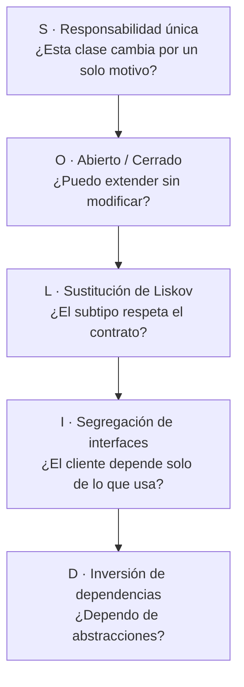
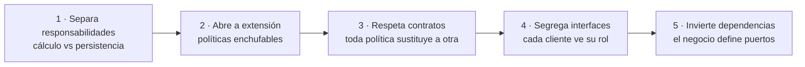

# Principios SOLID

SOLID es el acrónimo de cinco principios de diseño orientado a objetos que reducen el
acoplamiento y aumentan la cohesión. La idea original es de Robert C. Martin y fue
recopilada a principios de los 2000: cada letra nombra un principio independiente, pero los
cinco trabajan juntos como un sistema para que el código sea fácil de leer, fácil de probar
y barato de cambiar.

Si vienes de los [primeros pasos](/docs/getting-started), piensa en SOLID como el
vocabulario que te permite discutir diseño con precisión. Si ya escribes
[clean code](/docs/clean-code), piensa en SOLID como el paso siguiente: ya no se trata solo
de que una función sea legible, sino de cómo las clases y módulos colaboran entre sí a lo
largo de meses y años.

Este artículo explica cada principio con la misma estructura ordenada: qué dice, qué
problema resuelve, cómo se ve cuando lo violas, cómo se ve cuando lo aplicas bien y qué
errores son frecuentes al intentarlo.

## Qué problema resuelve SOLID

Todo sistema suficientemente usado tiende al mismo deterioro: rigidez, fragilidad,
inmovilidad y viscosidad.

- **Rigidez:** un cambio pequeño obliga a tocar muchos archivos.
- **Fragilidad:** un cambio en un módulo rompe otro que parecía no relacionado.
- **Inmovilidad:** no puedes reutilizar una pieza porque viene pegada a otras diez.
- **Viscosidad:** es más fácil hacer el apaño que hacer lo correcto, así que el diseño se
  degrada cada semana.

SOLID ataca esas cuatro enfermedades desde ángulos distintos. Ningún principio por sí solo
salva un proyecto, pero juntos empujan hacia módulos pequeños, contratos explícitos y
dependencias en una sola dirección.

<Callout tone="info" title="SOLID no es una receta dogmática">
  No apliques los cinco principios con la misma intensidad en todas partes. En código exploratorio o
  en un prototipo de dos días, la simplicidad gana. En el núcleo de negocio que vivirá años, SOLID
  paga cada semana. La arquitectura es priorizar dónde ser estricto.
</Callout>

## Mapa general de los cinco principios

Cada letra cubre una escala distinta del diseño:



- **S** mira hacia dentro de una clase: una sola razón para cambiar.
- **O** mira cómo crece el sistema: nuevas variantes sin reescribir lo estable.
- **L** mira la herencia y el polimorfismo: que extender no rompa expectativas.
- **I** mira los contratos: interfaces pequeñas y cohesivas.
- **D** mira la dirección de las dependencias: el negocio manda, los detalles obedecen.

Si solo puedes quedarte con una frase por principio, quédate con estas: una razón para
cambiar, extender sin modificar, sustituir sin sorprender, interfaces pequeñas, depender de
abstracciones.

## Principio de responsabilidad única

Cada módulo debe tener una única razón para cambiar. Una clase con dos responsabilidades
tiene dos motivos distintos para ser modificada, dos tipos de tests, dos lectores
distintos y el doble de probabilidad de conflicto en cada pull request.

La responsabilidad no se mide en número de métodos, sino en ejes de cambio. Pregúntate:
¿quién pide este cambio y por qué? Si la respuesta es a veces negocio y a veces
infraestructura, hay dos responsabilidades mezcladas.

### Síntomas de que violas la responsabilidad única

- Una clase `OrderService` que calcula totales, guarda en base de datos, envía correos y
  genera PDFs.
- Métodos que solo comparten el estado de la clase por accidente, no por cohesión real.
- Tests que necesitan montar base de datos, red y sistema de archivos para probar una regla
  de negocio de tres líneas.
- Cada cambio de formato del informe rompe los tests del cálculo de precios.

### Ejemplo: antes y después

```ts title="pedido-acoplado.ts"
// ❌ Todo mezclado: reglas de negocio + persistencia + notificaciones.
export class OrderService {
  async saveOrder(order: Order): Promise<void> {
    const total = order.lines.reduce((sum, line) => sum + line.price * line.qty, 0);
    const vat = total * 0.21;
    await db.query('INSERT INTO orders ...', [total + vat]);
    await mailer.send(order.customerEmail, `Tu total es ${total + vat}`);
  }
}
```

```ts title="pedido-cohesivo.ts"
// ✅ Cada colaborador tiene una razón para cambiar.
export class OrderTotal {
  static calculate(order: Order): number {
    const net = order.lines.reduce((sum, line) => sum + line.price * line.qty, 0);
    return net * (1 + VAT_RATE);
  }
}

export class OrderRepository {
  save(total: number): Promise<void> {
    return db.query('INSERT INTO orders ...', [total]);
  }
}

export class OrderNotifier {
  notify(email: string, total: number): Promise<void> {
    return mailer.send(email, `Tu total es ${total}`);
  }
}
```

El primer diseño obliga a tocar `OrderService` si cambia el IVA, la tabla SQL o el texto del
correo. El segundo permite cambiar cada eje por separado y probar el cálculo sin mocks de
red ni de base de datos.

### Cómo aplicarlo sin sobrediseñar

No crees una clase por método desde el día uno. Empieza con una clase honesta y extrae un
colaborador cuando veas uno de estos disparadores: el archivo supera lo que puedes leer de
un vistazo, los imports mezclan dominios distintos o un cambio te obliga a entender dos
mundos a la vez. Extraer tarde y con un motivo real es mejor que fragmentar pronto por miedo.

<Callout tone="tip" title="Regla práctica">
  Si no puedes describir lo que hace la clase en una frase sin usar la palabra «y», probablemente
  tiene más de una responsabilidad.
</Callout>

## Principio de abierto/cerrado

Las entidades deben estar abiertas a la extensión y cerradas a la modificación. Cuando
llega una variante nueva, deberías poder añadirla creando código nuevo, no editando el
código estable que ya funciona y ya está probado.

El enemigo típico es la cadena de condicionales que crece con cada requisito: `if`
para tarjeta, `else if` para transferencia, `else if` para billetera. Cada variante nueva
toca la misma función y pone en riesgo a todas las anteriores.

### Síntomas de que violas el principio abierto y cerrado

- Un `switch` gigante que cada sprint gana un caso nuevo.
- Miedo a tocar una función central porque «todo pasa por ahí».
- Duplicar una función entera para no romper la original.
- El historial de git muestra que el mismo archivo cambia por motivos totalmente distintos.

### Ejemplo: estrategia en lugar de condicionales

```ts title="descuentos-cerrados.ts"
// ❌ Cada campaña nueva obliga a modificar esta función.
export function discountFor(type: string, total: number): number {
  if (type === 'black-friday') return total * 0.8;
  if (type === 'socio') return total * 0.9;
  return total;
}
```

```ts title="descuentos-abiertos.ts"
// ✅ Añadir una campaña es añadir una clase, no editar las existentes.
export type DiscountPolicy = {
  appliesTo: (code: string) => boolean;
  apply: (total: number) => number;
};

export const discountPolicies: DiscountPolicy[] = [
  { appliesTo: (code) => code === 'black-friday', apply: (total) => total * 0.8 },
  { appliesTo: (code) => code === 'socio', apply: (total) => total * 0.9 },
];

export function discountFor(code: string, total: number): number {
  const policy = discountPolicies.find((item) => item.appliesTo(code));
  return policy ? policy.apply(total) : total;
}
```

La composición y el polimorfismo sustituyen al condicional creciente. El punto de extensión
queda explícito: la lista de políticas. Los tests de cada campaña viven junto a su
política y no se rompen entre sí.

### Cuándo no forzar la abstracción

Si solo hay dos variantes y no se espera una tercera, un condicional claro es mejor que una
jerarquía prematura. Aplica abierto y cerrado cuando veas el tercer caso asomando o cuando
el cambio venga de actores distintos: por ejemplo, el equipo de marketing añade campañas
mientras el equipo de pagos mantiene el cálculo base.

## Principio de sustitución de Liskov

Un subtipo debe poder reemplazar a su tipo base sin romper el contrato: precondiciones
iguales o más débiles, postcondiciones iguales o más fuertes, sin sorpresas laterales.

Dicho en lenguaje cotidiano: si tu código espera un `Pájaro` que vuela, no le pases un
`Pingüino` que lanza una excepción al volar. El error no está en el pingüino, sino en haber
modelado mal la jerarquía.

### Síntomas de que violas la sustitución de Liskov

- Métodos que lanzan `throw new Error('No soportado')` en algunas subclases.
- Subclases que exigen más que la base: más parámetros obligatorios, orden concreto,
  estado previo oculto.
- Tests que pasan con la clase base pero fallan con la subclase usando el mismo escenario.
- Comentarios del tipo «no uses esta subclase aquí porque rompe tal cosa».

### Ejemplo: el cuadrado no es un rectángulo mutable

```ts title="liskov-roto.ts"
// ❌ Square rompe la expectativa de Rectangle: ancho y alto ya no son independientes.
export class Rectangle {
  constructor(
    public width: number,
    public height: number,
  ) {}
  setWidth(value: number): void {
    this.width = value;
  }
  area(): number {
    return this.width * this.height;
  }
}

export class Square extends Rectangle {
  override setWidth(value: number): void {
    this.width = value;
    this.height = value;
  }
}
```

```ts title="liskov-respetado.ts"
// ✅ Contratos pequeños e inmutables: nadie promete lo que no puede cumplir.
export type Shape = {
  area: () => number;
};

export function rectangle(width: number, height: number): Shape {
  return { area: () => width * height };
}

export function square(side: number): Shape {
  return { area: () => side * side };
}
```

La segunda versión elimina la herencia problemática y la sustituye por un contrato mínimo
que ambas figuras sí pueden cumplir. Cuando la herencia te obliga a mentir, prefiere
composición o contratos más estrechos.

<Callout tone="warning" title="Herencia frágil">
  La herencia comparte mucho más que métodos: comparte expectativas. Si una subclase necesita
  desactivar comportamiento heredado, la jerarquía está invertida o sobra.
</Callout>

## Principio de segregación de interfaces

Es mejor tener varias interfaces específicas que una sola interfaz general. Un cliente no
debería depender de métodos que no usa, porque cada método innecesario es un motivo de
recompilación, de retest y de confusión.

Este principio brilla en equipos grandes: una interfaz gorda obliga a todos los clientes a
seguir el ritmo del miembro que más cambia.

### Síntomas de que violas la segregación de interfaces

- Implementaciones con métodos vacíos o que lanzan «no implementado».
- Cambiar un método para el cliente A rompe el despliegue del cliente B que ni lo usaba.
- Interfaces con prefijos por rol: `printForAdmin`, `printForGuest`, `scanForAdmin`.
- Mocks enormes en tests que solo ejercitan un método de diez.

### Ejemplo: interfaces por rol

```ts title="interfaz-gorda.ts"
// ❌ El lector simple paga el coste de imprimir, escanear y enviar por fax.
export type AllInOnePrinter = {
  print: (doc: string) => void;
  scan: (doc: string) => void;
  fax: (doc: string) => void;
};
```

```ts title="interfaces-segregadas.ts"
// ✅ Cada cliente depende solo de lo que realmente usa.
export type Printer = {
  print: (doc: string) => void;
};

export type Scanner = {
  scan: (doc: string) => void;
};

export class SimplePrinter implements Printer {
  print(doc: string): void {
    console.log(`Imprimiendo ${doc}`);
  }
}

export class OfficeMachine implements Printer & Scanner {
  print(doc: string): void {
    console.log(`Imprimiendo ${doc}`);
  }
  scan(doc: string): void {
    console.log(`Escaneando ${doc}`);
  }
}
```

Segregar no significa pulverizar: dos o tres métodos cohesivos por interfaz suele ser el
punto dulce. Si una interfaz cabe en una línea y su nombre describe un rol, vas bien.

## Principio de inversión de dependencias

Los módulos de alto nivel no deben depender de los de bajo nivel; ambos deben depender de
abstracciones. La lógica de negocio define qué necesita y la infraestructura se adapta,
nunca al revés.

Sin este principio, tu dominio acaba importando detalles de SQL, de HTTP o del framework.
Con él, puedes probar el negocio sin base de datos y cambiar de proveedor sin reescribir
reglas.

### Síntomas de que violas la inversión de dependencias

- `import { PostgresClient } from './infra'` dentro de una entidad de dominio.
- No puedes probar un caso de uso sin levantar contenedores.
- Cambiar de librería de correo obliga a editar servicios de negocio.
- La carpeta de dominio conoce nombres de tablas, URLs y claves de API.

### Ejemplo: el dominio define el puerto

```ts title="dependencia-directa.ts"
// ❌ El caso de uso conoce el detalle concreto.
import { PostgresOrders } from './postgres-orders';

export class Checkout {
  async run(order: Order): Promise<void> {
    await new PostgresOrders().save(order);
  }
}
```

```ts title="dependencia-invertida.ts"
// ✅ El caso de uso depende de una abstracción que la infraestructura implementa.
export type OrderStore = {
  save: (order: Order) => Promise<void>;
};

export class Checkout {
  constructor(private readonly store: OrderStore) {}

  run(order: Order): Promise<void> {
    return this.store.save(order);
  }
}
```

Este giro es la puerta de entrada a la [arquitectura hexagonal](/docs/c4-model#componentes):
el núcleo expone puertos y los adaptadores los implementan. En los diagramas de
[componentes](/docs/c4-model#componentes) verás exactamente estas flechas apuntando hacia
dentro, hacia el negocio.

<Callout tone="tip" title="Inyección sin magia">
  No necesitas un contenedor de inyección desde el día uno. Pasar dependencias por constructor y
  componer en un único punto de entrada ya es inversión de dependencias.
</Callout>

## Cómo se combinan los cinco principios

Ningún principio vive solo. Un flujo típico de refactoring aplica los cinco en cadena:



Imagina un checkout completo: `OrderTotal` calcula con responsabilidad única, las campañas
de descuento se añaden por extensión sin tocar el cálculo, cada campaña sustituye a
cualquier otra porque respeta el mismo contrato, la tienda web solo ve la interfaz de
cobro mientras el almacén solo ve la de preparación, y todo el caso de uso depende de
puertos que en producción implementa Postgres y en tests implementa memoria.

Cuando ese encaje ocurre, los [nombres explican](/docs/clean-code) por sí solos, las
[funciones son pequeñas](/docs/clean-code) de forma natural y el sistema admite cambios
semanales sin miedo.

## Errores comunes al aplicar SOLID

- **Sobreingeniería precoz:** crear diez interfaces para un CRUD que solo tiene un cliente.
  Empieza concreto y abstrae ante el segundo o tercer caso real.
- **Confundir capas con principios:** mover código de carpeta no reduce acoplamiento si las
  dependencias siguen apuntando al detalle. Lo que importa es la dirección de los imports.
- **Testear implementación en lugar de contrato:** si tus tests conocen clases concretas en
  vez de puertos, cada refactoring legítimo romperá tests legítimos.
- **Aplicar Liskov solo a clases:** también vale para APIs, eventos y esquemas. Si la
  versión 2 de un endpoint exige más y promete menos que la versión 1, rompe Liskov aunque
  no haya herencia.
- **Interfaces espejo de la base de datos:** segregar no sirve si cada interfaz replica una
  tabla. Diseña desde las necesidades del cliente, no desde el esquema.

## Checklist para tu próxima pull request

Revisa esta lista antes de pedir revisión y enlázala en tu plantilla de PR si ayuda:

- Cada clase nueva se describe en una frase sin usar «y».
- Ninguna función estable se modificó para añadir una variante: se añadió código nuevo.
- Toda subclase o implementación pasa los tests escritos contra el contrato base.
- Ningún cliente importa métodos que no usa; los mocks de test son pequeños.
- El dominio no importa infraestructura; las dependencias entran por constructor.
- Los cambios de negocio se prueban sin base de datos ni red.

Si fallan dos o más puntos, la PR no está mal: simplemente revela dónde el diseño pide una
extracción o una abstracción. SOLID funciona mejor como guía de conversación en revisión
que como examen antes de commitear.

## Para seguir profundizando

- Consolida la base con las ideas de [clean code](/docs/clean-code) y los hábitos de
  [primeros pasos](/docs/getting-started).
- Baja al detalle visual con el [modelo C4](/docs/c4-model#componentes): contexto,
  contenedores y componentes son el mapa donde viven tus puertos y adaptadores.
- Practica hoy: elige una clase de tu proyecto que mezcle dos ejes de cambio, extrae un
  colaborador, define su interfaz mínima e invierte la dependencia. Mañana repite con otra.

<Callout tone="info" title="Lectura recomendada">
  Los principios cobran todo su sentido cuando los ves en un sistema real durante meses. Vuelve a
  este artículo después de tu próximo refactoring grande: cada relectura revela un matiz que la
  prisa ocultó la primera vez.
</Callout>
