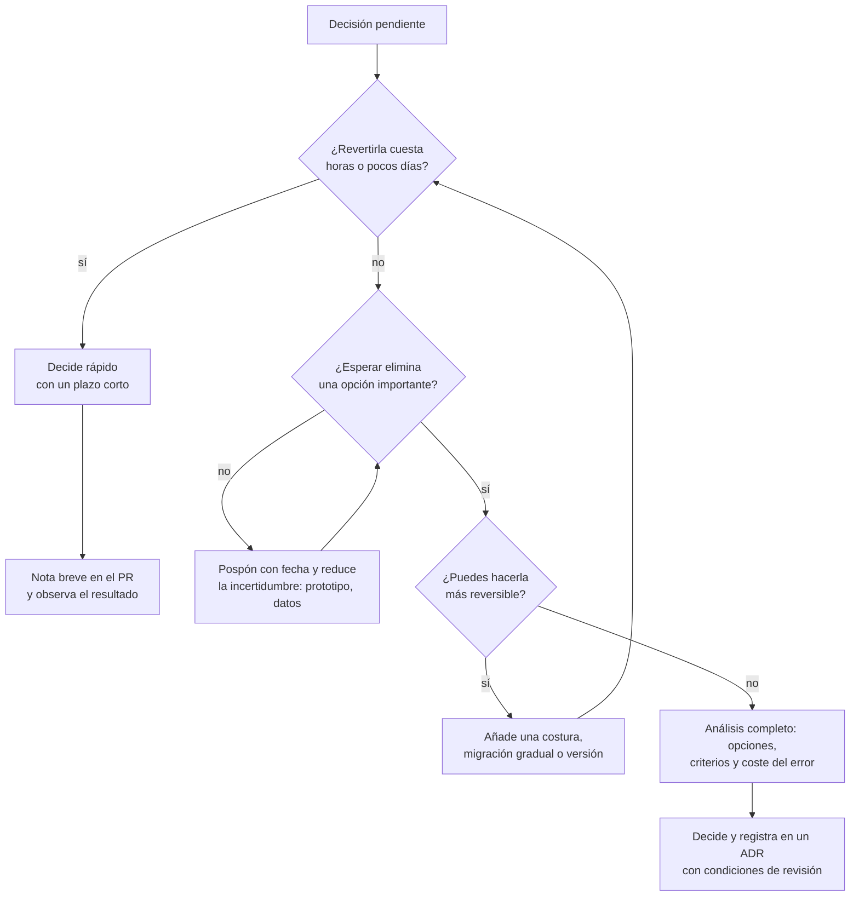
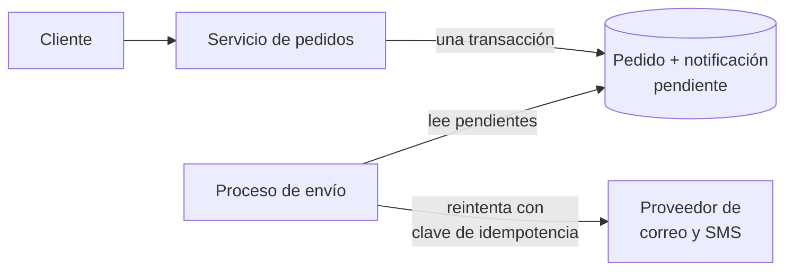

# Trade-offs y toma de decisiones en arquitectura

Seguro que lo has vivido: una reunión de una hora para elegir entre una cola y una llamada HTTP
termina con la opción de quien habló más alto, o con la frase «hagámoslo como en mi anterior
empresa». Tres meses después nadie recuerda por qué se eligió, y la discusión vuelve a empezar.
El problema no es la falta de un buen formato para documentar la decisión; es que **la decisión
nunca se razonó**: no hubo opciones reales, ni criterios, ni una idea de cuánto costaba
equivocarse.

**Un trade-off es lo que entregas a cambio de lo que eliges: toda decisión de arquitectura
compra unas propiedades del sistema pagando con otras, y decidir bien es hacer ese intercambio
de forma explícita y proporcional al coste de equivocarte.**

Este artículo trata de cómo llegar a la decisión; el de [ADR](/docs/adr) explica cómo
registrarla, y aquí no repetimos su plantilla.

<Callout tone="info" title="Fecha de corte">
  Las citas y fechas se comprobaron en octubre de 2026 contra las fuentes que aparecen al final.
  Cuando solo pude acceder a una fuente secundaria, el texto lo indica y la idea va parafraseada.
</Callout>

## No hay mejores prácticas, hay trade-offs

Mark Richards y Neal Ford formularon en _Fundamentals of Software Architecture_ (O'Reilly, 2020)
lo que llaman la primera ley de la arquitectura de software: _everything in software architecture
is a trade-off_, todo en arquitectura es un compromiso. La acompaña un corolario: si crees haber
encontrado algo que no lo es, lo más probable es que todavía no hayas identificado el coste. Su
segunda ley completa la idea: _why is more important than how_, el porqué importa más que el
cómo. Richards lo repitió en el podcast de InfoQ de septiembre de 2021, al presentar su siguiente
libro.

Ese libro, _Software Architecture: The Hard Parts_ (Ford, Richards, Sadalage y Dehghani, O'Reilly,
2021), lleva la idea al extremo. Según la descripción del libro, en arquitectura no hay
decisiones fáciles, sino «partes difíciles»: problemas sin mejores prácticas que te obligan a
elegir entre compromisos.

Esto no significa que todo valga. Significa que una práctica es buena **para un contexto**, y que
la pregunta útil nunca es «¿qué es lo mejor?», sino «¿qué gano, qué pierdo y me compensa aquí?».
Una frase como «los microservicios escalan mejor» es incompleta hasta que dices qué pagas por ello:
red, consistencia eventual, operación, depuración distribuida. Lo vemos con detalle en
[monolito frente a microservicios](/docs/monolito-vs-microservicios).

| Afirmación sin trade-off              | La misma afirmación con su coste                                            |
| ------------------------------------- | --------------------------------------------------------------------------- |
| «Usa siempre caché»                   | Menos latencia y carga a cambio de datos que pueden estar obsoletos         |
| «Normaliza la base de datos»          | Integridad y una sola fuente de verdad a cambio de más uniones en lectura   |
| «No repitas código»                   | Un solo lugar para cambiar a cambio de acoplar a quienes comparten la pieza |
| «Separa en servicios independientes»  | Despliegue autónomo a cambio de red, consistencia eventual y más operación  |
| «Escribe tu propia solución a medida» | Control total a cambio de mantenerla tú para siempre                        |

## De preferencias vagas a criterios explícitos

La mayoría de los debates se atascan porque cada persona optimiza un criterio distinto sin
decirlo. Quien defiende la cola piensa en resiliencia; quien defiende la llamada directa piensa en
simplicidad operativa. Los dos tienen razón y ninguno lo sabe. El primer trabajo del arquitecto es
**poner los criterios sobre la mesa** antes que las opciones.

Un criterio útil es observable. «Que sea escalable» no lo es; «soportar el triple del pico actual
de pedidos sin que el p95 del checkout empeore» sí. Es la misma técnica de los escenarios de
[atributos de calidad](/docs/atributos-de-calidad): estímulo, entorno y respuesta medible.

| Preferencia vaga          | Criterio explícito                                                            | Cómo lo compruebas                      |
| ------------------------- | ----------------------------------------------------------------------------- | --------------------------------------- |
| «Que sea escalable»       | Soporta el triple del pico actual sin degradar el p95 del flujo crítico       | Prueba de carga antes de producción     |
| «Que sea mantenible»      | Un cambio típico de regla toca un solo módulo y se prueba sin infraestructura | Revisión de los últimos cambios reales  |
| «Que sea seguro»          | Los datos personales nunca salen de la región exigida por la norma            | Regla de despliegue y auditoría         |
| «Que sea rápido de hacer» | En producción antes de la fecha comprometida con negocio                      | Plan con hitos y fecha                  |
| «Que no nos ate»          | Cambiar de proveedor cuesta semanas, no meses                                 | Ensayo de salida o costura identificada |

### Restricciones y criterios no son lo mismo

Antes de pesar nada, separa dos cosas que suelen mezclarse:

- **Restricciones**: condiciones de pasa o no pasa. Una norma que obliga a guardar datos en una
  región, un presupuesto con techo, una fecha que no se mueve, un equipo que no sabe operar cierta
  tecnología y no tiene tiempo de aprender. Una opción que viola una restricción no se puntúa: se
  descarta.
- **Criterios**: propiedades que quieres en mayor o menor grado. Latencia, coste, flexibilidad,
  tiempo de entrega. Estos sí se pesan y se comparan.

### Pesa los criterios contra tu contexto

Los mismos criterios pesan distinto según quién decide. No hay pesos correctos en abstracto: hay
pesos coherentes con el negocio, el equipo y el momento.

| Criterio                   | Producto buscando encaje en el mercado | Plataforma regulada (pagos, salud) | Producto consolidado con varios equipos |
| -------------------------- | -------------------------------------- | ---------------------------------- | --------------------------------------- |
| Tiempo hasta producción    | Muy alto                               | Medio                              | Medio                                   |
| Coste operativo            | Alto: el equipo es pequeño             | Medio                              | Medio                                   |
| Trazabilidad y auditoría   | Bajo                                   | Restricción, no criterio           | Medio                                   |
| Autonomía entre equipos    | Bajo: hay un solo equipo               | Medio                              | Muy alto                                |
| Flexibilidad a largo plazo | Bajo: el producto aún puede cambiar    | Alto                               | Alto                                    |

Fíjate en la fila de trazabilidad: en un contexto regulado deja de ser algo que se pesa y pasa a
ser una restricción. Ese cambio de categoría es, en sí mismo, una decisión que conviene hacer
explícita.

## Reversibilidad: puertas de un sentido y de doble sentido

La metáfora más útil para graduar el esfuerzo viene de la carta a los accionistas de Amazon
correspondiente a 2015, publicada en 2016. Jeff Bezos distingue dos tipos de decisiones:

- **Tipo 1, _one-way doors_**: decisiones de consecuencias grandes e irreversibles o casi
  irreversibles. Si cruzas la puerta y no te gusta lo que hay al otro lado, no puedes volver.
  Estas, dice, deben tomarse de forma metódica, con cuidado, despacio y consultando.
- **Tipo 2, _two-way doors_**: decisiones que se pueden cambiar. Si te equivocas, no vives mucho
  tiempo con las consecuencias: vuelves a abrir la puerta y regresas. Estas deberían tomarlas
  rápido personas o grupos pequeños con buen criterio.

La parte que más se olvida es la advertencia que sigue: según la carta, a medida que una
organización crece tiende a aplicar el proceso pesado del tipo 1 a casi todo, incluidas muchas
decisiones del tipo 2, y el resultado es lentitud, aversión al riesgo sin reflexión, poca
experimentación y menos invención. Una nota al pie añade el caso contrario: las empresas que usan
el proceso ligero para decisiones del tipo 1 desaparecen antes de hacerse grandes.

En arquitectura, la reversibilidad rara vez es binaria. Es un coste: cuánto tiempo, dinero y
riesgo supone deshacer la decisión dentro de seis meses.

| Normalmente reversible (doble sentido)           | Normalmente difícil de revertir (un sentido)             |
| ------------------------------------------------ | -------------------------------------------------------- |
| Librería interna detrás de una interfaz propia   | Formato de datos o contrato de API que consumen terceros |
| Configuración de reintentos o tiempos de espera  | Modelo de datos compartido por varios servicios          |
| Herramienta de build o de lint                   | Lenguaje principal de un sistema grande                  |
| Estructura de carpetas de un módulo              | Partir una base de datos en varias, o fusionarlas        |
| Proveedor accesible a través de un puerto propio | Proveedor cuyo SDK está repartido por todo el código     |

### Cómo volver reversible una decisión

A menudo la mejor jugada no es analizar más una puerta de un sentido, sino **convertirla en una de
doble sentido**:

- **Introduce una costura.** Un puerto propio delante del proveedor, como en la
  [arquitectura hexagonal](/docs/arquitectura-hexagonal), convierte «elegir proveedor» en «elegir
  el primer adaptador».
- **Migra de forma gradual.** Hacer convivir lo viejo y lo nuevo, con tráfico que se desplaza poco
  a poco, mantiene abierta la vuelta atrás hasta el final.
- **Cambia esquemas en dos pasos.** Primero amplías (añades sin quitar), luego contraes cuando ya
  nadie usa lo antiguo. Entre ambos pasos, revertir es barato.
- **Versiona contratos y activa con interruptores.** Una versión nueva no rompe a quien ya depende
  de ti, y una bandera de configuración separa desplegar de activar.

Cada una de estas técnicas tiene su propio coste. Pagarlo tiene sentido cuando el coste de
equivocarte es alto y la incertidumbre también.

## El último momento responsable

Mary y Tom Poppendieck recogen en _Lean Software Development: An Agile Toolkit_ (Addison-Wesley, 2003) la idea de **retrasar el compromiso hasta el último momento responsable**: el momento en que
no decidir elimina una alternativa importante. La definición procede de la entrada de Jeff Atwood
que cita el pasaje del libro; no pude consultar el texto original.

La idea se malinterpreta en dos direcciones:

- **No es procrastinar.** Esperar solo tiene valor si mientras tanto **aprendes** algo: datos de
  uso, un prototipo, una prueba de carga, la respuesta de un proveedor. Esperar sin reducir
  incertidumbre es perder tiempo.
- **No es «lo más tarde posible».** Es lo más tarde que todavía es responsable. Si retrasar la
  elección de base de datos te obliga a escribir dos veces la capa de persistencia, ya pasaste ese
  momento.

Una forma práctica de aplicarlo: cuando decidas posponer, escribe **qué información esperas
obtener, cómo la obtendrás y en qué fecha decidirás aunque no la tengas**. Sin fecha, posponer se
convierte en no decidir, y no decidir también es una decisión: la que toma el código por
acumulación.

## Un mapa para graduar el esfuerzo

Reversibilidad y último momento responsable se combinan en un flujo sencillo. Su propósito es
evitar los dos fallos que describe Bezos: el análisis pesado de lo trivial y la ligereza con lo
irreversible.

## Sesgos que distorsionan las decisiones

Los criterios explícitos existen, en buena parte, para protegerte de tu propio juicio. Estos son
los sesgos que más aparecen en decisiones técnicas, con un ejemplo y un antídoto para cada uno.

### Desarrollo guiado por el currículum

Elegir una tecnología porque quieres tenerla en tu experiencia, no porque el problema la pida.
**Ejemplo:** un equipo de tres personas con un monolito de tráfico modesto propone un orquestador
de contenedores con malla de servicios. Nadie lo ha operado y no hay un problema de despliegue que
lo justifique. **Antídoto:** pregunta qué problema concreto resuelve hoy y quién lo operará cuando
falle de madrugada. Si la respuesta es «nadie todavía», es una inversión en aprendizaje, y hay que
presentarla como tal.

### Coste hundido

Seguir invirtiendo en algo por lo que ya se gastó, no por lo que rendirá. Arkes y Blumer
describieron este efecto en 1985 como la mayor tendencia a continuar un proyecto una vez invertido
dinero, esfuerzo o tiempo. **Ejemplo:** un framework interno con dieciocho meses de trabajo
consume la mitad del equipo en mantenimiento, pero «ya invertimos demasiado como para dejarlo».
**Antídoto:** evalúa solo costes y beneficios futuros. La pregunta es: si empezáramos hoy, con lo
que sabemos, ¿lo elegiríamos?

### Anclaje en la primera opción

Tversky y Kahneman describieron en 1974 el anclaje: las estimaciones se ajustan a partir de un
valor inicial y quedan sesgadas hacia él. **Ejemplo:** en la reunión, la primera propuesta es
«usemos eventos para todo», y las demás se discuten como variaciones de esa, en lugar de como
alternativas. **Antídoto:** que cada persona escriba sus opciones antes de discutir, y que la lista
incluya siempre «no hacer nada» y la opción aburrida.

### La herramienta nueva y brillante

Sobrevalorar lo nuevo porque es nuevo. **Ejemplo:** adoptar una base de datos lanzada hace pocos
meses tras leer un artículo entusiasta, sin que nadie conozca sus modos de fallo. **Antídoto:** Dan
McKinley propuso en su ensayo de 2015 _Choose Boring Technology_ imaginar que cada empresa tiene
unas pocas «fichas de innovación»: capacidad limitada para hacer algo nuevo o difícil. Prefiere
tecnología bien entendida, con modos de fallo conocidos, y gasta las fichas solo donde te
diferencian.

### Sesgo del statu quo

El reverso del anterior: preferir lo que ya existe porque existe. Samuelson y Zeckhauser lo
documentaron en 1988: ante decisiones reales, las personas se quedan con la opción vigente con más
frecuencia de lo que justificaría el análisis. **Ejemplo:** se mantiene un despliegue manual de
tres horas porque «siempre ha funcionado», sin contar las horas ni los incidentes que cuesta.
**Antídoto:** trata el statu quo como una opción más de la tabla, con sus costes escritos. Si no
hacer nada sale gratis en tu análisis, el análisis está incompleto.

## Un método reutilizable

Ningún método sustituye al juicio, pero uno explícito hace visibles los saltos de razonamiento.
Este sirve para cualquier decisión que el mapa anterior haya clasificado como cara o difícil de
revertir.

1. **Enmarca el problema.** Escribe en dos o tres frases qué duele hoy y por qué ahora. Si no
   puedes, todavía no hay decisión que tomar.
2. **Lista las restricciones.** Normas, presupuesto, fechas, capacidades del equipo. Son filtros,
   no criterios.
3. **Enumera al menos dos opciones reales.** Incluye siempre no hacer nada y la opción aburrida.
   Una opción que nadie defendería en serio es un hombre de paja, no una alternativa.
4. **Define los criterios y sus pesos antes de puntuar.** Si los defines después, estarás
   racionalizando una preferencia.
5. **Evalúa cada opción contra cada criterio.** Con puntuaciones o con prosa, pero con el mismo
   rigor para todas. Anota qué compra y qué cuesta cada una.
6. **Haz explícitos la reversibilidad y el coste del error.** Para la opción favorita: ¿qué
   señal te diría que te equivocaste, cuándo la verías y cuánto costaría volver atrás?
7. **Decide y regístralo.** El [ADR](/docs/adr) guarda el contexto, las opciones y las
   consecuencias. Añade las **condiciones de revisión**: los hechos que, si ocurren, reabren la
   decisión. Cuando una condición es medible, conviértela en una
   [fitness function](/docs/fitness-functions).

Sobre las puntuaciones: son una herramienta de conversación, no un oráculo. Si cambiar un peso en
un punto cambia la opción ganadora, la decisión es frágil, y lo que hay que discutir son los
pesos, no los números.

## Pares de trade-offs habituales

Muchas decisiones se reducen a una de estas tensiones. Reconocerla te ahorra la mitad del debate,
porque deja claro qué se está comprando y con qué se paga.

| Tensión                                    | Lo que compras al inclinarte por el primero            | Lo que pagas                                                 | Pregunta que suele resolverla                               |
| ------------------------------------------ | ------------------------------------------------------ | ------------------------------------------------------------ | ----------------------------------------------------------- |
| Consistencia frente a disponibilidad       | Lecturas siempre actualizadas                          | Rechazar operaciones durante una partición de red            | ¿Qué es peor para el usuario: un error o un dato viejo?     |
| Latencia frente a coste                    | Respuestas rápidas: réplicas, cachés, más capacidad    | Infraestructura y complejidad de invalidación                | ¿Cuánto vale cada milisegundo para este flujo concreto?     |
| Acoplamiento frente a duplicación          | Un único lugar donde cambiar la lógica                 | Quienes comparten la pieza tienen que coordinar cada cambio  | ¿Cambian las dos copias por las mismas razones?             |
| Velocidad de entrega frente a flexibilidad | Llegar antes al mercado y aprender antes               | Deuda que limitará cambios futuros                           | ¿Sobrevivirá este código lo bastante como para que importe? |
| Construir frente a comprar                 | Control y ajuste exacto a tu dominio                   | Mantenimiento perpetuo y coste de oportunidad                | ¿Te diferencia esta pieza frente a la competencia?          |
| Sincronía frente a asincronía              | Simplicidad y respuesta inmediata al usuario           | Disponibilidad ligada a la del servicio llamado              | ¿Necesita el usuario el resultado para continuar?           |
| Estandarizar frente a autonomía            | Menos tecnologías que operar y conocimiento compartido | Equipos atados a herramientas que no encajan con su problema | ¿Cuánto cuesta operar una tecnología más?                   |

La primera fila es el terreno de [CAP y PACELC](/docs/cap-pacelc), que precisa cuándo existe
realmente esa tensión y qué otra aparece aunque no haya particiones. La tercera se desarrolla en
[acoplamiento y cohesión](/docs/acoplamiento-cohesion). La cuarta, en
[deuda técnica y evolución](/docs/deuda-tecnica-evolucion).

## Ejemplo: notificaciones síncronas o asíncronas

Un caso hipotético pero típico, de principio a fin.

### Contexto

Una tienda en línea confirma el pedido y, en la misma petición, llama por HTTP al proveedor de
correo y SMS para avisar al cliente. Cuando el proveedor va lento, el checkout va lento; cuando
falla, el pedido se guarda pero el cliente ve un error y a veces paga dos veces. El equipo tiene
cinco personas, opera ya una base PostgreSQL y no tiene un broker de mensajería en producción. En
dos meses llega la temporada alta.

**Restricciones:** no se contrata personal nuevo; los datos del cliente no pueden salir de la
región actual.

### Opciones

- **A. Mantener la llamada síncrona** con tiempo de espera corto y reintentos. Es la opción de no
  cambiar la arquitectura.
- **B. Bandeja de salida transaccional** (_outbox_): el pedido y un registro de «notificación
  pendiente» se guardan en la misma transacción de PostgreSQL; un proceso aparte lee esa tabla y
  llama al proveedor.
- **C. Introducir un broker de mensajería gestionado** y publicar un evento de pedido confirmado.

### Criterios y evaluación

Pesos de 1 a 3 acordados antes de puntuar; puntuaciones de 1 (malo) a 3 (bueno).

| Criterio                             | Peso | A. Síncrona | B. Outbox | C. Broker |
| ------------------------------------ | ---- | ----------- | --------- | --------- |
| Checkout independiente del proveedor | 3    | 1           | 3         | 3         |
| Garantía de que el aviso se envía    | 2    | 1           | 3         | 3         |
| Coste operativo nuevo                | 2    | 3           | 2         | 1         |
| Tiempo hasta producción              | 2    | 3           | 2         | 1         |
| Reversibilidad                       | 1    | 3           | 3         | 2         |
| **Total ponderado**                  |      | **20**      | **26**    | **21**    |

La opción A no resuelve el problema: un tiempo de espera corto reduce la lentitud, pero el
checkout sigue fallando cuando falla el proveedor. La C resuelve lo mismo que la B, pero añade una
pieza nueva que el equipo tendría que aprender a operar justo antes de la temporada alta. Si se
sube el peso de «coste operativo» a 3, la B sigue ganando: la decisión no es frágil.

### Decisión y consecuencias

**Decisión:** adoptar la bandeja de salida transaccional (B).

Consecuencias que se aceptan a sabiendas:

- **El aviso deja de ser inmediato.** Llega segundos después de confirmar el pedido. Negocio lo
  acepta porque el cliente ya ve la confirmación en pantalla.
- **La entrega pasa a ser al menos una vez.** Si el proceso cae después de enviar y antes de
  marcar el registro, el aviso puede repetirse. Se mitiga con una clave de idempotencia por
  notificación.
- **Aparece una métrica nueva que vigilar:** la antigüedad del registro pendiente más viejo. Si
  crece, algo está atascado.
- **La puerta queda abierta.** La tabla de pendientes puede alimentar más adelante un broker sin
  tocar el checkout, así que la opción C sigue disponible.

**Condiciones de revisión:** se reabre la decisión si más de dos consumidores necesitan el mismo
evento, si el volumen hace que la tabla de pendientes compita con las escrituras de pedidos, o si
la antigüedad del pendiente más viejo supera el umbral acordado de forma sostenida. Todo esto va
al ADR.

## Cuándo un análisis profundo vale la pena y cuándo no

El método anterior tiene un coste: horas de varias personas. Aplicarlo a todo es exactamente el
fallo que describe la carta de Bezos.

| Analiza a fondo cuando                                                  | Decide rápido y sigue cuando                              |
| ----------------------------------------------------------------------- | --------------------------------------------------------- |
| Revertir cuesta meses o implica migrar datos                            | Revertir cuesta horas o un par de días                    |
| La decisión fija un contrato que consumen otros equipos o terceros      | El impacto queda dentro de un módulo y de un equipo       |
| Compromete dinero a largo plazo: licencias, contratos, personal         | El coste es pequeño y se puede abandonar sin penalización |
| Afecta a un atributo de calidad crítico: seguridad, datos, cumplimiento | Afecta a preferencias de estilo o de herramientas locales |
| Hay desacuerdo real entre personas con buen criterio                    | Hay una opción evidente y nadie la discute                |

Para las decisiones de la derecha, el proceso correcto es ligero: alguien con criterio decide,
deja una nota en el PR y fija cuándo mirará el resultado. Si escribes un ADR para elegir la
librería de fechas, el equipo dejará de leer los ADR que importan.

## Errores frecuentes

- **Una sola opción real.** Si las alternativas eran hombres de paja, no hubo decisión: hubo una
  justificación.
- **Criterios definidos después de elegir.** Es la forma más común de racionalizar una
  preferencia.
- **Tratar todo como irreversible.** Paraliza al equipo y gasta la atención que necesitan las
  decisiones que sí lo son.
- **Tratar lo irreversible como reversible.** Un formato de datos público o un modelo compartido
  parecen pequeños el día que se eligen.
- **Posponer sin fecha.** El último momento responsable se convierte en el último momento.
- **Decidir sin quienes pagarán las consecuencias.** Operación, seguridad o el equipo que consume
  la API ven costes que tú no ves.
- **No escribir las condiciones de revisión.** Sin ellas, nadie sabe cuándo la decisión dejó de
  ser válida.

## Checklist

- [ ] El problema está enmarcado en pocas frases y se sabe por qué hay que decidir ahora.
- [ ] Las restricciones están separadas de los criterios y descartan opciones antes de puntuar.
- [ ] Hay al menos dos opciones reales, y una de ellas es no hacer nada o la opción aburrida.
- [ ] Los criterios son observables y sus pesos se acordaron antes de evaluar.
- [ ] Para cada opción está escrito qué compra y qué cuesta.
- [ ] Se sabe cuánto costaría revertir la decisión y qué señal indicaría que fue un error.
- [ ] El esfuerzo del análisis es proporcional a la reversibilidad, no a la importancia percibida.
- [ ] La decisión está en un ADR con condiciones de revisión concretas.

## Fuentes

Consultadas en octubre de 2026. Los libros de Richards y Ford y de los Poppendieck no se
consultaron directamente: sus ideas se citan a partir de las fuentes secundarias indicadas.

- [Carta a los accionistas de Amazon de 2015 (Jeff Bezos), anexo 99.1 en la SEC](https://www.sec.gov/Archives/edgar/data/1018724/000119312516530910/d168744dex991.htm): decisiones de tipo 1 y tipo 2
- [Podcast de InfoQ con Mark Richards y Neal Ford sobre The Hard Parts (8 de septiembre de 2021)](https://www.infoq.com/podcasts/software-architecture-hard-parts/): las dos leyes, en palabras de Richards
- [Laws of Software Architecture (DevIQ)](https://deviq.com/laws/laws-software-architecture/): enunciado de las leyes y del corolario, fuente secundaria
- [Software Architecture: The Hard Parts en el catálogo de la TUM](https://search.ub.tum.de/vufind/Record/ZDB-30-ORH-068277334): autores, año y descripción del libro
- [The Last Responsible Moment (Jeff Atwood, Coding Horror)](https://blog.codinghorror.com/the-last-responsible-moment/): cita del libro de Mary y Tom Poppendieck
- [Choose Boring Technology (Dan McKinley, 30 de marzo de 2015)](https://mcfunley.com/choose-boring-technology) y [boringtechnology.club](https://boringtechnology.club/)
- [Judgment under Uncertainty: Heuristics and Biases (Tversky y Kahneman, Science, 1974)](https://pubmed.ncbi.nlm.nih.gov/17835457/)
- [The Psychology of Sunk Cost (Arkes y Blumer, 1985)](https://cognition.aau.at/bg/BA/Arkes%20%26%20Blumer%201985.pdf)
- [Status Quo Bias in Decision Making (Samuelson y Zeckhauser, 1988)](https://scholar.harvard.edu/files/rzeckhauser/files/status_quo_bias_in_decision_making.pdf)
